# First-time setup

This page is for the person who installs RivetMSP. It covers the ways to put a new server into service, walks through the browser installer (`/setup/`) step by step, and lists what to do straight after the first sign-in. Everyone else can skip to [Getting started](01-getting-started.md).

| | |
|---|---|
| **Where to find it** | Your RivetMSP address followed by `/setup/`. A brand-new install sends you there on its own. |
| **Who can use it** | Whoever can reach the server before it is set up. There is no sign-in yet and none is needed. The installer switches itself off when you finish. |
| **Turn it on** | Nothing to turn on. A server with no `config.php` file, or with `$config_enable_setup` not yet set to `0` in it, shows the installer. |

## What it's for

RivetMSP is the managed-service-provider edition: service desk, billing, CRM and endpoint management in one application. Setting it up means three things: connect it to an empty database, create the first administrator, and record your company details, language, currency and time zone. The browser installer does all three in about five minutes.

There are four ways to get a running server. They all end in the same state.

| Way | Best for | What it does for you |
|---|---|---|
| **Docker Compose** (`docker compose up -d --build`) | Trying RivetMSP out, or a small self-hosted setup | Starts the web server, PHP, MariaDB and Redis in containers. You then open the browser installer and give it the database host `db`. It does not add TLS: put a reverse proxy with HTTPS in front of it. |
| **`deploy/install.sh`** | A production server on Ubuntu or Debian | Installs the packages, creates the database and database user, sets up the web server, a certificate, a firewall and the scheduled jobs, then runs the command-line setup (`scripts/setup_cli.php`) for you. |
| **Browser installer** (`/setup/`) | Any server where the files, web server and an empty database already exist | The six steps described below. |
| **`scripts/setup_cli.php`** | Scripted installs | The same result as the browser installer, driven by command-line options. See [Install from the command line](#install-from-the-command-line). |

> **Note.** Docker Compose and `deploy/install.sh` need a host this guide's test server does not have, so they are described here from the repository's own instructions (the top-level `README.md` and `deploy/README.md`) and were not run for this guide. The browser installer and the command-line setup were run on a throw-away server.

Before you start the browser installer you need:

- The RivetMSP files on a web server that can run PHP. The installer's **Setup Checks** page requires **PHP 8.5.0 or newer** (see the note under [Step 1](#step-1-check-the-server)).
- An **empty database** and a database user that can create tables in it. The installer does not create the database for you.
- The address you will use to open RivetMSP, ideally a proper host name with HTTPS. RivetMSP stores that host name as its base address, and links in emails are built from it.

## A quick tour

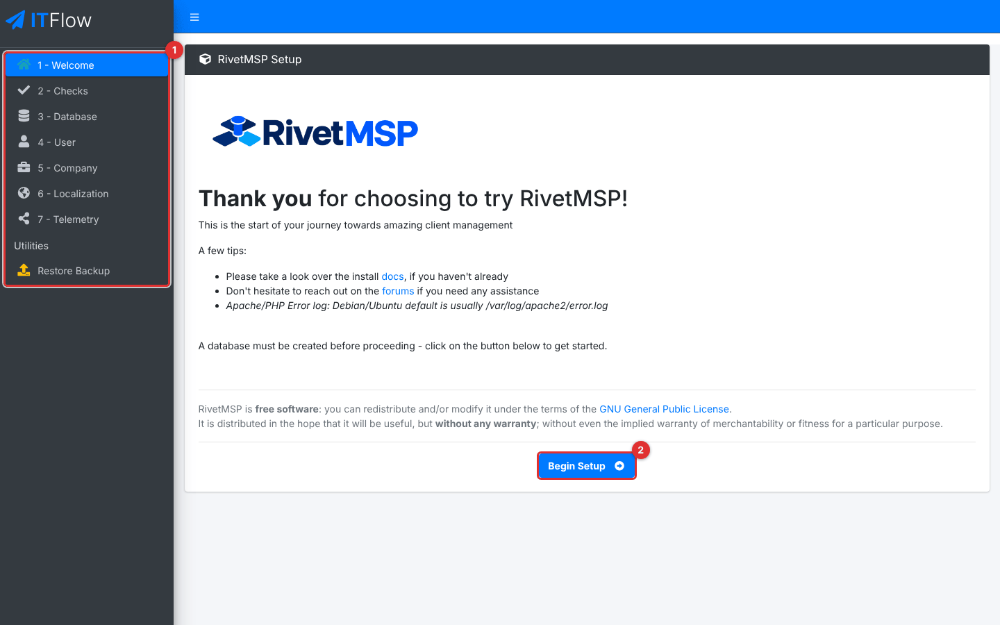

*Figure 1 — The welcome page. (1) The left menu lists the steps. (2) **Begin Setup** starts the checks.*

The left menu reads **1 - Welcome**, **2 - Checks**, **3 - Database**, **4 - User**, **5 - Company**, **6 - Localization** and **7 - Telemetry**. Under **Utilities**, **Restore Backup** is for moving an existing installation onto this server (see [Restore a backup instead](#restore-a-backup-instead)).

> **Note.** The menu numbers and the headings on each page do not agree. The page headings run **Step 1 - Setup Checks** to **Step 6 - Privacy**, and the menu entry for the last page is called **7 - Telemetry** although the page says RivetMSP collects no telemetry. This guide uses the page headings. The top of the menu also still shows the wordmark "ITFlow", a leftover from the software RivetMSP is built on.

You can leave the installer and come back. A step saves its answers when you press its **Next** button. The database step and the first-user step refuse to run a second time, so a finished install cannot be overwritten by mistake.

## Common tasks

### Install with the browser installer

#### Step 1: Check the server

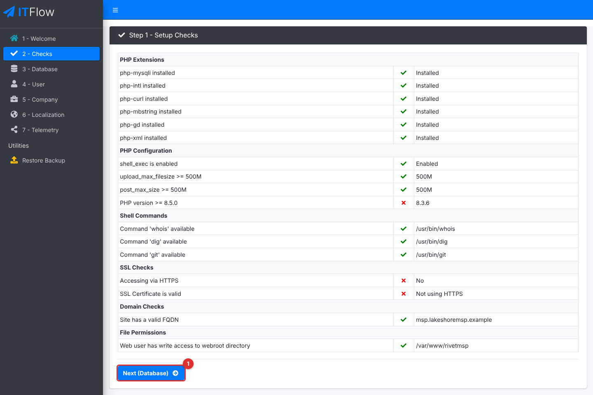

*Figure 2 — Step 1, Setup Checks. This is a test server running PHP 8.3 over plain HTTP, so the PHP version and the two SSL checks show red crosses. Example screen from a throw-away server.*

1. Click **Begin Setup**. The **Setup Checks** table lists what the installer looked at. None of the crosses stops you from continuing, but each one is worth reading.

| Group | What it checks | Why it matters |
|---|---|---|
| **PHP Extensions** | `mysqli`, `intl`, `curl`, `mbstring`, `gd` and `xml` are installed. | RivetMSP needs them. A missing one usually causes errors later. |
| **PHP Configuration** | `shell_exec` is enabled; `upload_max_filesize` and `post_max_size` are at least 500M; PHP is 8.5.0 or newer. | Large uploads and backups need the 500M limits. |
| **Shell Commands** | `whois`, `dig` and `git` are found. | Domain look-ups use `whois` and `dig`. Software updates use `git`. |
| **SSL Checks** | You opened the installer over HTTPS and the certificate is valid. | Sign-in is HTTPS-only by default (see [If sign-in shows an HTTPS message](#if-sign-in-shows-an-https-message)). |
| **Domain Checks** | **Site has a valid FQDN**: the address in your browser is a full host name such as `msp.example.com`, not an IP address or `localhost`, and has no port number. | Links in emails and the client portal are built from this address. |
| **File Permissions** | The web server can write to the web-root folder. | The installer has to write `config.php` there. |

> **Note.** The installer asks for PHP 8.5.0 or newer, and so does the project's `composer.json`. The text in the repository's README and in `deploy/install.sh` still mentions PHP 8.4. Go by the check on this page.

2. Fix what you care about, reload the page to check again, then click **Next (Database)**.

#### Step 2: Connect the database

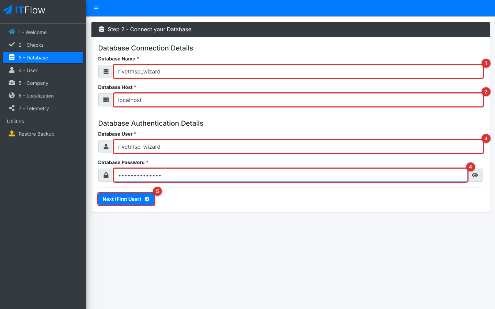

*Figure 3 — Step 2, Connect your Database. (1) **Database Name**. (2) **Database Host**. (3) **Database User**. (4) **Database Password**. (5) **Next (First User)**.*

3. Fill in **Database Name**, **Database Host** (usually `localhost`; with Docker Compose it is `db`), **Database User** and **Database Password**. The eye button shows the password as you type.
4. Click **Next (First User)**.

The installer tests the connection first. If it fails you see the database's own error message and can go back and correct the details. If it works, the installer writes `config.php`, creates every table (about 400, so allow a minute) and generates this installation's encryption key. It also tries to create a key file outside the web root (see [Keep the encryption keys safe](#keep-the-encryption-keys-safe)).

> The database details live in `config.php` after this step. To change them later, edit that file. Running this step a second time does nothing and sends you on to the next step.

Once the database is connected, the welcome page changes: **Begin Setup** is replaced by **Create First User** and **Restore from Backup**.

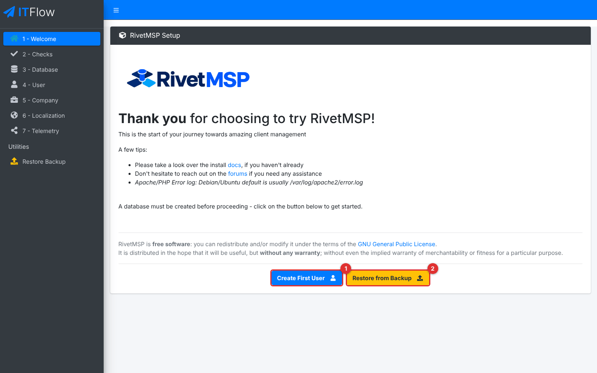

*Figure 4 — The welcome page once a database is connected. (1) **Create First User** continues the installation. (2) **Restore from Backup** replaces it with a backup file.*

#### Step 3: Create the first administrator

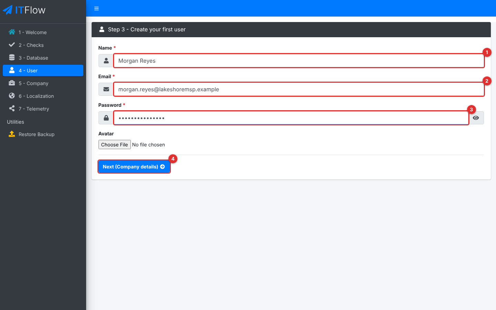

*Figure 5 — Step 3, Create your first user. (1) **Name**. (2) **Email**, which is also the sign-in name. (3) **Password**. (4) **Next (Company details)**.*

5. Enter your **Name**, **Email** and **Password**. **Avatar** is an optional picture (JPG, PNG, GIF or WebP, up to 2 MB).
6. Click **Next (Company details)**.

The password must be at least **12 characters** and must not be the same as your name, your email address or the part of the address before the `@`. If it fails, the installer returns to this step and shows the reason. This person becomes the **Administrator** and signs in with this email address and password. The password also protects your personal copy of the key that locks the credential vault, so choose one you can keep and store it safely. The installer only creates a first user when the database has none.

#### Step 4: Describe your company

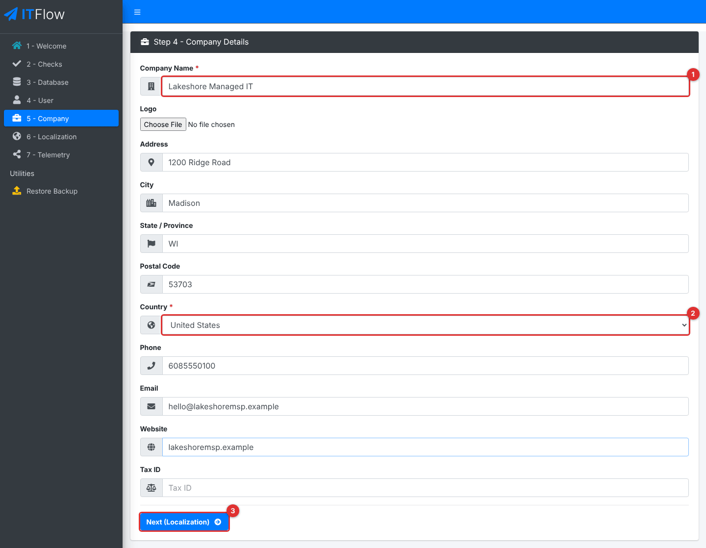

*Figure 6 — Step 4, Company Details. (1) **Company Name**. (2) **Country**. (3) **Next (Localization)**.*

7. Enter the **Company Name** and **Country**; both are required. Add a **Logo** (JPG or PNG, up to 2 MB), **Address**, **City**, **State / Province**, **Postal Code**, **Phone**, **Email**, **Website** and **Tax ID** if you want them.
8. Click **Next (Localization)**.

These details appear on invoices, quotes and emails. This step also creates the starting data described under [What the installer creates](#what-the-installer-creates). You can change the company details later in Administration → Settings (see the system settings guide, [System settings and maintenance](36-system-settings-maintenance.md)).

> **Note (known problem in release 26.10.49).** On the test server used for this guide, submitting the **Company Details** step failed with a server error ("Uncaught TypeError: setCanonicalVaultKey(): Argument #2 ($master_key) must be of type string, null given") and the installation stopped half-finished: the company record existed but no roles, permission modules, ticket statuses or categories had been created, so the new administrator saw a nearly empty menu and "You are not permitted to do that". The cause is in `setup/index.php`: the key it needs is created during the first-user step, in a different request, and is empty by the time the company step runs. Until this is fixed, install with `scripts/setup_cli.php` (next section) or `deploy/install.sh`, which does not use the browser installer. The screens in this guide for steps 5 and 6 and for the first sign-in come from a test server where that one line was patched; everything else about the installer is as described.

#### Step 5: Choose region and language

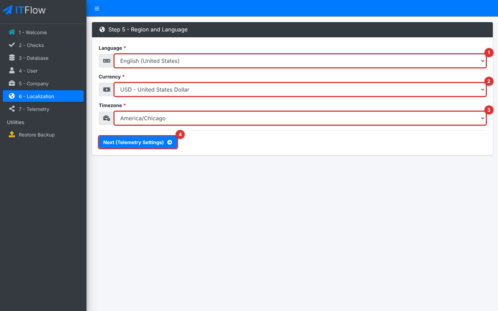

*Figure 7 — Step 5, Region and Language. (1) **Language**. (2) **Currency**. (3) **Timezone**. (4) **Next (Telemetry Settings)**.*

9. Pick the **Language**, **Currency** and **Timezone**. The time zone decides what time RivetMSP shows on tickets, reminders and reports, so set it to where most of your staff work. The currency becomes your company currency and the currency of the default **Cash** account.
10. Click **Next (Telemetry Settings)**.

#### Step 6: Privacy and finish

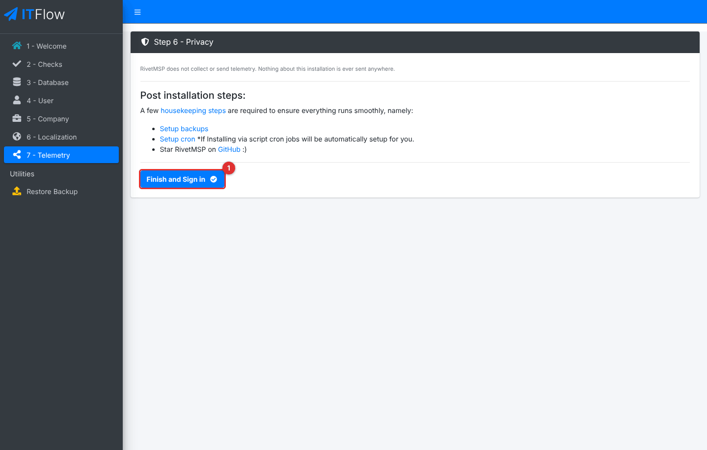

*Figure 8 — Step 6, Privacy. (1) **Finish and Sign in**.*

11. Read the reminders, then click **Finish and Sign in**.

RivetMSP does not collect or send telemetry; this page only reminds you what is left to do and turns the installer off. From now on `/setup/` sends anyone to the sign-in page.

### Install from the command line

`scripts/setup_cli.php` does the same job without a browser. Run it from the `scripts` folder, as the user who owns the files.

```
cd scripts
php setup_cli.php --non-interactive \
  --host=localhost --database=rivetmsp --username=rivetmsp \
  --base-url=msp.example.com --locale=en_US --timezone=America/Chicago --currency=USD \
  --company-name="Example MSP" --country="United States" \
  --user-name="First Admin" --user-email=admin@example.com </dev/null
```

Put the two passwords in the environment instead of on the command line: `ITFLOW_DB_PASSWORD` for the database and `ITFLOW_ADMIN_PASSWORD` for the administrator (12 or more characters). Without `--non-interactive` the script asks for anything you left out. These are the options:

| Option | Meaning |
|---|---|
| `--host`, `--database`, `--username`, `--password` | Database connection (required; the password may come from `ITFLOW_DB_PASSWORD`). |
| `--base-url` | The host name people will use, without `https://` (required). |
| `--locale`, `--timezone`, `--currency` | For example `en_US`, `America/Chicago`, `USD` (required). |
| `--company-name`, `--country` | Required. `--address`, `--city`, `--state`, `--zip`, `--phone`, `--company-email`, `--website` are optional. |
| `--user-name`, `--user-email`, `--user-password` | The first administrator (required; the password is 12 characters or more, and may come from `ITFLOW_ADMIN_PASSWORD`). |
| `--non-interactive` | Fail instead of asking for missing values. |
| `--settings-enc-key=<64 hex characters>` | Reuse an existing key instead of generating one. A restore uses this. |

> **Tips for scripted installs.** The script asks for the optional company fields on standard input even with `--non-interactive`, so redirect input from `/dev/null` as above. If it cannot create `/etc/rivetmsp/keys.json` it carries on with the key in `config.php`; set `RIVETMSP_SKIP_KEYFILE=1` on a test machine to skip that attempt. The message the script prints at the end shows an `https://` address even if you will use plain HTTP.

### After the installer

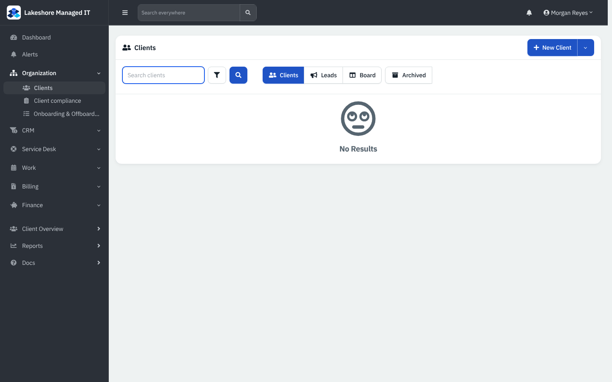

*Figure 9 — The first screen after sign-in on a new install. The start page is **Clients**, and it is empty. Example screen from a throw-away server.*

1. **Sign in.** Go to the sign-in page and use the email and password from step 3. The page and its options are described in [Getting started](01-getting-started.md#signing-in). You land on **Clients**, which is the default start page.
2. **Check for updates.** Open the user menu → **Administration** → **Maintenance** → **Update**. A new install already holds the newest database version, so there is normally nothing to do. If an **Update Database** button appears, take a backup and click it.

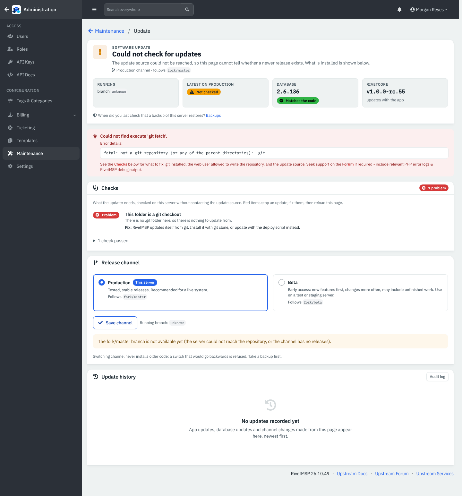

*Figure 10 — Maintenance → Update on a copy of the files that is not a git checkout. The page says so under **Checks** and offers no update. A server installed with `git clone` or `deploy/install.sh` can check for and apply updates here.*

3. **Turn on the scheduler.** Installing does not switch on scheduled work. `deploy/install.sh` and Docker Compose already run the cron job every five minutes, but the job does nothing until you open Administration → **Settings** → **Notifications**, switch on **Enable Cron Job** and save. Reminders, expiry alerts, recurring tickets and invoices, ticket automation and automatic backups all wait for this switch. (`deploy/install.sh` also schedules the outgoing-mail queue and the email-to-ticket reader every minute; each stays idle until its own feature is set up.) On a server you set up by hand, add the cron entries yourself (see the [system settings guide](36-system-settings-maintenance.md)).

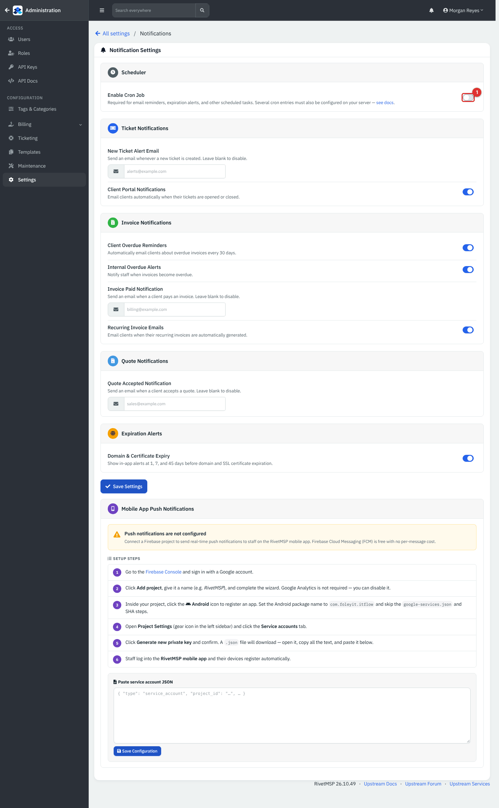

*Figure 11 — Settings → Notifications. (1) **Enable Cron Job**, off on a new install.*

4. **Set up backups.** Open Administration → **Maintenance** → **Backup**. Backups are turned off until you enter a **Backup encryption passphrase** of at least 16 characters, or tick **Allow unencrypted in-app backups**. Keep the passphrase somewhere other than this server: without it a backup cannot be restored onto a new server.

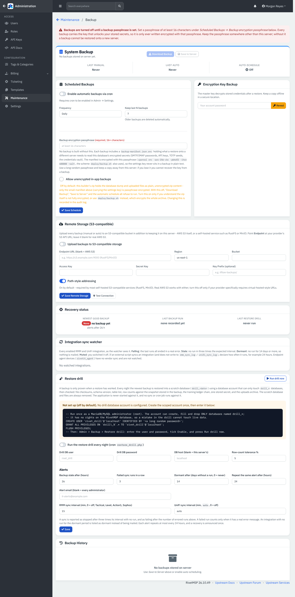

*Figure 12 — Maintenance → Backup on a new install. The red banner explains why **Download Backup** and **Save to Server** are greyed out.*

5. **Turn on the modules you will use.** Administration → **Settings** → **Modules** holds the company-wide switches (see the table in the Reference section).
6. **Add your team.** Create technician accounts under Administration → **Users** and check the roles under **Roles** (see [Users, roles and security](34-users-roles-security.md)).
7. **Add your clients.** See [Clients, contacts and locations](03-clients-contacts-locations.md).
8. **Set up outgoing mail** so invoices, ticket replies and password resets can be sent. See [Mail intake and sending](30-mail-intake-and-sending.md), [Webhooks, event rules and jobs](30b-webhooks-event-rules-and-jobs.md) and [AI and the MCP server](30c-ai-and-remote-mcp.md).

### Keep the encryption keys safe

Mail passwords, API keys, two-factor seeds and the credential vault are stored encrypted. The installer generates a key and writes it into `config.php` as `$config_settings_enc_key`. It also tries to create a key file at `/etc/rivetmsp/keys.json`, outside the web root; a web-server user normally cannot create a folder under `/etc`, in which case the installer says so and RivetMSP keeps working on the `config.php` key. Back up `config.php` (and the key file, if you create one) separately from your database backups. The detailed procedure is in `docs/KEY_MANAGEMENT.md` in the repository.

### If sign-in shows an HTTPS message

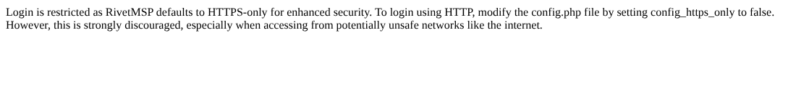

*Figure 13 — What you see when you open the sign-in page over plain `http://` on a default install.*

RivetMSP refuses to sign anyone in over plain HTTP, because passwords would cross the network unprotected. The installer writes `$config_https_only = TRUE;` into `config.php`. There are two ways out:

- **Use HTTPS** (recommended). Put a certificate on the server (`deploy/install.sh` sets up Let's Encrypt for you) or put a reverse proxy that provides HTTPS in front of it, then open the site with `https://`.
- **Allow HTTP on a private test server only.** Edit `config.php` and set `$config_https_only = FALSE;`. Never do this for a server reachable from the internet.

### Restore a backup instead

If you are moving RivetMSP to a new server, you can restore a backup instead of creating a fresh company.

1. Do steps 1 and 2 above so the installer knows the (empty) database.
2. On the welcome page, or in the left menu under **Utilities**, choose **Restore Backup**.

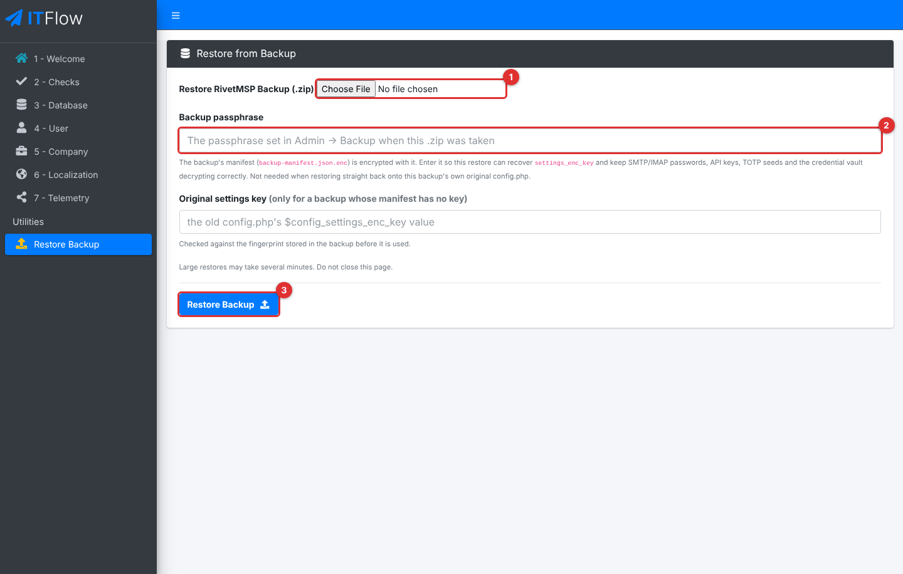

*Figure 14 — Restore from Backup. (1) The `.zip` file made by Administration → Maintenance → Backup. (2) **Backup passphrase**. (3) **Restore Backup**. A third box, **Original settings key**, is for backups whose manifest holds no key.*

3. Choose the `.zip` file in **Restore RivetMSP Backup (.zip)**. If a **Backup encryption passphrase** was set when the backup was taken, type it into **Backup passphrase**. Click **Restore Backup**.
4. Wait. Large restores take several minutes; do not close the page. When it finishes you land on the sign-in page. Sign in with an account from the old server.
5. Read the message shown after the restore. It reports how many files and folders came back and whether the settings key could be recovered.

The restore **replaces everything**: it drops every table in the database and empties the `uploads` folder before loading the backup, so use it only on an empty or disposable database. The archive must contain `db.sql` and `uploads.zip`. Uploaded files are checked as they are unpacked, and files that look like scripts or executables are rejected, with the restore stopping and listing them. The encrypted `backup-*.tar.gz.enc` files made by the server's disaster-recovery timer are restored with `deploy/restore.sh` on the command line instead.

> **Stored secrets.** Mail, integration and webhook passwords are encrypted with a key that lives in `config.php` on the old server. Every backup carries a copy of that key in a small manifest, and the restore puts it into the new `config.php`. If the manifest is encrypted and you leave **Backup passphrase** empty or wrong, the restore still finishes but cannot recover the key; the message says so, and you must re-enter those passwords. For an older backup whose manifest has no key, type the old `config.php` value into **Original settings key**. Restoring this way was not run end to end for this guide.

## Reference

### The installer's pages

| Menu entry | Page heading | Address | Required | Button |
|---|---|---|---|---|
| 1 - Welcome | RivetMSP Setup | `/setup/` | None | **Begin Setup** (later **Create First User** and **Restore from Backup**) |
| 2 - Checks | Step 1 - Setup Checks | `/setup/?checks` | None | **Next (Database)** |
| 3 - Database | Step 2 - Connect your Database | `/setup/?database` | Database Name, Host, User, Password | **Next (First User)** |
| 4 - User | Step 3 - Create your first user | `/setup/?user` | Name, Email, Password (12+ characters) | **Next (Company details)** |
| 5 - Company | Step 4 - Company Details | `/setup/?company` | Company Name, Country | **Next (Localization)** |
| 6 - Localization | Step 5 - Region and Language | `/setup/?localization` | Language, Currency, Timezone | **Next (Telemetry Settings)** |
| 7 - Telemetry | Step 6 - Privacy | `/setup/?telemetry` | None | **Finish and Sign in** |
| Restore Backup | Restore from Backup | `/setup/?restore` | A backup `.zip` | **Restore Backup** |

### What the installer creates

| Item | Starting contents |
|---|---|
| **Roles** | **Accountant**, **Technician** and **Administrator**. The first user is an Administrator. |
| **Permission modules** | Six: Client, Support, Credential, Sales, Financial and Reporting. Knowledge base, endpoint and alert permissions are not in a fresh install's list (see the note below). |
| **Ticket statuses** | **New**, **Open**, **On Hold** (pauses the SLA clock), **Resolved**, **Closed**. |
| **Numbering** | Tickets `TCK-`, invoices `INV-`, quotes `QUO-`, recurring invoices `REC-`, all starting at 1. Default net terms 30 days; overdue reminders at 1, 3 and 7 days. |
| **Categories** | 14 expense, 13 income and 8 referral categories, plus network interface, asset status, contact note, rack and software types. |
| **Other** | Payment methods **Cash**, **Check**, **Bank Transfer**, **Credit Card**; a **Default** calendar; a **Cash** account in your currency; a sidebar link called **Docs** that opens the upstream ITFlow documentation. |

> **Note.** Administrators see every menu entry. Other roles see an entry only when their role has a permission level for its module. Because a fresh install has no knowledge base, alerts or endpoint modules in its list, a technician sees **Knowledge Base**, **Alerts**, **Endpoints** and **Backups** only after those modules have been added and given a level (this guide's demo server adds them with a seed). How to add them from the web interface is not documented here.

### Module switches (Administration → Settings → Modules)

| Switch | On in a new install? |
|---|---|
| **Show IT Documentation** | Yes |
| **Show Ticketing** | Yes |
| **Show Invoicing / Accounting** | Yes |
| **Show Ticket Charges (Billing)** | Yes |
| **Show Knowledge Base** | No |
| **Show Live Chat on Tickets** | No |
| **Show Payroll** | No |
| **Enable Client Portal** | Yes |

Endpoint (RMM) management, Comet backups, UniFi and the remote MCP server have their own switches on their own settings pages and are off.

## Tips and good practice

- Open the installer using the final address people will use. RivetMSP stores that host name as its base address.
- Use a strong, unique password for the first administrator, and add a second administrator soon so you are not locked out if one account has a problem.
- Keep `config.php` private and include it in your server backups. It holds the key that protects stored secrets.
- If the installer is reachable after you finish, it is not a security problem: it only redirects to the sign-in page once `config.php` says setup is complete.
- Install and test on a throw-away copy first if you are moving from another system. The Restore step and the command-line script both overwrite whatever is in the database.

## Related guides

- [Getting started](01-getting-started.md): sign in and learn the layout.
- [System settings and maintenance](36-system-settings-maintenance.md): modules, company details, scheduler, backups and updates in full.
- [Users, roles and security](34-users-roles-security.md): add technicians and set roles.
- [Clients, contacts and locations](03-clients-contacts-locations.md): the first records to create.
