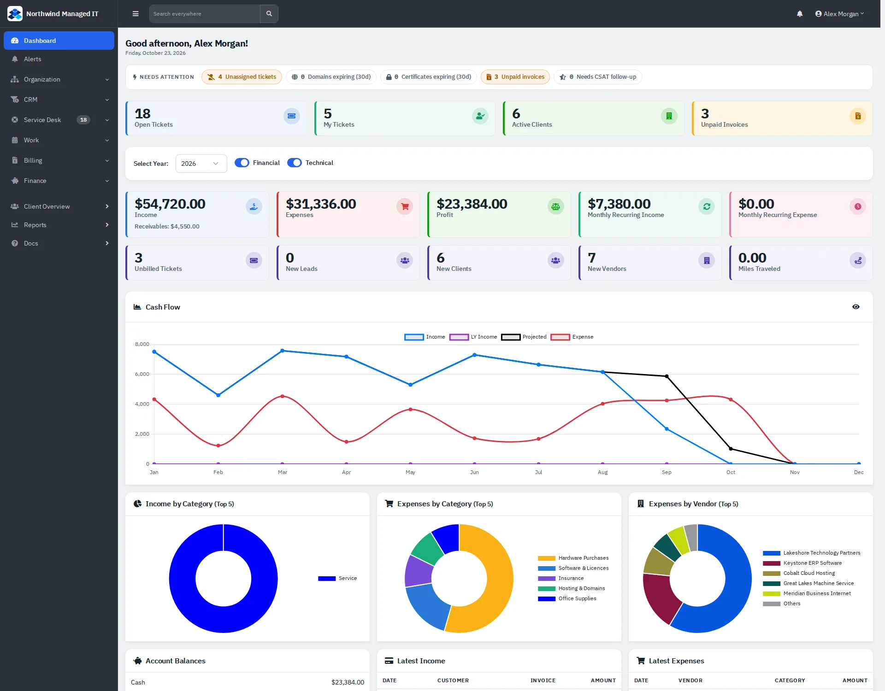

# Getting started

How to sign in to RivetMSP, find your way around, search, and set up your own account. The other guides assume you know these basics.

| | |
|---|---|
| **Where to find it** | Sign-in page: your RivetMSP address followed by `/login.php`. Your account: user menu (your name, top right) → **Account**. |
| **Who can use it** | Everyone with a staff account. Clients use the [client portal](08-client-portal.md) instead. |
| **Turn it on** | Nothing to turn on. An administrator creates your account under Administration → Users. |

## Signing in

1. Open the sign-in address your administrator gave you.
2. Enter your email address and password, or use **Sign in with a Passkey** if you added one to your account.
3. Tick **Stay signed in** only on a computer you trust.
4. Click **Sign In**. If multi-factor authentication is on for your account, a second screen asks for your code.

Repeated wrong passwords temporarily block sign-in, so use the reset route your administrator offers rather than guessing.

## The main screen

*Figure 1: The dashboard, the page the company name at the top of the sidebar always returns you to.*

| Part | What it does |
|---|---|
| **Sidebar groups** | Click a group (Organization, CRM, Service Desk, Work, Billing, Finance, Client Overview, Reports) to open it. The group holding the page you are on opens by itself. Number badges are live counts such as open tickets. |
| **☰ button** | Shrinks the sidebar to icons and back. |
| **Search everywhere** | Type at least two characters to find clients, contacts, assets, tickets and locations. Click a result to open it. |
| **Bell** | Your notifications. |
| **User menu** | **Administration** (administrators only), **Account** and **Logout**. |

The dashboard opens with a **Needs attention** strip (unassigned tickets, expiring domains and certificates, unpaid invoices, CSAT follow-ups) and your headline numbers. Two switches, **Financial** and **Technical**, show or hide the charts below; each person's choice is remembered. If both are off the page tells you how to turn them on.

## Your account

User menu → **Account** has tabs for **Details** (name, job title, phone, email signature), **Security** (password, multi-factor authentication, passkeys), **Preferences** (including light or dark mode), **Activity** and **Integrations**. Change your password here; administrators can also reset it.

## Lists work the same way everywhere

- **Search box** above a list filters it as you submit.
- **Column headings** sort; click again to reverse.
- **Filters** (funnel button or the filter bar) narrow by status, client, date and more; **Reset Filters** clears them.
- **Page size and pages** sit under the table.
- **Row menu (⋯)** holds the actions for one record; tick the row boxes first to use a **Bulk Action** on several.
- **New …** buttons open a dialog. Fields marked with a red star are required; if a required field sits on another tab of the dialog, the tab opens and the message shows there.

## Light and dark mode

Pick the theme under Account → Preferences. An administrator sets the company default under Administration → Settings → Theme.
