# Getting started

This page shows you how to sign in to RivetMSP, find your way around, set up your own account, and use the list features that almost every page shares. Read it first: the other guides assume you know these basics.

| | |
|---|---|
| **Where to find it** | Sign-in page: your RivetMSP address followed by `/login.php`. Your account: user menu (your name, top right) → **Account**. |
| **Who can use it** | Everyone who signs in. Which sidebar entries and buttons you see depends on your role (see [Roles and what you see](#roles-and-what-you-see)). |
| **Turn it on** | Nothing to turn on. Administrators control the start page (Administration → **Settings** → **Defaults** → **Start Page**), the notice on the sign-in page and the session length (Administration → **Settings** → **Security**). |

## Words used in this guide

| Word | Meaning |
|---|---|
| **Client** | An organisation you look after. Its people are **Contacts**. |
| **Contact** | A person at a client. Some contacts can sign in to the **client portal**. |
| **Technician** | A member of your own staff who signs in to RivetMSP. Technicians, billing staff and administrators are all "users". The built-in role called **Technician** is one of several roles. |
| **Client portal** | The separate site where a client's contacts raise tickets, read invoices and pay them. It uses the same sign-in page. See [Client portal](32-client-portal.md). |
| **Lead** | A client record that has not become a client yet. Leads are on the **Clients** page, under the **Leads** button. |
| **Administrator** | A user whose role has admin access. Administrators see **Administration** in the user menu and every sidebar entry. |

## Signing in

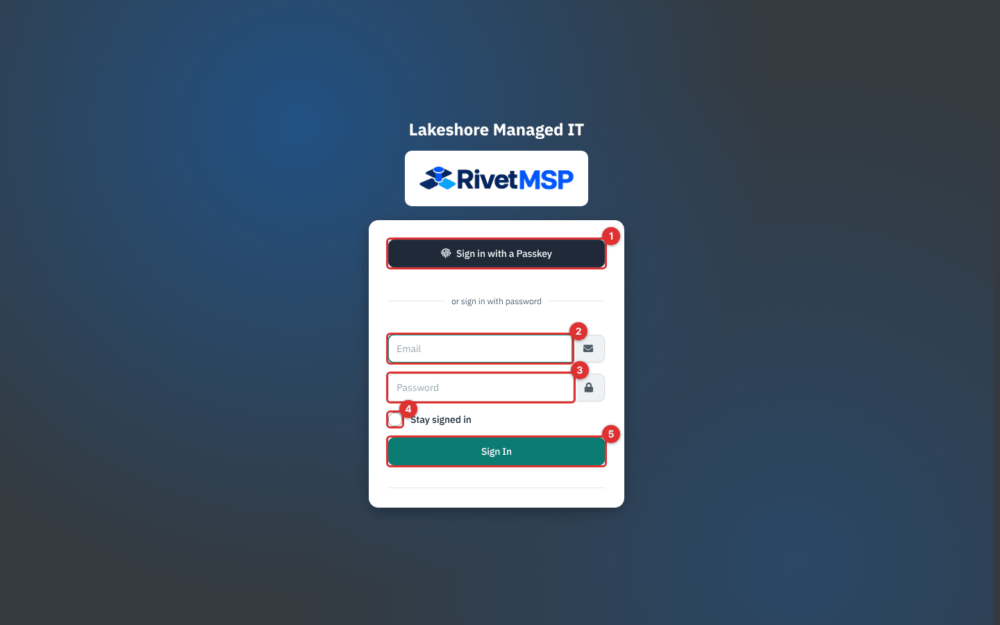

*Figure 1 — The sign-in page. Technicians and client contacts use the same page.*

The page shows your company name and logo, and takes its accent colour from the company's theme setting.

1. Open the sign-in address your administrator gave you.
2. Type your email address **(2)** and password **(3)**.
3. Tick **Stay signed in (4)** only on a computer you trust (see below).
4. Click **Sign In (5)**.

You land on the **start page**, which an administrator chooses (Administration → **Settings** → **Defaults** → **Start Page**: **Dashboard**, **Client Management**, **Support Tickets** or **Invoices**). A new install starts on **Clients**. If you opened a specific page while signed out, RivetMSP returns you to that page after you sign in.

### Other things the sign-in page can ask

- **MFA code.** If you turned on multi-factor authentication, a second screen asks for the six-digit code from your authenticator app (**Verify your 2FA code**). Under it, **Lost your authenticator? Use a recovery code** opens a box for one of your single-use recovery codes. The button is **Verify & Sign In**, and a **Remember Me** box lets you skip the code on this browser for a while.
- **Choosing a side.** If the same email address belongs to both a technician and a client contact, you see two buttons: one to sign in as a technician and one for the client portal.
- **Passkey.** **Sign in with a Passkey (1)** needs no email or password: your device asks for your fingerprint, face or PIN. It works only after you add a passkey to your account (see [Security](#security-password-mfa-and-passkeys)).
- **Login message.** An administrator can show a notice in the sign-in card (Administration → **Settings** → **Security** → **Login Message**).
- **Login key.** An administrator can require a secret key in the address (`/login.php?key=…`). Without it the email box is labelled **Client Email** and a technician's sign-in is refused; client contacts are not affected.
- **Client contacts.** They sign in on this same page and land in the portal. See the [client portal guide](32-client-portal.md).

Below the sign-in card, some links appear only when the client portal is on and an administrator has set them up: **Forgot password?** (when outgoing email is set up; it resets a **client portal** password), **Login with Microsoft Entra** and **Single Sign-On**. They sign in client contacts only. If a technician forgets a password, an administrator sets a new one (Administration → **Users**, edit the user).

### Stay signed in, and when you are signed out

**Stay signed in** keeps you signed in on this browser for the number of days set in Administration → **Settings** → **Security** → **2FA Remember Me Expire** (3 days on a new install). With MFA on, it also skips the code on that browser for the same period, except that administrators and users with vault access are still asked unless the sign-in policy says otherwise.

Even without it, a session ends after the **Idle timeout** (480 minutes without activity by default) or the **Maximum session length** (10,080 minutes, 7 days, by default; at most 90 days). Pages that only poll in the background do not count as activity.

If you use a shared computer, leave **Stay signed in** unticked and use user menu → **Sign out** when you finish.

> If you type a wrong password several times, sign-in is blocked for your network address: 15 failed attempts in 10 minutes lock that address out until the window passes. Every failed attempt is logged.

## A first look at the app

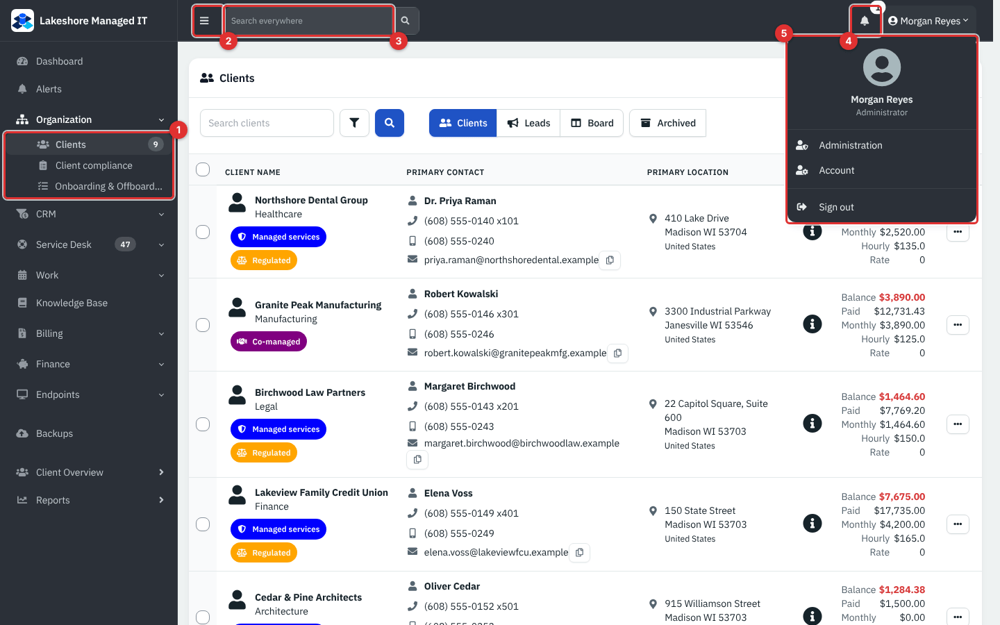

*Figure 2 — The main screen. The user menu is open so you can see its entries.*

| # | What it is | What it does |
|---|---|---|
| **(1)** | Sidebar group (here **Organization**) | Click a group name to open or close it. The group that holds the page you are on opens by itself. A number badge shows a live count, such as active clients or open tickets. |
| **(2)** | Fold button (three horizontal lines) | Shrinks the sidebar to icons and back. Your choice is remembered in this browser. On a narrow window the sidebar is hidden until you press it. |
| **(3)** | **Search everywhere** | Type at least two characters and matching records appear under the box. See [Search everywhere](#search-everywhere). |
| **(4)** | Bell | Your personal notifications. The number is how many you have not dismissed. |
| **(5)** | User menu | Your name, photo and role, then **Administration** (administrators only), **Account** and **Sign out**. |

The company name at the top of the sidebar always takes you to the **Dashboard**, described in the [Dashboard guide](02-dashboard.md). Your administrator can also add custom links to the sidebar and to the top bar, beside the bell (Administration → **Tags & Categories** → custom links).

### Sidebar groups

Entries appear only when the feature is switched on (Administration → **Settings** → **Modules**) **and** your role may use it. Roles grant a level for each permission module: Read, Modify or Full.

| Group | Entries | Shown when |
|---|---|---|
| **Dashboard** | Dashboard | Always. |
| **Alerts** | Alerts, with a red count of new alerts | Your role has the alerts permission. This is monitoring alerts from endpoint and backup tools, not your notifications. |
| **Organization** | Clients (count of active clients), Client compliance, Onboarding & Offboarding | Client: Read or higher. |
| **CRM** | Pipeline, Opportunities, Campaigns, Segments | Sales: Read or higher. |
| **Service Desk** | Tickets, Recurring Tickets, Request service, CSAT Ratings, Requests, Problems, Changes (and **AI actions** when the AI assistant is allowed to propose changes) | **Show Ticketing** is on and Support: Read or higher. CSAT Ratings needs CSAT turned on. |
| **Work** | Projects, Calendar | Calendar for everyone; Projects needs ticketing on and Support: Read or higher. |
| **Knowledge Base** | Knowledge Base (one entry, not a group) | **Show Knowledge Base** is on and the knowledge-base permission is Read or higher. |
| **Billing** | Quotes, Invoices, Recurring Invoices, Revenues, Products | **Show Invoicing / Accounting** is on and Sales: Read or higher. If only **Show Ticket Charges (Billing)** is on, only **Products** appears. |
| **Finance** | Payments, Vendors, Expenses, Recurring Expenses, Accounts, Transfers, Trips; **Payroll** for administrators when payroll is on | **Show Invoicing / Accounting** is on. All but **Trips** need Financial: Read or higher. |
| **Endpoints** | RMM Dashboard, Agent Fleet, Add device and more | The endpoint (RMM) module is on and your role has the endpoints permission. See the [endpoints guide](25-endpoints-rmm-overview.md). |
| **Backups** | Backup status from Comet | Comet backup is on and your role has the endpoints permission. |
| **Client Overview** | Opens the company-wide lists (contacts, locations, assets and so on) | Client: Read or higher. |
| **Reports** | Opens the reports | Reporting: Read or higher. |
| Custom links | Links your administrator added | Everyone. |

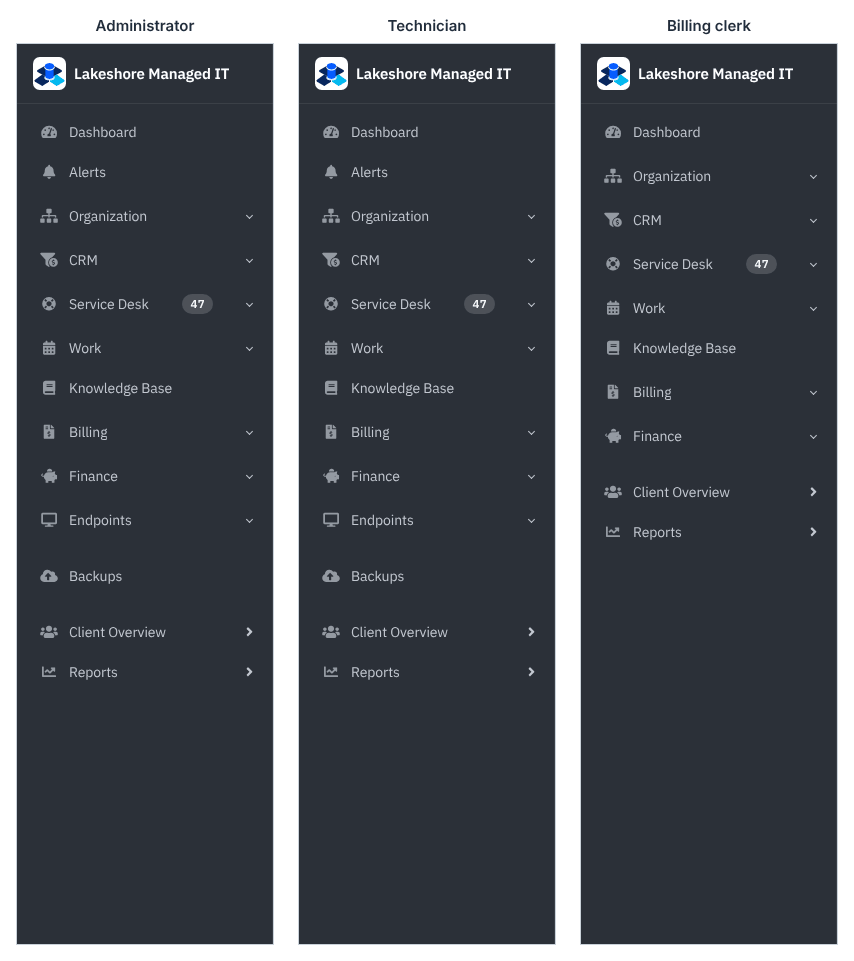

*Figure 3 — The same sidebar for three roles on this guide's demo server. The billing clerk has no endpoint or alert permissions, so **Alerts**, **Endpoints** and **Backups** are not shown. Example roles.*

On a record you can open from a list (a ticket, a contact, an asset), a breadcrumb or heading shows where you are. Administration pages that sit under **Settings**, **Tags & Categories**, **Billing**, **Ticketing**, **Templates** or **Maintenance** show a back link at the top.

## Three navigation scopes

The sidebar changes depending on how wide a view you are in. The page you open decides the scope.

- **Global sidebar.** All clients together. It is shown on the Dashboard, the Clients list, and on lists you open from a group such as **Service Desk → Tickets** or **Billing → Invoices**.
- **Client workspace.** When a page is opened for one client (you click a client, or open a ticket that belongs to it), the sidebar is replaced by that client's own rail. Figure 4 shows it.
- **Company-wide.** Choosing **Client Overview** in the global sidebar opens a rail that says **Company-wide**. Its lists (Contacts, Locations, Assets and so on) span every client you may see. Figure 5 shows it.

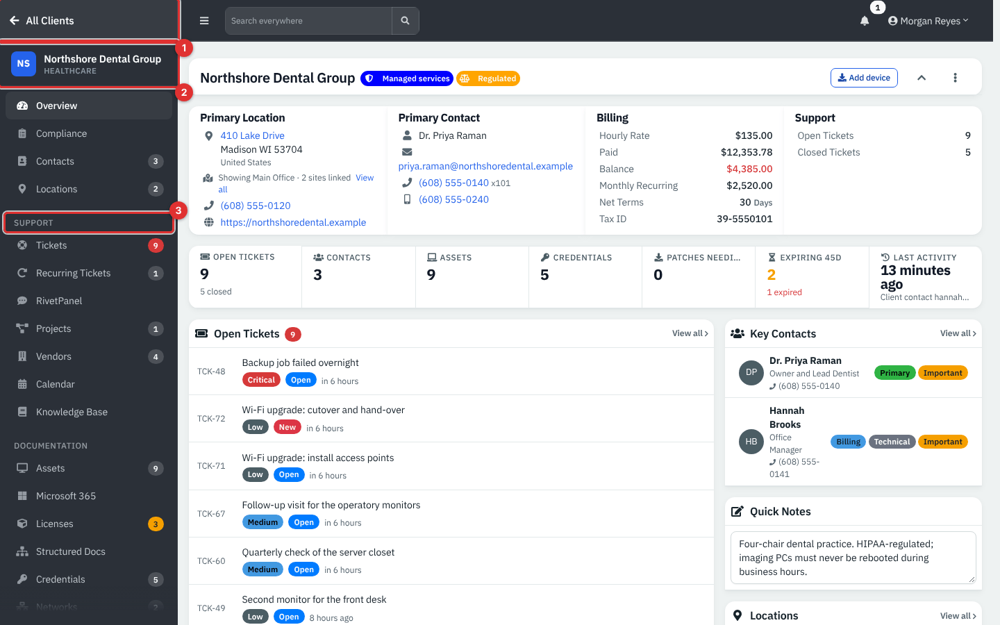

*Figure 4 — The client workspace for an example client. (1) **All Clients** is the way back. (2) The client's name and type. (3) Section headings: **SUPPORT**, **DOCUMENTATION** and **BILLING**.*

The client rail starts with **Overview**, **Compliance**, **Contacts** and **Locations**, then three sections:

| Section | Entries |
|---|---|
| **SUPPORT** | Tickets, Recurring Tickets, RivetPanel, Projects, Vendors, Calendar, Knowledge Base |
| **DOCUMENTATION** | Assets, Microsoft 365, Licenses, Structured Docs, Credentials, Networks, Printers, Network Drives, Racks, Certificates, Domains, Services, Contracts, Files |
| **BILLING** | Invoices, Recurring Invoices, Quotes, Payments, Trips |

Each section follows the same switches and permissions as the global sidebar (for example **DOCUMENTATION** needs **Show IT Documentation**, **Credentials** needs the credential permission, **BILLING** needs the accounting switch). Every list and count in it is limited to that client.

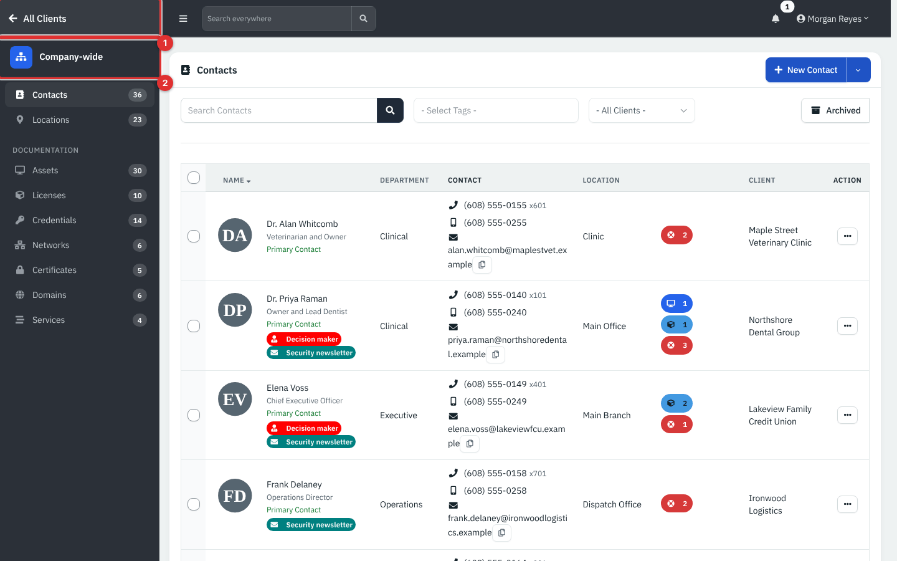

*Figure 5 — The company-wide rail. (1) **All Clients** returns to the Clients list. (2) The **Company-wide** label tells you the lists span every client you may see.*

To get back, click **All Clients** at the top of either rail. If you cannot tell where you are, look at the top of the sidebar: it names the client or says **Company-wide**. The same list can look different in each scope: **Assets** in the company-wide rail shows every client's assets, **Assets** in a client rail only that client's.

### The client's Overview page

Click a client in the **Clients** list and you land on its **Overview**.

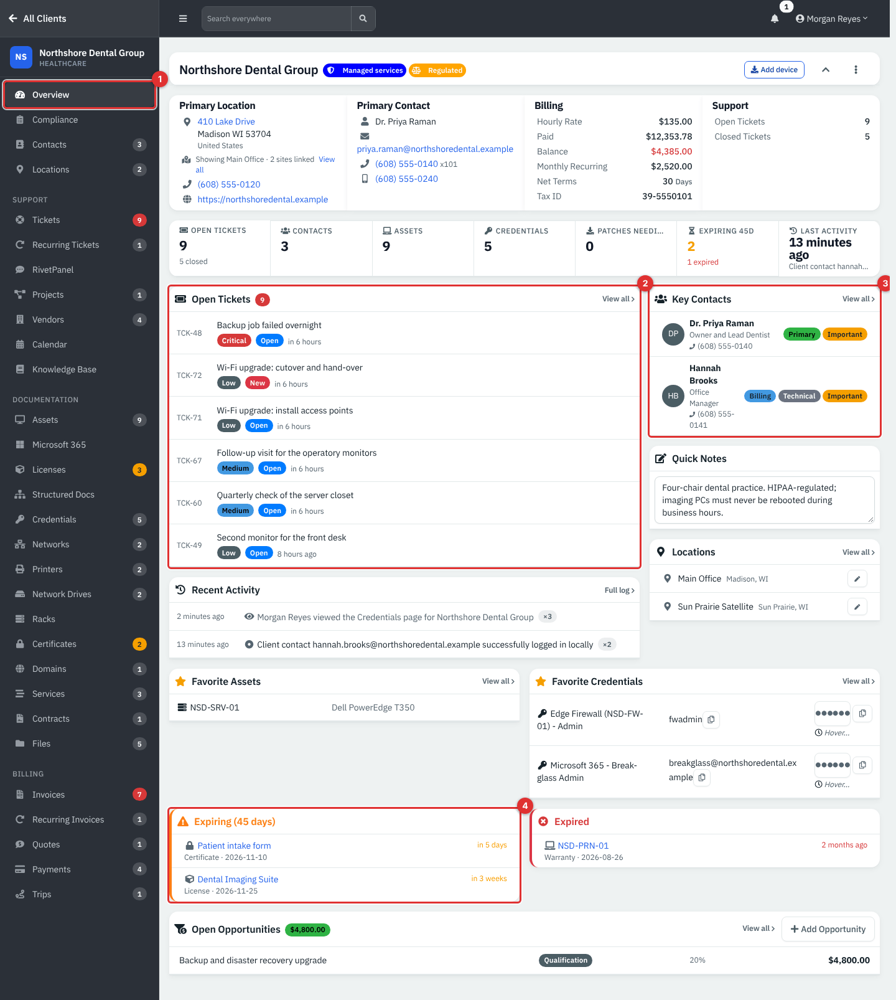

*Figure 6 — A client's Overview. (1) **Overview** in the client rail. (2) **Open Tickets**. (3) **Key Contacts**. (4) **Expiring (45 days)**. Example data.*

The top cards show the primary location, primary contact, billing figures (hourly rate, paid, balance, monthly recurring, net terms, tax ID) and support counts. The strip below counts open tickets, contacts, assets, credentials, patches needed and items expiring within 45 days. Further down are **Open Tickets**, **Key Contacts**, **Quick Notes**, **Locations**, **Recent Activity**, favourite assets and credentials, items that are expiring or expired, and **Open Opportunities**. The client area is covered in [Clients, contacts and locations](03-clients-contacts-locations.md).

## Your account

Open user menu → **Account**. A small sidebar replaces the main one and offers **Details**, **Security**, **Preferences**, **Activity** and **Integrations**. The arrow at the top (**Account**) returns you to the main screen.

### Details: profile and email signature

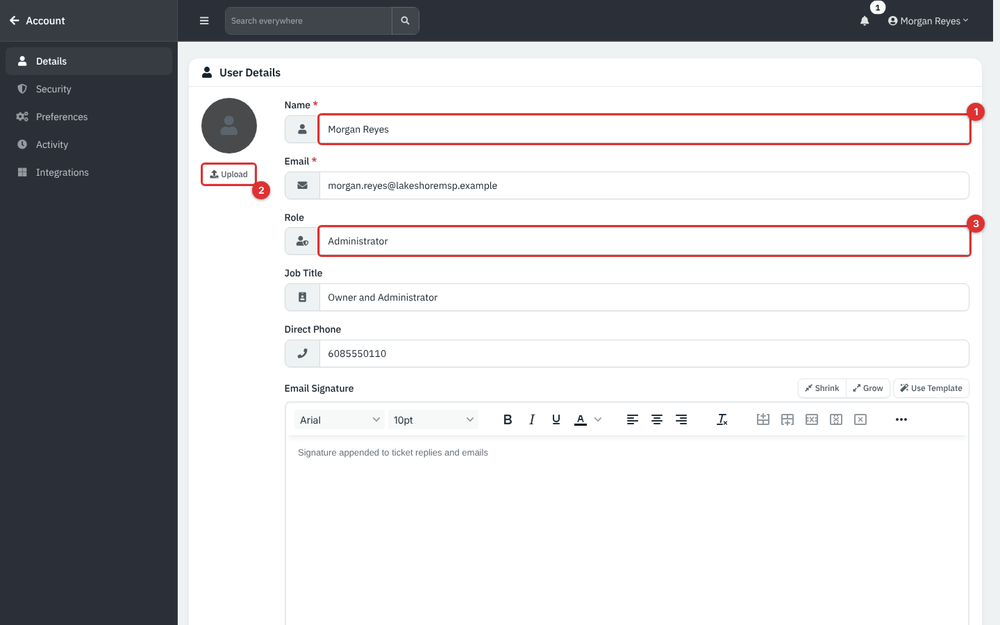

*Figure 7 — Account → Details. (1) **Name**. (2) **Upload** a photo. (3) **Role** is read-only.*

1. Open **Account → Details**.
2. Change your **Name**, **Email**, **Job Title** or **Direct Phone**. **Role** is read-only; an administrator changes it. Your email address is also your sign-in name.
3. To add a photo, click **Upload (2)**.
4. In **Email Signature**, write your own or click **Use Template**. **Shrink** and **Grow** resize the whole signature at once.
5. Save your changes.

The signature is added to ticket replies and emails you send from RivetMSP.

### Security: password, MFA and passkeys

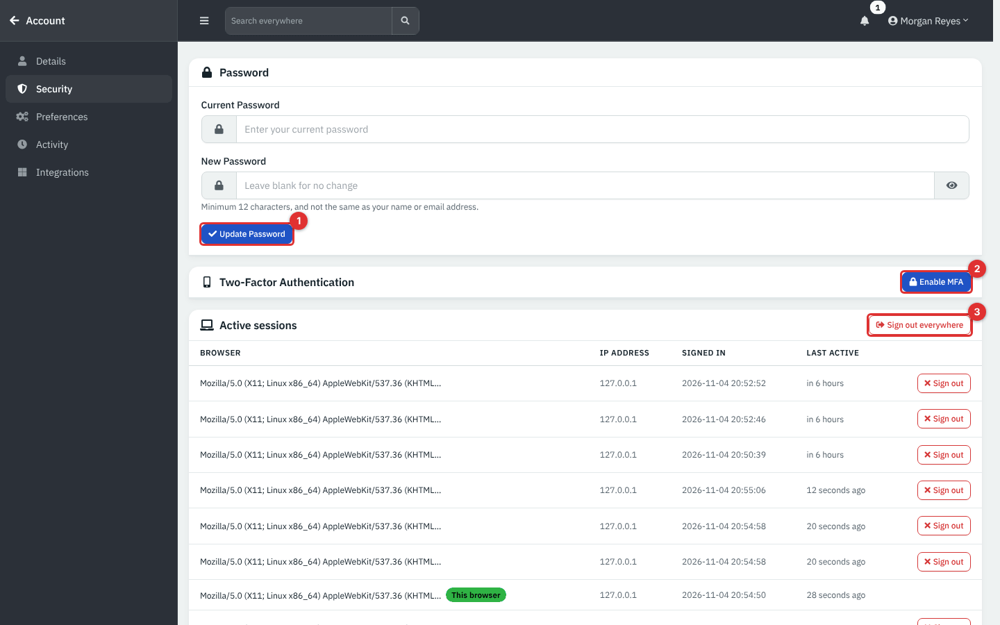

*Figure 8 — Account → Security. (1) **Update Password**. (2) **Enable MFA**. (3) **Sign out everywhere**. The sessions in the list are example data from the demo server.*

**Change your password**

1. Open **Account → Security**.
2. Enter your **Current Password** and a **New Password**. The page reminds you of the rule: at least 12 characters, and not the same as your name or email address (an administrator can raise the minimum).
3. Click **Update Password (1)**.

You are signed out straight away, on every browser, and must sign in with the new password.

**Turn on MFA (authenticator app)**

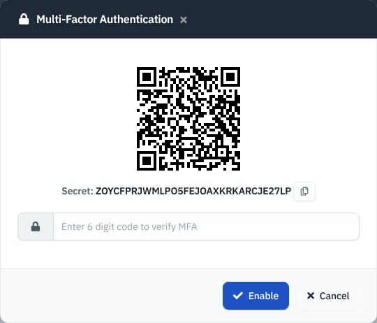

*Figure 9 — The MFA pop-up. The QR code and secret are an example that was never activated.*

1. Click **Enable MFA (2)**.
2. Scan the QR code with an authenticator app, or copy the **Secret** shown under it.
3. Type the six-digit code from the app into the box.
4. Click **Enable**.

The card then shows **Enabled**, and every sign-in asks for a code. You also receive **ten single-use recovery codes**, shown once on the Security page: save them away from this device. Each works once in place of an authenticator code, and **Make new recovery codes** (it asks for your password) cancels the old set. **Disable** removes MFA, unless an administrator requires it; then the card shows **Required** instead. If your account must have MFA and you have not enrolled, you are taken to a **Multi-Factor Authentication Enforced** page after sign-in until you do.

**Active sessions and passkeys**

- **Active sessions** lists every browser signed in as you: browser, IP address, when it signed in and when it was last active. **This browser** marks the one you are using. **Sign out** ends another session; **Sign out everywhere** ends all of them, this one included.
- **Passkeys**: click **Add Passkey**, name it after the device (for example "Laptop fingerprint"), and confirm on the device. The list shows when each was added and last used, with a button to remove it. Passkeys need a device that supports them and a secure (HTTPS) connection. Registering a passkey was not tried for this guide because the demo server has no authenticator, so the flow is described from the screen and the code.
- **Remember-Me Tokens** appears once you have used **Stay signed in** or **Remember Me**, with **Revoke All Tokens** to end them.

### Preferences

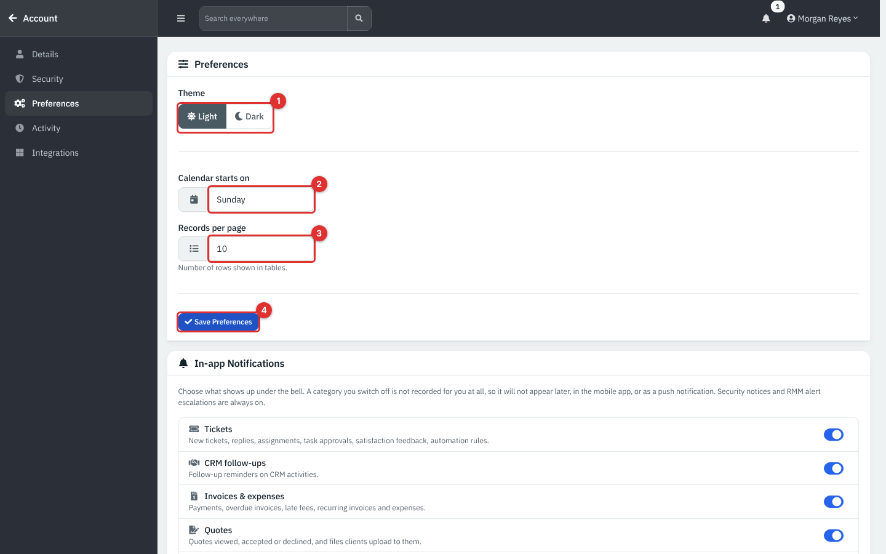

*Figure 10 — Account → Preferences. (1) **Theme**. (2) **Calendar starts on**. (3) **Records per page**. (4) **Save Preferences**.*

| Setting | What it does |
|---|---|
| **Theme (1)** | **Light** or **Dark**, for you only. |
| **Calendar starts on (2)** | **Sunday** or **Monday**, on the calendar. |
| **Records per page (3)** | 10, 25, 50 or 100 rows in lists. The footer of a long list changes the same setting. |

Click **Save Preferences (4)** for changes to take effect.

**In-app Notifications** below decides what shows up under the bell. Each category has a switch: **Tickets**, **CRM follow-ups**, **Invoices & expenses**, **Quotes**, **Expirations & reviews**, **Backups**, **Backup & sync health**, **Mail problems**, **RMM housekeeping**, **Integrations**, **Shared links viewed**, **Update available** and **Scheduled tasks ran**. A category you switch off is not recorded for you at all, so it does not appear later, in the mobile app or as a push notification. **Security** notices and **RMM alert escalations** are always on. **Push Notifications** lists your phones (**My Devices**) once you sign in to the mobile app, which this guide did not test.

**Activity** shows your last 10 successful sign-ins (**Recent Sign-ins**: when, device, browser, address) and your last 15 actions (**Recent Activity**). Check it if you suspect someone else used your account. **Integrations** holds **My Calendar Color**, which colours your tickets on the calendar so dispatchers can tell technicians apart, and **Outlook Calendar Sync**, which needs an administrator to finish the Microsoft setup first (not verified on a live service).

### Notifications

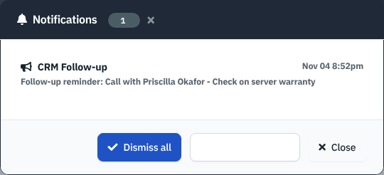

*Figure 11 — The bell. The pop-up lists notifications you have not dismissed.*

Click the bell. Each entry shows its type, time and text; click it to go to the related page. **Dismiss all** clears the list, and the grey button beside it, **See all Notifications**, opens the full page, where you can search, filter, dismiss one at a time and open **Dismissed**. The pop-up shows eight at a time, with arrows to page through them. Notifications are yours alone: dismissing one does not remove it for anyone else.

> **Note.** In this release the **See all Notifications** button is grey with white text on a pale background, so its label is hard to read. It is the button between **Dismiss all** and **Close**.

### Search everywhere

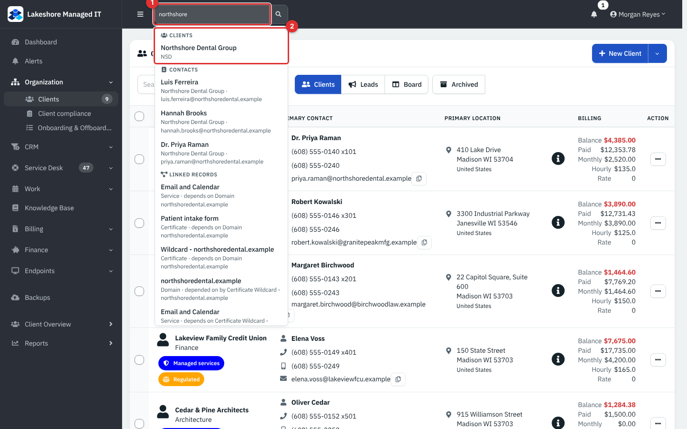

*Figure 12 — Search everywhere. (1) Type two or more characters. (2) Results are grouped by type.*

Results are grouped by type (**Clients**, **Contacts**, **Tickets**, **Quotes**, **Invoices**, **Assets**, **Software**, **Networks**, **Services**, **Linked records** and, for administrators, **Settings**) and show only what your role may see. Archived records are not included. Click a result to open it, or choose **See all results** at the bottom of the list.

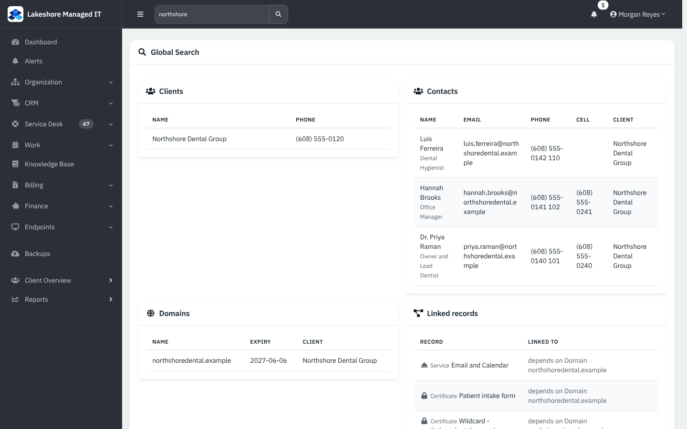

*Figure 13 — The Global Search page. It adds more groups, such as Domains, Documents, Files, Credentials and Ticket Replies.*

On a narrow window only a magnifier icon is shown, and it opens the full search page.

## Lists: search, filter, sort and page

Most list pages share the same controls. The **Clients** list shows them.

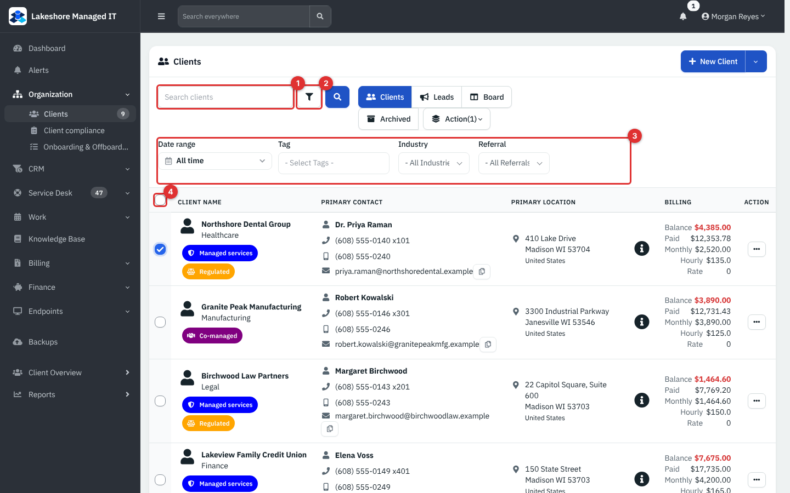

*Figure 14 — List controls on **Clients**. (1) Search box. (2) Filter button. (3) The advanced filter that opens. (4) Select-all checkbox. One row is ticked, so **Action (1)** appeared.*

1. **Search.** Type in the search box **(1)** and press Enter or the magnifier.
2. **Filter.** The funnel **(2)** opens an advanced filter **(3)**. On **Clients** it has **Date range**, **Tag**, **Industry** and **Referral**. Other lists have their own filters. A list that is filtered opens the panel by itself so you can see why rows are missing.
3. **Sort.** Click a column heading to sort by it; click again to reverse.
4. **Select rows.** Tick the box **(4)** at the head of the table to select every row on the page, or tick single rows. An **Action (n)** button appears for bulk changes: on **Clients** it can open tickets for the selected clients and set their hourly rate, net terms, industry or referral, among others.
5. **Page.** The footer shows how many rows there are and lets you move between pages.

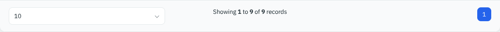

*Figure 15 — The list footer. It appears when a list has more than five rows.*

The drop-down on the left sets **how many rows per page** (5, 10, 20, 50, 100 or 500) and saves it for you; it is the same setting as **Records per page** in your account preferences. The middle shows **Showing 1 to 9 of 9 records**. The right shows page numbers.

Many lists also have an **Archived** button to switch between current and archived records, and a **New** button at the top right whose arrow holds **Import** and **Export** where the list supports them.

## Roles and what you see

A **role** is a set of permission levels, one per **permission module**. The levels are **None**, **Read** (viewing only), **Modify** (read, edit, archive) and **Full**. An administrator role has every module at Full.

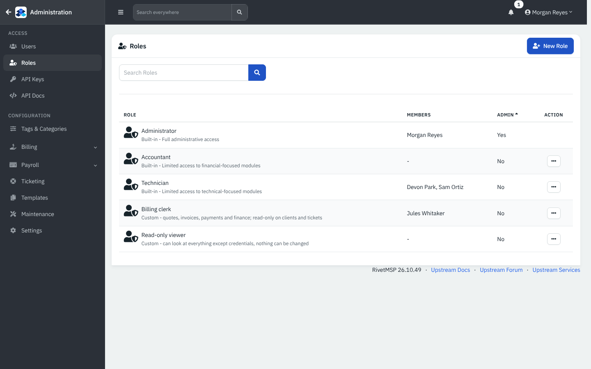

*Figure 16 — Administration → Roles. The last two roles are custom examples created for this guide's demo server.*

A new install has three built-in roles and six permission modules:

| Module (as shown on the Roles page) | What it covers | Accountant | Technician | Administrator |
|---|---|---|---|---|
| **Client** | General client and contact management | Read | Modify | Full |
| **Support** | Ticketing, assets and documentation | Read | Modify | Full |
| **Credential** | Client credentials: usernames, passwords and 2FA codes | None | Modify | Full |
| **Sales** | Quotes, invoices and products | Read | Modify | Full |
| **Financial** | Payments, accounts, expenses and budgets | Modify | None | Full |
| **Reporting** | All reports | Read | None | Full |

You can add roles of your own and give each user one role; see [Users, roles and security](34-users-roles-security.md). If a page is not allowed for your role, RivetMSP says so: for example "You are not permitted to do that! Tell your admin: read access to module_client is not permitted for your role."

## Reference

| Place | Address | What it is |
|---|---|---|
| Sign in | `/login.php` | Technicians and client contacts |
| Dashboard | `/agent/dashboard.php` | Your widget dashboard |
| Clients | `/agent/clients.php` | The default start page |
| Account | `/agent/user/user_details.php` | Details, Security, Preferences, Activity, Integrations |
| Notifications | `/agent/notifications.php` | The full list behind the bell |
| Global search | `/agent/global_search.php?query=…` | The full results page |
| Administration | `/admin/` | Administrators only |

## Tips and good practice

- Use **Search everywhere** before browsing. It finds clients, contacts, tickets, invoices and assets from any page.
- Set **Records per page** to a size that suits your screen.
- Turn on MFA and save the recovery codes the first time you sign in; ask your administrator to require it for everyone.
- Use **Sign out everywhere** (Account → Security) if you lose a laptop.
- Keep **Stay signed in** for your own machine only.

## Related guides

- [First-time setup](00-first-time-setup.md): installing RivetMSP.
- [Dashboard](02-dashboard.md): the widget dashboard you land on.
- [Clients, contacts and locations](03-clients-contacts-locations.md): the Clients list and a client's pages.
- [Service desk and tickets](05-service-desk-tickets.md): the Service Desk group.
- [Users, roles and security](34-users-roles-security.md): add users, roles, MFA policy and sessions.
