# Dashboard

The dashboard is the page you open at the start of the day. It is a set of small cards, called widgets, that each answer one question: how many tickets are open, which ones are about to miss their SLA, how much money is waiting to be billed or collected, what is about to expire. Every person builds their own dashboard: you choose the widgets, their size and order, and nobody else sees or changes your layout.

| | |
|---|---|
| **Where to find it** | **Dashboard** at the top of the left menu, or the company name and logo at the top of the menu. Both open **My dashboard**. If an administrator set another **Start Page** (**Administration** → **Settings** → **Defaults**), you land there after sign-in and reach the dashboard from the menu. |
| **Who can use it** | Every staff user. No permission is needed to open the page. Each widget needs the permission module listed for it in the [widget reference](#widget-reference): a widget you may not read is not offered, not calculated and not shown. |
| **Turn it on** | Nothing to turn on. The money band and the money widgets also need **Show Invoicing / Accounting** turned on under **Administration** → **Settings** → **Modules**. |

## What it's for

- See what needs attention now: unassigned tickets, SLA risks, overdue invoices, expiring domains.
- Keep a few numbers in view all day, such as tickets opened today or resolved this week.
- Give each role a useful starting page: a technician sees their own queue, an administrator also sees money.

Counts are worked out when the page loads. They do not update on their own, so reload the page to refresh them.

> **What is new in this release.** The old fixed dashboard (separate Financial and Technical views) is gone. The same figures are now widgets you can add, remove, resize and reorder, and a **Waiting on you** band at the top ranks the work and money that need a person today. The old address `dashboard.php` redirects to the new page.

## A quick tour

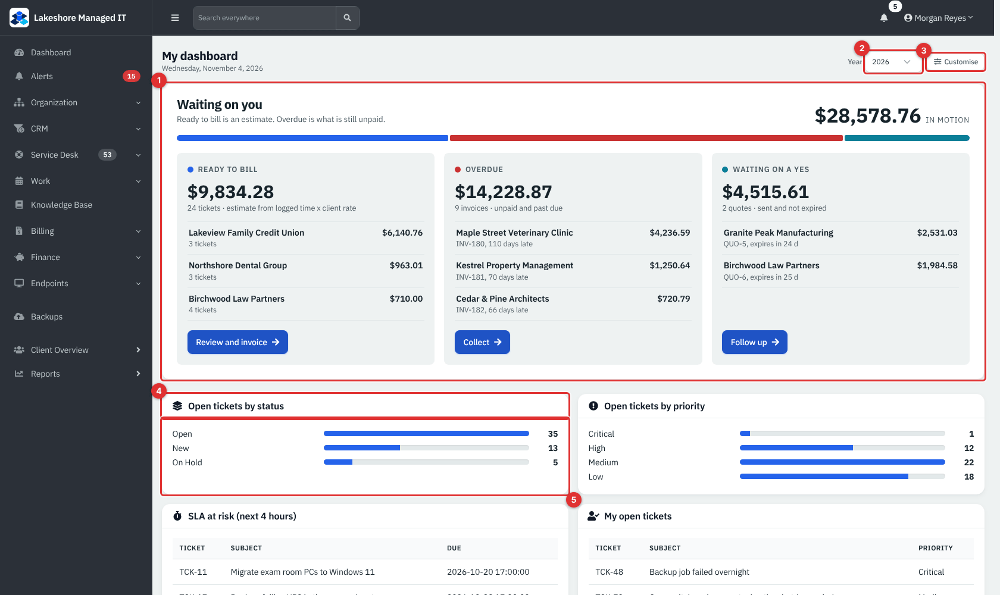

*Figure 1 — My dashboard for an administrator (example data). The band and the first widgets are visible; the rest of the layout continues below.*

1. **Waiting on you** band. The money (or work) that needs a person today. See [The Waiting on you band](#the-waiting-on-you-band).
2. **Year** picker. It appears only while at least one "for a year" widget is on your dashboard.
3. **Customise** opens customise mode, where you add, remove, resize and reorder widgets.
4. A widget's title bar. The icon and title tell you what it counts.
5. A widget's body: a list, a bar chart, a table or one big number.

Widgets sit on a 12-column grid. A **Small** widget takes a third of the width, a **Medium** one half, a **Wide** one the whole row. On a narrow screen they stack.

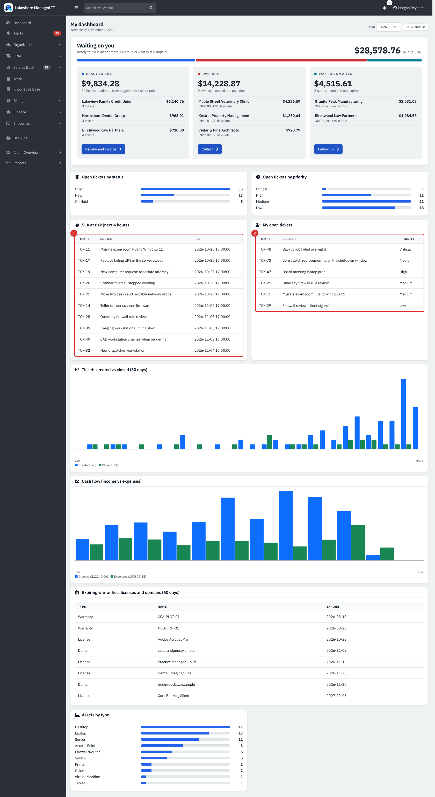

*Figure 2 — Table and chart widgets. (1) **SLA at risk (next 4 hours)** lists open tickets whose SLA resolution time is due within four hours or already past. (2) **My open tickets** lists tickets assigned to you. (3) **Tickets created vs closed (30 days)** compares the two per day.*

In a table widget, the first cell of a row (the ticket number, invoice number or client) is a link that opens the item.

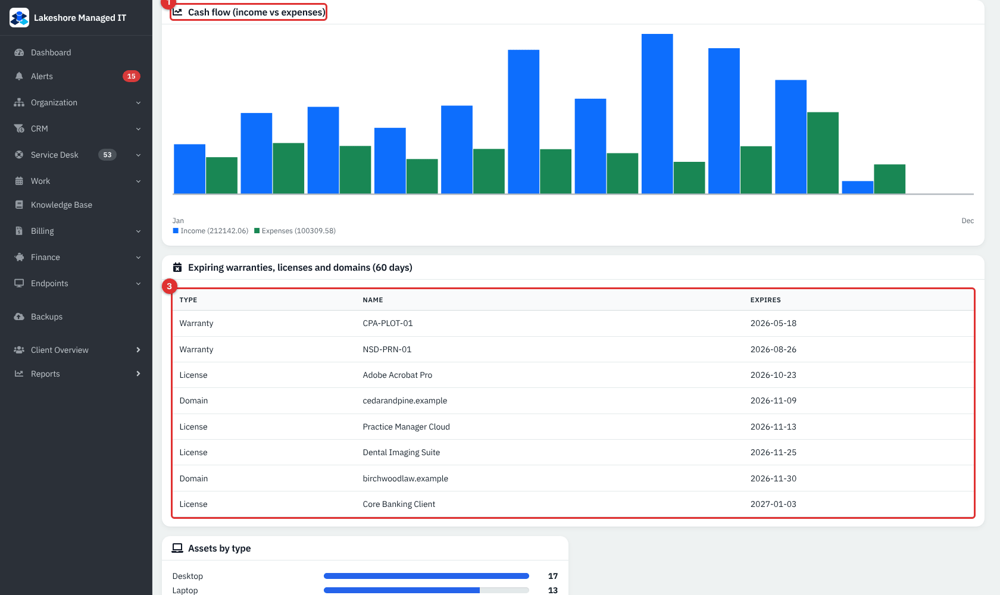

*Figure 3 — Money and expiry widgets. (1) The **Cash flow (income vs expenses)** title, with the year it covers. (2) Income (payments received) and expenses per month. (3) **Expiring warranties, licenses and domains (60 days)**.*

> **Note.** The expiry widget lists everything whose date is up to 60 days away, and that includes items that have already expired. Old dates at the top of the list (for example a warranty that ended in the spring) are expired items still on record, not mistakes in the widget.

## The Waiting on you band

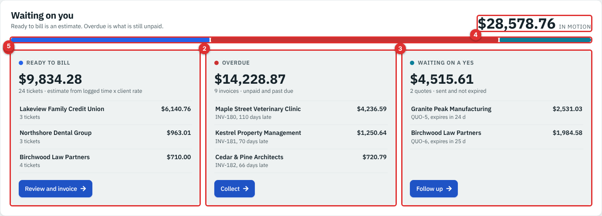

*Figure 4 — The money view of the band (example data).*

The band appears above the widgets and is not a widget: you cannot move or remove it. It has two forms.

**Money view** (invoicing and accounting is on and your role is Administrator or Accountant):

1. **Ready to bill.** Closed, billable tickets that no invoice includes yet. The amount is an estimate: the time logged on each ticket multiplied by the client's hourly rate. **Review and invoice** opens the [Unbilled Tickets report](23-reports.md#unbilled-tickets).
2. **Overdue.** Invoices with the status Sent, Viewed or Partial whose due date has passed, counted at what is still unpaid. **Collect** opens the invoice list. The three oldest are listed with the days late.
3. **Waiting on a yes.** Quotes with the status Sent or Viewed that have not expired. **Follow up** opens the quote list. These are possible income, not money owed.
4. The **in motion** figure adds the three columns together.
5. The coloured bar shows each column's share of that total.

**Work view** (everyone else): **Waiting on you** (your open tickets), **Past due** (open tickets past their due time) and **Unassigned** (open tickets nobody owns), each with a count and a button to the matching ticket list. The heading reads **Your day**.

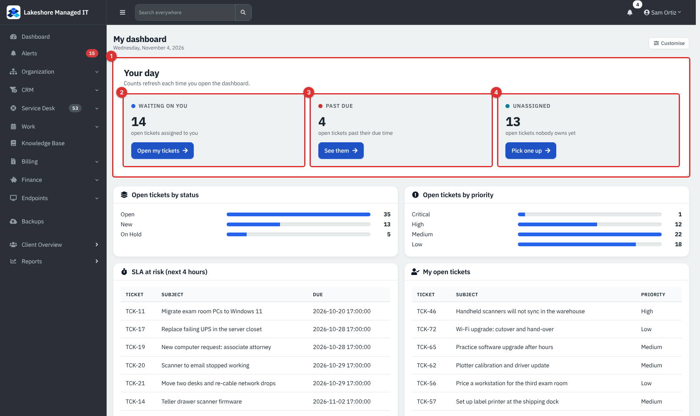

*Figure 5 — The work view for the technician Sam Ortiz. (1) The band. (2) Tickets waiting on you. (3) Tickets past due. (4) Unassigned tickets.*

> **Note.** The band decides by role, not by permission. A custom role such as **Billing clerk** has Financial permission and can add the money widgets to its dashboard, yet still sees **Your day**, because it is neither the Administrator nor the Accountant role.

Every figure respects the clients you are allowed to see. The one exception is the money widgets (see the table below), which show company totals to anyone who may read financial data.

## Common tasks

### Open customise mode

1. Choose **Customise** at the top right of the dashboard.
2. The title bar of each widget now carries a row of small buttons and a drag handle, and an **Add a widget** panel appears above the widgets.
3. Choose **Done** when you have finished. Every change is saved the moment you make it.

### Add a widget

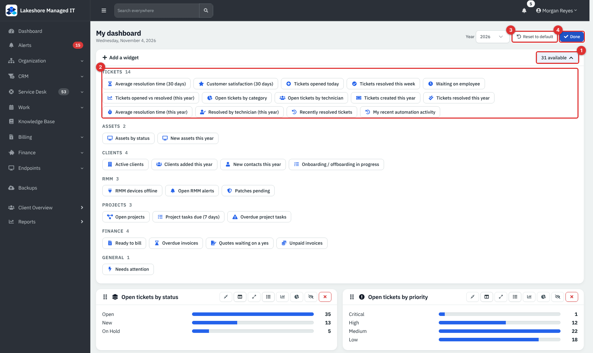

*Figure 6 — The add panel. (1) The button shows how many widgets you can still add. (2) Widgets are grouped by category with a count. (3) **Reset to default**. (4) **Done**.*

1. In customise mode, choose the **N available** button on the **Add a widget** bar.
2. Find the widget by its category (**Tickets**, **Assets**, **Clients**, **RMM**, **Projects**, **Finance**, **General**) and choose its name.
3. The widget is added at the end of the dashboard at its default size. Move and resize it as you like.

A dashboard holds at most 30 widgets. At 30 the panel warns you and the buttons are disabled until you remove one. A widget already on the dashboard is not offered again.

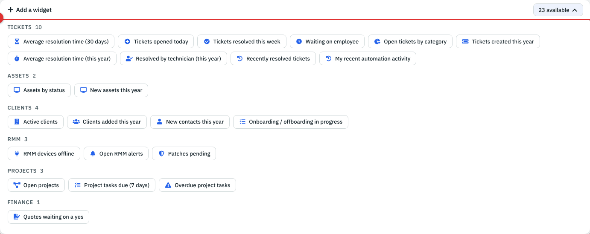

*Figure 7 — What a technician can add. Widgets that need a permission the role does not have, such as the money widgets, are missing from the list.*

### Move, resize, hide and remove a widget

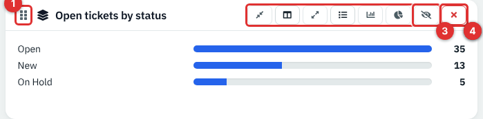

*Figure 8 — One widget in customise mode. (1) The drag handle. (2) Size and chart buttons. (3) **Hide**. (4) **Remove**.*

- **Reorder:** drag the grip at the left of the title bar and drop the widget where you want it. The new order is saved at once.
- **Resize:** choose **Size: Small**, **Size: Medium** or **Size: Wide**. The button for the current size is highlighted.
- **Hide:** hiding keeps the widget in your layout but takes it off the dashboard until you choose **Show**. In customise mode a hidden widget is dimmed and reads **Hidden. Choose Show to bring it back.**
- **Remove:** takes the widget out. You can add it again from the panel.

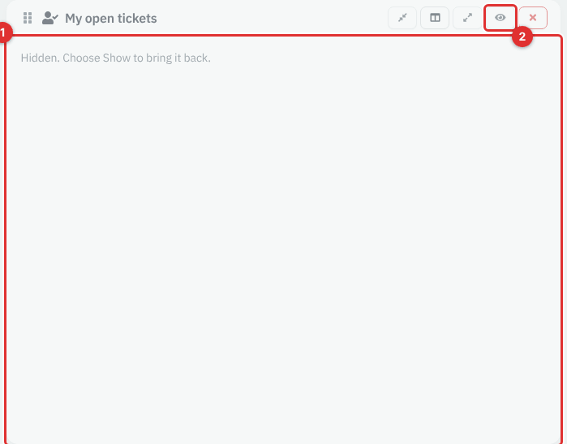

*Figure 9 — A hidden widget in customise mode. (1) The message. (2) **Show** brings it back.*

### Switch a widget between list, bar and pie

Widgets that count things in groups can be drawn as a list, a bar chart or a pie chart. The extra buttons appear in customise mode only for widgets that support it.

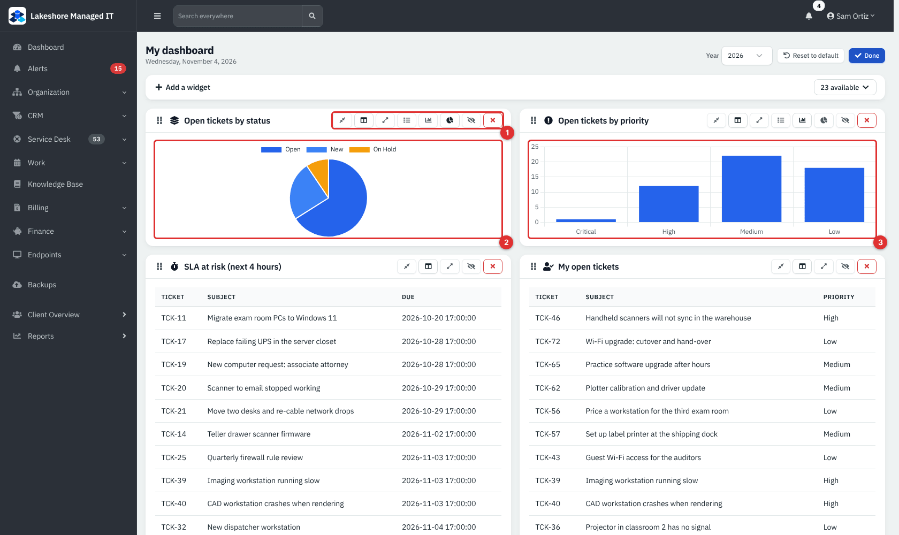

*Figure 10 — (1) The chart buttons: **Chart: List**, **Chart: Bar**, **Chart: Pie**. (2) A pie chart. (3) A bar chart.*

- Group widgets (open tickets by status, priority, category and technician, assets by type and status, open RMM alerts, patches pending) offer **List**, **Bar** and **Pie**. The default is **List**.
- Over-time widgets (**Tickets created vs closed (30 days)**, **Tickets opened vs resolved (this year)** and **Cash flow**) offer **Bar** and **Line**. The default is **Bar**.
- Every other widget has only one form and shows no chart buttons.

### Choose the year for "for a year" widgets

When one of the widgets in the reference table marked **Year** is on your dashboard, a **Year** picker appears next to **Customise**. It lists the current year and the five before it. The choice applies to all year widgets at once and is not remembered: the next time you open the dashboard it shows the current year again.

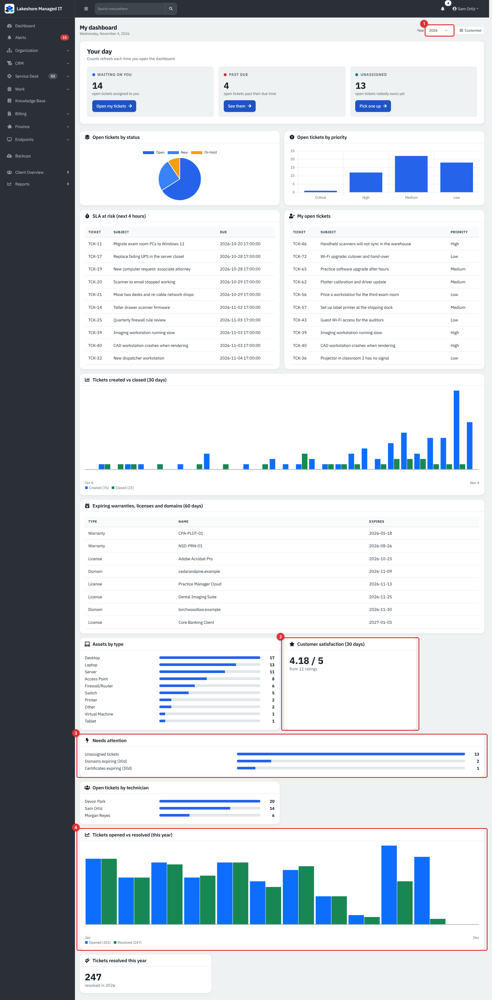

*Figure 11 — A longer dashboard. (1) The **Year** picker. (2) **Customer satisfaction (30 days)**. (3) **Needs attention**. (4) **Tickets opened vs resolved (this year)** for the year chosen.*

### Go back to the default layout

1. In customise mode choose **Reset to default**.
2. In the **Reset your dashboard?** window read the warning and choose **Reset to default** again.

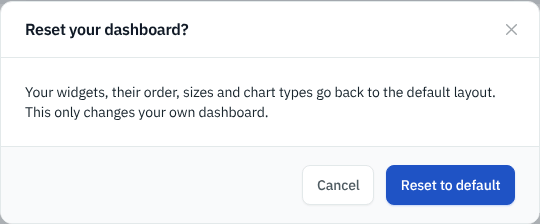

*Figure 12 — The reset confirmation. It only changes your own dashboard.*

Your widgets, their order, sizes and chart types go back to the default layout: **Open tickets by status**, **Open tickets by priority**, **SLA at risk (next 4 hours)**, **My open tickets**, **Tickets created vs closed (30 days)**, **Cash flow (income vs expenses)**, **Expiring warranties, licenses and domains (60 days)** and **Assets by type**. A role that cannot read some of these gets only the others, and a role that can read none gets the first six widgets it can read.

## Reference

### Widget reference

There are 39 widgets. A widget is offered when you can read **any** of the modules listed for it. "Scope" says whether it is narrowed to your clients or company-wide.

**Tickets** (module: Support unless noted)

| Widget | Shows | Notes |
|---|---|---|
| Open tickets by status | Open tickets grouped by status | List, Bar, Pie |
| Open tickets by priority | Open tickets grouped by priority, High first | List, Bar, Pie |
| SLA at risk (next 4 hours) | Up to 10 open tickets whose SLA resolution is due within 4 hours or already past | Skips tickets that do not count toward SLA and tickets whose SLA clock is paused |
| My open tickets | Up to 10 open tickets assigned to you | |
| Tickets created vs closed (30 days) | Created and closed per day, last 30 days | Bar, Line |
| Average resolution time (30 days) | Hours from start to resolved, across tickets resolved in 30 days | Project tickets are left out when **Exclude project-linked tickets** is on in the ticket settings |
| Customer satisfaction (30 days) | Average rating out of 5 and the number of ratings | Shows "Customer satisfaction surveys are turned off." when surveys are off |
| Tickets opened today | Tickets created today | |
| Tickets resolved this week | Tickets closed in the last 7 days | |
| Waiting on employee | Open tickets in a status named **Waiting on Employee** or **Waiting on Customer** | Shows 0 when no such status exists. See the note below |
| Tickets opened vs resolved (this year) | Opened and closed per month | **Year**. Bar, Line |
| Open tickets by category | Open tickets per category (top 8) | List, Bar, Pie |
| Open tickets by technician | Open assigned tickets per technician (top 8) | List, Bar, Pie |
| Tickets created this year | One number | **Year** |
| Tickets resolved this year | One number | **Year** |
| Average resolution time (this year) | Hours across the year | **Year**. Needs **Show Avg Resolution Time on the dashboard** in the ticket settings |
| Resolved by technician (this year) | Closed tickets per technician (top 8) | **Year** |
| Recently resolved tickets | The last 10 closed tickets with client and priority | |
| My recent automation activity | The last 10 automation rule results on your tickets | |

**Assets** (module: Assets or Support)

| Widget | Shows | Notes |
|---|---|---|
| Assets by type | Assets per type (top 12) | List, Bar, Pie |
| Assets by status | Assets per status | List, Bar, Pie |
| New assets this year | One number | **Year** |
| Expiring warranties, licenses and domains (60 days) | Up to 15 rows, soonest first, including already expired | Warranties need Assets or Support, licenses and domains need Clients |

**Clients** (module: Clients)

| Widget | Shows | Notes |
|---|---|---|
| Active clients | Clients that are not archived and not leads | |
| Clients added this year | One number | **Year** |
| New contacts this year | One number | **Year** |
| Onboarding / offboarding in progress | Up to 15 runs that are in progress, oldest first | Opens the run |

**RMM** (module: RMM; **Open RMM alerts** also accepts RMM Alerts)

| Widget | Shows | Notes |
|---|---|---|
| RMM devices offline | Enrolled devices that have not checked in for 15 minutes | |
| Open RMM alerts | Unresolved alerts by severity | List, Bar, Pie |
| Patches pending | Patches pending approval and approved but not installed | List, Bar, Pie |

**Projects** (module: Support)

| Widget | Shows | Notes |
|---|---|---|
| Open projects | Projects not completed or archived | |
| Project tasks due (7 days) | Open project tickets due in the next 7 days | |
| Overdue project tasks | Open project tickets past their due date | |

**Finance** (module: Financial; **Quotes waiting on a yes** also accepts Sales). These are company-wide.

| Widget | Shows | Notes |
|---|---|---|
| Ready to bill | Estimate per client from closed, billable, uninvoiced tickets | Same figure as the band |
| Overdue invoices | Up to 10 unpaid invoices past due, with days late and amount owed | |
| Quotes waiting on a yes | Up to 10 sent or viewed quotes that have not expired | |
| Unpaid invoices | Total still owed on Sent, Viewed and Partial invoices, and how many | |
| Cash flow (income vs expenses) | Payments received and expenses per month | **Year**. Bar, Line |

**General** (module: Support, Clients or Training)

| Widget | Shows | Notes |
|---|---|---|
| Needs attention | Unassigned open tickets, domains expiring in 30 days, certificates expiring in 30 days | Needs Support |

> **Note.** The title **Waiting on employee** is wording carried over from the IT-department edition. In RivetMSP it means tickets waiting on the client. It counts a status with exactly that name or **Waiting on Customer**; a fresh RivetMSP install has neither status, so the widget shows 0 until you create one under the ticket settings.

### Customise buttons

| Button | Title (hover text) | What it does |
|---|---|---|
| Grip | Drag to reorder | Move the widget |
| Shrink | **Size: Small** | One third of the width |
| Columns | **Size: Medium** | Half the width |
| Expand | **Size: Wide** | Full width |
| List, bar, pie, line icons | **Chart: List**, **Chart: Bar**, **Chart: Pie**, **Chart: Line** | Change how the numbers are drawn |
| Eye | **Hide** / **Show** | Keep the widget but take it off the dashboard |
| Cross | **Remove** | Take it out of your layout |

### Limits and rules

| Rule | Value |
|---|---|
| Widgets per dashboard | 30 |
| Each widget appears | once |
| Year picker range | Current year and the five before |
| Layout is stored | per user, saved on every change |
| Money widgets | Company-wide, but restricted to clients you may see if your access is limited |
| Other widgets | Restricted to the clients you may see |

## Tips and good practice

- Keep the dashboard short. Eight to twelve widgets load fast and fit one screen or two.
- Give technicians **SLA at risk**, **My open tickets** and **Needs attention**. Give the service manager **Open tickets by technician**, **Tickets opened vs resolved (this year)** and **Customer satisfaction**.
- Use the bar or pie form for groups with two to five values and the list for longer ones.
- When a number looks wrong, open the matching report in [Reports](23-reports.md): the widget and the report use the same figures.
- Widget colours and chart styles follow your theme, including dark mode.

## Related guides

- [Reports](23-reports.md) for the full financial and technical reports and for scheduled emails.
- [Service desk tickets](05-service-desk-tickets.md) for the tickets behind the ticket widgets.
- [Ticket billing and worksheets](06-ticket-billing-and-worksheets.md) for how billable tickets become invoices.
- [Recurring tickets, catalog, CSAT and requests](07-recurring-tickets-catalog-csat-requests.md) for customer satisfaction surveys.
- [Assets](11-assets.md) for warranties and the assets widgets.
