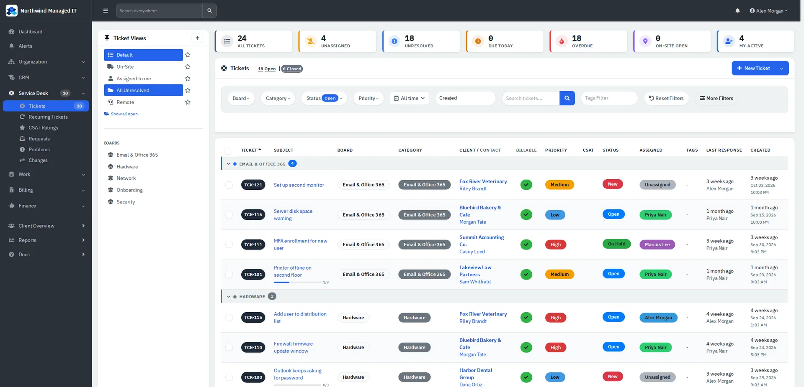
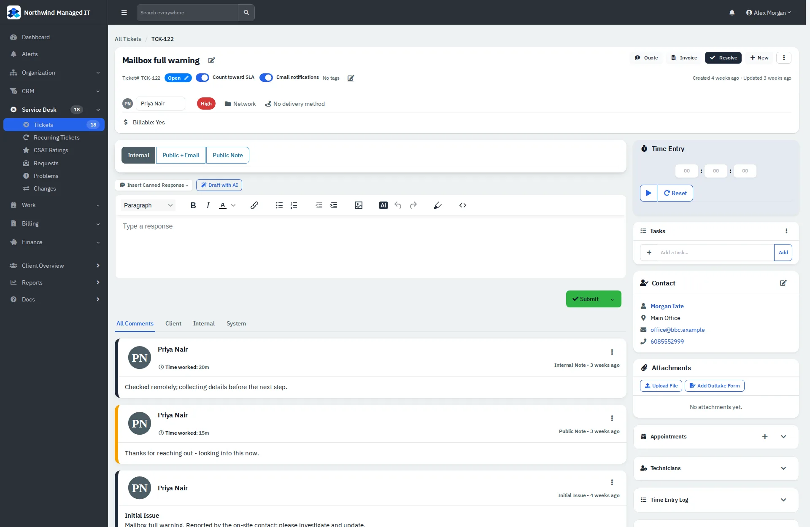

# Service desk

Tickets are the core of the app. This guide covers finding tickets, working one, logging time, and handling several at once.

| | |
|---|---|
| **Where to find it** | Sidebar → **Service Desk** → **Tickets**. Also **Recurring Tickets**, **CSAT Ratings**, **Requests**, **Problems** and **Changes**. |
| **Who can use it** | Technicians and administrators. Accountants see what their role allows. |
| **Turn it on** | Administration → Settings → **Modules** (ticketing). Statuses, categories, templates and service levels are set under Administration → Ticketing. |

## The ticket list

*Figure 1: Ticket views on the left, status tiles on top, filters, then the list grouped by category.*

- **Tiles** across the top (All tickets, Unassigned, Unresolved, Due today, Overdue, On-site open, My active) are counts; click one to filter to it.
- **Ticket Views** are saved filter sets (Default, On-Site, Assigned to me, All Unresolved, Remote). The ⊕ button saves the current filters as your own view; the star marks a view as your default.
- **Filters:** Board, Category, Status, Priority, date range, search and Tags, plus **More Filters**. **Reset Filters** clears them.
- **Boards** (left, below the views) show only tickets of one category.
- On screens narrower than about 1700px the views panel sits above the list so the table keeps its full width.

## Opening and working a ticket

*Figure 2: Ticket detail.*

1. Click the subject in the list.
2. Choose how you reply with the tabs above the editor:
   - **Internal**: a note only your team sees.
   - **Public Note**: visible to the client in the portal, **not** emailed.
   - **Public + Email**: visible to the client **and emailed** to them. If the ticket has email notifications switched off, the reply is saved but not sent unless you tick the override.
3. Type in the editor (it supports formatting, images and canned responses via **Insert Canned Response**) and click **Submit**.
4. To change status, click the status pill at the top (a dialog offers New, Open, On Hold, Resolved, Closed, or your own statuses) and **Save**. **Resolve** is the shortcut for finishing a ticket.
5. To assign, use the assignee box under the title; it saves when you pick a name.

Other controls on the ticket:

- **Count toward SLA** and **Email notifications** switches under the title.
- **Quote** and **Invoice** buttons create a quote or invoice from the ticket.
- **New** menu: upload an attachment or add an outtake form.
- **⋮ menu**: Summarize, Merge Ticket, Add Contact, Add Asset, Add Vendor, Add Watcher, Change Client, Delete.
- Side panels: **Time Entry**, **Tasks**, **Contact**, **Attachments**, **Appointments**, **Technicians**, **Time Entry Log**, **Worksheets**, **Charges**, **Activity Summary**, **Problem**.

### Logging time

Hours and minutes go in with a reply or note: fill in the Time Entry boxes (or press the timer's play button, then stop it) and submit the reply. The time shows on the reply and in the time reports.

## Handling several tickets at once

Tick the boxes at the start of the rows; a **Bulk Action (n)** button appears with: Assign Agent, Set Category, Set Priority, Email Notifications, Update/Reply, Set Project, Merge, Resolve and Delete. **Export** is under the **New Ticket** button's menu.

## Creating a ticket

**New Ticket** (top right of the list, or **New Ticket** on a client overview) opens a dialog. Pick the client and contact, give a subject and details; fields with a red star are required.
