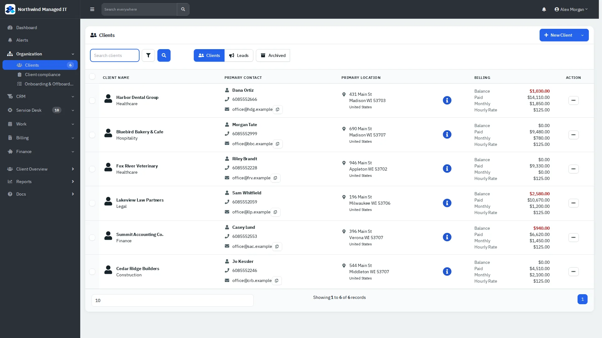
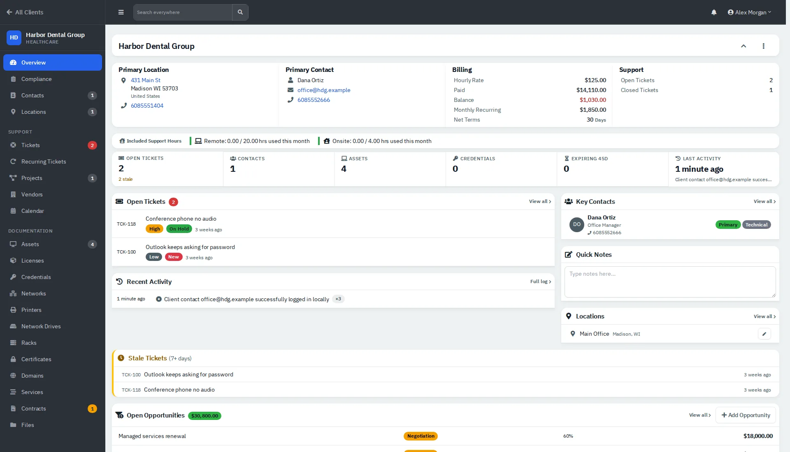
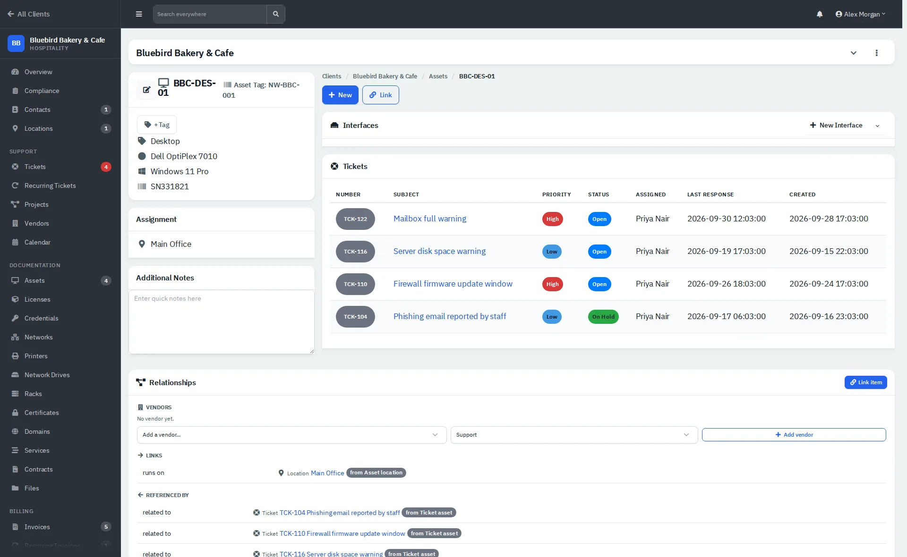

# Clients, contacts and assets

Everything you know about a customer lives under their client record.

| | |
|---|---|
| **Where to find it** | Sidebar → **Organization** → **Clients**. Open a client for its overview and its own sidebar. **Client Overview** (sidebar) lists contacts across clients. |
| **Who can use it** | Staff whose role allows the client modules. An administrator can limit a user to certain clients. |
| **Turn it on** | Always on; individual documentation sections follow the modules switched on under Administration → Settings → Modules. |

## The client list

*Figure 1: Clients with primary contact, location and billing figures.*

Use the **Clients / Leads / Archived** buttons to switch lists. **New Client** opens the add dialog (tabs: Details, Location, Contact, Billing, Notes; a name and a primary contact are required). Tick several rows for bulk actions: Import, Export, Open Tickets, Set Hourly Rate, Set Net Terms, Set Industry, Set Referral, Assign Tags, Send Email and Archive.

## The client overview

*Figure 2: Overview of one client: billing summary, support counts, open tickets, key contacts, notes, locations, stale tickets and open opportunities.*

The overview answers "how is this client doing?" at a glance: balance, what they paid, monthly recurring amount, net terms, included support hours used this month, open and stale tickets and open opportunities. The **⋮** menu has **New Ticket**, **Edit Client**, **Export Data** and **Archive Client**.

The client's own sidebar groups the records:

- **Support:** Tickets, Recurring Tickets, Projects, Vendors, Calendar.
- **Documentation:** Assets, Licenses, Credentials, Networks, Printers, Network Drives, Racks, Certificates, Domains, Services, Contracts, Files.
- **Billing:** Invoices, Recurring Invoices, Quotes, Payments and similar entries when you have access.

Badges show how many records each section holds.

## Contacts and locations

**Contacts** hold the people at a client, with phone and email links and notes. Mark one as **Primary**, **Billing** or **Technical**. **Locations** hold addresses and phone numbers; one is the client's primary location.

## Assets

*Figure 3: An asset: hardware and OS details, assignment, the tickets raised about it, and what it is related to.*

Open the client → **Assets** → **New Asset**. The asset page lists the tickets that mention it, so you can see its history, and a **Relationships** panel links it to a vendor, location and other records. Use **Search everywhere** to jump to an asset by name from anywhere.

## Credentials

Credentials are stored encrypted and masked until revealed. Viewing the credential list is recorded in the audit log.
