# Clients, contacts and locations

A **client** is a company you look after. Every ticket, asset, credential, invoice and document in RivetMSP belongs to a client, and each client has its own people (**contacts**) and sites (**locations**). This guide shows how to find, add, edit, import, tag, archive and delete clients, how to keep their contacts and locations up to date, and how to read the client's own overview page.

| | |
|---|---|
| **Where to find it** | Sidebar → **Organization** → **Clients**. Click a client's name to open its own workspace, where **Overview**, **Contacts** and **Locations** are the first entries. **Client Overview** (further down the sidebar) lists contacts and locations for all clients together. |
| **Who can use it** | The **Client** permission module (Administration → Roles). **Read** to view clients and contacts. **Modify** to add, edit, import, tag, archive and restore. **Full** to delete a client, to use **Export Data** on a client, and to anonymize or delete a contact. The **Locations** list also needs **Support** at Read or above. The **Billing** column on the Clients list needs **Financial** at Read or above and the invoicing module switched on. Administrators always have full access. |
| **Turn it on** | Nothing to turn on. Portal logins for contacts need **Settings → Modules → Client portal** (see [Client portal](32-client-portal.md)). |

## What it's for

- Keeping one record per company with its industry, billing terms, tags and notes.
- Knowing who to call: one **primary** contact, plus **billing**, **technical** and **important** contacts.
- Recording each site, its address, hours and a contact on site.
- Giving a contact access to the client portal.
- Starting point for everything else: tickets, assets, credentials and invoices all hang off the client.

## A quick tour

### The Clients list

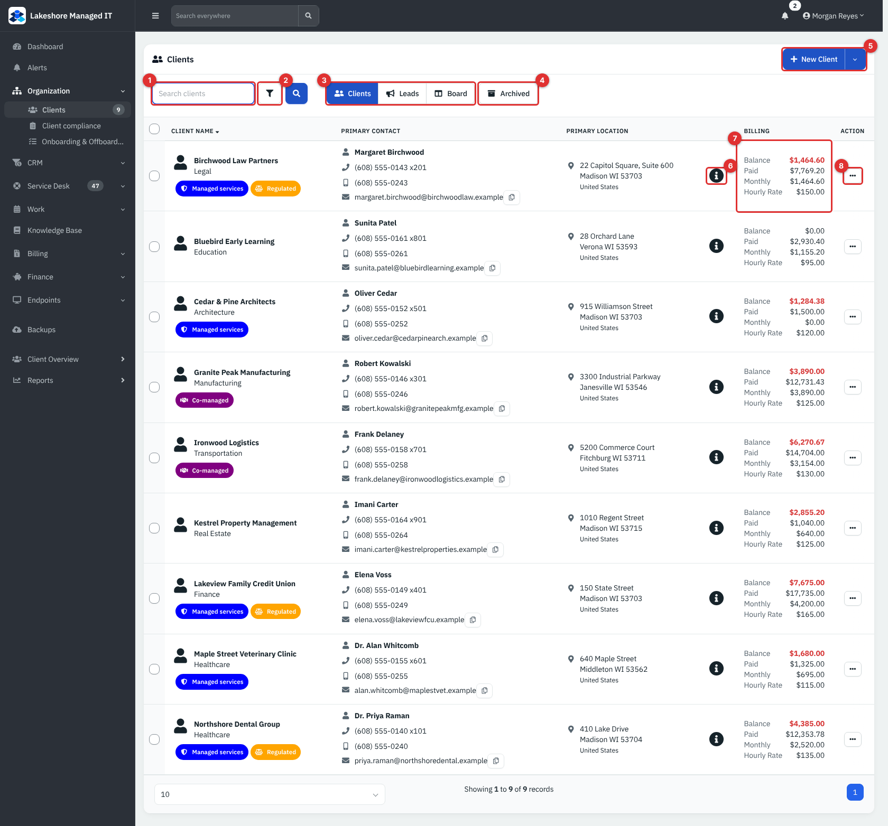

*Figure 1 — Sidebar → Organization → Clients.*

1. **Search clients (1).** Matches the client name, short name, industry, referral, tags, tax ID, the primary contact's name, e-mail and phone numbers, and the primary location's address.
2. **Filter button (2).** Opens **Date range** (the day the client was created), **Tag**, **Industry** and **Referral**.
3. **Clients / Leads / Board (3).** **Clients** shows customers, **Leads** shows prospects (companies marked **Is Lead**), and **Board** opens the lead pipeline. Leads are covered in [CRM: leads and pipeline](21-crm-leads-and-pipeline.md).
4. **Archived (4).** Switches between active and archived clients.
5. **New Client (5).** The arrow next to it offers **Import** and **Export**.
6. **Info icon (6).** Hover over it to see how many contacts, assets, vendors, credentials, software items and tickets the client has.
7. **Billing (7).** **Balance** (invoiced but unpaid; shown in red when above zero), **Paid**, **Credit** (only when the client has a credit), **Monthly** (the monthly total of active recurring invoices; yearly ones are divided by 12) and **Hourly Rate**.
8. **Action (8).** **Edit**, **Archive** (**Restore** in the archived view) and, on a lead, **Convert to Client**.

Under each name you see the client's **industry** and its tags. By default the most recently opened client comes first; click a column heading to sort. The **Primary Contact** column shows the contact marked primary, and clicking the name opens a quick summary of that person.

> **Note:** On a narrow window the **Billing** column can wrap a long amount onto two lines. Widen the window or collapse the sidebar if that happens.

### Find a client

1. Type in **Search clients** and press Enter, or click the funnel to open the filters.
2. Pick a **Tag**, **Industry** or **Referral**; they apply as soon as you choose a value.

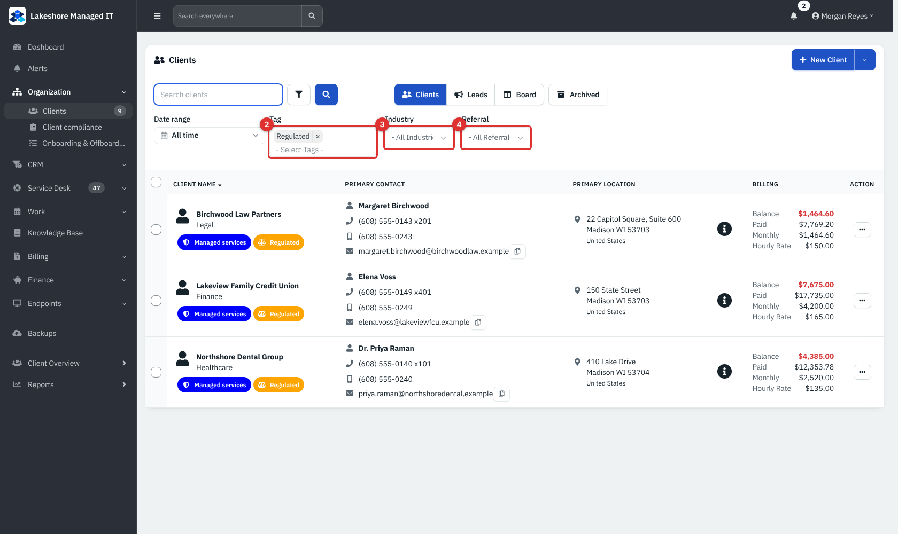

*Figure 2 — Date range (1), Tag (2), Industry (3) and Referral (4). Industry is the free-text **Industry** field of the client.*

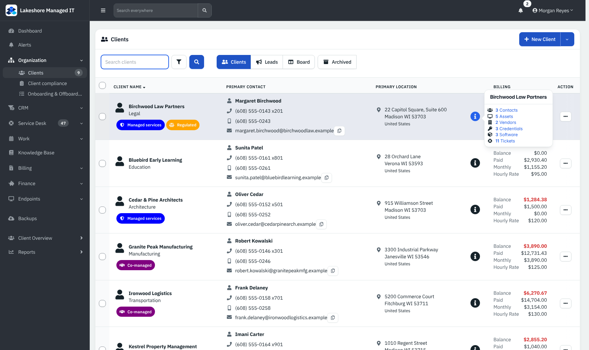

*Figure 3 — The info icon's pop-up. A line appears only when the count is above zero, and each line links to that list for the client.*

The **Search everywhere** box in the top bar also finds clients, contacts, assets, tickets and locations (at least two characters).

## Common tasks

### Add a client

1. On **Clients**, click **New Client**.
2. On **Details**, enter the **Name** (required). If the name looks like an existing client, a note appears under the box. Optionally set a **Shortened Name** (up to six characters, shown in capitals), **Industry**, **Referral** (pick one, or type a new one, or use **+** to add it to the list), **Website** and **Tags**.
3. On **Location**, optionally fill in the address, **Country**, phone, extension and fax.
4. On **Contact**, enter the **Primary Contact** (required), title, phone, extension, mobile and e-mail.
5. On **Billing** (shown when invoicing is on), check **Hourly Rate**, **Payment Terms** and **Tax ID**. They start from the company defaults in Administration → Settings → Defaults.
6. On **Notes**, add anything the team should know, then click **Create Client**.

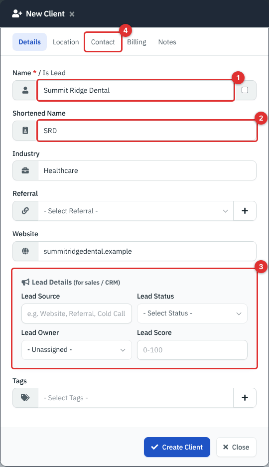

*Figure 4 — Details tab. Name (1), Shortened Name (2), the **Lead Details** block (3) and the Contact tab (4).*

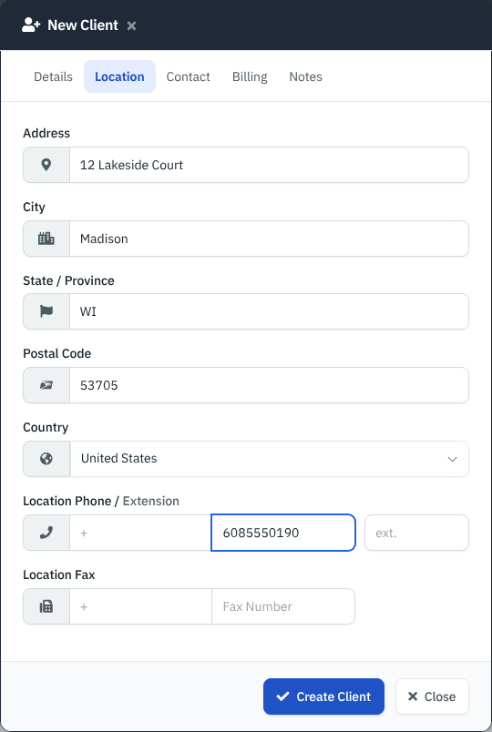

*Figure 5 — Location tab. This becomes the client's primary location.*

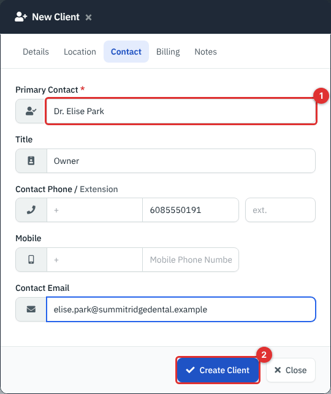

*Figure 6 — Contact tab. The person you enter (1) becomes the primary contact; **Create Client** (2) is in the footer.*

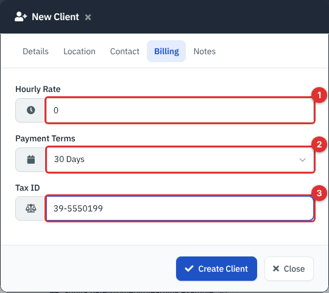

*Figure 7 — Billing tab: Hourly Rate (1), Payment Terms (2) and Tax ID (3). **Payment Terms** offers On Receipt, 7, 10, 15, 30, 45, 60 or 90 days.*

What RivetMSP creates for you:

- The client, with a short name made from the name if you left it blank.
- A location named **Primary**, only if you filled in an address, city, state, postal code or phone.
- The primary contact, marked **Primary** and **Important**.
- A **Domains** entry (and an SSL certificate entry, when one can be read) for the **Website**, when it looks like a valid host name. This uses the internet, so it may be empty on a server without outbound access. Not verified on a live service in this guide.
- A **Referral** value that is not yet in the list is added to the referral list.

The lead fields (**Lead Source**, **Lead Status**, **Lead Owner**, **Lead Score**) are for sales; ignore them for a normal client.

### Edit a client

1. In the list, **Action** → **Edit**; or on the client's page, the **⋮** menu → **Edit Client**.
2. Change what you need on **Details**, **Billing** and **Notes**, then click **Save**.

Two things to know: saving replaces the client's tags with the ones selected in the form, and editing here does not change the primary contact or location. Change those under **Contacts** and **Locations**.

### Tag, rate or e-mail several clients at once

Tick the box on one or more rows. An **Action** button appears next to **Archived**.

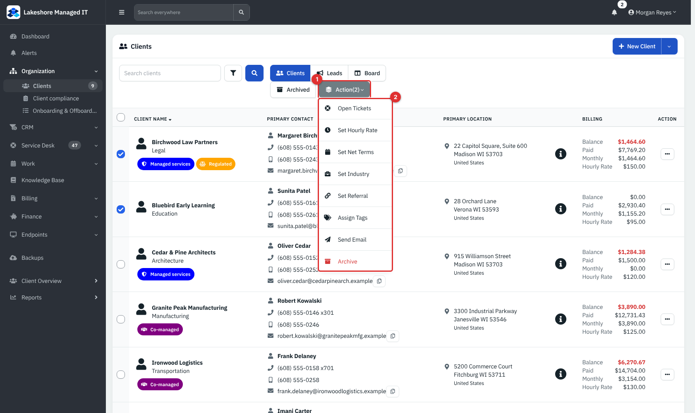

*Figure 8 — Select clients (1) and open the **Action** menu (2).*

- **Open Tickets** creates one ticket for each selected client (see [Service desk](05-service-desk-tickets.md)).
- **Set Hourly Rate**, **Set Net Terms**, **Set Industry** and **Set Referral** give every selected client the same value.
- **Assign Tags** adds the tags you pick. Tick **Remove Existing Tags** to replace what is there.
- **Send Email** queues a message to the contacts of the selected clients. Tick **Primary**, **Important**, **Billing** or **Technical** contacts. If you tick none, every contact of those clients receives it, archived ones included. Messages go to the outgoing mail queue; sending needs mail to be set up (see [Mail intake and sending](30-mail-intake-and-sending.md), [Webhooks, event rules and jobs](30b-webhooks-event-rules-and-jobs.md) and [AI and the MCP server](30c-ai-and-remote-mcp.md)).
- **Archive** (**Restore** in the archived view).

### Import and export clients

**New Client** arrow → **Export** downloads a CSV of every client, archived clients and leads included, with its primary contact and primary location.

**Import** takes a CSV with exactly 22 columns in a fixed order; use **sample csv template** in the pop-up. Each row creates a client with one contact (who becomes primary) and one location. Rows whose name already exists are skipped and counted as duplicates.

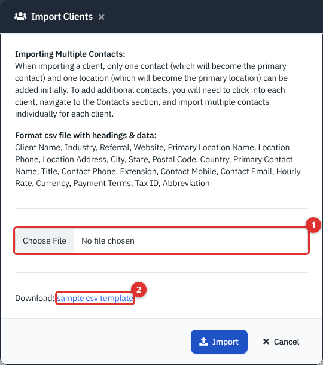

*Figure 9 — Choose the CSV file (1) or download the template (2).*

### Archive, restore and delete a client

1. **Action** → **Archive** on the row, or **⋮** → **Archive Client** on the client's page. Confirm.
2. The client leaves the main list, dropdowns and the sidebar count. **Active recurring invoices for the client are switched off**, with a note in their history. Nothing is deleted.
3. To bring a client back, click **Archived**, then **Action** → **Restore**. Recurring invoices stay off; switch them on again yourself if you need them.

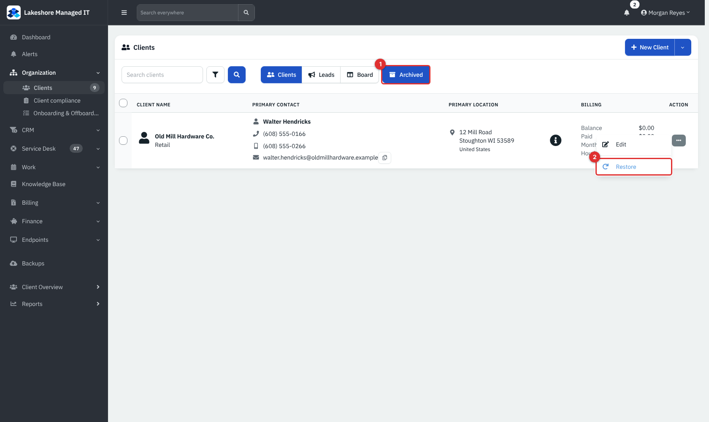

*Figure 10 — Click **Archived** (1), then **Action** → **Restore** (2).*

**Delete** is permanent and needs the **Client** module at **Full**. Archive the client first, open it, and choose **⋮** → **Delete Client**. Type the client's name to confirm. This removes the client and its contacts, locations, assets, credentials, invoices, quotes, tickets, files and logs. It cannot be undone.

## The client's workspace

Click a client's name to open its workspace. The sidebar changes to the client's own menu: **Overview**, **Compliance** ([next guide](04-client-workflows-and-compliance-per-client.md)), **Contacts** and **Locations**, then **Support**, **Documentation** and **Billing** groups. Items appear only for modules that are on and that your role can use, and numbers on the right count that client's records. Click **All Clients** to leave.

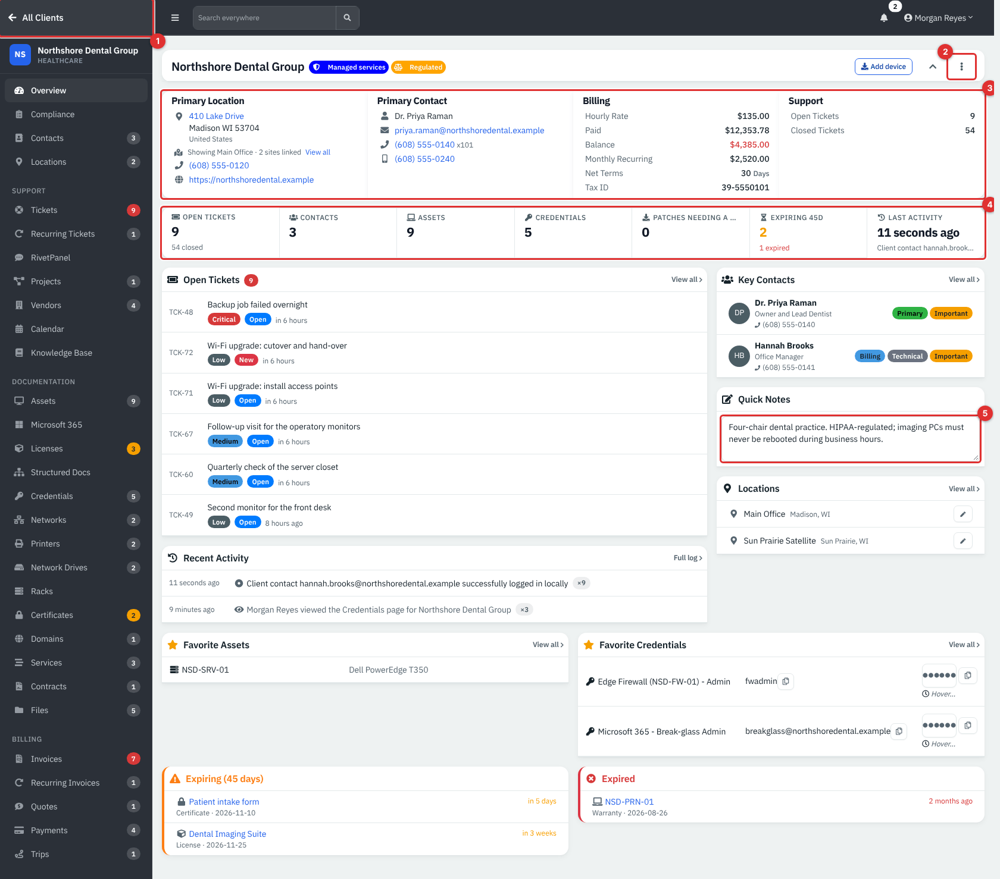

*Figure 11 — The Overview of Northshore Dental Group (example data).*

1. **All Clients (1)** returns to the list.
2. **⋮ menu (2)** holds the client actions (Figure 12).
3. **Header strip (3)**: **Primary Location**, **Primary Contact**, **Billing** (rate, paid, balance, monthly recurring, net terms, tax ID) and **Support** (open and closed tickets). The chevron folds it away.
4. **Summary tiles (4)** count open tickets, contacts, assets, credentials, patches needing a decision (only with the built-in endpoint module) and items expiring within 45 days, and show the last change. Each tile links to its list.
5. **Quick Notes (5)**: type and click elsewhere to save. Notes are saved to the client record and a log entry is written.

Below the tiles you find **Open Tickets**, **Recent Activity**, **Key Contacts** (the primary contact and everyone marked billing, technical or important, up to five), **Locations**, **Favorite Assets** and **Favorite Credentials**, and, when relevant, **Stale Tickets** (no activity in 7 or more days), **Expiring (45 days)**, **Expired**, **Shared Items** and open sales opportunities. Cards with nothing to show are hidden.

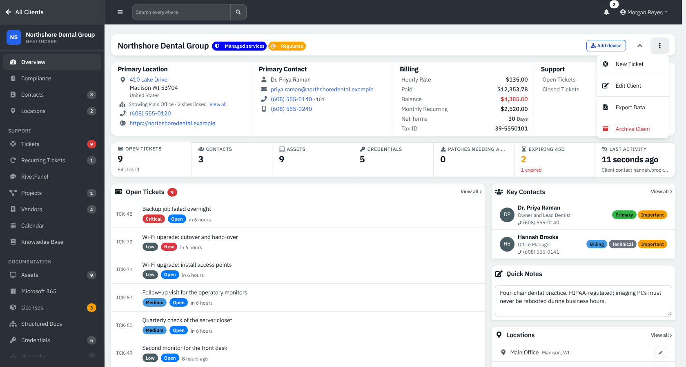

*Figure 12 — The **⋮** menu: **New Ticket** (needs Support at Modify), **Edit Client**, **Export Data** (needs Client at Full; choose which sections to include in a PDF) and **Archive Client**.*

## Contacts

A contact is a person at the client. **Contacts** in the client's sidebar lists that client's people; **Client Overview → Contacts** lists everyone.

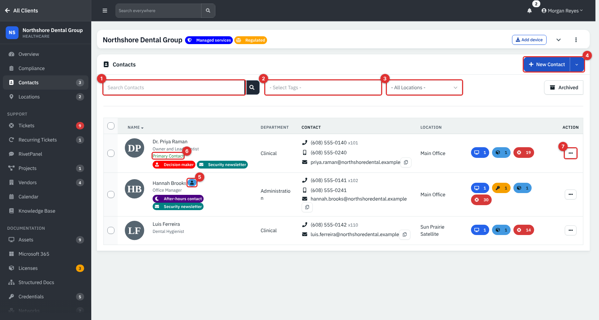

*Figure 13 — Contacts for one client.*

1. **Search Contacts (1)** matches name, title, department, e-mail, phone and location.
2. **Tags (2)** and **Locations (3)** filter the list. (On the all-clients list the third filter picks a client.)
3. **New Contact (4)**; its arrow offers **Import** (from a client's page only) and **Export**.
4. **Portal-login icon (5)** next to a name means the contact has a client-portal login.
5. **Primary Contact (6)** marks the one primary contact. Names of contacts marked **Important** are shown in bold, and important contacts sort to the top.
6. **Action (7)**: **Details**, **Make Note**, **Edit** and, for administrators, **Archive** and **Anonymize & Archive**.

The coloured pills at the right count linked assets, credentials, licenses and tickets; click one to jump to that part of the contact's page.

### Add a contact

1. On **Contacts**, click **New Contact**.
2. On **Details**, check the **Client**, enter the **Name** (required) and optionally the title, **Department / Group**, phone, extension, mobile, e-mail and **Location**. Tick the box beside the name to make this person the **Primary Contact**; any previous primary contact is demoted.
3. On **Photo**, upload a picture (jpg, jpeg, gif, png or webp).
4. On **Access**, set the **Pin**, the **Client Portal** login and the **Roles** (next sections).
5. On **Notes**, add notes and **Tags**, then click **Create**.

An e-mail address that is not valid is silently dropped, so check it after saving.

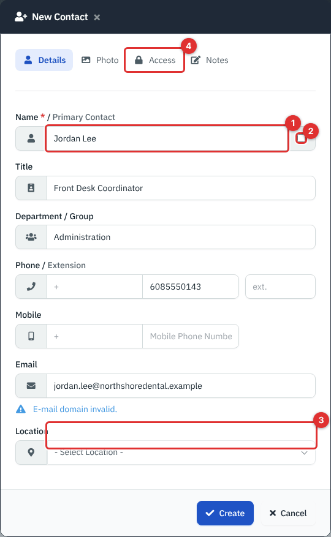

*Figure 14 — Name (1), the Primary Contact box (2), Location (3) and the Access tab (4).*

### Roles: primary, important, billing, technical

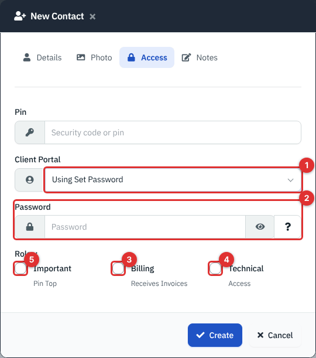

*Figure 15 — Client Portal (1), Password (2), Billing (3), Technical (4) and Important (5).*

| Role | What it does |
|---|---|
| **Primary** | The one main contact. Shown on the client list and header. Always also **Important**. Cannot be archived while primary: make someone else primary first. |
| **Important** | Pins the person to the top of the contact list and into **Key Contacts**. |
| **Billing** | Receives invoices and receipts, and sees **Billing** in the client portal (when invoicing is on). |
| **Technical** | The person for technical matters; sees all the client's tickets, assets and documents in the portal. |

A client can have several billing or technical contacts. The primary contact also sees both portal menus.

### Give a contact portal access

1. Make sure the contact has an **e-mail address**; a login needs a name, an e-mail and a method.
2. Open **Access** and choose **Client Portal**: **Using Set Password**, **Using Azure Credentials**, or **Using Single Sign-On** (shown only once single sign-on is turned on; see [Users, roles and security](34-users-roles-security.md)). **- No Access** is the default for contacts without a login.
3. For a set password, type one or use the **?** button to generate one. If you leave it empty, a random password is set and the contact has to use **Forgot password** on the portal sign-in page.
4. When editing, tick **Send user e-mail with login details?** to queue a welcome message. This needs outgoing mail; delivery is not verified here.

What the contact then sees is described in [Client portal](32-client-portal.md). Archiving the contact disables the login; restoring the contact enables it again, but the billing, technical and important ticks are not restored.

### Contact details page

Click a contact's name.

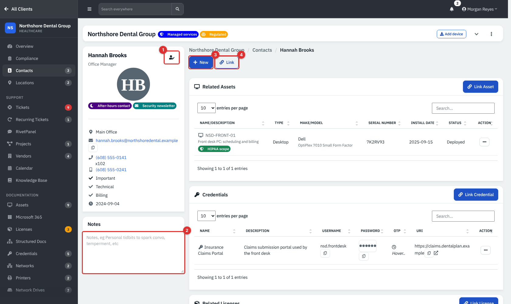

*Figure 16 — Details for Hannah Brooks (example data).*

1. **Edit (1)** reopens the contact form.
2. **Notes (2)** is a free text box that saves when you click away.
3. **New (3)** creates a ticket, recurring ticket, asset, credential, document, file upload or note already linked to this person.
4. **Link (4)** links existing assets, licenses, credentials, services, documents and files.

Below are the linked items, the contact's tickets and a **Notes** log. Make a log entry with **Make Note** (or **New Note**); the type is **Call**, **Email**, **Meeting**, **In Person** or **Note**, and the entry records who wrote it and when. The **Activity Timeline** belongs to the CRM (see [CRM: leads and pipeline](21-crm-leads-and-pipeline.md)).

> **Note:** The **Pin** you enter is shown in plain text on the contact page. Do not store anything that must stay secret there; use [Credentials](14-credentials-and-vault.md).

### Bulk actions, archive and anonymize

Tick contacts and open **Bulk Action**.

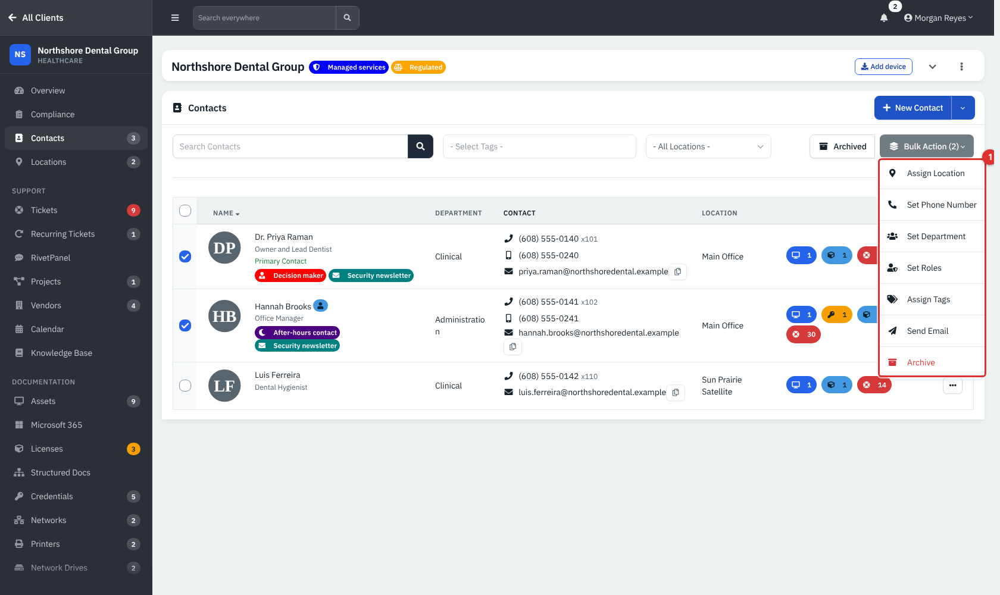

*Figure 17 — Assign Location, Set Phone Number, Set Department, Set Roles, Assign Tags, Send Email and Archive.*

**Set Roles** sets **Important**, **Billing** and **Technical** exactly as ticked for every selected contact, so unticked roles are cleared. **Send Email** queues messages to the selected contacts' e-mail addresses.

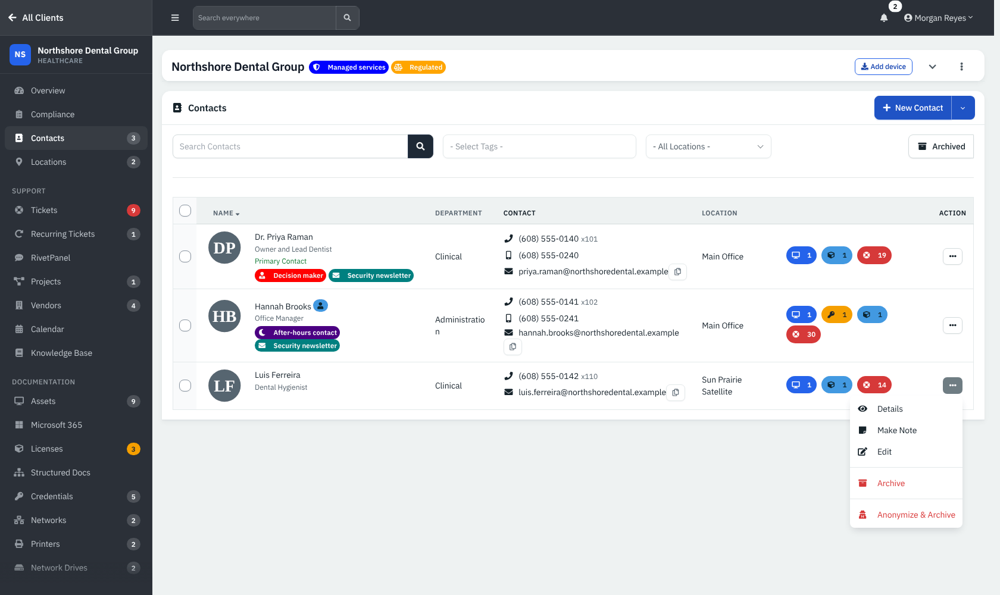

*Figure 18 — The row menu. **Archive** and **Anonymize & Archive** appear for the built-in Administrator role and never for the primary contact.*

- **Archive** hides the person, switches off their portal login, and clears their billing, technical and important ticks. Use the **Archived** button to see archived contacts and **Restore** them.
- **Anonymize & Archive** (needs **Client** at **Full**) replaces the name with asterisks, empties title, department, e-mail, phones, photo, PIN and notes, removes the location, archives the portal login, and redacts the person's name and e-mail from this client's audit log and from tickets they raised, then archives the contact. It cannot be undone.
- **Delete** shows only when an administrator has turned on destructive deletes in the database setting `config_destructive_deletes_enable`; it removes the contact permanently.

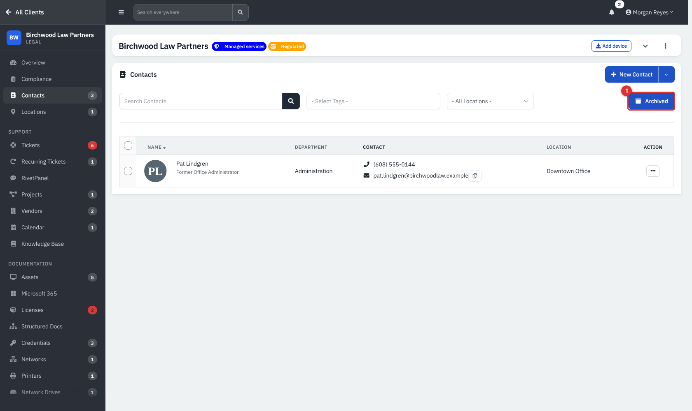

*Figure 19 — Click **Archived** (1) to see archived contacts.*

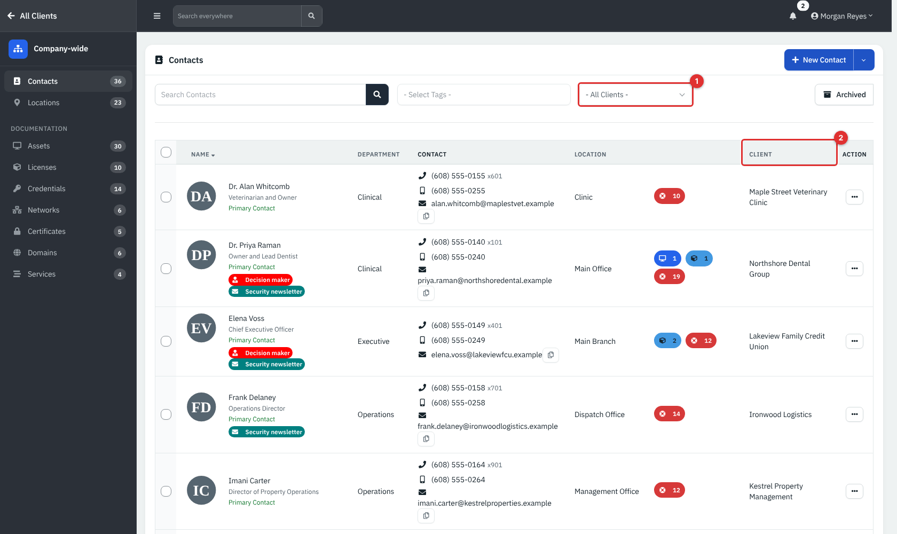

*Figure 20 — Client Overview → Contacts: filter by client (1); the **Client** column (2) links to that client's own list.*

## Locations

A location is a site: an office, branch, plant or clinic.

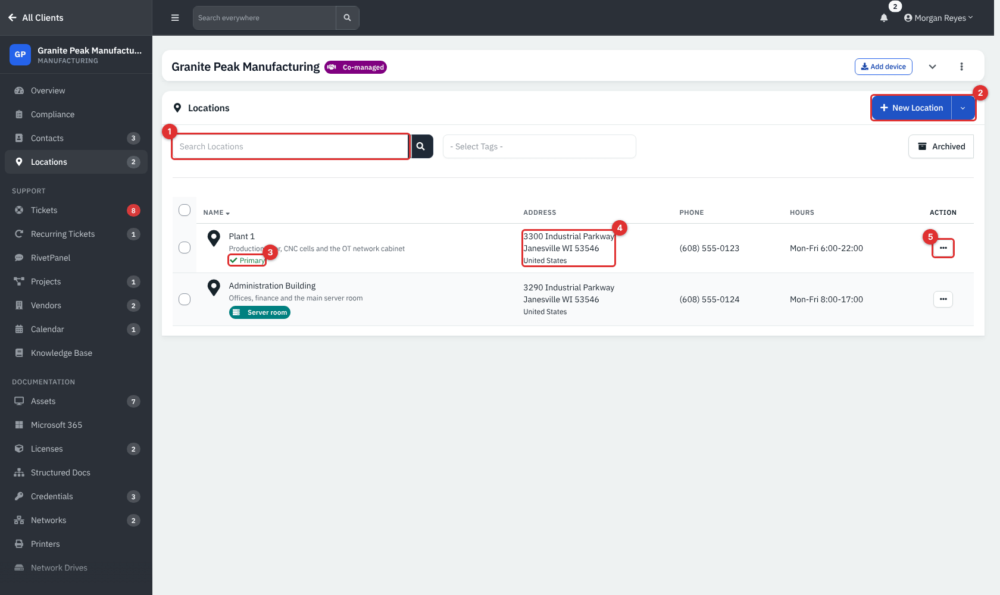

*Figure 21 — Locations for Granite Peak Manufacturing (example data).*

1. **Search Locations (1)**, plus a **Tags** filter and an **Archived** button.
2. **New Location (2)**, with **Import** and **Export** in the arrow menu.
3. **Primary (3)** marks the client's main site, shown in the client list and header.
4. **Address (4)** links to a map; the provider (Google or Bing) comes from your account settings.
5. **Action (5)**: **Edit**, **Relationships** (what is linked to the site) and, for administrators, **Archive**. A primary location cannot be archived.

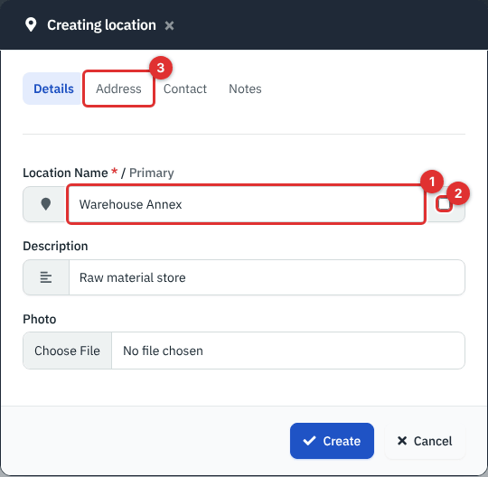

*Figure 22 — Name (1), Primary (2) and the Address tab (3).*

To add a site: **New Location**, enter the **Location Name**, optionally a description and photo; **Address** tab for the street, city, state, postal code and country; **Contact** tab for the person on site, phone, fax and **Hours** (free text, for example *Mon-Fri 7:30-17:00*); **Notes** for parking or building access; **Tags**. Ticking **Primary** moves the primary mark to this site.

**Import** takes a CSV with eight columns: Name, Description, Address, City, State, Postal Code, Phone, Hours. Existing names for the same client are skipped. **Delete** appears on archived locations only when destructive deletes are enabled (as for contacts).

## Reference

### Client fields

| Field | Notes |
|---|---|
| **Name** | Required, up to 200 characters. Blank names are refused. |
| **Shortened Name** | Up to 6 characters, upper case. Made from the name if blank. |
| **Industry** | Free text; used by the **Industry** filter and in reports. |
| **Referral** | Chosen from Administration → Tags & categories → Referrals; new values are added. |
| **Website** | A leading `http://` or `https://` is removed. |
| **Hourly Rate** | Needs invoicing on. Default from Settings → Defaults. |
| **Payment Terms** | On Receipt, 7, 10, 15, 30, 45, 60 or 90 days. |
| **Tax ID** | Free text. |
| **Notes** | Free text; **Quick Notes** on the overview edits the same text. |
| **Tags** | Client tags (Administration → Tags & categories). |

### Permissions at a glance

| Action | Needs |
|---|---|
| View clients, contacts | **Client** Read |
| View locations | **Client** Read and **Support** Read |
| Add, edit, import, tag, archive, restore | **Client** Modify |
| Delete a client; **Export Data**; anonymize or delete a contact | **Client** Full |
| Billing column | **Financial** Read and invoicing on |
| New Ticket from a client | **Support** Modify |

## Tips and good practice

- Keep exactly one primary contact per client, and give each client at least one billing and one technical contact. Invoices and portal menus depend on those ticks.
- Use **Tags** for groupings such as *Managed services* or *Regulated*; they are searchable and filterable.
- Prefer **Archive** over **Delete**. Archived clients keep their history and invoices.
- Use **Locations** for every site, and set each contact's location, so on-site visits and assets can be routed correctly.
- Do not put passwords in notes. Use [Credentials](14-credentials-and-vault.md).

## Related guides

- [Client workflows and compliance](04-client-workflows-and-compliance-per-client.md)
- [Service desk](05-service-desk-tickets.md)
- [CRM: leads and pipeline](21-crm-leads-and-pipeline.md)
- [Client portal](32-client-portal.md)
- [Users, roles and security](34-users-roles-security.md)
