# Client workflows and client compliance

Two tools help you run the relationship with a client in a repeatable way. **Onboarding & Offboarding** gives you checklists you start when a client (or one of its people) joins or leaves. **Client compliance** tracks which security standards apply to a client, records each review of a checklist item, saves snapshots and, if you choose, shares one snapshot with the client in the client portal.

| | |
|---|---|
| **Where to find it** | Sidebar → **Organization** → **Onboarding & Offboarding** and **Client compliance**. Inside a client, **Compliance** is the second entry in the client's sidebar. Checklist templates live in Administration → **Templates** → **Client workflows**. |
| **Who can use it** | The **Client** permission module. **Read** to see runs, the compliance overview and each client's compliance page. **Modify** to start, tick, skip, reopen and cancel workflows, to choose standards, record reviews, save snapshots and share. Creating and editing templates also needs Modify, and the Administration area is open to administrators only. |
| **Turn it on** | Nothing to turn on. Onboarding & Offboarding follows a core module switch that is on by default; when it is off the pages say so and the sidebar entry disappears. Client compliance needs the latest database update (Administration → Update). |

## What it's for

- **Workflows** make sure the same steps happen every time: new-client set-up, a new starter at a client, a client leaving, a leaver. They are manual checklists; ticking a task never changes accounts or access by itself.
- **Compliance** is a working checklist for you and the client against ISO/IEC 27001, SOC 2, PCI DSS, HIPAA or NIST SP 800-171 / CMMC. It is a record of reviews, **not** a certification or an audit opinion; control references are indicative.

---

## Part 1: Onboarding & Offboarding

### A quick tour

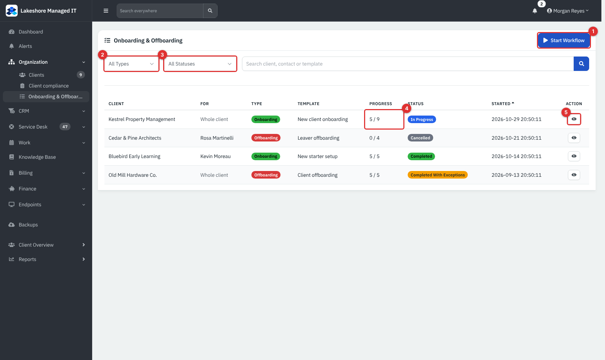

*Figure 1 — Sidebar → Organization → Onboarding & Offboarding (example data).*

1. **Start Workflow (1).** Opens the start pop-up. Needs **Client** at Modify.
2. **Type (2)** and **Status (3)** filters, plus a search box for client, contact or template name.
3. **Progress (4).** Tasks that are no longer pending, out of the total. A skipped task counts as dealt with.
4. **Eye button (5).** Opens the run.

Columns: **Client**, **For** (the person, or **Whole client**), **Type** (**Onboarding** or **Offboarding**), **Template**, **Progress**, **Status** and **Started**. The newest run is first.

### Run statuses

| Status | Meaning |
|---|---|
| **In Progress** | At least one required task is still pending. |
| **Completed** | Every required task is completed. |
| **Completed With Exceptions** | Every required task is dealt with, and at least one task (required or optional) was skipped. |
| **Cancelled** | Someone cancelled the run. It is frozen: tasks can no longer be changed. |

Optional tasks (marked **optional**) never hold a run open. The status is worked out each time you complete or skip a task. If you **reopen** a task in a finished run, the run goes back to **In Progress**.

### Start a workflow

1. Click **Start Workflow**.
2. Choose the **Workflow**. Templates are listed as `[Onboarding]` or `[Offboarding]` followed by the name.
3. Choose the **Client** (active clients only).
4. Leave **Specific person (optional)** on **- Whole client -**, or pick a contact of that client to track a new starter or a leaver.
5. Click **Start**. RivetMSP opens the new run.

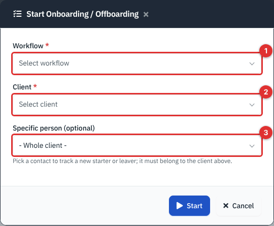

*Figure 2 — Workflow (1), Client (2) and Specific person (3).*

If the Workflow list is empty, no template exists yet; see Part 1, "Templates". Starting copies the template's tasks into the run, so changing the template later does not change runs that already started. You can also open the pop-up from a link that already contains the client.

### Work through a run

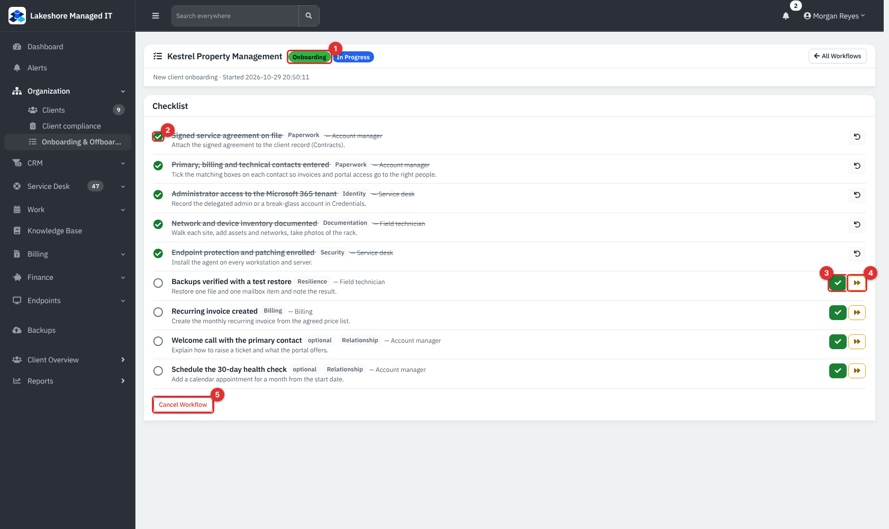

*Figure 3 — A run in progress: type (1), a completed task (2), **tick** (3), **skip** (4), **Cancel Workflow** (5).*

Each task shows its title, a **category** pill (for example Identity or Billing), the **default owner** ("Service desk", "Account manager"), optional instructions and an **optional** pill if it is not required.

- **Tick (3)** marks the task completed. It is struck through.
- **Skip (4)** asks for a **Reason** (required, up to 500 characters) and marks the task skipped; the reason is shown under the task.
- **Reopen** (the undo arrow on a finished task) puts it back to pending.
- **Cancel Workflow (5)** asks for confirmation. A cancelled run cannot be reopened.

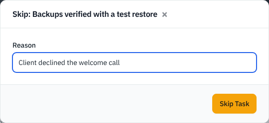

*Figure 4 — Skipping needs a reason. The pop-up is shown filled in but was not saved.*

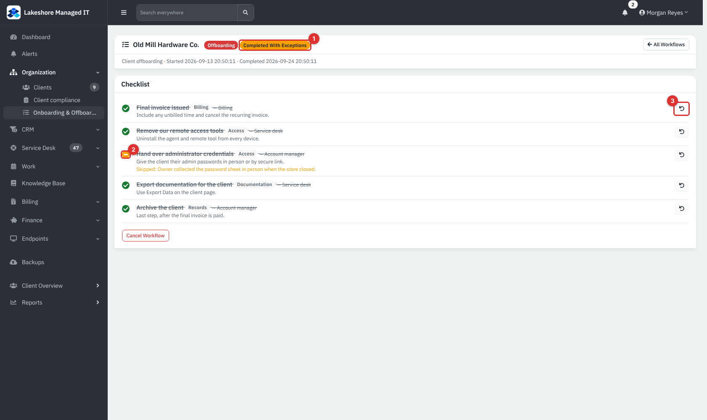

*Figure 5 — A run that finished with one skipped task: status badge (1), the skipped mark and reason (2) and **Reopen** (3).*

Every start, completion and cancellation is written to the audit log, and each task action to the client's activity log. Completing a task also fires the `workflow.task_completed` webhook event; see [Webhooks and event rules](30b-webhooks-event-rules-and-jobs.md). The dashboard widget **Onboarding / offboarding in progress** lists open runs (see [Dashboard](02-dashboard.md)).

> **Note:** A template with no tasks produces a run that stays **In Progress**, because status is only worked out when a task is ticked or skipped. Cancel such a run.

### Templates (Administration)

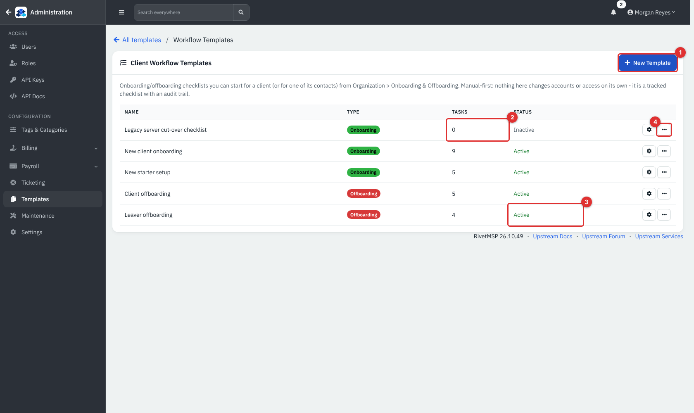

*Figure 6 — Administration → Templates → Client workflows.*

1. **New Template (1).** Enter a **Template Name**, choose the **Type** (Onboarding or Offboarding) and an optional **Description**, then **Create**.
2. **Tasks (2)** counts the tasks of each template.
3. **Status (3)** shows **Active** or **Inactive**. Only active templates can be started. New templates are Active; the interface has no switch to make one inactive.
4. **Row actions (4).** The cog opens the template; the **⋯** menu offers **Edit** (name, type, description) and **Archive**.

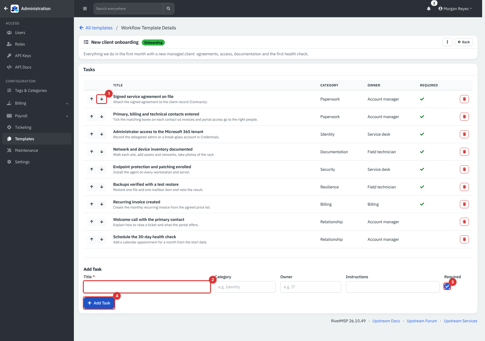

*Figure 7 — A template. Move a task with the arrows (1); fill in **Title** (2), optional **Category**, **Owner** and **Instructions**, and untick **Required** (3) for an optional task, then **Add Task** (4).*

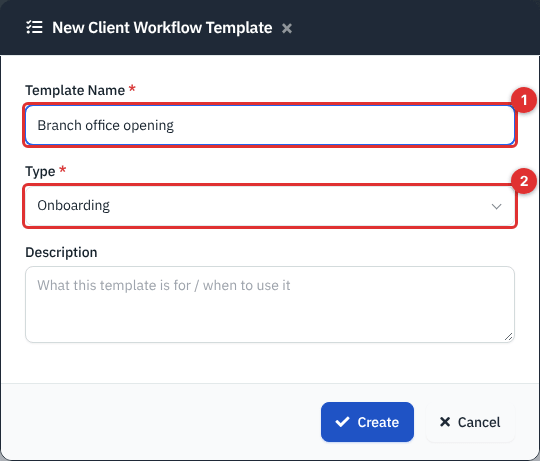

*Figure 8 — Name (1) and Type (2).*

Task fields: **Title** (required, up to 255 characters), **Category** (free text, 100), **Owner** (free text, 100; a role or team name, not a user account), **Instructions** (500) and **Required** (ticked by default). Use the red bin to remove a task from the template.

---

## Part 2: Client compliance

### The overview of all clients

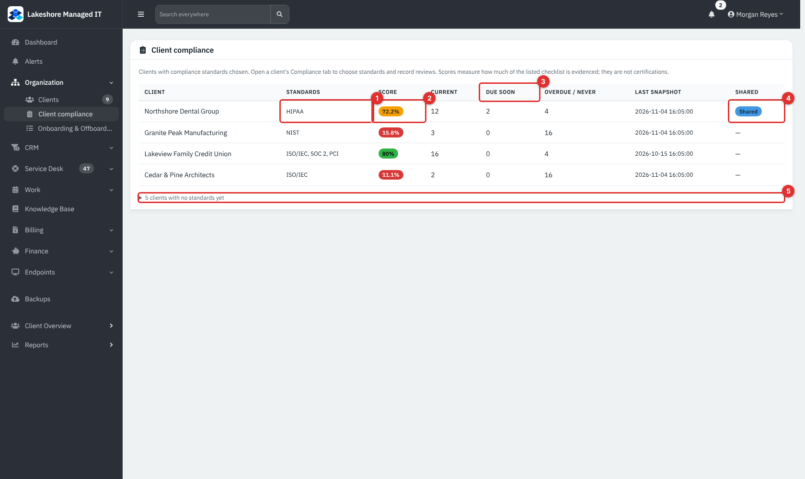

*Figure 9 — Sidebar → Organization → Client compliance.*

The table lists clients that have at least one standard chosen. Archived clients and leads are left out.

1. **Standards (1).** The first word of each chosen standard: ISO/IEC, SOC 2, PCI, HIPAA, NIST.
2. **Score (2).** Green at 80% or more, amber at 50% or more, red below. A dash means nothing to score.
3. **Current**, **Due soon (3)** and **Overdue / never**. Counts of checklist items in each state.
4. **Last snapshot** and **Shared (4).** **Shared** appears when a snapshot is published to the client's portal users.
5. **Clients with no standards yet (5).** Expand to list the clients not tracked; each links to its page.

### A client's compliance page

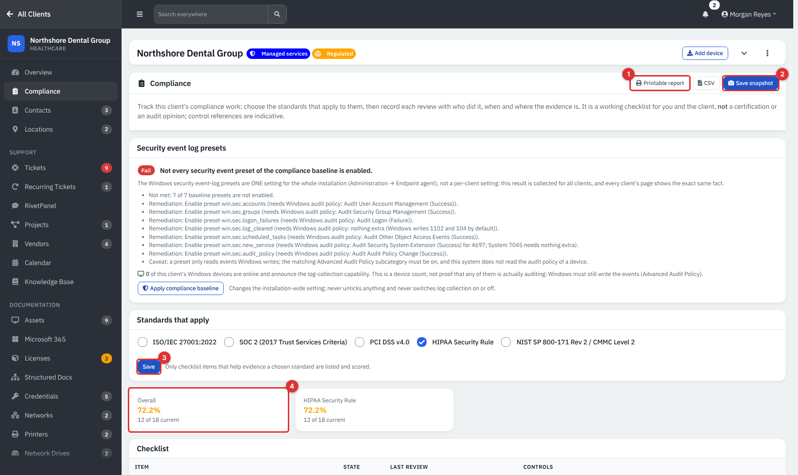

*Figure 10 — Northshore Dental Group → Compliance (example data).*

1. **Printable report (1)** and **CSV** export the current assessment. The printable report opens in a new tab.
2. **Save snapshot (2)** stores the assessment as it is today.
3. **Standards that apply (3).** Tick any of **ISO/IEC 27001:2022**, **SOC 2 (2017 Trust Services Criteria)**, **PCI DSS v4.0**, **HIPAA Security Rule** and **NIST SP 800-171 Rev 2 / CMMC Level 2**, then **Save**. Unticking all hides the checklist.
4. **Score tiles (4).** One **Overall** tile and one per chosen standard, with "N of M current".

The checklist depends on the standards you choose: 18 items for ISO, SOC 2, PCI and HIPAA and 19 for NIST, with some items shared by several standards (for example *Security policy written, approved and reviewed*, *User access review*, *Backup restore test*) and a few specific to one (for example *Business associate agreements signed* for HIPAA).

> **Note:** The **Security event log presets** card at the top appears only when the built-in endpoint module is on. It reports one installation-wide result (collecting Windows security events), not a per-client one, so every client page shows the same card. **Apply compliance baseline** changes that installation-wide setting and needs the RMM administrator ability. See [Endpoints](25-endpoints-rmm-overview.md).

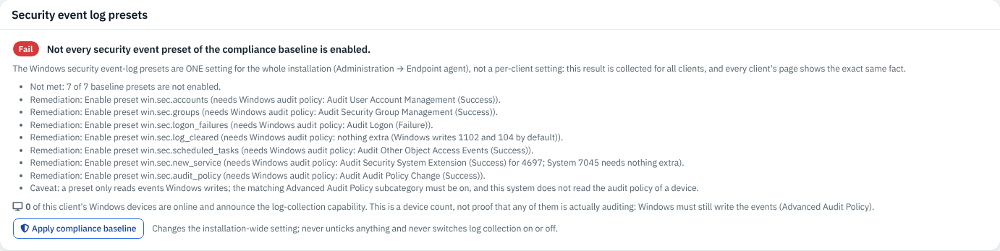

*Figure 11 — The preset card. It says "Fail" here because log collection is off in the demo.*

### Record a review

Each checklist row shows the item, its category and how often it must be redone, then its **State**, **Last review** (date, reviewer, next due date and note) and the **Controls** it helps evidence.

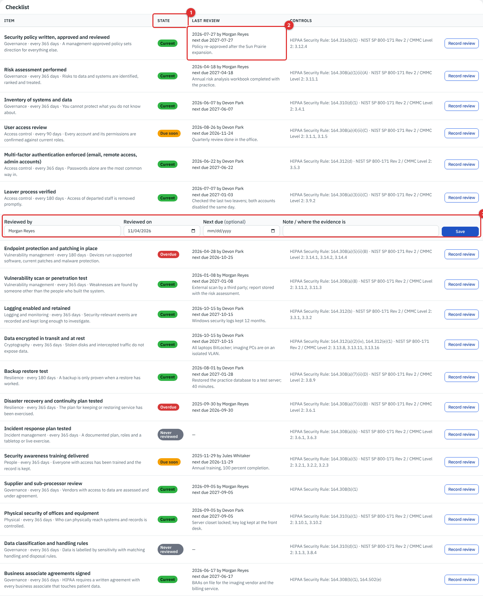

*Figure 12 — State (1), Last review (2) and the **Record review** form (3).*

1. Click **Record review** on the row.
2. Fill in **Reviewed by** (starts as you), **Reviewed on** (today or earlier), **Next due** (optional) and **Note / where the evidence is**.
3. Click **Save**.

The newest review for an item is the one that counts; earlier reviews are kept. If you leave **Next due** empty, the due date is the review date plus the item's interval: 365 days for most items, 180 for *Leaver process verified*, *Endpoint protection and patching in place* and *Backup restore test*, and 90 for *User access review*. **Next due** cannot be before the review date.

| State | Meaning | Score weight |
|---|---|---|
| **Current** | The due date is still some way off. | 1 |
| **Due soon** | Within the warning window before the due date: a quarter of the interval, at most 30 days. | 0.5 |
| **Overdue** | The due date has passed. | 0 |
| **Never reviewed** | No review recorded. | 0 |

The score is the average weight of the listed items as a percentage. It measures how many of the listed controls have a current review, nothing more.

### Snapshots and sharing with the client

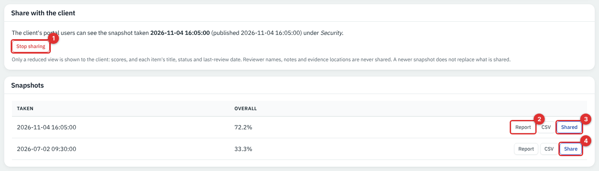

*Figure 13 — **Stop sharing** (1), **Report** (2), **Shared** (3) and **Share** (4).*

- **Save snapshot** stores the scores and every checklist line as they are now. **Snapshots** lists the 12 most recent with **Report** (printable) and **CSV**.
- Click **Share** on a snapshot, optionally type a **message shown above the report**, then click **Share this snapshot**. Only one snapshot is shared per client at a time; sharing another replaces it. **Stop sharing** removes it.
- A newer snapshot does **not** replace what is shared. Share it again when you want the client to see the update.

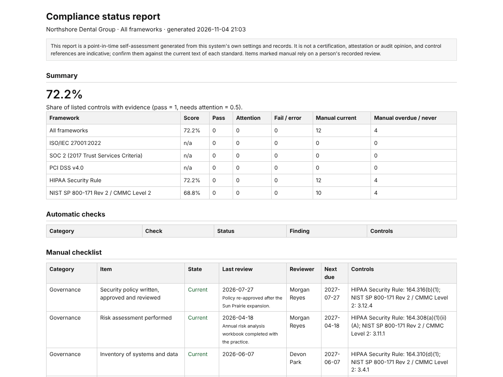

*Figure 14 — The printable report. Each export is recorded in the audit log.*

What the client sees is a reduced view: scores, and each item's title, area, status and last-review date. Reviewer names, notes and evidence locations are never shared. The portal shows a **Security** entry only when something is shared.

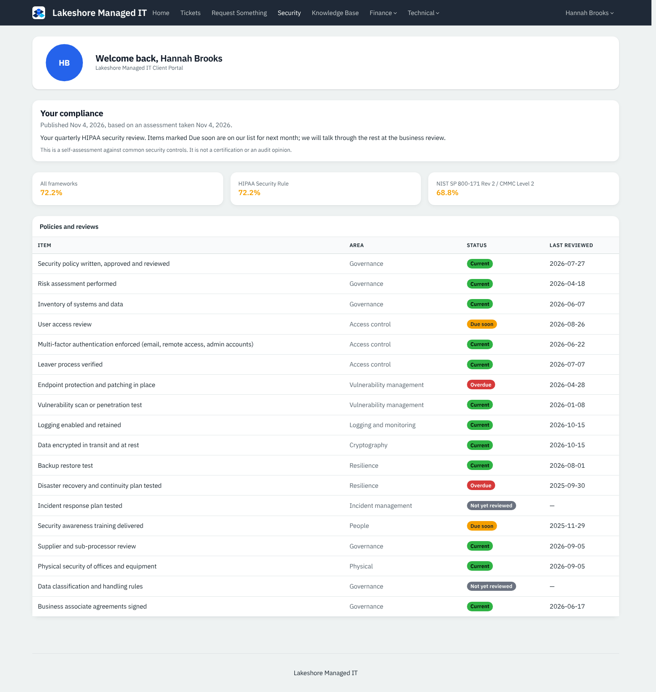

*Figure 15 — The portal's **Security** page as the client's office manager sees it. It also shows "Our security posture" when an administrator has published the provider's own report (see [Compliance administration](35-compliance-admin.md)).*

> **Note:** The portal's score tiles can include a standard you did not choose for that client (a NIST SP 800-171 tile appears here for a client with only HIPAA ticked), because some items carry references to several standards. The client page and the overview show only the standards you chose.

## Reference

### Compliance checklist (24 items)

| Area | Items |
|---|---|
| Governance | Security policy; risk assessment; inventory of systems and data; supplier and sub-processor review; data classification; BAAs signed (HIPAA); cardholder-data scope and SAQ (PCI); ISMS scope and statement of applicability (ISO); system description (SOC 2); CUI / FCI scope, SSP and POA&M, CMMC self-assessment (NIST) |
| Access control | User access review; MFA enforced; leaver process verified |
| Vulnerability management | Endpoint protection and patching; vulnerability scan or penetration test |
| Logging and monitoring | Logging enabled and retained |
| Cryptography | Data encrypted in transit and at rest |
| Resilience | Backup restore test; disaster recovery and continuity plan tested |
| Incident management | Incident response plan tested |
| People | Security awareness training delivered |
| Physical | Physical security of offices and equipment |

### Permissions at a glance

| Action | Needs |
|---|---|
| See runs, compliance overview, a client's compliance page, exports | **Client** Read |
| Start, tick, skip, reopen, cancel; choose standards; record reviews; snapshot; share | **Client** Modify |
| Create, edit, archive templates and tasks | **Client** Modify, in the Administration area |

## Tips and good practice

- Build one template per situation (new client, new starter, client leaving, leaver) and keep the steps short and verifiable.
- Start person-level workflows for the person, so the run shows their name in the list.
- Record a review as soon as you do the work, and put the evidence location in the note (for example the document name). Notes stay internal.
- Take a snapshot after each quarterly review, then share the snapshot you are happy for the client to see.
- Remember the wording the client reads: a self-assessment, not a certification.

## Related guides

- [Clients, contacts and locations](03-clients-contacts-locations.md)
- [Client portal](32-client-portal.md)
- [Compliance administration](35-compliance-admin.md)
- [Webhooks and event rules](30b-webhooks-event-rules-and-jobs.md)
- [Dashboard](02-dashboard.md)
