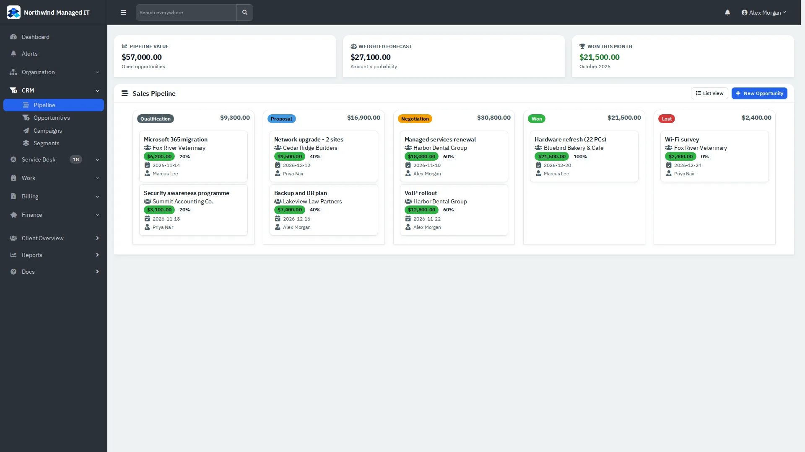

# Sales and CRM

Capture leads, track opportunities through stages and see the pipeline.

| | |
|---|---|
| **Where to find it** | **Organization → Clients → Leads** for leads. Sidebar → **CRM** → **Pipeline**, **Opportunities**, **Campaigns**, **Segments**. |
| **Who can use it** | Users whose role includes the sales module. |
| **Turn it on** | Administration → Settings → **Modules**. |

## Leads

1. Go to **Organization → Clients** and click **Leads**.
2. Click **New Lead**. Give the lead a name and a primary contact (on the Contact tab). The Details tab also has a lead source, a lead status (a preset such as New, Contacted, Qualified, Proposal, Negotiation, Converted or Lost, or one you type), an owner and a score.
3. Click **Create Lead**.

To turn a lead into a customer, open the row menu (⋯) and choose **Convert to Client**. **Edit** changes its details and **Archive** removes it from the list.

Leads are not counted in the **Clients** badge or the dashboard's **Active Clients**.

## Opportunities and the pipeline

*Figure 1: Opportunities by stage with totals.*

The pipeline shows open deals as cards in the stages **Qualification**, **Proposal**, **Negotiation**, **Won** and **Lost**, with each stage's value. The tiles above show **Pipeline Value**, **Weighted Forecast** (amount times probability) and **Won This Month**. Move a card between stages by dragging it. **List View** shows the same records as a table; **New Opportunity** adds one (name, client, contact, stage, probability, amount, close date, owner, notes).

A client's overview also lists its open opportunities and has **Add Opportunity**.
