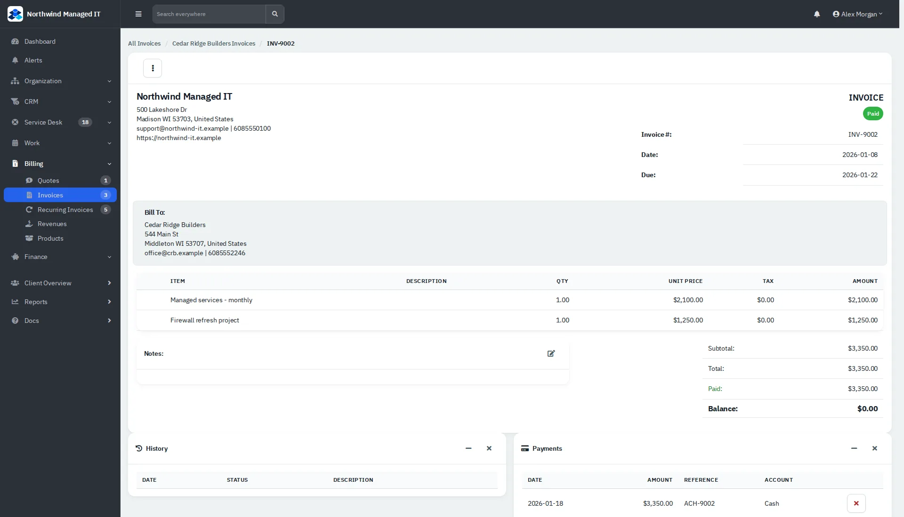
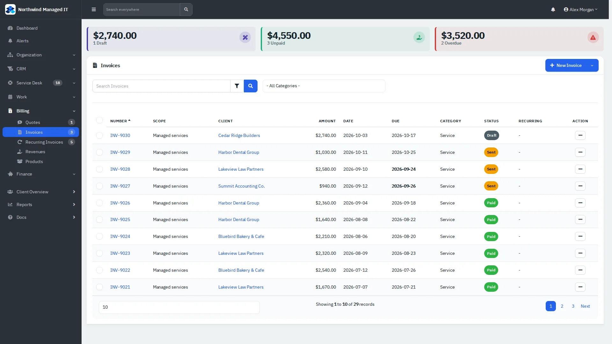
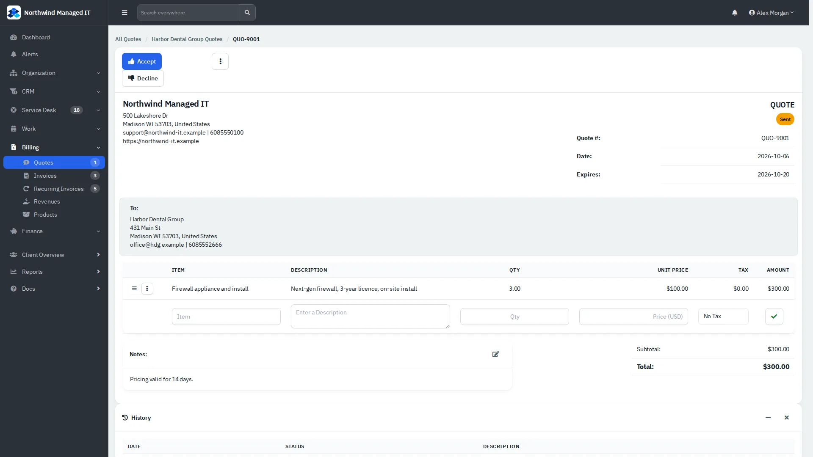

# Quotes, invoices and payments

Bill clients for tickets, projects and recurring services, and record the money that comes in.

| | |
|---|---|
| **Where to find it** | Sidebar → **Billing**: **Quotes**, **Invoices**, **Recurring Invoices**, **Revenues**, **Products**. **Finance**: **Payments**, **Vendors**, **Expenses**, **Recurring Expenses**, **Accounts**, **Transfers**, **Trips**. |
| **Who can use it** | Administrators and accountants; technicians only if their role allows. |
| **Turn it on** | Administration → Settings → Modules (accounting) and Administration → Settings → **Invoices** / **Quotes** for numbering, terms and defaults. |

## Invoices

*Figure 1: An invoice: header, items, totals, history and payments.*

*Figure 2: The invoice list with status and amounts.*

Invoices move through the statuses **Draft**, **Sent**, **Viewed**, **Partial**, **Paid** and **Cancelled** (plus **Non-Billable**).

1. **New invoice:** Billing → Invoices → **New Invoice** (choose a client, category and dates), then add items from the line at the bottom of the invoice or pick a product.
2. **From a ticket:** on the ticket click **Invoice**; the dialog proposes a title and the ticket as a line, and you confirm.
3. **Row menu:** Edit, Copy, **Mark Sent**, Delete. **Mark Sent** changes the status; it does not email anyone.
4. **Invoice page menu (⋮):** Edit, Copy, Recurring (turn it into a recurring invoice), Print, Download PDF, Packing Slip, Copy Guest URL (the link a client opens without signing in), Delete.

> Sending an invoice by email goes through your mail settings. Test with your own address first.

## Recording a payment

1. Open the invoice and click **Add Payment**.
2. Fill in the date, amount, account, payment method and reference, and save.
3. The invoice shows the amount paid and the balance, and becomes **Partial** or **Paid**.

All payments are also listed under **Finance → Payments**.

## Quotes

*Figure 3: A quote.*

Quotes are built like invoices (Billing → Quotes → New Quote or **Quote** on a ticket). A sent quote shows **Accept** and **Decline** buttons; clients can accept from the guest link you send them. The ⋮ menu has Edit, Copy, Print, Download PDF, Copy Guest URL and Delete.

## Recurring invoices

**Billing → Recurring Invoices** holds invoices that are created on a schedule (frequency, next date, status). They feed the **MRR & Forecast** report. **Recurring** on an invoice's ⋮ menu creates one from an existing invoice.

## Products, revenues and expenses

**Products** are the services and items you bill, with prices and taxes. **Revenues** record income that is not an invoice. Under Finance, **Expenses** and **Recurring Expenses** record what you spend by vendor and category, **Accounts** hold balances, and **Transfers** move money between accounts.
