# Service Desk: Tickets

A ticket is one request or fault from one contact, with the whole conversation, the time spent and the outcome kept in one place. This page covers the ticket list, saved views, creating tickets and everything on a ticket's page. Recurring tickets, the **Request Something** menu, CSAT ratings and e-mailed requests are in [Recurring Tickets, Request Something, CSAT Ratings and Requests](07-recurring-tickets-catalog-csat-requests.md). Billing a ticket (charges, invoices, quotes, worksheets) is in [Ticket Billing and Worksheets](06-ticket-billing-and-worksheets.md).

| | |
|---|---|
| **Where to find it** | Sidebar → **Service Desk** → **Tickets**. Inside a client, **Tickets** in the client's own sidebar shows only that client's tickets. |
| **Who can use it** | Permission module **Access to ticketing, assets and documentation**. **Read** sees tickets and their notes, including internal ones. **Modify** creates tickets, replies, edits, merges and uses the bulk and quick controls. **Full** also deletes tickets and can share saved views with every technician. |
| **Turn it on** | **Show Ticketing** in Administration → Settings → Modules. Anything that sends email also needs a mail server; this guide's demo has none, so email behaviour is described from the code and was not verified on a live service. |

## What it's for

- Log a request that came by phone, walk-up, email, the client portal or a recurring schedule, and give it an owner.
- Keep the conversation the client sees apart from your private notes.
- Track priority, response and resolution targets, time worked, tasks and site visits.
- Close the ticket, collect a satisfaction rating and reopen it if the fix did not hold.
- Mark work billable so it reaches an invoice (the billing side is covered in the next guide).

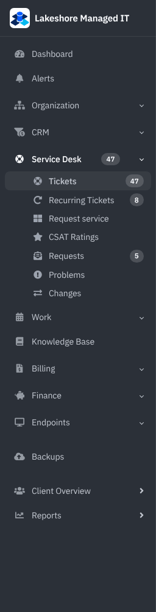

*Figure 1 — The Service Desk group. The badges are live counts: open tickets, recurring tickets and requests waiting. **CSAT Ratings** shows only while ratings are switched on. The catalog is labelled **Request service** in the sidebar and headed **Request Something** on its page.*

## A quick tour

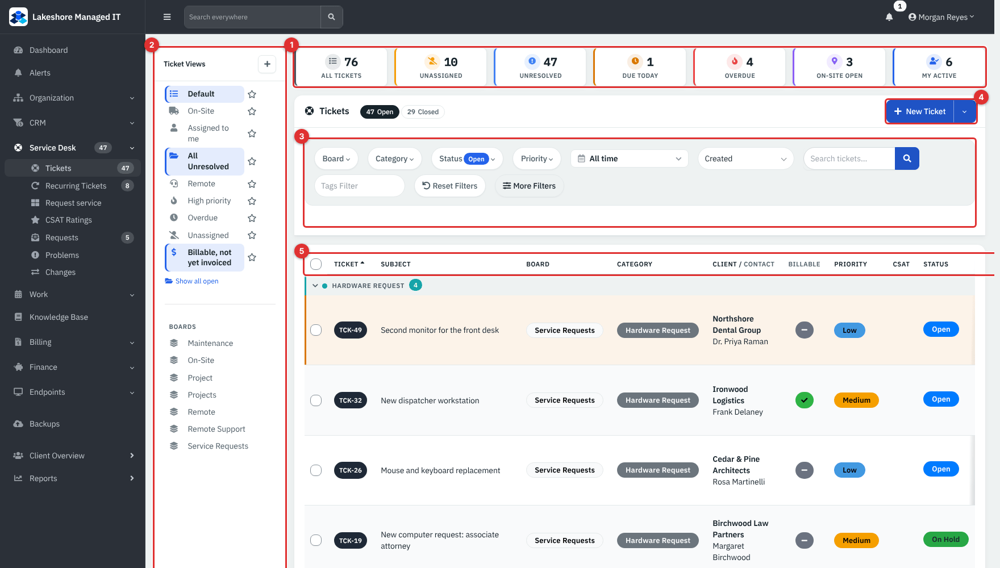

*Figure 2 — The ticket list. Example data from the Lakeshore Managed IT demo.*

| # | What it is | What it does |
|---|---|---|
| **(1)** | Stat tiles | **All Tickets**, **Unassigned**, **Unresolved**, **Due Today**, **Overdue**, **On-Site Open** and **My Active**. Click one to filter the list. **Unresolved** is every ticket that is not closed, whatever its status. **Due Today** and **Overdue** use the ticket's **Due** date, not the SLA. |
| **(2)** | **Ticket Views** | Saved sets of filters (see [Saved views](#keep-a-filtered-list-as-a-view)). Under them, **Boards** lists the top-level categories. |
| **(3)** | Filter bar | **Board**, **Category**, **Status**, **Priority**, a date range and which date it applies to, search, **Tags Filter**, **Reset Filters** and **More Filters**. |
| **(4)** | **New Ticket** | Opens the new ticket form. The arrow beside it holds **Export**. |
| **(5)** | Column headings | Click a heading to sort. Tickets are grouped under a coloured header for each category. |

Each row shows the ticket number, the subject, the **Board** and **Category**, the client and contact, **Billable** (when you also have access to the Sales module), **Priority**, **CSAT**, **Status**, who it is **Assigned** to, tags, the last response and the created date. A **bold** row has never had an update. A **tinted** row means the latest entry came from the contact (or nobody has answered yet), so it is waiting for you. A thin bar under the subject counts finished tasks. **Merged** and **No email** labels appear beside the subject when they apply.

## Common tasks

### Find tickets

1. Click a stat tile, or the **Open** and **Closed** counters beside the title.
2. Use the filter bar. **Board**, **Category**, **Priority** and **Status** each open a list of choices you can tick in any combination; a ticket matches if it fits any ticked choice in a group.
3. Type in the search box. Search matches the ticket number, client, subject, status, priority, technician, contact, asset and vendor. It does not search the text of replies.
4. Click **More Filters** for **Assigned to** (including **Me** and **Unassigned**), **On-site / remote**, **Due** (overdue, due today) and **Project**, then **Apply filters**.
5. Click a column heading to sort. Click **Reset Filters** to start again.

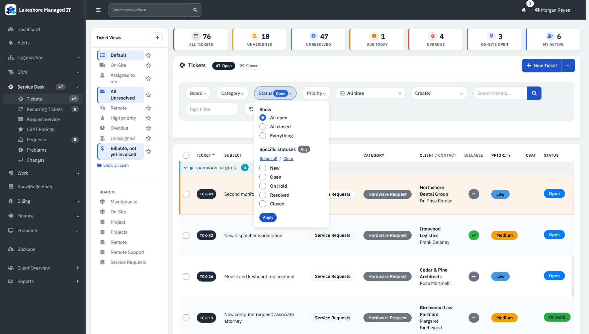

*Figure 3 — The **Status** filter. **All open** is the default; tick **Specific statuses** for anything else.*

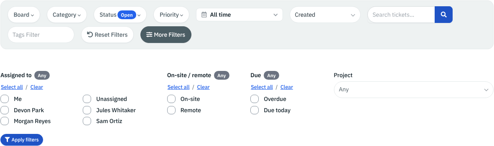

*Figure 4 — **More Filters**. **Tick both (or neither)** of On-site and Remote to include every ticket.*

The date range filters on the date field you pick next to it (the default is when the ticket was created). Resolved and closed dates exist only on closed tickets, so with **All open** selected that choice returns nothing; the page says so.

### Change a ticket from the list

With **Modify**, the category, priority, status and technician pills in each open row are drop-downs. Click one and choose a value.

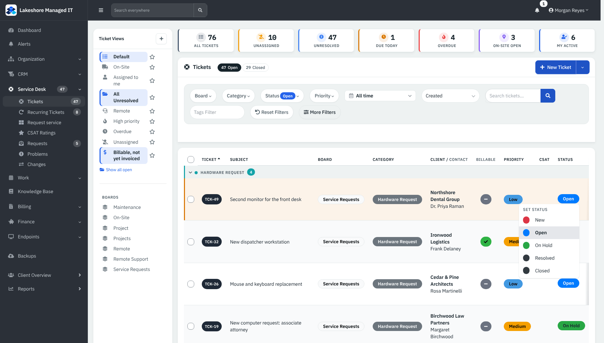

*Figure 5 — **Set Status**. The demo uses the five standard statuses. An administrator can add more under [Ticketing setup](37-ticketing-setup-and-templates.md).*

Changes made here send no email. Choosing **Resolved** closes the ticket at once (see [Statuses](#statuses)).

### Act on several tickets at once

1. Tick the boxes at the start of the rows. The box in the header ticks the current page only.
2. Open **Bulk Action (n)**.
3. Choose **Assign Agent**, **Set Category**, **Set Priority**, **Email Notifications**, **Update/Reply**, **Set Project**, **Merge**, **Resolve** or, with **Full** access, **Delete**. Most open a pop-up for a value.

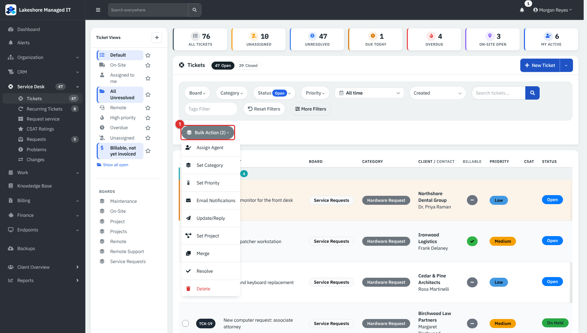

*Figure 6 — The **Bulk Action** menu. **Delete** cannot be undone and shows only at **Full**.*

**Update/Reply** posts one reply or note, and can set a status, on every ticket you ticked. **Email Notifications** turns the per-ticket email switch on or off for the selection (see [The two switches](#the-two-switches-count-toward-sla-and-email-notifications)).

### See tickets as a board

Drag cards between status columns to change status. There is one column per active status except **Closed**. A card shows priority, category, client and contact, the subject and the technician. Dropping a card on **Resolved** closes the ticket.

There is no button for the board. Add `view=kanban` to the Tickets address, or ask an administrator to set **Tickets Default View** to **Kanban** in Administration → Settings → Ticketing (the page is headed **Ticket Settings**). **Kanban Settings** on the same page decide whether cards can be ordered inside a column and whether columns can be moved.

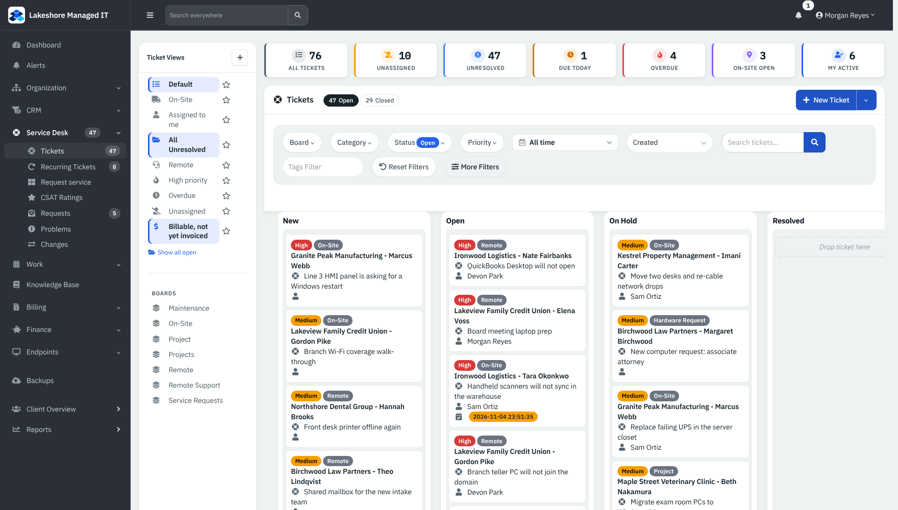

*Figure 7 — The board, scrolled to its first columns. Cards are grouped by status; **Closed** has no column.*

### Keep a filtered list as a view

1. Set the filters you want.
2. Click the **+** beside **Ticket Views**.
3. Enter a **Name**, pick an **Icon**, and check the filters the view will use. Tick **Make this my default view** if Tickets should open with it.
4. Click **Save View**.

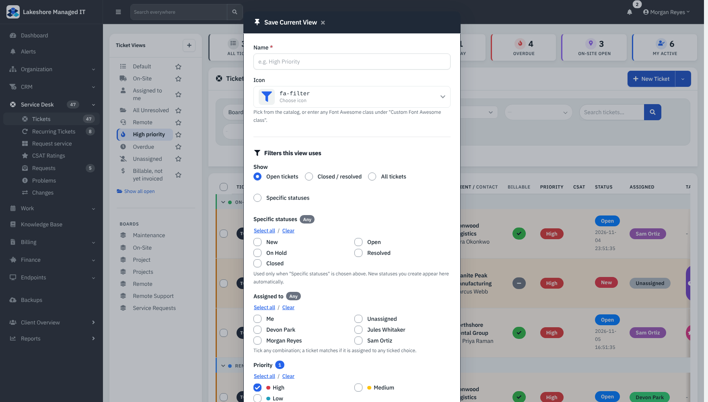

*Figure 8 — **Save Current View**. **Share with all agents** and **Make this the default for agents without a personal default** appear lower in the form and work only at **Full**; otherwise the view stays private.*

Your own views get a kebab menu with **Move Up**, **Move Down**, **Edit** and **Delete**. The star beside a view makes it your default; **Reset to my default** returns to it, and **Show all open** is the plain open list. With no filter in the address, Tickets opens your default view first, else the shared default. The installer creates five shared views (**Default**, **On-Site**, **Assigned to me**, **All Unresolved**, **Remote**); the demo adds **High priority**, **Overdue**, **Unassigned** and **Billable, not yet invoiced**.

### Create a ticket

1. Click **New Ticket**. The form is titled **New Ticket (v2)**.
2. On **Details**, optionally choose a **Template** (it copies the template's tasks). Enter the **Subject**, the details, the **Priority** and a **Category**. Leave **Assign to** as **Unassigned** to let the team pick it up. **Mark Billable** appears when invoicing is on.
3. On **Contact**, choose the **Client**, then the **Contact**.
4. On **Assignment**, optionally choose an **Asset**, **Location**, **Vendor** and **Vendor Ticket Number**.
5. Click **Create**. The ticket opens.

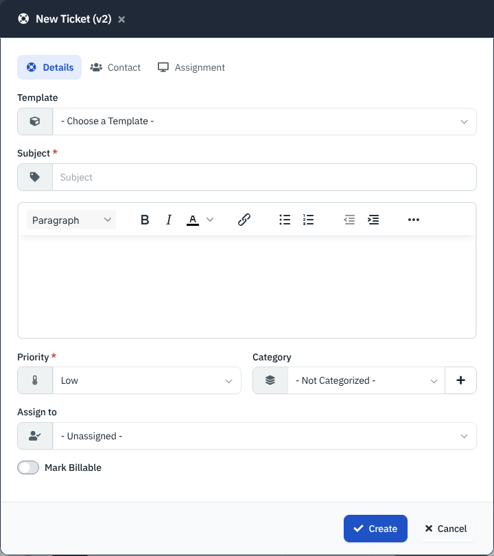

*Figure 9 — **Details**. **Subject** and **Priority** are required.*

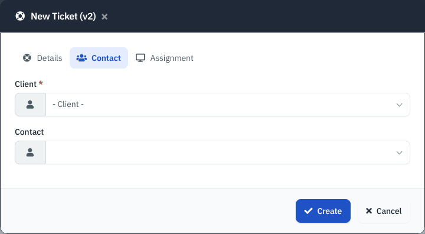

*Figure 10 — **Contact**. **Client** is required.*

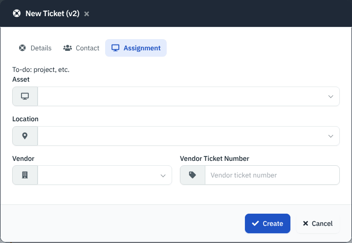

*Figure 11 — **Assignment**. The line "To-do: project, etc." at the top is unfinished placeholder text in the form.*

The number comes from the **Ticket Prefix** and **Next Number** in Ticket Settings. A ticket created without a technician starts as **New**. When you pick a technician it starts as **Open** (the app looks for a status named **Assigned** first and falls back to **Open**), unless an administrator set a **Default Status**. The category you choose sets the **delivery method**: the categories named **Remote** and **Maintenance** mean Remote work, **On-Site** and **Project** mean On-site work. If you leave the category empty, a category called **Remote** is used when it exists. The contact and any watchers get a "Ticket created" email only when a mail server is set up and the company's general notifications are on. A ticket that came from a category flagged **Non-billable** ignores the **Mark Billable** switch, and one in an **SLA exempt** category gets no SLA due dates.

> **Note**
> Opening the form from a contact's or an asset's own page gives the same form with the client already filled in.

### Work in one client

Open a client from **Organization → Clients**, then **Tickets** in the client's sidebar. The list, the counters and **New Ticket** are limited to that client and the client is filled in for you. The **Ticket Views** and **Boards** column is not shown in this scope.

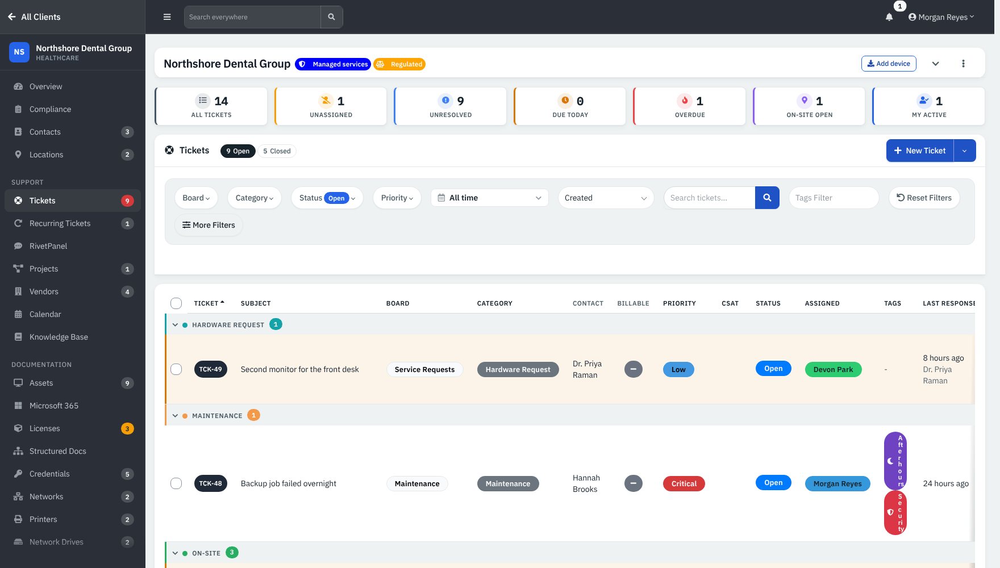

*Figure 12 — The same list inside one client.*

### Open a ticket

Click the number or subject.

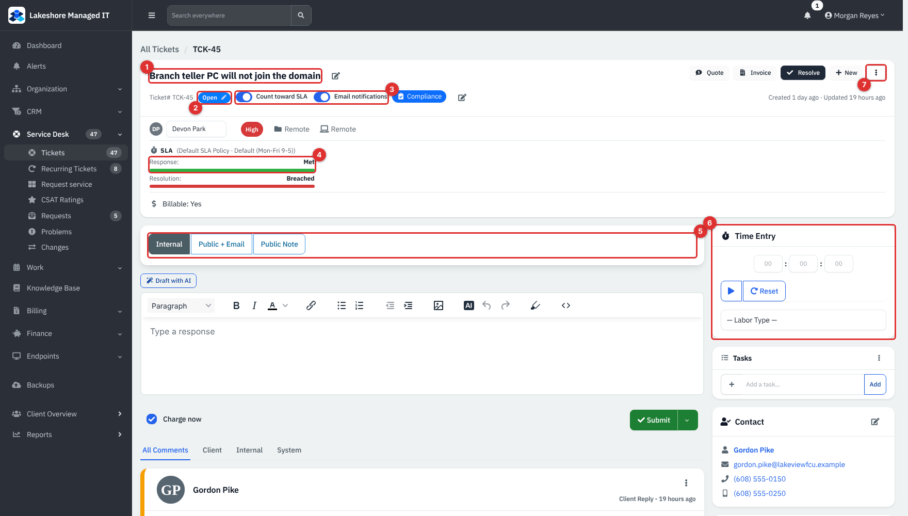

*Figure 13 — A ticket.*

| # | What it is | What it does |
|---|---|---|
| **(1)** | Subject | The pencil beside it opens the edit form with **Details**, **Contact** and **Assignment** tabs. The due date is set there. |
| **(2)** | Status | Click it to open **Status** and save a new one. Tags have a pencil of their own beside the switches. |
| **(3)** | **Count toward SLA** and **Email notifications** | Two switches, described in the next section. |
| **(4)** | SLA meters | **Response** and **Resolution**, each **Met**, **Breached**, **Paused**, a countdown or **Outside hours**, with the policy and business-hours calendar named above them. |
| **(5)** | Reply type | **Internal**, **Public + Email** or **Public Note**. |
| **(6)** | **Time Entry** | A timer or hours, minutes and seconds boxes, with an optional **Labor Type**. |
| **(7)** | Kebab menu | **Merge Ticket**, **Add Contact**, **Add Asset**, **Add Vendor**, **Add Watcher**, **Change Client** and, at **Full**, **Delete**. **Summarize** appears when AI is switched on. |

The top-right buttons are **Quote**, **Invoice**, **Resolve** (shown while every task is done) and **+ New**, which offers **Upload Attachment** and **Add Outtake Form**. Below the header you see the technician, priority, board or category and delivery method, then the SLA, and **Billable: Yes** or **No**.

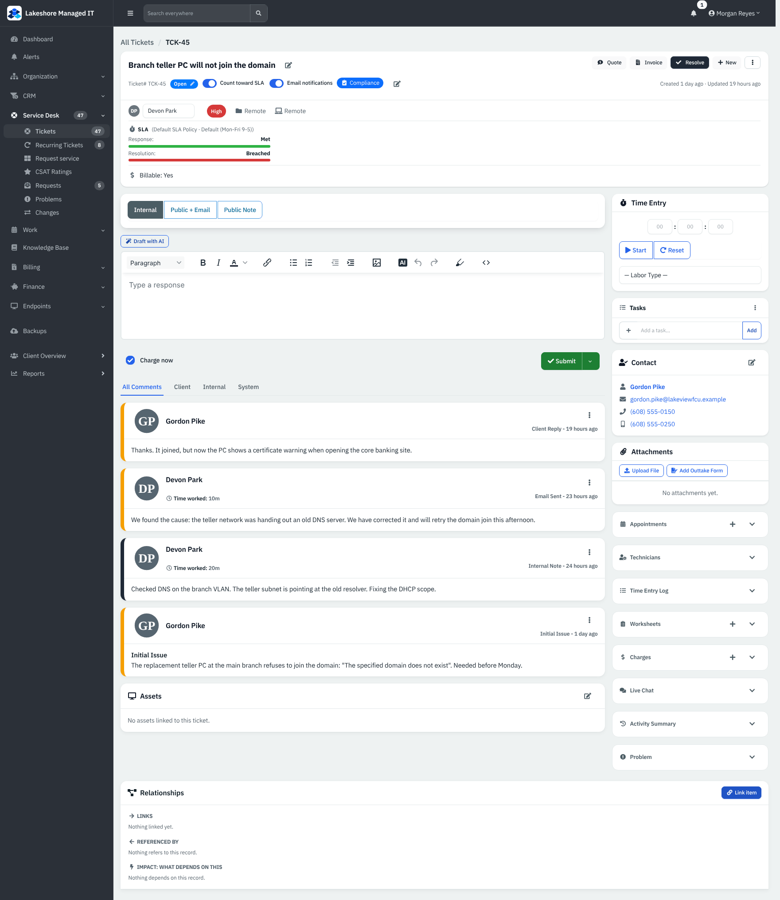

*Figure 14 — The thread, newest first, with the side cards on the right. Tabs above it filter by **All Comments**, **Client**, **Internal** or **System**.*

Another technician viewing the same ticket shows as "is viewing this ticket".

### The two switches: Count toward SLA and Email notifications

Both sit beside the status. They are new to the ticket page in this release and apply to this ticket only.

- **Count toward SLA** on (the default): the ticket gets response and resolution due dates from the SLA policy and counts in the SLA reports. Off: no due dates, never at risk or breached, and it drops out of the SLA numbers. Tickets raised by monitoring, and tickets in an **SLA exempt** category, start with it off.
- **Email notifications** on (the default): replies marked **Public + Email** are emailed. Off: nothing is sent for this ticket, the list shows **No email**, and a **Public + Email** reply is only saved unless you tick **Email this one reply anyway**. A ticket that arrived by email always sends email, so the switch is locked on for it.

### Reply, or leave a note

1. Choose a tab: **Internal** (default, technicians only), **Public + Email** (visible in the portal and emailed) or **Public Note** (visible in the portal, not emailed).
2. Optionally open **Insert Canned Response** and pick a saved reply. Edit it before sending. **Draft with AI** needs an AI provider, so it is not covered here.
3. Type your reply. Optionally add time in **Time Entry** and choose a **Labor Type**.
4. Click **Submit**, or the arrow beside it to send and set a status at the same time.

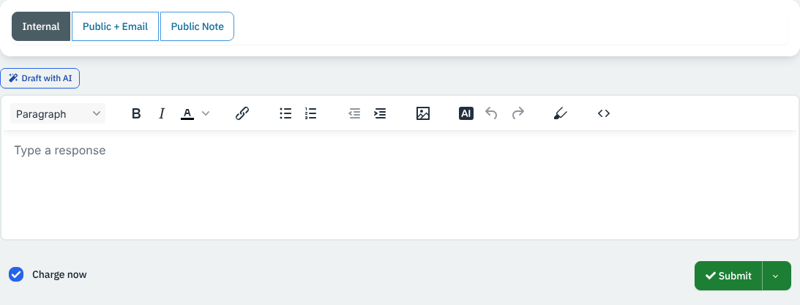

*Figure 15 — The reply form.*

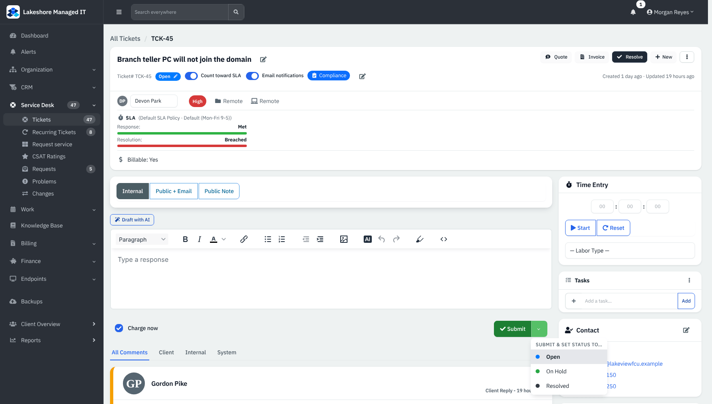

*Figure 16 — **Submit & set status to...** lists the active statuses except **New** and **Closed**; **Resolved** is hidden while tasks are unfinished. Choosing **Resolved** closes the ticket.*

Time in the **Time Entry** boxes is saved with the reply; with no text it becomes a **Labor Note** reading "Time logged". **Charge now** turns a reply's time into a charge when you also picked a **Labor Type** (see [Ticket Billing and Worksheets](06-ticket-billing-and-worksheets.md)). A **Public + Email** reply adds your signature, if you have one, and emails the contact and every watcher; their answers by email come back into the ticket when email-to-ticket is set up.

### Change a ticket's details

Click the kebab menu at the top right.

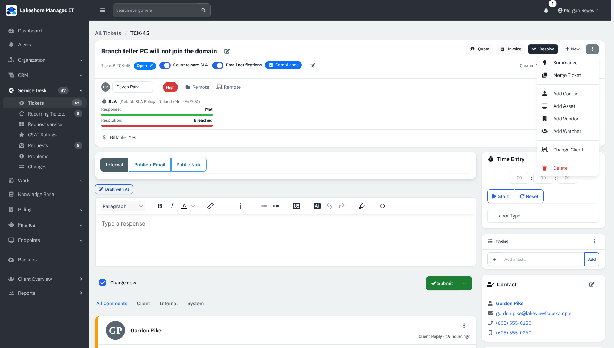

*Figure 17 — The ticket menu.*

- **Add Contact**, **Add Asset**, **Add Vendor** and **Add Watcher** attach more to the ticket. Watchers are email addresses that follow the ticket.
- **Change Client** moves the ticket to another client and marks every existing reply **Internal**, so the new client's contacts cannot read the old conversation.
- **Delete** (Full only) removes the ticket permanently. Close or merge it instead when in doubt.

### Merge duplicate tickets

1. Open the duplicate and choose **Merge Ticket**.
2. Pick the ticket to keep in **Ticket number to merge this ticket into** and enter a **Reason for merge**.
3. Tick **Move notes & replies to the new parent ticket** to carry the conversation across.
4. Click **Merge**.

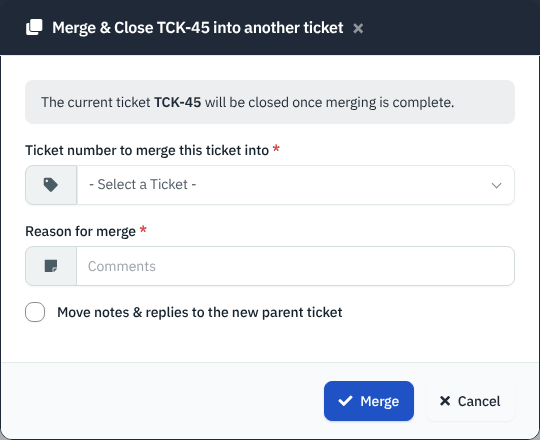

*Figure 18 — The duplicate is closed when you merge.*

The duplicate is closed and shows **Merged** in the list. Both tickets get a system note. To merge from the list, tick the tickets and use **Merge** in **Bulk Action**.

### Track time, tasks, files and more

The side cards hold the working details. **Time Entry**, **Tasks**, **Contact** and **Attachments** are always open; click the header of any other card to unfold it.

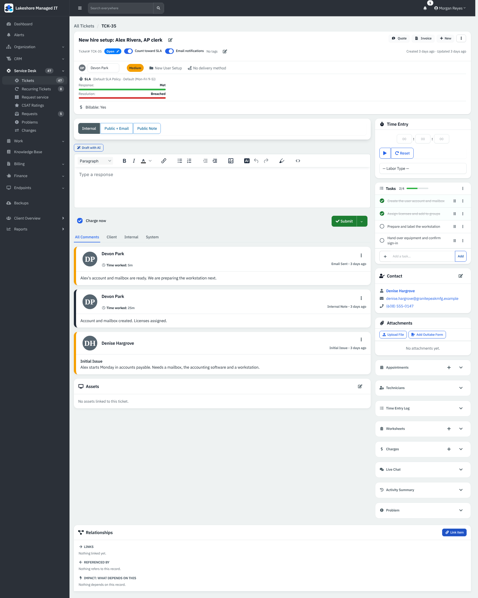

*Figure 19 — Tasks copied from the **New hire setup** template. The list shows 2/4 done.*

| Card | Use it to |
|---|---|
| **Time Entry** | Time the work. On a closed ticket it reads "Ticket closed". |
| **Tasks** | Keep a checklist. A template fills it in. **Resolve** appears only when every task is done. |
| **Contact** | See who asked. The pencil changes the contact. |
| **Attachments** | **Upload File** or **Add Outtake Form** (a form the contact signs). |
| **Appointments**, **Technicians** | Book a visit and add helper technicians. A visit has a Remote or Onsite type and appears in the calendar (see [Dispatch, Scheduling and Calendar](08-dispatch-scheduling-calendar.md)). |
| **Time Entry Log** | Who spent what, and the total. |
| **Worksheets**, **Charges** | Checklists the technician fills in, and billable items. See [Ticket Billing and Worksheets](06-ticket-billing-and-worksheets.md). |
| **Live Chat** | Chat with the contact while they have the ticket open in the portal. Needs **Show Live Chat on Tickets** in Administration → Settings → Modules. |
| **Activity Summary** | Dates, source, first response, total time, who closed it and the rating. |
| **Problem** | Link the ticket to a problem record (see [Problems and Changes](10-problems-and-changes.md)). |

Below the cards, **Relationships** links the ticket to other records. Each automatic note, such as a status change or "Ticket closed.", logs one minute of time.

### Parent and child tickets

A large job can be split into child tickets. Open the child, click the pencil beside its subject and choose the **Parent Ticket** (it must belong to the same client). The parent shows a **Parent / Child Tickets** card listing its children and their statuses.

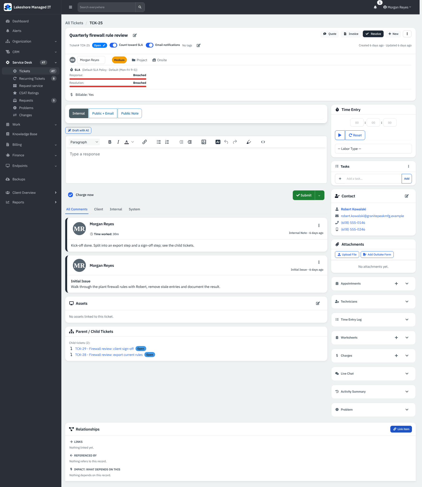

*Figure 20 — **Quarterly firewall rule review** with its two child tickets.*

### Resolve, close and reopen a ticket

1. Click **Resolve** and confirm. The ticket becomes **Closed**, a system note "Ticket closed." is added. Closing notifications need a mail server (not verified on a live service).
2. To send a closing message, reply with status **Resolved** instead.
3. To reopen, click **Reopen** on the closed ticket. The status returns to **Open**.

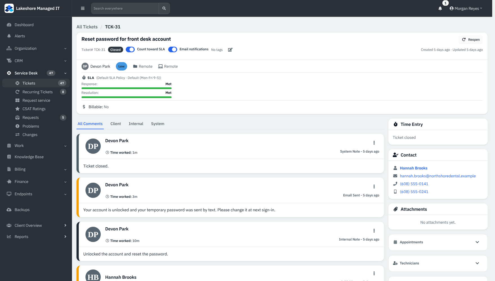

*Figure 21 — A closed ticket. **Reopen** is at the top right.*

The contact can rate the ticket from the email or the portal. A rating at or below the low-rating threshold (2 by default) reopens the ticket with an internal note. Ratings are reviewed in [CSAT Ratings](07-recurring-tickets-catalog-csat-requests.md#csat-ratings). Closed tickets also close by themselves: **Number of hours to auto close resolved tickets** in Ticket Settings (72 in the demo) applies to resolved ones.

## Reference

### Statuses

| Status | Meaning | How a ticket gets there |
|---|---|---|
| **New** | Nobody has picked it up. | Creation without a technician, or **Default Status** in Ticket Settings. |
| **Open** | Being worked. | Creation with a technician, **Reopen**, a low CSAT rating, or choosing it. |
| **On Hold** | Waiting. | Choosing it, or a **Request Something** item that needs approval. In the demo's SLA policy it pauses the SLA clock. |
| **Resolved** | A trigger, not a resting state. | Choosing it closes the ticket, so a ticket never stays **Resolved**. |
| **Closed** | Finished. Resolved and closed dates are stamped. | **Resolve**, choosing Resolved or Closed, a merge, or auto-close. |

Every status except **Closed** leaves the ticket open for the counters and the **Unresolved** tile. Whether a status pauses the SLA clock is a setting on the status; see [Ticketing setup](37-ticketing-setup-and-templates.md).

### Priorities

**Low**, **Medium**, **High** and **Critical**. The list colours High and Critical red, Medium amber and Low blue. The SLA policy has targets for three tiers: Low, Medium and High, where Critical uses the High targets. The New Ticket form and the catalog offer Low, Medium and High.

### Entry types

| Label | What it is |
|---|---|
| **Initial Issue** | The original request. |
| **Internal Note** | Technicians only. |
| **Email Sent** | A public reply marked as emailed. |
| **Public Note** | Visible to the contact, not emailed. |
| **Client Reply** | From the contact. |
| **System Note** | Written by the app. |
| **Automation Note**, **RMM Alert Note** | From rules and monitoring. |
| **Labor Note** | Time with no text. |

> **Note**
> **Email Sent** appears for a reply marked as emailed even when no mail server is set up, so check the mail queue before trusting it.

### Emails

| When | To | Needs |
|---|---|---|
| Ticket created on the form | Contact and watchers | Mail server, general notifications on |
| **Public + Email** reply | Contact and watchers | Mail server, ticket switch on |
| Closing a ticket | Contact, with rating faces when CSAT is on | Mail server (read from the code; not sent in the demo) |

Email is queued and sent by the scheduler (cron), so nothing leaves without it.

## Tips and good practice

- Prefer **Internal** when unsure; you can always follow with a public reply.
- Assign as soon as you take a ticket so it leaves **Unassigned**.
- Pick the right category: it sets the delivery method, billable default and SLA treatment.
- Merge rather than delete duplicates, so history is kept.
- Use **On Hold** with an SLA-pausing status for tickets you cannot move.
- Log time as you go; the totals feed the reports.
- Save the filters you use every day as a view and star your favourite.

## Related guides

- [Recurring Tickets, Request Something, CSAT Ratings and Requests](07-recurring-tickets-catalog-csat-requests.md)
- [Ticket Billing and Worksheets](06-ticket-billing-and-worksheets.md)
- [Dispatch, Scheduling and Calendar](08-dispatch-scheduling-calendar.md)
- [Ticketing setup and templates](37-ticketing-setup-and-templates.md)
- [Client Portal](32-client-portal.md)
