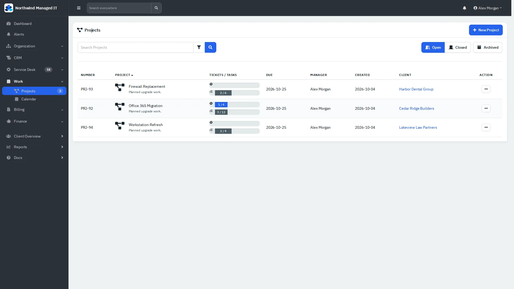
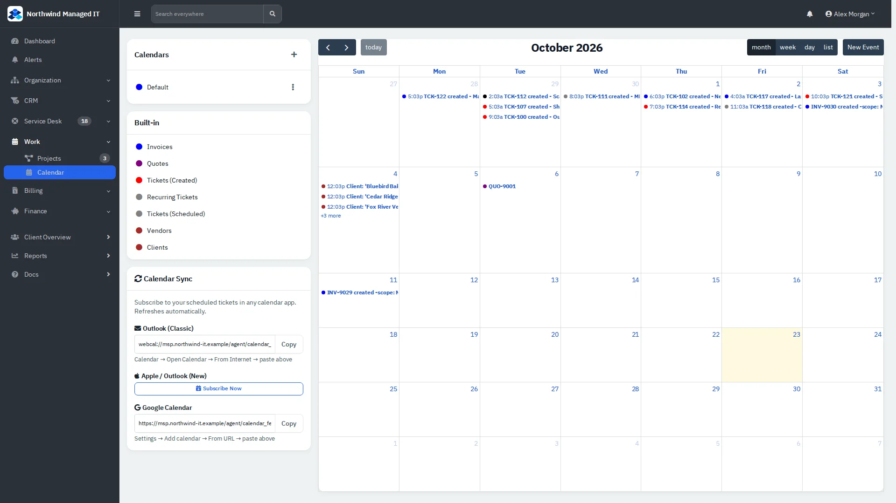

# Projects and calendar

Plan multi-ticket work as projects and see tickets, invoices and appointments on one calendar.

| | |
|---|---|
| **Where to find it** | Sidebar → **Work** → **Projects** and **Calendar**. A client's own sidebar also has **Projects** and **Calendar**. |
| **Who can use it** | Staff whose role includes the project module. |
| **Turn it on** | Administration → Settings → **Modules**; defaults under Administration → Settings → **Projects**. |

## Projects

*Figure 1: Projects with ticket/task progress, due date, manager and client.*

1. **New Project** (top right) asks for a name, client, manager and dates.
2. Open a project for its details, tickets and tasks. Switch views with the tabs: **Details**, **Gantt** (timeline, with Day/Week/Month zoom) and **Kanban** (columns of tasks; **New Task** adds one).
3. Attach existing tickets with **Link**, or create tickets inside the project. Tickets can also be added in bulk from the ticket list (**Bulk Action → Set Project**).

Use **Open / Closed / Archived** to change which projects are listed.

## Calendar

*Figure 2: Month view with the built-in calendars on the left.*

The left panel lists **Calendars** (your own) and **Built-in** layers you can show or hide: Invoices, Quotes, Tickets (Created), Recurring Tickets, Tickets (Scheduled), Vendors and Clients. Switch between **month**, **week**, **day** and **list**, press **today**, and use **New Event** to add an appointment. Scheduled tickets (**Add Appointment** on a ticket) appear here too.

**Calendar Sync** gives you a feed address to subscribe to from Outlook (classic), Apple or Outlook (new), or Google Calendar so scheduled tickets show on your phone. Treat the address like a password: it identifies you.
