# Ticket Billing and Worksheets

Field work turns into money on the ticket. This page covers the billing side of a ticket: marking it billable, logging time against a labor type, adding charges, starting a quote or an invoice from the ticket and finding work that is **Ready to bill**. It also covers worksheets (checklists the technician fills in on site) and outtake forms (a hand-over document the customer signs).

| | |
|---|---|
| **Where to find it** | Open any ticket (Sidebar → **Service Desk** → **Tickets**). The billing buttons sit at the top of the ticket, and **Worksheets**, **Charges** and **Attachments** are cards on its right-hand side. Labor types and worksheet templates are set up in Administration. |
| **Who can use it** | Permission module **Access to ticketing, assets and documentation**: **Read** to see charges, worksheets and outtake forms; **Modify** to add, edit and delete them and to sign an outtake form in person. Changing **Billable**, and creating a quote or an invoice from a ticket, also needs **Modify** on **Access to quotes, invoices and products**. Administrators always have full access. |
| **Turn it on** | **Show Invoicing / Accounting** in Administration → Settings → Modules shows the **Billable** line and the **Quote** and **Invoice** buttons. **Show Ticket Charges (Billing)** in the same place shows the **Charges** card and the **Charge now** box; it works without invoicing. Both are on in the demo. |

## What it's for

- Decide which tickets are chargeable, and keep that decision visible on the ticket and in the list.
- Record what was done and for how long, priced by the kind of work (remote, on site, after hours, travel).
- Start a quote before the work, or an invoice after it, without retyping the ticket.
- See at a glance which closed tickets have not been billed yet.
- Make technicians follow a checklist on site, and get the customer's signature before the ticket can close.

## A quick tour

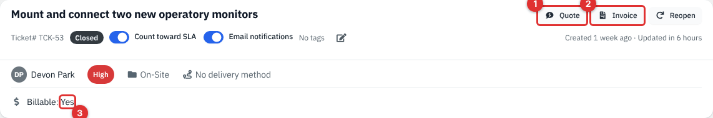

*Figure 1 — The top of a closed, billable ticket. Example data from the Lakeshore Managed IT demo.*

1. **Quote** starts a draft quote from this ticket.
2. **Invoice** starts a draft invoice, or adds the ticket to a draft invoice that already exists.
3. **Billable: Yes** (or **No**). Click it to change. Once an invoice exists, this line turns into a link to the invoice (**Invoiced: INV-14**), and when a quote exists a **Quoted:** link appears above it.

The cards on the right-hand side of the ticket are folded until you click their header. The ones this page uses are:

| Card | What it holds |
|---|---|
| **Time Entry** | The timer or hours, minutes and seconds boxes, and a **Labor Type** list. On a closed ticket it reads "Ticket closed". |
| **Time Entry Log** | Every time entry with who logged it, **Remote** or **Onsite**, its labor type and the total. |
| **Worksheets** | Checklists filled in on the ticket. The **+** adds one. |
| **Charges** | The priced lines for the ticket and their subtotal. The **+** adds one. |
| **Attachments** | Files, plus **Upload File** and **Add Outtake Form** for hand-over forms the customer signs. |

## Common tasks

### Mark a ticket billable

1. On the ticket, click **Yes** or **No** after **Billable:**.
2. Choose **Yes** or **No** in **Billable?** and click **Save**.

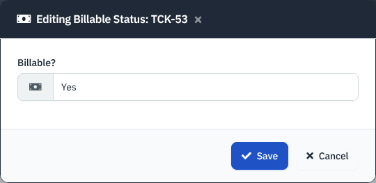

*Figure 2 — **Editing Billable Status**.*

New tickets start as billable only when **Default to Billable** is on in Administration → Settings → Ticketing, or the **Mark Billable** box is ticked in the **New Ticket** pop-up. A ticket category can also be flagged **Non-billable** (Administration → **Tags & categories** → **Categories**, edit the category), so tickets in it start as not billable. A choice you make by hand is remembered: changing the category later does not undo it.

The line is not shown to people without any access to **Access to quotes, invoices and products**, and you cannot change it once an invoice exists.

### Log time against a labor type

Labor types are the kinds of work you charge for, each with a default hourly rate (see [Set up labor types](#set-up-labor-types)).

1. On an open ticket, start the timer or type hours and minutes in **Time Entry**.
2. Pick a value in **Labor Type**.
3. Leave **Charge now** ticked and write your note. Click **Submit**.

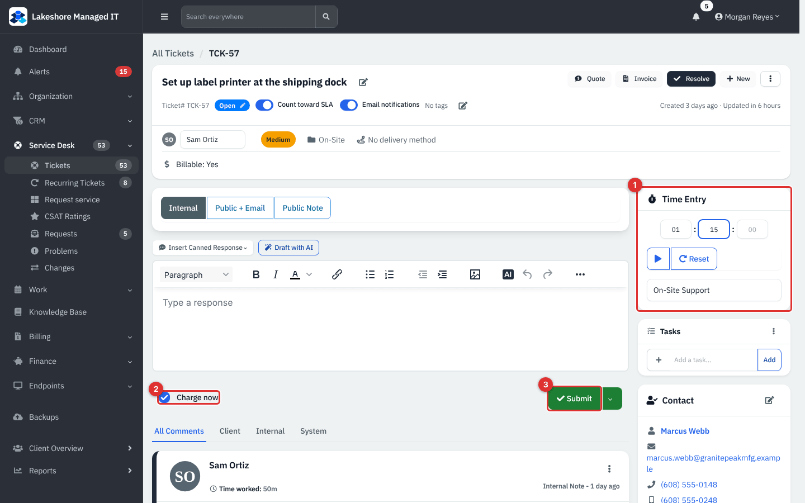

*Figure 3 — (1) **Time Entry** with a labor type chosen. (2) **Charge now**. (3) **Submit**.*

The time is saved on the reply. Because a labor type is chosen and **Charge now** is ticked, the app also adds a charge named after the labor type, priced at that labor type's rate. The quantity is the time rounded **up** to the next half hour, with a minimum of 0.5. Fifty minutes therefore becomes 1.0 and 1 hour 15 minutes becomes 1.5.

- **Charge now** shows only when **Show Ticket Charges (Billing)** is on and at least one labor type exists.
- If you tick it, log time and choose no labor type, the app warns that no charge will be created and asks you to confirm.
- The **Time Entry Log** card lets you fix mistakes afterwards: click **Remote** or **Onsite** to toggle it, or the labor type badge to change it. Changing it there does not alter charges that were already created.

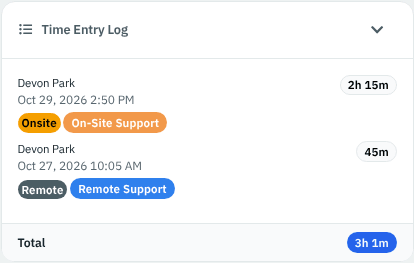

*Figure 4 — **Time Entry Log** on a finished job.*

> **Note.** Every automatic note, such as "Ticket closed.", logs one minute of time. That minute is part of the ticket's total and of the quantity suggested on an invoice.

### Add, edit or remove a charge

A charge is one priced line on the ticket: labor, a part, travel. Use it for things other than time at an hourly rate.

1. Open the **Charges** card and click **+** (open tickets only).
2. Optionally click a **Labor Type** button, or pick a **Product / Service** from your catalog. Either fills in the name and the price.
3. Type the **Item Name**, a **Description**, the **Qty** and the **Unit Price**. **Total** is worked out for you.
4. Choose a **Tax** if one applies, then click **Add Charge**.

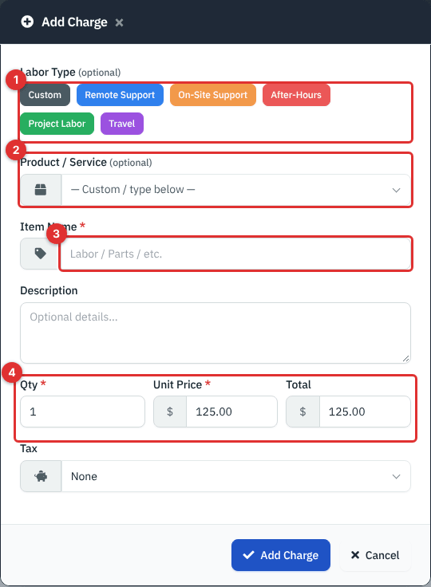

*Figure 5 — **Add Charge**. (1) **Labor Type** buttons, **Custom** for anything else. (2) **Product / Service**. (3) **Item Name**, required. (4) **Qty**, **Unit Price** and **Total**.*

The unit price starts at the client's hourly rate. Picking a labor type or product replaces it with that item's price.

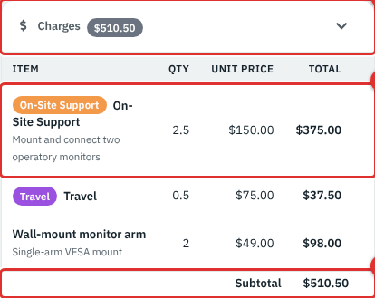

*Figure 6 — The **Charges** card. (1) The badge in the header is the subtotal. (2) One line with its labor type badge, quantity, unit price and total. (3) **Subtotal**.*

Each line has an edit (pencil) and a delete (bin) button while the ticket is open. Once the ticket is closed the card is read-only. Deleting hides the line; it is not shown again.

> **Note.** In this release a charge is a record on the ticket, not a line that travels to an invoice. **Invoice** (below) builds its line from the time logged and the client's hourly rate, and does not copy the **Charges** card. The **Invoiced** badge on a charge appears only if the charge has an invoiced date, which the ticket page itself never sets. Use the charges as your worksheet of what to bill, and check them against the invoice line. The **Ticket Charges** report keeps showing them as uninvoiced.

### Create a quote from a ticket

1. On a billable ticket with no quote, click **Quote**.
2. Fill in **Scope**, **Quote Category**, **Quote Date** and **Expire** (30 days ahead by default).
3. Enter the **Item**, **QTY** and **Price** (the client's hourly rate is filled in), and a **Tax**. Click **Quote**.

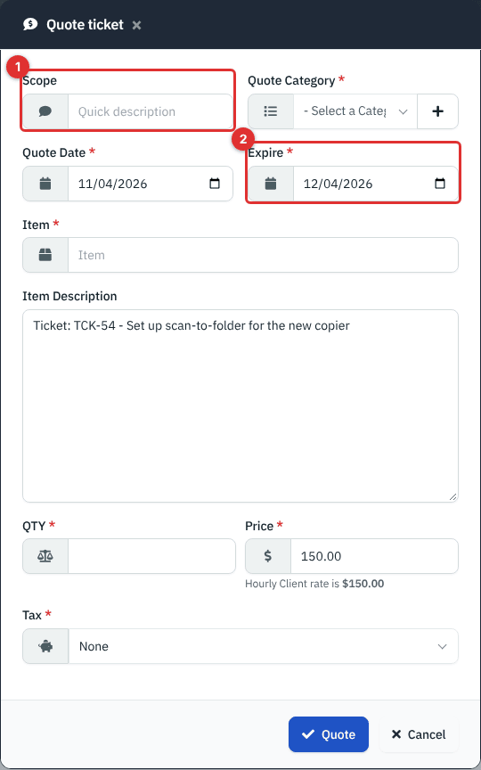

*Figure 7 — **Quote ticket**. (1) **Scope**. (2) **Expire**; the date cannot be in the past.*

A **Draft** quote is created and opens. The ticket gets a **Quoted:** link and an internal note, and the **Quote** button goes away. Send and track the quote as described in [Products, Quotes and Invoices](15-products-quotes-invoices.md).

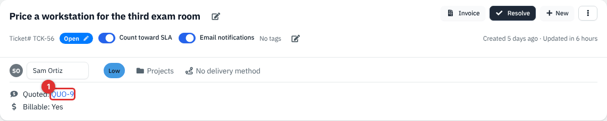

*Figure 8 — A ticket that already has a quote.*

### Create an invoice from a ticket

1. On a billable ticket without an invoice, click **Invoice**.
2. If the client already has a **Draft** invoice, choose a tab: **Add to Existing Invoice** puts the line on that draft; **Create New Invoice** starts a new one. If there is no draft, the form starts directly on a new invoice.
3. For a new invoice fill in **Invoice Date**, **Invoice Category** and, if you like, **Invoice Title**.
4. Check the line: **Item** (default **Support [Hourly]**), the description, **QTY** and **Price**, and the **Tax**. Click **Invoice**.

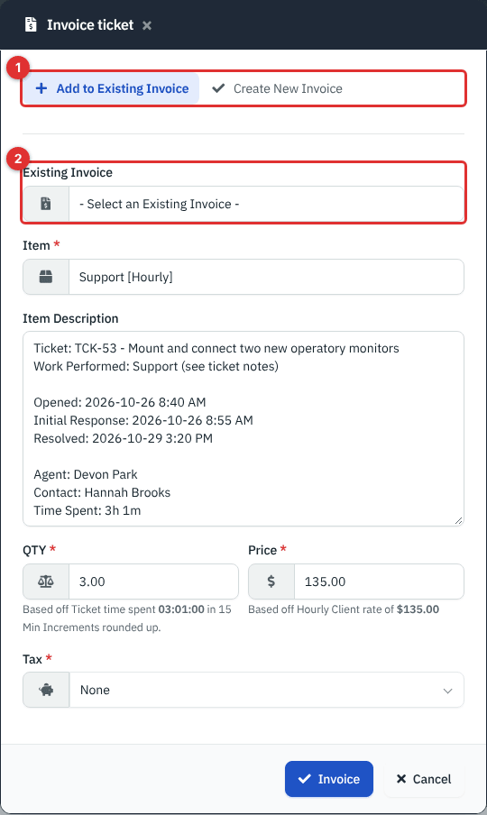

*Figure 9 — A client with a draft invoice. (1) The two tabs. (2) The draft to add to.*

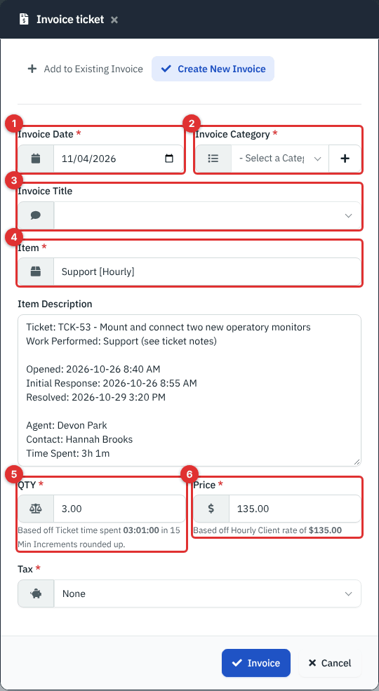

*Figure 10 — **Create New Invoice**. (1) Date. (2) Category, required. (3) Title. (4) **Item**. (5) **QTY**. (6) **Price**.*

What the app prepares for you:

- The **Item Description** lists the ticket number and subject, when it was opened, answered and resolved, the technician, location, contact, asset and the total time spent.
- **QTY** is the total time worked, rounded to the nearest 15 minutes (7.5 minutes or less rounds down), in hours. The note under the field says "rounded up", but the app rounds to the nearest quarter hour. **Price** is the client's hourly rate.
- The invoice is a **Draft**, due after the client's payment terms. It opens so you can add lines, review and send it.

The ticket now shows **Invoiced:** with a link to the invoice, an internal note is added, and the **Quote** and **Invoice** buttons are gone. You cannot add a ticket to a paid invoice.

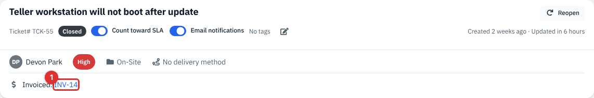

*Figure 11 — The **Invoiced:** link replaces the **Billable** line.*

If a quote exists, the pop-up shows a **View quote?** link so you do not bill the same work twice.

### Find work that is ready to bill

A ticket is **Ready to bill** when it is closed, marked billable and has no invoice. Three places show them:

- **Dashboard.** The **Ready to bill** figure in the "Waiting on you" band is an estimate: time logged multiplied by the client's hourly rate. See [Dashboard](02-dashboard.md).
- **Ticket list.** Click the **Billable, not yet invoiced** view in the **Ticket Views** list. The **Billable** column shows a tick for billable tickets.
- **Reports.** **Unbilled Tickets** (Reports → **Financial**) counts raised, billable and unbilled tickets per client, and each client name opens the matching ticket list. **Ticket Charges** (Reports → **Technical**) lists charges per ticket for a year, with **Uninvoiced charges only** to filter.

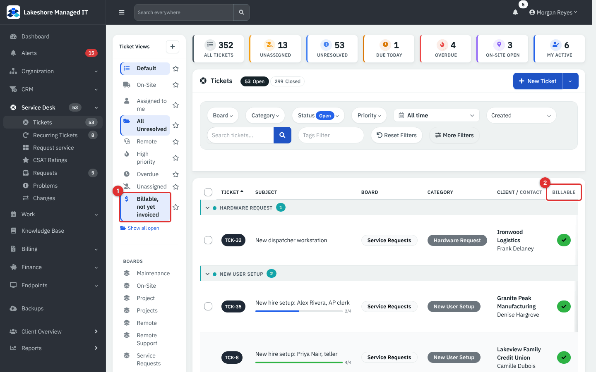

*Figure 12 — The saved view (1) and the **Billable** column (2).*

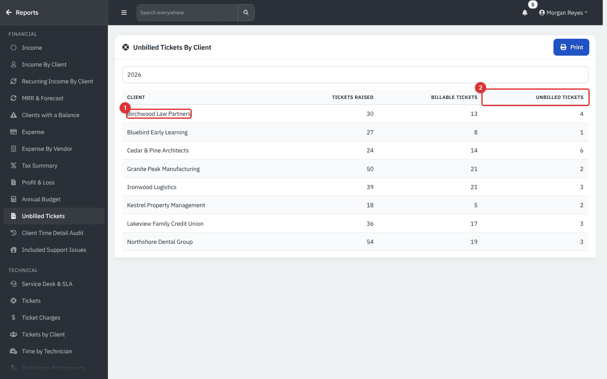

*Figure 13 — **Unbilled Tickets By Client**. (1) Client name, linked to the ticket list. (2) Unbilled tickets.*

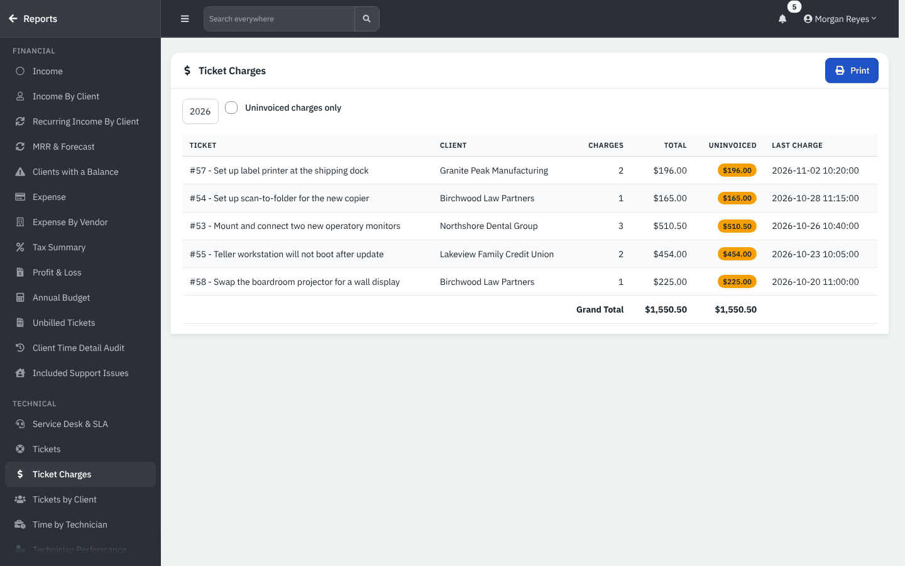

*Figure 14 — **Ticket Charges**. The invoiced ticket (#55) still shows its charges as uninvoiced, for the reason in the note above.*

For the report details see [Reports](23-reports.md).

### Use a worksheet on a ticket

A worksheet is a template of questions the technician answers on the ticket: text boxes, checkboxes, lists, notes and a signature box. Create templates once (see [Build a worksheet template](#build-a-worksheet-template)), then add them to tickets.

1. On an open ticket, open the **Worksheets** card and click **+**.
2. Choose a **Worksheet Template**. Tick **Is Required** if the ticket must not close until the worksheet is finalized.
3. Click **Add Worksheet**. The confirmation message has a **Fill it out now** link.

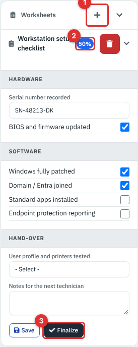

*Figure 15 — The **Worksheets** card. (1) **+** adds a worksheet. (2) The percentage is the share of answered fields. (3) **Finalize**.*

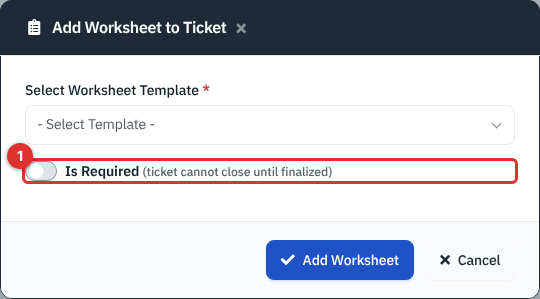

*Figure 16 — **Add Worksheet to Ticket**. (1) **Is Required**.*

Fill in the card directly, then click **Save** to keep your answers or **Finalize** to lock them. A finalized, ordinary worksheet shows **Finalized** and becomes read-only; **Unfinalize** unlocks it again. The bin button deletes a worksheet while the ticket is open.

The **Fill it out now** link opens the worksheet on a page of its own, with **Save Worksheet** and **Save & Mark Complete**. Fields marked with a red star in the template are required in text and note boxes on that page.

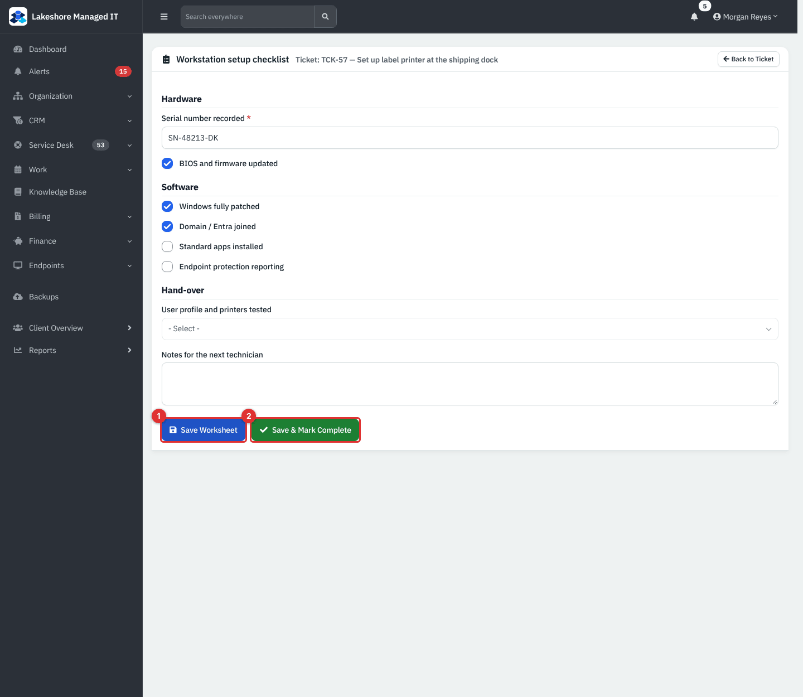

*Figure 17 — The full-page worksheet. (1) **Save Worksheet**. (2) **Save & Mark Complete**.*

> **Note.** The full-page worksheet is linked only from that confirmation message. The ticket card itself has no link to it, so copy the page address (`worksheet.php?worksheet_id=…`) if you need it later. Everything except the **Customer Sign Link** can also be done in the card.

You can also add worksheets automatically: an automation rule with the action **Add worksheet from template** adds one to every ticket that matches (see [Dispatch, Scheduling and Calendar](08-dispatch-scheduling-calendar.md#automate-with-ticket-rules)). Such a worksheet is an ordinary one, not **Is Required**.

### Get a signature with a required worksheet

A worksheet added with **Is Required** works as a sign-off:

- **Resolve** is refused with "there is an unfinalized outtake worksheet" until it is finalized.
- Its full page shows **Customer Sign Link**, a private web address you can send to the customer. They fill in or check the answers, type their name, draw a signature and press **Submit & Sign Outtake Form**. That finalizes the worksheet and records who signed and when.
- A required worksheet stays editable after it is finalized, and a signed one shows **Signed by** with the customer's name.

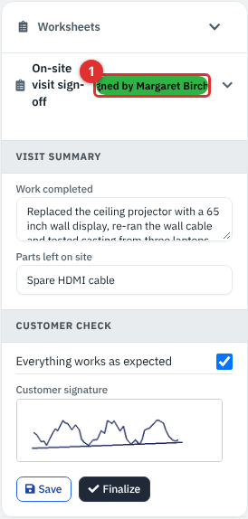

*Figure 18 — A signed worksheet. (1) **Signed by** badge.*

### Hand over with an outtake form

An outtake form is a one-page hand-over document: the ticket description, the comments on the ticket and your **Tech Notes / Work Summary**, followed by a disclaimer and a signature box. Use it when equipment or work is handed back to the customer.

1. On the ticket click **New → Add Outtake Form**, or **Add Outtake Form** in **Attachments**.
2. Open it with the pencil button in **Attachments** and fill in **Tech Notes / Work Summary**. Click **Save Notes**.
3. Get it signed in one of three ways: **Sign In-Person**, **Email Link to** the contact (needs a contact email, the ticket's **Email notifications** switch on and a working mail server), or copy the signing link for the customer.

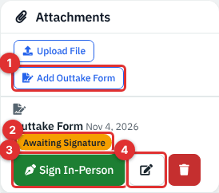

*Figure 19 — **Attachments**. (1) **Add Outtake Form**. (2) **Awaiting Signature**. (3) **Sign In-Person**. (4) Open the form.*

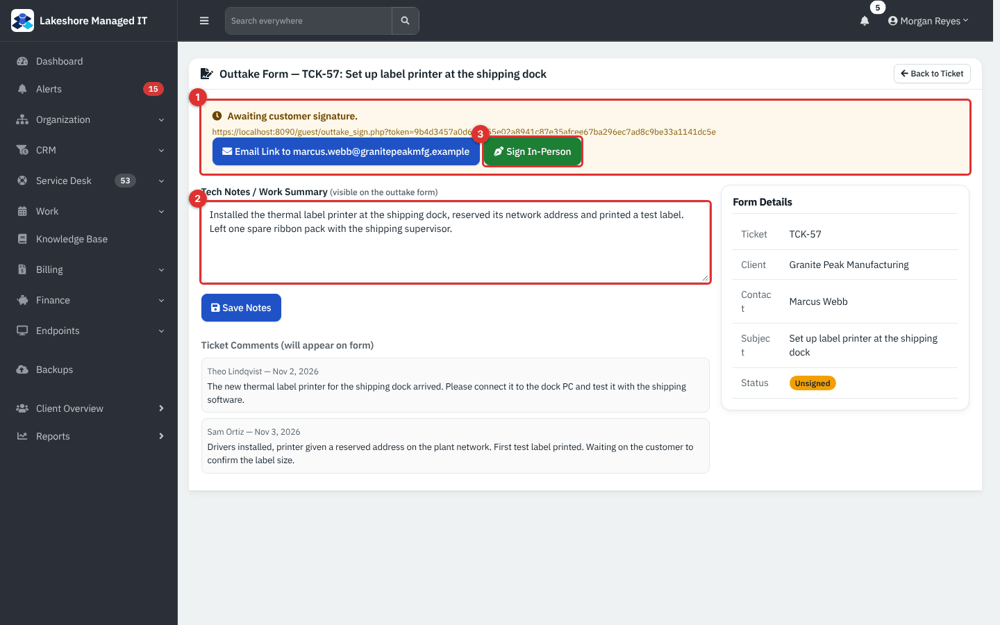

*Figure 20 — The outtake form page. (1) Status and signing options. (2) Tech notes. (3) **Sign In-Person**.*

To sign in person, hand the device to the customer. Their name is filled in from the ticket's contact; they draw a signature, tick the terms and press **Sign & Save**.

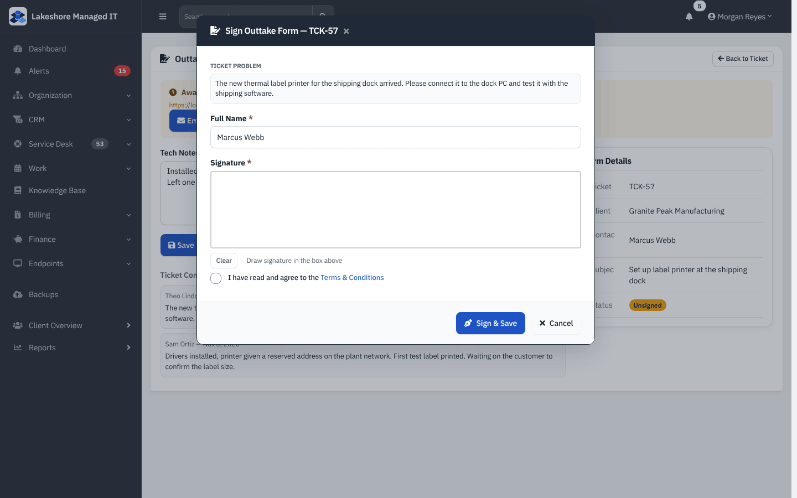

*Figure 21 — **Sign Outtake Form**.*

When the form is signed the app creates a PDF, saves it in the client's files in a folder named **Outtake Forms**, attaches it to the ticket and adds an internal note. **Resolve** is refused while an outtake form is unsigned.

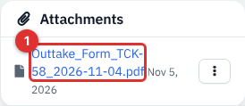

*Figure 22 — The signed PDF in **Attachments**.*

What the customer sees from the emailed or copied link needs no login. The signing section reads:

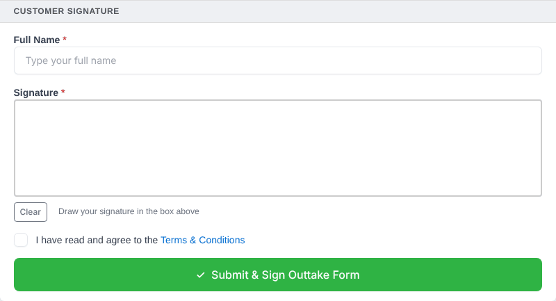

*Figure 23 — The signing section of the customer's page.*

> **Note.** The customer page also lists the ticket's comments with the name of who wrote each. For comments written by a technician it can show the name of a contact whose internal id happens to match the technician's, so review the comments before you send a form. The disclaimer wording on the form is fixed and not editable in the app.

### Set up labor types

1. Go to Administration → **Ticketing** → **Tickets** → **Labor types**. (The page lists **Name**, **Default Rate** and **Color**.)
2. Click the new button, give it a **Name**, a **Default Rate (per hour)** and a **Color**, and save.

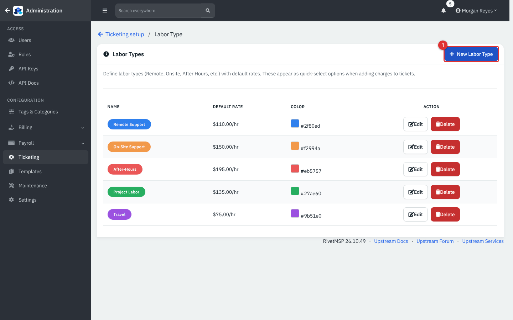

*Figure 24 — **Labor types** with the demo's five: Remote Support, On-Site Support, After-Hours, Project Labor and Travel. (1) New labor type.*

### Build a worksheet template

1. Go to Administration → **Templates** → **Worksheet templates** and click **New Template**. Give it a **Template Name** and optional description, then **Create Template**.
2. Open it with **Edit** and use **Add Field**. Each field has a name, a **Type**, **Options** (for lists, one choice per line) and **Required**.
3. Drag rows to put the fields in order.

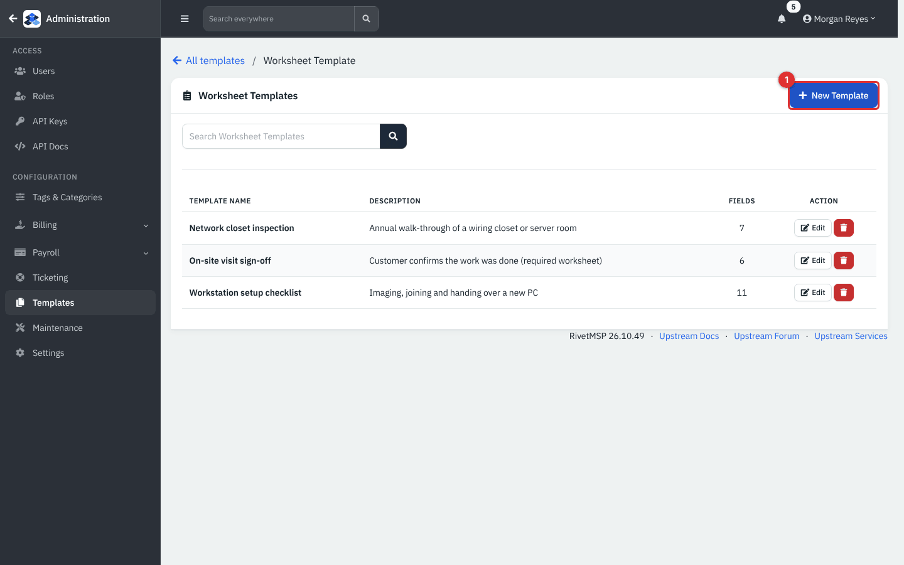

*Figure 25 — **Worksheet Templates**. (1) **New Template**.*

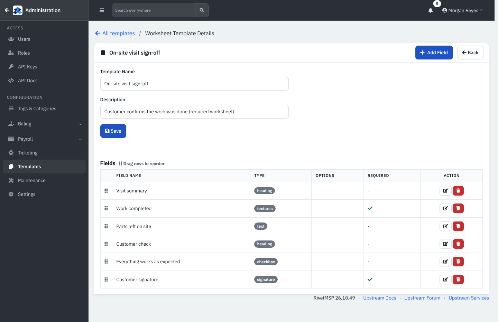

*Figure 26 — Fields of the **On-site visit sign-off** template.*

| Field type | On the ticket |
|---|---|
| **heading** | A section title, no answer. |
| **text** | One line. |
| **textarea** | Several lines. |
| **checkbox** | A tick box. |
| **select** | A list built from the options. |
| **signature** | A box to draw in. |

Changing a template later changes how existing worksheets that use it display, because answers are stored per field.

## Reference

### Where each control appears

| Control | Shown when |
|---|---|
| **Billable** line | **Show Invoicing / Accounting** is on and you can read quotes and invoices. |
| **Quote** button | Accounting on, ticket billable, no quote and no invoice, and **Modify** on both permission modules. |
| **Invoice** button | Accounting on, ticket billable, no invoice yet, and **Modify** on both modules. |
| **Charges** card | **Show Ticket Charges (Billing)** is on, and the ticket is open or already has charges. |
| **Charge now** | Ticket charges on and at least one labor type. |
| **Worksheets** card | The ticket is open, or already has a worksheet. |

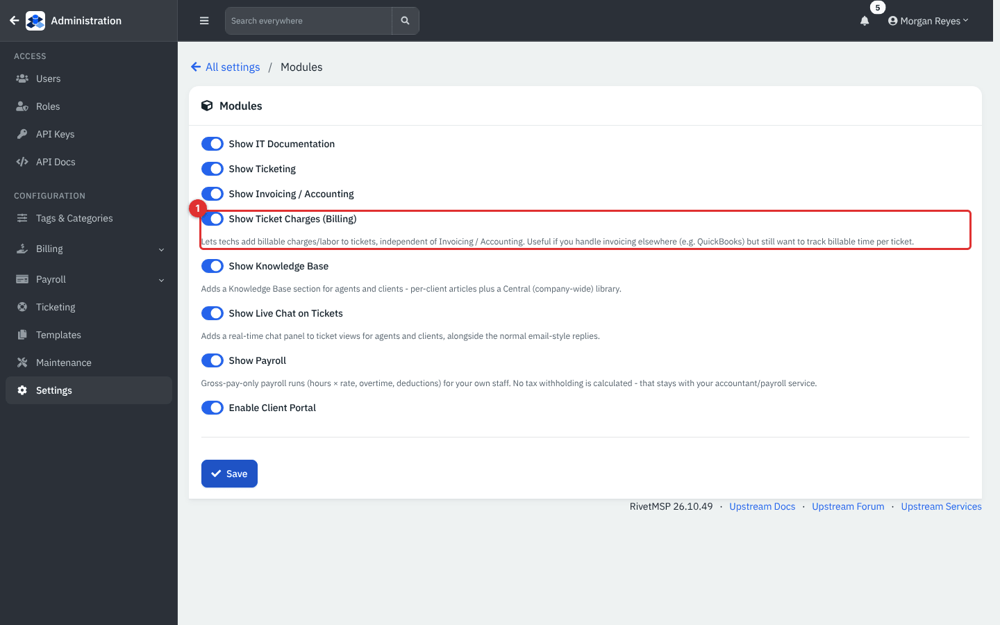

*Figure 27 — **Show Ticket Charges (Billing)** in Administration → Settings → Modules. (1) The switch and its explanation.*

### What blocks resolving a ticket

| Situation | Message |
|---|---|
| An outtake form is unsigned | "Cannot resolve ticket: there is an unsigned outtake form. Have the customer sign it first." |
| A required worksheet is not finalized | "Cannot resolve ticket: there is an unfinalized outtake worksheet. Finalize it first." |

**Resolve** on this product closes the ticket at once. Closing by other routes is refused with the same checks.

### Charge fields

| Field | Notes |
|---|---|
| **Item Name** | Required, up to 200 characters. |
| **Description** | Optional. |
| **Qty** | At least 0.01. |
| **Unit Price** | Not negative. |
| **Tax** | Any tax that has been set up in the app; **None** by default. |

## Tips and good practice

- Create labor types before your technicians start logging time, so **Charge now** is available from day one.
- Decide a rule for billing: either rely on the **Invoice** button (time times client rate) or on the **Charges** card, and do not mix them for the same ticket.
- Add your standard worksheet to every on-site ticket with an automation rule, and tick **Is Required** by hand on jobs that need a customer sign-off before they close.
- Use **Billable, not yet invoiced** each week as the invoicing to-do list.
- Mark managed-plan work **No** on purpose. Only billable tickets count as unbilled.

## Related guides

- [Service Desk: Tickets](05-service-desk-tickets.md) — the ticket page in full.
- [Dispatch, Scheduling and Calendar](08-dispatch-scheduling-calendar.md) — booking the visit.
- [Products, Quotes and Invoices](15-products-quotes-invoices.md) — what happens to the draft quote or invoice.
- [Reports](23-reports.md) — **Unbilled Tickets** and **Ticket Charges**.
- [Dashboard](02-dashboard.md) — the **Ready to bill** figure.
