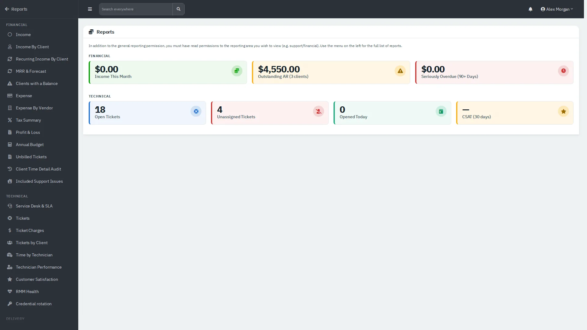
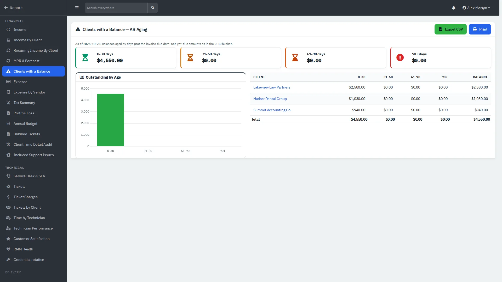
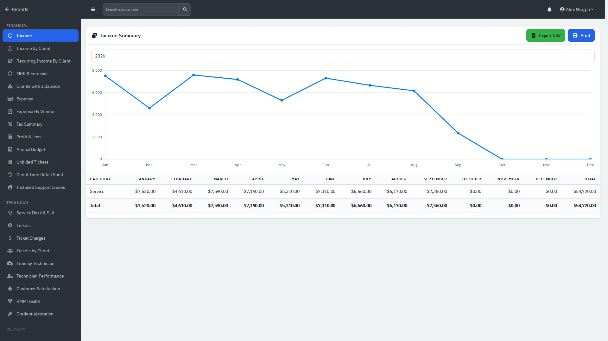
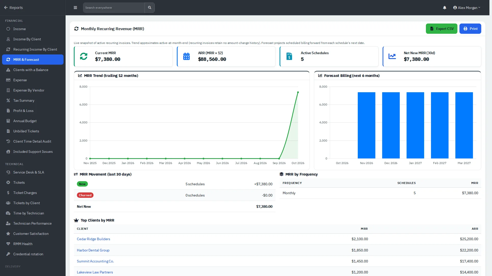

# Dashboard and reports

Answer "how are we doing?" and export the numbers.

| | |
|---|---|
| **Where to find it** | **Dashboard** (company name at the top of the sidebar) and sidebar → **Reports**. |
| **Who can use it** | Reports need the reporting permission, plus read access to the area (financial or support). |
| **Turn it on** | Nothing to turn on; financial figures need the accounting module. |

## The dashboard

The **Needs attention** strip lists what is waiting: unassigned tickets, domains and certificates expiring in 30 days, unpaid invoices and CSAT follow-ups. Below it, headline tiles show open tickets, your tickets, active clients and unpaid invoices.

With **Financial** switched on you also get income, expenses, profit, recurring income, a **Cash Flow** chart for the selected year, income and expense breakdowns and your account balances. With **Technical** on you get ticket trends and breakdowns. Use **Select Year** to look back.

## Reports

*Figure 1: The reports landing page. The menu on the left lists every report.*

**Financial:** Income, Income By Client, Recurring Income By Client, MRR & Forecast, Clients with a Balance, Expense, Expense By Vendor, Tax Summary, Profit & Loss, Annual Budget, Unbilled Tickets, Client Time Detail Audit, Included Support Issues.

**Technical:** Service Desk & SLA, Tickets, Ticket Charges, Tickets by Client, Time by Technician, Technician Performance, Customer Satisfaction, RMM Health, Credential rotation.

There is also a scheduled-reports page for reports delivered on a timetable.

### Accounts receivable aging

*Figure 2: Clients with a Balance, aged by days past the due date.*

Balances are bucketed 0-30, 31-60, 61-90 and 90+ days past the invoice due date (amounts not yet due sit in 0-30). Use **Export CSV** or **Print**.

### Income and recurring revenue

*Figure 3: Income by month for the year.*

*Figure 4: Monthly recurring revenue, annual run rate, movement and the next six months of scheduled billing.*

**Unbilled Tickets** shows, per client, tickets raised, billable and not yet invoiced; use it before month-end billing. Most reports have **Export CSV** and **Print** buttons at the top right.
