# Recurring Tickets, Request Something, CSAT Ratings and Requests

This page covers four smaller parts of the Service Desk that sit beside the ticket list: **Recurring Tickets** (work that repeats on a schedule), **Request Something** (a menu of one-click ticket shortcuts), **CSAT Ratings** (what contacts said about closed tickets) and **Requests** (emails from unknown senders waiting for a decision). The ticket itself is in [Service Desk: Tickets](05-service-desk-tickets.md).

| | |
|---|---|
| **Where to find it** | Sidebar → **Service Desk** → **Recurring Tickets**, **Request service**, **CSAT Ratings** and **Requests**. The catalog is managed in Administration → **Service Catalog** (the **Manage Catalog** button on the Request Something page). Recurring Tickets also appears inside a client, in the client's own sidebar; **CSAT Ratings** can be limited to one client with its **All Clients** filter. |
| **Who can use it** | Permission module **Access to ticketing, assets and documentation**. **Read** to see all four pages. **Modify** to create and edit recurring tickets, force a run, convert or dismiss requests and approve CSAT comments. **Full** to delete recurring tickets. Managing the catalog is for administrators only. |
| **Turn it on** | **Show Ticketing** in Administration → Settings → Modules. **CSAT Ratings** also needs **Enable CSAT ratings** in Administration → Settings → Ticketing. Recurring tickets are raised by the scheduler, so cron must be running (Administration → Settings → Notifications → **Enable Cron**). |

## What it's for

- Raise the same job every week, month or quarter without anyone remembering to (patch reviews, backup restore tests, site inspections).
- Give staff and contacts a short menu of common requests that opens a ticket already filled in, with an optional approval hold.
- See how contacts rate your work and follow up on unhappy ratings.
- Review emails that did not match a known contact and turn the real ones into tickets.

## Recurring tickets

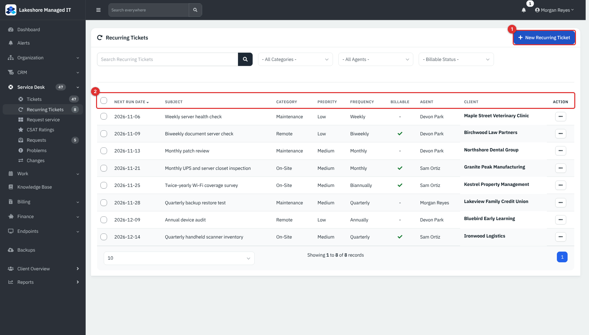

*Figure 1 — **Recurring Tickets**. Example data. (1) **New Recurring Ticket**. (2) Column headings; click to sort.*

The list shows, for each template, the **Next Run Date**, **Subject**, **Category**, **Priority**, **Frequency**, **Billable**, **Agent** and **Client**. Search matches the subject and category. The three filters narrow by **Category**, **Agent** and **Billable Status** (**Billable** or **Non-Billable**).

### Create a recurring ticket

1. Click **New Recurring Ticket**.
2. On **Details**, enter the **Subject** and description, choose **Priority** and **Category**, optionally **Assign to** a technician, and switch **Mark Billable** on if the work is charged.
3. On **Contact**, choose the **Client** (required) and a **Contact**.
4. On **Schedule**, choose the **Frequency** and the **Starting date**.
5. Optionally, on **Assets**, link an **Asset** and **Additional Assets** of that client.
6. Click **Create**.

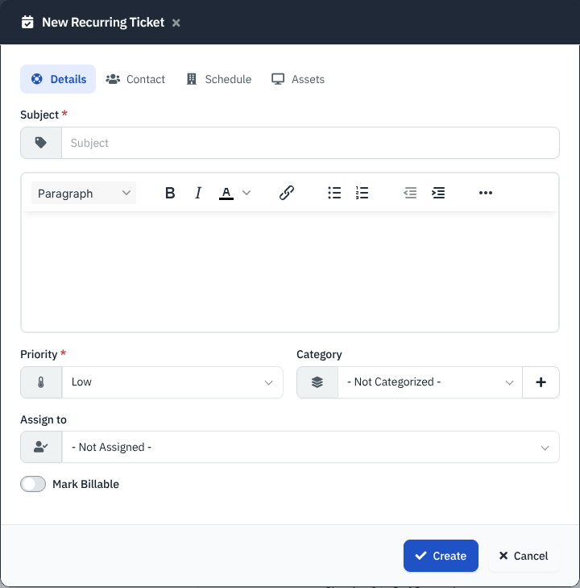

*Figure 2 — **Details**. **Subject** and **Priority** are required.*

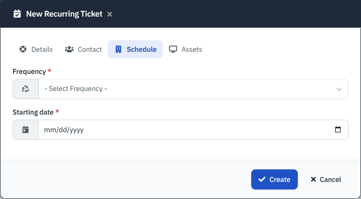

*Figure 3 — **Schedule**. The starting date cannot be in the past.*

**Frequency** choices are **Three Days**, **Weekly** and **Biweekly** (in days) and **Monthly**, **Quarterly**, **Biannually** and **Annually** (in months). The first ticket is raised on the starting date.

### How and when tickets appear

Each time the scheduler runs, it looks for templates whose **Next Run Date** is today. For each one it creates a ticket with source **Recurring**, copies the subject, details, priority, category, contact, technician and assets, applies the category's rules (a **Non-billable** category forces the ticket non-billable, an **SLA exempt** category gives it no SLA), and then moves the **Next Run Date** on by one frequency step. The new ticket then follows the normal rules in [Service Desk: Tickets](05-service-desk-tickets.md); if the template names a technician and a contact with an email address, and a mail server is set up, the contact gets the usual "Ticket created" email (not verified on a live service).

> **Note**
> The scheduler only matches a next run date that equals today. If cron was off that day, or you set a date in the past, no ticket is raised and the app posts a notification "Recurring ticket ... next run date is in the past!". Edit the template and set a new **Next run date**.

### Edit, force or delete

Click a subject, or open its **...** menu, to see the actions.

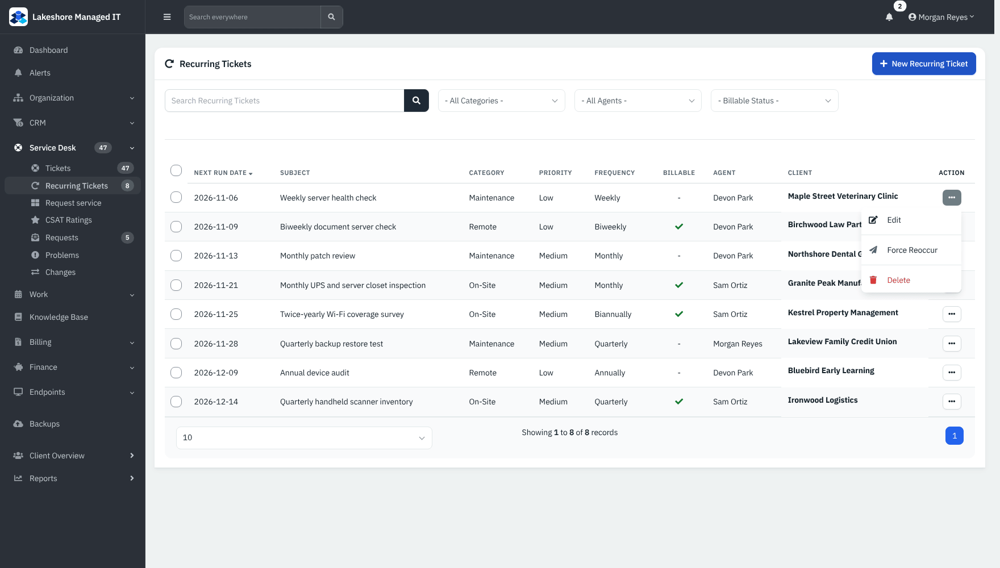

*Figure 4 — The row menu. **Delete** shows only at **Full**.*

- **Edit** opens the same tabs as the new form, plus **Next run date**. Changing it is how you skip or bring forward a run.
- **Force Reoccur** raises the ticket now and moves the next run date forward one step from its current value, so a forced run replaces the next scheduled one.
- **Delete** removes the template. Tickets it already raised stay.

### Act on several at once

Tick the rows and open **Bulk Action (n)**.

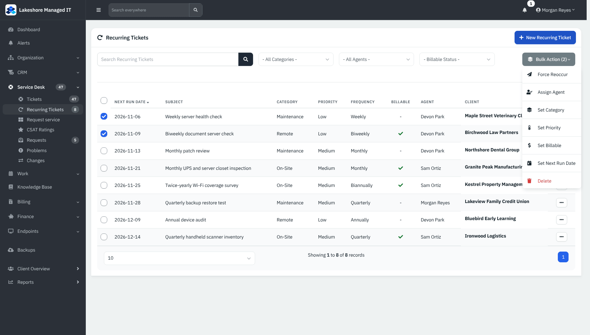

*Figure 5 — **Force Reoccur**, **Assign Agent**, **Set Category**, **Set Priority**, **Set Billable**, **Set Next Run Date** and **Delete**.*

## Request Something

**Request Something** is a menu of tiles. Picking one opens the normal **New Ticket** form with the subject, category and priority already filled in. It is a shortcut, not a separate workflow.

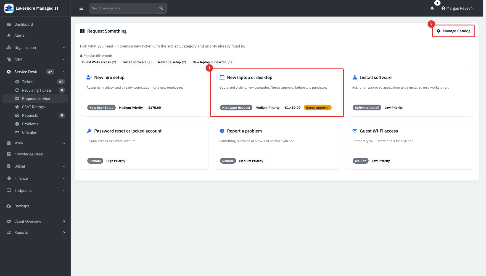

*Figure 6 — **Request Something**. (1) A tile shows the name, description, category, priority, an informational price and a **Needs approval** badge. (2) **Manage Catalog** (administrators only). **Popular this month** counts tickets raised from each item in the last 30 days.*

### Raise a ticket from a tile

1. Open Service Desk → **Request service** and click a tile.
2. Choose the **Client** and **Contact** on the **Contact** tab, add detail on **Details**, and click **Create**.

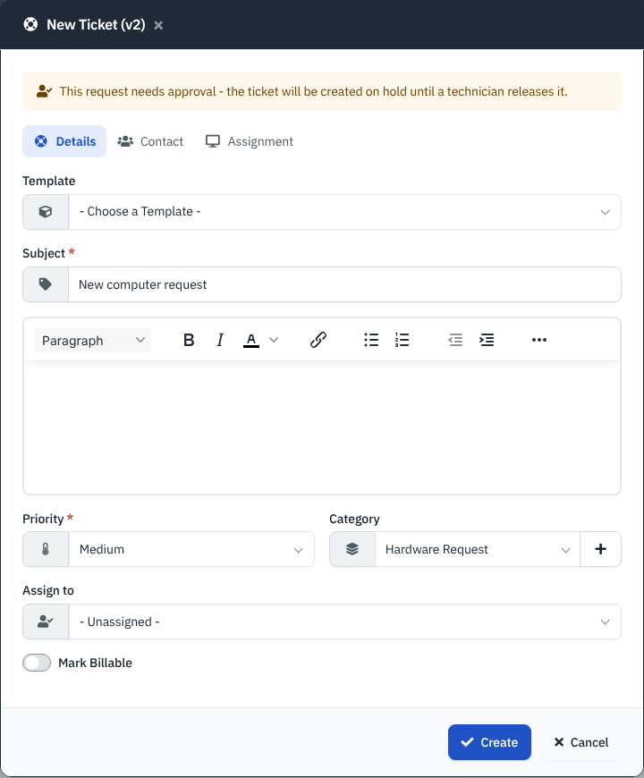

*Figure 7 — The prefilled form. The banner appears for an item that needs approval.*

If the item **Requires approval**, the ticket is created and immediately put **On Hold** (the app looks for a status called **Pending Approval** first and falls back to **On Hold**), with the system note "Held for approval (Service Catalog). A technician releases it by changing its status." Releasing it is an ordinary status change; there is no separate approve or reject button.

### Manage the catalog

Administrators open Administration → **Service Catalog** (or **Manage Catalog**).

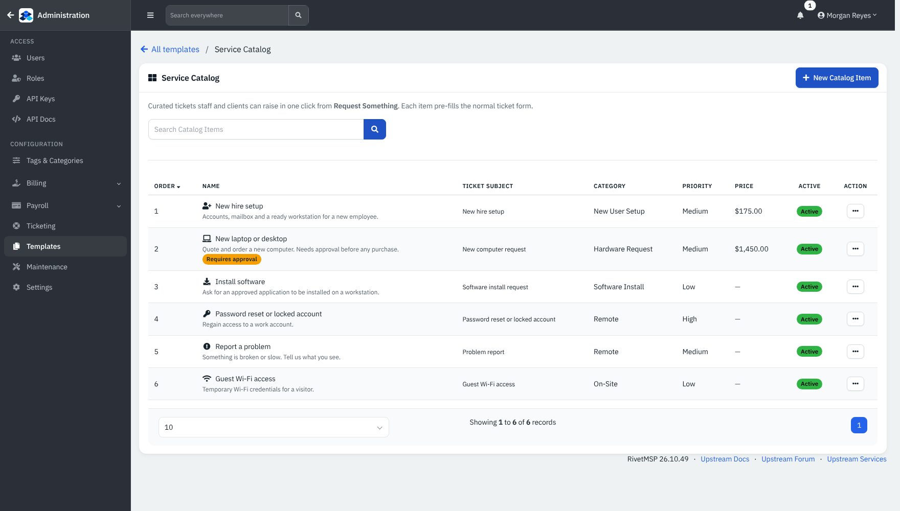

*Figure 8 — The catalog list with order, name, subject, category, priority, price, and **Active** or **Inactive**.*

Click **New Catalog Item**, or open an item to edit it.

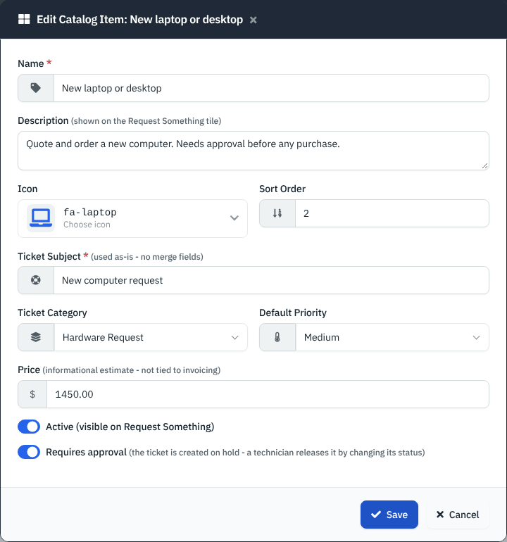

*Figure 9 — An item. **Requires approval** puts the created ticket on hold.*

| Field | What it does |
|---|---|
| **Name** | The tile title. Required. |
| **Description** | Short text shown on the tile (up to 500 characters). |
| **Icon**, **Sort Order** | The tile icon and its place; lower numbers come first. |
| **Ticket Subject** | Used exactly as typed. There are no merge fields. Required. |
| **Ticket Category**, **Default Priority** | Prefilled in the form. The priority can be left **Not set**. |
| **Price** | An informational estimate shown on the tile. It is not tied to invoicing. |
| **Active** | Inactive items stay in the admin list but disappear from the menu. The **...** menu has **Deactivate** and **Activate**. |
| **Requires approval** | Creates the ticket on hold. |

Contacts see the same catalog in the client portal under **Request Something**, with an extra **Something else** tile that opens a blank ticket.

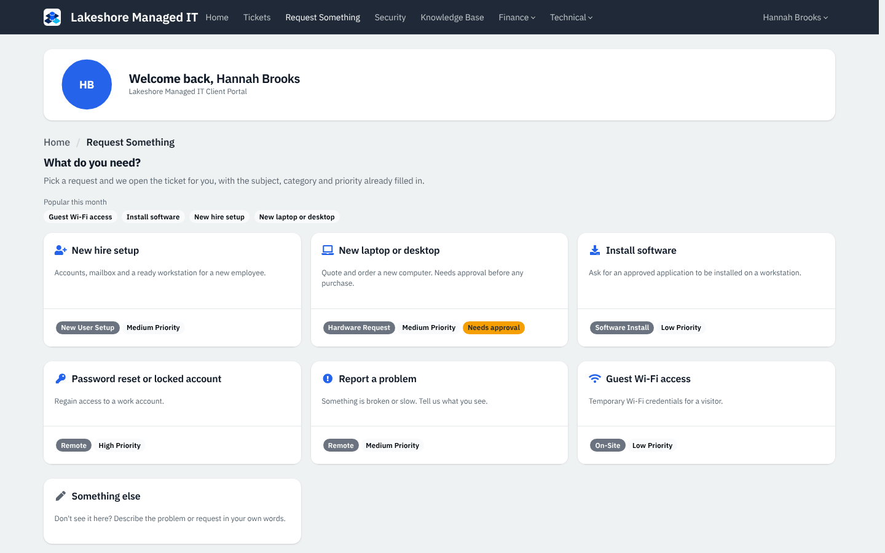

*Figure 10 — The portal view of the catalog for Hannah Brooks at Northshore Dental Group. Example data.*

## CSAT ratings

When CSAT is on, the closing email carries five faces and the portal asks for a rating once a ticket is closed. The scale is 1 to 5: **Very unhappy**, **Unhappy**, **Neutral**, **Happy**, **Very happy**.

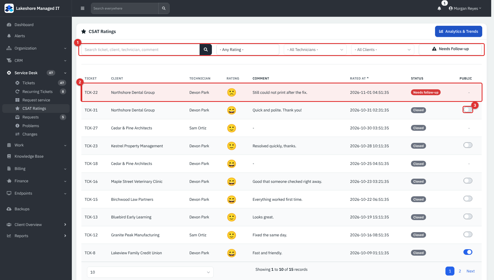

*Figure 11 — **CSAT Ratings**. (1) Search and filters. (2) A row needing follow-up. (3) The **Public** switch.*

Columns: **Ticket**, **Client**, **Technician**, **Rating**, **Comment**, **Rated At**, **Status** and **Public**. Filters: search (ticket, client, technician, comment), **Any Rating**, **All Technicians**, **All Clients** and **Needs Follow-up**.

### Low ratings reopen the ticket

A rating at or below the low-rating threshold (2 by default) reopens the ticket: the status goes back to **Open**, resolved and closed dates are cleared, and an internal note "Automatically reopened — ... rated this ticket 2/5" is added with the comment. A notification goes to the team. The row turns red and shows **Needs follow-up** until the ticket is closed again.

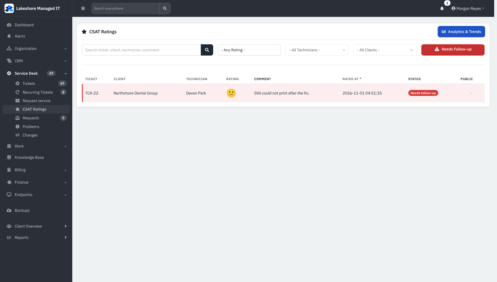

*Figure 12 — **Needs Follow-up** shows only unhappy ratings on tickets that are not closed.*

### Show a comment publicly

A rating of 4 or 5 with a comment gets a **Public** switch (at **Modify**). Switched on, the comment may appear in the public rating feed (`GET /api/v1/csat`) used to put a rating widget on a website. It is off for every rating until someone reviews it, because free text can carry personal details. Ratings of 3 or less, or without a comment, show a dash.

### Analytics

**Analytics & Trends** opens the CSAT report (Reports → Technical → **Customer Satisfaction**). It has a date range, **Avg Rating**, **Response Rate**, **Satisfied** and **Needs Follow-up** tiles, a rating distribution, an average-rating trend, tables by technician and by client, and a feedback list, with **Export CSV** and **Print**.

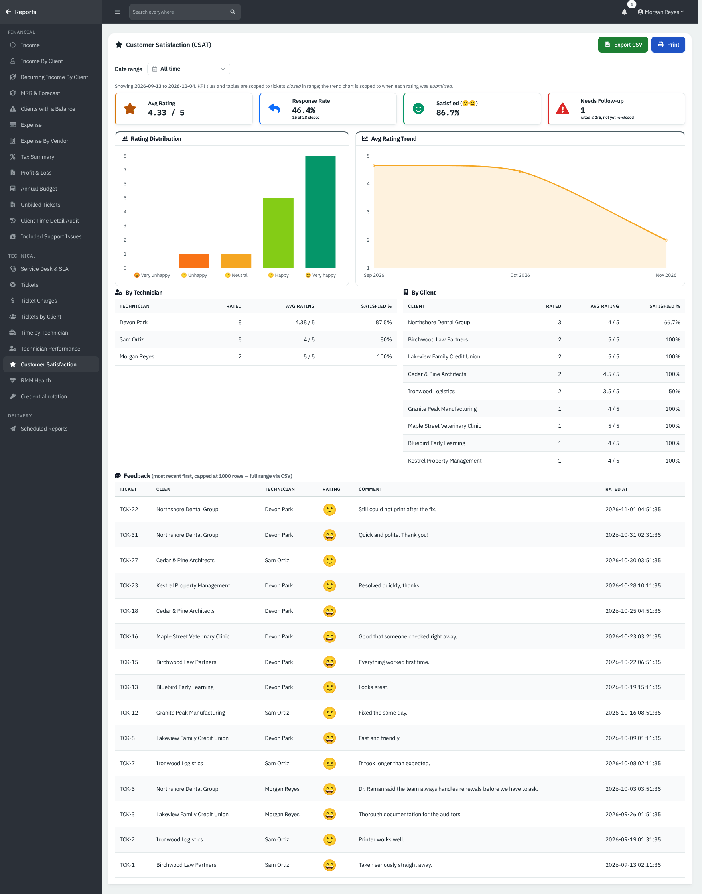

*Figure 13 — The CSAT report. Tiles and tables count tickets closed in the date range; the trend counts when each rating was submitted.*

### Settings

In Administration → Settings → Ticketing: **Enable CSAT ratings**, **Reminder email delay** (days after close before an unrated ticket gets one reminder; 3 in the demo), **Low-rating follow-up threshold** (2 in the demo) and **Google review link**. When a contact gives 4 or 5 stars, the portal offers a "Leave us a Google review" button that opens this link. Reminders and rating emails need a mail server and were not sent in the demo.

## Requests (emailed)

When **Email-to-ticket parsing** is on, mail from a known contact or domain becomes a ticket or a reply. Mail from senders that match nothing waits in **Requests**. The mailbox poller itself needs a live mail server, so in the demo the rows are examples of what it would write.

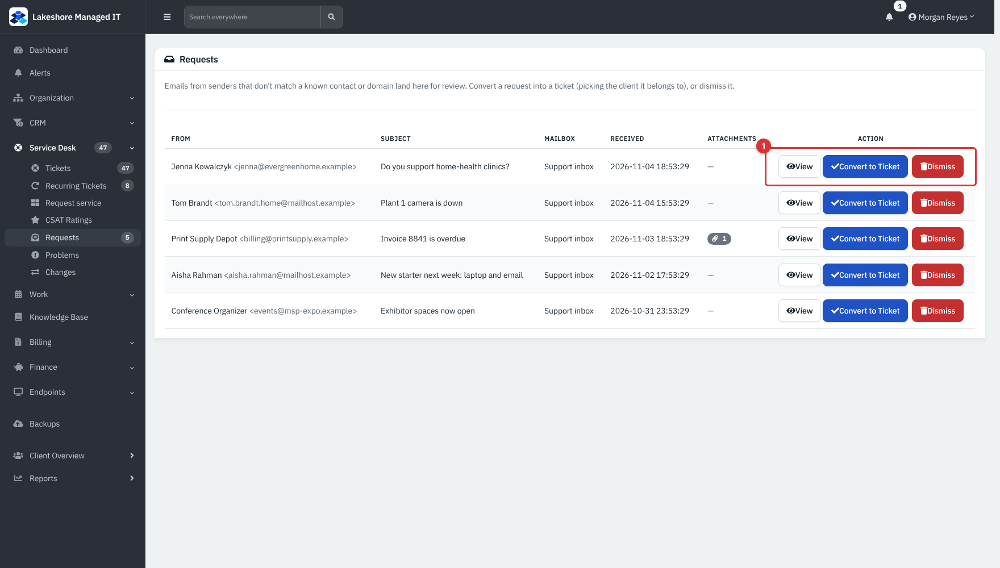

*Figure 14 — **Requests**. (1) The actions for a row.*

Columns: **From**, **Subject**, **Mailbox**, **Received**, **Attachments** and **Action**. Technicians who are limited to certain clients see only requests whose mailbox's default client is one of theirs, plus requests from mailboxes with no default client.

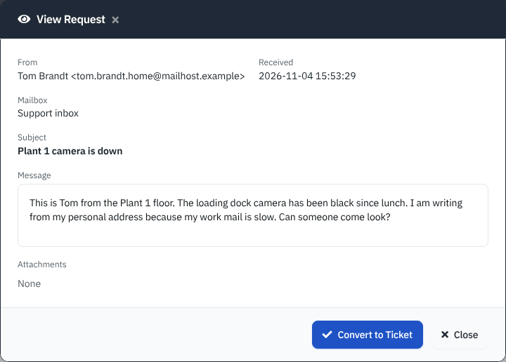

*Figure 15 — **View**. The message is shown sanitised; attachments and the original email are linked.*

### Turn a request into a ticket

1. Click **View** to read it, then **Convert to Ticket** (or click **Convert to Ticket** in the list).
2. Choose the **Client**. The default is the mailbox's default client; **None (Guest / unassigned)** creates a ticket without a client.
3. Click **Create Ticket**. The ticket opens.

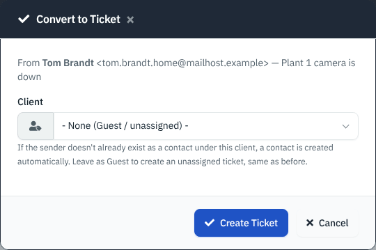

*Figure 16 — **Convert to Ticket**. If the sender is not yet a contact of that client, a contact is created automatically.*

**Dismiss** removes a request you do not want after you confirm. Both actions need **Modify**; a request that was already converted or dismissed reports "Request not found".

## Reference

### Recurring ticket fields

| Field | Notes |
|---|---|
| **Subject**, details | Copied to every ticket raised. |
| **Priority** | **Low**, **Medium** or **High**. |
| **Category** | Optional; decides delivery method, non-billable and SLA-exempt behaviour. |
| **Frequency** | Three Days, Weekly, Biweekly, Monthly, Quarterly, Biannually, Annually. |
| **Starting date**, **Next run date** | The next run is set from the start date and moves on by one step each run. |
| **Billable** | Copied to the ticket unless the category forces non-billable. |
| **Client**, **Contact**, **Asset** | Required client; contact and asset optional. |

### CSAT faces

| Rating | Face label | Counts as satisfied |
|---|---|---|
| 1 | Very unhappy | No |
| 2 | Unhappy | No |
| 3 | Neutral | No |
| 4 | Happy | Yes |
| 5 | Very happy | Yes |

## Tips and good practice

- Put patching, backup tests and inspections on a schedule so they do not depend on memory. Use Maintenance or Remote categories to keep the delivery method right.
- Check the **Recurring Tickets** list after a cron outage for dates now in the past.
- Keep catalog subjects plain: they are used exactly as typed.
- Use **Requires approval** for purchases; the hold is a reminder, not a locked workflow.
- Review **Needs Follow-up** every day and read the comment before you reply.
- Convert real requests quickly; dismiss newsletters and invoices that belong in email.

## Related guides

- [Service Desk: Tickets](05-service-desk-tickets.md)
- [Ticketing setup and templates](37-ticketing-setup-and-templates.md)
- [Client Portal](32-client-portal.md)
- [Mail intake and sending](30-mail-intake-and-sending.md), [Webhooks, event rules and jobs](30b-webhooks-event-rules-and-jobs.md) and [AI and the MCP server](30c-ai-and-remote-mcp.md)
- [Reports](23-reports.md)
