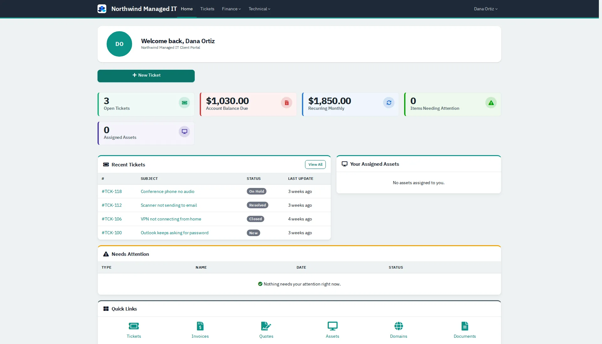
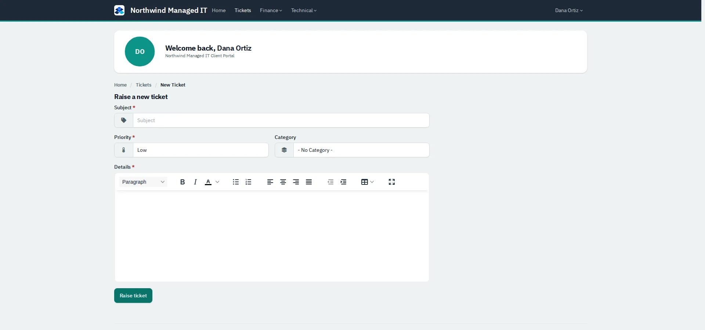

# Client portal

What your clients see when they sign in to raise tickets and check invoices.

| | |
|---|---|
| **Where to find it** | Your RivetMSP address followed by `/client/`. |
| **Who can use it** | Client contacts that have a portal login. |
| **Turn it on** | Give a contact a portal login from the contact's record; module settings are under Administration → Settings → **Modules**. |

## Home

*Figure 1: The portal home: open tickets, balance due, recurring monthly amount, items needing attention, recent tickets, assigned assets and quick links.*

The top bar has **Home**, **Tickets**, **Finance** (Invoices, Recurring Invoices, Quotes, Saved Payments) and **Technical** (Contacts, Assets, Contracts & Docs, Documents, Domains, Certificates, All tickets). The account menu has **Account** and **Sign out**.

## Raising a ticket

*Figure 2: Raise a ticket: subject, priority, category and details.*

1. Click **New Ticket** (home) or **Tickets → New Ticket**.
2. Give a subject, choose a priority and optional category, describe the problem and click **Raise ticket**.
3. The ticket opens; the client can follow its status and reply to it later from **Tickets**.

The portal form has no attachment field; clients who need to send a file should reply by email.

## Invoices and quotes

**Finance → Invoices** lists invoices with amount, date, due date and status; **Quotes** lists quotes. A client with a saved card can manage it under **Saved Payments**. A client who is not signed in can open an invoice or quote from the guest link you send them.

## Account

**Account** lets a client change their password.
