# Dispatch, Scheduling and Calendar

This page is about getting the right technician to the right place at the right time. You book appointments on tickets, see them next to meetings and maintenance windows on the shared calendar, subscribe to your own visits in another calendar app, and let the app hand new tickets to the technician who has the matching skill.

| | |
|---|---|
| **Where to find it** | Sidebar → **Work** → **Calendar**. Appointments are booked on a ticket (the **Appointments** card). Inside a client, **Calendar** in the client's own sidebar shows only that client's entries. Skills and automation rules are in Administration. |
| **Who can use it** | Permission module **Access to ticketing, assets and documentation**: **Read** to see the calendar and appointments; **Modify** to book and change appointments, add and edit calendars and events; **Full** to delete a calendar. Skills, Outlook credentials and automation rules are administrator pages. |
| **Turn it on** | The calendar and appointments are always available. The email option on events needs a mail server. Outlook sync needs an administrator to enter Microsoft credentials. Automatic dispatch needs an automation rule (see [Send new tickets to the right technician](#send-new-tickets-to-the-right-technician)). |

## What it's for

- Book a remote session or an on-site visit for one technician or several, with notes for the visit.
- See everybody's visits at a glance, coloured by technician, together with team meetings and maintenance windows.
- Put your own visits in Outlook, Apple Calendar or Google Calendar.
- Spread new tickets across technicians by skill and workload instead of assigning each by hand.

## A quick tour

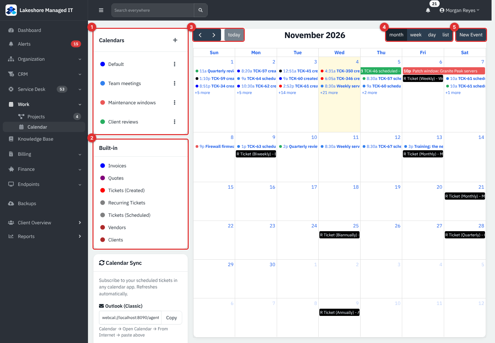

*Figure 1 — The calendar in month view. Example data from the Lakeshore Managed IT demo; the clutter is real: every ticket, invoice and quote also appears on its creation day.*

1. **Calendars**: your own calendars, each with a colour. **+** adds one; the three-dot menu renames it or, for an administrator, deletes it.
2. **Built-in**: the colour key for entries the app draws by itself (see [What appears on the calendar](#what-appears-on-the-calendar)).
3. Previous, next and **today**.
4. **month**, **week**, **day** and **list** views.
5. **New Event**.

Below the two cards on the left sit **Calendar Sync** and its feed addresses (see [Subscribe in another calendar app](#subscribe-in-another-calendar-app)).

Click any ticket entry to open the ticket, and any event to edit it. Click a day number or a weekday name to jump to that day or week.

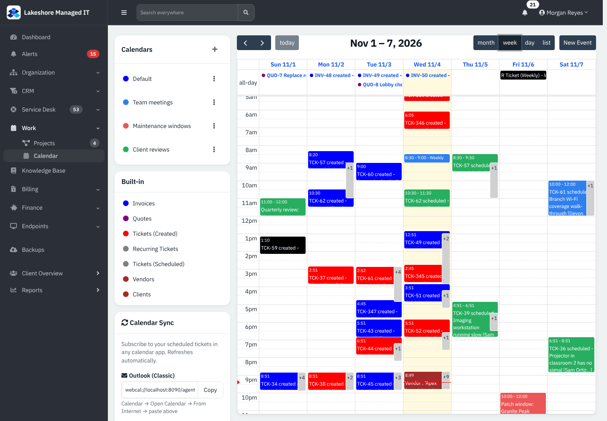

*Figure 2 — **week** view. Each visit sits in its time slot, coloured by technician: blue for Devon Park and green for Sam Ortiz. When many entries share a slot the calendar shows a **+** count; click it to see the rest.*

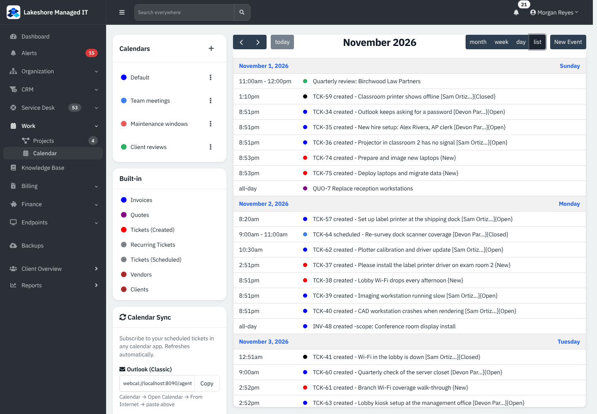

*Figure 3 — **list** view is the easiest way to read a busy month.*

## Common tasks

### Book an appointment on a ticket

An appointment is one visit or call for one technician. A ticket can have as many as you like.

1. Open the ticket and unfold the **Appointments** card. Click **+** (or **Add appointment** when the card is empty). You need **Modify**, and the ticket must be open.
2. Choose **Remote** or **Onsite** under **Appointment Type**.
3. Pick the **Start**, and a **Duration**.
4. Tick one or more **Technicians**. If the ticket is already assigned, that technician is ticked for you.
5. Add **Notes** for the visit (internal: door codes, parts to bring) and click **Save**.

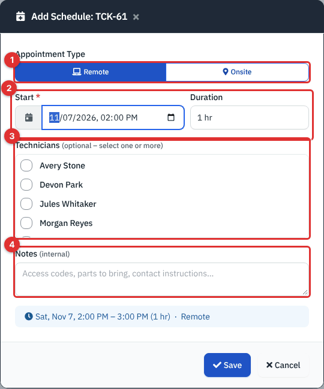

*Figure 4 — **Add Schedule**. (1) **Appointment Type**. (2) **Start** and **Duration**. (3) **Technicians**. (4) **Notes**. A blue line at the bottom previews the booking, for example "Sat, Nov 7, 2:00 PM – 3:00 PM (1 hr) · Remote".*

If you tick two technicians the app saves **one appointment for each**, with the same time and notes, so each of them sees it on their own calendar. With no technician ticked the appointment is saved unassigned and shows no technician name.

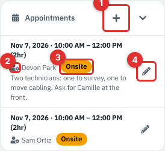

*Figure 5 — The **Appointments** card. (1) **+** adds an appointment. (2) The technician. (3) The **Onsite** or **Remote** badge. (4) The pencil edits one entry.*

The booking does not notify the customer and does not change the ticket's status or assignee. Tell the customer in a normal reply.

### Change or remove an appointment

1. In the **Appointments** card click the pencil beside the entry.
2. Change the type, start, duration, **Technician** (one person for this entry) or **Notes**, and click **Save**.
3. To remove it, click the red **Delete** link at the bottom left.

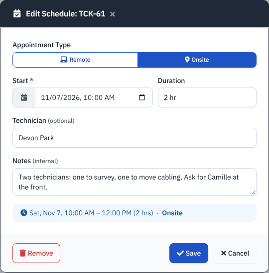

*Figure 6 — Editing one appointment. (1) **Delete**.*

The pencil disappears once the ticket is closed. Deleting an appointment keeps nothing on the calendar, but the booking is archived rather than erased.

> **Note.** An older style of single appointment, stored on the ticket itself, still shows on the calendar and the list for tickets that have one. The ticket's **Appointments** card is the one to use: it is what the calendar feed and the mobile app read.

### What appears on the calendar

The calendar draws several kinds of entry. Some belong to you, some are automatic.

| Entry | Colour | Notes |
|---|---|---|
| Your calendars' events | The calendar's colour | Meetings, windows, reviews you add. |
| **Tickets (Scheduled)** | The technician's own colour | A booked appointment, titled "TCK-61 scheduled - subject [Technician]{Status}". Without a personal colour it is red once past and grey while upcoming. |
| **Tickets (Created)** | Red (New), blue (Open), grey (On Hold), black (Resolved or Closed) | One entry on the day each ticket was created. |
| **Recurring Tickets** | Shown as "R Ticket (frequency)" | The next date a recurring ticket will run. |
| **Invoices** / **Quotes** | Blue / purple | Shown on the date they were created. |
| **Vendors** / **Clients** | Brown | On the date they were added. Client entries appear only on the main calendar. |

Inside a client's own calendar only that client's entries are shown.

### Add a calendar and an event

Use separate calendars to keep kinds of entry apart, for example **Team meetings**, **Maintenance windows** and **Client reviews**.

1. Click **+** in **Calendars**, give the calendar a **Name** and pick its **Color**, then **Create**. The three-dot menu next to a calendar renames it and changes its colour (**Rename**); only an administrator sees **Delete**, which also deletes all its events.
2. Click **New Event**.
3. On the **Event** tab choose the **Calendar**, type a **Title**, and set **Start / End**. Entering a start fills the end one hour later.
4. On **Details** add a **Location** and a description. On **Attendees** choose a **Client** if the event concerns one. Click **Create**.

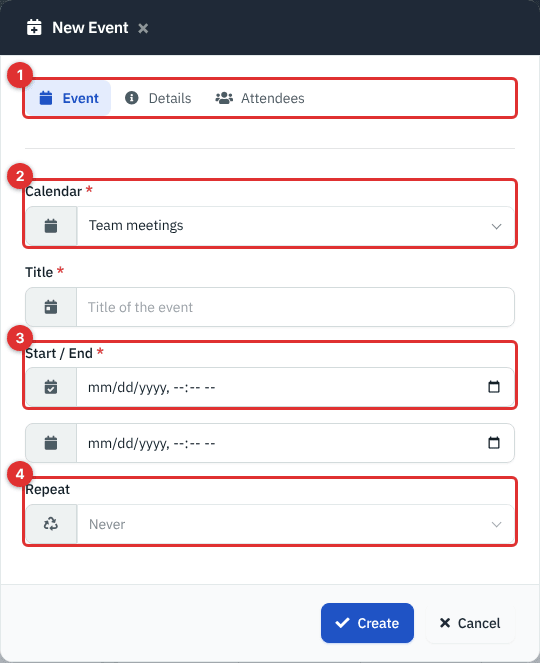

*Figure 7 — **New Event**. (1) The three tabs. (2) **Calendar**. (3) **Start / End**. (4) **Repeat**.*

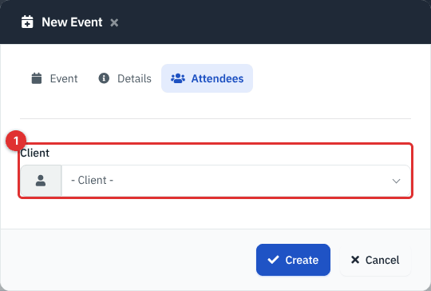

*Figure 8 — The **Attendees** tab: a **Client** list. **Email Event** appears below it only when a mail server is configured in Administration → Settings → Mail.*

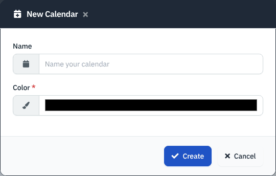

*Figure 9 — **New Calendar**.*

**Email Event** sends the client's primary contact a short "New Calendar Event" message with the title and start time. It was not verified on a live mail server.

> **Note.** The **Repeat** list is greyed out in this release, so an event cannot repeat. Add each date as its own event.

To change an event, click it on the calendar, edit and click **Save**. **Delete** is in the same pop-up. A client's name set on an event also puts it on that client's own calendar.

### Choose your calendar colour

Each technician has a personal colour that tints their appointments on the calendar so a dispatcher can tell them apart.

1. Open the account menu (your name, top right) → **Account** → **Integrations**.
2. Under **My Calendar Color** pick a colour and click **Save Color**.

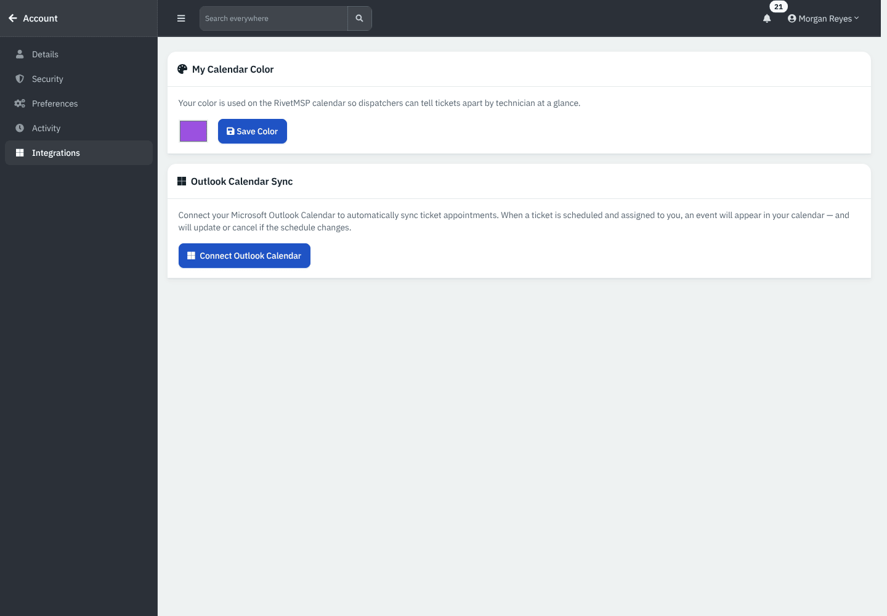

*Figure 10 — **Integrations** on your account page.*

### Subscribe in another calendar app

Every signed-in user has a private feed address in the **Calendar Sync** card. It lists your own scheduled tickets and appointments from the last 30 days onward and refreshes when your calendar app asks again.

1. In **Calendar Sync** use **Copy** under **Outlook (Classic)** and paste it into Outlook: **Calendar → Open Calendar → From Internet**.
2. For Apple Calendar or the new Outlook click **Subscribe Now**.
3. For Google Calendar copy the second address and use **Settings → Add calendar → From URL**.

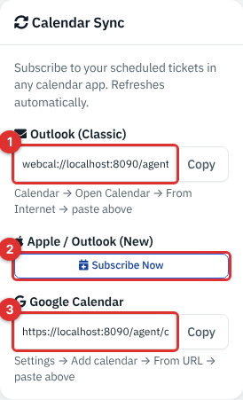

*Figure 11 — **Calendar Sync**. (1) The `webcal://` address. (2) **Subscribe Now**. (3) The `https://` address.*

The feed contains only appointments where **you** are the technician, so an unassigned appointment is in nobody's feed. Treat the address as a password: anyone who has it can read your visits. The feed is read-only and was not tried with real calendar apps in this guide.

### Sync with Outlook

Instead of the feed, the app can push appointments to a technician's Outlook calendar. An administrator first enters the Azure app details under Administration → **Settings** → **Calendar sync** (**Tenant ID**, **Application (Client) ID**, **Client Secret**; the **Redirect URI** to copy into Azure is shown on the page). Each technician then clicks **Connect Outlook Calendar** under **Integrations**. After that, appointments assigned to them create, update and remove events in their Outlook calendar. The **Sync All Appointments to Outlook** card on the admin page has a **Scope** (**Upcoming appointments only** or all) and **Sync Now**, to re-send appointments after a reconnect; only appointments whose technician has connected Outlook are sent. A **Setup Guide** card on the page walks through the Azure registration.

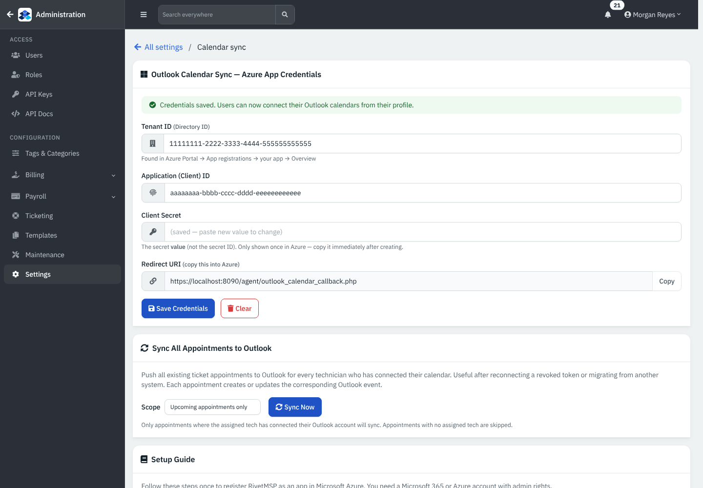

*Figure 12 — Azure app credentials, filled in with placeholder values. Example data, not a live connection; not verified against Microsoft services.*

### Send new tickets to the right technician

Automatic dispatch picks a technician for a ticket with this rule:

1. If the ticket's category has a **Required Skill**, look at the active technicians who hold that skill.
2. If the category has none, or nobody holds it, look at every active technician.
3. From that group choose the one with the **fewest open tickets**. A tie goes to the person with the lowest user number.

The chosen technician becomes the ticket's assignee and gets a notification in the app. Nothing is booked on the calendar.

Set it up in four steps:

1. **Create skills.** Administration → **Tags & categories** → **Tags**, choose the **Technician** filter and add tags such as *Networking* or *Hardware and printers*.
2. **Give skills to people.** Administration → **Users**, click **Skills** next to a user, pick skills and **Save Skills**.
3. **Ask for a skill.** Administration → **Tags & categories** → **Categories** (Ticket), edit a category and choose a **Required Skill**.
4. **Switch dispatch on** with a ticket automation rule (below).

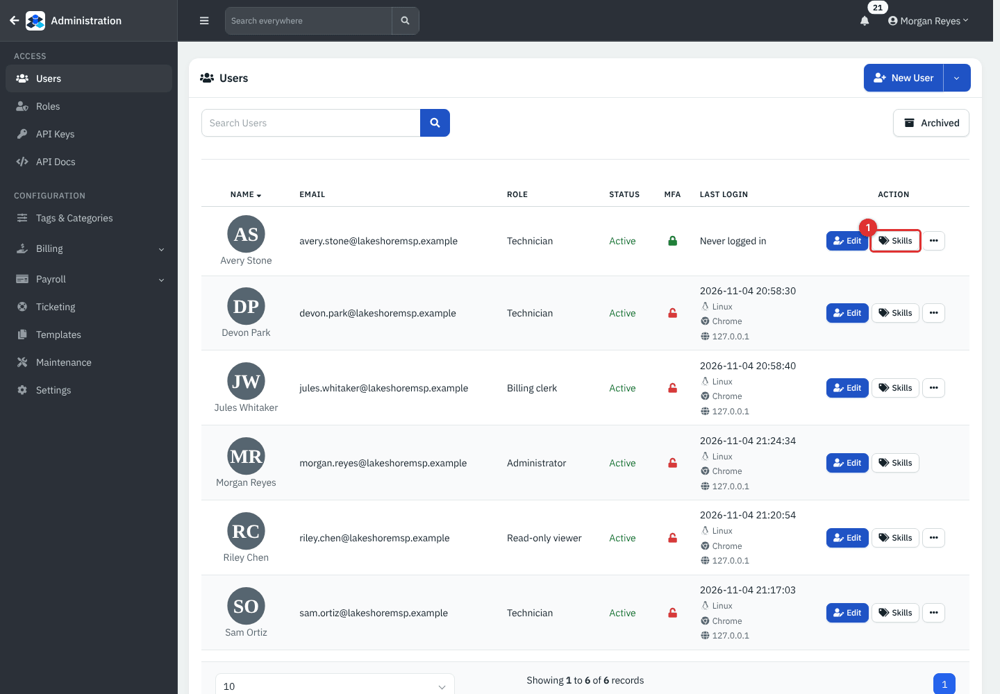

*Figure 13 — (1) **Skills** on a user's row.*

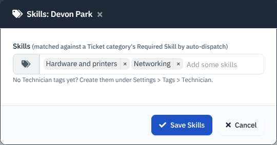

*Figure 14 — **Skills**.*

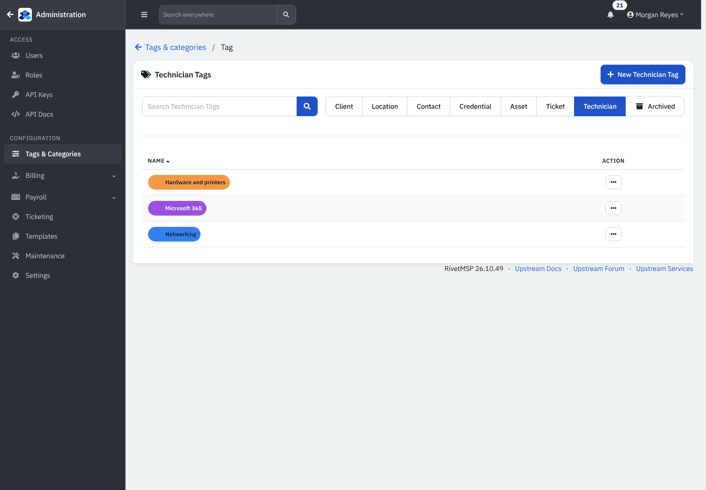

*Figure 15 — Skill tags are ordinary tags of the **Technician** type.*

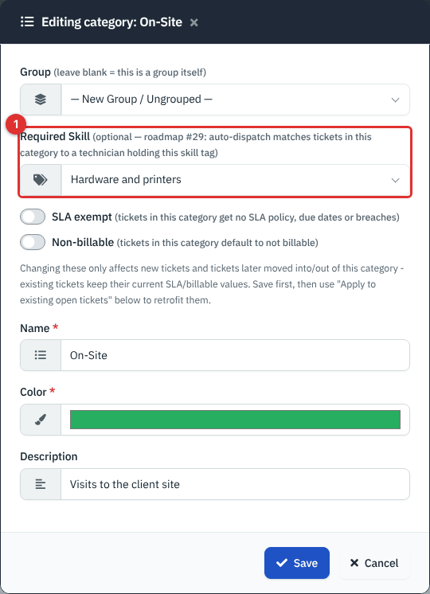

*Figure 16 — **Required Skill** on a ticket category; the first choice is **None (workload balance only)**. The same pop-up has the **SLA exempt** and **Non-billable** switches.*

Every active user counts as a technician for dispatch, including administrators and billing staff, so give each person only the skills they really hold and leave the rest to the rule's fallback.

### Automate with ticket rules

Administration → **Ticketing** → **Tickets** → **Ticket automation** lists rules that run when a ticket is created, when it is updated, on a schedule, or when a monitoring alert arrives. A rule has a trigger, conditions and one or more actions. Rules with the trigger **Ticket created** run at the moment the ticket is saved; scheduled checks run when the cron job runs. The two actions that matter for field work:

| Action | What it does |
|---|---|
| **Auto-dispatch (skill + workload match)** | Assigns the ticket as described above. |
| **Add worksheet from template** | Adds the chosen worksheet template once to the ticket. The worksheet is ordinary, not **Is Required**. |

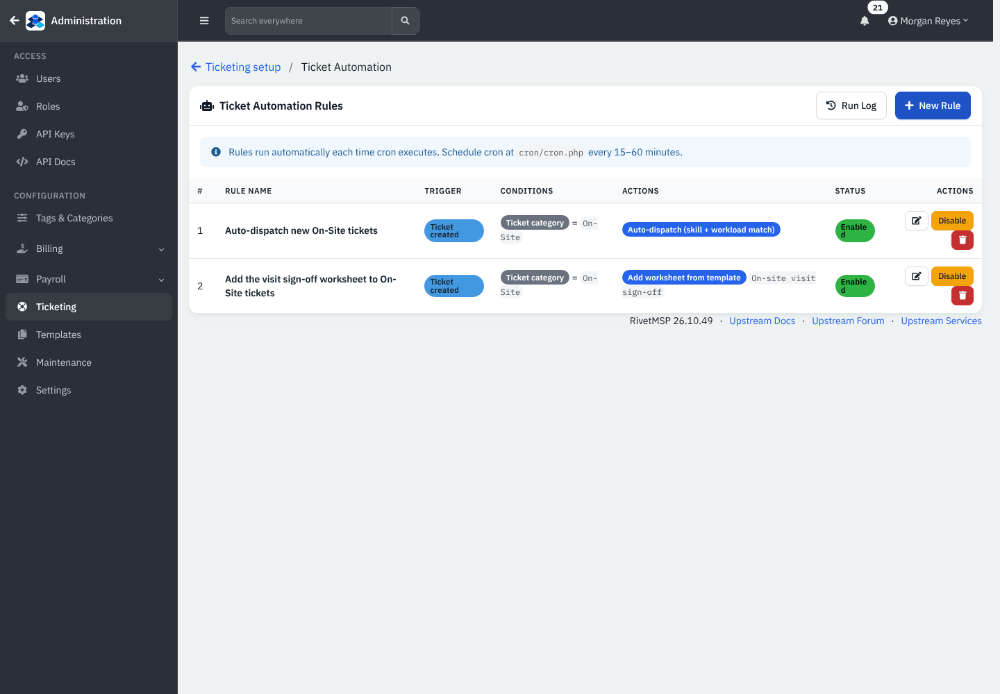

*Figure 17 — Two rules: one auto-dispatches **On-Site** tickets and one adds the visit sign-off worksheet to them.*

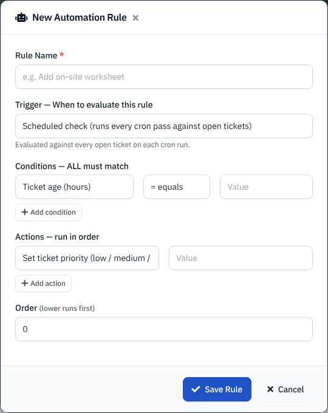

*Figure 18 — **New Automation Rule**. Pick a trigger, add conditions (for example **Ticket category** equals **On-Site**) and choose the actions.*

The full list of triggers, conditions and actions is in [Ticketing Setup and Templates](37-ticketing-setup-and-templates.md).

### Keep track of mileage

Trips (miles driven to a client) are logged under Finance → **Trips**, and per client in the client's sidebar. See [Expenses, Revenues, Accounts and Trips](18-expenses-revenues-accounts.md).

## Reference

### Appointment durations

| Choice | Length |
|---|---|
| 30 min, 1 hr, 1.5 hr, 2 hr, 3 hr, 4 hr | As named. |
| 8 hr (All day) | Eight hours from the start time. |
| Custom end time | You choose the end date and time. |

### Appointment type

| Type | Meaning |
|---|---|
| **Remote** | Work done by connecting from the office. |
| **Onsite** | A visit at the customer's location. |

The same two words are used on time entries (see [Ticket Billing and Worksheets](06-ticket-billing-and-worksheets.md)).

## Tips and good practice

- Add the visit as soon as you promise it, and put the access details in **Notes**.
- Use **Onsite** only for real visits so reports on on-site time stay honest.
- Ask each technician to set a personal colour once; the week view is then readable at a glance.
- Keep skill tags few and meaningful. Too many skills spread tickets thinly.
- Review the dispatch rule when someone leaves; an inactive user is skipped automatically.

## Related guides

- [Service Desk: Tickets](05-service-desk-tickets.md) — the ticket page and its cards.
- [Ticket Billing and Worksheets](06-ticket-billing-and-worksheets.md) — logging time on site and getting a signature.
- [Projects](09-projects.md) — larger jobs with milestones.
- [Ticketing Setup and Templates](37-ticketing-setup-and-templates.md) — automation, categories and statuses.
- [Integrations](29-integrations.md) — the Outlook calendar connection with the other Microsoft links.
