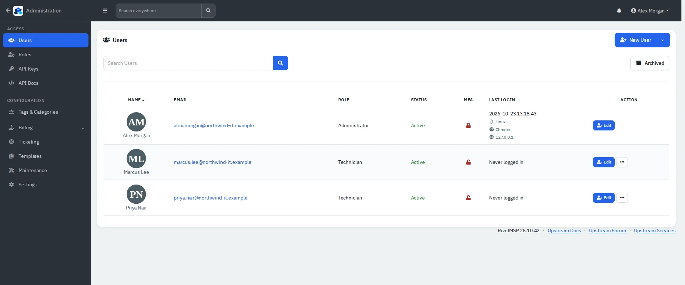
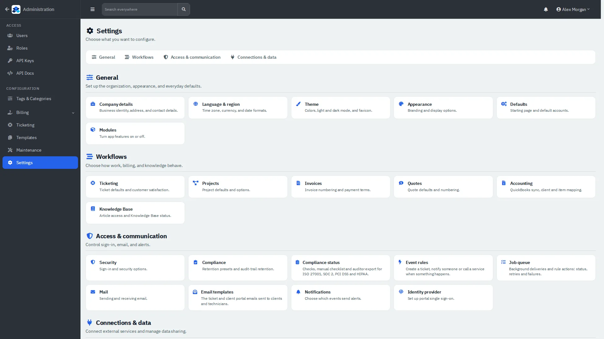
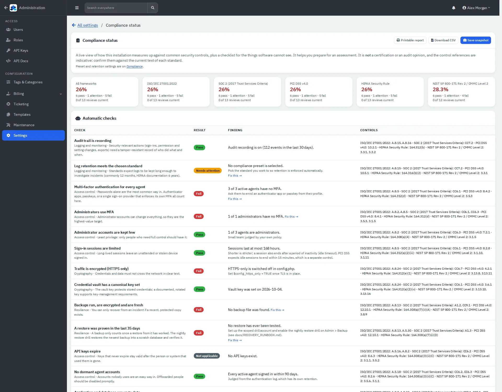

# Administration

Users, roles, settings, ticketing setup, compliance and system health.

| | |
|---|---|
| **Where to find it** | User menu (your name, top right) → **Administration**. The arrow at the top left returns to the app. |
| **Who can use it** | Administrators. |
| **Turn it on** | Always available to administrators. |

The Administration sidebar has **Users**, **Roles**, **API Keys**, **API Docs**, **Tags & Categories**, **Billing** (Taxes, Payment Methods, Payment Providers), **Ticketing**, **Templates**, **Maintenance** and **Settings**.

## Users and roles

*Figure 1: Users with role, status, MFA and last sign-in.*

1. **Users → New User.** Give a name and email (the email is also the sign-in name), pick a **Role** (required) and a password of at least 12 characters that is not the name or email. Tick **Force MFA on next login** if you want it. The **Access** tab limits which clients the user can see; no boxes means all clients. No email is sent, so give the user their password yourself.
2. A second account with the same email address is refused.
3. **Edit** changes a user. The row menu (⋯) has **Disable** and **Archive**; disabling takes effect at once and unassigns the user's open tickets.
4. **Roles** lists the built-in roles (**Administrator**, **Accountant**, **Technician**) and lets you create your own with per-module access.

## Settings

*Figure 2: Settings, grouped by purpose.*

- **General:** Company details, Language & region, Theme, Appearance, Defaults (start page and defaults), Modules (switch features on and off).
- **Workflows:** Ticketing, Projects, Invoices, Quotes, Accounting, Knowledge Base.
- **Access & communication:** Security (sign-in policy, MFA), Compliance, Compliance status, Event rules, Job queue, Mail, Notifications, Identity provider.
- **Connections & data:** Integrations, Endpoint agent, Remote access, Calendar sync, Webhooks, AI, Telemetry.

## Ticketing setup

**Ticketing** gathers ticket statuses, labor types, ticket templates, email intake (mailboxes) and service levels (SLA policies and calendars, holidays).

## Compliance status

*Figure 3: Compliance status: automatic checks and a manual checklist per framework.*

A live view of how the installation measures up against common security controls (ISO 27001, SOC 2, PCI DSS, HIPAA, NIST 800-171), with a printable report, CSV download and monthly snapshots. It is an aid for assessment preparation, not a certification.

## Maintenance and health

**Maintenance** groups four areas: **Jobs & mail** (what is scheduled and what is waiting to send), **Activity & diagnostics** (audit log, app log, email log), **Server** and **Recovery & updates**. The **Audit Log** records who did what; filter by client, user, type and action, and search by text.

> Back up before updating, and run updates only from Administration → Maintenance → Recovery & updates.
