# Projects

A project groups the tickets, milestones and tasks of one job that takes weeks, such as a Wi-Fi upgrade or a laptop refresh. It shows how far along the job is, how many hours it has used against its estimate and, if you set a rate and a budget, how much of the budget has been spent.

| | |
|---|---|
| **Where to find it** | Sidebar → **Work** → **Projects**. Inside a client, **Projects** in the client's own sidebar shows only that client's projects. |
| **Who can use it** | Permission module **Access to ticketing, assets and documentation**: **Read** to view projects, the **Gantt** and **Kanban** tabs; **Modify** to create and edit projects, milestones and tasks, link tickets, and close, archive or restore a project; **Full** to delete a project. |
| **Turn it on** | **Show Ticketing** in Administration → Settings → Modules. The project number prefix is under Administration → Settings → **Projects**. Project templates are under Administration → **Templates**. |

## What it's for

- Keep the tickets, tasks and milestones of one job together and see one progress bar for the whole job.
- Give each task an owner and a due date, and watch tasks move across a board or a timeline.
- Compare hours worked with an estimate, and money spent with a budget.
- Start a repeatable job, such as a laptop refresh, from a template that creates the tickets and their checklists for you.

## A quick tour

### The project list

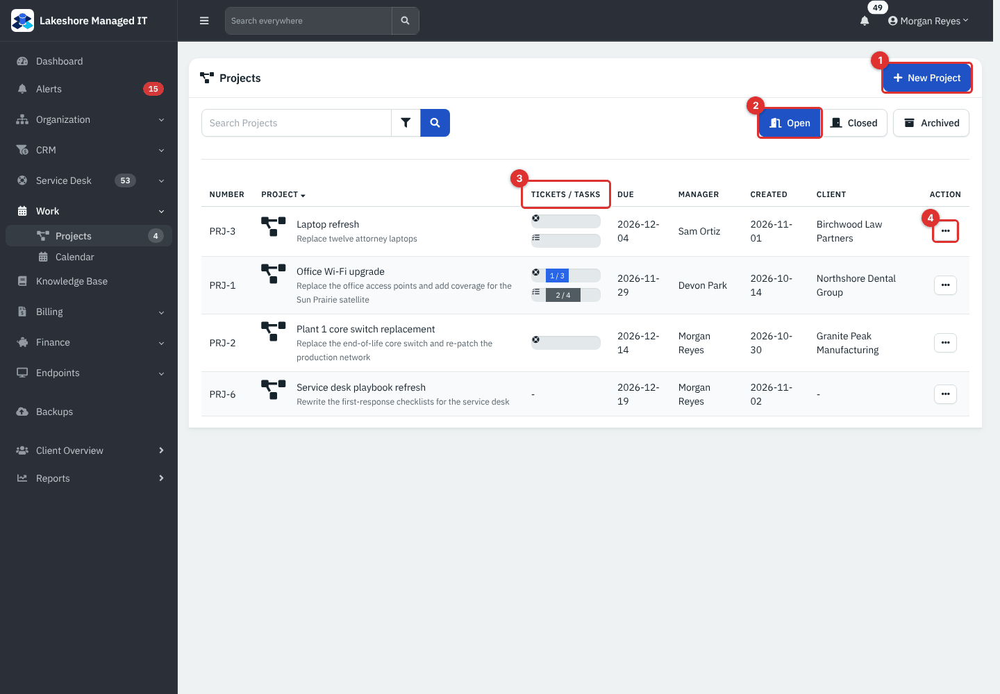

*Figure 1 — The project list. Example data from the Lakeshore Managed IT demo.*

1. **New Project** (needs **Modify**).
2. **Open**, **Closed** and **Archived** buttons switch the list.
3. **Tickets / Tasks**: the top bar is the share of the project's tickets that are closed (1 / 3) and the lower bar the share of tasks that are done (2 / 4).
4. The **Action** menu of a row: **Edit** while the project is open; **Archive**, **Restore** and **Delete** on closed and archived ones.

Type in the search box to find a project by number, name, description or manager. The filter button next to it opens a **Date range** that filters on the day the project was created. Click a column heading to sort.

> **Note.** The task bar in the list counts only tasks that belong to the project's tickets. Tasks you add straight to a project are counted on the project page.

### A project page

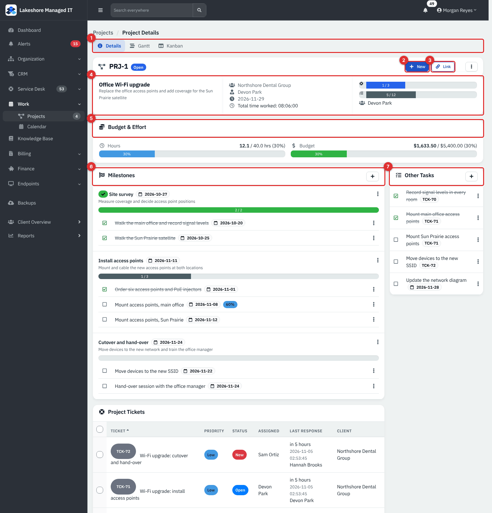

*Figure 2 — A project page with its header, budget card, milestones and tasks.*

1. Tabs: **Details**, **Gantt** and **Kanban** show the same tasks three ways.
2. **New** adds a **Ticket**, **Milestone** or **Task**.
3. **Link** attaches an existing **Open Ticket** or **Closed Ticket**.
4. The summary row: name and description, client, manager, due date and time worked, then the ticket and task progress bars.
5. **Budget & Effort**: hours and money against the plan.
6. **Milestones** with their tasks.
7. **Other Tasks**: tasks that belong to no milestone, including tasks that belong to a project ticket. The card is called **Tasks** when the project has no milestones.

Below these, **Project Tickets** lists every ticket linked to the project with its priority, status, assignee, last response and client.

The ⋮ menu at the top right holds **Edit** while the project is open, **Archive** once it is closed and **Delete** once it is archived (needs **Full**).

## Common tasks

### Create a project

1. Go to **Work → Projects** and click **New Project**. (Opened from a client's own sidebar, the form is for that client and the **Client** list is not shown.)
2. Fill in the form. **Project Name** and **Date Due** are required.
3. Click **Create**. The project opens as **Open** with a number such as PRJ-3.

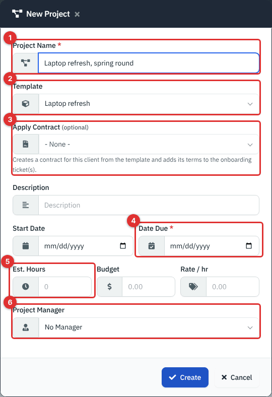

*Figure 3 — **New Project**, started from a client's own sidebar, with a template picked. (1) **Project Name**. (2) **Template**. (3) **Apply Contract**. (4) **Date Due**. (5) **Est. Hours**. (6) **Project Manager**.*

| Field | What it does |
|---|---|
| **Client** | The client the project is for. **- No Client -** makes an internal project that has no client. |
| **Project Name** | Required. |
| **Template** | Optional. Creates tickets and their tasks from a project template. |
| **Apply Contract** | Only in a client's own sidebar. Creates an active contract for this client from a contract template and adds its terms to the template's tickets (see [Contracts and Recurring Invoices](16-contracts-and-recurring-invoices.md)). Choosing a project template that has a default contract template fills this in. |
| **Description** | One line shown in the list and on the page. |
| **Start Date**, **Date Due** | The due date is required. |
| **Est. Hours** | The estimate the **Hours** bar compares against. |
| **Budget**, **Rate / hr** | The money plan: see [Budget and effort](#budget-and-effort). |
| **Project Manager** | Any active user except those with the Accountant role. |

Change any of these later with the ⋮ menu → **Edit** (open projects only). The **Template** list is only on the create form.

### Start from a template

1. In **New Project** pick a **Template**, for example **Laptop refresh**, and click **Create**.
2. Open the project. For each ticket template in the project template the app has made one ticket, linked to the project, with the template's subject and details and one task for each task template.

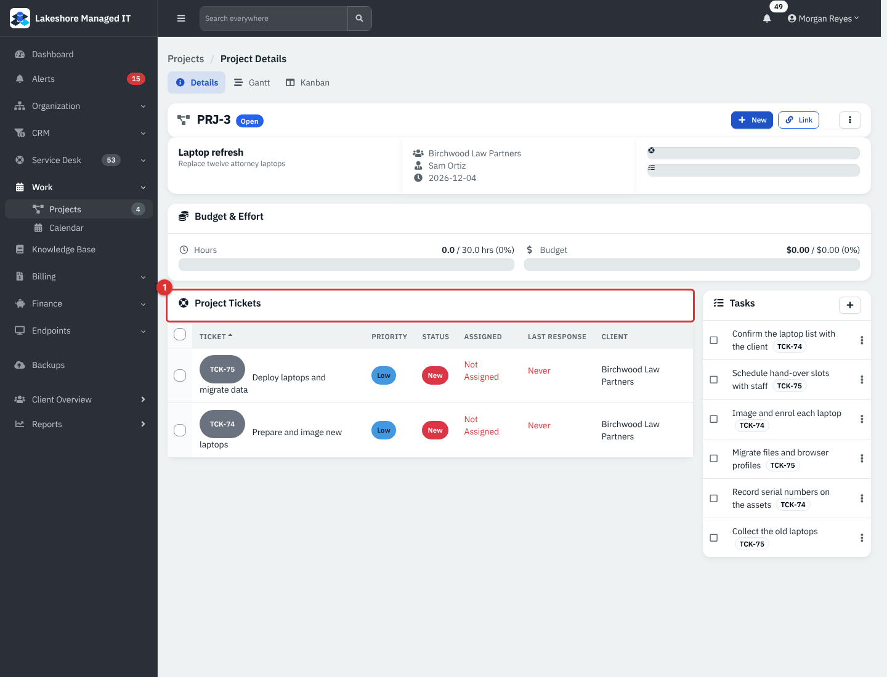

*Figure 4 — The new project with two tickets and six tasks. (1) **Project Tickets**.*

Things to know:

- The tickets are **Low** priority, in the project's client, and **New** and unassigned unless Administration → Settings → Ticketing has a default assignee (then they are **Open** and assigned to that person).
- Estimates on the task templates are not copied.
- A template supplies tickets and tasks only. Milestones, due dates and task owners are added by hand.
- The tickets have no contact, asset or location; open each one and fill them in.

Templates are made by an administrator under Administration → **Templates** → **Project templates**: name and describe a template, then add ticket templates, each with its task templates.

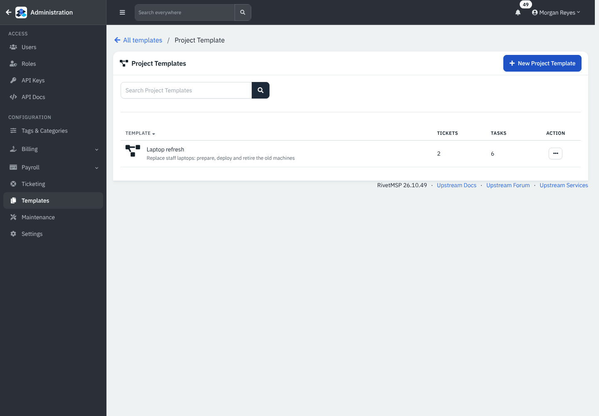

*Figure 5 — **Project Templates**: the demo has one, with two ticket templates and six tasks.*

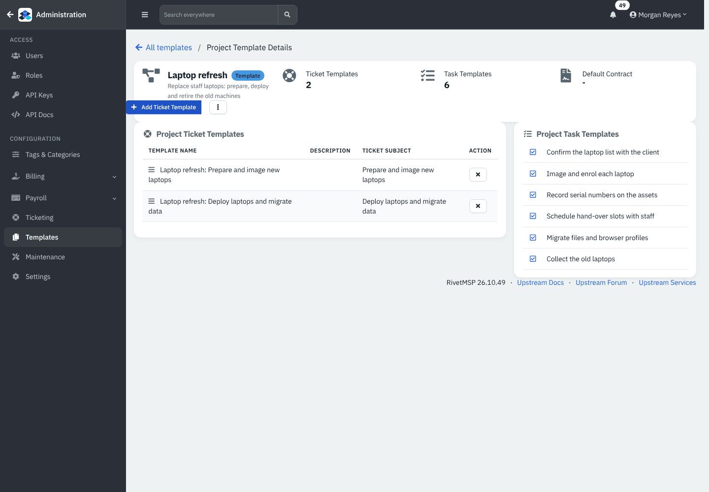

*Figure 6 — A project template's ticket templates and task templates.*

### Add milestones and tasks

Use a milestone to group tasks into a phase.

1. On the project page click **New → Milestone**. Enter a **Milestone Name**, a **Description**, a **Due Date** and an **Order** (new milestones go last).
2. Click **New → Task**, or choose **Add Task** in a milestone's ⋮ menu to pick that milestone for you.
3. Fill in the task form and click **Create**.

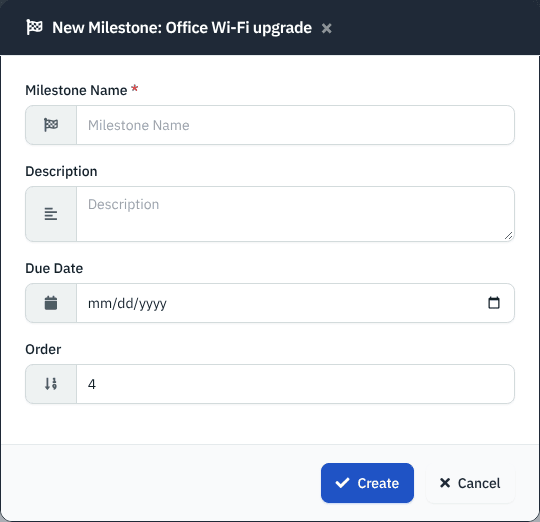

*Figure 7 — **New Milestone**.*

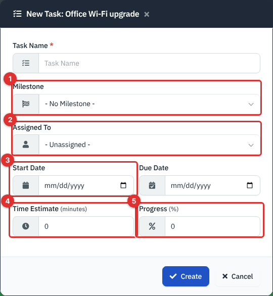

*Figure 8 — **New Task**. (1) **Milestone**. (2) **Assigned To**. (3) **Start Date**, with **Due Date** beside it. (4) **Time Estimate**, in minutes. (5) **Progress**, 0 to 100.*

On the project page:

- Tick the box before a task to mark it done, untick to reopen it. The ⋮ beside it has **Edit** and **Delete**.
- A milestone's ⋮ menu has **Add Task**, **Mark Complete** (or **Reopen**), **Edit** and **Delete**. A milestone with tasks shows a progress bar of finished tasks; one without tasks shows 100% once it is marked complete.
- A task that belongs to a ticket shows the ticket number. Tasks you add directly to the project do not have one.
- Deleting a milestone leaves its tasks in place under **Other Tasks**.

### Link or create tickets

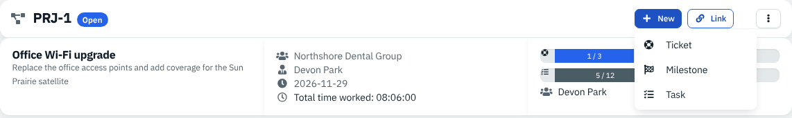

*Figure 9 — **New** adds a **Ticket**, **Milestone** or **Task** to this project. **Link** next to it attaches existing tickets.*

- **New → Ticket** creates a ticket that is already in the project.
- **Link → Open Ticket** picks one or more open tickets that are in no project (only that client's tickets when you are in a client's sidebar).
- **Link → Closed Ticket** links one closed ticket by typing its number. It must belong to the project's client.

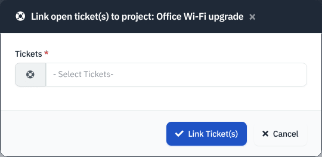

*Figure 10 — **Link open ticket(s) to project**. A ticket can be in one project at a time.*

You can also use the bulk **Project** action in the ticket list, or **Project** on a ticket, to move tickets in and out (see [Service Desk: Tickets](05-service-desk-tickets.md)).

### Budget and effort

The **Budget & Effort** card appears when the project has an estimate, a budget, a rate or logged time.

- **Hours** shows hours worked over the estimate. Worked hours are the time logged on the project's tickets, plus the time estimates of completed tasks that sit directly on the project (not on a ticket). The estimate is **Est. Hours**; if you left it empty, the total of all task time estimates is used.
- **Budget** shows hours worked multiplied by **Rate / hr**, over the **Budget** amount.
- A bar turns red above 100 percent.

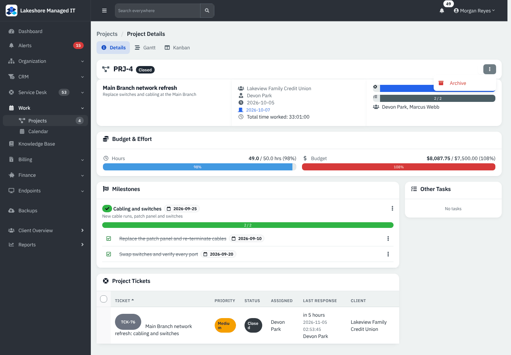

*Figure 11 — A closed project: 98 percent of its hours used and 108 percent of its budget, so the budget bar is red. The ⋮ menu shows **Archive**.*

> **Note.** The money figure uses **Rate / hr**, not each technician's labor type or the client's hourly rate. Leave **Rate / hr** empty if you want to track hours only; invoices are made from tickets as described in [Ticket Billing and Worksheets](06-ticket-billing-and-worksheets.md).

### See a project on a timeline or a board

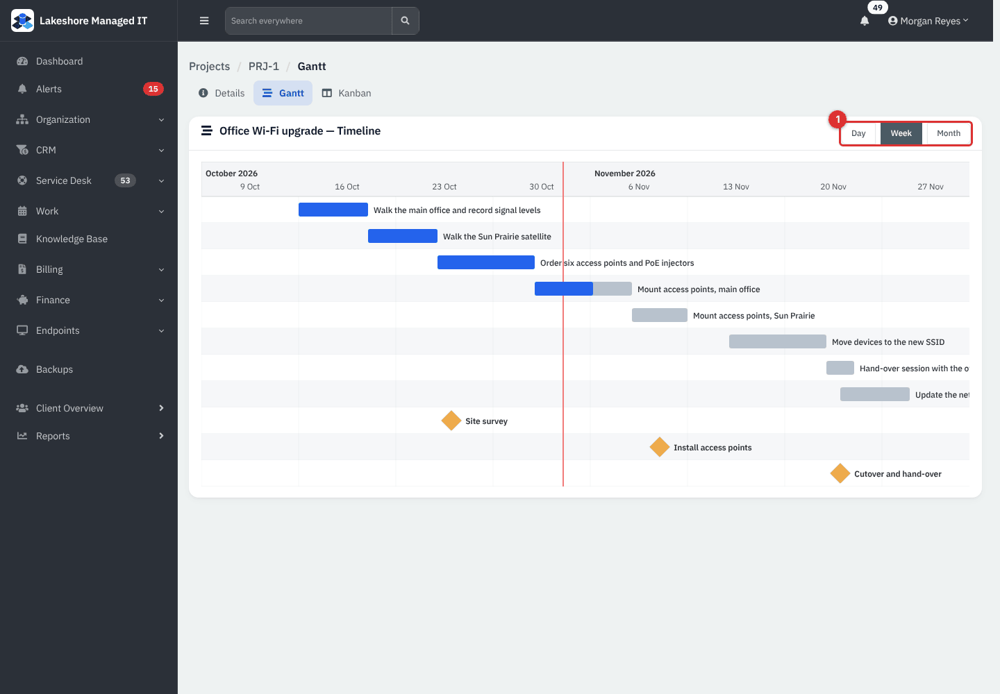

*Figure 12 — **Gantt**. (1) **Day**, **Week** and **Month** zoom.*

The **Gantt** tab draws one bar per task that has a start and a due date, with milestones as diamonds. Drag a bar to move it or drag its end to change the dates; drag inside a bar to change progress. The change is saved and a small message confirms it. Tasks without dates are left out, and a project with none shows a hint to add dates.

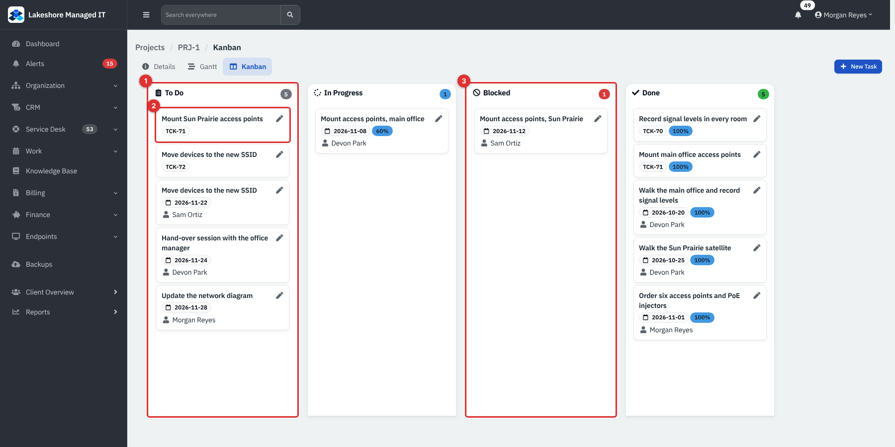

*Figure 13 — **Kanban**. (1) **To Do**. (2) A task card with its ticket number, due date, progress and assignee. (3) **Blocked**.*

The **Kanban** tab has four fixed lanes: **To Do**, **In Progress**, **Blocked** and **Done**. Drag a card to another lane to change its state. Dropping in **Done** completes the task and sets progress to 100; dragging it out reopens it. A task that has never been moved sits in **Done** if it is complete, **In Progress** when its progress is above 0, otherwise **To Do**. **New Task** at the top adds a task.

### Close, archive, restore and delete

1. When every linked ticket is closed or resolved (or the project has no tickets), a **Close** button appears at the top. Click it. The project moves to the **Closed** list with its completion date.
2. A closed project's ⋮ menu has **Archive**. Archived projects are in the **Archived** list.
3. In the **Archived** list the **Action** menu has **Restore**. **Delete** needs **Full** access and removes the project record only; its tickets are not deleted.

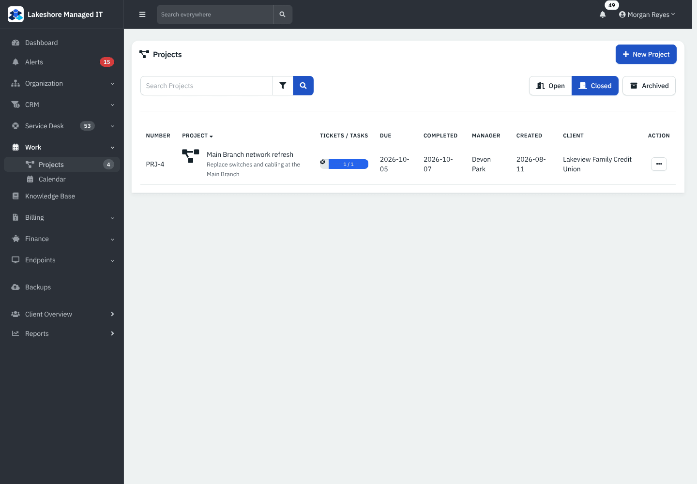

*Figure 14 — The **Closed** list adds a **Completed** column.*

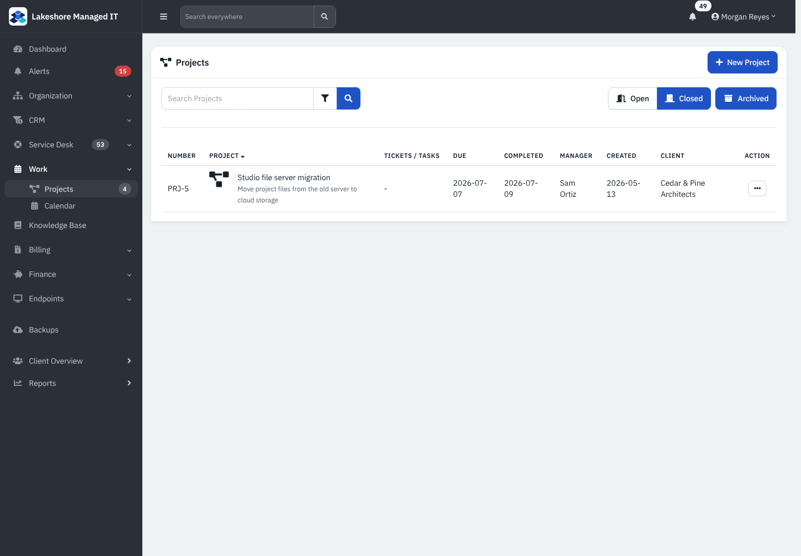

*Figure 15 — **Archived** projects.*

### Work on a client's projects

Open the client, then **Projects** in its sidebar. The list shows only that client's projects and the **Client** column is hidden.

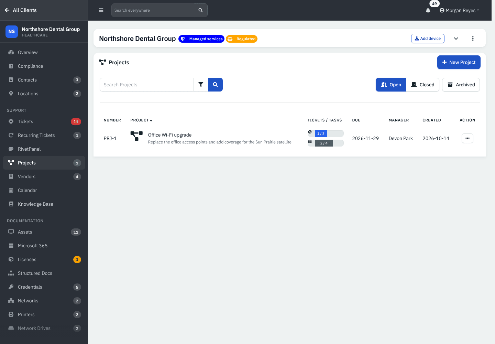

*Figure 16 — Projects of one client.*

## Reference

### Project states

| State | How it gets there | What you can do |
|---|---|---|
| **Open** | Created | Edit, add tickets, milestones and tasks, **Close** when its tickets are done. |
| **Closed** | **Close** | **Archive**. Not editable. |
| **Archived** | **Archive** | **Restore**, **Delete**. |

### Number prefix

The prefix and the next number are set in Administration → Settings → **Projects** (default prefix **PRJ-**). Changing the prefix does not rename existing projects.

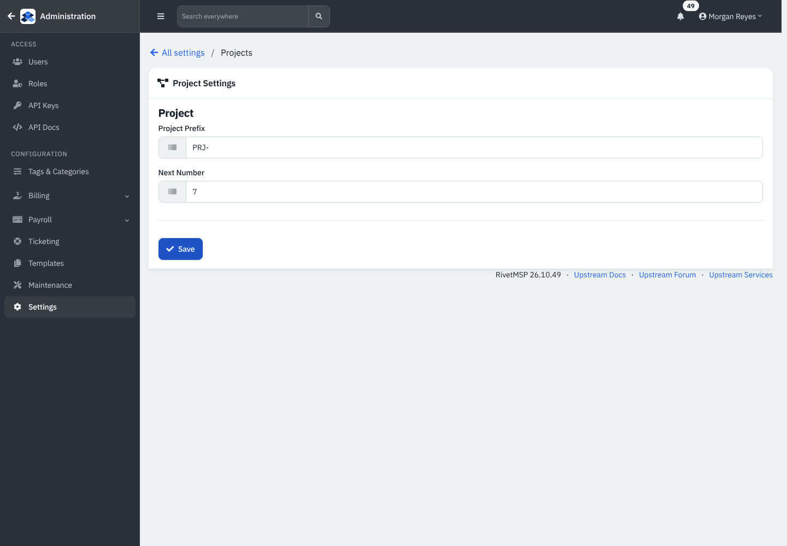

*Figure 17 — **Project Settings**.*

## Tips and good practice

- Put a due date on every task you want to see on the Gantt, and a start date as well.
- Use milestones for client-visible phases and keep tasks short enough to finish in a day or two.
- Log time on the project's tickets so the **Hours** bar means something.
- Close a project only when its tickets are closed; keep the invoice for the work on the tickets themselves.
- Use an internal project, with no client, for your own improvement work.

## Related guides

- [Service Desk: Tickets](05-service-desk-tickets.md) — ticket tasks, bulk **Project** action.
- [Dispatch, Scheduling and Calendar](08-dispatch-scheduling-calendar.md) — booking the visits a project needs.
- [Ticket Billing and Worksheets](06-ticket-billing-and-worksheets.md) — billing project tickets.
- [Contracts and Recurring Invoices](16-contracts-and-recurring-invoices.md) — contract templates used by **Apply Contract**.
- [Dashboard](02-dashboard.md) — project widgets.
