# Problems and Changes

Two records sit beside the ticket list for work that is bigger than one request. A **problem** is the underlying cause behind several tickets, such as VPN sessions that keep dropping at different offices. A **change** is a planned alteration to a client's or your own systems, such as a firmware upgrade or a core switch swap, with its risk, plan, rollback plan and approval. A change can also ask the client for its own sign-off through a link.

| | |
|---|---|
| **Where to find it** | Sidebar → **Service Desk** → **Problems** and **Changes**. On a ticket, the **Problem** card links the ticket to a problem. |
| **Who can use it** | Permission module **Access to ticketing, assets and documentation**: **Read** to open the lists and records; **Modify** to create and edit problems and changes, move their status, link tickets and send approval requests. A technician restricted to certain clients sees internal changes and the changes of those clients only, and only their tickets on a problem. |
| **Turn it on** | On by default. The module switch is a stored setting (`config_core_itsm_enabled`); this release has no screen for it in Administration. If it were off, both pages would say "Problems & Changes is turned off". |

## What it's for

- Handle a root cause once instead of closing the same kind of ticket again and again.
- See, from a problem, every ticket it explains and which change will fix it.
- Plan risky work in writing: why, who is affected, the steps, and how to undo it.
- Get an approval trail: who approved a change and, when a client is involved, whether the client approved or rejected it.

## A quick tour

### Problems

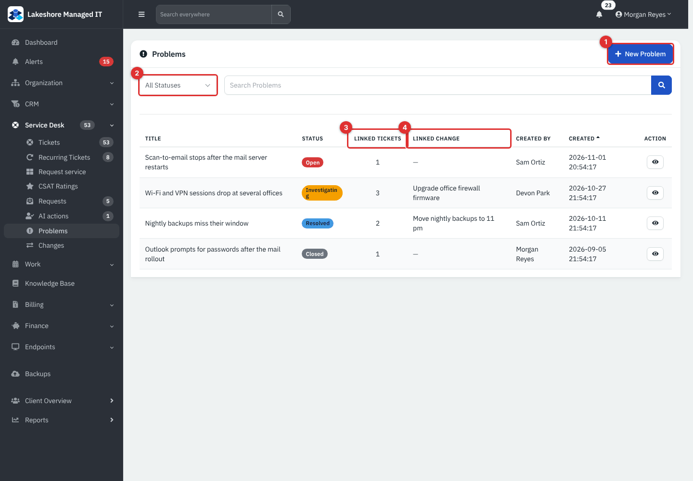

*Figure 1 — **Problems**. Example data from the Lakeshore Managed IT demo.*

1. **New Problem**.
2. Filter by status: **Open**, **Investigating**, **Resolved**, **Closed**.
3. **Linked Tickets**: how many tickets point at this problem.
4. **Linked Change**: the change planned to fix it.

Search looks in titles and descriptions. The eye button on a row opens the problem.

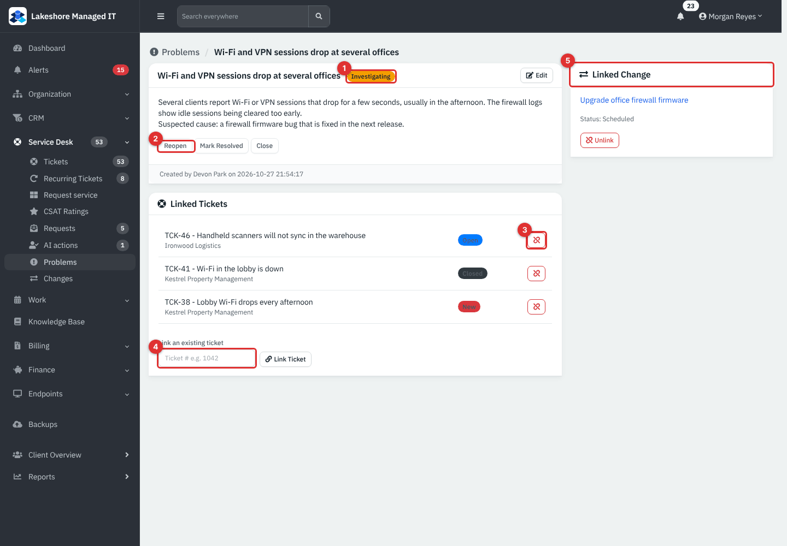

*Figure 2 — A problem. (1) Status badge beside the title. (2) The status buttons under the description. (3) Unlink a ticket. (4) **Link an existing ticket**. (5) **Linked Change**.*

### Changes

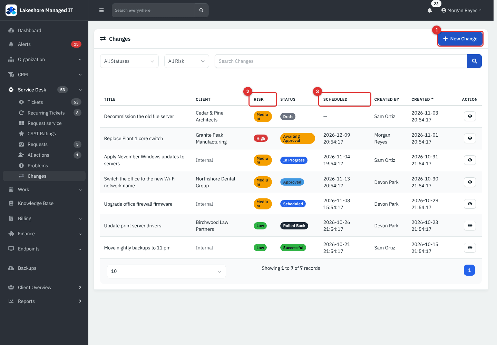

*Figure 3 — **Changes**. (1) **New Change**. (2) **Risk**: **Low**, **Medium** or **High**. (3) **Scheduled** date and time.*

Besides the filters (status, risk) and the search box, the list shows the client, or **Internal**, who created each change and when.

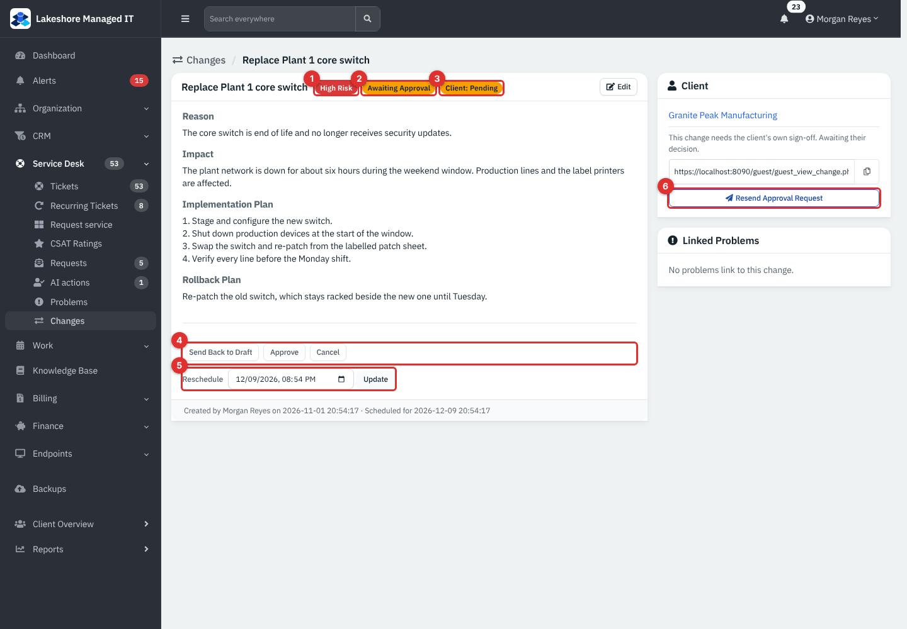

*Figure 4 — A change. (1) Risk. (2) Status. (3) The client's decision. (4) Status buttons. (5) **Reschedule**. (6) The client approval request.*

## Common tasks: problems

### Record and work a problem

1. Click **New Problem**, enter a **Title** and an optional **Description** (root cause, related incidents), then **Create Problem**.
2. Open it and use the buttons under the description to move its status.
3. Link the tickets it explains (see below) and, when a fix is planned, a change.

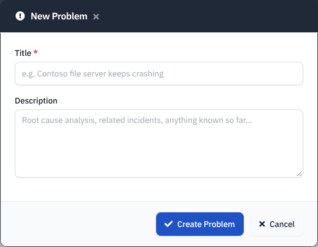

*Figure 5 — **New Problem**. Only the title is required.*

| Status | Buttons it offers |
|---|---|
| **Open** | **Start Investigating**, **Mark Resolved**, **Close** |
| **Investigating** | **Reopen** (back to Open), **Mark Resolved**, **Close** |
| **Resolved** | **Back to Investigating**, **Reopen**, **Close** |
| **Closed** | **Reopen**, **Reopen (Investigating)** |

The date a problem is first resolved or closed is kept and shown in the footer; reopening clears it. Problems cannot be deleted. Moving a problem does not change its tickets and sends no email.

### Link tickets to a problem

Either way works:

- On the problem, type a ticket number in **Link an existing ticket** (with or without the prefix) and click **Link Ticket**. The red button next to a ticket unlinks it.
- On the ticket, open the **Problem** card, choose a problem in **Select problem** and click **Link to Problem**. **Unlink** removes it.

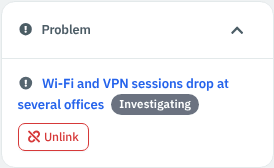

*Figure 6 — The **Problem** card on a linked ticket.*

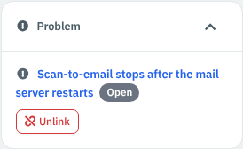

*Figure 7 — The same card on a ticket with no problem yet.*

A ticket can belong to one problem at a time.

### Link a change to a problem

A problem can have one change, the planned fix.

1. In **Linked Change**, choose a change in **Select Change** and click **Link Existing Change**, or click **Create New Change**, which opens **New Change** and links it when you save.
2. **Unlink** removes the link. The change itself is untouched.

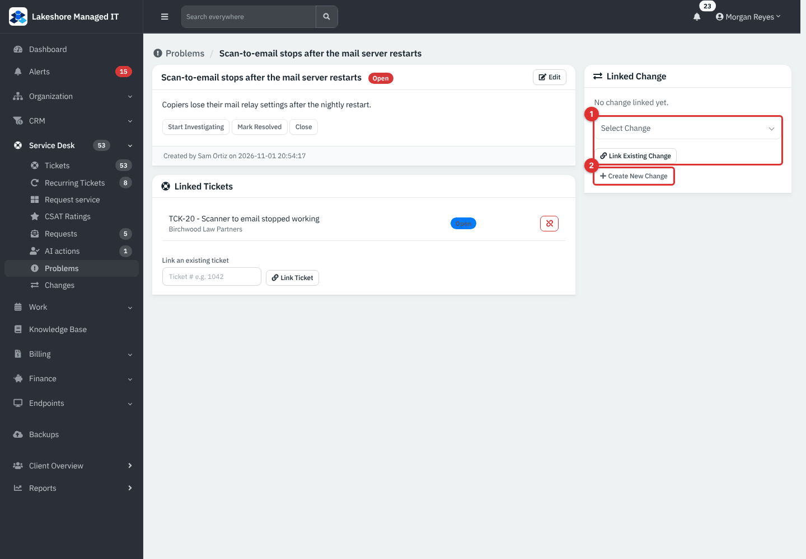

*Figure 8 — (1) Pick an existing change. (2) **Create New Change**.*

## Common tasks: changes

### Plan a change

1. Click **New Change**.
2. Enter the **Title** and **Risk** (required). Add the **Reason**, **Impact**, **Implementation Plan**, **Rollback Plan** and **Scheduled For** if you know them.
3. Choose a **Client** if the change affects one; leave **- Internal, no client -** for your own systems.
4. Tick **Requires the client's own sign-off before it can proceed** if the client must agree (only possible with a client chosen).
5. Click **Create Change**. A new change is a **Draft**.

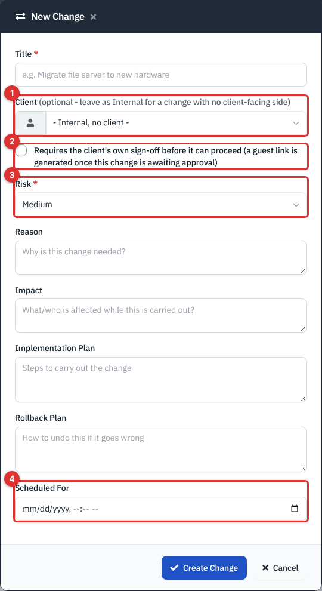

*Figure 9 — **New Change**. (1) **Client**. (2) The client sign-off box. (3) **Risk**. (4) **Scheduled For**.*

### Run a change through its stages

Open the change and use the buttons below its text.

| Status | Buttons it offers |
|---|---|
| **Draft** | **Submit for Approval**, **Cancel** |
| **Awaiting Approval** | **Send Back to Draft**, **Approve**, **Cancel** |
| **Approved** | **Schedule** (with a date and time box), **Start Now**, **Cancel** |
| **Scheduled** | **Unschedule** (back to Approved), **Start Now**, **Cancel** |
| **In Progress** | **Mark Successful**, **Mark Failed**, **Cancel** |
| **Failed** | **Mark Rolled Back**, **Cancel** |
| **Successful** | **Mark Rolled Back** |
| **Rolled Back**, **Cancelled** | None. The change is finished. |

**Schedule** needs a date and time, either typed beside the button or already set on the change. Until a change is finished, **Reschedule** (a date box and **Update**) moves its time. The status buttons only offer legal moves, so a change cannot skip approval.

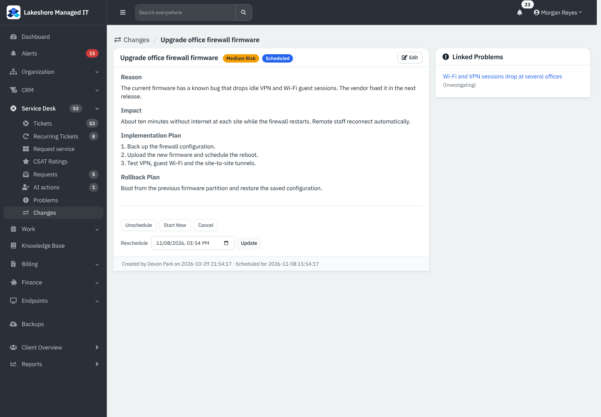

*Figure 10 — A scheduled change. **Linked Problems** on the right lists the problems it is meant to fix.*

> **Note.** **Approve** can be pressed by anyone with **Modify**, including the person who wrote the change. The app has no separate approver role, so agree on a rule for who approves what.

### Ask the client to approve a change

Use this when a change affects a client and they should say yes first.

1. Make sure the change has a **Client** and that the client has a **primary contact with an email address**.
2. In the **Client** panel click **Request Client Approval** (or tick the sign-off box when you create the change, and then use **Send Approval Request**).
3. The app queues an email to the primary contact with a private link. The same link is shown in the panel; click the copy button to send it yourself. **Resend Approval Request** sends it again.
4. The client opens the link, reads the reason, impact and schedule, and presses **Approve** or **Reject**. No login is needed.

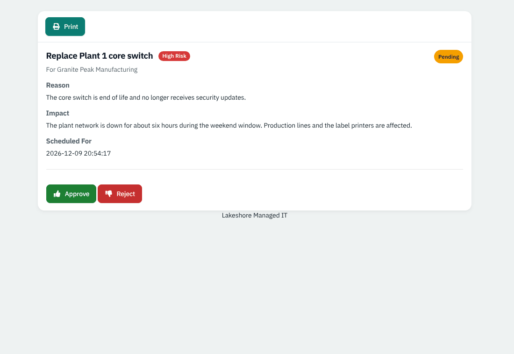

*Figure 11 — What the client sees. Example data; the email was not sent in the demo.*

The decision appears beside the status as **Client: Approved** or **Client: Rejected** (it starts as **Client: Pending**), with the date in the **Client** panel. The team gets an in-app notification and an audit entry is written. A decision can be given once; after the change is finished the link only says it is no longer awaiting a decision.

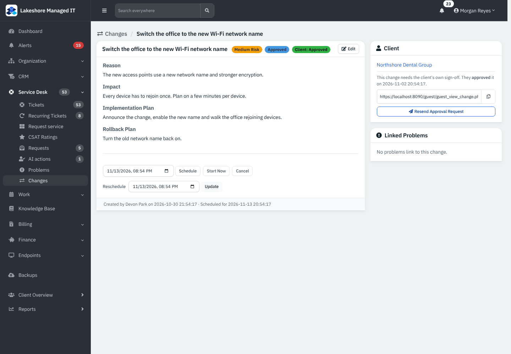

*Figure 12 — **Client: Approved** on a change that is also internally **Approved**.*

> **Note.** The client's answer is recorded and shown but it does not control the status buttons. A change the client rejected can still be moved to **Approved** and run. Check the **Client:** badge before you **Approve** or **Start Now**.

Sending the email needs a working mail server; this guide's demo has none, so that step is described from the code and was not verified on a live service.

### Change who or what a change is about

Click **Edit** on the change to update the title, client, risk and the text fields. The scheduled time is changed with **Reschedule**, not in this form. Removing the client also turns off the client sign-off. The approval link is created once and kept, so a link you already sent keeps working when you edit the change.

## Reference

### Change statuses and what they mean

| Status | Meaning |
|---|---|
| **Draft** | Being written. |
| **Awaiting Approval** | Waiting for someone to approve it. |
| **Approved** | Agreed; not yet scheduled or started. |
| **Scheduled** | Has a date and time. |
| **In Progress** | Being carried out. |
| **Successful**, **Failed** | The result. |
| **Rolled Back** | Undone after a failure or later problem. |
| **Cancelled** | Dropped before it finished. |

### Risk levels

| Level | Use it for |
|---|---|
| **Low** | Routine, quick to undo, no outage. |
| **Medium** | Short interruption or needs care. |
| **High** | Long outage, many users, hard to undo. |

### What is recorded

Creating, editing, status changes, links and client decisions are written to the activity log, and key steps also to the audit trail (see [Users, Roles and Security](34-users-roles-security.md)).

## Tips and good practice

- Link tickets to a problem as they arrive; the count on the **Problems** list shows which causes cost the most.
- Always write a **Rollback Plan** for **Medium** and **High** changes.
- Use **Client: Pending** as a reminder; resend the request if the client has not answered in a day or two.
- Close a problem only after its change is **Successful** and the tickets have stopped.

## Related guides

- [Service Desk: Tickets](05-service-desk-tickets.md) — the **Problem** card and ticket list.
- [Projects](09-projects.md) — larger planned work with milestones.
- [Guest Links](33-guest-links.md) — the other links clients can open without signing in.
- [Users, Roles and Security](34-users-roles-security.md) — audit trail and permissions.
