# Assets

Assets are the devices you look after for a client: PCs, laptops, servers, switches, firewalls, printers, phones and more. Each asset records who has it, where it is, what state it is in, how it is wired to the network, and which licenses, credentials, documents, files and services belong to it. The asset page is the first place to look when something breaks.

| | |
|---|---|
| **Where to find it** | Inside one client: **Clients** → pick the client → **Documentation** → **Assets**. Across every client: **Client Overview** → **Documentation** → **Assets**. |
| **Who can use it** | Permission module **Support** (`module_support`): **Read** to view, **Modify** to add, edit, copy and use the bulk actions, and an **Administrator** role to archive, restore or delete (the row menu shows **Archive** only to administrators). |
| **Turn it on** | **Administration** → **Settings** → **Modules** → **Show IT Documentation**. It is on in a standard install. |

## What it's for

Use assets to answer four questions fast: what does this client own, who has it, is it healthy and supported, and what depends on it. Because an asset links to licenses, credentials, documents, services and tickets, the asset page doubles as a map of everything that touches a device.

Assets always belong to one client. The per-client list shows only that client; the company-wide list (Client Overview) shows every client together and adds a **Client** column.

> The screens in this guide use the fictional client Northshore Dental Group and the example company Lakeshore Managed IT. All hosts, serial numbers and addresses are made up.

## A quick tour

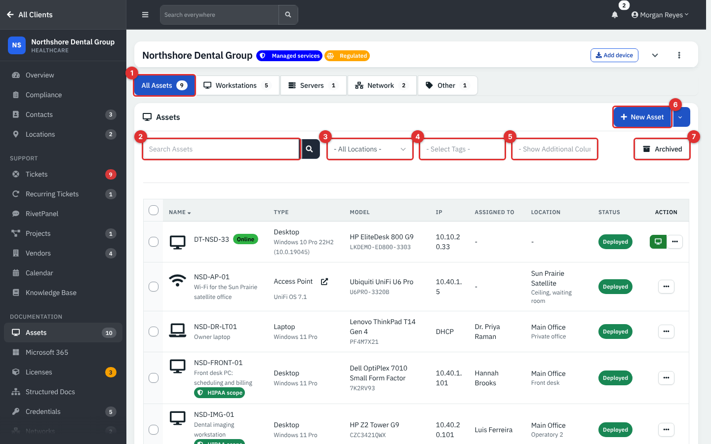

*Figure 1 — The Assets list for Northshore Dental Group.*

1. **Type tabs.** **All Assets**, **Workstations** (laptops and desktops), **Servers**, **Virtual** (virtual machines), **Network** (switches and access points) and **Other** (everything else, including printers, phones, tablets, displays and cameras). A tab appears only when it has at least one asset, and each shows a count.
2. **Search.** Matches name, description, type, IP, MAC, make, model, serial, operating system, assigned contact, location, client and tag.
3. **All Locations.** Filters by one of the client's locations (per-client list only).
4. **Select Tags.** Filters by one or more asset tags.
5. **Show Additional Columns.** Adds **MAC Address**, **Purchase Date**, **Install Date** and **Warranty Expire** columns.
6. **New Asset.** Opens the New Asset window. The arrow beside it holds **Import** (per-client list only) and **Export**.
7. **Archived.** Switches between live and archived assets.

**Firewall/Router assets do not appear in any tab.** The list code leaves them out of every tab and count; see [Tips](#tips-and-good-practice).

Each row shows the name with a yellow star for a favorite, the description and any tags as colored labels; the **Type** (with a small link icon when the asset has a web address) and operating system; **Model** and serial; the primary interface's **IP**; **Assigned To**; **Location** with the physical spot underneath; and a colored **Status**. When the RMM module sees the device, an **Online** or **Offline** badge appears beside the name.

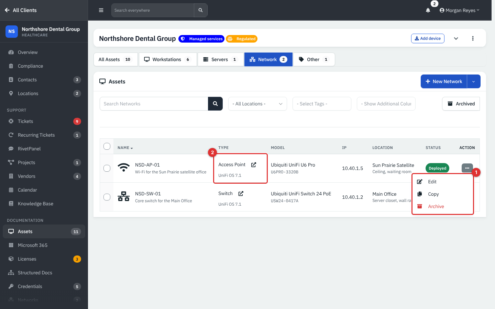

*Figure 2 — The row menu (1) and the Type cell with its web-address link (2).*

1. **Row menu (the three dots).** **Edit**, **Copy** (duplicates the asset into a new one) and, for administrators, **Archive**. On the **Archived** view the menu offers **Restore** and **Delete** instead.
2. **Type cell.** The small arrow icon opens the asset's **URI**, **URI 2** or **Client URI**.

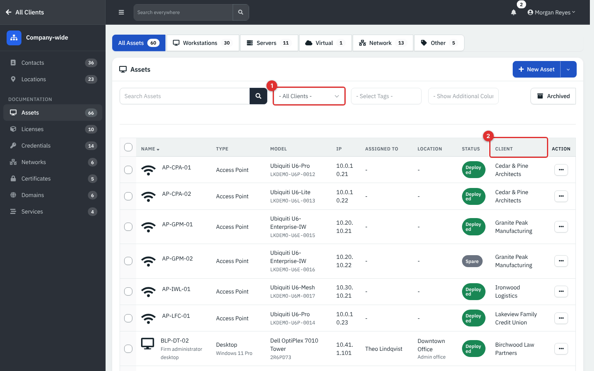

*Figure 3 — The company-wide list under Client Overview. A **Client** filter (1) and a **Client** column (2) take the place of the location filter.*

## Common tasks

### Add an asset

1. Open the client's **Assets** list and click **New Asset** (the button says **New Server**, **New Workstation** and so on when a tab is selected).
2. On **Details**, choose the **Type** and enter the **Name**; both are required. Optional: the star beside the name marks a favorite, plus **Asset Tag**, **Make**, **Model**, **Serial Number**, **Operating System** and **Description**.

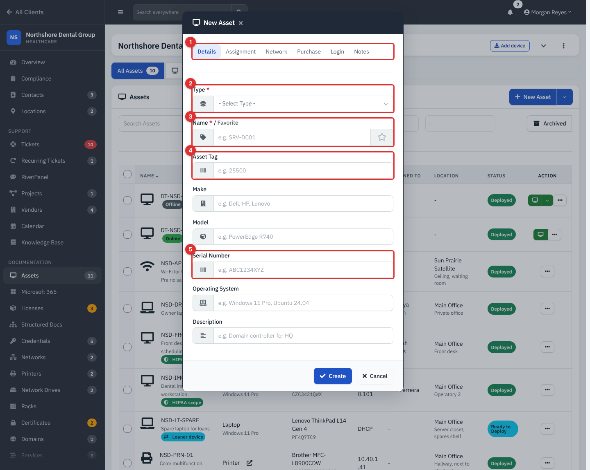

*Figure 4 — Details tab. Type (2) and Name (3) are required.*

3. On **Assignment**, set **Location**, **Physical Location** (free text such as "Server closet"), **Assign To** (a contact of that client) and **Status**.

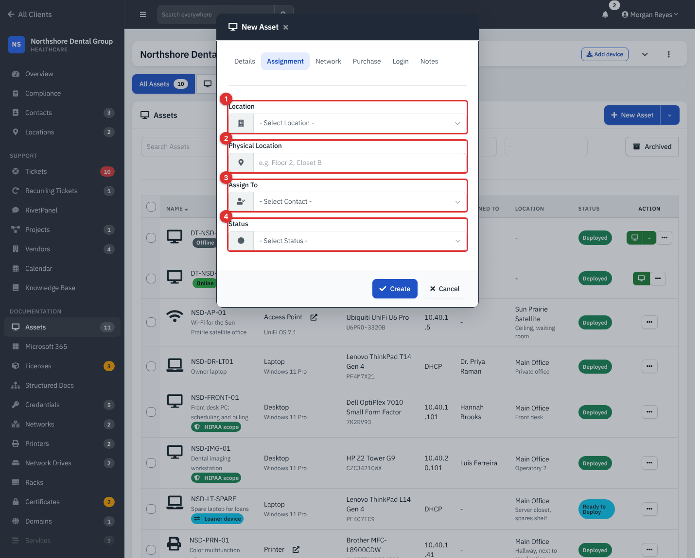

*Figure 5 — Assignment tab.*

4. On **Network**, pick the **Network**, enter an **IPv4 Address** (or tick the box beside it for DHCP), **MAC Address**, **IPv6 Address** and **NAT Address**, plus **URI**, **URI 2**, **Client URI** (shown to the client in the portal) and an **AnyDesk ID**.

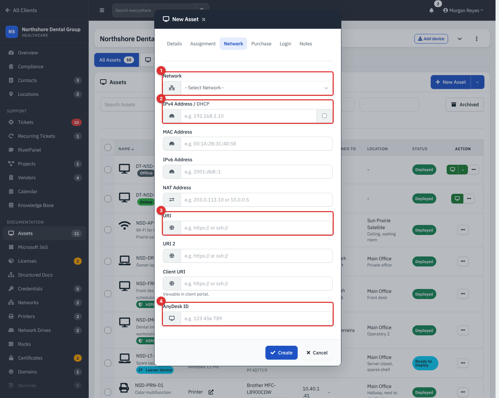

*Figure 6 — Network tab.*

5. On **Purchase**, pick the **Vendor** and enter **Purchase Reference**, **Purchase Date**, **Install Date** and **Warranty Expire**.

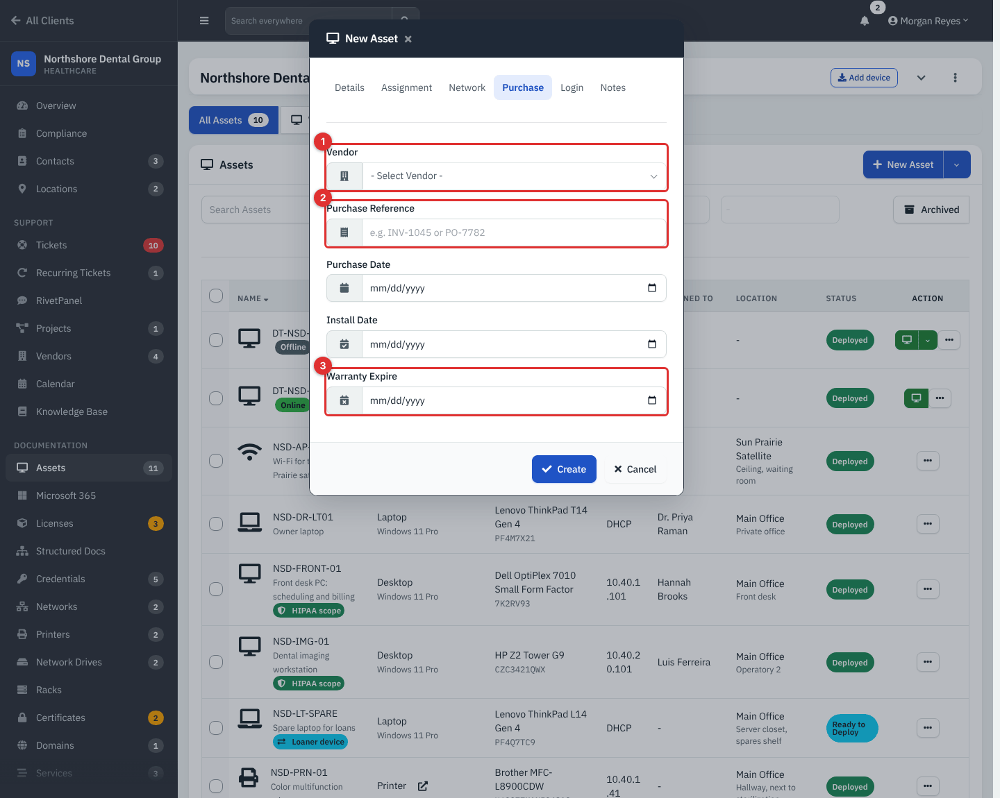

*Figure 7 — Purchase tab.*

6. **Login** stores a username and password as a credential linked to the asset (see [Credentials and the vault](14-credentials-and-vault.md)). **Notes** holds free text, a photo upload and the tags.
7. Click **Create**.

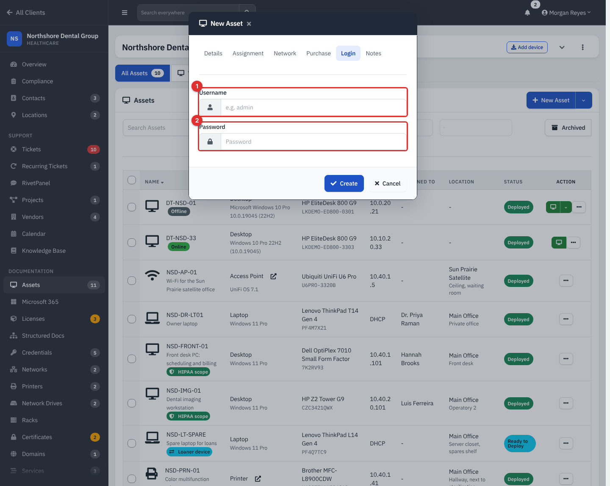

*Figure 8 — Login tab.*

Creating an asset also creates its first network interface (named `01`, marked primary) and a history entry. The **Type** list is fixed: Laptop, Desktop, Server, Phone, Mobile Phone, Tablet, Firewall/Router, Switch, Access Point, Printer, Display, Camera, Virtual Machine and Other.

### Work on several assets at once

1. Tick the boxes at the start of the rows.
2. Click **Bulk Action** (it appears once something is ticked).
3. Choose an action.

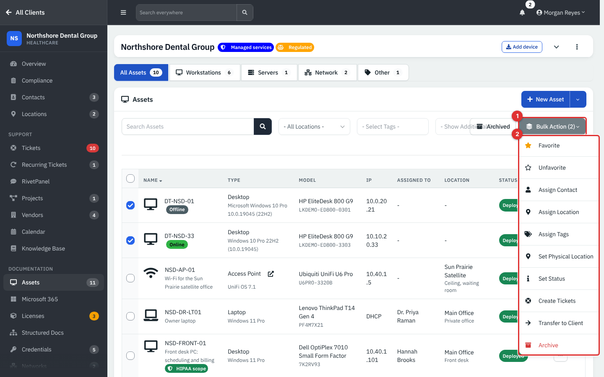

*Figure 9 — Bulk actions with two assets ticked.*

| Action | What it does |
|---|---|
| **Favorite** / **Unfavorite** | Adds or removes the yellow star. |
| **Assign Contact**, **Assign Location** | Per-client list only. |
| **Assign Tags** | Adds tags to every selected asset. |
| **Set Physical Location** | Sets the free-text spot. |
| **Set Status** | Changes the status. |
| **Create Tickets** | Creates one ticket per selected asset. |
| **Transfer to Client** | Moves the assets to another client. |
| **Archive** | Archives the selection (administrators). On the archived view: **Restore** and **Delete**. |

### Show extra columns

Choose columns in **Show Additional Columns**. Warranty dates are the quickest way to plan a refresh.

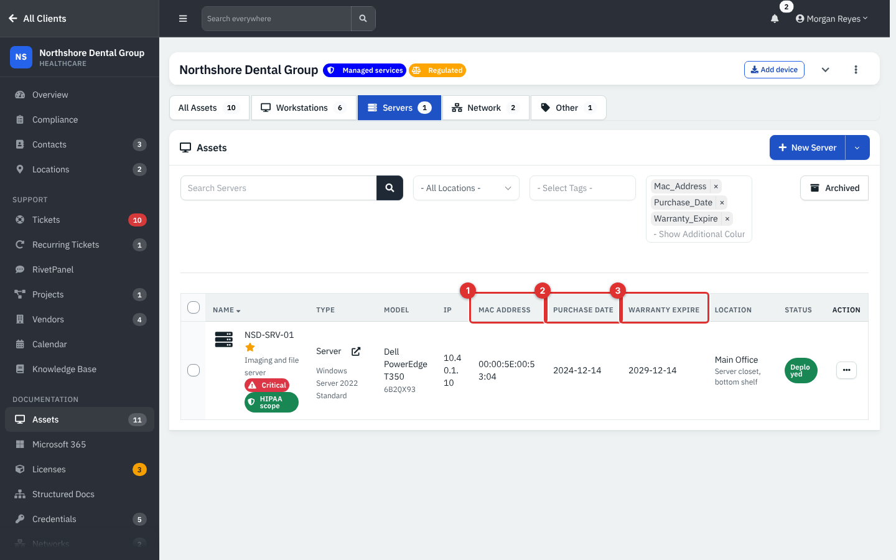

*Figure 10 — MAC Address (1), Purchase Date (2) and Warranty Expire (3).*

### Import and export

1. Open the arrow beside **New Asset** and choose **Import** (per-client list).
2. Download the **sample csv template** and fill it in. The headings are Name, Description, Type, Make, Model, Serial, OS, Purchase Date, Assigned To, Location, Physical Location and Notes.
3. Choose the file and click **Import**.

**Export** in the same menu downloads the current list.

### Archive and restore

Administrators use the row menu **Archive**. Archived assets disappear from the tabs and from the counts. Click **Archived** to see them; **Restore** brings one back and **Delete** removes it for good.

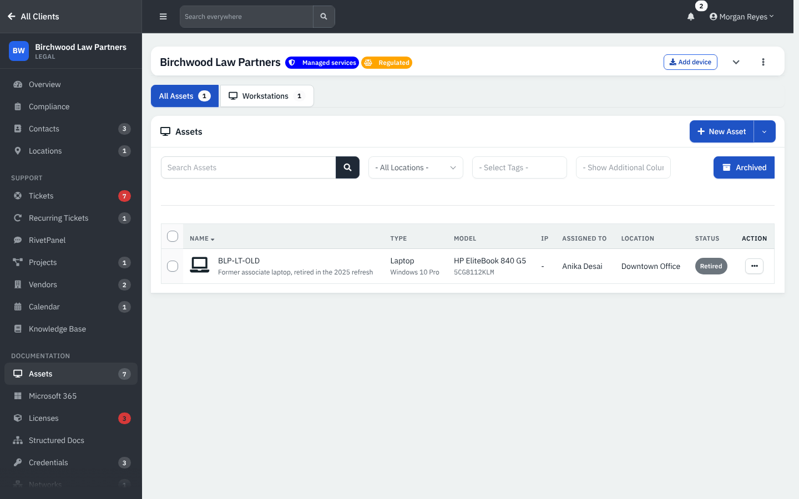

*Figure 11 — The Archived view for Birchwood Law Partners shows a retired laptop kept for the audit trail.*

### Read an asset page

Click an asset name to open its page.

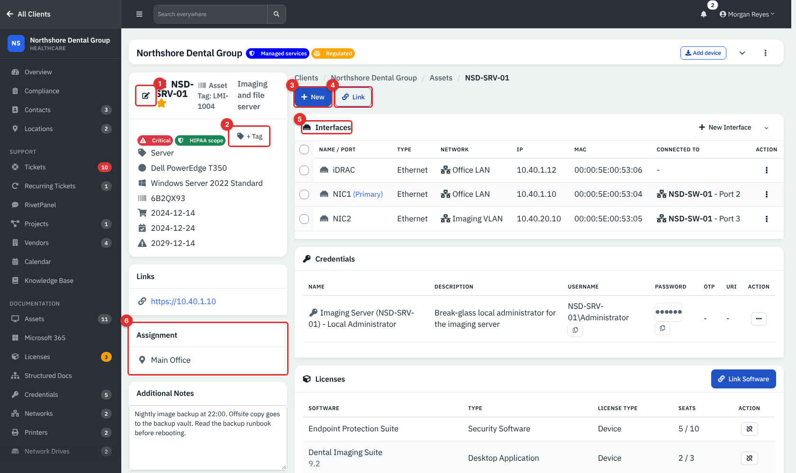

*Figure 12 — The page for the imaging server NSD-SRV-01.*

1. **Edit** (pencil). Opens the same tabs as New Asset (without **Login**) plus **History**.
2. **+ Tag.** Opens the **Notes** tab where tags are managed.
3. **New.** Creates a ticket, recurring ticket, credential, document or uploaded file already linked to this asset.
4. **Link.** Links an existing license, credential, service, document or file.
5. **Interfaces.** One row per port with type, network, IP, MAC and **Connected To** (the port on the other end of the cable).
6. **Assignment.** Location, assigned contact and their phone and email.

The left column also shows a **Links** card for the asset's web addresses, a **Remote Access** card (**Connect via AnyDesk** when an AnyDesk ID is set) and **Additional Notes**, a text box that saves what you type.

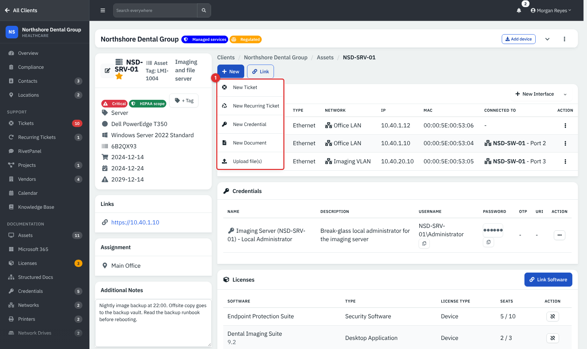

*Figure 13 — The **New** menu: New Ticket, New Recurring Ticket, New Credential, New Document, Upload file(s).*

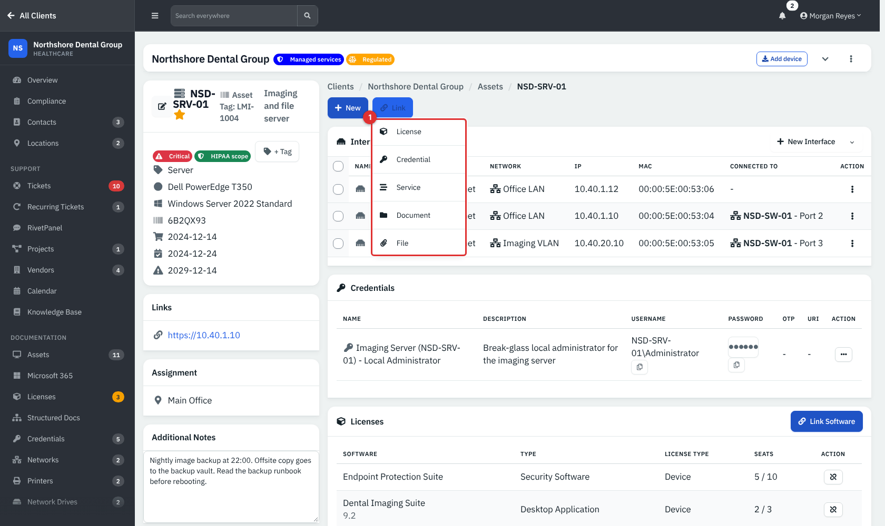

*Figure 14 — The **Link** menu: License, Credential, Service, Document, File.*

Below the interfaces, cards appear when they have content: **Credentials**, **Licenses**, **Documents**, **Files** (list or grid view), **Recurring Tickets**, **Tickets**, **Linked Services** and a **Relationships** card. Each has its own link button and an unlink button on every row.

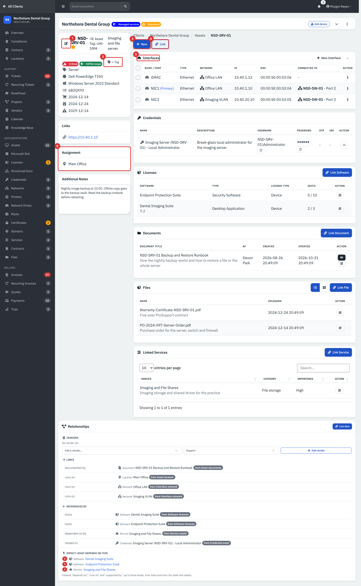

*Figure 15 — The complete page: interfaces, credentials, licenses, documents, files, services and relationships.*

### Add or change a network interface

1. On the asset page click **New Interface** in the Interfaces card.
2. Enter the **Interface Name or Port**, **Interface Type**, **Description**, **Network**, **IPv4 Address / DHCP**, **MAC Address**, **IPv6 Address**, **NAT Address**, and **Connected to** (another asset's interface).
3. Click **Create**. Connecting two interfaces shows the link on both assets.

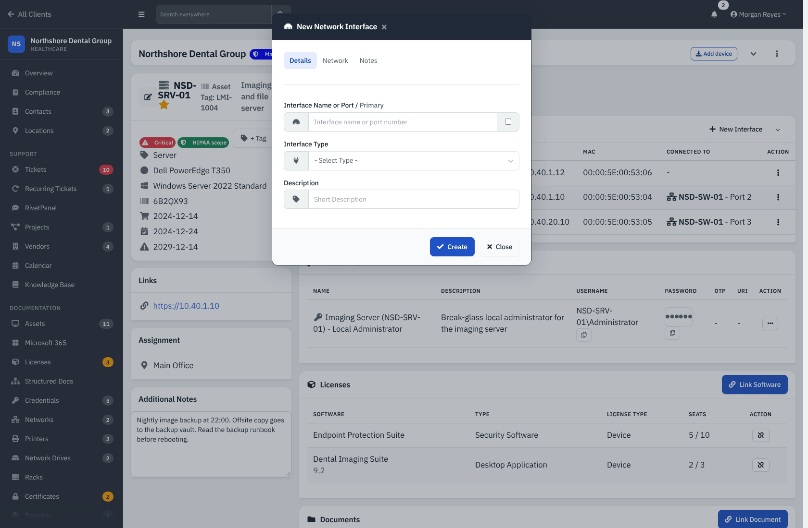

*Figure 16 — New Interface.*

The Interfaces card also has bulk actions to change the network or type of several interfaces, and import and export.

### See an asset's history

Open **Edit** and choose **History**. Every creation, status change and archive is listed with the person and date.

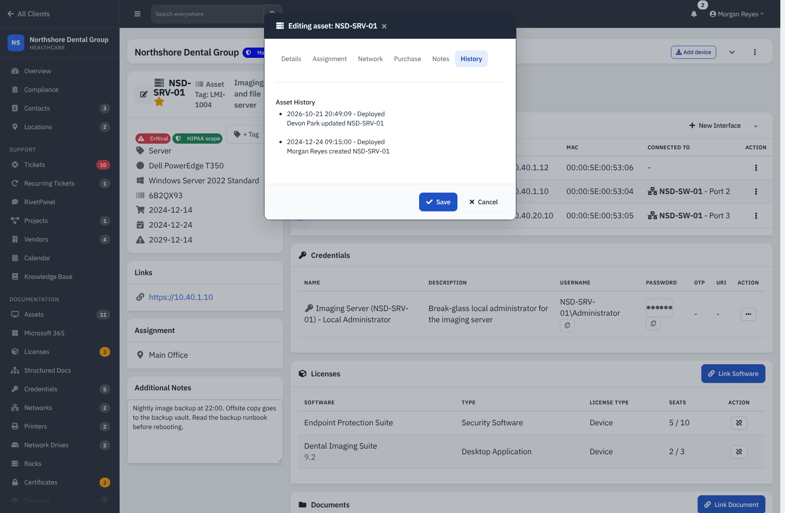

*Figure 17 — History.*

### Remote management panel

When the RMM module is on and a device is linked to the asset, a banner above the cards shows online state, operating system, last-seen time and health, with remote-connect and run-command actions where your role allows. That panel comes from the Endpoints area. It is not shown on this demo's example assets, which have no linked device, and it was not verified against a live agent here.

## Reference

### Statuses

Asset statuses are a category list (**Administration** → **Tags & Categories** → **Asset Status**). A standard install has **Ready to Deploy**, **Deployed**, **Out for Repair**, **Lost**, **Stolen** and **Retired**. You can add your own.

### Permissions

| Action | Needs |
|---|---|
| View assets and asset pages | Support: **Read** |
| Add, edit, copy, link, bulk actions | Support: **Modify** |
| Archive, restore, delete | Administrator role |
| See remote panel | RMM module and its permission |

## Tips and good practice

- **Name by role and place**, for example `NSD-SRV-01`, so a search finds it from a ticket subject.
- **Fill in warranty and purchase dates when you create the device.** Warranty dates feed the warranty widgets on the dashboard.
- **Record cabling.** Using **Connected to** on interfaces means the switch page shows every device on every port.
- **Use the Note.** The page's **Additional Notes** box is the quickest place to put "never reboot during business hours".
- **Firewall/Router assets** are excluded from the Assets list and counts. To reach one, open it from a link on a credential, document or service, or from the Endpoints area's network pages. This is how the app behaves today, and it is listed as an oddity in the author notes.

## Related guides

- [Documentation records](12-documentation-records.md) for licenses, domains, certificates, networks and vendors
- [Credentials and the vault](14-credentials-and-vault.md)
- Clients and contacts guide for locations and the people you assign devices to
- Endpoints guide for linked devices
