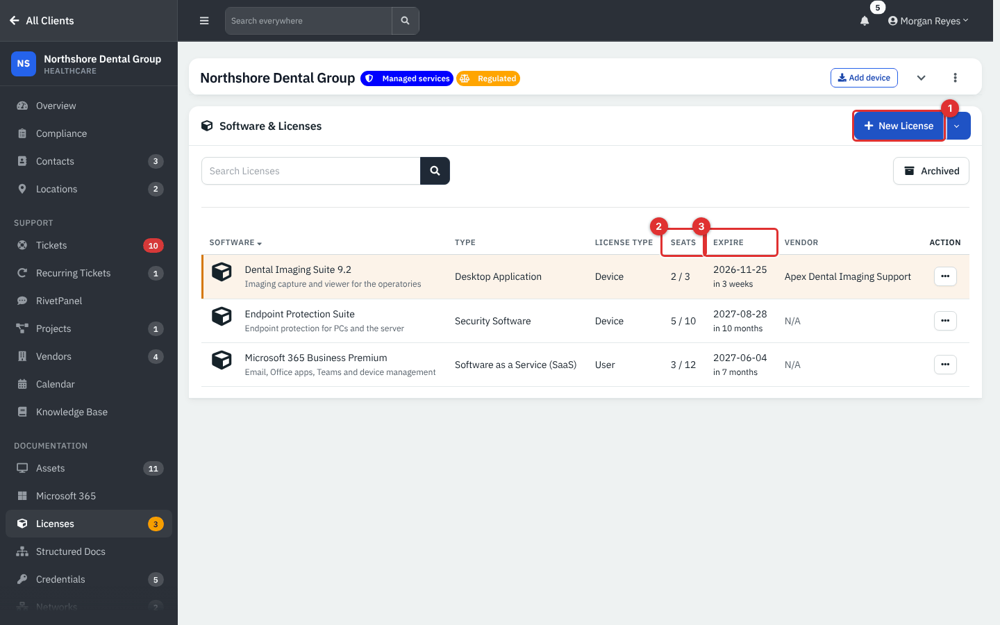
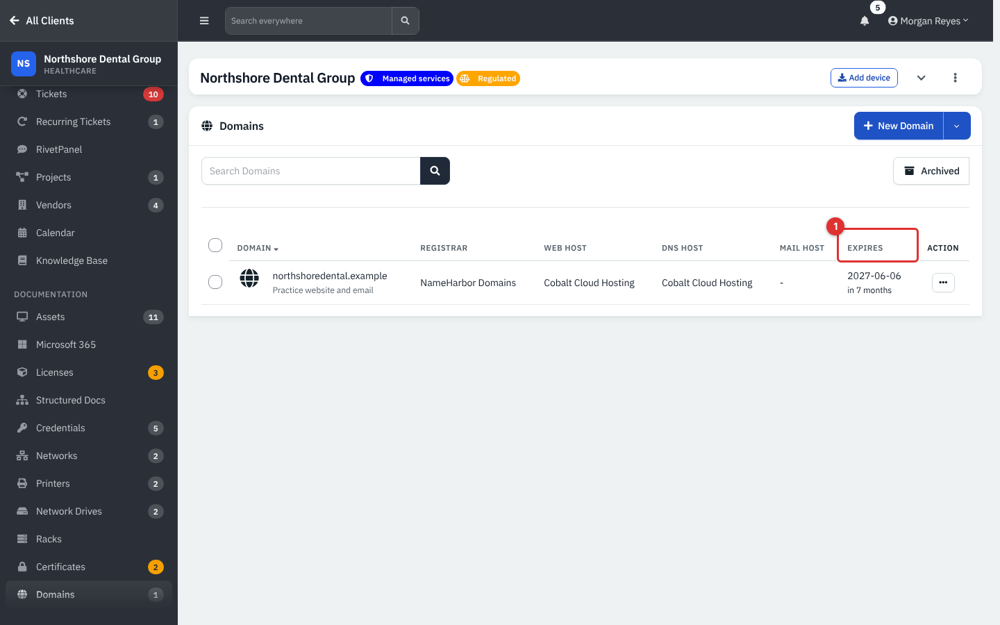
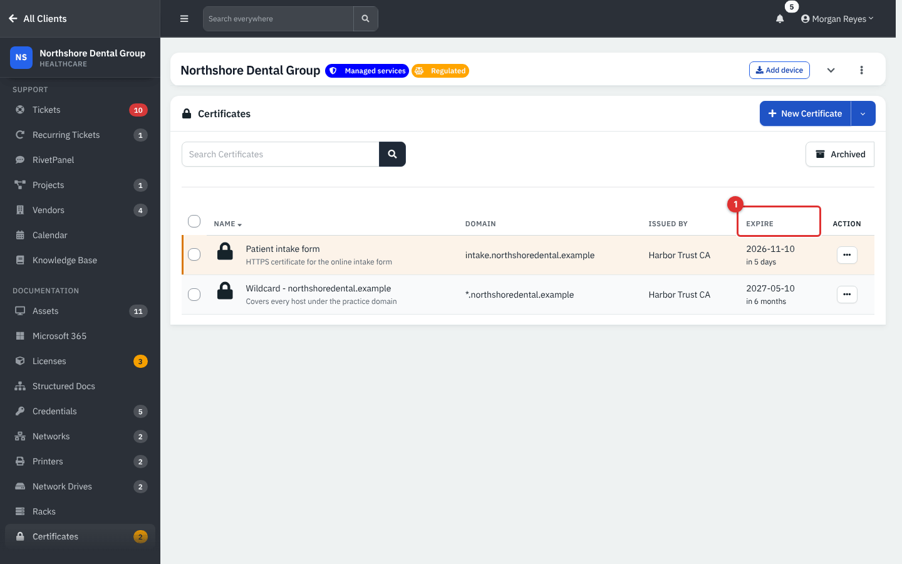
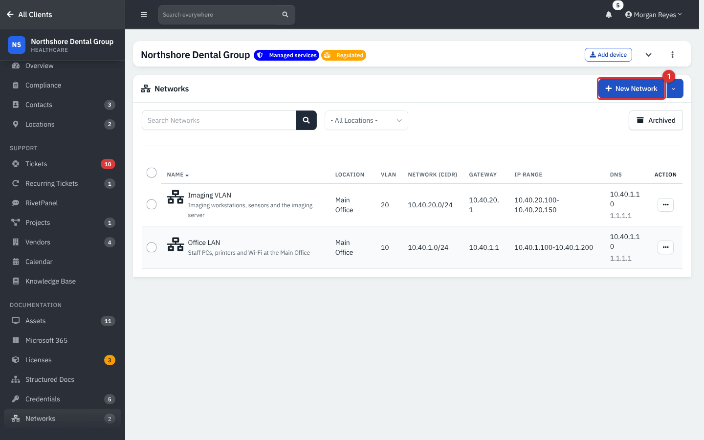
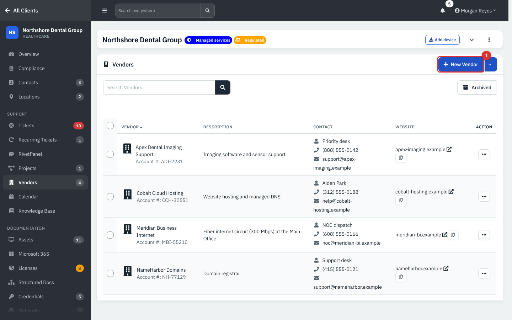
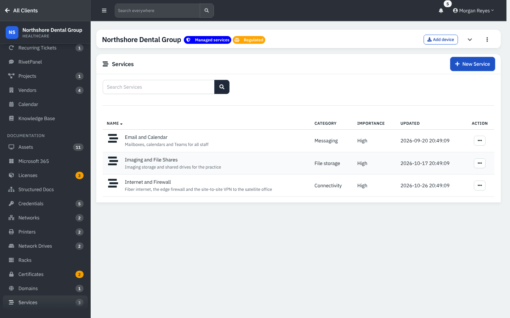
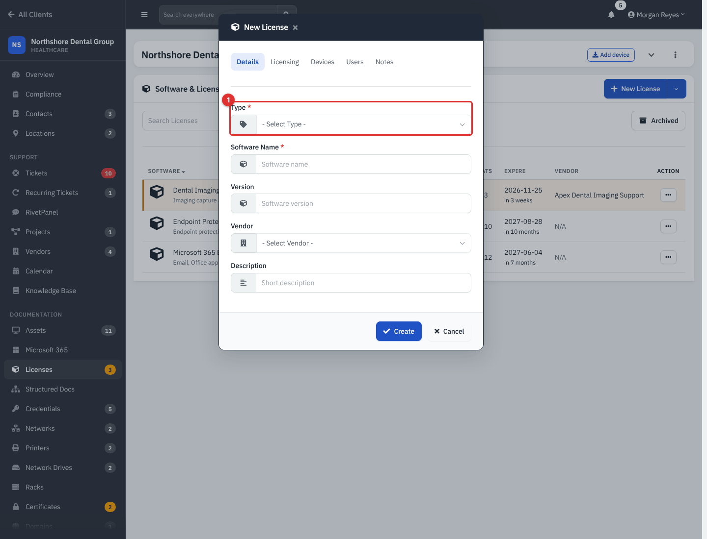
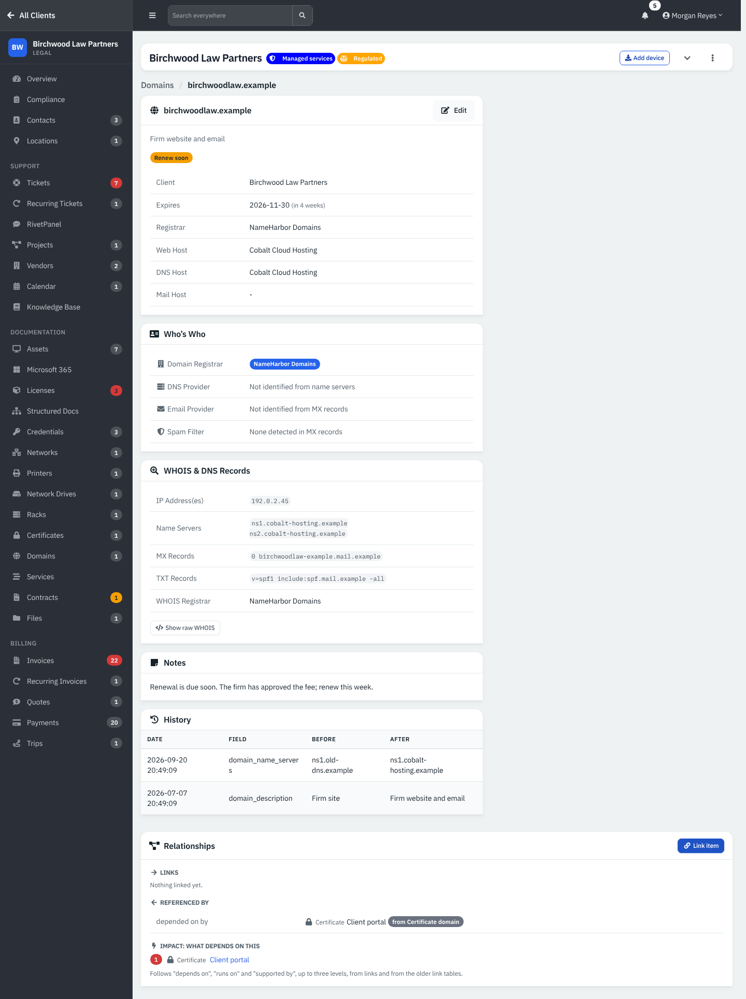

# Documentation records: licenses, domains, certificates, networks, vendors and services

Besides assets, each client has a set of smaller documentation lists: software licenses, domains, certificates, networks, vendors and services. They are simple, searchable tables, and they link to each other and to assets, so you can ask "what runs on this server?" or "what expires this month?". Racks, printers, network drives, files, documents, structured documentation, relationships and sharing are in the [second half of this chapter](12b-files-structured-docs-and-sharing.md).

| | |
|---|---|
| **Where to find it** | Inside a client: **Clients** → pick the client → **Documentation** → **Licenses**, **Networks**, **Certificates**, **Domains**, **Services**; **Support** → **Vendors**. Across clients: **Client Overview** → **Documentation** (Licenses, Networks, Certificates, Domains, Services). Items hide in a client's menu when the client has none of them. |
| **Who can use it** | Permission module **Support** (`module_support`): **Read** to view, **Modify** to add and edit, **Full** or an administrator to archive and delete. |
| **Turn it on** | **Administration** → **Settings** → **Modules** → **Show IT Documentation**. |

## What it's for

These lists hold the facts you otherwise hunt for during an outage: how many seats are left on a license, when a domain renews, which certificate is installed where, what the gateway address is, who to call at the ISP. Expiry dates are color-coded so renewals do not surprise you.

## A quick tour

### Licenses

*Figure 1 — Licenses for Northshore Dental Group.*

1. **New License.** Its arrow menu offers **Create from Template** and **Export**.
2. **Seats.** Shown as *used / total*, for example 2 / 3.
3. **Expire.** With the time left. Rows turn amber 45 days or fewer before expiry, red 7 days or fewer, and gray once expired.

Columns: **Software**, **Type**, **License Type**, **Seats**, **Expire**, **Vendor**, **Action**.

### Domains and certificates

*Figure 2 — Domains. **Expires** (1) turns amber 90 days before expiry and red at 14 days.*

Domain columns: **Domain**, **Registrar**, **Web Host**, **DNS Host**, **Mail Host**, **Expires**. Registrar and hosts are vendors you have recorded for the client.

*Figure 3 — Certificates. **Expire** (1) turns amber 7 days before expiry and red at 1 day.*

Certificate columns: **Name**, **Domain**, **Issued By**, **Expire**.

### Networks

*Figure 4 — Networks, with a **New Network** button (1).*

Columns: **Name**, **Location**, **VLAN**, **Network (CIDR)**, **Gateway**, **IP Range** (the assignable range) and **DNS**.

### Vendors and services

*Figure 5 — Vendors for one client.*

*Figure 6 — Services (**Name**, **Category**, **Importance**, **Updated**).*

## Common tasks

### Add a license

1. Open **Licenses** and click **New License** (or use **Create from Template** for a ready-made entry).
2. On **Details**, set **Type**, **Software Name**, **Version**, **Vendor** and **Description**.

*Figure 7 — New License. **Type** (1) is required.*

3. On **Licensing**, set **License Type** (for example User or Device), **Seats**, **License Key**, **Purchase Reference**, **Purchase Date** and **Expire**.
4. On **Devices** and **Users**, choose who or what holds a seat. User licenses count people, device licenses count assets.
5. Click **Create**.

You can also assign a license from an asset page with **Link** → **License**. The **Seats** column then shows how many are in use.

### Track a domain

1. Click **New Domain**, enter the **Domain Name**, **Description**, **Registrar**, **Webhost**, **DNS Host**, **Mail Host**, **Expire Date** and **Notes**.
2. Click **Create**.

A background job (`cron/domain_refresher.php`) can fill DNS and registration details from public lookups. This was **not verified on a live service** for this guide, and the demo's DNS and WHOIS values are example text.

*Figure 8 — A domain page: details, **Who's Who** (registrar, DNS, email provider and spam filter), **WHOIS & DNS Records**, **Notes**, **History** and **Relationships**.*

### Add a certificate

Click **New Certificate**. Enter **Certificate Name**, **Description**, **Domain** (the host name it covers; there is also a drop-down to tie it to a domain you track), **Issued By**, **Expire Date** and the **Public Key**. Never paste a private key into a record.

### Document a network

Click **New Network**. Enter **Name**, **VLAN**, **Network (CIDR)**, **Assignable IP Range**, **Gateway**, **Primary DNS**, **Secondary DNS**, **Location** and **Description**. Networks then appear in the **Network** drop-down of every asset and interface, so each device records which network it sits on. **Import** and **Export** are in the same menu.

### Add a vendor

Click **New Vendor** (or **Create from Template**). The fields are **Vendor Name**, **Description**, **Account Number**, **Account Manager**, **Support Phone**, **Support Hours**, **Support Email**, **Support Website URL**, **Pin/Code** and **SLA**. Vendors recorded for a client are those *that client* buys from; the company's own vendors for expenses live under **Finance** → **Vendors**.

### Document a service

Click **New Service**. Give it a **Name**, **Description**, **Category**, **Importance** and **Backup** note, then choose related contacts, vendors, documents, assets, credentials, domains and certificates. The service's details window then lists what it depends on.

## Reference

| Record | Expiry colors | Links to |
|---|---|---|
| License | amber 45 days, red 7 days, gray expired | Assets (device seats), contacts (user seats), vendor, documents, files, credentials |
| Domain | amber 90 days, red 14 days, gray expired | Registrar, web host, DNS host, mail host (vendors), certificates, services |
| Certificate | amber 7 days, red 1 day, gray expired | Domain, services |
| Network | none | Locations, asset interfaces |
| Service | none | Assets, vendors, domains, certificates, contacts, documents, credentials |

## Tips and good practice

- Enter expiry dates when you create a record. They drive the expiry widgets on the dashboard (domains, licenses and warranties).
- Put the **registrar** and **host** vendors on every domain so the next technician knows who to call.
- Keep one network record per VLAN, with the gateway and DHCP range, before you start filling in asset IPs.
- Use **Services** for anything a client would describe as "the thing that stopped working": file shares, email, internet.

## Related guides

- [Assets](11-assets.md)
- [Files, structured documentation and sharing](12b-files-structured-docs-and-sharing.md)
- [Credentials and the vault](14-credentials-and-vault.md)
- Dashboard guide for the expiry widgets
