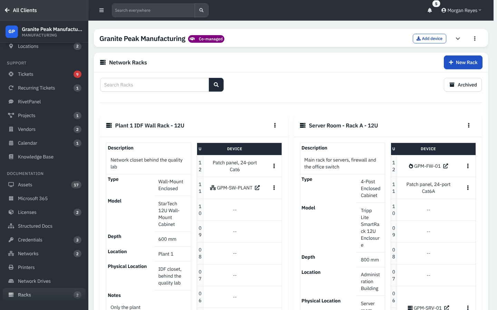
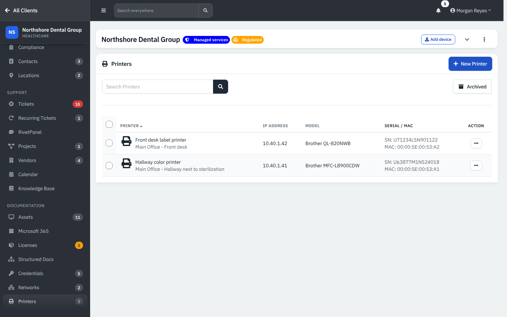
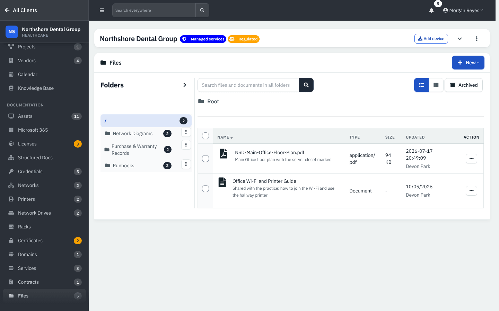
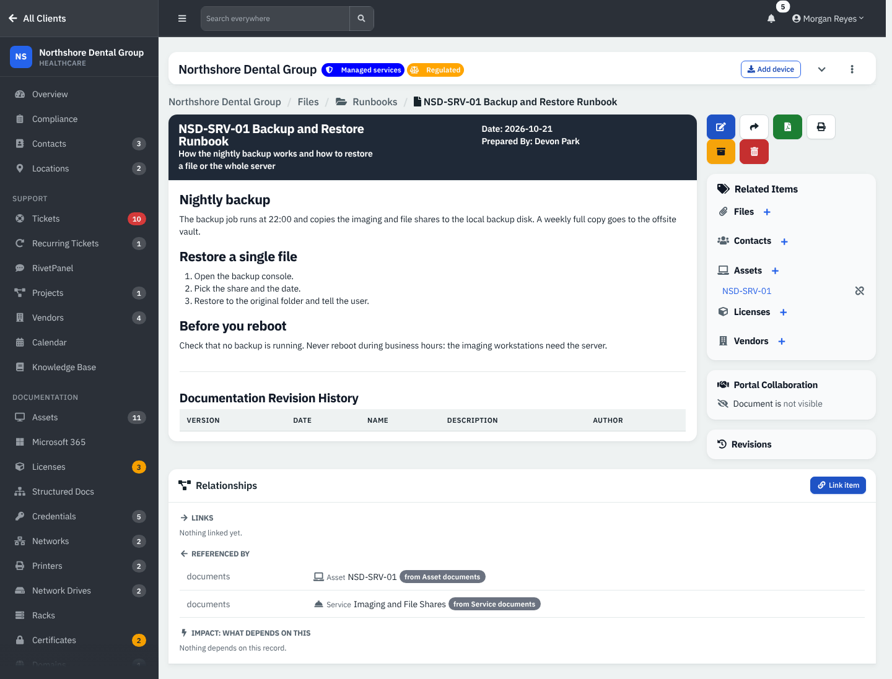
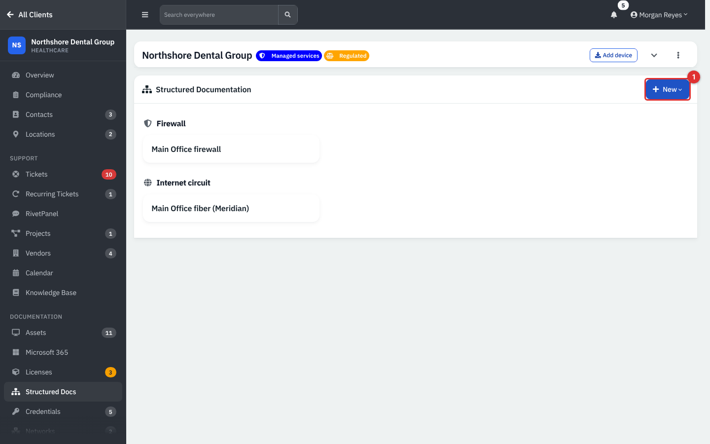
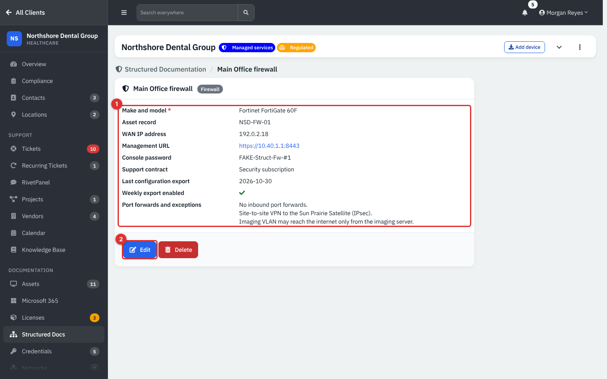
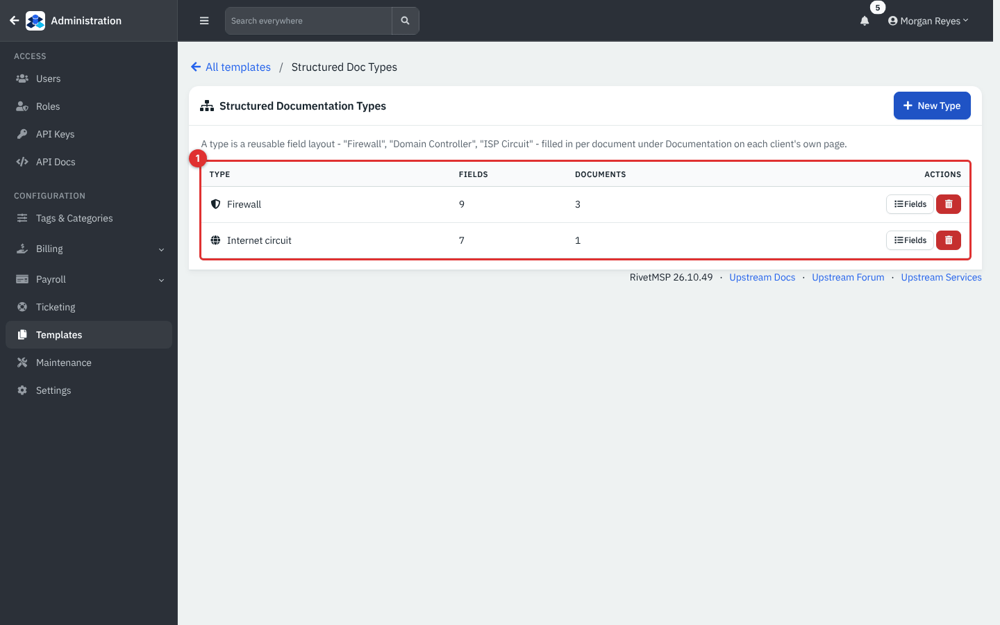
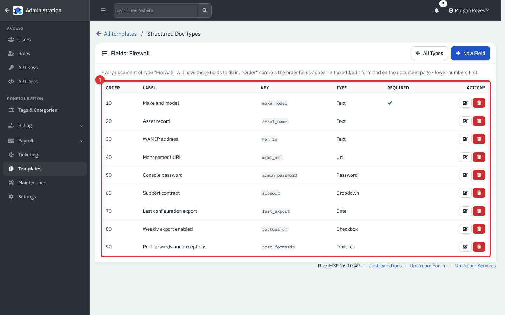
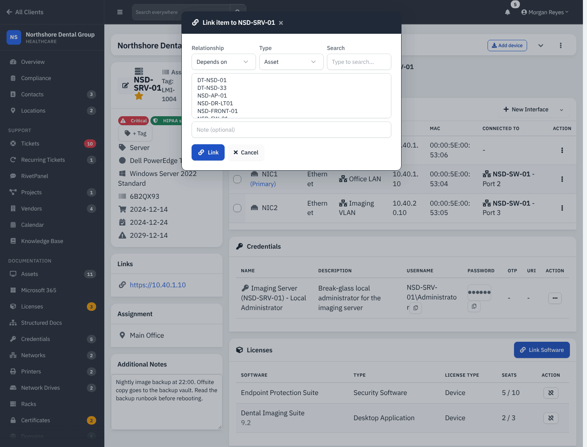

# Files, structured documentation, relationships and sharing

The second half of the documentation chapter covers physical and written records: racks, printers, network drives, files and documents, structured documentation (fixed-field records such as a firewall sheet), the Relationships card that ties records together, and expiring share links. Licenses, domains, certificates, networks, vendors and services are in [Documentation records](12-documentation-records.md).

| | |
|---|---|
| **Where to find it** | Inside a client: **Documentation** → **Racks**, **Printers**, **Network Drives**, **Files**, **Structured Docs**. Structured document *types* are defined by an administrator under **Administration** → **Templates** → **Structured Documentation Types**. |
| **Who can use it** | Permission module **Support** (`module_support`): **Read** to view, **Modify** to add and edit, **Full** to delete a structured document. Defining types needs an administrator. |
| **Turn it on** | **Administration** → **Settings** → **Modules** → **Show IT Documentation**. |

## What it's for

Keep the *evidence* for a client's environment next to the records: the rack diagram, the purchase order, the runbook, the firewall sheet. Everything is per client, so a technician opening the client sees one tidy set.

## A quick tour

### Racks, printers and network drives

*Figure 1 — Racks for Granite Peak Manufacturing: each rack shows its model, depth, location and a numbered unit table with the device in each unit.*

Each rack card lists **Description**, **Type**, **Model**, **Depth**, **Location**, **Physical Location** and **Notes**, and a unit table with **U** and **Device**. A unit can name an asset (shown as a link) or free text such as "UPS, 3000 VA".

*Figure 2 — Printers: **Printer**, **IP Address**, **Model**, **Serial / MAC**.*

*Figure 3 — Network drives: **Drive**, **Letter**, **Path** and **Purpose**.*

### Files and documents

*Figure 4 — The Files page: a folder tree on the left, files and documents on the right, a list/grid toggle and a **New** menu.*

1. **Folders.** Click a folder to filter; the number is how many items it holds.
2. **New.** Uploads a file, writes a document, creates a document from a template, or adds a folder.
3. **Search.** Searches files and documents in all folders.

*Figure 5 — A document page with action buttons, **Related Items**, **Portal Collaboration**, **Revisions** and the Relationships card.*

The buttons are **Edit**, **Share**, **PDF Export**, **Print**, **Archive** and **Delete**. **Related Items** lists linked assets, contacts, licenses, files and vendors with a **+** to add more and an unlink button on each. **Portal Collaboration** says whether the document is visible to the client in the portal. **Revisions** lists earlier versions.

### Structured documentation

*Figure 6 — Structured Documentation groups a client's records by type. **New** (1) lists the types an administrator defined.*

*Figure 7 — A structured document: fixed fields (1) and **Edit** (2). The password field is masked until **Reveal** is clicked.*

## Common tasks

### Add a rack

Click **New Rack**. Choose **Type** (for example 4-Post Enclosed Cabinet), enter **Name**, **Number of Units**, **Model**, **Depth**, **Location**, **Physical Location**, **Description** and an optional photo. Then use the rack's device button to put an asset or free-text device into a unit range.

### Upload a file or write a document

1. Open **Files** and choose a folder.
2. Click **New** and pick the item.
3. Documents use a rich-text editor; choose whether the document is visible to the client.
4. Open the document later to **Share**, export to PDF or link it to assets and contacts.

File rows keep a name, description, size and type. Uploaded files are stored on the server. The example files in this guide's demo are records only and cannot be downloaded.

### Define a structured document type (administrator)

1. Go to **Administration** → **Templates** → **Structured Documentation Types**.

*Figure 8 — Types, with the number of fields and documents for each.*

2. Click **New Type**, name it and pick an icon.
3. Click **Fields**, then **New Field**. Set **Label**, **Field Type**, whether it is **Required**, and **Order**.

*Figure 9 — The Firewall type's fields.*

Field types: **Text (single line)**, **Text (multiple lines)**, **Number**, **Date**, **Checkbox (yes/no)**, **Dropdown** (options, one per line or comma-separated), **URL** and **Password (encrypted at rest)**.

### Write a structured document

Open **Structured Docs**, click **New** and pick a type, name the document and fill in the fields. Leave a password field blank when editing to keep the stored value.

A password field is **lighter weight than the credential vault**: there is no password re-entry and no reveal limit. It is encrypted at rest, requires Support access, and each reveal is written to the activity log and audit trail. Use the vault for shared logins.

### Link records with Relationships

Asset, domain, certificate, document, contact, KB article and ticket pages end with a **Relationships** card.

*Figure 10 — **Link item** to an asset: choose a **Relationship**, the **Type** of record, search, add a note, click **Link**.*

Relationship types are **depends on**, **runs on**, **supported by**, **documented by** and **related**. The card shows links you made (with an unlink button), read-only rows derived from the older link tables (marked "from ..."), what refers to this record, and an **Impact: what depends on this** list that follows depends-on, runs-on and supported-by links up to three levels.

### Share a document, file or credential

1. Open the **Share** action (a document's button, or the row menu of a file or credential).
2. Choose who to **Share with** (a client contact's email or one you type).
3. Pick **Expiration**: 1 hour (default), 1 day, 1 week or 1 month.
4. Optionally switch on **Delete after view** and add a client-visible note.
5. Click **Send and Show Link**.

The recipient opens the link without logging in. The decryption key travels in the link, so treat it like a password. The page that receives it is described in the portal and guest-link guides.

## Reference

| Item | Notes |
|---|---|
| Structured field types | Text, Text (multiple lines), Number, Date, Checkbox, Dropdown, URL, Password |
| Share expirations | 1 hour, 1 day, 1 week, 1 month |
| Relationship types | depends on, runs on, supported by, documented by, related |

## Tips and good practice

- Use **structured documents** for facts that always have the same shape (every firewall, every internet circuit) and plain **documents** for procedures.
- Link a runbook to the asset and the service it protects, so it appears on both pages.
- Prefer a **short expiry and Delete after view** when you share a credential.
- **Note (app behavior).** The empty message on the Structured Documentation page still says "this department".

## Related guides

- [Documentation records](12-documentation-records.md)
- [Assets](11-assets.md)
- [Credentials and the vault](14-credentials-and-vault.md)
- [Knowledge base](13-knowledge-base.md)
