# Knowledge Base

The Knowledge Base holds written how-to articles. A **Central** article is company-wide: your internal procedures, such as how to reset a password or onboard a client. A **client** article belongs to one client: that client's own quirks and instructions. Either kind can be shown to the client in the client portal.

| | |
|---|---|
| **Where to find it** | **Knowledge Base** in the main sidebar (all articles, Central and client), or **Support** → **Knowledge Base** inside a client (that client's articles plus every Central article). |
| **Who can use it** | Permission module **Knowledge Base** (`module_kb`). **Read** to view; **Modify** to import Word or PDF files, add embeds, set a review schedule and restore versions. In the current code creating, editing and deleting an article only needs **Read** (see the note under Tips). |
| **Turn it on** | **Administration** → **Settings** → **Modules** → **Show Knowledge Base**. It is **off** by default. Give roles the Knowledge Base permission under **Administration** → **Roles**. |

## What it's for

Write a procedure once, find it from any ticket. Central articles keep your team consistent; client articles keep a client's special rules (never reboot the imaging server in the daytime) where the next technician will see them. Articles that help clients help themselves can be published to the portal.

## A quick tour

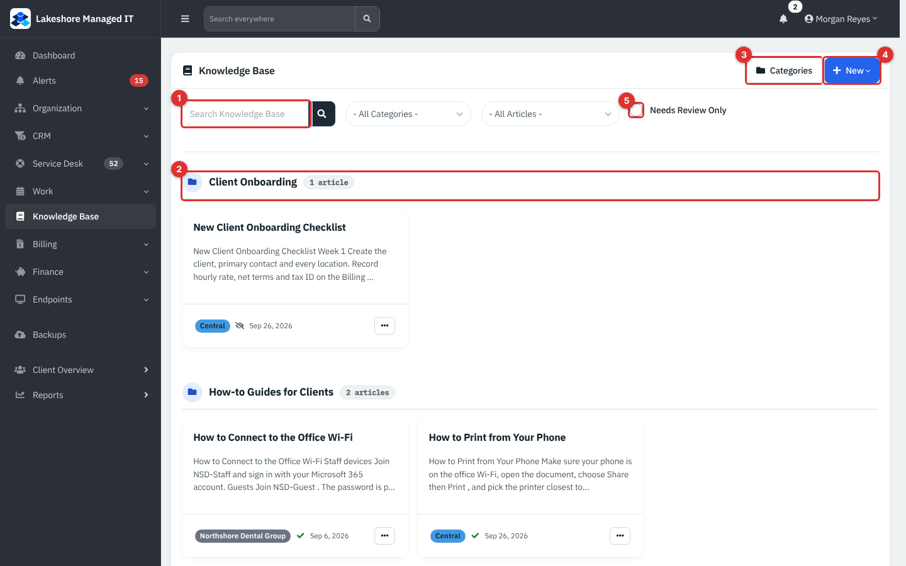

*Figure 1 — The Knowledge Base, grouped by category.*

1. **Search.** Searches titles and the full text of articles.
2. **Category group.** Articles are grouped under their category with a count. Articles without a category show under **Uncategorized**, always last.
3. **Categories.** Opens the category manager.
4. **New.** **Article**, and under **Import**: **Word Doc** and **PDF**.
5. **Needs Review Only.** Shows only articles whose review date has passed.

Beside the search box are two filters: a category filter (**All Categories**, **Uncategorized** or one category) and a scope filter (**All Articles**, **Central (Company-wide)** or one client).

Each card shows the title, a preview, the scope badge (**Central** or the client name), an eye icon (a check means **Visible in client portal**, a crossed eye means **Hidden from client portal**) and the last-updated date. The three-dots menu has **View**, **Edit** and **Delete**. A yellow **Needs Review** badge marks overdue articles.

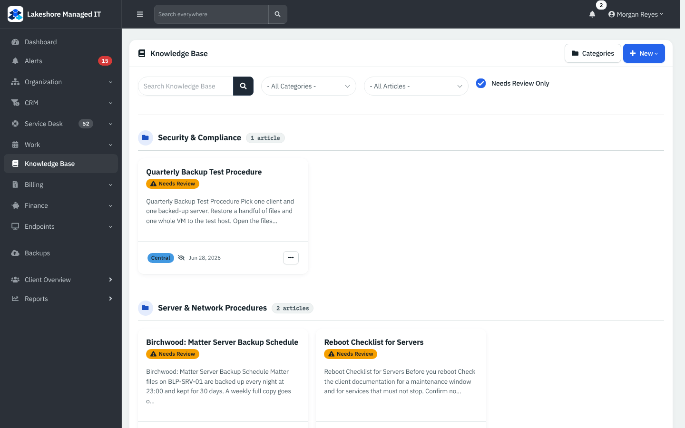

*Figure 2 — **Needs Review Only** lists overdue articles.*

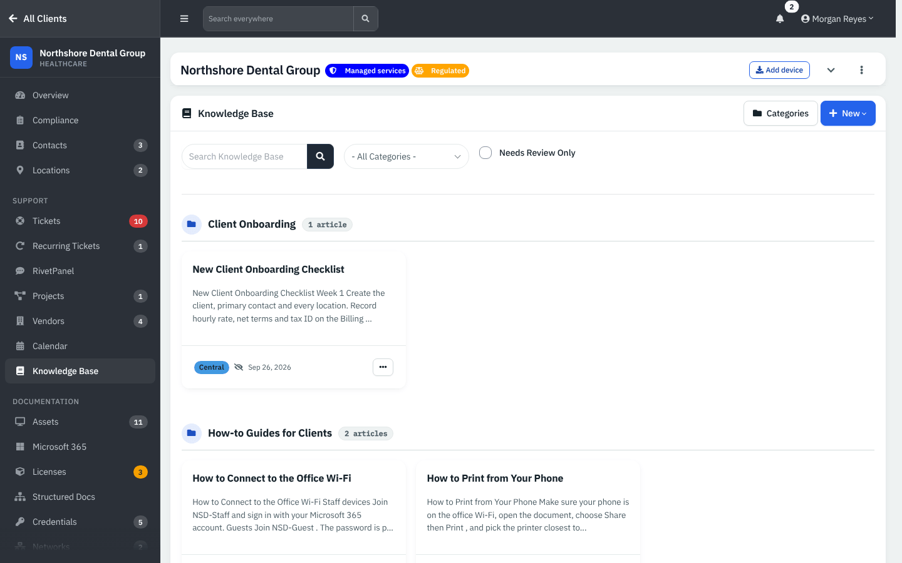

*Figure 3 — Inside a client, the list shows that client's articles plus all Central articles.*

### Reading an article

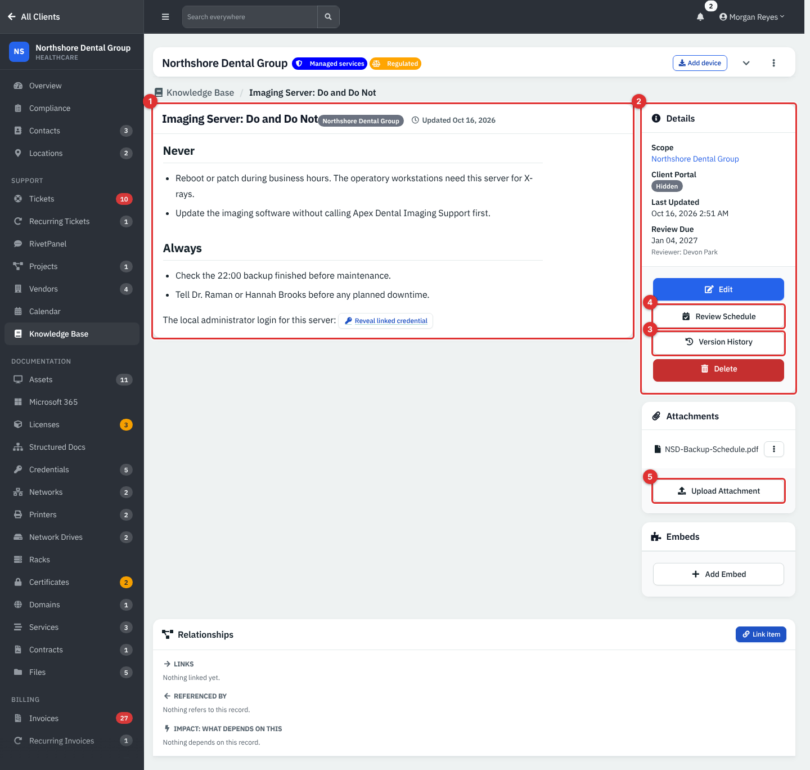

*Figure 4 — An article page.*

1. **The article.** The reader shows the text, the scope badge and the update date.
2. **Details.** **Scope**, **Client Portal** (**Visible** or **Hidden**), **Last Updated**, and **Review Due** with the reviewer.
3. **Version History.**
4. **Review Schedule.**
5. **Upload Attachment.** Attachments are listed above it with **View**, **Download** and **Delete**.

The sidebar also has **Edit**, **Delete** and an **Embeds** card. The page ends with the Relationships card ([Relationships](12b-files-structured-docs-and-sharing.md#link-records-with-relationships)).

## Common tasks

### Write an article

1. Click **New** → **Article**.
2. Enter the **Title**. Choose the **Client** (leave as **Central (Company-wide)** for everyone), the **Category**, and **Visible to Client Portal** (**Yes** or **No**).
3. Write the **Content** in the editor.
4. Click **Create Article**.

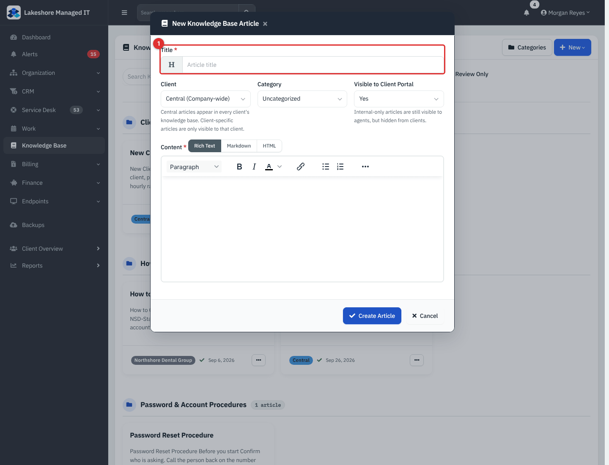

*Figure 5 — New Knowledge Base Article.*

Inside a client's Knowledge Base the **Client** is preset to that client.

### Edit an article

Open the article and click **Edit**. Every save keeps the previous text as a numbered version.

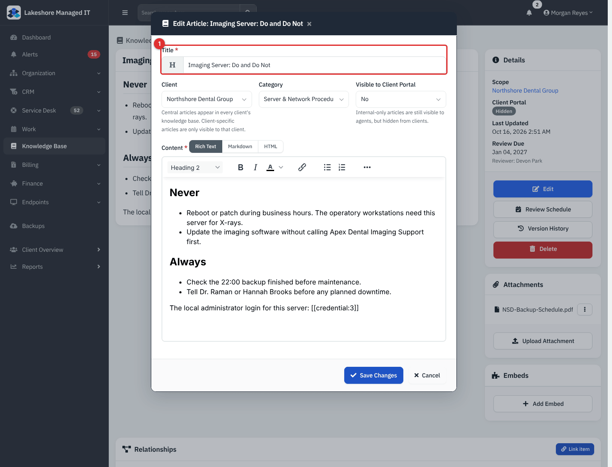

*Figure 6 — Editing an article.*

### Point to a credential safely

Type `[[credential:ID]]` in the text, where ID is the credential's number. The reader shows a **Reveal linked credential** button instead. The button opens the normal credential window, which checks the reader's Credentials permission and client access again, so a secret is never printed in the article. The link works for people who have access to that credential; others see the usual denial.

### Review dates

1. Open the article and click **Review Schedule**.
2. Set **Review Due Date** and a **Reviewer** (a technician).
3. Click **Save**.

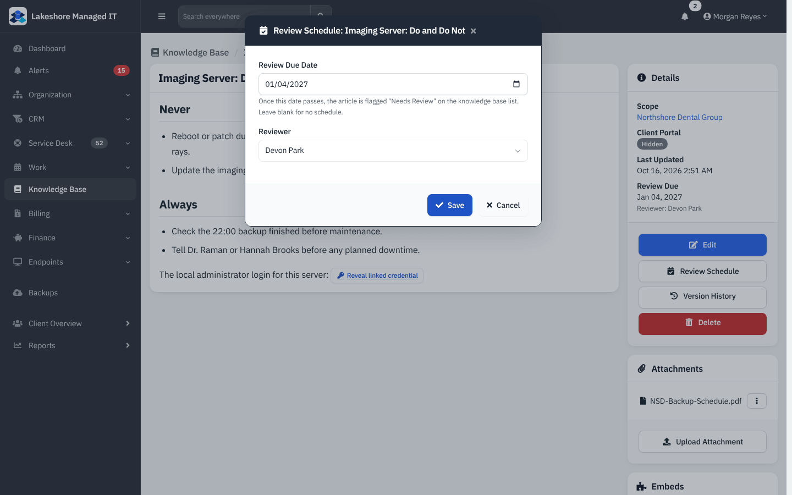

*Figure 7 — Review Schedule.*

When the date passes, the article gets a **Needs Review** badge in lists and on its page.

### Version history

1. Open the article and click **Version History**.
2. Each row shows the version number, the editor and when it was saved, with **View** and **Restore**.
3. **Restore** brings that text back.

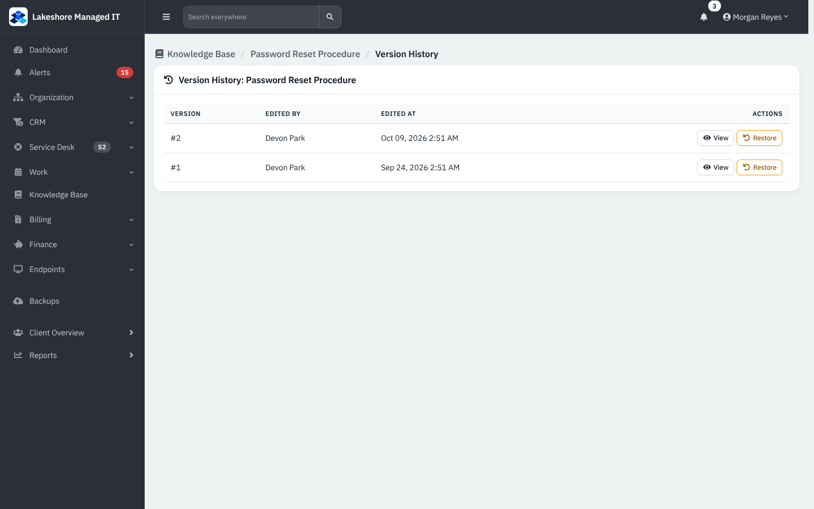

*Figure 8 — Version history of Password Reset Procedure.*

### Categories

Click **Categories** on the list. You can add a category with a **Name**, an optional **Parent Category** and a **Client**, edit it, or delete it. A sub-category appears under its parent with an arrow.

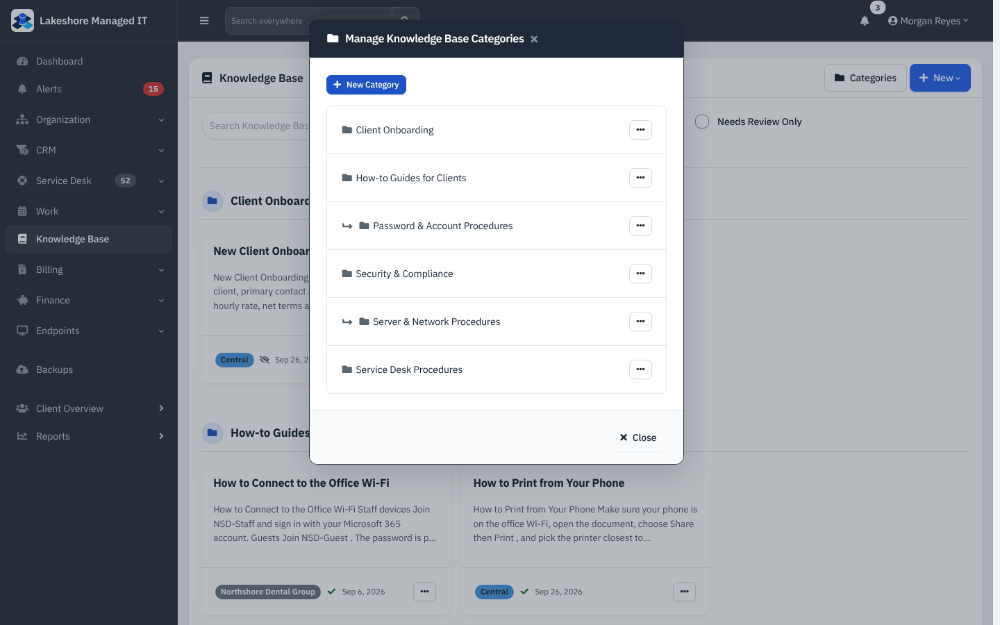

*Figure 9 — Manage Knowledge Base Categories.*

### Import from Word or PDF

1. Click **New** → **Import** → **Word Doc** (or **PDF**).
2. Choose the file; Word files up to 32 MB. Optionally set a **Title**, **Client**, **Category** and **Visible to Client Portal**.
3. Click **Import Document**.

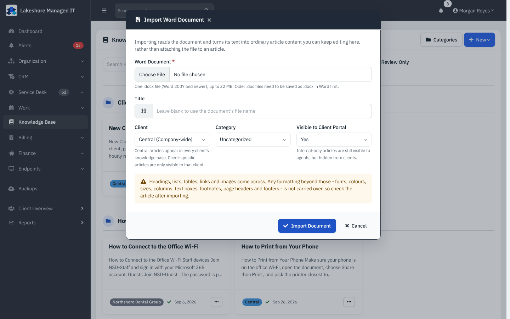

*Figure 10 — Import Word Document. The window warns that headings, lists, tables, links and images carry over but fonts, colors, sizes, columns, text boxes, footnotes and page headers do not.*

### Attachments and embeds

Use **Upload Attachment** for PDFs, images and other files (the allowed types are images, PDF, text, office files, zip, audio and video among others). **Add Embed** takes a small self-contained HTML tool (a calculator, a sizing sheet) with a **Name**, the **HTML** and a **Height**. Embeds run in a sandboxed frame with no access to the site's cookies or data.

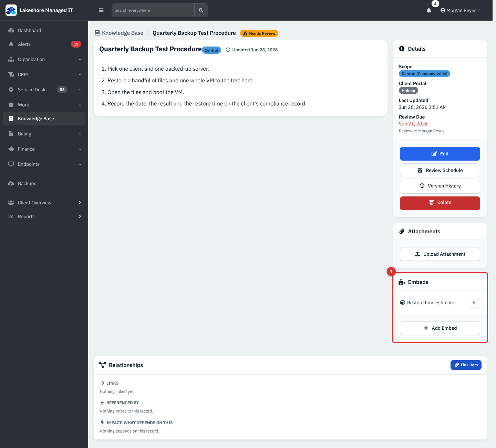

*Figure 11 — The Embeds card (1) on an article; the embed opens in its own sandboxed page.*

### Show an article to clients

Set **Visible to Client Portal** to **Yes**. Clients see **Knowledge Base** in the portal navigation (when the module is on) and can read the article. Articles set to **No** stay internal. The portal itself is covered in the portal guide.

## Reference

| Item | Notes |
|---|---|
| Scope | **Central** (company-wide) or one client |
| Portal visibility | **Visible** or **Hidden** per article |
| Review | Review Due Date and Reviewer; overdue articles are flagged **Needs Review** |
| Versions | The previous text is stored as a numbered version each time an article is edited |
| Word import | Up to 32 MB |
| Credential token | `[[credential:ID]]` |

## Tips and good practice

- Keep Central articles short and procedural; put client-specific exceptions in client articles.
- Give every article a reviewer and a review date, then check **Needs Review Only** monthly.
- Never paste a password into an article. Use the credential token.
- **Note (app behavior).** The article pages let anyone with **Read** access create, edit and delete articles, and manage categories. Importing, embeds, the review schedule and version restore ask for **Modify**. If that is too open for you, give the Knowledge Base permission only to roles that should write.
- The word "Central" appears on the badge and in the filter; "Company-wide" appears in the scope picker.

## Related guides

- [Credentials and the vault](14-credentials-and-vault.md)
- [Assets](11-assets.md)
- Client portal guide
