# Credentials and the vault

The credential vault is where you keep logins for each client: firewall consoles, server local admins, cloud admin accounts, vendor portals. Usernames, passwords and one-time-password (OTP) seeds are encrypted. They stay masked in the list and are shown or copied only when you ask, and every reveal is logged.

| | |
|---|---|
| **Where to find it** | Inside a client: **Clients** → pick the client → **Documentation** → **Credentials**. Across clients: **Client Overview** → **Documentation** → **Credentials**. The rotation report is **Reports** → **Technical** → **Credential rotation**. |
| **Who can use it** | Permission module **Credentials** (`module_credential`): **Read** to see and reveal, **Modify** to add, edit, move, share, tag and archive, **Full** to delete. The **Read-only viewer** example role has no access at all. |
| **Turn it on** | Part of IT documentation (**Administration** → **Settings** → **Modules** → **Show IT Documentation**). The vault needs a vault key, set up when RivetMSP was installed (see [Reference](#reference)). |

## What it's for

Shared logins live in one place instead of in chat or spreadsheets. You can see who changed what, find passwords that have not changed in months, and hand a one-off secret to a client through an expiring link.

## A quick tour

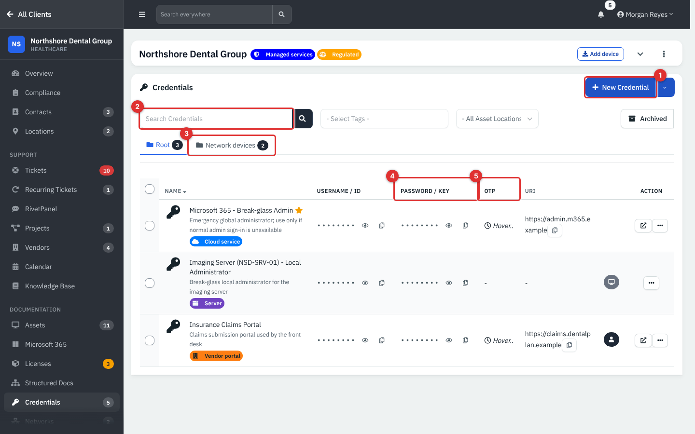

*Figure 1 — Credentials for Northshore Dental Group.*

1. **New Credential.** The arrow beside it holds **New Folder**, **Import** and **Export**.
2. **Search.** Matches name, description, URI, tag and client.
3. **Folder tabs.** **Root** and any folders you made, each with a count.
4. **Username / ID** and **Password / Key** columns, masked, each with an eye (show) and a copy button.
5. **OTP.** Hover to see the current six-digit code for credentials with a seed.

Rows also show the description, tags (colored labels), a star for favorites, the **URI** with copy and open buttons, the linked contact or asset icon, and a row menu.

The row menu holds **Edit**, **Relationships**, **Move** (to a folder), **Share** and **Archive**; on the archived view **Restore** and **Delete**. Filters add **Select Tags** and **All Asset Locations**, and **Archived** switches views.

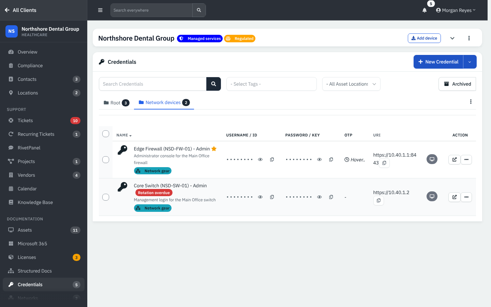

*Figure 2 — The **Network devices** folder. A red **Rotation overdue** label marks a credential whose rotation date has passed.*

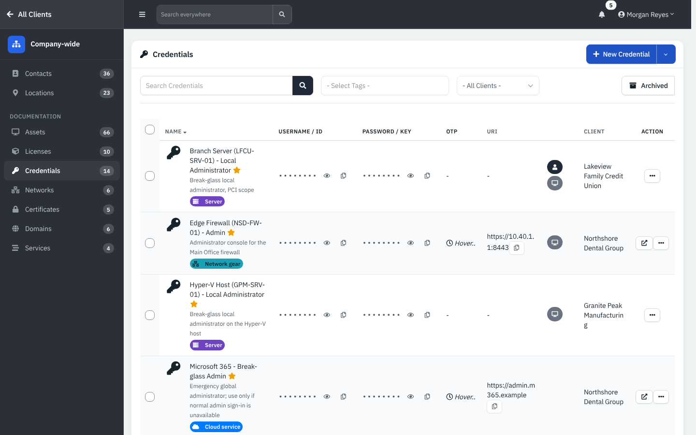

*Figure 3 — Client Overview → Credentials adds a **Client** column. Folders exist only inside one client.*

## Common tasks

### Add a credential

1. Click **New Credential**. (If the button is grayed out your session has no vault key; sign in again with your password, or ask an administrator to reset your password under **Users**.)
2. On **Details**, enter **Name** (required; the star marks it important), **Description**, **Username / ID**, **Password / Key**, **TOTP Seed**, **Rotation Due** (a reminder date) and **URI** and **URI 2**.
3. On **Relation**, link a **Contact** and an **Asset** of that client. On **Notes**, add a note and **Tags**.
4. Click **Create**.

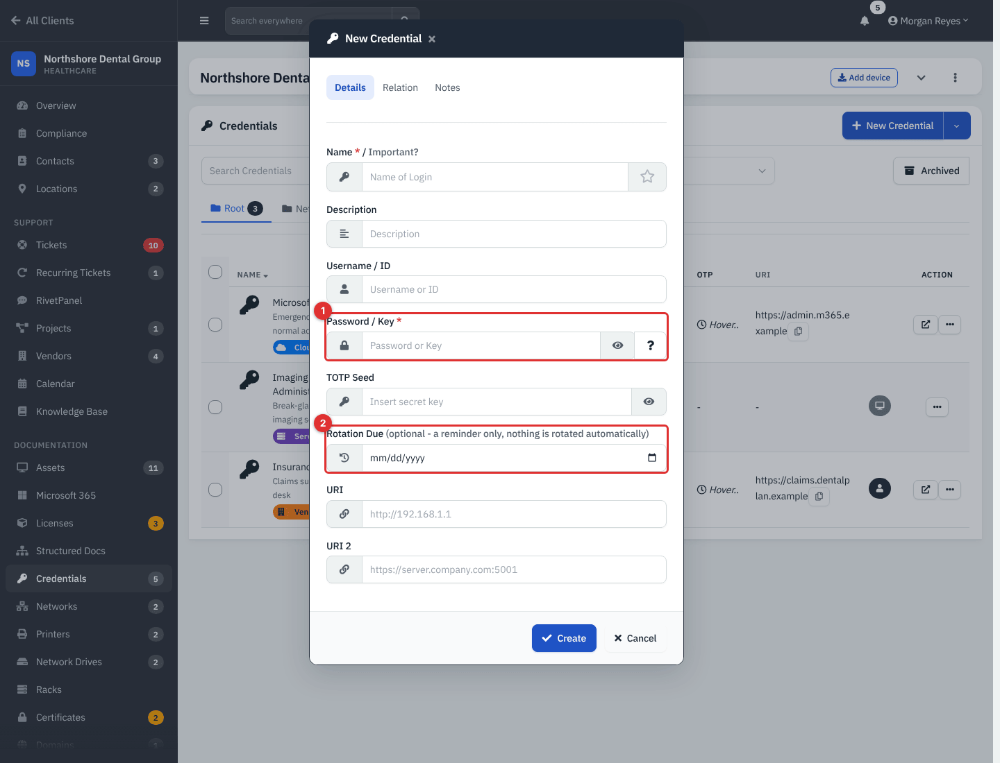

*Figure 4 — New Credential. **Password / Key** (1) and **Rotation Due** (2).*

A credential made from the asset's **New** menu or **Login** tab is created already linked to that asset.

### Reveal or copy a value

1. Click the **eye** beside a masked username or password. The value is shown in place and is not cached, so it is masked again later; the copy button copies it without showing it.
2. If your password was last entered more than **15 minutes** ago (the default) you are asked for it again.

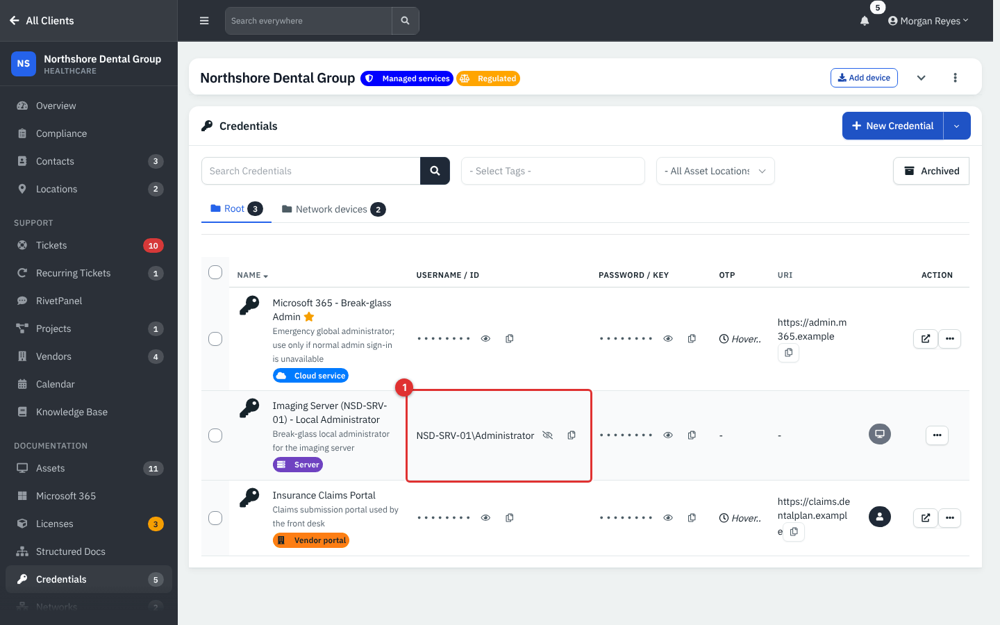

*Figure 5 — A username shown after clicking the eye (1).*

Every reveal and copy is written to the activity log. A user who reveals more than **30** values in 10 minutes (the default) is blocked and the administrators are notified. Users who sign in with single sign-on, with no local password, are not asked for the step-up password.

### View a credential

Click a name or use the view window to see all the fields, notes and **Rotation Due** in one place.

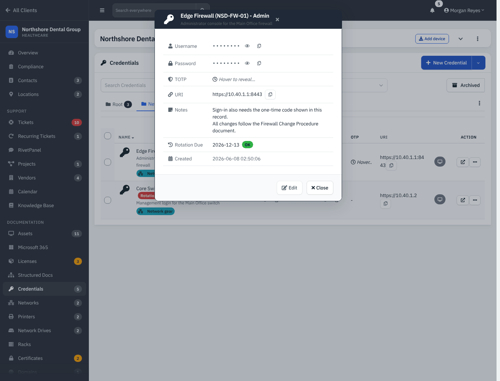

*Figure 6 — The view window keeps secrets masked until you reveal them.*

### See what changed

Open **Edit** and choose **History**. Each change to the name, description, URL, username, note, rotation date or password is listed with who made it and when. Password changes are recorded without showing either value.

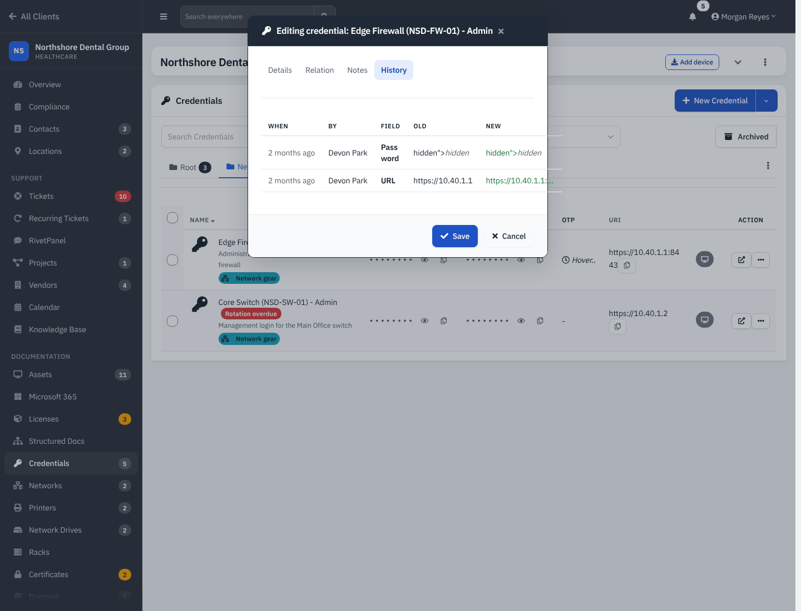

*Figure 7 — History tab.*

**Note (app behavior).** In this release the history table shows the text `hidden">hidden` in the Old and New columns of a Password row. It is a display glitch; the passwords themselves are not shown.

### Organize with folders and tags

Use **New Folder** from the arrow menu, **Move** from the row menu or **Bulk Action** → **Move**. **Bulk Action** also offers **Favorite**, **Unfavorite**, **Assign Tags**, **Archive**, and on the archived view **Restore** and **Delete**.

### Import and export

**Import** (inside a client) takes a CSV. The heading line is: Name, Description, Username, Password, TOTP, URI. **Export** downloads the list with decrypted values, so handle the file as sensitive.

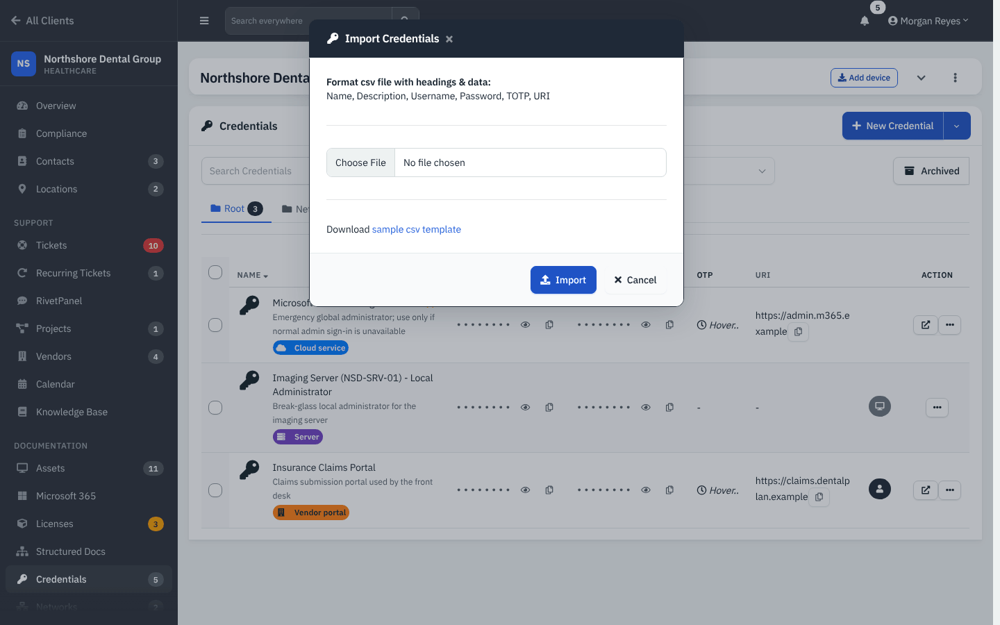

*Figure 8 — Import Credentials.*

### Share a secret with someone outside

1. Open the row menu and choose **Share**.
2. Pick the **Share with** contact or type an email, then choose **Expiration**: 1 hour (default), 1 day, 1 week or 1 month.
3. Optionally turn on **Delete after view** and add a note.
4. Click **Send and Show Link**.

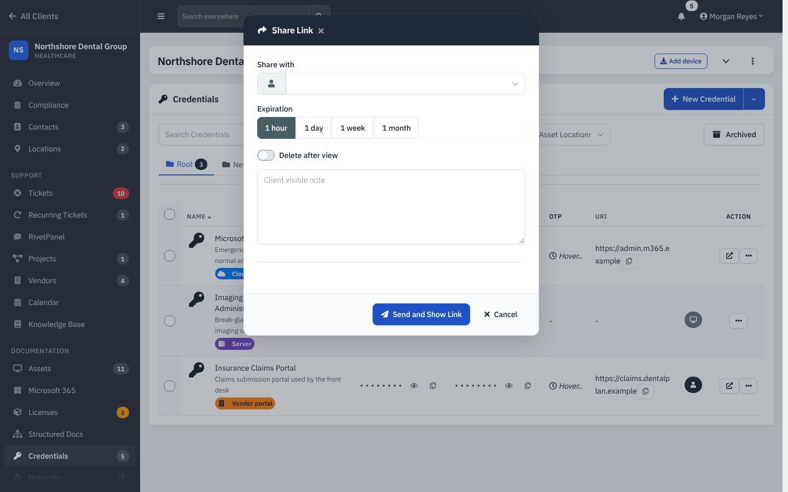

*Figure 9 — Share Link.*

The recipient needs no account. The link carries the key to open the secret, so send it through a different channel than the code or password, and prefer a short expiry.

### Find old passwords: the rotation report

Open **Reports** → **Technical** → **Credential rotation**. It lists credentials whose password has not changed in the last **90** days (change **Days** to widen or narrow), with the client, name, description and the date of the last password change. **Print** gives a copy for a review meeting.

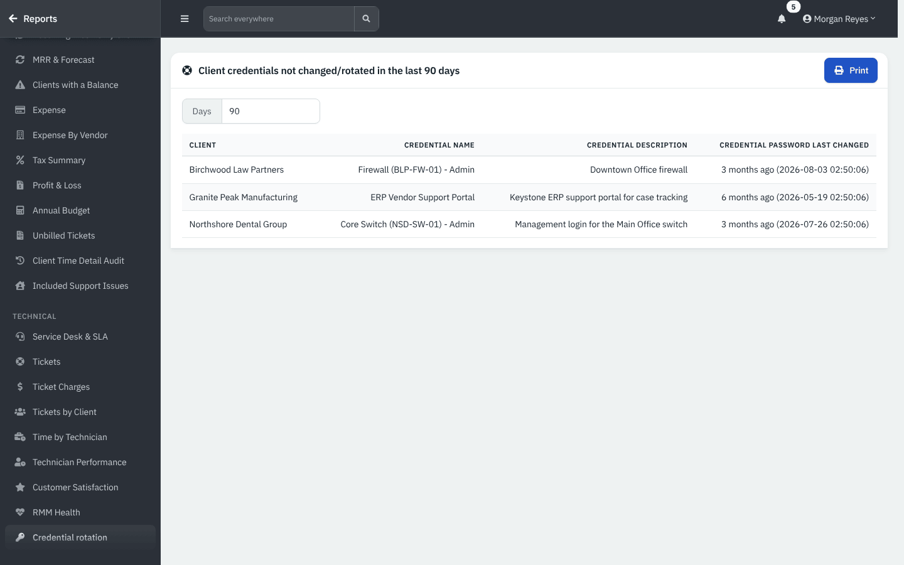

*Figure 10 — Credentials not changed in 90 days.*

### Link a credential into a Knowledge Base article

Put `[[credential:ID]]` in the article. Readers see **Reveal linked credential**, which re-checks their permission. See [Knowledge base](13-knowledge-base.md).

## Reference

### Vault settings (administrators)

Go to **Administration** → **Settings** → **Security**.

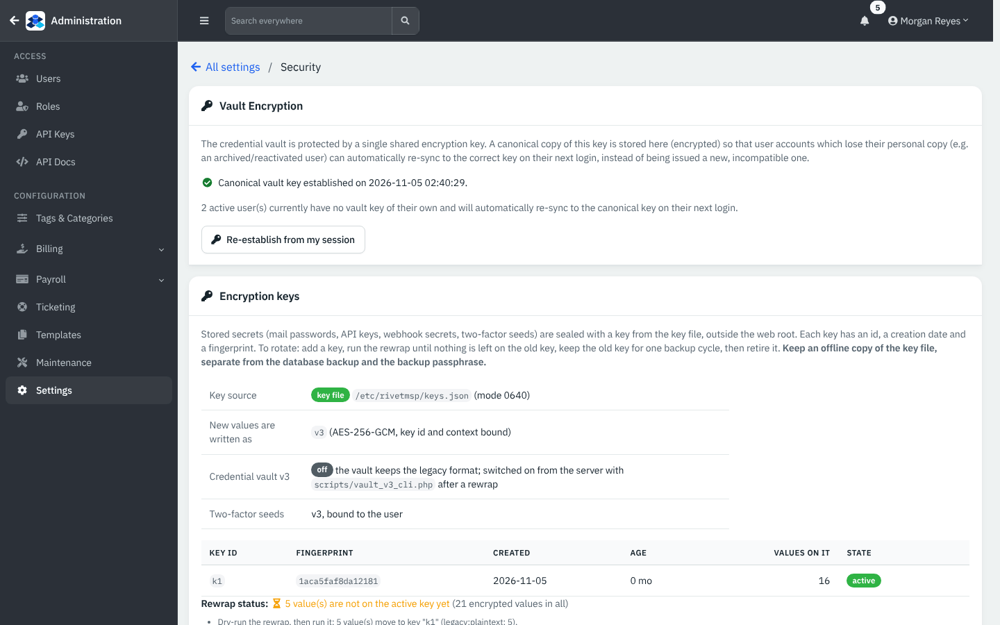

*Figure 11 — The Security page: Vault Encryption, Encryption keys, and the credential vault list limits further down.*

| Setting | What it does | Default |
|---|---|---|
| **Vault Encryption** | The vault uses one shared key. A canonical copy is stored encrypted so that accounts which lose their own copy (an archived then reactivated user) re-sync on next sign-in. **Establish from my session** creates it. | Set during install |
| **Ask for the password again after** | Minutes before the password is needed again to reveal or copy. 0 means never. | 15 |
| **Reveal limit** | Reveals per user per 10 minutes before blocking and alerting administrators. | 30 |
| **Encryption keys** | Shows key ids, fingerprints, dates, counts and state, never the key. Stored secrets (mail passwords, API keys, webhook secrets, two-factor seeds) are sealed with a key from the key file outside the web root (`/etc/rivetmsp/keys.json`). Keep an offline copy of the key file, separate from the database and the backup passphrase. | |
| **Credential vault v3** | A newer storage format. It is off here and is switched on from the server with `scripts/vault_v3_cli.php` after a rewrap. Not verified here. | Off |

Credentials of a user are unlocked by that user's own password. A user without a vault key of their own sees a grayed **New Credential** button and a "vault is locked" notice until they sign in again.

### Restore from a backup (administrators)

**Administration** → **Maintenance** → **Credential Restore** loads a backup .zip made by the Backup tool, lets you decrypt rows with a master key you supply (it is not stored) and **Restore** a row into the live vault.

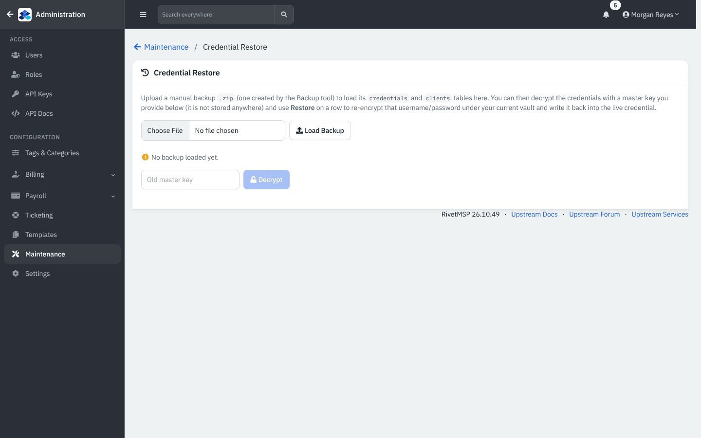

*Figure 12 — Credential Restore.*

### Permissions

| Action | Needs |
|---|---|
| See the list, reveal, copy | Credentials: **Read** |
| Add, edit, move, share, import, archive | **Modify** |
| Delete (also bulk delete) | **Full** |
| Export | **Read** (the CSV holds decrypted values) |
| Rotation report | **Read** |

## Tips and good practice

- Set **Rotation Due** on every shared admin password, then review the **Rotation overdue** labels and the rotation report each month.
- Store break-glass accounts (local administrator, cloud emergency admin) here and mark them important.
- Link credentials to the asset or contact they belong to; they then show on the asset page.
- Share with a short expiry and **Delete after view**.
- OTP seeds in this demo are published documentation examples, not working codes. Never copy real secrets into screenshots.

## Related guides

- [Assets](11-assets.md)
- [Knowledge base](13-knowledge-base.md)
- [Files, structured documentation and sharing](12b-files-structured-docs-and-sharing.md) for the lighter password field
- Users, roles and security guide
