# Products, Quotes and Invoices

This is how work becomes a bill. You keep a price list of **products** (things you sell and stock) and **services** (time and plans), send a **quote** for the client to accept, turn the accepted quote into an **invoice**, send the invoice, and record the money that comes in. Each step leaves a history trail on the document.

| | |
|---|---|
| **Where to find it** | Sidebar → **Billing** → **Quotes**, **Invoices** and **Products**. Inside a client: the **Billing** section of that client's sidebar → **Invoices**, **Quotes**. Settings: Administration → **Settings** → **Invoices**, **Quotes** and **Notifications**. |
| **Who can use it** | Permission module **Access to quotes, invoices and products** (`module_sales`): **Read** to look, **Modify** to create, edit, send and cancel, **Full** to delete quotes and invoices. Recording a payment also needs **Modify** on **Access to payments, accounts, expenses and budgets** (`module_financial`). Archiving, restoring and deleting products is for administrators. |
| **Turn it on** | **Show Invoicing / Accounting** in Administration → **Settings** → **Modules** shows the whole **Billing** group. With only **Show Ticket Charges (Billing)** on, the sidebar shows **Products** by itself. Both are on in the demo. |

> **Example data.** Everything on the screens below is invented for the demo company, Lakeshore Managed IT. Online payment and outgoing e-mail are not connected in the demo, so the steps that depend on them are described from the product's code and screens and have not been verified on a live service. They are marked where they come up.

## What it's for

- Keep one price list so quotes and invoices use the same names, prices and tax.
- Track stock for physical products, and see it fall as you invoice them.
- Give a client a quote with an expiry date and let them accept or decline it from a link.
- Create invoices from accepted quotes, tickets, recurring invoices or from scratch.
- Send invoices, take payments, and watch what is overdue.
- Add a late fee automatically to invoices that stay unpaid, and remind clients by e-mail.

## A quick tour

### Products and services

Sidebar → **Billing** → **Products**. The page opens on **Services**; the **Product** button switches to physical products.

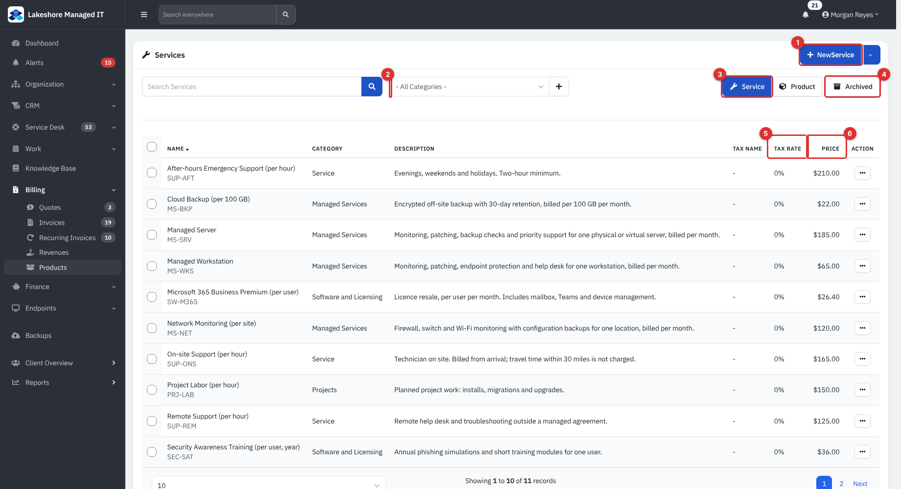

*Figure 1 — The price list (Services).*

1. **New Service** (it becomes **New Product** on the Product tab) opens the add pop-up. It needs Modify.
2. The category box narrows the list to one income category. The **+** next to it adds a category.
3. **Service** and **Product** switch between the two lists. A service is time or a plan; a product is something you hold in stock.
4. **Archived** shows archived items instead of active ones.
5. **Tax Rate** (and **Tax Name** beside it) is the tax that is filled in when you pick the item on a quote or invoice. A service with no tax shows `0%`.
6. **Price** is the unit price. Click any **Name** to edit the item.

The Product tab adds **QTY** (stock on hand) and **Location** columns. The search box looks in name, description, code, location, category, price and tax.

### Quotes

Sidebar → **Billing** → **Quotes** lists every quote, newest first. The number beside **Quotes** in the sidebar counts quotes that are **Sent** or **Viewed**, which are the ones waiting for an answer.

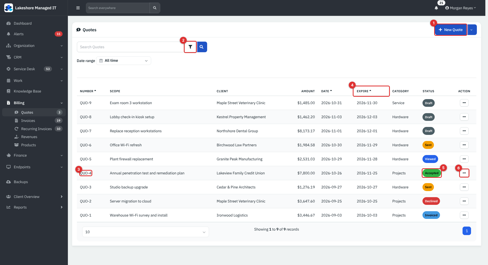

*Figure 2 — The Quotes list.*

1. **New Quote** starts a quote.
2. The funnel button opens a **Date range** picker.
3. The quote number opens the quote.
4. **Expire** is the last day the client can accept.
5. The coloured **Status** badge shows where the quote stands (see [Quote statuses](#quote-statuses)).
6. The **…** menu offers **Edit**, **Copy** and **Delete**. **Email** shows when outgoing e-mail is set up.

### Invoices

Sidebar → **Billing** → **Invoices**. Three tiles sit above the list.

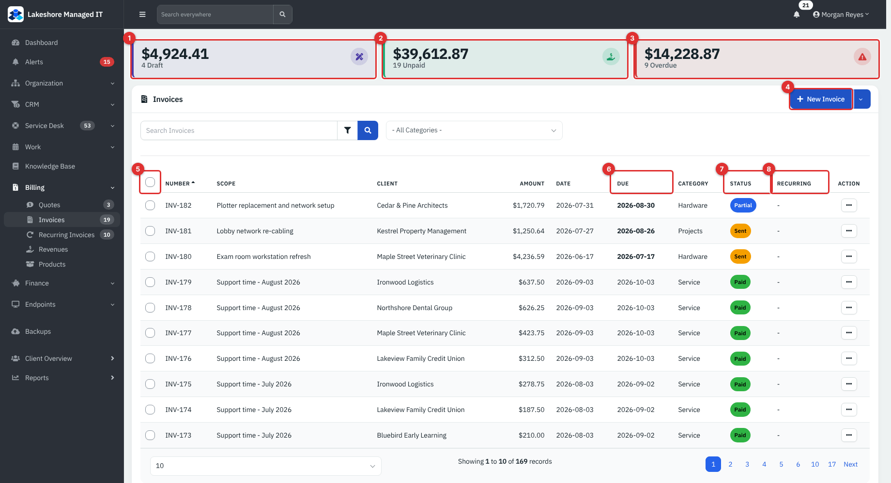

*Figure 3 — The Invoices list.*

1. **Draft** counts invoices you have not sent yet and adds up their totals. Click a tile to filter the list.
2. **Unpaid** covers **Sent**, **Viewed** and **Partial** invoices.
3. **Overdue** covers unpaid invoices whose due date has passed.
4. **New Invoice** starts an invoice. The arrow beside it opens **Export**.
5. The box in the header selects every row on the page; use the boxes in the rows to pick some. A **Bulk Action** button then appears.
6. **Due** turns bold when an unpaid invoice is past its due date.
7. **Status** is the badge described in [Invoice statuses](#invoice-statuses).
8. **Recurring** names the recurring invoice that produced this one, if any. Click it to open the recurring invoice ([Contracts and Recurring Invoices](16-contracts-and-recurring-invoices.md)).

> **Note.** The tiles add up invoice totals, not what is still owed. For a partly paid invoice the amounts are approximate. The **Balance** on the invoice itself is the exact figure.

## Common tasks

### Add a product or a service

1. Sidebar → **Billing** → **Products**. Choose **Service** or **Product**, then click **New Service** or **New Product**.
2. Fill in the pop-up and click **Create**.

   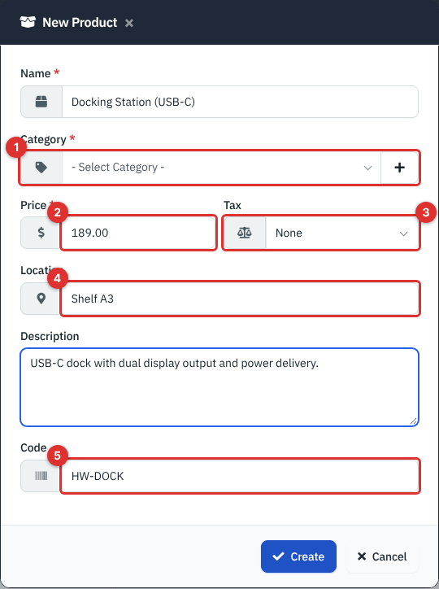

   *Figure 4 — The New Product pop-up.*

   1. **Category** is required and lists income categories only. The **+** beside it adds one.
   2. **Price** is required, in your company currency.
   3. **Tax** lists the taxes set up under Administration → **Billing** → **Taxes**. **None** leaves the item untaxed.
   4. **Location** (products only) is where the item is kept, such as a shelf.
   5. **Code** is your SKU or part number. It is shown under the name in the list and in the item search on invoices.

   **Name** and **Description** complete the form. The item is created in your company currency.

To change an item later, click its name or choose **Edit** from the **…** menu.

### Add stock to a product

1. On the **Product** tab, open the **…** menu of the product and choose **Add Stock**.

   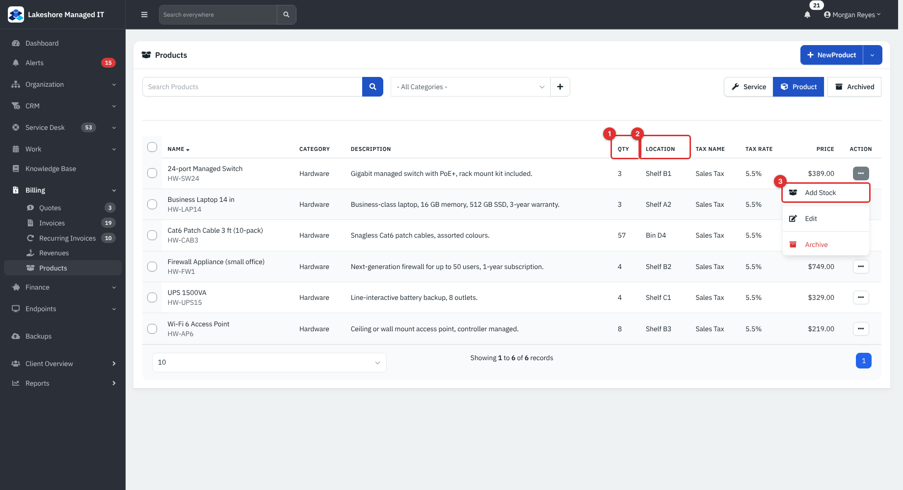

   *Figure 5 — Stock on hand (1), location (2) and the row menu with Add Stock (3).*

2. Enter the **QTY** received, optionally link the **Expense** you paid to buy it, add a note, and click **Add Stock**.

   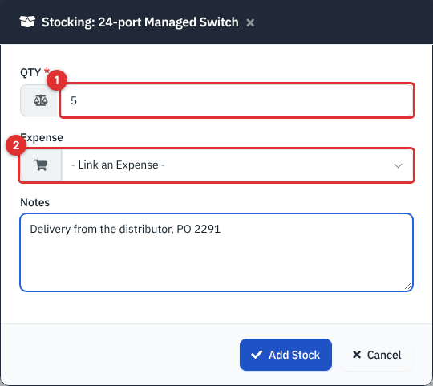

   *Figure 6 — Add Stock. The units received (1) and the expense they were bought on (2).*

Stock goes **down** when you add a physical product to an invoice by picking it from the **Item** type-ahead, and comes back if you remove that line. A line typed by hand does not move stock. If there is not enough stock, the line is refused with a message such as "Not Enough ... in stock". Services never touch stock.

### Archive, restore and delete products

Administrators see **Archive** in the row menu. An archived product leaves the type-ahead on quotes and invoices but stays on documents that already use it. The **Archived** list offers **Restore** and, when your company allows permanent deletes, **Delete**. Tick several rows for **Bulk Action** → **Set Category**, **Archive**, **Unarchive** or **Delete**. **Export** in the arrow menu next to **New Service** downloads a CSV file.

### Create a quote

1. Sidebar → **Billing** → **Quotes** → **New Quote**. (From inside a client the client is already chosen.)

   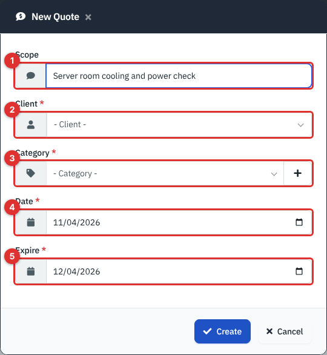

   *Figure 7 — The New Quote pop-up.*

   1. **Scope** is a short description that shows in the list.
   2. **Client** is required (hidden when you start from a client).
   3. **Category** is the income category, required.
   4. **Date** defaults to today.
   5. **Expire** defaults to 30 days from today and cannot be in the past.

2. Click **Create**. The quote opens as a **Draft**.
3. Add lines in the row at the bottom of the table: type an **Item** name, or start typing a product name and pick it, then set **Qty**, **Price** and **Tax** and click the green tick. (On invoices the type-ahead list shows the product code in front of the name.)

   

   *Figure 8 — A Draft quote. Send (1), the actions menu (2), status (3), expiry (4), the new-line row (5 and 6), notes (7) and totals (8).*

   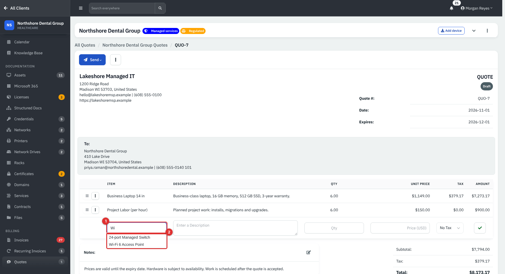

   *Figure 9 — Typing in the **Item** box (1) lists matching price-list items (2). Picking one fills the description, quantity of 1, price and tax.*

4. Drag the handle at the left of a line to reorder lines. Use the **⋮** menu on a line to **Edit** or **Delete** it. The pencil on the **Notes** card edits a note that prints on the quote.

Lines can be added until the quote is **Accepted**, **Declined** or **Invoiced**.

### Send a quote and record the answer

1. On a **Draft** quote click **Send**. **Send Email** appears when outgoing mail is set up and the client's primary contact has an e-mail address; it queues a message with a link to the quote. **Mark Sent** changes the status to **Sent** without sending anything, for example when you hand the quote over yourself.
2. To give a link yourself, open the **⋮** menu and choose **Copy Guest URL**. The link needs no sign-in.
3. When the client opens the link, a **Sent** quote becomes **Viewed** and the history records it.

   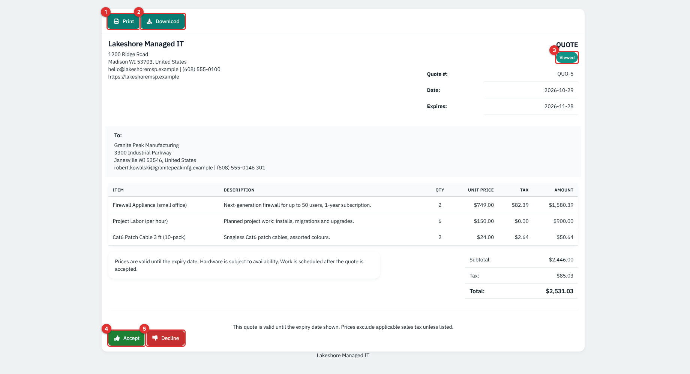

   *Figure 10 — What the client sees. Print (1), Download (2), status (3), Accept (4) and Decline (5).*

4. The client chooses **Accept** or **Decline**. Staff are notified and the history records it. If **Email address to notify when quotes are accepted/declined** is filled in under Administration → **Settings** → **Quotes** and outgoing mail is set up, that address gets a message too. After acceptance the client page offers **Upload File**, which lands on the quote's **Attachments** card.
5. If the client answers by phone, open a **Sent** or **Viewed** quote and click **Accept** or **Decline** yourself. The history shows your name.

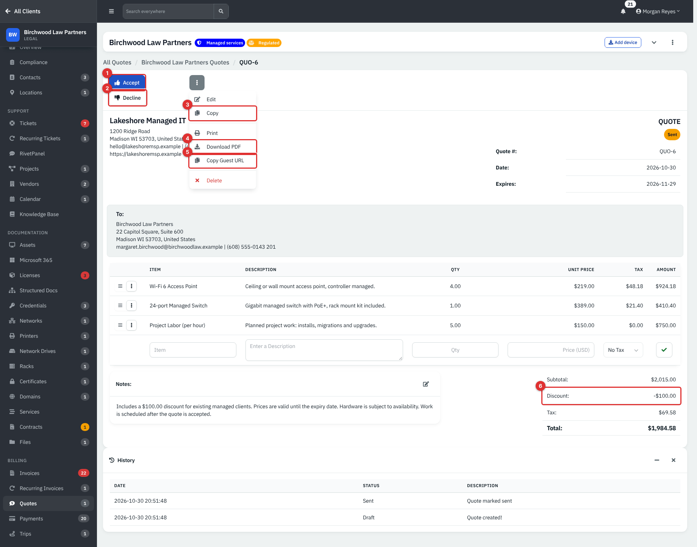

*Figure 11 — A Sent quote: Accept (1) and Decline (2), then in the menu Copy (3), Download PDF (4), Copy Guest URL (5) and the Discount line (6).*

A quote has no **Expired** status. The expiry date is checked when someone answers: a client cannot accept or decline after the **Expire** date, and the quote stays **Sent** or **Viewed** until you act on it.

> **Note.** The **Accept** and **Decline** buttons on the staff page do not check the expiry date, so a technician can still record an answer after it passes.

### Turn an accepted quote into an invoice

1. Open the **Accepted** quote. The **Invoice** button appears in place of **Send**.

   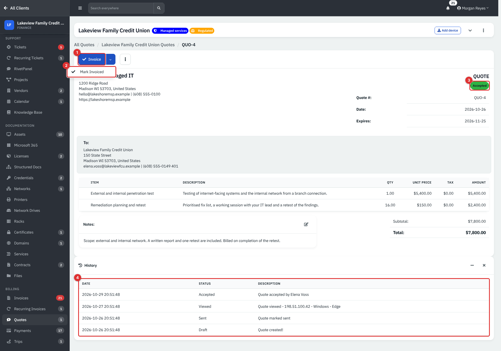

   *Figure 12 — An Accepted quote. **Invoice** (1), **Mark Invoiced** (2), status (3) and history (4).*

2. Click **Invoice**, pick the **Invoice Date**, and click **Create Invoice**.

   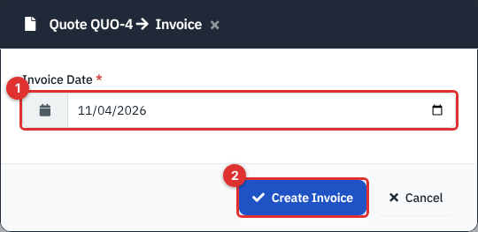

   *Figure 13 — Create Invoice from the quote.*

3. A **Draft** invoice opens with the quote's lines, discount, scope and notes. The quote becomes **Invoiced** and cannot be invoiced again. The invoice's due date counts from today using the client's net terms.

**Mark Invoiced** in the arrow menu records that you invoiced the work elsewhere, without creating an invoice.

To reuse a quote, choose **Copy** from its menu. The copy is a new **Draft** with the same lines, for the same or another client.

### Create an invoice

There are four ways to get an invoice: from an accepted quote (above), from a ticket (see [Ticket Billing and Worksheets](06-ticket-billing-and-worksheets.md#create-an-invoice-from-a-ticket)), from a recurring invoice (see [Contracts and Recurring Invoices](16-contracts-and-recurring-invoices.md)), or from scratch.

1. Sidebar → **Billing** → **Invoices** → **New Invoice**.

   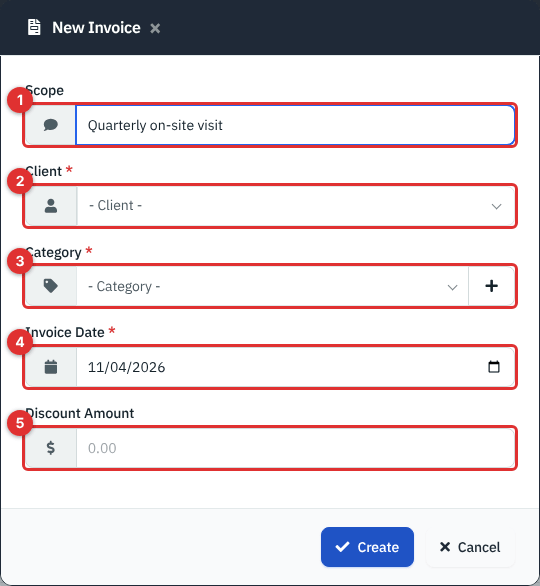

   *Figure 14 — The New Invoice pop-up.*

   1. **Scope** is a short description.
   2. **Client** (hidden when you start from a client).
   3. **Category** is the income category.
   4. **Invoice Date** defaults to today. The due date is this date plus the client's net terms.
   5. **Discount Amount** comes off the total. It cannot be negative or more than the lines add up to.

2. Click **Create**. The invoice opens as a **Draft**; add lines the same way as on a quote.

   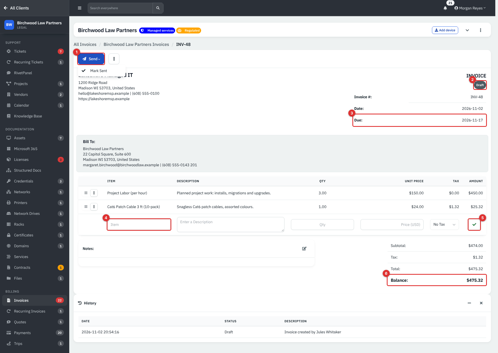

   *Figure 15 — A Draft invoice. Send (1), status (2), due date (3), new-line row (4 and 5) and balance (6).*

3. To change the dates, scope, category or discount later, use **⋮** → **Edit**. The **Invoice Due** date can be set by hand there.
4. To start a new invoice from an old one, use **⋮** → **Copy**. The copy is a **Draft** dated today.

An invoice that is **Paid** is a closed record: its lines, dates and status can no longer be changed, and it cannot be cancelled or deleted. A **Cancelled** invoice hides the new-line row.

### Send an invoice and give the client a link

1. On a **Draft** invoice click **Send**. **Mark Sent** sets the status to **Sent**. **Send Email** (when outgoing mail is set up and the primary contact has an address) queues the invoice link to the primary contact and also to every other contact marked as a **Billing** contact on the client.
2. The **⋮** menu holds the other ways to hand the invoice over.

   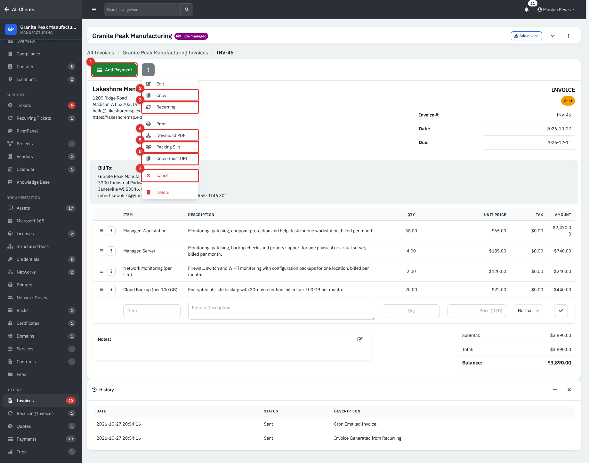

   *Figure 16 — A Sent invoice and its menu. **Add Payment** (1), **Copy** (2), **Recurring** (3), **Download PDF** (4), **Packing Slip** (5), **Copy Guest URL** (6) and **Cancel** (7).*

   - **Print** uses your browser's print dialog.
   - **Download PDF** makes a PDF with your company details, the lines, totals and the invoice footer.
   - **Packing Slip** makes a PDF with item names and quantities, a **Picked?** column and **Picked By** and **Checked By** lines, but no prices. It is meant for goods you deliver.
   - **Copy Guest URL** copies a link to the client view.
   - **Recurring** turns the invoice into a recurring one (see [Contracts and Recurring Invoices](16-contracts-and-recurring-invoices.md#turn-an-invoice-into-a-recurring-invoice)).

   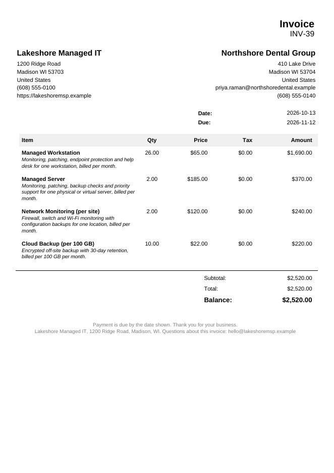

   *Figure 17 — An invoice PDF.*

3. When the client opens the link, a **Sent** invoice becomes **Viewed** and the staff get a notification.

   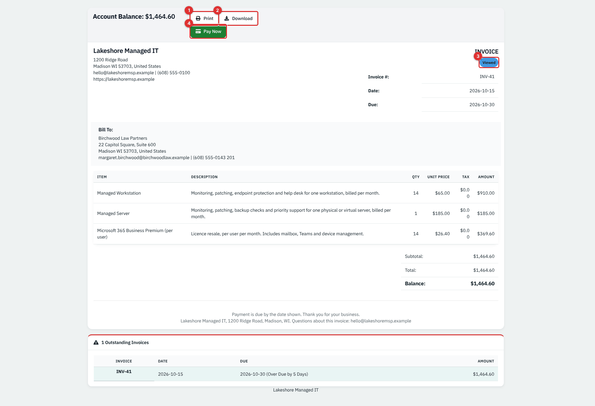

   *Figure 18 — The client's invoice page. **Pay Now** (4) only appears when an online payment provider is set up, and never on a **Paid**, **Cancelled** or **Draft** invoice. Example data, not a live connection.*

The e-mail text is fixed in the product. The invoice history records that it was sent.

### Record a payment

1. Open an unpaid invoice and click the green **Add Payment** button. It is hidden on **Draft**, **Paid**, **Cancelled** and **Non-Billable** invoices and on invoices with a zero total. You need **Modify** on both Sales and Payments.

   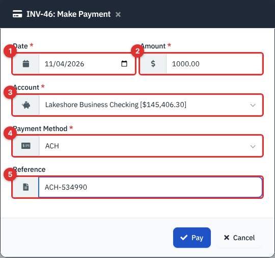

   *Figure 19 — The Make Payment pop-up. **Date** (1), **Amount** (2), **Account** (3), **Payment Method** (4) and **Reference** (5).*

2. The **Amount** is filled in with the balance. Lower it for a part payment. Pick the **Account** the money went to and the **Payment Method**, add a **Reference** such as a cheque number, and click **Pay**.
3. A full payment sets the invoice to **Paid**. A smaller one sets it to **Partial**.

   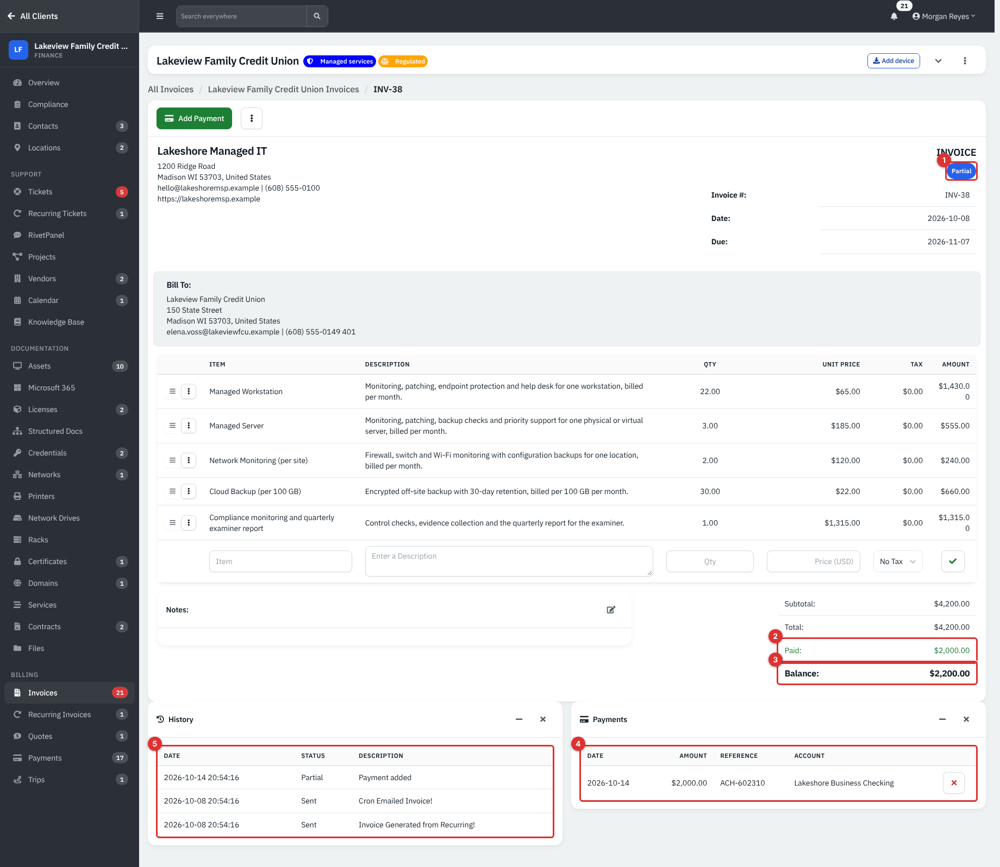

   *Figure 20 — A Partial invoice. Status (1), **Paid** (2), **Balance** (3), the **Payments** card (4) and **History** (5).*

The **Payments** card lists each payment with a delete button. For batch payments, saved cards and AutoPay see [Payments, AutoPay and Stripe](17-payments-autopay-stripe.md).

### Follow up on overdue invoices

There is no **Overdue** status. An unpaid invoice counts as overdue the day after its due date, and shows it in four places: the **Overdue** tile, a bold due date in the list, a red **Overdue** badge on the invoice, and the dashboard.

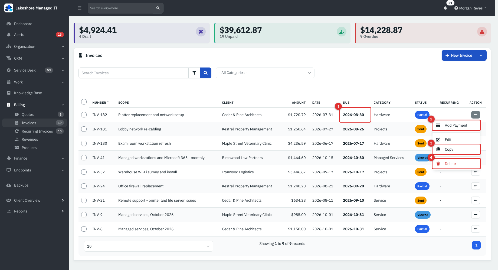

*Figure 21 — The **Overdue** tile filter. Overdue due dates (1), **Add Payment** (2), **Copy** (3) and **Delete** (4) in the row menu.*

Two switches under Administration → **Settings** → **Notifications** control reminders.

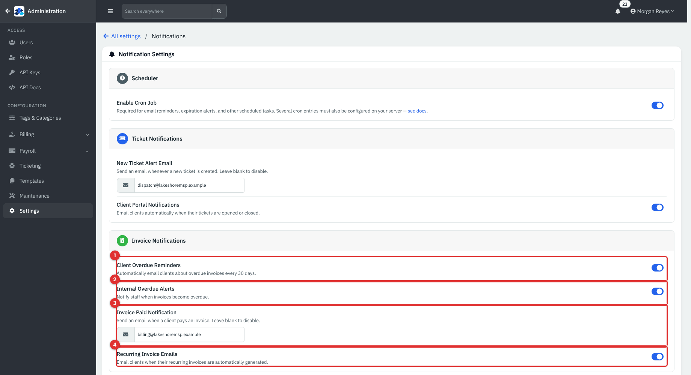

*Figure 22 — Invoice notifications.*

1. **Client Overdue Reminders** e-mails the client's primary contact one day after the due date and then about every 30 days for up to two years. The same job also posts an **Invoice Overdue** notification for your staff. It only runs when the scheduled-jobs worker is running (**Enable Cron Job** on the same page), and the e-mail also needs outgoing mail.
2. **Internal Overdue Alerts** is shown here, but the overdue job does not read this switch in this release. Staff notifications follow switch 1.
3. **Invoice Paid Notification** is an address that gets a message when a client pays online.
4. **Recurring Invoice Emails** e-mails clients when a recurring invoice is created.

**Late fees.** When **Enable Late Fee** is on (Administration → **Settings** → **Invoices**), the same nightly job adds a **Late Fee** line to the invoice every 30 days after the due date, as a percentage of what is still owed. The history records "Cron applied a late fee of ...".

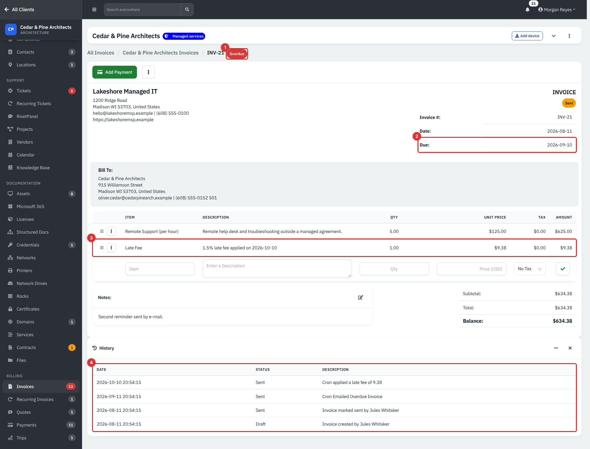

*Figure 23 — An overdue invoice with a **Late Fee** line. Badge (1), due date (2), the fee (3) and history (4).*

> **Note.** The first reminder goes out on day 1 without a fee; fees start on day 30. Reminders and fees need the cron job and were not verified against a live mail server.

### Cancel, delete or mark non-billable

- **⋮** → **Cancel** sets the status to **Cancelled**. It is blocked once a payment exists on the invoice: remove the payment first.
- **⋮** → **Delete** removes the invoice with its lines and history, and frees any tickets linked to it. It needs **Full** on Sales and is blocked for **Paid** invoices and invoices with payments.
- **Mark Non-Billable** appears on a **Sent** or **Viewed** invoice whose total is zero. Use it for goodwill work you still want on record.

### Work with several invoices at once

Tick the boxes on the left of the list rows and open **Bulk Action**. **Set Category** changes the income category of the selected invoices. When you are on one client's **Invoices** page, **Batch Payment** also appears: it records one payment across several of that client's invoices (see [Payments, AutoPay and Stripe](17-payments-autopay-stripe.md)).

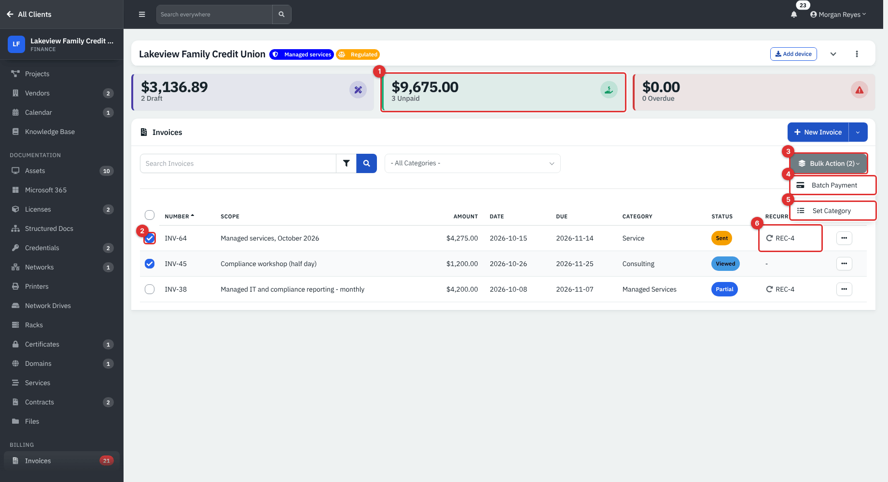

*Figure 24 — Bulk actions on one client's invoices. Tiles (1), ticked row (2), **Bulk Action** (3), **Batch Payment** (4), **Set Category** (5) and the recurring link (6).*

The arrow beside **New Invoice** and **New Quote** opens **Export** to download a CSV file, with a date range for invoices.

### Set numbering, the footer and late fees

Administration → **Settings** → **Invoices** (administrators only).

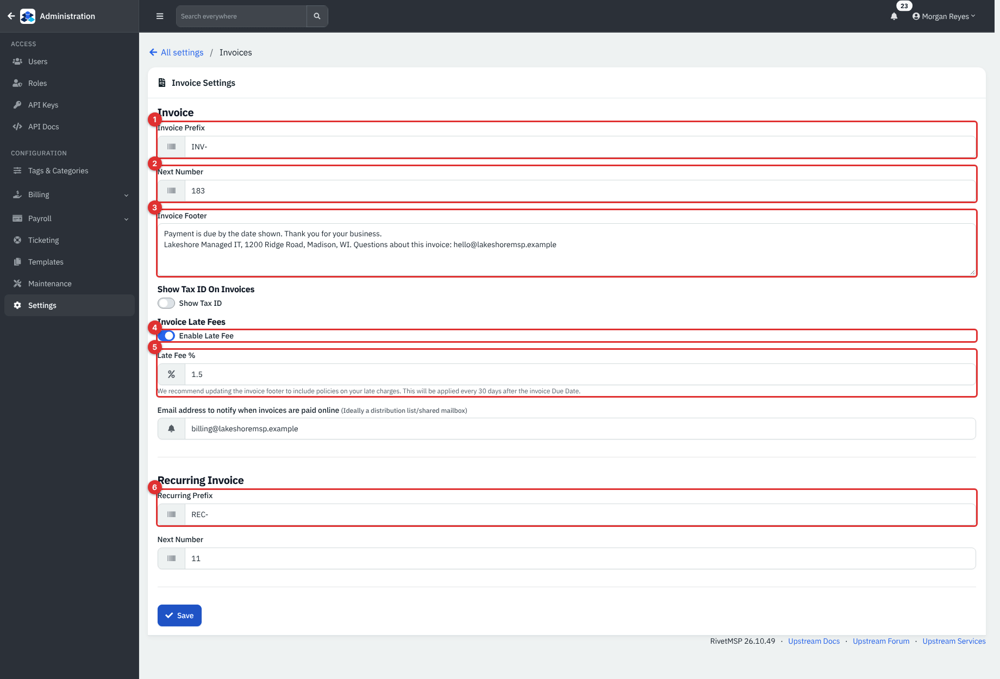

*Figure 25 — Invoice Settings.*

1. **Invoice Prefix** is the text before the number, such as `INV-`.
2. **Next Number** is the number the next invoice gets. Raise it to skip numbers; do not lower it below one already used.
3. **Invoice Footer** prints at the bottom of invoices and PDFs.
4. **Enable Late Fee** switches the late fee on.
5. **Late Fee %** is the percentage of the unpaid balance. The page notes it is applied every 30 days after the due date.
6. **Recurring Prefix** (and its next number) number your recurring invoices.

**Show Tax ID On Invoices** adds your tax number to invoices. **Quotes** has its own page with the same shape.

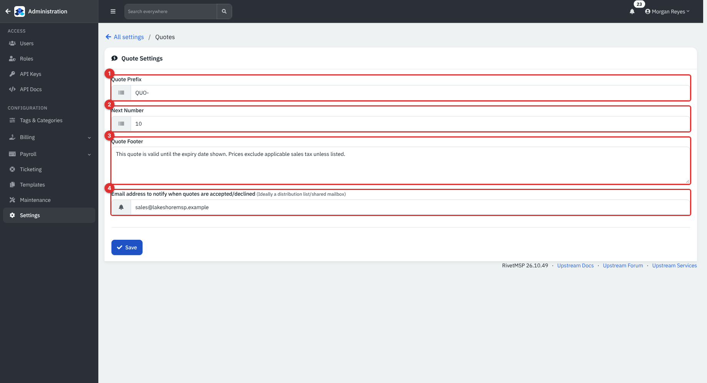

*Figure 26 — Quote Settings. Prefix (1), next number (2), footer (3) and the e-mail for accepted or declined quotes (4).*

## Reference

### Quote statuses

| Status | Meaning | How it gets there |
|---|---|---|
| **Draft** | Being prepared. Lines can be edited. | **New Quote** or **Copy** |
| **Sent** | Handed to the client. | **Send Email** or **Mark Sent** |
| **Viewed** | The client opened the link. | The client opens the guest link while the quote is **Sent** |
| **Accepted** | The client or a technician agreed. | **Accept** on the guest page or on the staff page |
| **Declined** | The client or a technician refused. | **Decline** |
| **Invoiced** | An invoice was made from it. | **Invoice** or **Mark Invoiced** |

### Invoice statuses

| Status | Meaning | How it gets there |
|---|---|---|
| **Draft** | Not sent. Lines and dates can be edited. | **New Invoice**, **Copy**, from a quote or a ticket |
| **Sent** | Sent to the client; also what a recurring invoice creates. | **Send Email**, **Mark Sent**, recurring invoice |
| **Viewed** | The client opened the link. | Guest link opened while **Sent** |
| **Partial** | Part paid. | A payment smaller than the balance |
| **Paid** | Fully paid and locked. | A payment that clears the balance |
| **Cancelled** | Voided; no new lines. | **⋮** → **Cancel** |
| **Non-Billable** | A zero-value record. | **Mark Non-Billable** |

### Price list fields

| Field | Notes |
|---|---|
| Name | Up to 200 characters. Shown on quotes and invoices. |
| Type | **Service** or **Product**. Set when you create the item; it cannot be changed afterwards. |
| Category | An income category. Required. |
| Price | Unit price in the company currency. Required. |
| Tax | One tax, or **None**. |
| Location | Products only. |
| Description | Copied to the line when you pick the item. |
| Code | SKU or part number. |

### Permissions

| Task | Sales | Payments |
|---|---|---|
| See products, quotes, invoices | Read | - |
| Create, edit, copy, send, cancel, add lines and stock | Modify | - |
| Add or remove a payment | Modify | Modify |
| Delete a quote or invoice | Full | - |
| Archive, restore, delete a product | Administrator | - |
| Invoice settings, quote settings, taxes | Administrator | - |

In the demo the built-in **Technician** role has Modify on Sales and the **Billing clerk** role has Full on both modules.

## Tips and good practice

- Put your common services on the price list first, so a price changes in one place.
- Set each client's **Net terms** in the client record. They set every invoice's due date.
- Mark a quote **Sent** only when it really went out; the sidebar count follows **Sent** and **Viewed** quotes.
- Use **Copy** for repeat work instead of rebuilding the lines.
- Check the **Balance** line, not the tile, for the exact amount a client owes.
- Clients also see invoices in the client portal ([Client Portal](32-client-portal.md)).

> **Note.** Client credits are not available in this release. The **Add Credit** button in the client header is switched off and the **Apply Credit** pop-up is not reachable from any invoice screen.

## Related guides

- [Contracts and Recurring Invoices](16-contracts-and-recurring-invoices.md) for monthly and yearly billing.
- [Payments, AutoPay and Stripe](17-payments-autopay-stripe.md) for taking and recording money.
- [Ticket Billing and Worksheets](06-ticket-billing-and-worksheets.md) for creating quotes and invoices from tickets.
- [Accounting and Pax8 Sync](20-accounting-pax8-sync.md) for sending invoices to QuickBooks or Xero.
- [Guest Links](33-guest-links.md) and [Client Portal](32-client-portal.md) for what the client sees.
- [Reports](23-reports.md) for income and unbilled-ticket reports.
