# Contracts and Recurring Invoices

A **contract** records what you have agreed to provide a client: the type of service, how long it runs, the response times you promise and any support hours included. A **recurring invoice** bills a fixed set of lines every month or every year without anyone retyping them. They are separate records, but you can link one to the other: if the contract ends, the recurring invoice stops by itself.

| | |
|---|---|
| **Where to find it** | Contracts: open a client, then **Contracts** in the client's sidebar. Recurring invoices: Sidebar → **Billing** → **Recurring Invoices**, or **Billing** → **Recurring Invoices** inside a client. Contract templates: Administration → **Templates** → **Contract templates**. |
| **Who can use it** | Contracts: **Access to ticketing, assets and documentation** (`module_support`) at **Modify** to add, change, delete and upload documents. The Contracts page itself does not check a level before it opens. Recurring invoices: **Access to quotes, invoices and products** (`module_sales`): **Read** to look, **Modify** to create, edit and force-send, **Full** to delete. Templates are administrators only. |
| **Turn it on** | Recurring invoices need **Show Invoicing / Accounting** in Administration → **Settings** → **Modules**. They are created on schedule by the scheduled-jobs worker, so **Enable Cron Job** under Administration → **Settings** → **Notifications** must be on. |

> **Example data.** The contracts, clients and amounts on these screens are invented for the demo company, Lakeshore Managed IT. The scheduled run, e-mails and card charging described here need a running scheduler, outgoing mail and Stripe; none of them was verified on a live service for this guide.

## What it's for

- Keep each client's agreement in one place, with its dates, value and documents.
- Warn yourself when a contract is close to renewal or has lapsed.
- Give a contract response and resolution times, so tickets raised under it get due times.
- Track included support hours for plans that come with a monthly allowance.
- Build new contracts from a template, for one client or many at once.
- Bill managed services every month or year from a list of lines, and pause billing when a contract ends.

## A quick tour

### Contracts

Open a client and click **Contracts** under **Documentation** in the client's sidebar. The number beside it is how many contracts the client has; it turns amber when any contract has a renewal date within the next 45 days or already past.

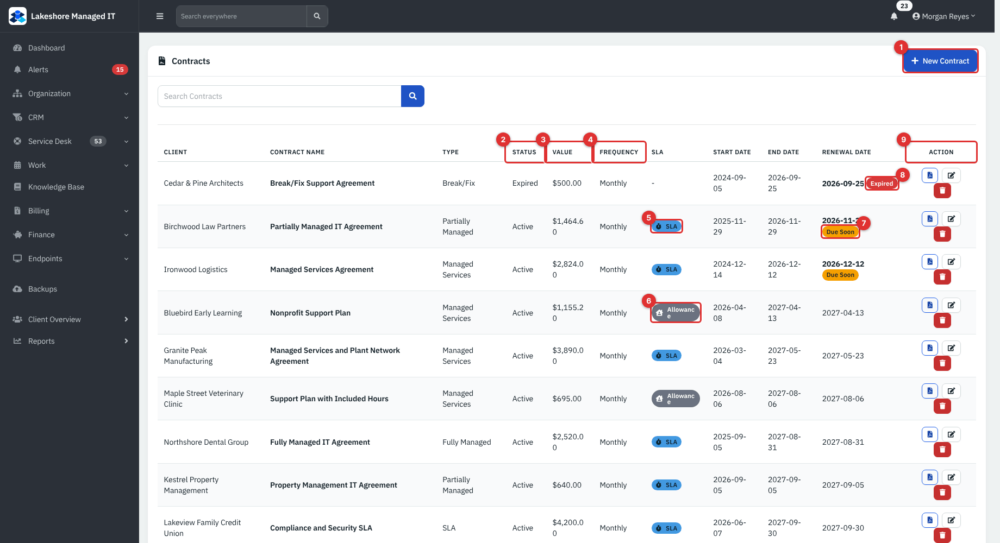

*Figure 1 — The Contracts list. This view shows every client; opened from a client's sidebar it shows only that client and drops the **Client** column.*

1. **New Contract** opens the add pop-up.
2. **Status** is **Active**, **Pending**, **Expired** or **Cancelled**. You set it by hand.
3. **Value** is the billing value you entered. It is for your information; invoices are not created from it.
4. **Frequency** is the **Billing Frequency** you chose.
5. **SLA** appears when any response or resolution time is set.
6. **Allowance** appears when included remote or on-site hours are set.
7. **Due Soon** marks a **Renewal Date** within 45 days.
8. **Expired** marks a **Renewal Date** that has passed. Both labels come from the date alone, whatever the **Status** says.
9. The buttons at the end of a row open the contract's **Documents**, **Edit** it and delete it. Delete asks to confirm, hides the contract from every list and cannot be undone from the screens.

The list is sorted by renewal date, soonest first, with contracts that have no renewal date last. The search box looks in the contract name, client and type.

### Recurring invoices

Sidebar → **Billing** → **Recurring Invoices**. The page opens on **Active** and sorts by **Next Date**. The number in the sidebar counts every recurring invoice, active or not.

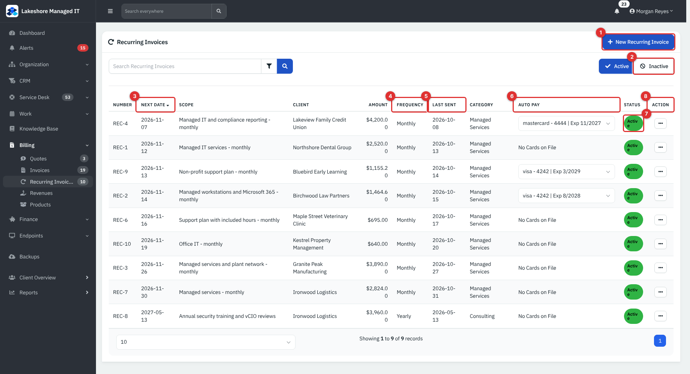

*Figure 2 — The Recurring Invoices list.*

1. **New Recurring Invoice** opens the add pop-up.
2. **Inactive** shows recurring invoices that are paused.
3. **Next Date** is the day the next invoice will be created.
4. **Frequency** is **Monthly** or **Yearly**.
5. **Last Sent** is the day the last invoice was created.
6. **Auto Pay** shows a saved card you can charge automatically, or **No Cards on File**.
7. The green **Active** badge means the invoice will be created on its next date.
8. The **…** menu has **Edit**, and **Delete** for paused ones.

## Common tasks

### Add a contract

1. Open the client and click **Contracts** → **New Contract**.

   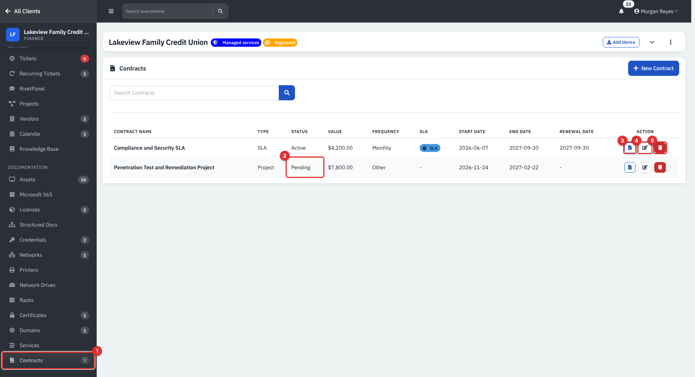

   *Figure 3 — One client's contracts. The **Contracts** entry (1), a **Pending** contract (2), and the **Documents** (3), **Edit** (4) and delete (5) buttons.*

2. Fill in the pop-up and click **Create Contract**.

   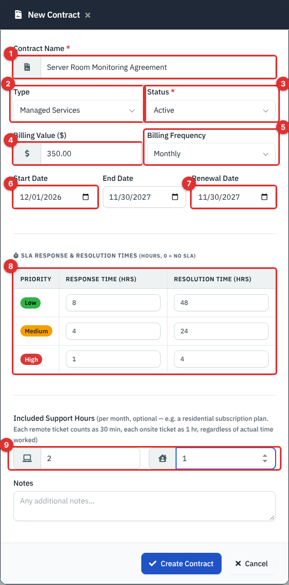

   *Figure 4 — The New Contract pop-up.*

   1. **Contract Name** is required, for example "Monthly MSP Agreement".
   2. **Type** is one of **Managed Services**, **Fully Managed**, **Partially Managed**, **Break/Fix**, **Block Hours**, **Project**, **SLA** or **Other**.
   3. **Status** is required: **Active**, **Pending**, **Expired** or **Cancelled**.
   4. **Billing Value** is the amount, shown with a dollar sign in the list whatever your currency.
   5. **Billing Frequency** is **Monthly**, **Quarterly**, **Annual** or **Other**. It is a label for people; it does not schedule anything.
   6. **Start Date** and **End Date** bound the agreement.
   7. **Renewal Date** drives the **Due Soon** and **Expired** labels.
   8. The **SLA Response & Resolution Times** table takes hours for **Low**, **Medium** and **High** priority. Leave a box empty (or enter 0) for no SLA.
   9. **Included Support Hours** are per month, split into remote and on-site.

   **Notes** is a free-text box below.

Contracts you delete or that you set to **Expired** or **Cancelled** also stop their recurring invoices (see [Link a recurring invoice to a contract](#link-a-recurring-invoice-to-a-contract)).

### Give a contract response times (SLA)

The SLA table sets hours, not business hours. When a ticket is created with a contract chosen, the **Response** and **Resolution** due times are the creation time plus the hours for the ticket's priority. Time a ticket spends on a status that pauses the SLA is added back. If an SLA policy applies to the ticket, the policy's targets replace the contract's hours (see [Ticketing Setup and Templates](37-ticketing-setup-and-templates.md)).

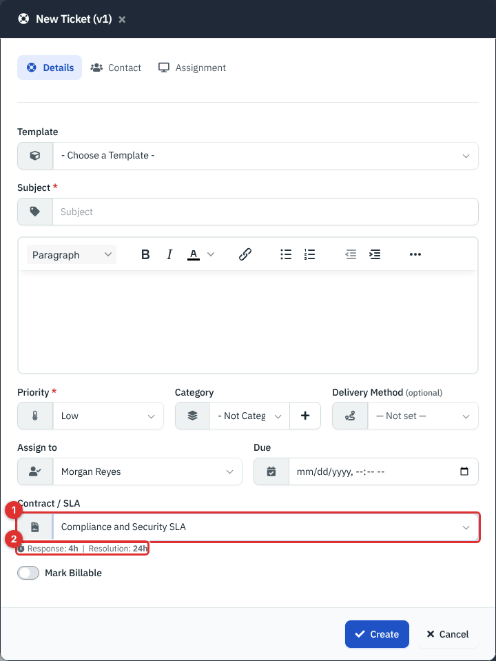

*Figure 5 — Choosing a contract on a ticket. The **Contract / SLA** box (1) lists the client's **Active** contracts; the hint (2) shows that contract's hours for the chosen priority.*

> **Note.** In this release the **Contract / SLA** box is on the longer **New Ticket** form that opens from a contact's, asset's or project's page (its title says "v1"). The main **New Ticket** button on the Tickets list does not offer it.

### Track included support hours

Give a contract **Included Support Hours** and it gets an **Allowance** badge. Every ticket that is linked to the contract and created in the month counts as a flat **0.5 hour** when its **Delivery Method** is **Remote** and **1 hour** when it is **Onsite**, whatever time was actually logged. The count is calculated each time you look, so it needs no reset.

Open Reports → **Included Support Issues** to see each client's included, used and remaining hours and the percentage used, with a month and year chooser.

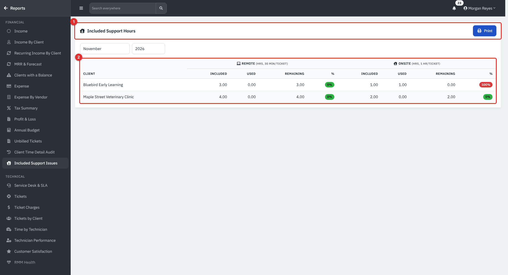

*Figure 6 — The Included Support Hours report. The report header (1) and the table (2).*

Only **Active** contracts with an allowance are listed. See [Reports](23-reports.md) for the other reports.

### Attach documents to a contract

Click the document button at the end of the contract's row. Choose a file and click **Upload**. PDF, Word (`.doc`, `.docx`), PNG, JPEG and text files up to 20 MB are accepted; the type is checked on the file itself, not its name. The pop-up lists each file with its size, who uploaded it and the date, and has buttons to download or delete it.

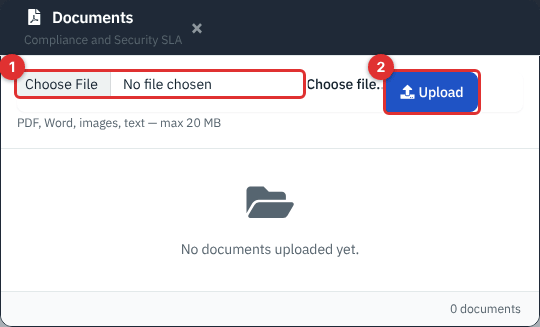

*Figure 7 — The contract's **Documents** pop-up. Choose a file (1) and click **Upload** (2).*

### Use contract templates

A template holds the standard terms of an agreement so you do not retype them for each client. They live in Administration → **Templates** → **Contract templates** and are for administrators.

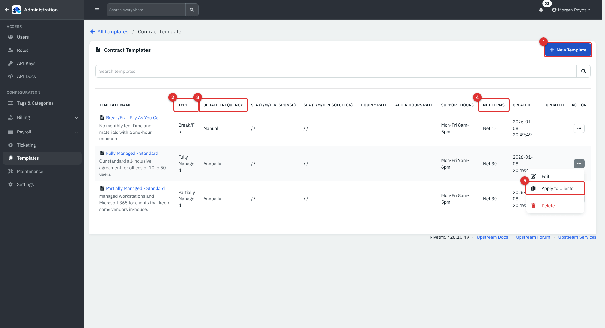

*Figure 8 — Contract Templates. **New Template** (1), **Type** (2), **Update Frequency** (3), **Net Terms** (4) and **Apply to Clients** (5).*

1. Click **New Template**. The pop-up has four tabs: **General Info**, **SLA**, **Rates & Support** and **Details**.

   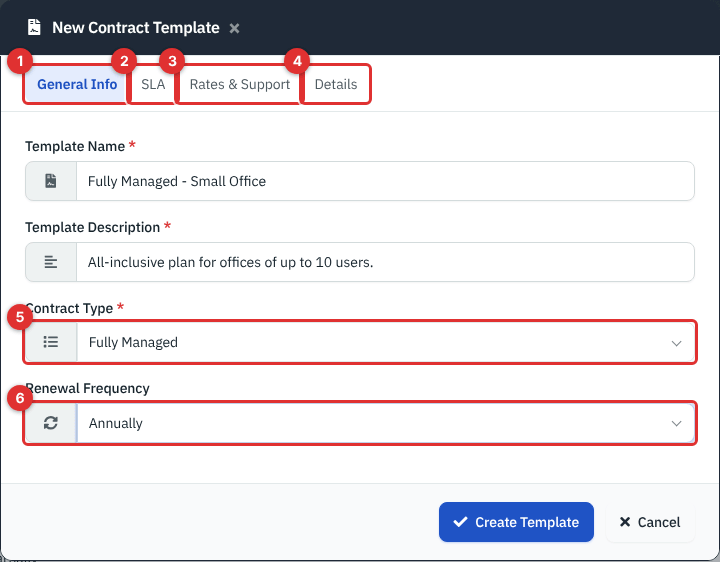

   *Figure 9 — General Info. The four tabs (1 to 4), **Contract Type** (5) and **Renewal Frequency** (6).*

   **General Info** takes the name, a description, the type (**Fully Managed**, **Partially Managed** or **Break/Fix**) and a renewal frequency (**Manual**, **Annually**, **2 Year**, **3 Year**, **5 Year** or **7 Year**). **SLA** takes the six response and resolution hours. **Details** holds the contract text.

   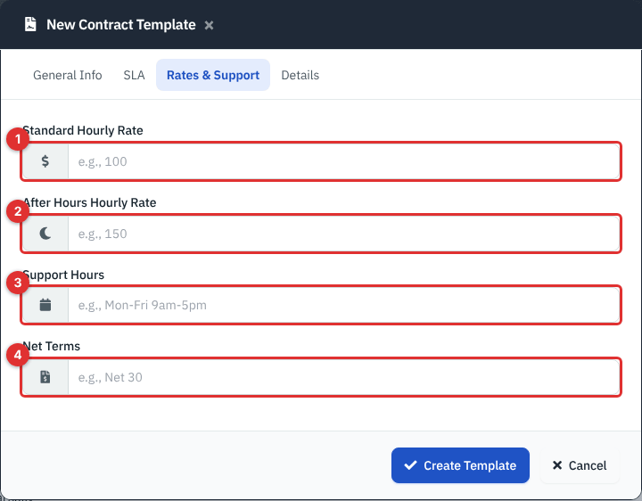

   *Figure 10 — Rates & Support: standard rate (1), after-hours rate (2), support hours text (3) and net terms text (4).*

2. To make contracts from it, open the row menu and choose **Apply to Clients**.

   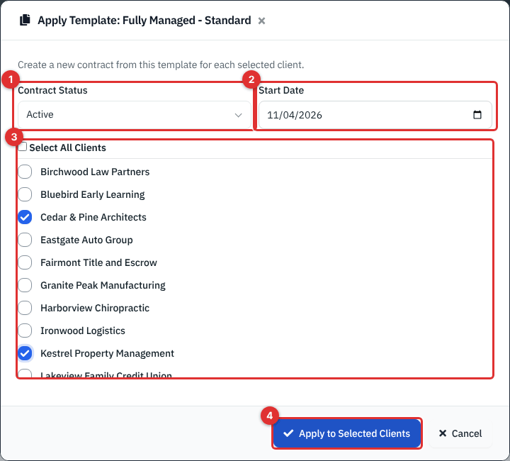

   *Figure 11 — Apply to Clients. **Contract Status** (1), **Start Date** (2), the client list (3) and **Apply to Selected Clients** (4).*

3. Choose **Active** or **Pending**, a **Start Date**, tick the clients (or **Select All Clients**) and click **Apply to Selected Clients**.

Each ticked client gets its own contract with the template's name, type, SLA hours, details and frequency. Applying twice makes two contracts. The new contracts have no **Billing Value**, **End Date** or **Renewal Date**; add them afterwards with **Edit**.

> **Note.** The template's **Renewal Frequency** choices (such as **Annually**) are not the same as a contract's **Billing Frequency** choices, and the text is copied across as it is. The list's **SLA** and **Hourly Rate** columns also show empty even when a template has values; open the template with **Edit** to see them. The applied hourly rates, support-hours text and net terms are stored on the contract, but no contract screen displays them in this release. The type list in the template pop-up spells one choice "Partialy Managed".

### Create a recurring invoice

1. Sidebar → **Billing** → **Recurring Invoices** → **New Recurring Invoice**. Start from a client's own **Recurring Invoices** page if you want to link a contract now.

   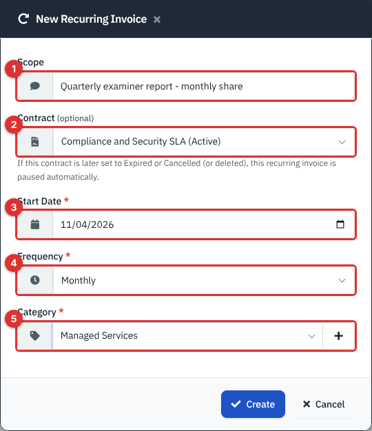

   *Figure 12 — The New Recurring Invoice pop-up. **Scope** (1), **Contract** (2), **Start Date** (3), **Frequency** (4) and **Category** (5).*

   1. **Scope** is a short description.
   2. **Contract** (optional) lists the client's contracts. It only appears when you start from a client.
   3. **Start Date** is the first **Next Date**, today by default.
   4. **Frequency** is **Monthly** or **Yearly**. There is no weekly or quarterly option.
   5. **Category** is the income category.

2. Click **Create**. The recurring invoice opens with no lines. Add the lines in the row at the bottom, as on an invoice, and use the price list type-ahead if you like.

   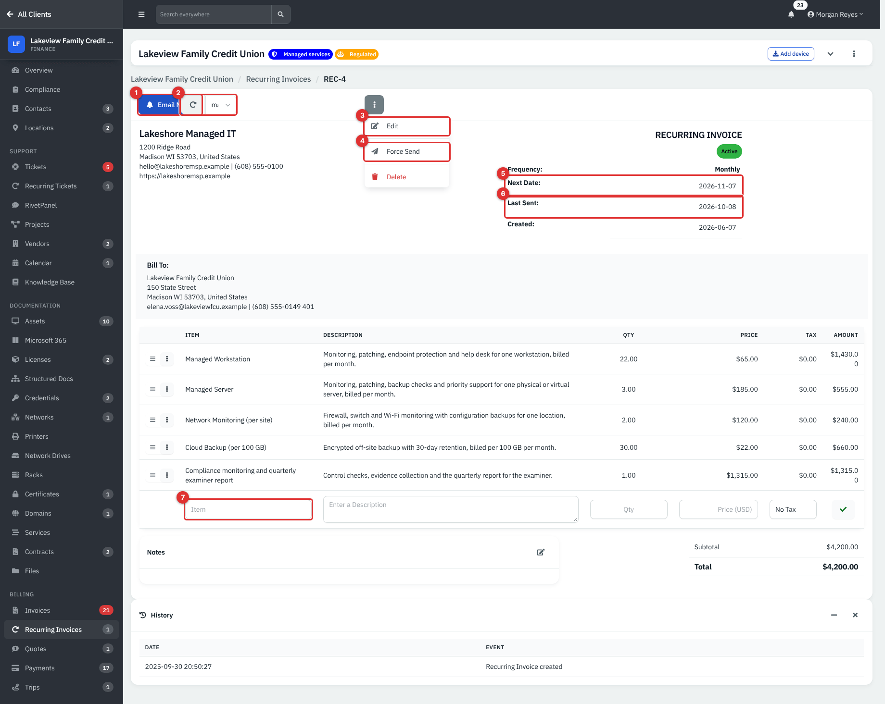

   *Figure 13 — A recurring invoice. **Email Notify** (1), the **Auto Pay** card box (2), **Edit** (3), **Force Send** (4), **Next Date** (5), **Last Sent** (6) and the new-line row (7).*

3. The recurring invoice's amount is the total of its lines less any discount you set in **Edit**.

### Turn an invoice into a recurring invoice

1. Open any invoice and choose **⋮** → **Recurring**.

   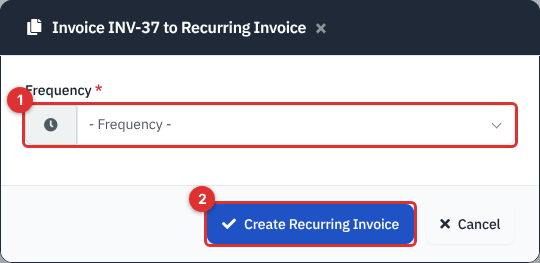

   *Figure 14 — **Frequency** (1) and **Create Recurring Invoice** (2).*

2. Pick **Monthly** or **Yearly** and click **Create Recurring Invoice**.

The new recurring invoice copies the scope, category, lines and total, and is **Active**. Its **Next Date** is the invoice date plus one month or year. Check the total afterwards if the invoice had a discount.

### Change a recurring invoice

Open it and choose **⋮** → **Edit** (or **Edit** from the list's **…** menu).

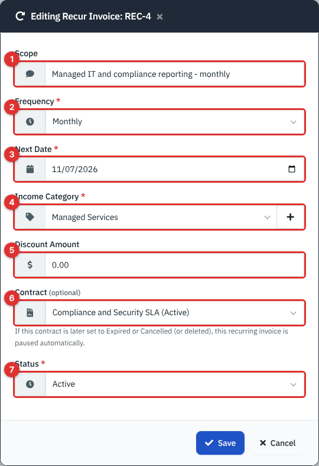

*Figure 15 — Edit. **Scope** (1), **Frequency** (2), **Next Date** (3), **Income Category** (4), **Discount Amount** (5), **Contract** (6) and **Status** (7).*

You can change the next date, discount, linked contract and status here. Add, change or remove lines on the recurring invoice page itself. The **Email Notify** button at the top toggles whether that recurring invoice e-mails its client; it is blue when on and outlined red when off.

### Link a recurring invoice to a contract

Choose the contract in **Contract** when you create or edit the recurring invoice. The list shows only that client's contracts, with their status.

From then on, setting that contract to **Expired** or **Cancelled**, or deleting it, pauses every **Active** recurring invoice linked to it. The recurring invoice's **Status** becomes **Inactive** and its history records why. Only the change into **Expired** or **Cancelled** triggers this, so saving an already expired contract again does not undo a recurring invoice you restarted by hand.

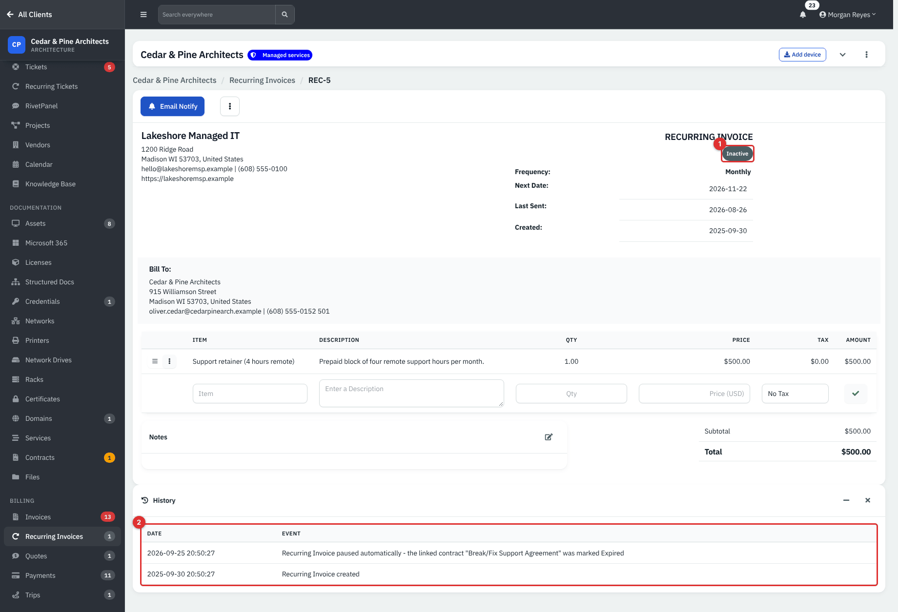

*Figure 16 — A recurring invoice that was paused when its contract was marked **Expired**. The badge (1) and the history (2).*

> **Note.** A contract whose **Renewal Date** has passed but whose **Status** is still **Active** does not pause anything. Change the status when the agreement really ends.

### Pause, restart or delete a recurring invoice

1. To pause, open **Edit**, set **Status** to **Inactive** and save. Use the **Inactive** button on the list to find paused ones.

   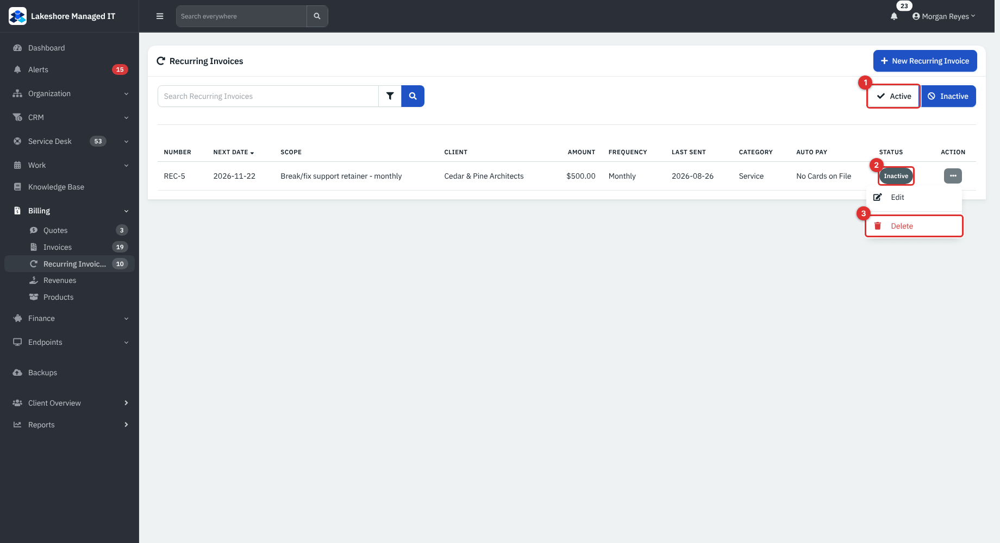

   *Figure 17 — The **Inactive** list. **Active** (1), the **Inactive** badge (2) and **Delete** (3).*

2. To restart, set **Status** back to **Active** and set **Next Date** to a day in the future. A **Next Date** in the past never fires, because the scheduled job only looks for invoices due today.
3. To delete, pause the recurring invoice first. The list offers **Delete** only for inactive ones (the menu on the recurring invoice's own page always shows it) and it needs **Full** on Sales. Invoices it already created are kept.

### What happens on the next date

When the scheduled-jobs worker runs on the **Next Date** of an **Active** recurring invoice:

1. It creates an invoice dated today, with the **Sent** status, the recurring invoice's lines and amount as saved, and a due date set by the client's net terms. The invoice's **Recurring** column in the list names the recurring invoice.
2. It sets **Last Sent** to today and **Next Date** to one month or one year after today.
3. It posts a **Recurring Sent** notification.
4. If **Recurring Invoice Emails** is on (Administration → **Settings** → **Notifications**) and **Email Notify** is on for this recurring invoice, it e-mails the invoice link to the primary contact and to the client's other **Billing** contacts.
5. If a saved card is chosen under **Auto Pay**, the card is charged when the invoice reaches its due date (see [Payments, AutoPay and Stripe](17-payments-autopay-stripe.md)). That step needs Stripe and has not been verified on a live service.

The same run raises a notification for any active recurring invoice whose **Next Date** is already in the past.

**Force Send** in the menu does the same thing on demand: it creates the invoice now, recalculates each line's tax at the current tax rate, and moves **Next Date** to one period after today. It makes a real invoice and, when the e-mail switches above are on, sends it, so use it only when you mean to bill.

> **Note.** The next date is counted from the day the invoice is created, not from the old next date. If the scheduler is a day late, the schedule moves a day later too.

If you use Pax8, its automated billing can update the quantities on recurring invoice lines. See [Accounting and Pax8 Sync](20-accounting-pax8-sync.md).

## Reference

### Contract fields

| Field | Notes |
|---|---|
| Contract Name | Required, up to 200 characters. |
| Type | **Managed Services**, **Fully Managed**, **Partially Managed**, **Break/Fix**, **Block Hours**, **Project**, **SLA**, **Other**. |
| Status | **Active**, **Pending**, **Expired**, **Cancelled**. Only **Active** contracts are offered on the ticket form and counted in the allowance report. |
| Billing Value | Number with two decimals; informational. |
| Billing Frequency | **Monthly**, **Quarterly**, **Annual**, **Other**; informational. |
| Start, End, Renewal Date | Optional dates. Renewal drives **Due Soon** (within 45 days) and **Expired**. |
| SLA times | Hours for response and resolution at Low, Medium and High priority. 0 or blank means none. |
| Included Support Hours | Remote and on-site hours per month. Blank means no allowance. |
| Notes | Free text. |
| Documents | Up to 20 MB per file: PDF, Word, PNG, JPEG, text. |

### Recurring invoice fields and statuses

| Field | Notes |
|---|---|
| Number | `REC-` and a number. The prefix and next number are under Administration → **Settings** → **Invoices**. |
| Scope | Up to 255 characters. |
| Frequency | **Monthly** or **Yearly**. |
| Next Date | Day the next invoice is created. |
| Last Sent | Day the last invoice was created. |
| Category | An income category. |
| Discount Amount | Taken off the total of the lines. |
| Contract | Optional, same client only. |
| Status | **Active** (1) or **Inactive** (0). |
| Email Notify | Per recurring invoice, on by default. |

### Permissions

| Task | Module and level |
|---|---|
| Open the Contracts page | Any signed-in technician with access to the client |
| Add, edit, delete a contract, upload or delete a document | **Support** at Modify |
| Create and edit templates, apply a template | Administrator |
| See recurring invoices | **Sales** at Read |
| Create, edit, force-send a recurring invoice | **Sales** at Modify |
| Delete a recurring invoice | **Sales** at Full |

> **Note.** The **New Contract**, edit and delete buttons show to everyone who can open the Contracts page, even without **Modify** on Support. Saving is refused with a permission message if the level is too low. In the demo the **Billing clerk** role has only Read on Support, so a billing clerk can look at contracts but not change them.

## Tips and good practice

- Link every recurring invoice that comes from a contract to it, so the two cannot drift apart.
- Set the contract's **Renewal Date** even for evergreen agreements. It is the only date the warnings use, and the amber badge on the client sidebar will remind you.
- Keep **Status** truthful. Nothing changes a contract's status when a date passes.
- Use **Block Hours** or an **Allowance** for prepaid time, and the Included Support Hours report to keep clients informed.
- The all-clients Contracts list is reachable at `/agent/contracts.php` on your server but has no menu entry.

## Related guides

- [Products, Quotes and Invoices](15-products-quotes-invoices.md) for the invoices that recurring invoices create.
- [Payments, AutoPay and Stripe](17-payments-autopay-stripe.md) for saved cards and automatic charging.
- [Ticketing Setup and Templates](37-ticketing-setup-and-templates.md) for SLA policies and business hours.
- [Reports](23-reports.md) for income and recurring income reports.
- [Clients, Contacts and Locations](03-clients-contacts-locations.md) for net terms and billing contacts.
