# Payments, AutoPay and Stripe

Money coming in. This guide covers everything that happens after an invoice has been sent: recording a payment by hand, settling several invoices with one cheque, letting a client pay online with a card, and charging a saved card automatically when a recurring invoice falls due (**AutoPay**). It also explains how an administrator connects Stripe and what the client sees in the client portal.

| | |
|---|---|
| **Where to find it** | Sidebar → **Finance** → **Payments** (every payment). On an invoice: **Add Payment**. On a client: **Billing** → **Payments**. Administration → **Billing** → **Payment Providers**, **Saved Payment Methods** and **Payment Methods**. Client portal: **Finance** → **Saved Payments**. |
| **Who can use it** | Viewing the **Payments** list needs **Financial** (`module_financial`) at Read. Adding a payment needs **Financial** and **Sales** at Modify; the row menu to edit or delete a payment shows for **Sales** at Full. Setting up Stripe is administrators only. |
| **Turn it on** | The invoicing module (Administration → **Settings** → **Modules**) must be on. Online payment also needs a Stripe **Payment Provider** (see [Connect Stripe](#connect-stripe)). AutoPay charges run from the scheduled-jobs worker, which needs **Enable Cron** (Administration → **Settings** → **Notifications**). |

> **Example data, not a live connection.** Stripe cannot be reached from the demo company used for the screenshots, so every Stripe screen in this guide shows invented placeholder keys, customer ids and card numbers. The card-charging steps are described from the product's code and settings screens and have **not been verified against a live Stripe account**. Try them with Stripe's test keys before relying on them.

## What it's for

- Record that a client paid an invoice by ACH, cheque, cash or card, and keep the invoice status correct (**Partial** or **Paid**).
- Settle several open invoices at once with a **Batch Payment**.
- Let clients pay with **Pay Now** on the invoice link you send them.
- Charge a saved card for you from the invoice (**Pay with Saved Card**).
- Charge a saved card automatically on the due date of a recurring invoice (**AutoPay**).
- Record the Stripe processing fee as an expense every time a card payment is taken, so your books show the real net amount.

## A quick tour

### The Payments list

Open **Finance** → **Payments**. Every payment against every invoice is listed, newest first.

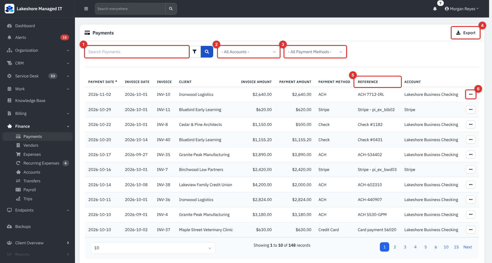

*Figure 1 — The Payments list.*

1. **Search Payments** looks in the invoice number, client name, account, payment method and reference.
2. **All Accounts** narrows the list to one account. It only offers accounts that have at least one payment.
3. **All Payment Methods** narrows the list to one method (ACH, Check, Stripe and so on).
4. **Export** downloads the current payments as a CSV file. It only shows once there is at least one payment.
5. **Reference** holds the cheque number, bank reference or, for card payments, `Stripe - ` followed by the Stripe payment id.
6. The **…** menu at the end of a row opens **Edit** and **Delete**.

Click the filter button next to the search box to reveal a **Date range** picker. By default the list shows all time. Column headings sort the list. Each client's own **Billing** → **Payments** page shows the same list limited to that client, without the **Client** column.

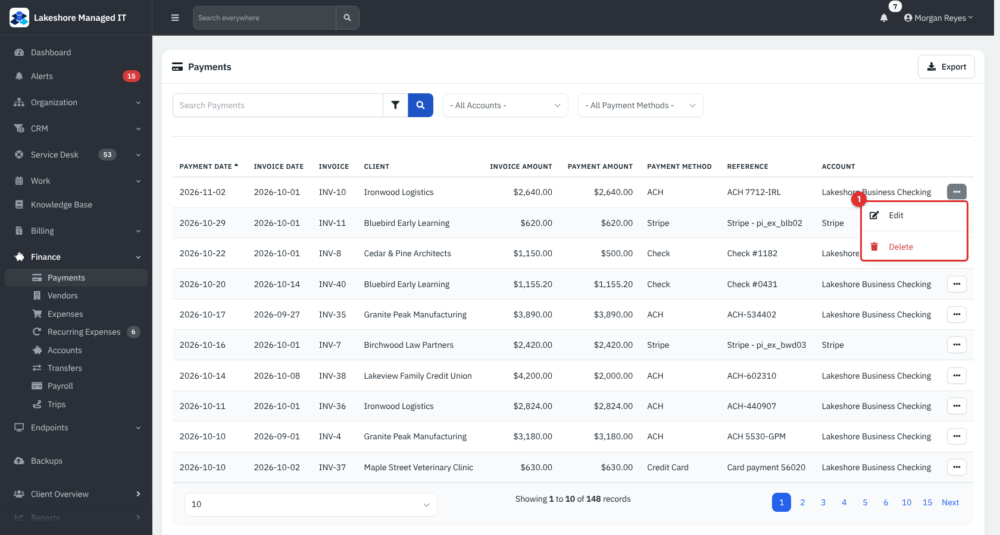

*Figure 2 — The row menu offers Edit and Delete.*

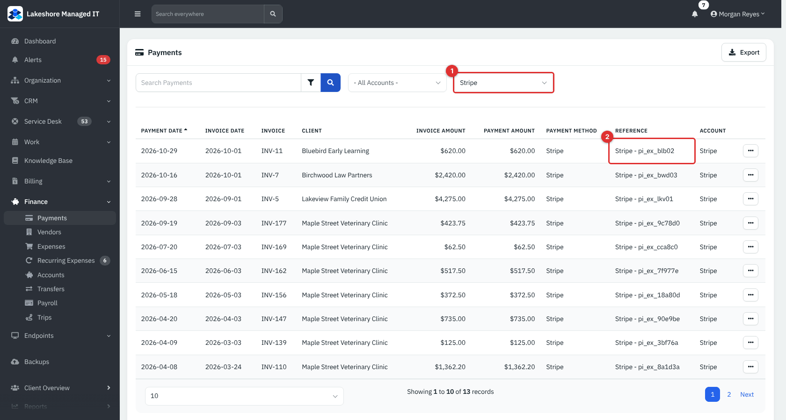

*Figure 3 — Filtering by payment method **Stripe** (1) shows only card payments taken through the payment provider. The reference (2) is the Stripe payment id.*

### Payment Providers (administrators)

Administration → **Billing** → **Payment Providers** is where Stripe is connected. The top table lists the provider; **Customer Mapping** below shows which clients have a Stripe customer record and which saved cards they have.

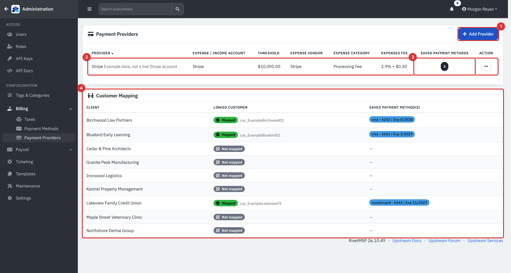

*Figure 4 — Payment Providers.*

1. **Add Provider** opens the set-up pop-up. Only Stripe is offered, and it can only be added once.
2. The provider row shows the account that receives the money, the **Threshold**, the expense vendor and category, and the **Expensed Fee** (for example 2.9% + $0.30).
3. The round number is how many cards clients have saved. Click it to open **Saved Payment Methods**.
4. **Customer Mapping** lists every active client. **Mapped** means the client has agreed to automatic payments and has a Stripe customer record; **Not mapped** means they have not.

## Common tasks

### Record a payment you received

1. Open the invoice (Billing → **Invoices**, then the invoice number).
2. Click the green **Add Payment** button. It is hidden on invoices that are **Draft**, **Paid**, **Cancelled** or **Non-Billable**, and on invoices with a zero total.

   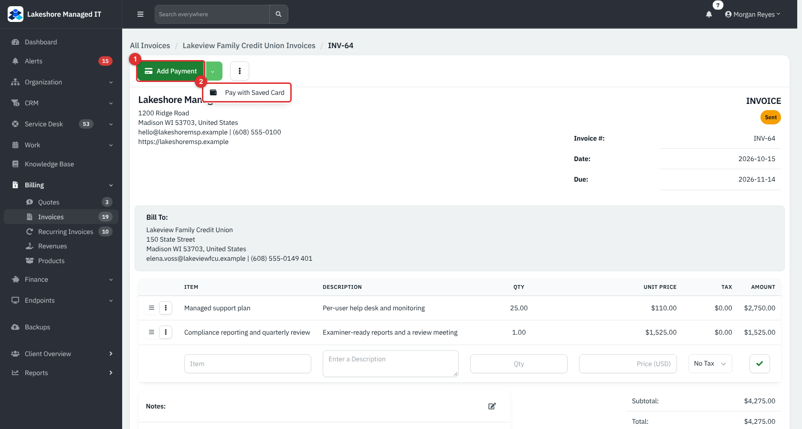

   *Figure 5 — The **Add Payment** button (1). When the client has a saved card and the invoice is **Sent** or **Viewed**, a small arrow opens **Pay with Saved Card** (2).*

3. Fill in the pop-up.

   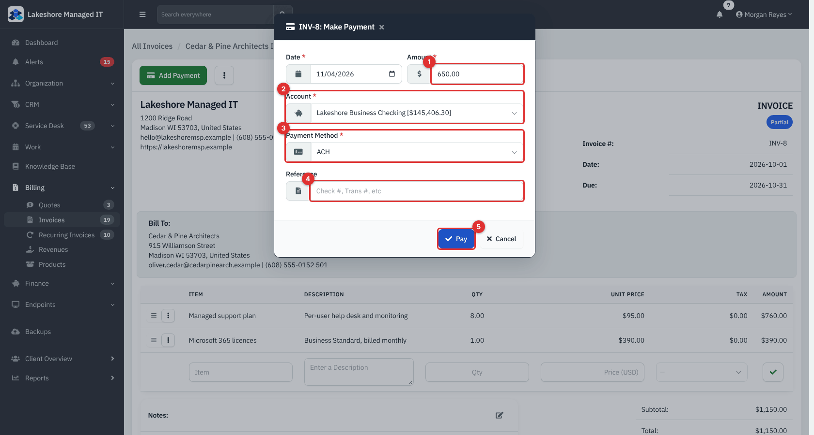

   *Figure 6 — The **Make Payment** pop-up.*

   1. **Amount** is filled in with the full balance. Change it for a part payment. It must be more than zero and cannot be more than the balance.
   2. **Account** is the bank or cash account that received the money. The list shows each account's current balance. The default comes from Administration → **Settings** → **Defaults**.
   3. **Payment Method** comes from the list in Administration → **Billing** → **Payment Methods**.
   4. **Reference** is free text: a cheque number or transaction number.
   5. **Pay** saves the payment.

   The **Date** defaults to today. If outgoing e-mail is configured and the client has a primary contact with an e-mail address, an **Email Receipt** tick box appears (ticked by default).
4. After saving, the invoice becomes **Paid** when the payments add up to the invoice total, otherwise **Partial**. The change is written to the invoice **History**, and if the accounting sync is connected the payment is queued for it (see [Accounting and Pax8](20-accounting-pax8-sync.md)).

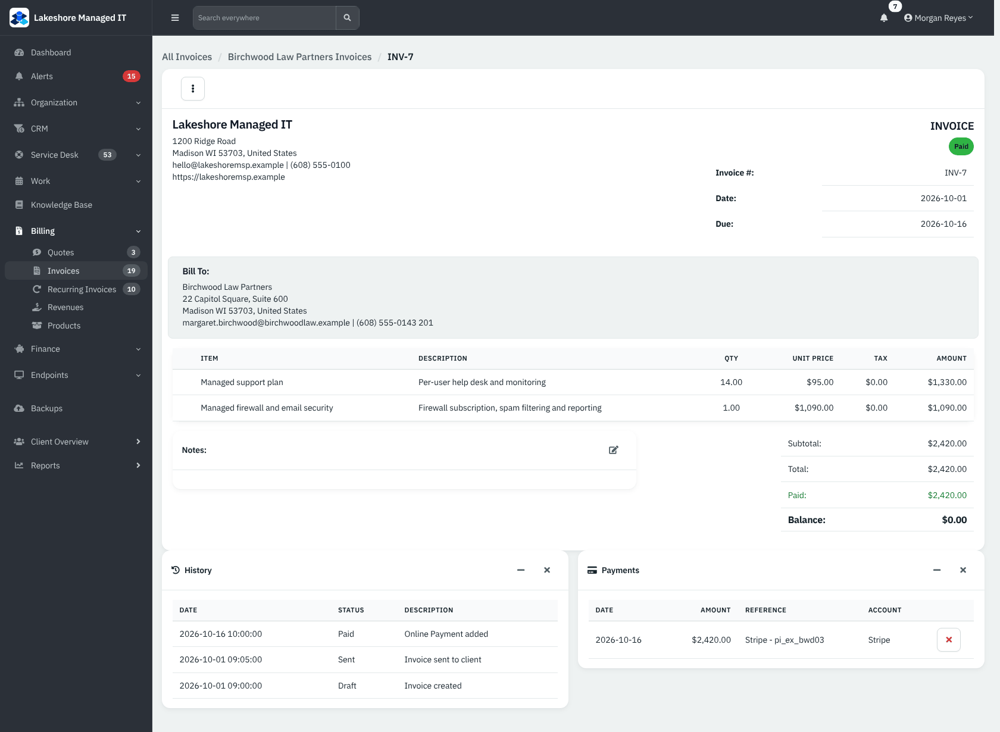

*Figure 7 — A paid invoice. The **History** card records each step and the **Payments** card lists the payment with its red delete button. Online payments are labelled **Online Payment added**.*

### Edit or delete a payment

Use the **…** menu on the Payments list (Figure 2), or the red button on the invoice's **Payments** card. **Edit** changes the date, amount, account, method and reference; the amount plus the invoice's other payments may not exceed the invoice total. The invoice status is re-checked afterwards.

> **Note.** **Delete** recalculates the invoice status as **Paid** (balance zero or less) or **Partial**. Deleting the only payment on an invoice therefore leaves it **Partial** with the full balance outstanding, not back at **Sent**. Deleting a card payment does not refund it: refund it in Stripe yourself.

### Settle several invoices with one payment (Batch Payment)

When a client sends one cheque for several invoices:

1. Open the client, then **Billing** → **Invoices**.
2. Tick any invoice's box. The **Bulk Action** button appears.
3. Click **Bulk Action** → **Batch Payment**.

   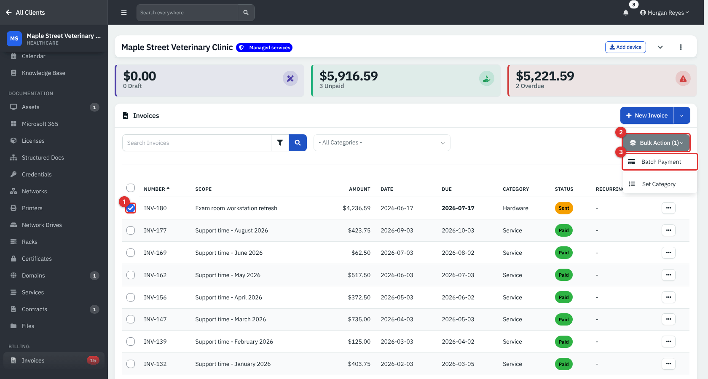

   *Figure 8 — Tick a box (1), open **Bulk Action** (2) and choose **Batch Payment** (3). The option only appears when the client owes money.*

4. Enter the date, amount, account, method and reference.

   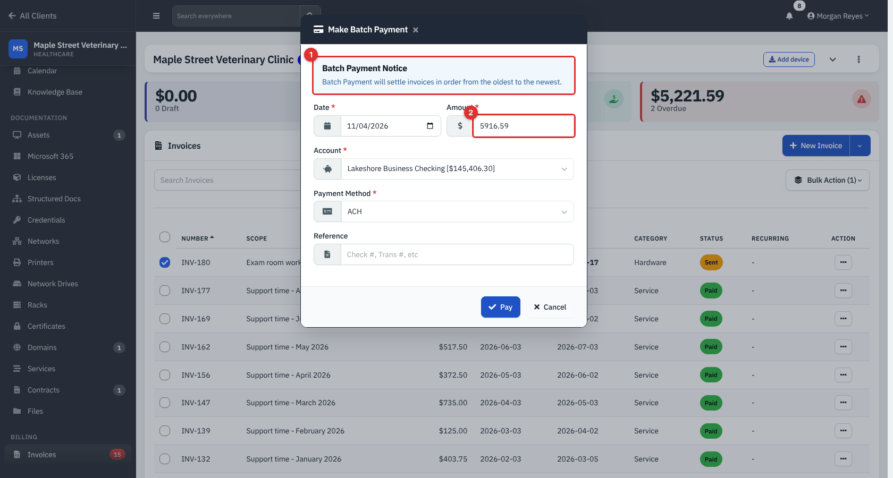

   *Figure 9 — The notice (1) says invoices are settled from oldest to newest. The **Amount** (2) starts at the client's whole outstanding balance.*

5. Click **Pay**. The amount is applied to the client's open invoices (**Sent**, **Viewed**, **Partial** or **Overdue**) in invoice-number order. Each invoice that is covered in full becomes **Paid**; the last one may become **Partial**. The same reference is stored on every payment, so the Payments list shows them together.

The amount cannot be more than the client's total balance ("Payment exceeds Client Balance"). The tick box in step 2 only reveals the menu: the batch always covers all of the client's open invoices, not only the ticked ones.

### Let a client pay online (Pay Now)

Send the invoice by e-mail or copy its guest link (invoice **…** menu → **Copy Guest URL**). The client opens it without signing in.

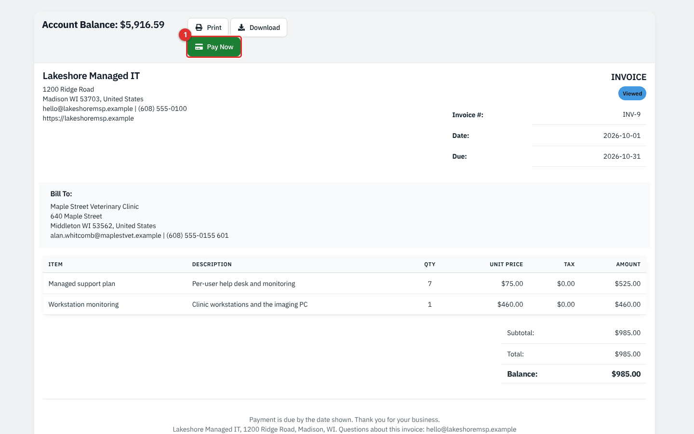

*Figure 10 — The client's view of an unpaid invoice. **Pay Now** (1) appears when a Stripe provider is set up, the invoice is not **Paid**, **Cancelled** or **Draft**, and the provider's **Threshold** is zero or higher than the invoice amount.*

**Pay Now** opens a card form for the balance. When the payment succeeds the invoice is marked **Paid**, a payment with method **Stripe** and reference `Stripe - <payment id>` is added, and the processing fee is added as an expense (see [Connect Stripe](#connect-stripe)). The same payment is only ever recorded once, even if Stripe's webhook and the client's browser both report it.

### Charge a saved card yourself

If the client has saved a card (see below) and the invoice is **Sent** or **Viewed**, use **Add Payment** → the arrow → **Pay with Saved Card**, choose the card and click **Pay**. The full invoice amount is charged to that card. If Stripe declines it you will see "Payment failed" and nothing is recorded.

### Set up AutoPay on a recurring invoice

AutoPay charges a saved card when the invoice created from a recurring invoice falls due.

1. The client first agrees to automatic payments and saves a card in the client portal (next section). You cannot save a card for them.
2. Open the client, **Billing** → **Recurring Invoices**, then the recurring invoice.
3. In the top bar, use the box with the circular arrow icon to pick the saved card. **Disabled** switches AutoPay off. The box only appears when the client has at least one saved card.

   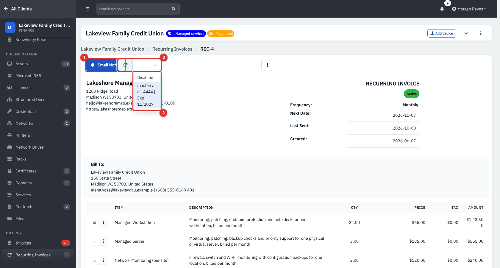

   *Figure 11 — **Email Notify** (1), the AutoPay box (2) and the list of the client's saved cards (3). The box is narrow: click it to see the card description.*

4. The choice saves as soon as you pick it and is written to the audit log.

What happens on the due date, once the scheduled-jobs worker runs:

- It looks for invoices created by that recurring invoice whose **due date is today** and whose status is **Sent** or **Viewed**.
- It charges the saved card for the full invoice amount. On success the invoice becomes **Paid**, the history says **Online Payment added (autopay)**, a receipt is e-mailed, the Stripe fee expense is recorded and a notification "Invoice … automatically paid" is raised.
- On failure the history shows **Payment failed** with Stripe's reason, and the invoice stays open for you to chase.
- If the saved card has been removed or the provider is switched off, nothing is charged and only the activity log notes it.

> **Note.** The charge only runs on the exact due date. An invoice that is already **Partial**, or one whose due date passed while the worker was off, is not charged later. Watch for invoices that stay unpaid after their due date.

To see what a client has authorised, open `/agent/client_autopay.php?client_id=<number>` (the page is not linked from the menus). It lists the client's saved cards read-only.

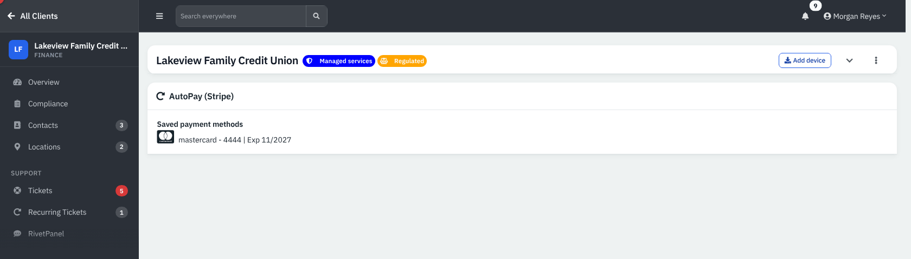

*Figure 12 — The AutoPay overview lists the saved cards. If the client has not given consent yet, it says so.*

### What the client does in the portal

Primary and billing contacts see **Finance** → **Saved Payments** in the client portal.

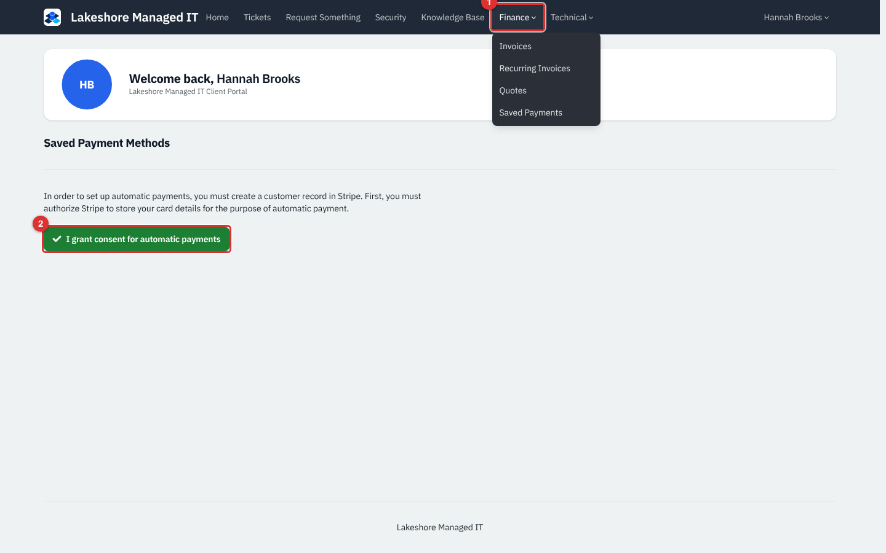

*Figure 13 — The **Finance** menu (1) leads to **Saved Payments**. Before anything else the client must press **I grant consent for automatic payments** (2), which creates their customer record at Stripe.*

After consent the page lists saved cards (each with **Remove**) and shows a Stripe form to add a new card. Card numbers are entered on Stripe's own form and never reach RivetMSP, which stores only Stripe's reference and a description such as `visa - 4242 | Exp 8/2028`. If Stripe is not set up the page says so instead.

### Connect Stripe

Before you start, create a Stripe **Account** and **Vendor** called *Stripe* (Finance → [Accounts](18-expenses-revenues-accounts.md), Finance → Vendors) and an expense category such as *Processing Fee*; the form pre-selects them by those names.

1. Administration → **Billing** → **Payment Providers** → **Add Provider**.
2. On the **Details** tab choose **Stripe** and paste the **Publishable key** (`pk_…`) and **Secret key** (`sk_…`) from your Stripe dashboard. Choose the **Income / Expense Account** that should receive the money, and an optional **Threshold**: invoices above it will not offer Pay Now (0 switches the check off).
3. On the **Expense** tab leave **Enable Expense** on and choose the **Payment Provider Vendor**, the **Expense Category**, the **Percentage Fee** (enter 2.9 for 2.9%) and the **Flat Fee** that Stripe charges you. Each card payment then creates an expense of `invoice × percentage + flat fee`.
4. Click **Add**.
5. Open the provider again (click its name). The pop-up now shows the **Webhook URL** and a **Webhook signing secret** box.

   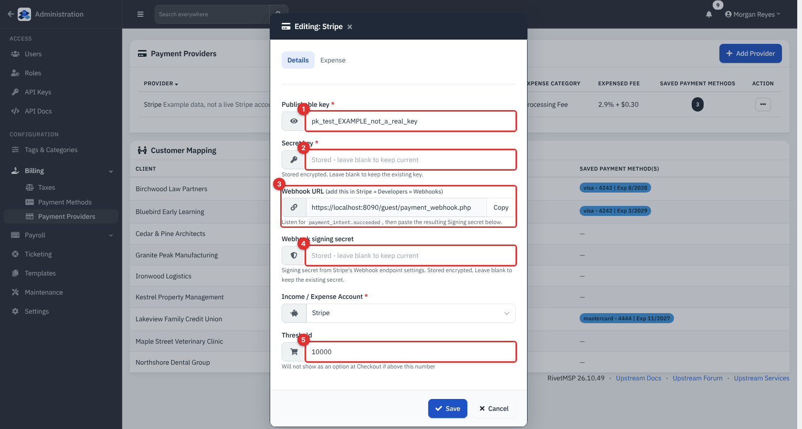

   *Figure 14 — **Publishable key** (1), **Secret key** (2), the **Webhook URL** to copy into Stripe (3), the **Webhook signing secret** (4) and the **Threshold** (5). The secret key and signing secret are stored encrypted; leave them blank when saving to keep the stored values.*

   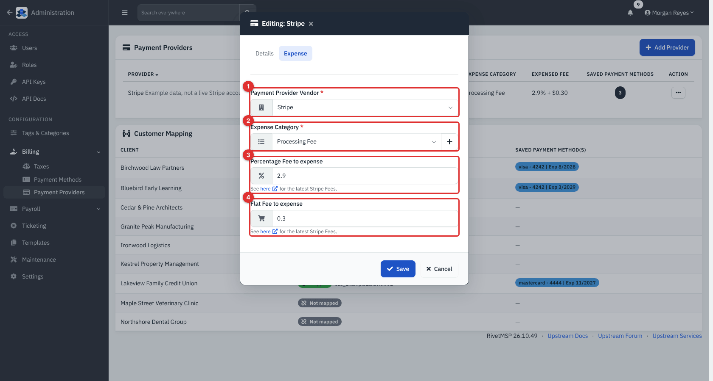

   *Figure 15 — The **Expense** tab: vendor (1), category (2), percentage fee (3) and flat fee (4).*

6. In Stripe → Developers → Webhooks, add the Webhook URL as an endpoint listening for `payment_intent.succeeded`, then paste Stripe's signing secret into the box and save. The URL begins with the address of your own RivetMSP server, so it must be reachable from the internet over HTTPS.

The webhook is a safety net: it records a card payment even if the client closes the browser before the confirmation page loads. It checks Stripe's signature, ignores events it has already handled, and never adds a payment twice.

**Saved Payment Methods** (Administration → **Billing** → **Payment Providers** → the round number) lists every saved card with its Stripe customer and payment-method ids and a **Delete** button.

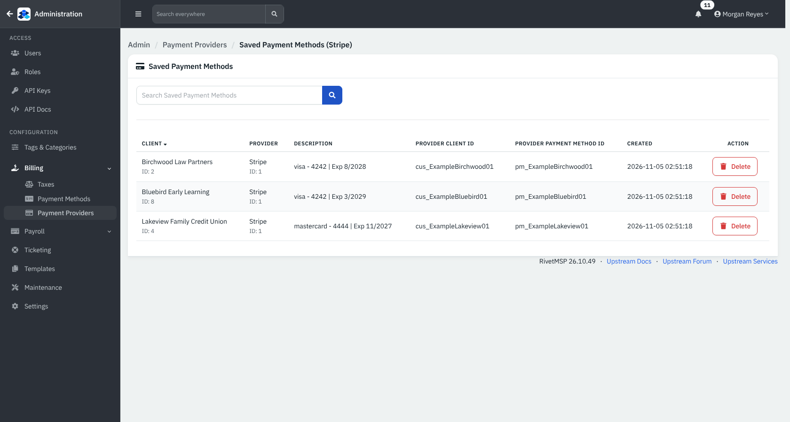

*Figure 16 — Saved Payment Methods.*

Deleting a **Payment Provider** (**…** → **Delete Provider and…**) also deletes its saved cards, client links and any AutoPay settings. Do not do this casually.

### Payment methods

The choices in the **Payment Method** box come from Administration → **Billing** → **Payment Methods** (a fresh install has Cash, Check, ACH and Credit Card). Add your own, such as Wire.

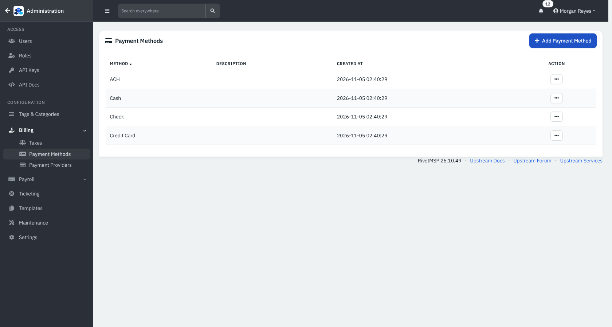

*Figure 17 — Payment Methods.*

## Reference

### Payments list columns

| Column | Meaning |
|---|---|
| **Payment Date** | Date the money was received. |
| **Invoice Date**, **Invoice** | The invoice this payment settles (click for the invoice). |
| **Client** | Hidden on a client's own list. |
| **Invoice Amount**, **Payment Amount** | Invoice total and this payment. |
| **Payment Method**, **Reference** | How it was paid and the cheque, transaction or Stripe id. |
| **Account** | Where it went. An archived account shows as `Archived - name`. |

### Payment provider fields

| Field | Meaning |
|---|---|
| **Publishable key**, **Secret key** | Stripe API keys. Use test keys (`pk_test_`, `sk_test_`) to try it. |
| **Webhook signing secret** | Stripe's `whsec_…` value for the webhook endpoint. |
| **Income / Expense Account** | Account that receives card payments and the fee expense. |
| **Threshold** | Invoices larger than this do not show **Pay Now**. 0 = no limit. |
| **Enable Expense**, vendor, category | Whether and how the processing fee is booked. |
| **Percentage Fee**, **Flat Fee** | Your Stripe pricing, used to calculate the fee expense. |

### Invoice statuses and payments

| Status | Can you add a payment? |
|---|---|
| **Draft**, **Cancelled**, **Non-Billable**, **Paid** | No. |
| **Sent**, **Viewed**, **Partial**, **Overdue** | Yes. |
| **Pay with Saved Card** and AutoPay | **Sent** or **Viewed** only. |

### Permissions

| Action | Needs |
|---|---|
| See Payments, export | **Financial** Read |
| Add payment, batch payment, pay with saved card | **Financial** and **Sales**, both Modify |
| Edit payment | **Financial** and **Sales**, both Full |
| Delete payment | **Financial** and **Sales** Modify (the row menu itself shows at **Sales** Full) |
| Set AutoPay on a recurring invoice | **Sales** Modify |
| Payment Providers, Saved Payment Methods, Payment Methods | Administrators |

## Tips and good practice

- Always record the account and reference. They are what you will match against your bank statement.
- Use the **Stripe** account only for money that Stripe holds, and move it to your bank with a [transfer](18-expenses-revenues-accounts.md#transfers) when Stripe pays out.
- Test the whole path with Stripe test keys and a test card before turning on AutoPay for a real client.
- Tell clients that AutoPay charges the whole invoice on its due date, and who to contact if a card is declined.
- The Stripe **Threshold** is a handy brake: set it a little below the size of invoices you would rather be paid by bank transfer.

## Related guides

- [Expenses, revenues and accounts](18-expenses-revenues-accounts.md): accounts, transfers and the fee expenses.
- [Accounting and Pax8](20-accounting-pax8-sync.md): payments are pushed to QuickBooks Online or Xero.
- [Products, quotes and invoices](15-products-quotes-invoices.md) and [Contracts and recurring invoices](16-contracts-and-recurring-invoices.md): where the invoices come from.
- [Client portal](32-client-portal.md) and [Guest links](33-guest-links.md): what the client sees.
- [Getting started](01-getting-started.md): roles and permission levels.
