# Expenses, revenues and accounts

Money going out, and the accounts that hold it. This guide covers the **Finance** area of RivetMSP: recording what the business spends (**Expenses**, **Recurring Expenses**, **Vendors**), income that is not an invoice payment (**Revenues**), the bank, card and cash **Accounts** that balances are kept in, **Transfers** between accounts, and a mileage log (**Trips**). Together with [Payments](17-payments-autopay-stripe.md) they give every account a live balance and feed the financial [reports](23-reports.md).

| | |
|---|---|
| **Where to find it** | Sidebar → **Finance** → **Vendors**, **Expenses**, **Recurring Expenses**, **Accounts**, **Transfers**, **Trips**. **Revenues** is under sidebar → **Billing** → **Revenues**. |
| **Who can use it** | **Financial** (`module_financial`): Read to look, Modify to add and edit, Full to delete. Adding a revenue also needs **Sales** at Modify. Vendors use **Support** (`module_support`). |
| **Turn it on** | The invoicing module must be on (Administration → **Settings** → **Modules**), otherwise the whole **Finance** group is hidden. |

> The demo company in the screenshots is invented. Names, amounts and vendors are examples.

## What it's for

- Know what the company spends, on what, from which account, and for which client when it is re-billed.
- Keep a running balance for each account without a separate accounting package.
- Record regular costs once (rent, licences, insurance) and let RivetMSP create the expense every month or year.
- Record non-invoice income such as vendor rebates and interest.
- Move money between accounts without distorting income or expense totals.
- Keep a mileage log for travel to client sites.

## A quick tour

How the pieces fit: every **payment**, **revenue** and **expense** belongs to an **account**. An account's balance is its opening balance, plus payments and revenues, minus expenses. Transfers are recorded as an expense on one account and a revenue on the other.

### Expenses

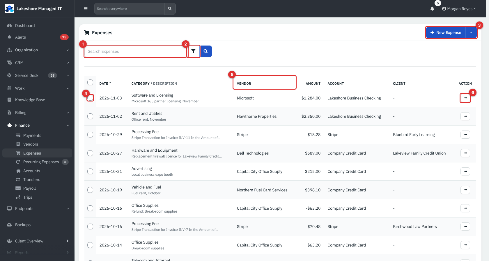

*Figure 1 — Finance → Expenses.*

1. **Search Expenses** looks in the vendor, client, category, account, description and amount.
2. The filter button reveals **Date range**, **Vendor**, **Category** and **Account** filters.
3. **New Expense** adds an expense. The arrow beside it offers **Export**.
4. Tick boxes select rows for a bulk action.
5. Column headings sort. The **Category / Description** column shows the category with the description underneath.
6. The **…** menu holds the actions for one row.

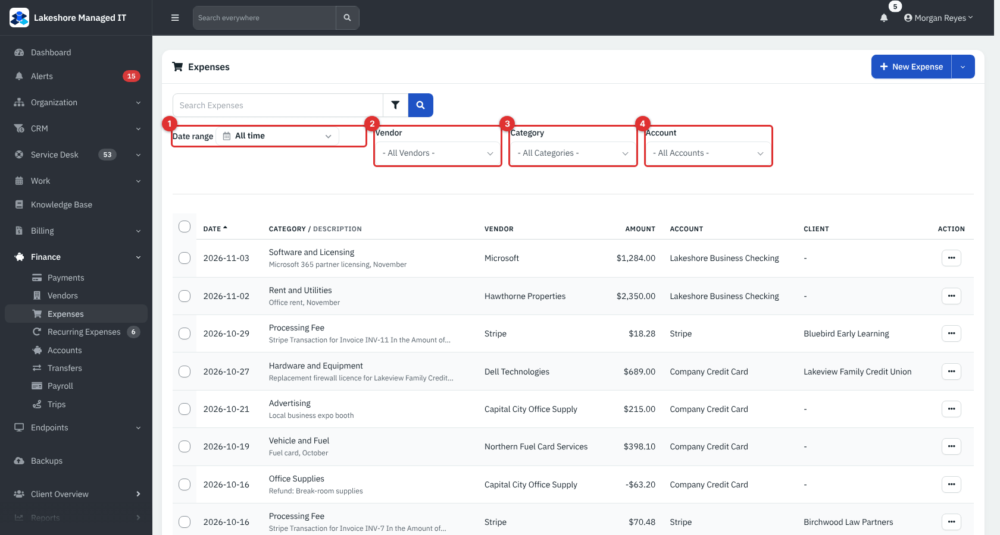

*Figure 2 — The filters (1 to 4). They apply as soon as you choose a value.*

> **Note.** The list only shows expenses that have a vendor. The two halves of a [transfer](#transfers) are expenses without a vendor, so they never appear here.

### Accounts

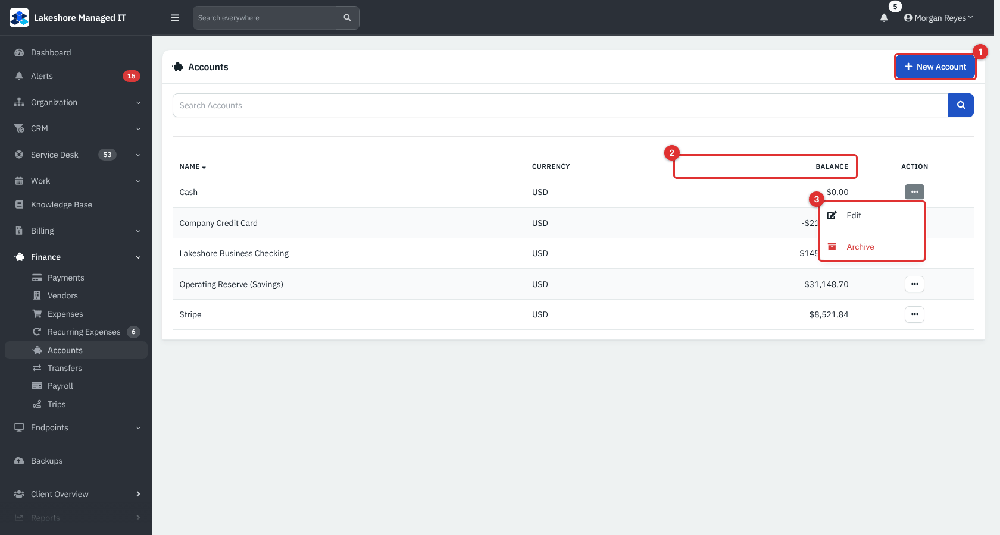

*Figure 3 — Finance → Accounts. **New Account** (1), **Balance** (2) and the row menu (3).*

A fresh install has a single account called **Cash**. The **Balance** is calculated live, in the account's own currency.

## Common tasks

### Add an expense

1. **Finance** → **Expenses** → **New Expense**.

   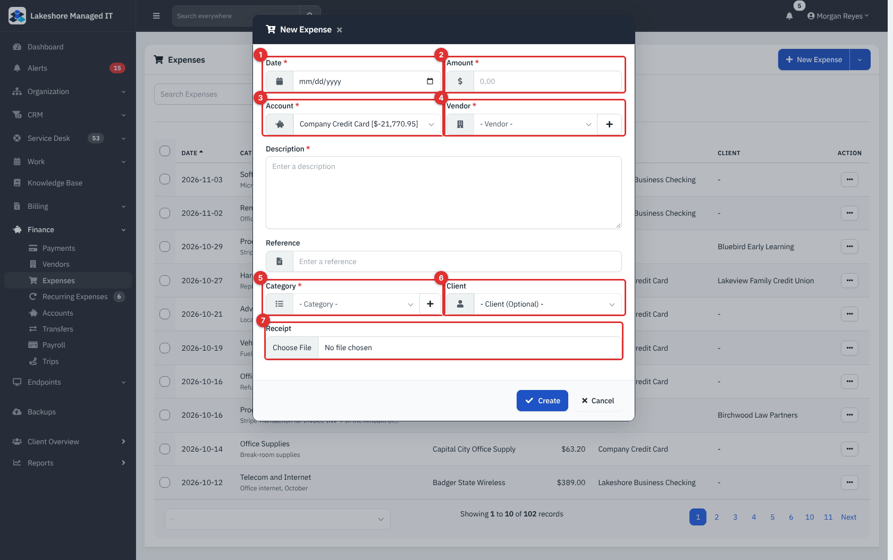

   *Figure 4 — The **New Expense** pop-up.*

   1. **Date** and 2. **Amount** (required).
   3. **Account** the money left from. The list shows each account's balance. Default from Administration → **Settings** → **Defaults** → **Expense Account**.
   4. **Vendor** (required). The **+** next to it opens the Vendors page to add one.
   5. **Category** (required). The **+** adds a new expense category.
   6. **Client** is optional. Set it when the cost belongs to a client, so you can see and re-bill it.
   7. **Receipt** takes an image or PDF. It is stored with the expense and can be downloaded later.

   **Description** (required) and **Reference** (an invoice or order number) complete the form.
2. Click **Create**.

### Edit, copy, refund or delete an expense

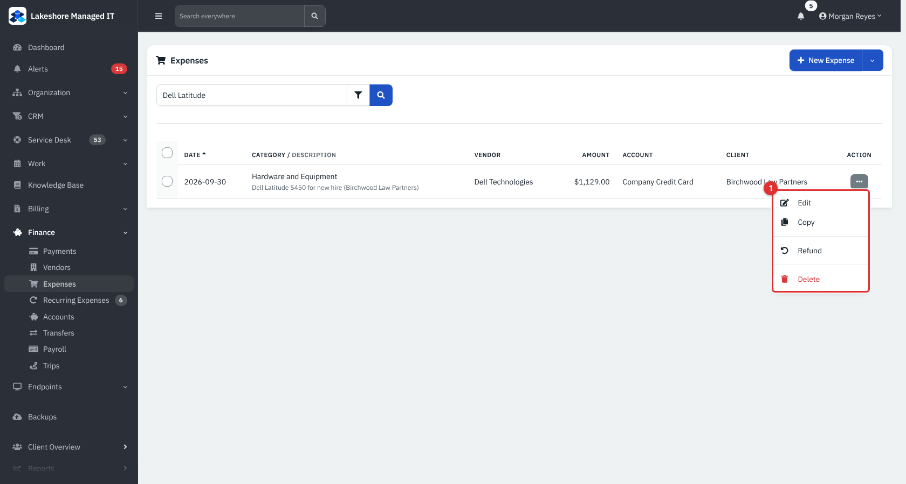

*Figure 5 — The row menu. **Download** also appears when a receipt is attached.*

- **Edit** changes any field (and replaces the receipt).
- **Copy** opens a new expense pre-filled from this one. Use it for repeat purchases.
- **Refund** records money coming back from the vendor.

  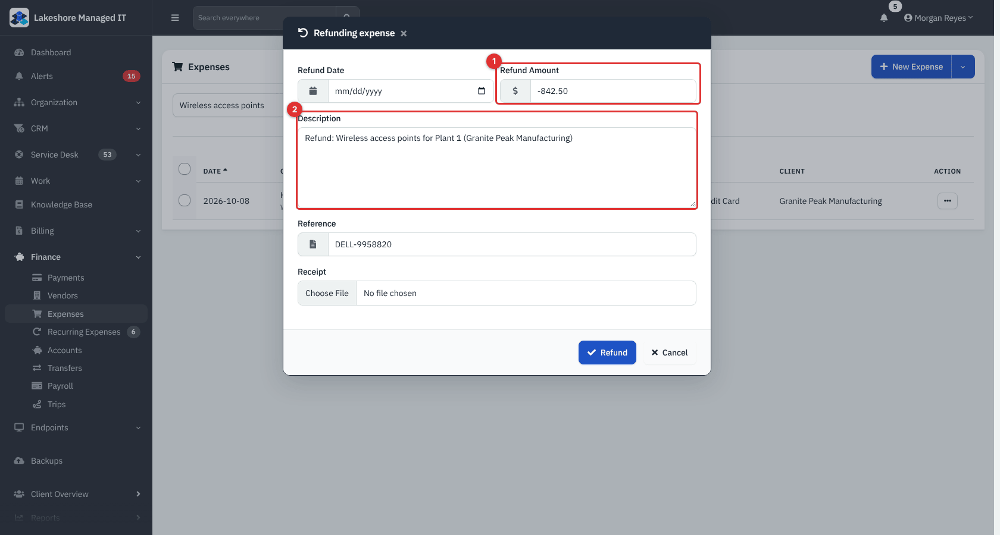

  *Figure 6 — A refund is a second expense with a negative amount (1) and the description prefixed **Refund:** (2). The account, vendor and category are copied from the original.*

- **Delete** removes it after a confirmation. It needs **Financial** at Full.

### Change many expenses at once

Tick the boxes, then click **Bulk Action**.

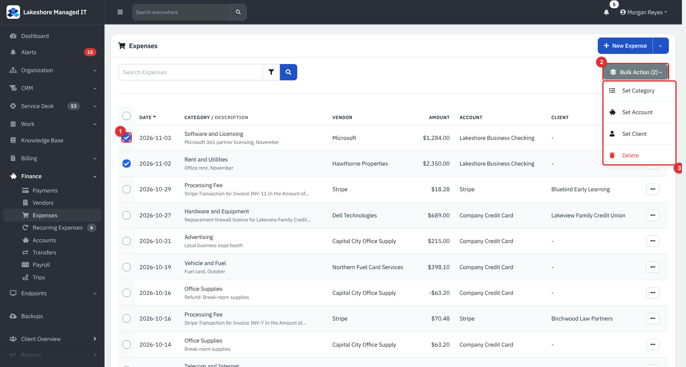

*Figure 7 — Tick rows (1), open **Bulk Action** (2) and choose from the menu (3): **Set Category**, **Set Account**, **Set Client** or **Delete**.*

### Record a regular cost once (Recurring Expenses)

1. **Finance** → **Recurring Expenses** → **New Recurring Expense**.

   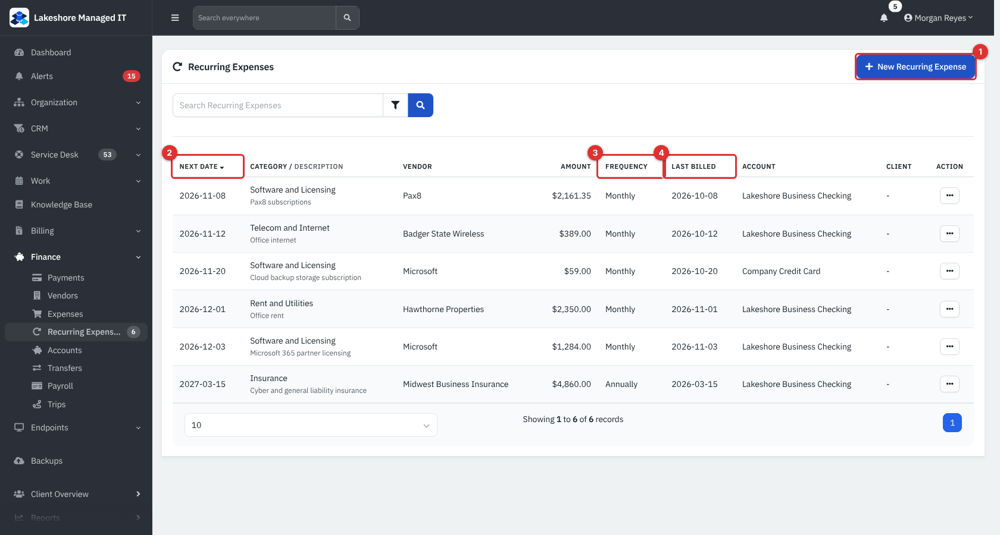

   *Figure 8 — Recurring Expenses. The number beside the menu item counts the rules.*

   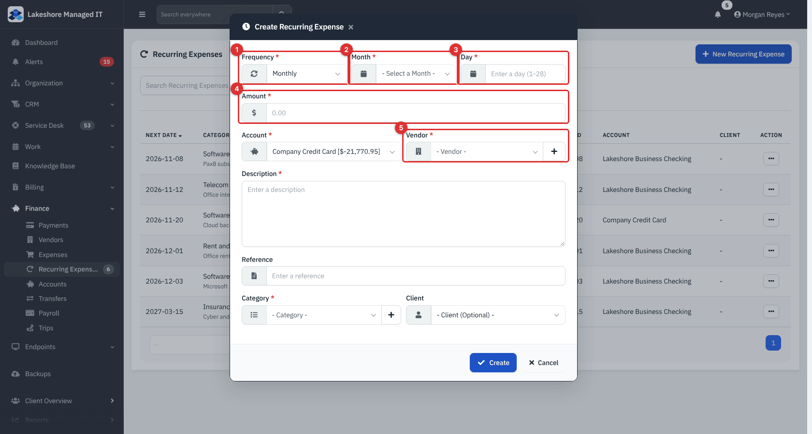

   *Figure 9 — **Frequency** (1), **Month** (2), **Day** (3), **Amount** (4) and **Vendor** (5).*

2. Choose **Monthly** or **Annually**, the **Month**, and the **Day** (1 to 28, so it exists in every month). The first expense is created on that month and day, this year if it is still ahead, otherwise next year. For a monthly rule, **Month** only sets the first month.
3. Fill in the amount, account, vendor, category, optional client, description and reference, then **Create**.

Every day the scheduled-jobs worker creates an expense dated today for each rule whose **Next Date** is today, then moves **Next Date** forward one month (or to the same day next year) and sets **Last Billed**. A notification "Expense … created from recurring expenses" is raised.

> **Note.** A rule only fires when the worker runs on exactly the **Next Date**. If the worker is switched off that day, the rule is not caught up later; RivetMSP raises a notification that the next run date is in the past. There is no pause switch: delete the rule to stop it. Turn the worker on under Administration → **Settings** → **Notifications** → **Enable Cron**.

### Record income that is not an invoice payment (Revenues)

Use **Billing** → **Revenues** → **New Revenue** for vendor rebates, interest, resale of equipment and similar income. Invoice payments never go here: record them with **Add Payment** on the invoice.

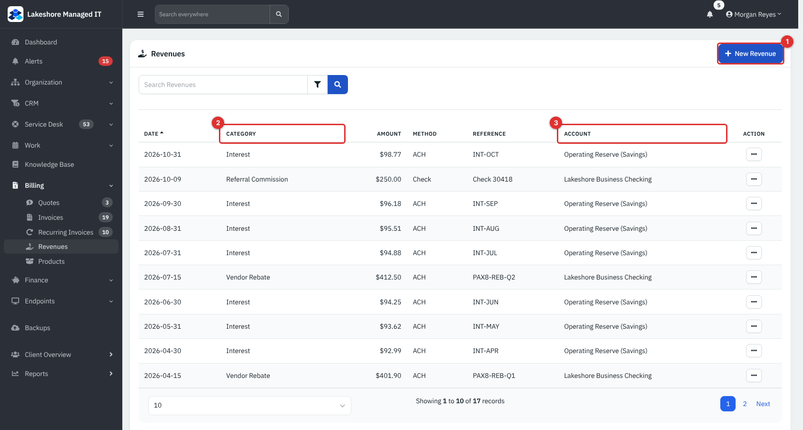

*Figure 10 — Revenues.*

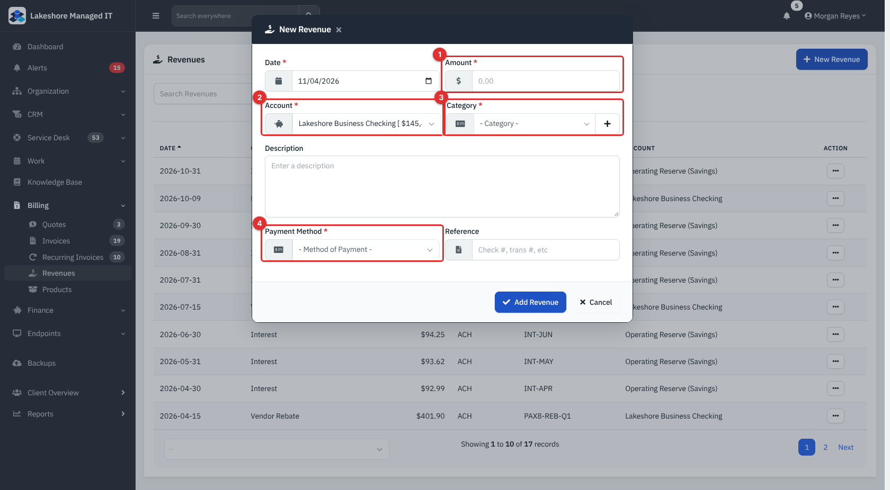

*Figure 11 — **Amount** (1), **Account** (2), **Category** (3, an income category) and **Payment Method** (4) are required. **Description** and **Reference** are optional.*

Revenues have **Edit** and **Delete** in their row menu. A revenue is recorded in the account you choose and raises its balance.

### Manage accounts

1. **Finance** → **Accounts** → **New Account**.

   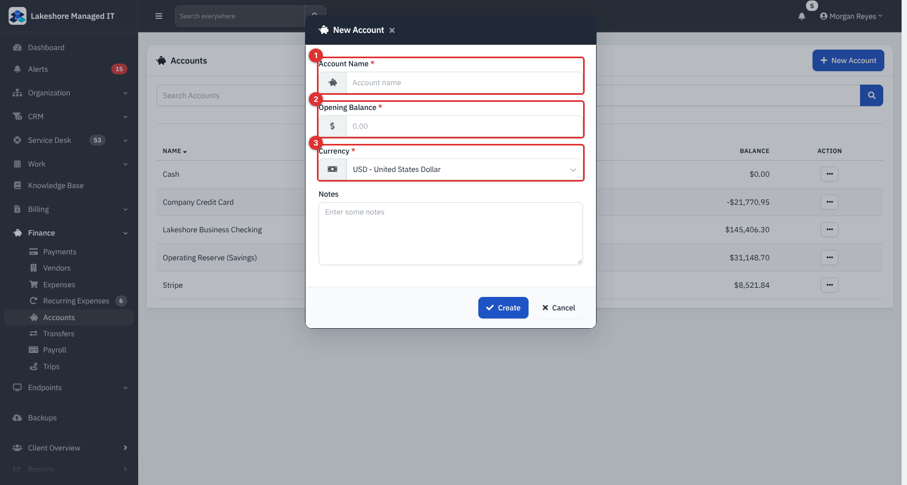

   *Figure 12 — **Account Name** (1), **Opening Balance** (2, may be negative, for example a credit card) and **Currency** (3).*

2. **Edit** a name, notes or currency from the row menu.
3. **Archive** removes an account from the lists. It is only offered when the **Balance** is exactly zero. Archived accounts stay visible as `Archived - name` on old payments.

Typical accounts for an MSP: **Business Checking**, **Savings**, **Company Credit Card**, **Cash**, and **Stripe** (money Stripe is holding for you).

### Transfers

Use a transfer to move money between your own accounts: a Stripe payout to the bank, a credit card payoff, a top-up of a savings account.

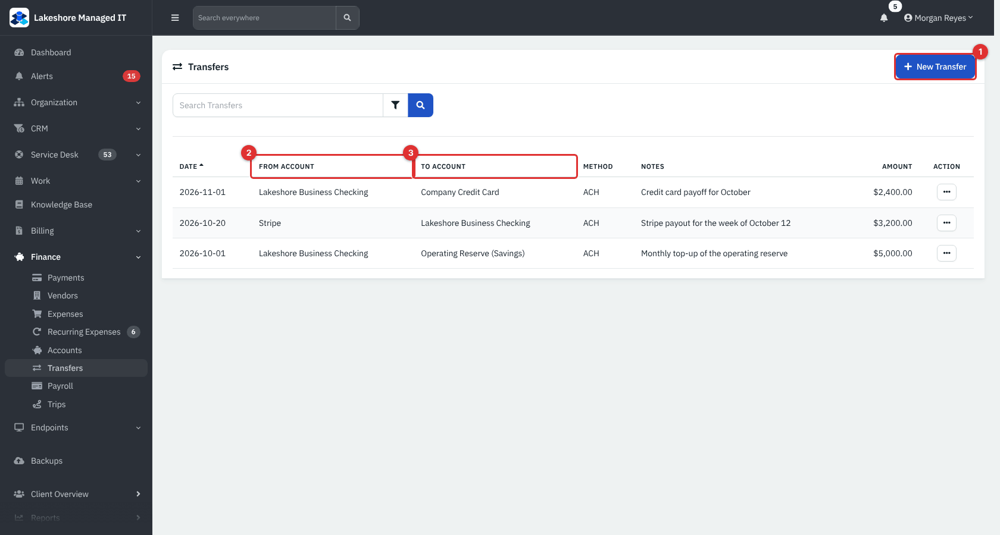

*Figure 13 — Finance → Transfers.*

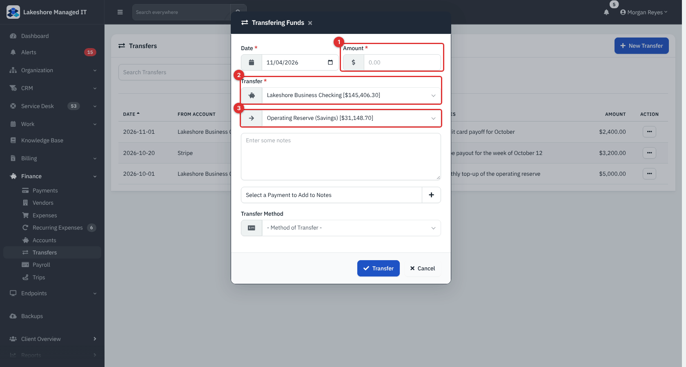

*Figure 14 — Enter the **Amount** (1), the account the money leaves (2) and the account it goes to (3). An optional note and **Transfer Method** complete it.*

Under the hood a transfer creates an expense on the first account and a revenue on the second, so balances move correctly. Neither appears in **Expenses** or **Revenues**. The defaults for the two accounts come from Administration → **Settings** → **Defaults**. Transfers are always stored in the company currency, even between accounts of different currencies.

### Trips (mileage log)

**Finance** → **Trips** keeps a record of business travel.

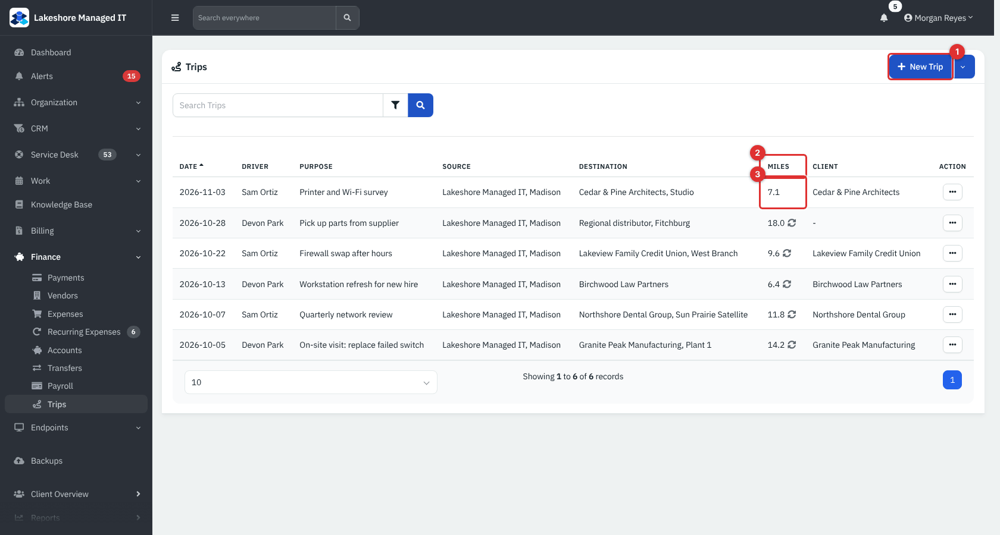

*Figure 15 — Finance → Trips. A circular-arrows icon after the miles means round trip.*

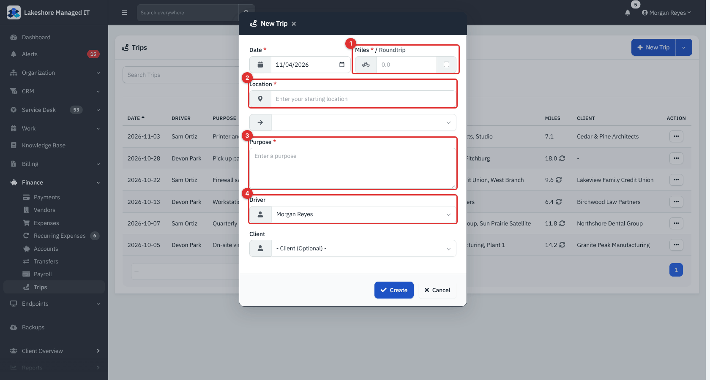

*Figure 16 — **Miles** (1) with a **Roundtrip** tick box, the starting **Location** (2) and a **Destination** you can pick or type, **Purpose** (3) and **Driver** (4). **Client** is optional.*

> **Note.** The miles are stored exactly as typed. Ticking **Roundtrip** only adds the icon; it does not double the number, so enter the full distance travelled. RivetMSP does not apply a mileage rate or create an expense from a trip: use the totals for your own mileage claim. Trips can also be opened from a client's own sidebar, limited to that client.

### Vendors

**Finance** → **Vendors** lists the companies you buy from (not your clients' vendors, which sit in each client's own **Vendors** list).

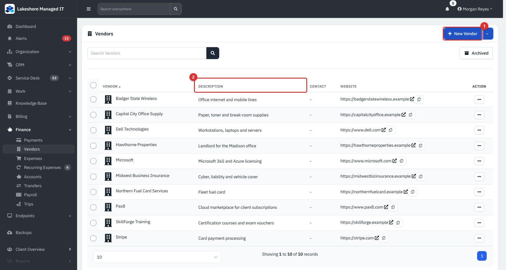

*Figure 17 — Finance → Vendors.*

Click the add button to create a vendor with contact details, website, account number, hours and notes, or add one from a template. See [Documentation records](12-documentation-records.md) for client-level vendors.

### Set the finance defaults

Administration → **Settings** → **Defaults** pre-fills the accounts in the pop-ups.

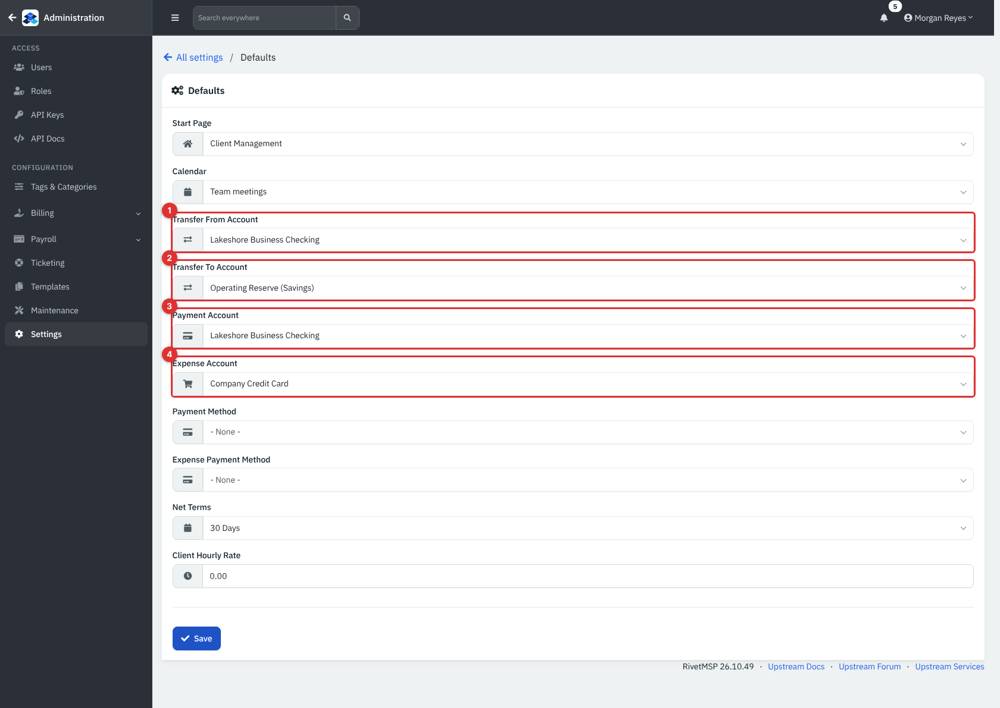

*Figure 18 — **Transfer From Account** (1), **Transfer To Account** (2), **Payment Account** (3) and **Expense Account** (4).*

> **Note.** The **Payment Method** and **Expense Payment Method** boxes on this page are filled from the old *Payment Method* categories, not from the **Payment Methods** list used on invoices. On an installation without such categories they show **None**, and clicking **Save** on this page clears any default method set elsewhere. Set the account defaults here and choose the payment method on each payment.

## Reference

### Expense fields

| Field | Required | Notes |
|---|---|---|
| **Date**, **Amount** | Yes | Amount may be negative only through **Refund**. |
| **Account** | Yes | Balance falls by the amount. |
| **Vendor**, **Category** | Yes | Categories are managed under Administration → **Tags & categories**. |
| **Client** | No | Tie the cost to a client. |
| **Description** | Yes | |
| **Reference** | No | Up to 200 characters. |
| **Receipt** | No | Image or PDF. |

### Recurring expense fields

| Field | Notes |
|---|---|
| **Frequency** | **Monthly** or **Annually**. |
| **Month**, **Day** | Day is 1 to 28. Month sets the first run, and the yearly run date. |
| **Next Date**, **Last Billed** | Shown in the list; **Next Date** is what the daily worker matches. |
| Other fields | As for an expense. |

### Account balance

`Balance = Opening Balance + payments + revenues - expenses` for that account, shown in the account's currency.

### Permissions

| Action | Needs |
|---|---|
| View any list, export | **Financial** Read |
| Add or edit an expense, recurring expense, account, transfer or trip; archive an account | **Financial** Modify |
| Delete an expense, account, transfer or trip; bulk delete expenses | **Financial** Full |
| Add or edit a revenue | **Sales** Modify (list needs **Financial** Read) |
| Delete a revenue | **Sales** Full |
| Vendors | **Support** |

The built-in **Technician** role has none of these. Give the **Accountant** or a custom role (for example **Billing clerk**) the levels it needs; see [Getting started](01-getting-started.md).

## Tips and good practice

- Create the accounts first, then set the defaults, so pop-ups are right the first time.
- Always attach the receipt: it makes year-end much easier.
- Set a client on any cost you intend to re-bill (hardware bought for a client, for instance).
- Reconcile each month: compare an account's **Balance** with the bank statement. A difference usually means a missing payment or a transfer entered as an expense.
- Use **Transfers** rather than an expense and a revenue by hand, so reports are not inflated.

## Related guides

- [Payments, AutoPay and Stripe](17-payments-autopay-stripe.md): payments, and the Stripe fee expenses created for card payments.
- [Payroll](19-payroll.md): staff pay is calculated separately from expenses.
- [Accounting and Pax8](20-accounting-pax8-sync.md): Pax8 costs are the other side of client licence billing.
- [Dashboard and reports](23-reports.md): income, expense and profit reports built from this data.
