# Payroll

Payroll in RivetMSP works out what you owe your own technicians and staff for a pay period: hourly pay, overtime, a flat salary, one-off job rates and standing deductions such as health insurance. It is a calculator and a permanent record, not a payroll service.

> **Gross pay only.** RivetMSP does not calculate or withhold income tax, social security, Medicare or any other tax or benefit rule. It adds up hours × rate and subtracts the fixed dollar amounts you enter. Pay your staff and file taxes with your accountant or payroll service, using the numbers from here if you wish.

| | |
|---|---|
| **Where to find it** | Sidebar → **Finance** → **Payroll**, or user menu → **Administration** → **Payroll** (**Employees**, **Deductions**, **Periods**, **Runs**, **Settings**). |
| **Who can use it** | Administrators only. There is no permission level to grant to other roles. |
| **Turn it on** | Administration → **Settings** → **Modules** → **Show Payroll**. The **Payroll** group then appears in the Administration sidebar and under **Finance**. |

> The screenshots use an invented staff of four and invented pay rates. Nothing here is real payroll data.

## What it's for

- Enrol each staff member as **hourly** or **salaried**.
- Enter the hours worked each week of a pay period.
- Have overtime worked out per week with the multiplier you choose.
- Pay a different rate for particular jobs (for example after-hours work on a ticket).
- Subtract standing deductions (insurance, retirement contribution).
- Lock each finished run so its numbers can never change.

## A quick tour

### Switch it on

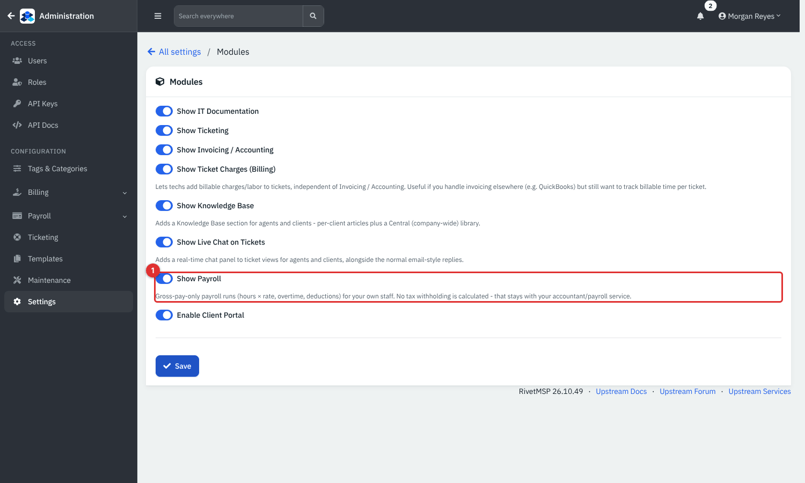

*Figure 1 — Administration → **Settings** → **Modules**. **Show Payroll** (1) turns the feature on. Its help text repeats that there is no tax withholding.*

Save the page. **Payroll** now shows in the Administration sidebar with five pages: **Employees**, **Deductions**, **Periods**, **Runs** and **Settings**.

### The pieces

1. **Settings**: overtime rule and default pay frequency.
2. **Employees**: who is paid, how, and their standing deductions.
3. **Periods**: the date ranges you pay for. You enter hours on a period.
4. **Runs**: the calculated result for a period, first as a **Draft**, then **Finalized**.

## Common tasks

### Set the overtime rule

Administration → **Payroll** → **Settings** (also reached from Administration → **Settings** → **Workflows** → **Payroll**).

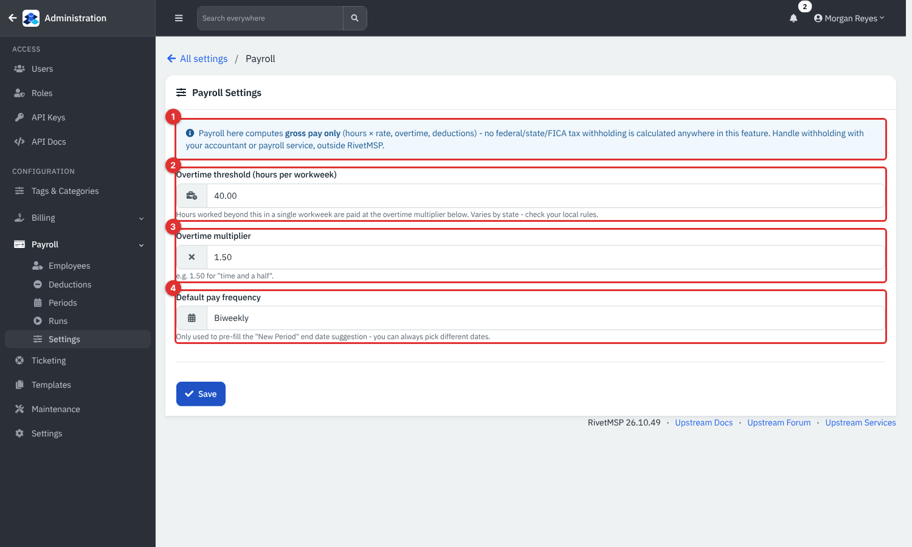

*Figure 2 — Payroll Settings.*

1. The blue note repeats that only gross pay is calculated.
2. **Overtime threshold (hours per workweek)**: hours above this in one week are overtime. The default is 40; rules vary by state, so check yours.
3. **Overtime multiplier**: 1.50 means time and a half.
4. **Default pay frequency**: **Weekly**, **Biweekly**, **Semimonthly** or **Monthly**. It only pre-fills the end date when you create a new period.

Click **Save**. The rule in force when a run is calculated is copied into that run, so changing it later never alters old runs.

### Enrol an employee

Open **Payroll** → **Employees**. Every active staff user is listed.

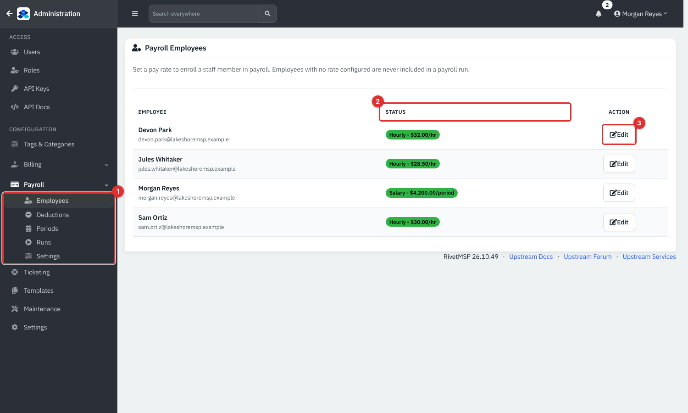

*Figure 3 — The **Payroll** menu (1) is open on **Employees**. **Status** (2) shows **Hourly** with the rate, **Salary** with the per-period amount, or **Not enrolled**. **Edit** or **Enroll** (3) opens the person.*

People with no rate are never included in a run.

1. Click **Enroll** (or **Edit**) beside the person.
2. Choose **Pay Type**: **Hourly**, or **Salary (flat amount per pay period)**.
3. Enter the **Hourly rate** or **Amount per pay period**.
4. Click **Save**.

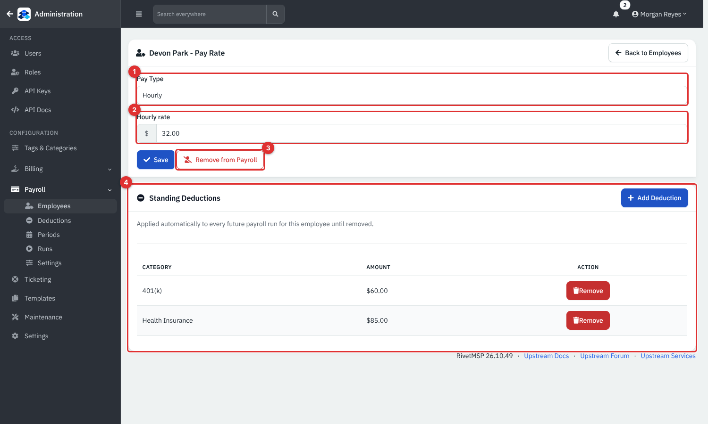

*Figure 4 — **Pay Type** (1), rate (2), **Remove from Payroll** (3) and the **Standing Deductions** card (4).*

A salaried person is paid the flat amount for every period, with no proration for part periods, and enters no hours. **Remove from Payroll** stops future runs including the person; old runs keep their figures.

### Add deductions

First create the categories: **Payroll** → **Deductions** → **New Deduction Category** (a name such as *Health Insurance* and an optional description).

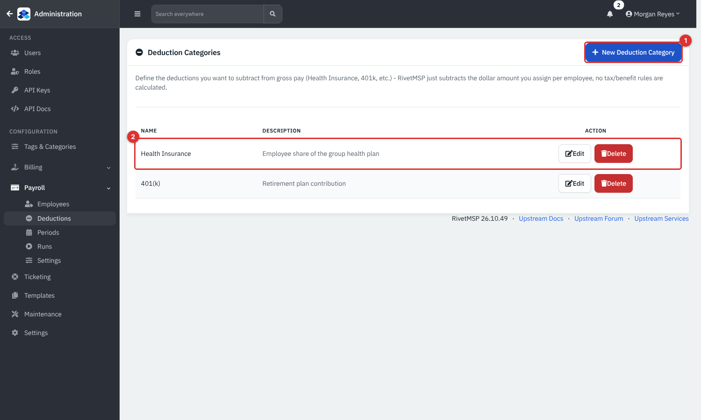

*Figure 5 — Deduction Categories. **Edit** and **Delete** are on each row.*

Deleting a category also removes it from every employee's standing deductions; later runs no longer take it.

Then give each person their amounts. On the employee's page click **Add Deduction** under **Standing Deductions**.

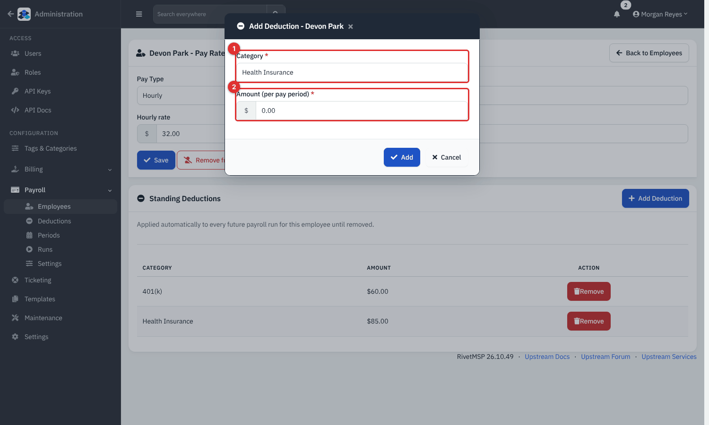

*Figure 6 — Choose the **Category** (1) and the **Amount (per pay period)** (2). It is taken from every future run until you click **Remove**.*

The amount is a fixed dollar figure per pay period. RivetMSP does not work out percentages or limits.

### Create a pay period

**Payroll** → **Periods** → **New Period**.

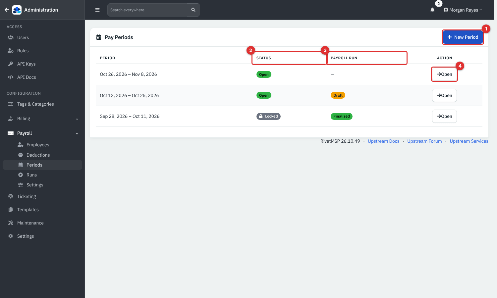

*Figure 7 — Pay Periods. **Status** (2) is **Open** or **Locked**; **Payroll Run** (3) is empty, **Draft** or **Finalized**; **Open** (4) goes to the period.*

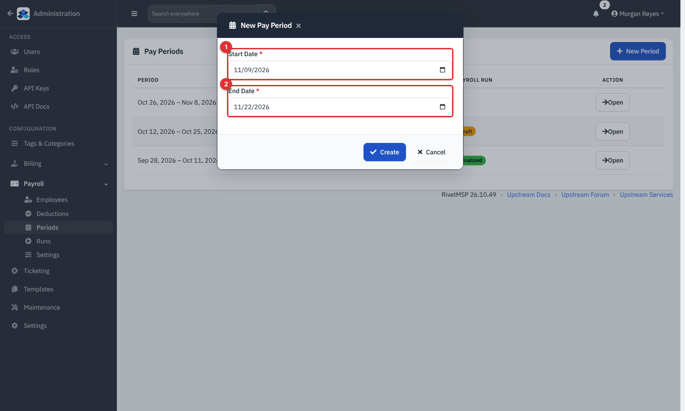

*Figure 8 — The start date is the day after the previous period ended and the end date follows your default pay frequency. Change either if you need to.*

Each period is split into seven-day work weeks starting on the period's first day (not necessarily Monday). A period that is not a multiple of seven days ends with a shorter last week.

### Enter hours

Open a period. Hourly employees get one row of boxes per week.

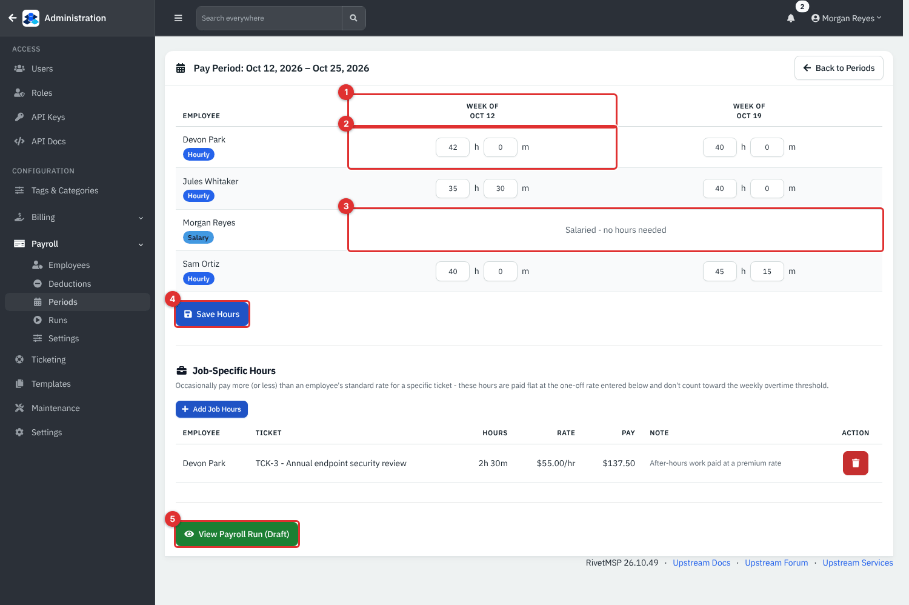

*Figure 9 — Hours for the period. Week columns (1), the hours and minutes boxes (2), the **Salaried - no hours needed** row (3), **Save Hours** (4) and **View Payroll Run** (5).*

Type whole **h**ours and **m**inutes for each week (a week may exceed 24 hours, because it is a weekly total). Click **Save Hours**.

Hours are typed in by hand: RivetMSP does not copy them from ticket time.

### Pay a job at a different rate

Under **Job-Specific Hours** click **Add Job Hours**.

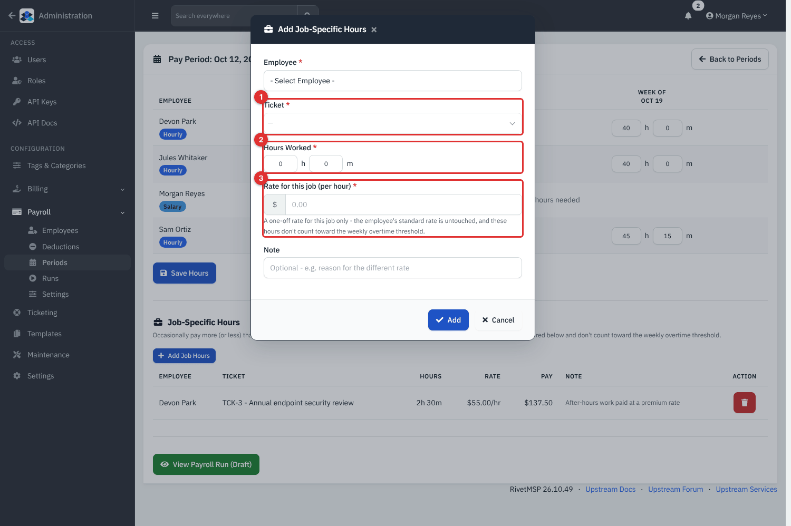

*Figure 10 — Pick the **Ticket** (1), the **Hours Worked** (2) and the one-off **Rate for this job** (3). A note is optional.*

These hours are paid flat at that rate, on top of normal pay. They do not count towards the weekly overtime threshold, and they apply to salaried staff too. The table lists each entry with its pay; the red button removes it.

### Run payroll

When the hours are in, open the period and click **Run Payroll**.

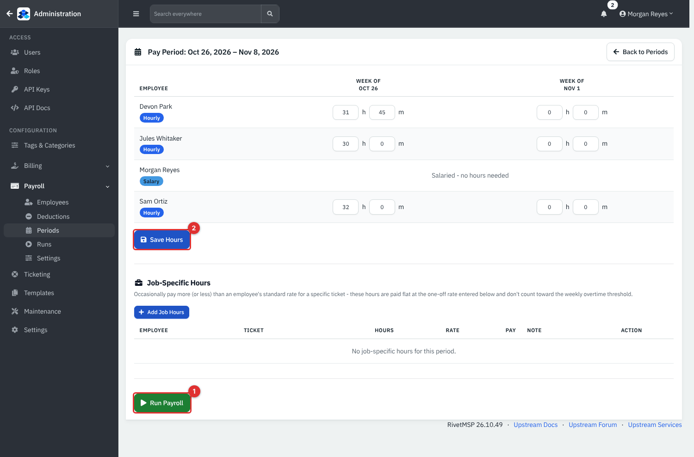

*Figure 11 — **Run Payroll** (1) creates a draft run; **Save Hours** (2) saves the boxes above first.*

The run is a **Draft**. Open **Payroll** → **Runs** to see all of them.

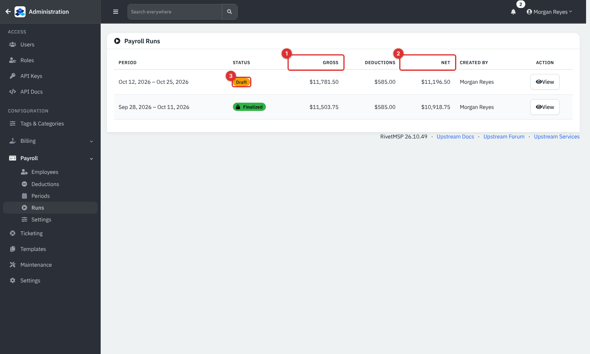

*Figure 12 — Payroll Runs: **Gross** (1), **Net** (2) and the status badge (3).*

Open a run to check it.

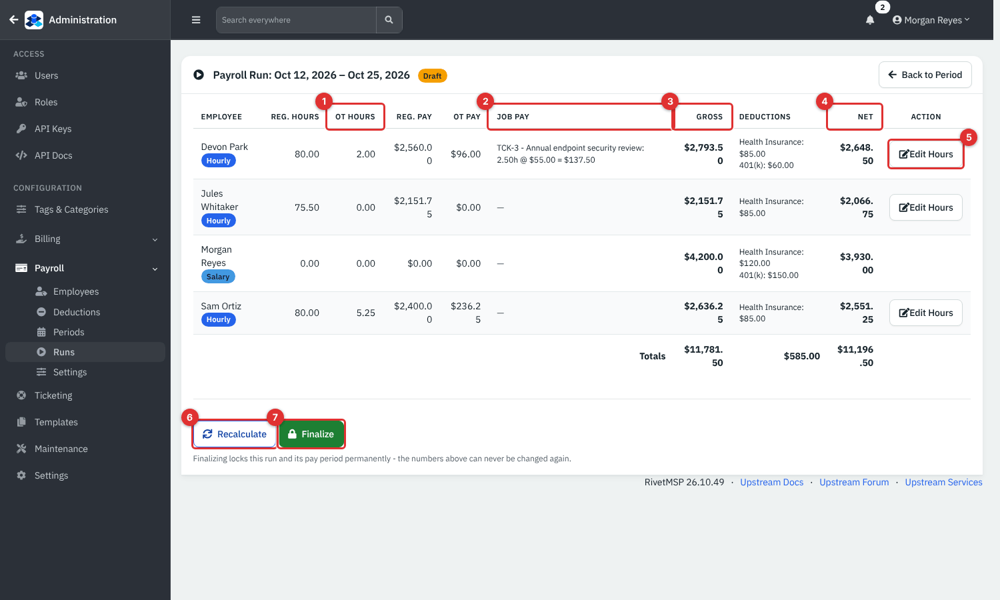

*Figure 13 — A draft run.*

1. **OT Hours** are hours above the weekly threshold, summed over the period; **Reg. Hours** are the rest.
2. **Job Pay** lists each job entry as hours at its rate.
3. **Gross** = regular pay + overtime pay (or the salary) + job pay.
4. **Net** = gross minus the **Deductions** column.
5. **Edit Hours** (hourly staff only) changes one person's weekly hours.
6. **Recalculate** redoes the sums from the current hours, rates and deductions.
7. **Finalize** locks the run.

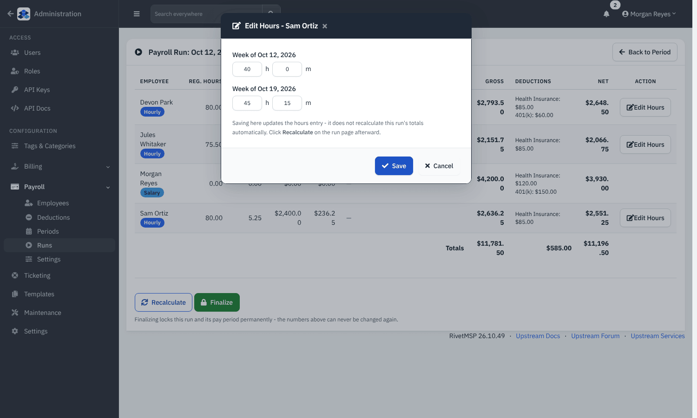

*Figure 14 — **Edit Hours** shows the person's weeks. Saving only updates the hours: click **Recalculate** afterwards to see the new totals.*

Overtime is worked out week by week: in a week of 45 hours with a 40-hour threshold, 40 hours are regular and 5 are overtime at rate × multiplier.

### Finalize

Click **Finalize** and confirm. The run becomes **Finalized** and its period becomes **Locked**: hours can no longer be edited and the run cannot be recalculated.

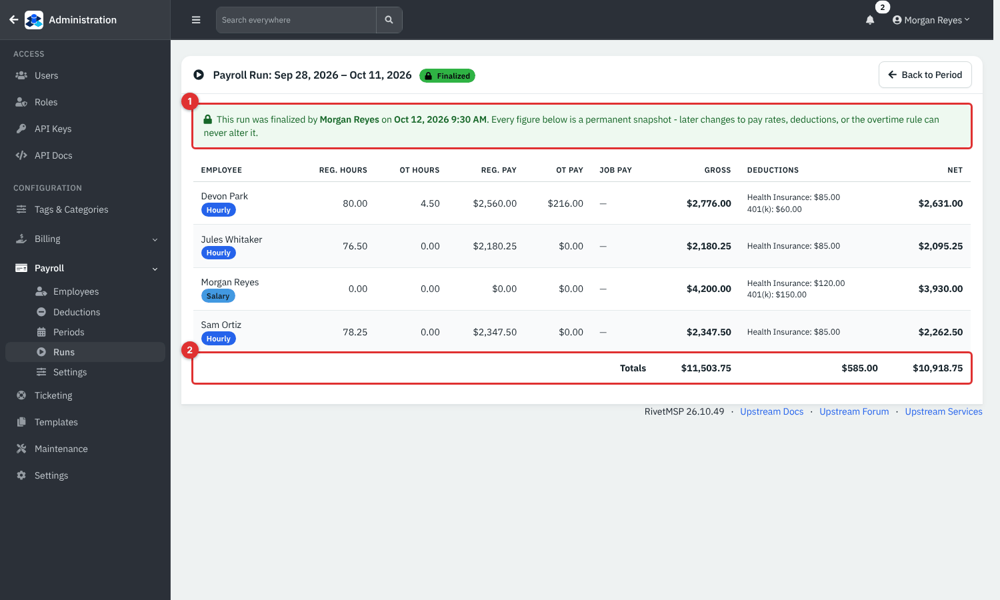

*Figure 15 — A finalized run. The notice (1) says who finalized it and when; the totals row (2) is the run total. Every figure is a snapshot of that moment.*

> **Note.** Finalizing cannot be undone. Check the numbers, preferably with the person who does your payroll, before you click.

## Reference

### Pay types

| Type | How pay is worked out |
|---|---|
| **Hourly** | Hours per week up to the threshold × rate, plus hours above it × rate × multiplier. |
| **Salary** | The flat per-period amount. No hours, no overtime, no proration. |
| Job-specific hours | Hours × the job's own rate, added to either type. |

### Statuses

| Item | Status | Meaning |
|---|---|---|
| Period | **Open** | Hours can be changed. |
| Period | **Locked** | Its run is finalized. |
| Run | **Draft** | Can be recalculated and edited. |
| Run | **Finalized** | Permanent. |

### Run columns

**Employee** (with **Hourly** or **Salary**), **Reg. Hours**, **OT Hours**, **Reg. Pay**, **OT Pay**, **Job Pay**, **Gross**, **Deductions**, **Net**, and a totals row.

## Tips and good practice

- Create the period, enter all hours, then run: it is quicker than recalculating many times.
- Use job-specific hours for premium work, not a change to the person's rate, so the standard rate stays untouched.
- Keep payroll in an administrator-only account. Everything here is confidential.
- Run payroll for the period only after hours are approved; there is no way to reopen a finalized period.

## Related guides

- [Expenses, revenues and accounts](18-expenses-revenues-accounts.md): record the actual wage payments as expenses.
- [Getting started](01-getting-started.md): roles and administrator access.
- [Billing and worksheets for tickets](06-ticket-billing-and-worksheets.md): the time clients are billed for, which is separate from payroll hours.
