# Accounting sync and Pax8

Two connections that move money-related data between RivetMSP and outside services. **Accounting** pushes your customers, items, invoices, quotes and payments to **QuickBooks Online** or **Xero** so your bookkeeper does not retype them. **Pax8** pulls what you pay for each client's Microsoft 365 and other cloud subscriptions, compares it with what you bill, and can optionally keep the licence line items on a client's recurring invoice up to date.

| | |
|---|---|
| **Where to find it** | Administration → **Settings** → **Workflows** → **Accounting**. Pax8: Administration → **Settings** → **Connections & data** → **Integrations** → the **Pax8** tab. |
| **Who can use it** | Administrators only. |
| **Turn it on** | The invoicing module (Administration → **Settings** → **Modules**). Accounting is then enabled by saving your app credentials and connecting. Pax8 is enabled by saving your Pax8 API credentials and switching **Enabled** on. The background worker must be on (Administration → **Settings** → **Notifications** → **Enable Cron**). |

> **Not verified on a live service.** QuickBooks Online, Xero and Pax8 cannot be reached from the demo company that produced the screenshots. The screens show **seeded example rows** (invented customer ids, invoice ids and subscriptions) and the connection badges say **Not Connected**. The steps for connecting are described from the settings screens and the product's code. The product itself says the Xero and Pax8 integrations have so far only been tested against stand-in test servers, never the real services: try them with a small test company first and check the results against the provider's own documentation.

## What it's for

- Accounting: have every invoice you send, every payment you record and every quote you send appear in your accounting package automatically.
- Pax8: see at a glance what each client's cloud licences cost you, what you bill them, and your margin.
- Pax8: optionally keep the licence quantities on a client's recurring invoice in step with Pax8, with your own price per seat.

## A quick tour

### Where the settings live

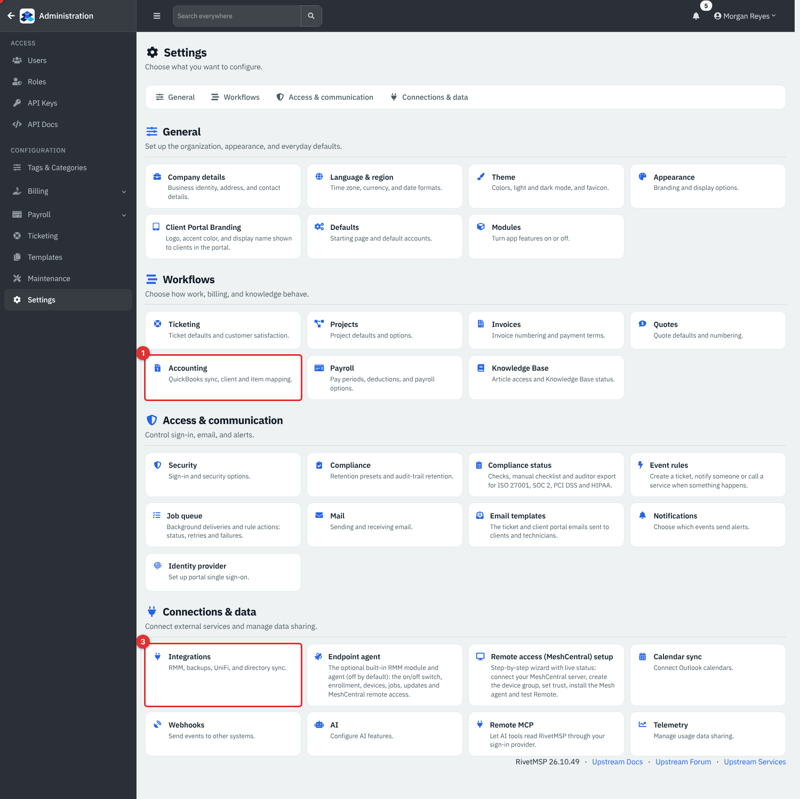

*Figure 1 — Administration → **Settings**. **Accounting** (1) is in the **Workflows** group and is only shown when invoicing is on. **Payroll** (2) is next to it. **Integrations** (3), under **Connections & data**, leads to the Pax8 page.*

### Accounting: four tabs

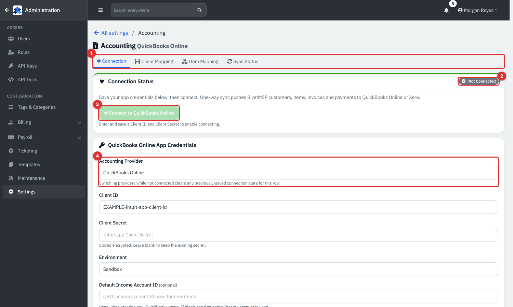

*Figure 2 — Administration → Settings → **Accounting**, **Connection** tab.*

1. The tabs: **Connection**, **Client Mapping**, **Item Mapping** and **Sync Status**.
2. The status badge: **Connected** or **Not Connected**.
3. **Connect to QuickBooks Online** (or Xero). It stays greyed out until a Client ID and Client Secret are saved.
4. **Accounting Provider**: **QuickBooks Online** or **Xero**. It cannot be changed while connected.

## Common tasks

### Connect QuickBooks Online or Xero

1. Create a developer app with the provider (an Intuit app for QuickBooks Online, a Xero app for Xero) and note its **Client ID** and **Client Secret**. Use the redirect address shown by your provider's instructions for your RivetMSP server address.
2. In RivetMSP open **Accounting** → **Connection**, scroll to the credentials card and fill it in.

   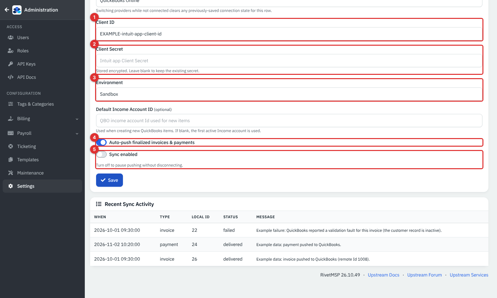

   *Figure 3 — **Client ID** (1), **Client Secret** (2, stored encrypted; leave blank to keep the saved one), **Environment** (3, **Production** or **Sandbox** for QuickBooks), **Auto-push finalized invoices & payments** (4) and **Sync enabled** (5).*

3. Click **Save**, then **Connect to QuickBooks Online** (or Xero) and sign in to the provider to allow access. You return to RivetMSP and the badge reads **Connected**, with the company id, environment and when the access token expires (it is renewed automatically).
4. Use **Default Income Account ID** (QuickBooks) or **Default Bank Account Code** (Xero) if you want new items or payments to go to a particular account. Left blank, the first active income account (QuickBooks) or bank account (Xero) is used.

Turn **Sync enabled** off to pause pushing without disconnecting. **Disconnect** removes the connection (confirm first). **Disconnect before switching provider.**

The lower part of the **Connection** tab, **Recent Sync Activity**, lists the latest pushes and errors.

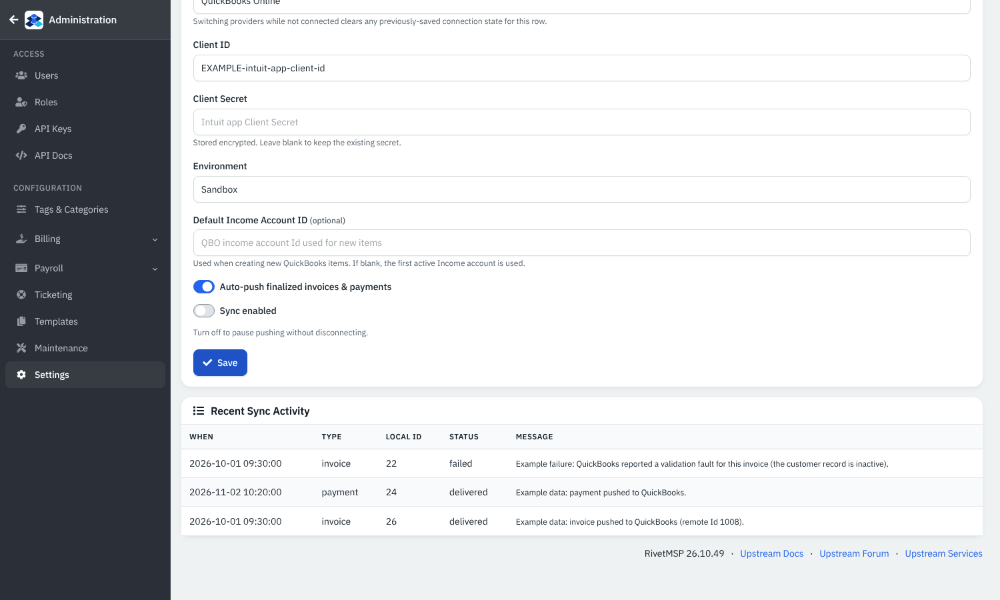

*Figure 4 — Recent Sync Activity. Example rows, not a live connection.*

### What is pushed, and when

With **Auto-push** on:

- An **invoice** is queued when it becomes **Sent**: when you click **Mark Sent**, or e-mail it from a draft.
- A **payment** is queued when you record it ([Payments](17-payments-autopay-stripe.md)), including batch, card and AutoPay payments.
- A **quote** is queued when it is sent, and arrives in QuickBooks as an **Estimate**.
- The **client** (as a customer) and the **products** on its lines (as items) are created first, if they are not mapped yet.

Everything goes through a queue. A background job sends the queued items, one at a time. A failed item is retried after 5 minutes, then 30 minutes, 2 hours and 6 hours, and is marked **failed** after the fifth attempt. An invoice is always pushed before its payment, and nothing already mapped is ever created twice.

Pushing is one-way: changing a record in QuickBooks or Xero does not change RivetMSP. The exceptions are the optional manual **Import** buttons below.

### Map clients to customers

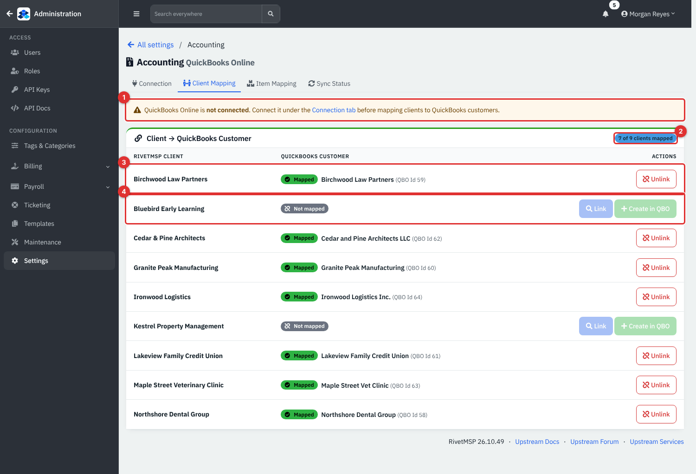

*Figure 5 — **Client Mapping**. The warning (1) appears until you connect. The badge (2) counts mapped clients. A mapped row (3) shows the provider customer name and id with **Unlink**; an unmapped row (4) offers **Link** and **Create in QBO**.*

- **Link** searches the provider's customers so you can pick the existing one.
- **Create in QBO** (or Xero) makes a new customer from the client's name and primary contact.
- **Unlink** removes the mapping (the customer in the provider is not touched).

You do not have to map everything in advance: a client with no mapping is created automatically the first time one of its invoices is pushed. Map clients that already exist in your books first to avoid duplicates.

### Map products to items

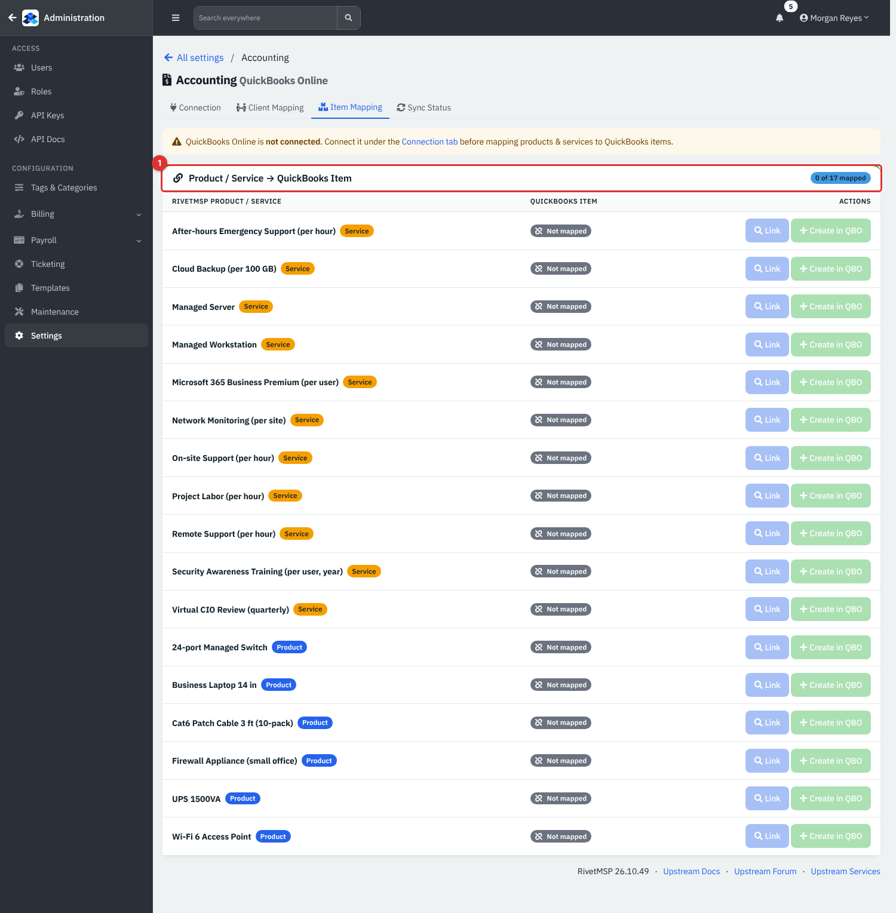

*Figure 6 — **Item Mapping**: each product or service (with a **product** or **service** label) shows **Mapped** with the provider item, or **Not mapped** with **Link** and **Create** buttons. When connected, an **Import from QuickBooks** panel lists items that exist in QuickBooks but not in RivetMSP, with **Import** and **Import all**.*

### Watch the queue (Sync Status)

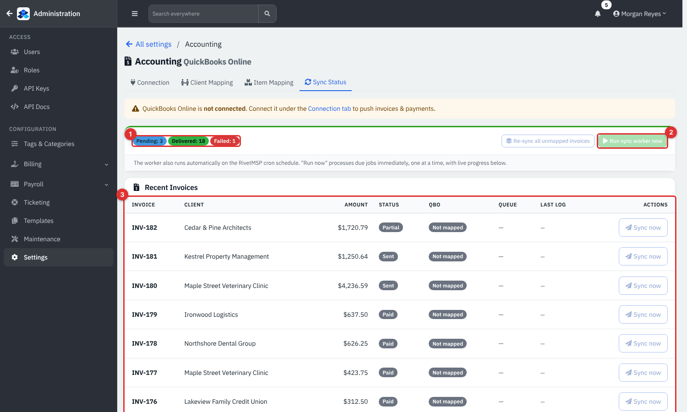

*Figure 7 — **Sync Status**. Counts of **Pending**, **Delivered** and **Failed** jobs (1), **Re-sync all unmapped invoices** and **Run sync worker now** (2), and the **Recent Invoices** table (3).*

Each recent invoice, quote and payment shows its provider id (**Id …** or **Not mapped**), its queue state, the last log line and **Sync now**. A failed row also shows **Retry**. The **Run sync worker now** button processes due jobs immediately with live progress, instead of waiting for the scheduled job. Below the invoices are **Recent Quotes** and **Recent Payments**.

With QuickBooks connected, the tab also has **Import** panels for invoices, estimates and payments that exist in QuickBooks but not in RivetMSP; each has **Import** and **Import all**. Use them once, when you start, to bring history across. Xero does not support these imports yet; push from RivetMSP instead.

### Connect Pax8

Pax8 is a one-way **pull**: RivetMSP reads your subscriptions and never changes anything at Pax8.

1. Administration → **Settings** → **Integrations** → the **Pax8** tab.

   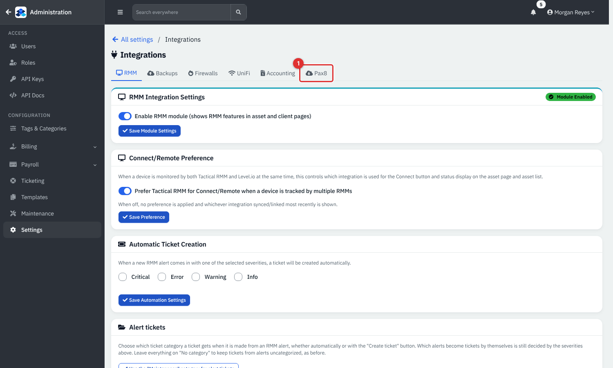

   *Figure 8 — The **Pax8** tab on the Integrations page.*

2. On **Connection** enter the **Pax8 API Client ID** and **Pax8 API Client Secret** from your Pax8 partner account.

   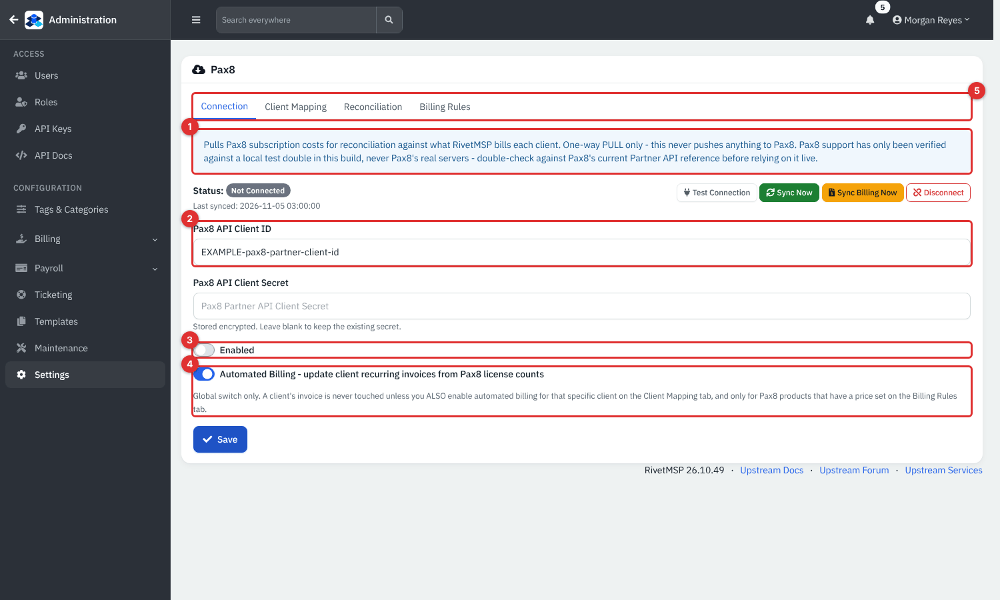

   *Figure 9 — Pax8 **Connection**. The note (1) says it is pull-only. **Client ID** and **Secret** (2). **Enabled** (3). **Automated Billing** (4). The tabs (5): **Connection**, **Client Mapping**, **Reconciliation**, **Billing Rules**.*

3. Switch **Enabled** on and **Save**. Click **Test Connection** to check the credentials, and **Sync Now** to pull straight away. Once a day the background worker syncs on its own. **Last synced** shows the time.
4. **Disconnect** clears the access token and switches Pax8 off.

### Map Pax8 companies to clients

After the first sync, every Pax8 company appears on **Client Mapping**.

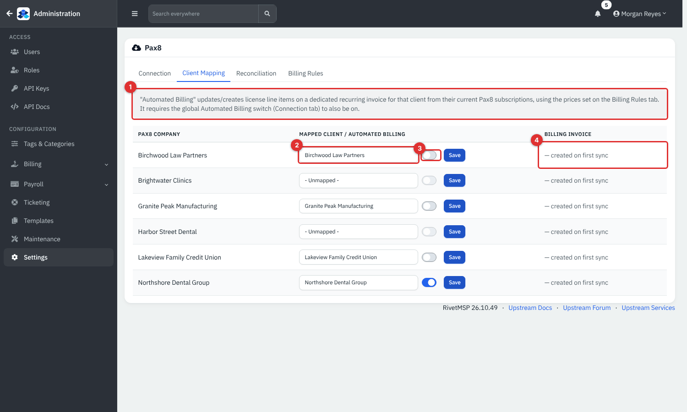

*Figure 10 — **Client Mapping**. For each Pax8 company choose the RivetMSP client (2) and click **Save**. The switch (3) turns **Automated Billing** on for that client; the **Billing Invoice** column (4) shows the recurring invoice that automated billing uses, or "created on first sync".*

Subscription costs are only pulled for mapped companies. A company that is **Unmapped** is listed but its costs are not stored.

### Compare cost and billing (Reconciliation)

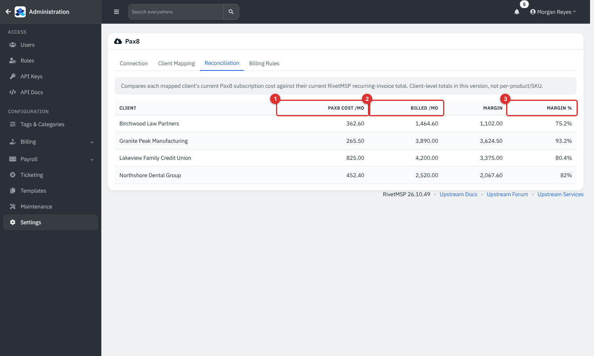

*Figure 11 — **Reconciliation**.*

1. **Pax8 Cost /mo**: the monthly total of the client's **active** Pax8 subscriptions.
2. **Billed /mo**: the total of the client's active recurring invoices in RivetMSP.
3. **Margin %**: billed minus cost, as a percentage of billed.

A negative margin turns the row red. The comparison is by client total, not by product: it includes everything you bill the client on recurring invoices, not only licences, so read it as a rough guide.

### Optional: automated billing of licences

This keeps a recurring invoice's licence lines in step with Pax8. It is off until you switch on **three** things, so connecting Pax8 never changes an invoice by surprise:

1. The global **Automated Billing** switch on **Connection**.
2. The client's own switch on **Client Mapping**.
3. A price on **Billing Rules** for each Pax8 product you want billed.

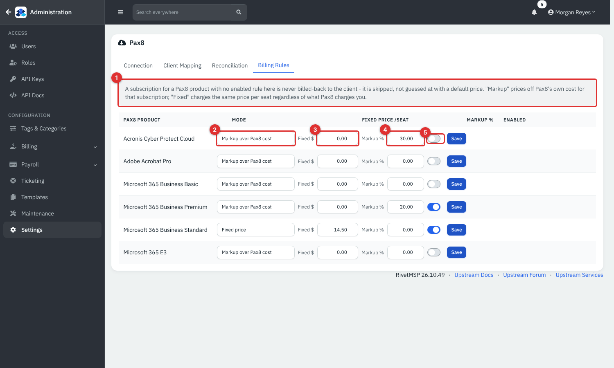

*Figure 12 — **Billing Rules**. For each Pax8 product choose **Markup over Pax8 cost** or **Fixed price** (2), fill in **Fixed $** per seat (3) or **Markup %** (4), switch **Enabled** on (5) and click **Save**.*

When the sync runs (daily, or **Sync Billing Now** on **Connection**):

- A **dedicated recurring invoice** called *Pax8 M365 Licensing (auto-managed)* is created for the client the first time, monthly.
- Each active subscription with an enabled rule becomes a line: product name × seat count × price per seat. Quantity or price changes update the line.
- A subscription that is cancelled in Pax8 has its line **archived**, never deleted.
- A subscription with no enabled rule is skipped, not guessed at.
- Lines you added to that invoice by hand are left alone.

## Reference

### Accounting tabs

| Tab | What it does |
|---|---|
| **Connection** | Credentials, connect/disconnect, auto-push and enabled switches, recent activity. |
| **Client Mapping** | Link or create provider customers for clients. |
| **Item Mapping** | Link or create provider items for products and services; import items. |
| **Sync Status** | Queue counts, retry, run now, import invoices, estimates and payments (QuickBooks). |

### Queue states

| State | Meaning |
|---|---|
| **Pending** | Waiting to be sent, or waiting for a retry time. |
| **Delivered** | Sent and mapped. |
| **Failed** | Gave up after five attempts. Fix the cause, then **Retry**. |

### Pax8 settings

| Field | Meaning |
|---|---|
| **Pax8 API Client ID / Secret** | Partner API credentials. The secret is stored encrypted. |
| **Enabled** | Master switch for the daily sync. |
| **Automated Billing** | Global permission to update recurring invoices. |
| Billing rule **Mode** | **Markup over Pax8 cost** adds the percentage to Pax8's unit cost; **Fixed price** uses your set price per seat. |

## Tips and good practice

- Map existing clients and items first, then switch **Sync enabled** on, so nothing is duplicated.
- Check **Sync Status** after the first week for **Failed** items. A typical cause is a customer that is inactive in the provider.
- Start Pax8 reconciliation without automated billing. Turn billing on for one test client before the rest.
- Review the auto-managed recurring invoice after the first sync, and check the invoice date and amount before it is next sent.
- Keep the provider's own documentation to hand: the two sides change their programming interfaces from time to time.

## Related guides

- [Payments, AutoPay and Stripe](17-payments-autopay-stripe.md): the payments that are pushed.
- [Products, quotes and invoices](15-products-quotes-invoices.md) and [Contracts and recurring invoices](16-contracts-and-recurring-invoices.md): the records that are synced.
- [Expenses, revenues and accounts](18-expenses-revenues-accounts.md): the cost side, including recording what you pay Pax8.
- [Integrations](29-integrations.md): the other connections on the Integrations page.
