# Leads, opportunities and the sales pipeline

The CRM tools in RivetMSP help you win new business without a separate sales program. A **lead** is a company you are still talking to. An **opportunity** is a specific deal, with an amount, a chance of winning and an expected close date. When a lead says yes, you convert it to a **client** and the company, its contacts and its deals carry over to your day-to-day work.

| | |
|---|---|
| **Where to find it** | Leads: sidebar → **Organization** → **Clients**, then the **Leads** and **Board** buttons. Deals: sidebar → **CRM** → **Pipeline** and **Opportunities**. A client's open deals also appear on its **Overview** page. |
| **Who can use it** | Leads and the board need the role permission **Client**: **Read** to look, **Modify** to add, edit, move, convert and archive leads and to log activities on contacts. Pipeline and Opportunities need **Sales**: **Read** to look (the **CRM** group is hidden without it), **Modify** to add, edit and drag deals, **Full** to delete them. Technicians who may only see some clients see only those clients' leads and deals. |
| **Turn it on** | Nothing to switch on. There is no CRM toggle under **Administration** → **Settings** → **Modules**; the screens are there for every role that has the permissions above. Follow-up reminders also need scheduled jobs (see [Log calls, e-mails and follow-ups](#log-calls-e-mails-and-follow-ups)). |

All screens in this guide show example data for a fictional company, Lakeshore Managed IT. Nothing on them is a live connection to any other service.

## What it's for

- Keep a list of prospects, with where each came from (**Lead Source**), who on your team owns it (**Lead Owner**) and how promising it is (**Lead Score**, 0 to 100).
- See at a glance which stage every lead has reached on the **Lead pipeline** board, and move a lead by dragging its card.
- Turn a won lead into a client in one step, without retyping anything.
- Track each deal's value, probability and close date, and see the total and the weighted forecast of everything still open.
- Record calls, e-mails, meetings and notes against a contact, with an optional reminder.

Two different sets of stages are used, and they are meant for different questions:

| | Lead stages (the board) | Opportunity stages (the pipeline) |
|---|---|---|
| Question it answers | How far along is this prospect? | How likely is this deal, and for how much? |
| Stages | **New**, **Contacted**, **Qualified**, **Proposal**, **Negotiation**, **Lost** | **Qualification**, **Proposal**, **Negotiation**, **Won**, **Lost** |
| Where you see it | Clients → **Board**, and the **Lead** column of the Leads list | CRM → **Pipeline** and **Opportunities** |
| Money | None | **Amount**, **Probability (%)**, weighted value |
| Finished when | You convert the lead to a client (or mark it **Lost**) | The deal is **Won** or **Lost** |

A lead can have any number of opportunities, and so can an existing client, which is how you track an upsell such as a security bundle for a current client.

## A quick tour

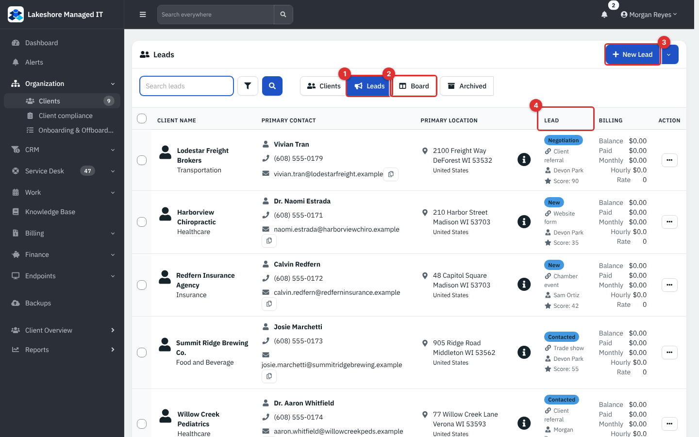

*Figure 1 — Clients → Leads. Example data, not a live connection.*

1. **Leads** switches the Clients page to prospects. **Clients** switches back; **Archived** shows archived records.
2. **Board** opens the Lead pipeline board.
3. **New Lead** opens the lead dialog. The arrow beside it offers **Import** and **Export**.
4. The **Lead** column summarizes the lead: its stage badge, its source, its owner and its score.

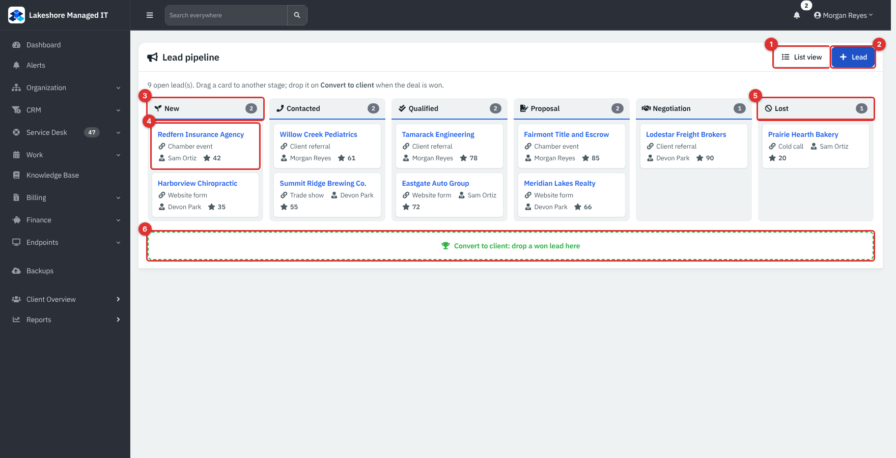

*Figure 2 — The Lead pipeline board. Example data.*

1. **List view** returns to the Leads list.
2. **Lead** adds a lead (shown only if you may Modify clients).
3. Each column is a stage: **New**, **Contacted**, **Qualified**, **Proposal**, **Negotiation**, **Lost**. The number is how many leads are in it.
4. A card shows the company name (a link to its Client Overview), the source, the owner and the score. Cards are sorted by score, highest first.
5. **Lost** holds leads you gave up on. They do not count in the "open lead(s)" total above the board.
6. The green **Convert to client** bar is where you drop a won lead.

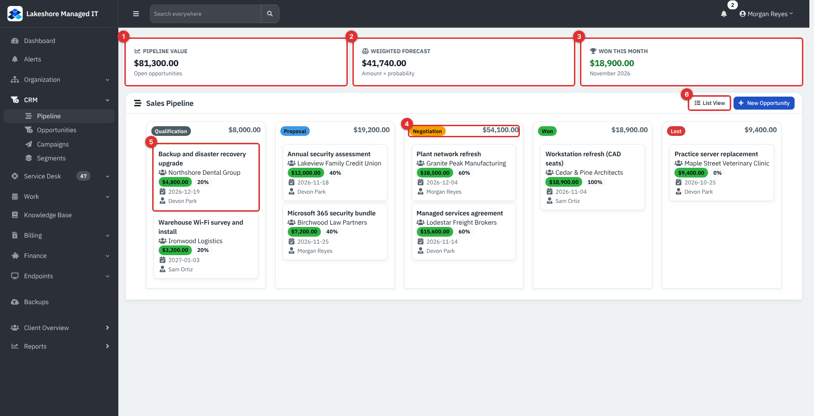

*Figure 3 — CRM → Pipeline. Example data.*

1. **Pipeline Value**: the total **Amount** of all open opportunities.
2. **Weighted Forecast**: each open opportunity's amount multiplied by its probability, added up.
3. **Won This Month**: the amount of deals in the **Won** stage that were last updated in the current month.
4. A stage column. The badge is the stage and the figure on the right is the total amount in that column.
5. A deal card: name, client, amount, probability, expected close date and owner.
6. **List View** opens the table of opportunities. **New Opportunity** is beside it.

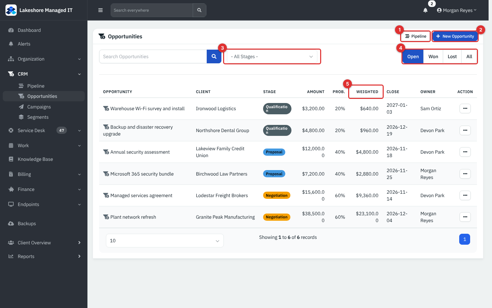

*Figure 4 — CRM → Opportunities. Example data.*

1. **Pipeline** returns to the board.
2. **New Opportunity** adds a deal.
3. The stage filter, **- All Stages -**, narrows the list to one stage.
4. **Open**, **Won**, **Lost** and **All** filter by outcome. **Open** is selected when you arrive.
5. **Weighted** is **Amount** × **Prob.**.

## Common tasks

### Add a lead

1. Open **Organization** → **Clients** and select **Leads**.
2. Select **New Lead**.
3. Enter the **Name** of the company. The **Is Lead** box beside it is already ticked.
4. Fill in the **Lead Details** box, then the other tabs if you know the answers: **Location**, **Contact** (the person you are talking to) and **Billing**.
5. Select **Create Lead**.

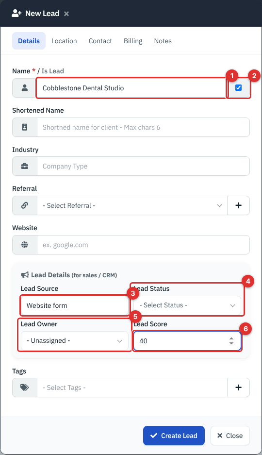

*Figure 5 — The New Lead dialog, Details tab.*

1. **Name** is required.
2. **Is Lead** marks the record as a prospect. Untick it and the record becomes an ordinary client.
3. **Lead Source** is free text, up to 60 characters (for example **Website form**, **Trade show**, **Client referral**).
4. **Lead Status** is the stage. Leave it empty if you like: the lead then appears in the **New** column of the board.
5. **Lead Owner** lists the active team members; **- Unassigned -** is the default.
6. **Lead Score** is a whole number from 0 to 100. A score of 0 is stored as empty and the card shows no score.

**Note:** the status box lets you type your own word as well as choose one. The board only has the six columns above, so a lead with any other status (a blank one, a custom one, or **Converted**) is shown in the **New** column so that no lead is hidden.

The dialog is the same one used to add a client. The lead tools use the same company, contact and location records, so a lead's contacts are real contacts: they can be tagged, logged against and included in a campaign (see [Campaigns and segments](22-campaigns-and-segments.md)). See [Clients, contacts and locations](03-clients-contacts-locations.md) for those tabs.

### Find and read your leads

1. In the Leads list, type in **Search leads** and press Enter. The search looks at the name, short name, industry, referral, contact, address and tags.
2. Use the funnel button for more filters (industry, referral, tags, dates).
3. Read the **Lead** column: the stage badge, the source, the owner and **Score**.

Archived leads stay out of both the list and the board. Select **Archived** to find them.

### Move a lead to another stage

On the board:

1. Point at a card and drag it into another column. Release it.
2. The move is saved immediately and the numbers at the top of each column update.

If the move cannot be saved (for example, the session has expired or you lack Modify access to clients), the card jumps back to where it was and a message tells you why. Nothing changes in that case.

Without dragging: open the row menu (**...**) on the Leads list, select **Edit** and choose another **Lead Status**.

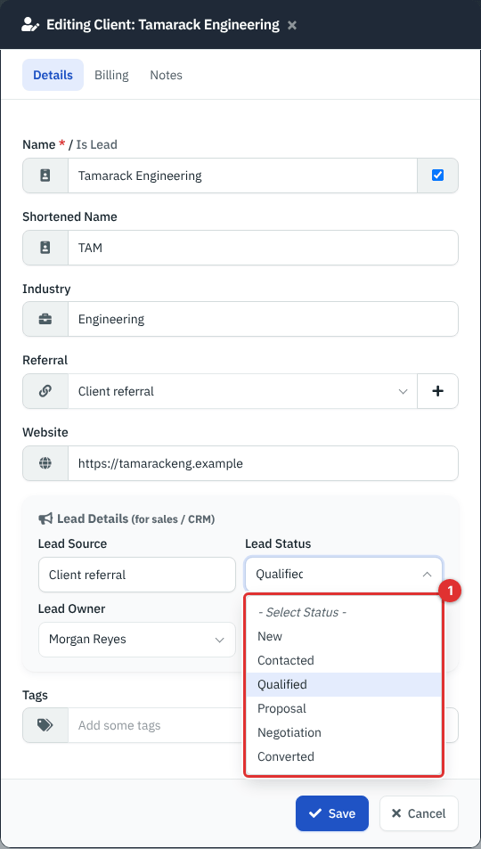

*Figure 6 — Editing a lead. (1) The Lead Status list. It offers the six board stages plus Converted.*

The list also offers **Converted**. Do not pick it by hand; use the convert action below, which also changes the record from a lead into a client.

### Convert a lead to a client

Do this when the prospect has said yes.

1. On the board, drag the card onto the green **Convert to client** bar. The bar appears only if you may Modify clients.
2. Or, on the Leads list, open the row menu (**...**) and select **Convert to Client**, then confirm.

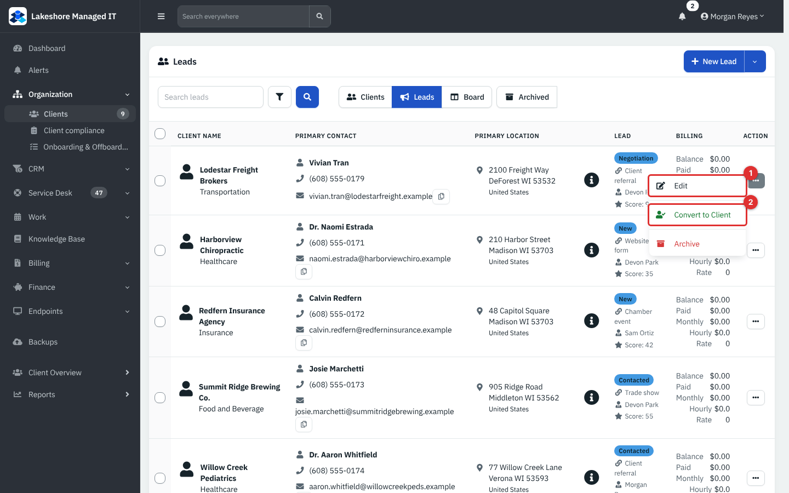

*Figure 7 — The row menu. (1) Edit. (2) Convert to Client. Archive is beneath it.*

What happens:

- The record stops being a lead. It leaves the Leads list and board and appears under **Clients**.
- Its **Lead Status** is set to **Converted**.
- Its contacts, locations and opportunities stay attached.
- The action is recorded in the audit log.

After converting, open **Edit** and complete the **Billing** tab (hourly rate, payment terms, tax ID) and anything else a client needs.

**Note:** there is no Undo button. If you convert a lead by mistake, edit the client and tick **Is Lead** again; the stage stays **Converted**, so it will show in the **New** column of the board until you change the status.

### Add an opportunity

1. Open **CRM** → **Opportunities** (or **Pipeline**) and select **New Opportunity**. From a client's **Overview** page, select **Add Opportunity** in the **Open Opportunities** card; the client is then filled in and locked.
2. Enter the **Opportunity Name**.
3. Choose the **Client** (a client or a lead) or leave **- No Client -**. Choose the **Contact** if there is one; the list shows that client's contacts only.
4. Choose the **Stage**. The **Probability (%)** changes to the stage's usual value, which you can overwrite.
5. Enter the **Amount**, the **Expected Close Date**, the **Owner** (you, by default) and any **Notes**.
6. Select **Create**.

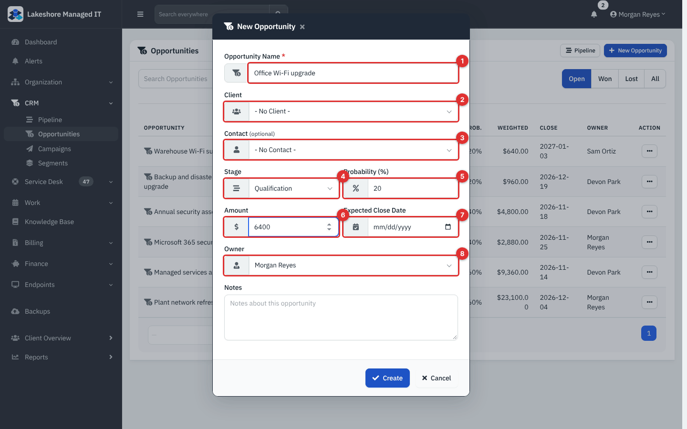

*Figure 8 — The New Opportunity dialog.*

1. **Opportunity Name** (required).
2. **Client**.
3. **Contact (optional)**.
4. **Stage**.
5. **Probability (%)**, 0 to 100.
6. **Amount**.
7. **Expected Close Date**.
8. **Owner**.

### Move an opportunity through the pipeline

1. Open **CRM** → **Pipeline**.
2. Drag the deal card to another stage column. The page reloads so that the tiles and column totals are up to date.
3. To change anything else, double-click the card to open **Edit Opportunity**.

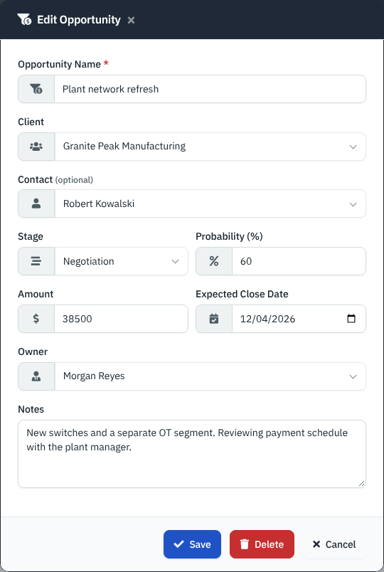

*Figure 9 — Edit Opportunity. Delete appears only with Full access to Sales.*

What the stage means for the deal:

| Stage | Default probability | Status set on the deal |
|---|---|---|
| **Qualification** | 20 | open |
| **Proposal** | 40 | open |
| **Negotiation** | 60 | open |
| **Won** | 100 | won |
| **Lost** | 0 | lost |

**Note:** the probability follows the stage only in the **Edit Opportunity** and **New Opportunity** dialogs. When you drag a card on the board, only the stage and status change; the probability stays as it was, so the weighted forecast does not change by itself. Open the card and update **Probability (%)** if you want it to.

A deal in a stage the board does not know (an older record) is shown in the **Qualification** column.

### Read the numbers

The tiles at the top of the pipeline count only deals that are not archived. **Pipeline Value** and **Weighted Forecast** count deals whose status is open, so Won and Lost deals drop out of them. **Won This Month** adds the amounts of deals in the **Won** stage whose last update falls in the current calendar month (a deal with no update date uses its creation date).

### Work with the list

1. Open **CRM** → **Opportunities**.
2. Use the status buttons (**Open**, **Won**, **Lost**, **All**) and the stage filter. **Search Opportunities** looks at the deal name, the client, the contact and the owner.
3. Select a deal's name or **...** → **Edit** to change it.
4. With Full access to Sales, **...** → **Delete** removes the deal. This is permanent: deleted deals are not archived and cannot be restored.

To see one client's deals only, select **View all** in the **Open Opportunities** card on that client's **Overview**.

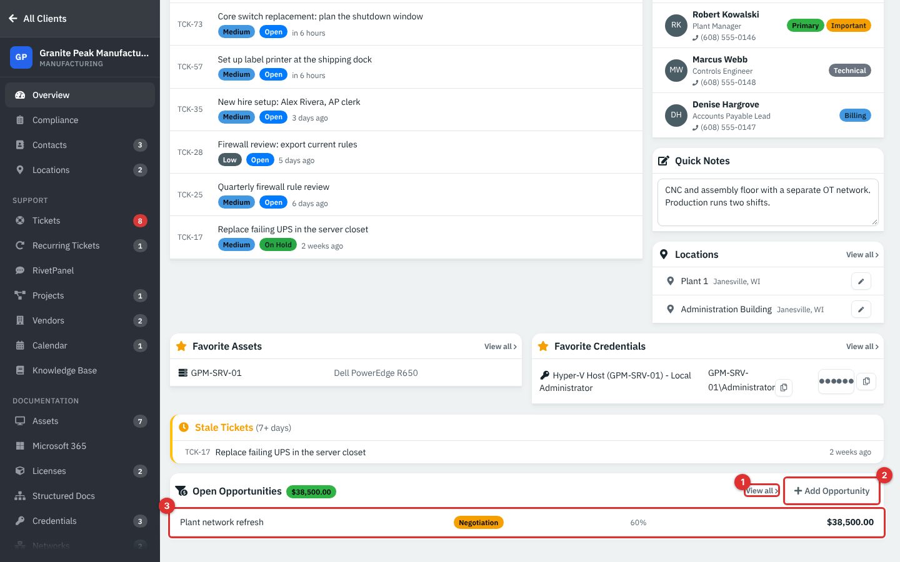

*Figure 10 — Client Overview. (1) View all lists that client's opportunities. (2) Add Opportunity. (3) A deal row with its stage, probability and amount. The card shows up to eight open deals.*

### Log calls, e-mails and follow-ups

The activity timeline is on each **contact's** page, so notes live with the person you spoke to.

1. Open the client, select **Contacts**, then select the contact's name.
2. In **Activity Timeline**, select **Log Activity**.
3. Choose the **Type**: **Call**, **Email**, **Meeting** or **Note**.
4. Add a **Subject** and **Details**.
5. Optionally set **Follow-up Due** and **Reminder**.
6. Select **Log Activity**.

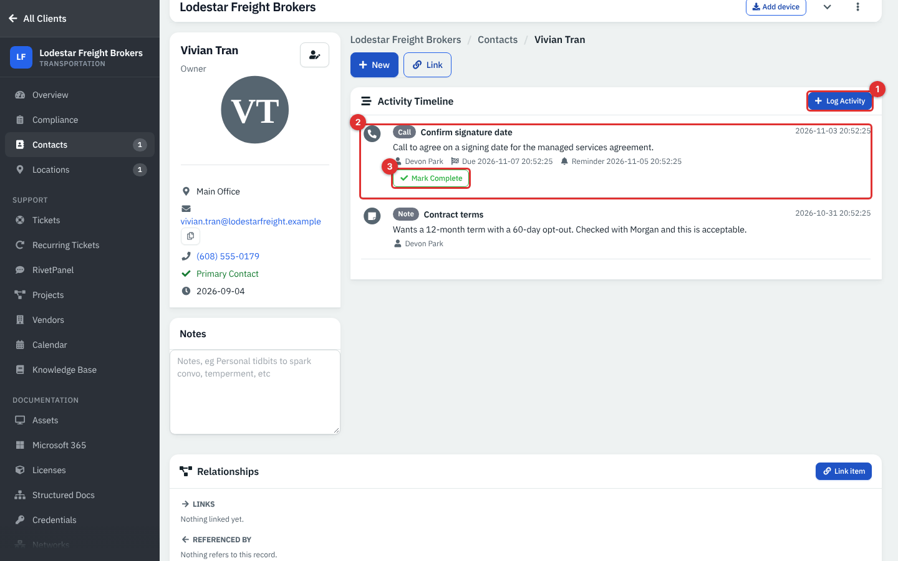

*Figure 11 — The Activity Timeline. (1) Log Activity. (2) An entry with type, subject, owner, due date and reminder. (3) Mark Complete.*

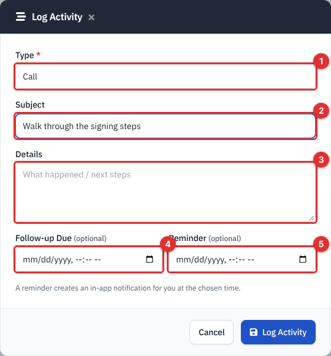

*Figure 12 — The Log Activity dialog. (1) Type. (2) Subject. (3) Details. (4) Follow-up Due. (5) Reminder.*

The timeline shows the activities logged against this contact, and any logged against its client, newest first. An entry that has a due date or a reminder gets a **Mark Complete** button; completing it stops the reminder and shows a **Completed** badge.

**Reminders.** When a reminder time has passed and the entry is not complete, the person who logged it receives a **CRM Follow-up** notification under the bell (the link opens the contact). Each reminder fires once. This is done by the scheduled jobs, so the setting **Enable Cron Job** under **Administration** → **Settings** → **Notifications** must be on and the main job must be running (see [System settings and maintenance](36-system-settings-maintenance.md)). It has not been verified here against a real schedule: the demo seeds the notification by running the same reminder script.

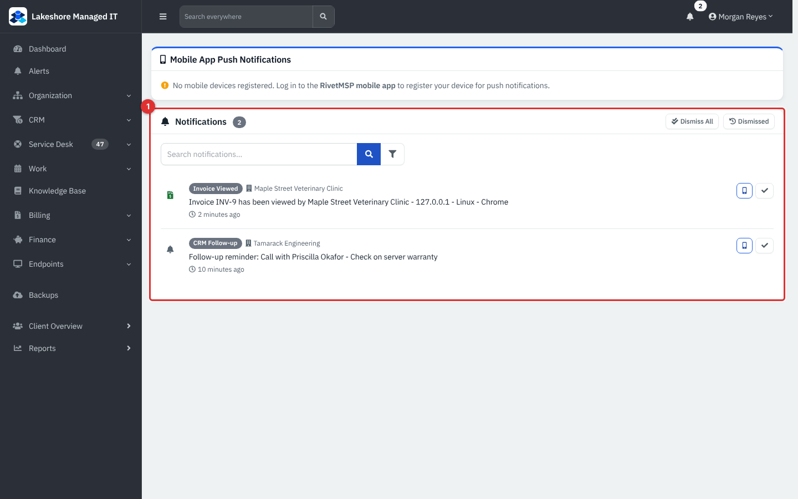

*Figure 13 — A CRM Follow-up notification (the demo shows a seeded reminder).*

To stop these notices, switch off **CRM follow-ups** under your name → **Account** → **Preferences** → **In-app Notifications**; see [Campaigns and segments](22-campaigns-and-segments.md#reminders-and-notifications).

## Reference

### Lead fields

| Field | Where | Notes |
|---|---|---|
| **Is Lead** | Client add/edit dialog | Ticked = lead (Leads list and board). Unticked = client. |
| **Lead Source** | Lead Details | Free text, up to 60 characters. |
| **Lead Status** | Lead Details | **New**, **Contacted**, **Qualified**, **Proposal**, **Negotiation**, **Converted**, **Lost**, or your own text. The board shows six columns; anything else shows under **New**. |
| **Lead Owner** | Lead Details | Any active team member or **- Unassigned -**. |
| **Lead Score** | Lead Details | 0 to 100; 0 is saved as empty. |

### Opportunity fields

| Field | Notes |
|---|---|
| **Opportunity Name** | Required, up to 255 characters. |
| **Client** | Any non-archived client or lead you may see, or **- No Client -**. |
| **Contact** | Optional; limited to the selected client's contacts. Segments use it for **Only contacts with an open opportunity**. |
| **Stage** | **Qualification**, **Proposal**, **Negotiation**, **Won**, **Lost**. |
| **Probability (%)** | 0 to 100. |
| **Amount** | Decimal, in the company currency. |
| **Expected Close Date** | Optional date. |
| **Owner** | Any active team member; defaults to the person adding it. |
| **Notes** | Free text. |

### Permissions at a glance

| Action | Permission |
|---|---|
| See Leads, the Board, and client Overview | **Client** Read |
| Add, edit, move, convert and archive leads; log activities | **Client** Modify |
| See Pipeline and Opportunities (and the **CRM** menu) | **Sales** Read |
| Add, edit and drag opportunities | **Sales** Modify |
| Delete opportunities | **Sales** Full |

## Tips and good practice

- Agree what each lead stage means in your team (for example, **Qualified** = budget and a decision date known) so everyone moves cards the same way.
- Give every lead an owner and a source. Reports on where good clients come from are only as good as this field.
- Put a **Reminder** on every activity that ends with "I will call back", and mark it **Complete** when done.
- Create the opportunity as soon as a price is discussed, then drag it as the talks move on. Open **Edit Opportunity** at a stage change to keep **Probability (%)** honest.
- Convert as soon as the agreement is signed, then finish the **Billing** tab so the new client can be invoiced.
- Use **Lost** rather than deleting a lead or deal: you keep the history and can try again later.

## Related guides

- [Clients, contacts and locations](03-clients-contacts-locations.md)
- [Campaigns and segments](22-campaigns-and-segments.md)
- [Products, quotes and invoices](15-products-quotes-invoices.md)
- [Users, roles and security](34-users-roles-security.md)
- [Getting started](01-getting-started.md)
