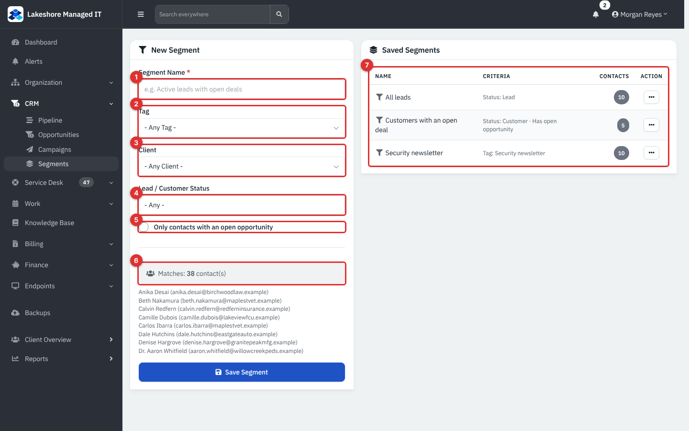
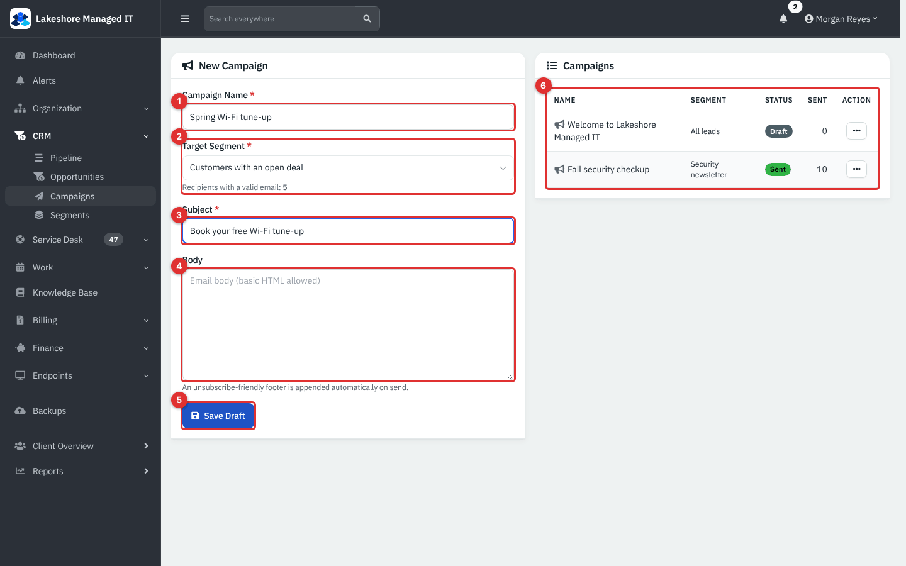
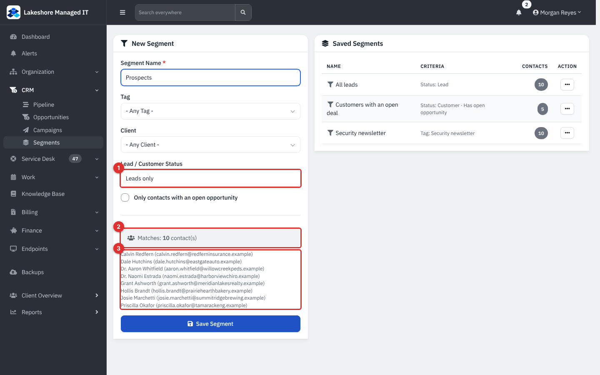
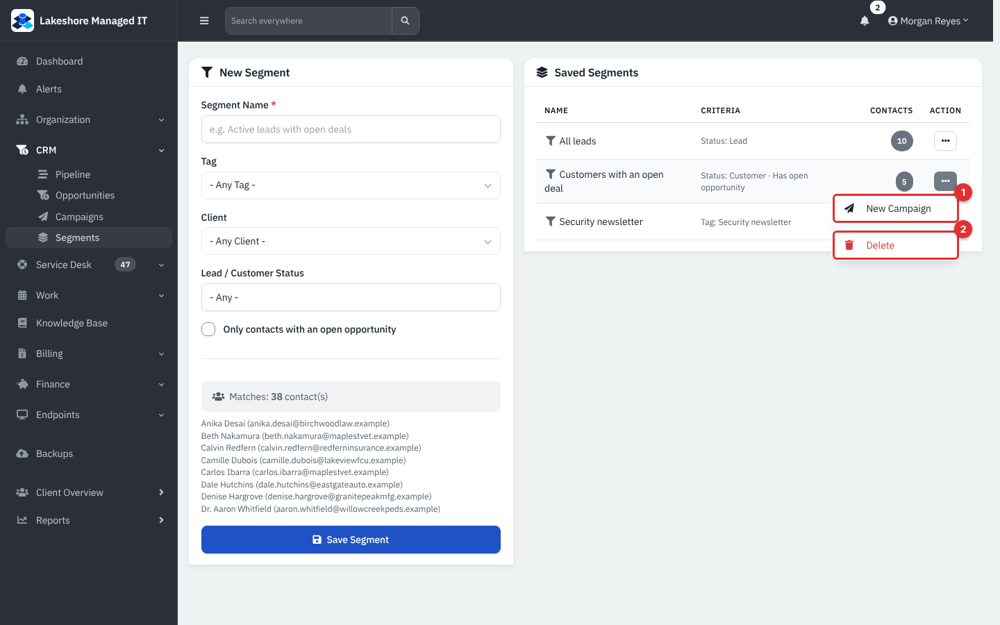
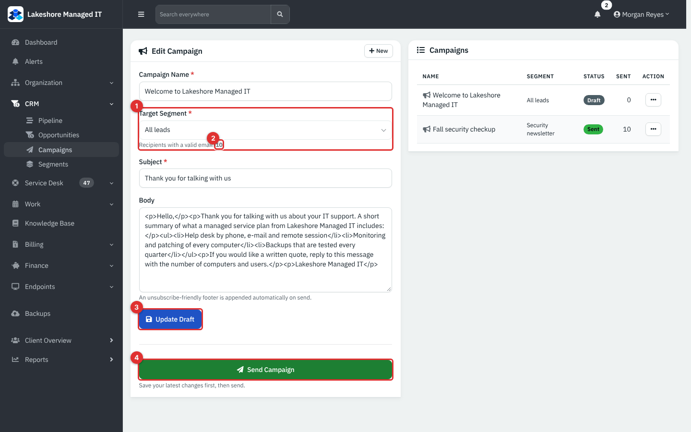
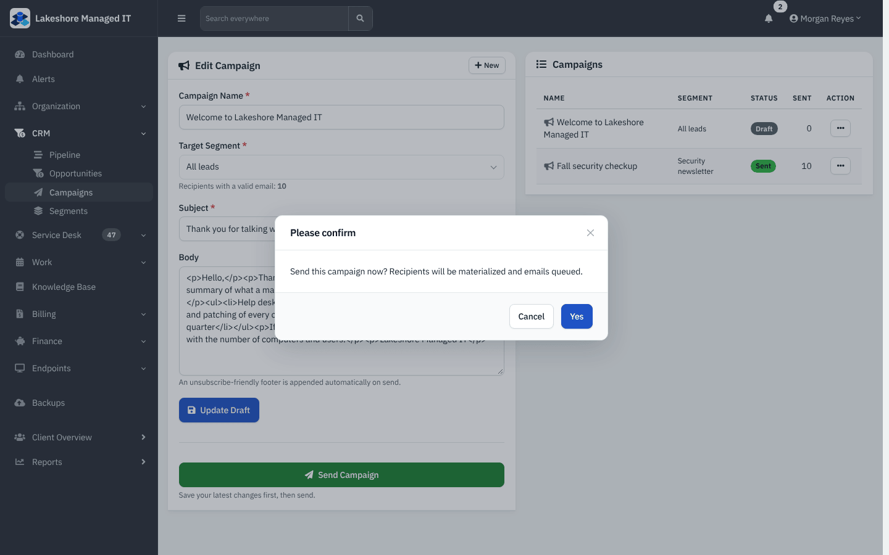
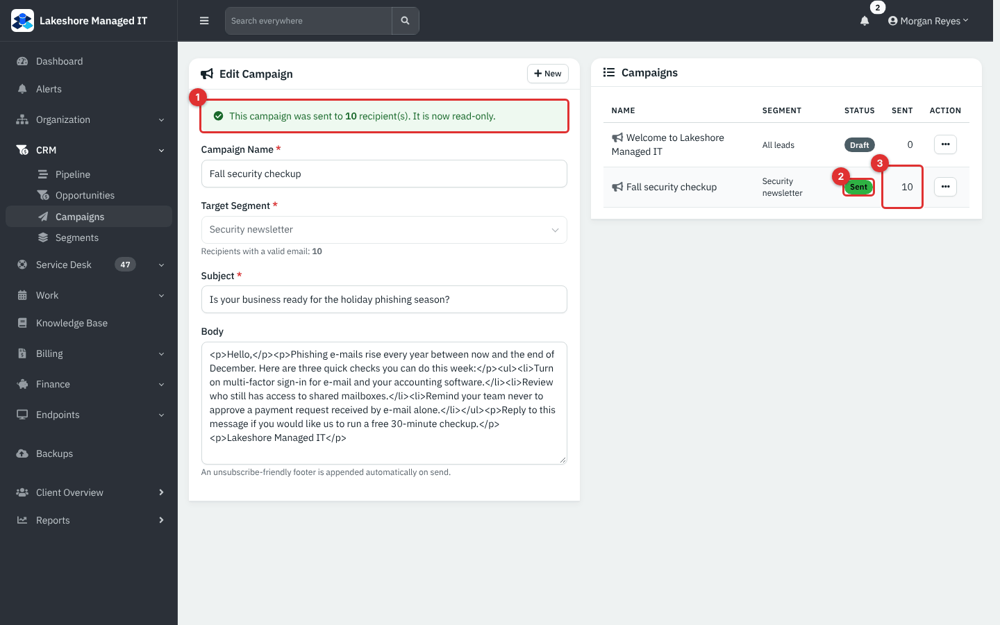
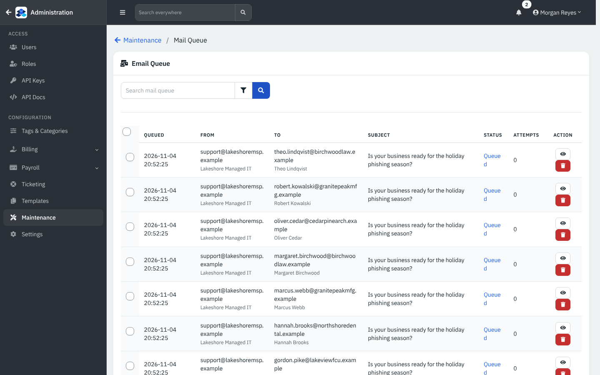
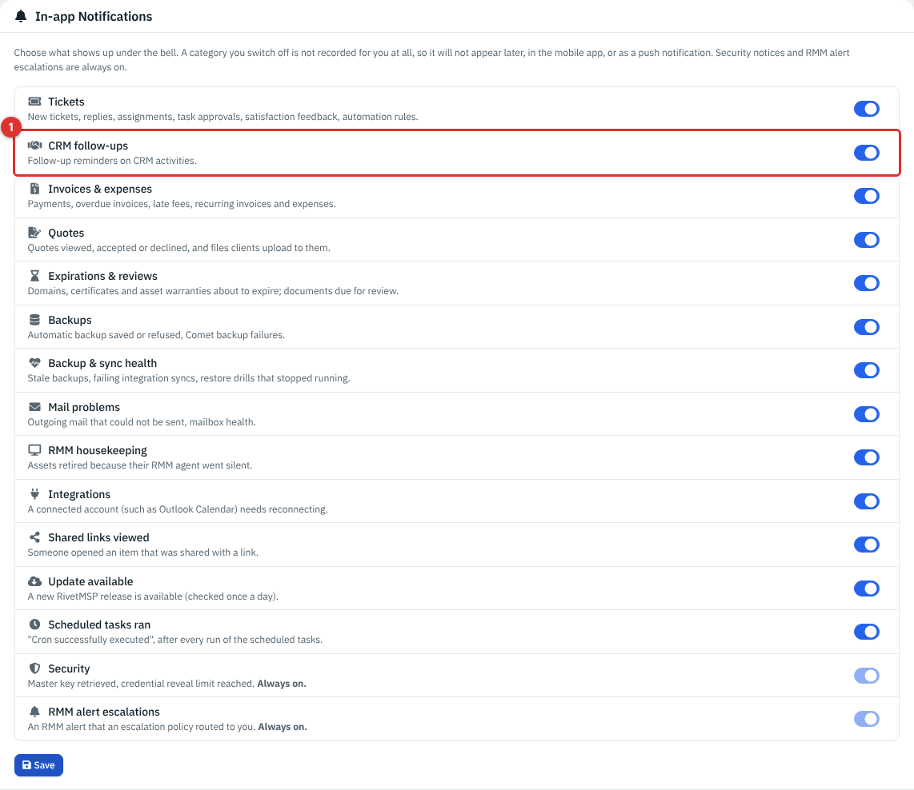

# Campaigns and segments

Campaigns let you send one e-mail to a group of contacts, such as every prospect or everyone who gets your security newsletter. A **segment** is the saved rule that picks the group. A **campaign** is the message plus the segment it goes to. This page covers both, and the follow-up reminders that go with CRM work.

| | |
|---|---|
| **Where to find it** | Sidebar → **CRM** → **Segments** and **Campaigns**. |
| **Who can use it** | Role permission **Sales**: **Read** to see segments and campaigns (and the **CRM** group in the sidebar), **Modify** to create segments, save drafts and send, **Full** to delete segments and campaigns. A user who may see only some clients reaches only the contacts of those clients. |
| **Turn it on** | Nothing to switch on. Sending needs a **From Email** under **Administration** → **Settings** → **Mail** (the **System Default** box in **Mail From Configuration**). Delivery needs working outgoing mail and the scheduled jobs; see [Before you send](#before-you-send). |

All screens show example data for a fictional company, Lakeshore Managed IT. Nothing was sent to a real address: the demo has no mail server, so messages only wait in the mail queue.

## What it's for

- Keep a few saved groups of contacts ("All leads", "Customers with an open deal", "Security newsletter") and see how many people each one holds right now.
- Send a short announcement, a seasonal reminder or a "thank you for talking to us" note to a whole group in one step.
- Keep a record of what you sent and how many people it was queued for.

This is a simple tool: one plain-text or basic HTML message, sent once, to everyone in a segment. It does not schedule sends, personalize messages, track opens or clicks, or manage unsubscribe requests. See [Tips and good practice](#tips-and-good-practice).

## A quick tour

*Figure 1 — CRM → Segments. Example data, not a live connection.*

1. **Segment Name** (required). This is the name you pick later when you build a campaign.
2. **Tag** narrows the group to contacts that carry one tag.
3. **Client** narrows the group to the contacts of one client.
4. **Lead / Customer Status**: **- Any -**, **Leads only** or **Customers only**.
5. **Only contacts with an open opportunity** keeps contacts that are named on an open deal.
6. **Matches** shows how many contacts fit the choices above, live.
7. **Saved Segments** lists each segment with its criteria and its current number of **Contacts**.

*Figure 2 — CRM → Campaigns. Example data.*

1. **Campaign Name** is for your own use; recipients never see it.
2. **Target Segment** chooses who gets it. Under it, **Recipients with a valid email** shows how many of that segment have an address.
3. **Subject** is the e-mail subject line.
4. **Body** is the message. It accepts basic HTML.
5. **Save Draft** keeps the campaign without sending it.
6. The **Campaigns** table lists every campaign with its **Segment**, **Status** (**Draft** or **Sent**) and the number **Sent**.

## Common tasks

### Create a segment

1. Open **CRM** → **Segments**.
2. Type a **Segment Name**.
3. Choose any of **Tag**, **Client**, **Lead / Customer Status** and **Only contacts with an open opportunity**. Leave a box on **Any** to ignore it.
4. Watch **Matches**: it updates as you change the boxes and lists up to eight example names with their e-mail addresses.
5. Select **Save Segment**.

*Figure 3 — Building a segment. (1) Leads only. (2) The count changes at once. (3) The sample list shows up to eight contacts.*

How the choices combine: a contact must satisfy every choice you set (the rules are joined with AND). A segment with no choices matches every contact that is not archived.

What each choice means:

| Choice | A contact matches when |
|---|---|
| **Tag** | The contact has that tag. Tags are assigned on the contact (see [Clients, contacts and locations](03-clients-contacts-locations.md)). |
| **Client** | The contact belongs to that client. |
| **Leads only** | The contact's company is still a lead (see [Leads, opportunities and the sales pipeline](21-crm-leads-and-pipeline.md)). |
| **Customers only** | The contact's company is not a lead. |
| **Only contacts with an open opportunity** | The contact is the **Contact** chosen on at least one deal whose status is open. A deal with no contact chosen does not count. |

**Note:** the count is worked out again each time the page opens, so a saved segment's **Contacts** number changes as your records change. It counts every matching contact, including people with no e-mail address. The campaign form shows the count of people who do have an address. Archived contacts are left out, but the contacts of an archived client are not, unless the contact is archived too.

There is no screen to edit a saved segment. To change one, create a new segment and delete the old one.

### Delete a segment

1. In **Saved Segments**, open the row menu (**...**).
2. Select **Delete** (needs Full access to Sales) and confirm.

*Figure 4 — The row menu. (1) New Campaign opens the campaign form with this segment already chosen. (2) Delete.*

**Note:** deleting a segment does not stop a draft campaign that still points to it. Such a campaign shows an empty segment box, but the **Send Campaign** button still works, and a campaign whose segment is gone is sent to every contact that has an e-mail address. Before you delete a segment, open **Campaigns** and move or delete any draft that uses it.

### Write and save a campaign

1. Open **CRM** → **Campaigns**. (Or use **New Campaign** from a segment's row menu.)
2. Enter the **Campaign Name**, choose the **Target Segment**, and enter the **Subject**.
3. Write the **Body**. Plain paragraphs work; for basic formatting use HTML tags such as `
`, `<ul>` and `<li>`. There is no visual editor and no preview.
4. Select **Save Draft**. You land on the saved campaign, titled **Edit Campaign**, with the status **Draft**.
5. Use **Update Draft** after changes.

A line is added to the foot of every message when it is sent: "You are receiving this message because you are a contact of *your company name*. If you would prefer not to receive these emails, please reply to this message and let us know." You cannot edit this line.

### Before you send

- The segment must be chosen. Without one, the app says "Select a target segment before sending".
- A **From Email** must be set under **Administration** → **Settings** → **Mail** → **Mail From Configuration** → **System Default**. If it is empty the app says "No outbound 'from' email is configured" and does not send. The message comes from this address and name.
- Check **Recipients with a valid email**: this is how many messages will be queued.
- Check the segment and the wording. A sent campaign cannot be recalled.

### Send a campaign

1. Open the draft from the **Campaigns** list.
2. Save your latest changes first with **Update Draft**: sending uses the saved version, not what is on the screen.
3. Select **Send Campaign**.
4. Read the question, "Send this campaign now? Recipients will be materialized and emails queued.", and select **Yes** (or **Cancel**).

*Figure 5 — A draft. (1) Target Segment. (2) The recipient count. (3) Update Draft. (4) Send Campaign (appears only on a saved draft).*

*Figure 6 — The confirmation. Nothing is sent until you select Yes.*

What happens when you confirm:

1. The segment is resolved to contacts that have an e-mail address. Addresses that are not valid are skipped.
2. One record per contact is stored for the campaign, and one message per contact is put in the mail queue. Two contacts that share an address each receive a message.
3. The campaign status changes to **Sent**, the time is stored, and a message such as "queued to 10 recipient(s)" is shown.
4. The campaign is locked. You cannot edit it or send it again.

*Figure 7 — A sent campaign. (1) The notice that it is read-only. (2) The Sent status. (3) The number of recipients queued.*

**Note:** **Sent** (the count) means "queued for sending", not "delivered". The count is written when the messages are placed in the queue. Delivery happens later, by the scheduled mail job.

To send a similar message again, create a new campaign. There is no copy button.

### Check the mail queue

Messages from a campaign wait in the mail queue until the scheduled mail job delivers them.

1. Open **Administration** → **Maintenance** → **Mail queue**.
2. Search for the campaign's subject. Each recipient has a row with the time it was queued, the **From** address, the **To** address, the **Status** and the number of **Attempts**.

*Figure 8 — Administration → Maintenance → Mail queue, showing the messages a campaign queued. Example data: the demo has no mail server, so these stay queued.*

Delivery has not been verified on a live mail server in this guide. It depends on your outgoing mail settings and on the scheduled jobs running (see [System settings and maintenance](36-system-settings-maintenance.md) and [Mail intake and sending](30-mail-intake-and-sending.md), [Webhooks, event rules and jobs](30b-webhooks-event-rules-and-jobs.md) and [AI and the MCP server](30c-ai-and-remote-mcp.md)).

### Delete a campaign

1. In the **Campaigns** table, open **...** → **Delete** (needs Full access to Sales) and confirm.
2. The campaign and its list of recipients are removed. Messages already in the mail queue are not removed.

### Reminders and notifications

CRM follow-up reminders (set when you log an activity on a contact, see [Leads, opportunities and the sales pipeline](21-crm-leads-and-pipeline.md#log-calls-e-mails-and-follow-ups)) arrive as a **CRM Follow-up** notification under the bell. They are created by the scheduled jobs and go to the person who logged the activity, once per reminder.

Each person can switch the category off for themselves: your name → **Account** → **Preferences** → **In-app Notifications** → **CRM follow-ups**. A category that is switched off is not recorded at all for that person.

*Figure 9 — Preferences → In-app Notifications. (1) The CRM follow-ups switch.*

## Reference

### Segment criteria

| Setting | Values | Notes |
|---|---|---|
| **Tag** | Any contact tag, or **- Any Tag -** | Contact tags only. |
| **Client** | Any non-archived client you may see, or **- Any Client -** | |
| **Lead / Customer Status** | **- Any -**, **Leads only**, **Customers only** | Based on the contact's company. |
| **Only contacts with an open opportunity** | On / off | Uses the **Contact** on the opportunity. |

### Campaign status

| Status | Meaning | What you can do |
|---|---|---|
| **Draft** | Saved, not sent. | Edit, **Update Draft**, **Send Campaign**, delete. |
| **Sent** | Queued for sending. Time stored. | Read only, delete. |

### Messages and limits

| Item | Value |
|---|---|
| **Campaign Name** | Up to 150 characters. |
| **Segment Name** | Up to 150 characters. |
| **Subject** | Up to 255 characters. |
| **Body** | Plain text or basic HTML. The unsubscribe-style footer is added at send time. |
| Sample names in a segment preview | Up to 8. |

### Permissions

| Action | Permission |
|---|---|
| See Segments, Campaigns and the sidebar group | **Sales** Read |
| Create a segment, save a draft, send | **Sales** Modify |
| Delete a segment or a campaign | **Sales** Full |

## Tips and good practice

- Start small. Send a new campaign to a segment of your own staff first: create a segment with a **Tag** that only your team has, and check how the message looks in your inbox.
- Name segments by who is in them ("Customers with an open deal"), not by the campaign, so you can reuse them.
- Tag the contacts who agreed to receive newsletters, and build the newsletter segment from that tag. The system has no unsubscribe field on contacts, so when someone replies "please stop", remove their tag (or mark the contact archived) and they will drop out of the segment.
- Marketing e-mail is regulated in many places. Check the rules that apply to you, such as the need for a postal address and for honoring opt-outs, before you send to people who are not already clients.
- Keep the body short and put the one thing you want them to do near the top.
- Because sending cannot be undone, read the recipient count twice.

## Related guides

- [Leads, opportunities and the sales pipeline](21-crm-leads-and-pipeline.md)
- [Clients, contacts and locations](03-clients-contacts-locations.md)
- [System settings and maintenance](36-system-settings-maintenance.md)
- [Mail intake and sending](30-mail-intake-and-sending.md), [Webhooks, event rules and jobs](30b-webhooks-event-rules-and-jobs.md) and [AI and the MCP server](30c-ai-and-remote-mcp.md)
- [Users, roles and security](34-users-roles-security.md)
