# Reports and scheduled reports

Reports turn the tickets, time, invoices, payments and expenses you already record into answers: how much did we earn, who owes us, how fast do we respond, how busy is each technician, which client is unprofitable. This page covers every report in the **Reports** area, how to export them, and how to have a summary emailed to the team on a schedule.

| | |
|---|---|
| **Where to find it** | **Reports** at the bottom of the left menu. It opens the reports hub with a menu of reports on the left (**Financial**, **Technical**, **Delivery**). |
| **Who can use it** | **Reporting** permission at **Read** or higher for the area, plus the permission each report needs (see [Who can see which report](#who-can-see-which-report)). Creating or changing scheduled reports needs **Reporting** at **Modify**. |
| **Turn it on** | Financial reports need **Show Invoicing / Accounting** turned on under **Administration** → **Settings** → **Modules**. Technical reports need ticketing turned on. Scheduled emails also need cron and outgoing mail (see [Scheduled reports](#scheduled-reports)). |

## What it's for

- **Run the business:** income, expenses, profit and loss, recurring revenue, who is behind on payment.
- **Run the service desk:** volume, SLA compliance, workload, satisfaction.
- **Bill accurately:** find closed work that was never invoiced and check the time behind an invoice.
- **Report to others:** export to a spreadsheet, print, or email a headline summary on a schedule.

All screenshots show example data for a fictional company with twelve months of history.

## A quick tour

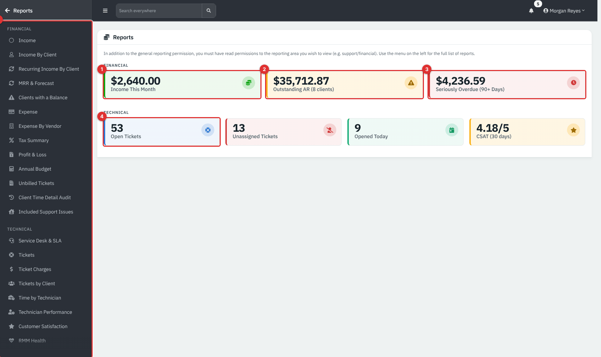

*Figure 1 — The reports hub.*

1. **Income This Month:** payments plus revenue entries recorded this month. It opens [Income](#income).
2. **Outstanding AR:** everything unpaid, with the number of clients. It opens [Clients with a Balance](#clients-with-a-balance-ar-aging).
3. **Seriously Overdue (90+ Days):** the oldest balance.
4. The technical tiles: **Open Tickets**, **Unassigned Tickets**, **Opened Today** and **CSAT (30 days)** (shown only when satisfaction surveys are on). Each opens the matching report.
5. The report menu. The arrow at the top (**Reports**) takes you back to your start page.

A person who can read neither financial nor support reports sees a message to ask an administrator for access. Every report page has a **Print** button. Many also have **Export CSV** (see [Exports and printing](#exports-and-printing)).

### Choosing the period

Reports use one of three kinds of period control.

- **Year** (and sometimes **Month**): a drop-down, for example in Income and Tickets by Client. It changes the page at once.
- **Date range:** a picker for the service desk, technician, satisfaction and RMM reports and the time audit.
- **None:** a live snapshot (AR aging, MRR, recurring income).

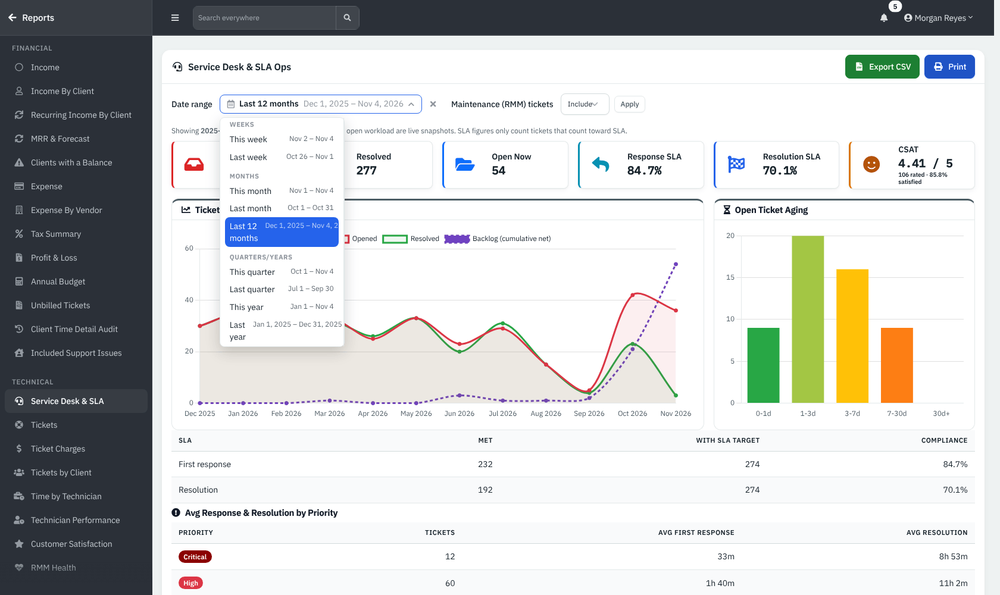

*Figure 2 — The date range picker. It offers Today, Yesterday, Last 7/14/30/90 days, This and Last week, This and Last month, Last 12 months, This and Last quarter, This and Last year, and **Custom range** with a two-month calendar. The dates each preset covers are shown beside its name. The **x** next to the button clears the choice.*

> **Note.** **Last 12 months** runs from the first day of the month eleven months back, so in early November it starts on 1 December of the previous year. Choose **Custom range** for an exact twelve months.

## Financial reports

### Income

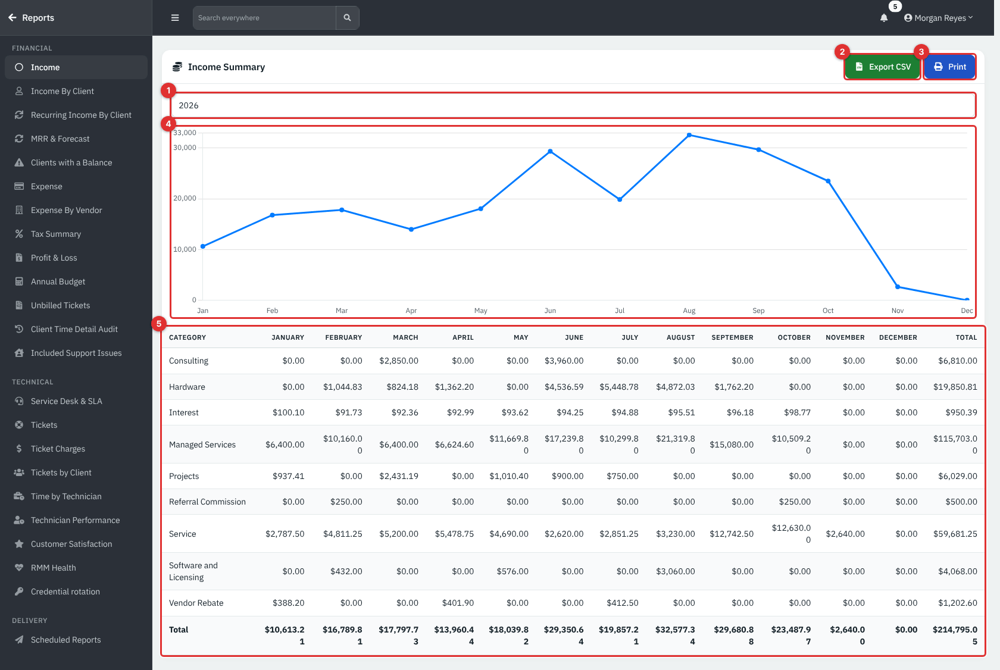

*Figure 3 — Income (example data). (1) Year. (2) **Export CSV**. (3) **Print**. (4) Income per month. (5) Income by category and month, with a **Total** row.*

Money received in the year: payments on invoices (counted by payment date, filed under the invoice's income category) plus revenue entries that have a category. The year list holds the years that have payments or revenue. The export is the same category-by-month table.

### Income By Client

*Figure 4 — (1) Year, or **All Years**. (2) Clients ranked by what they paid.*

Lists only clients whose payments in the period come to more than 599 (the title says "600 or more"). No export; use **Print**.

### Recurring Income By Client

*Figure 5 — (1) Monthly recurring amount per client, with **Total Monthly Income**.*

Counts active recurring invoices: monthly amounts as they are, yearly amounts divided by 12. Inactive schedules are left out. Other frequencies are not counted.

### MRR & Forecast

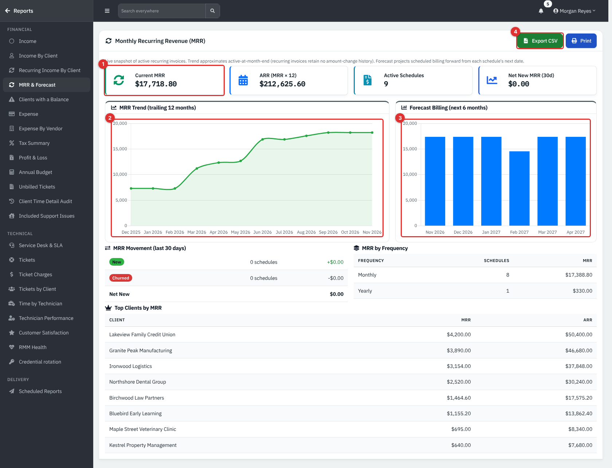

*Figure 6 — MRR (example data). (1) Headline tiles: **Current MRR**, **ARR (MRR × 12)**, **Active Schedules**, **Net New MRR (30d)**. (2) **MRR Trend (trailing 12 months)**. (3) **Forecast Billing (next 6 months)**. (4) **Export CSV** (top clients).*

Below the charts: **MRR Movement (last 30 days)** (new and churned schedules), **MRR by Frequency** and **Top Clients by MRR**.

> **Note.** The trend is an approximation. RivetMSP keeps no history of price changes, so each month counts the schedules that existed and were not archived at month end, at their current amount. The forecast adds each schedule's next billing date forward six months.

### Clients with a Balance (AR aging)

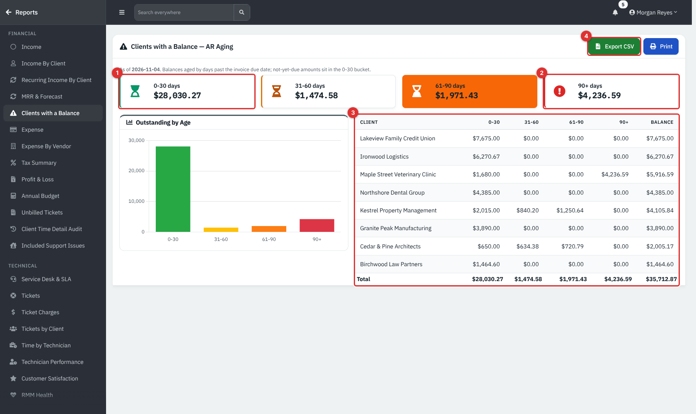

*Figure 7 — AR aging (example data). (1) **0-30 days**. (2) **90+ days**. (3) Balance per client by age, with totals. (4) **Export CSV**.*

Each unpaid invoice (not Draft, Cancelled or Non-Billable) is aged by days past its due date. Money not yet due sits in **0-30 days**. The hub tiles use the same numbers.

### Expense

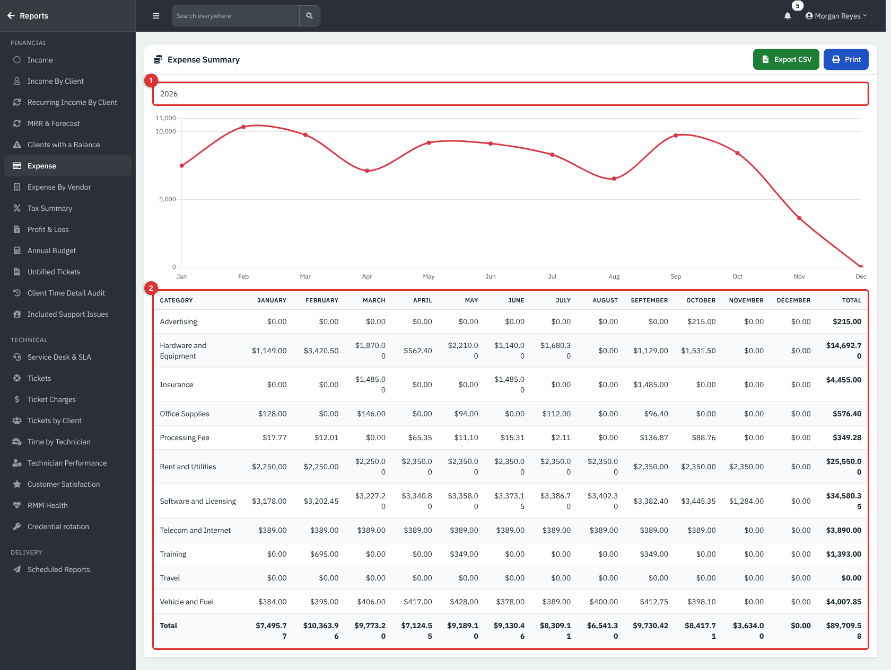

*Figure 8 — (1) Year. (2) Expenses by category and month. **Export CSV** produces the same table.*

> **Note.** The **Total** row adds only expenses that have a vendor. Money moved between your own accounts (recorded without a vendor) appears in category rows only if it has a category, so the total can be lower than the column sum.

### Expense By Vendor

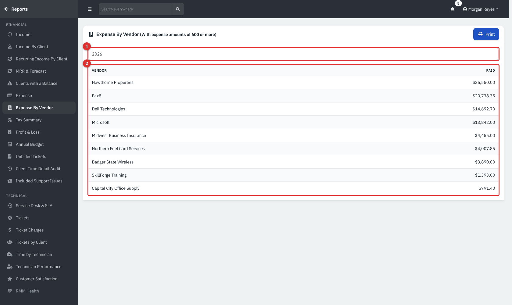

*Figure 9 — (1) Year or **All Years**. (2) Vendors ranked by amount.*

Lists vendors with more than 599 of expenses in the period.

> **Note.** The year list is built from the years that have payments or revenue, not from expenses.

### Tax Summary

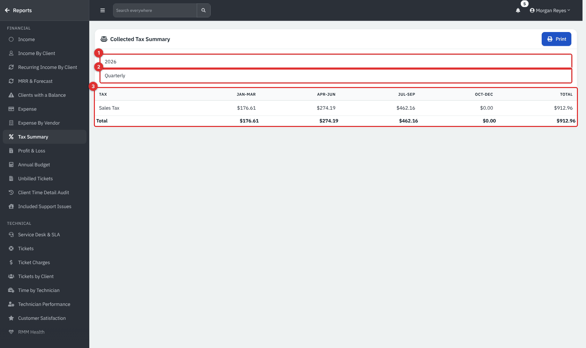

*Figure 10 — (1) Year. (2) **Monthly** or **Quarterly**. (3) Tax collected per tax, with totals.*

Tax is counted when the money arrives: each payment carries its share of the tax on its invoice. A part-paid invoice therefore reports only part of its tax.

### Profit & Loss

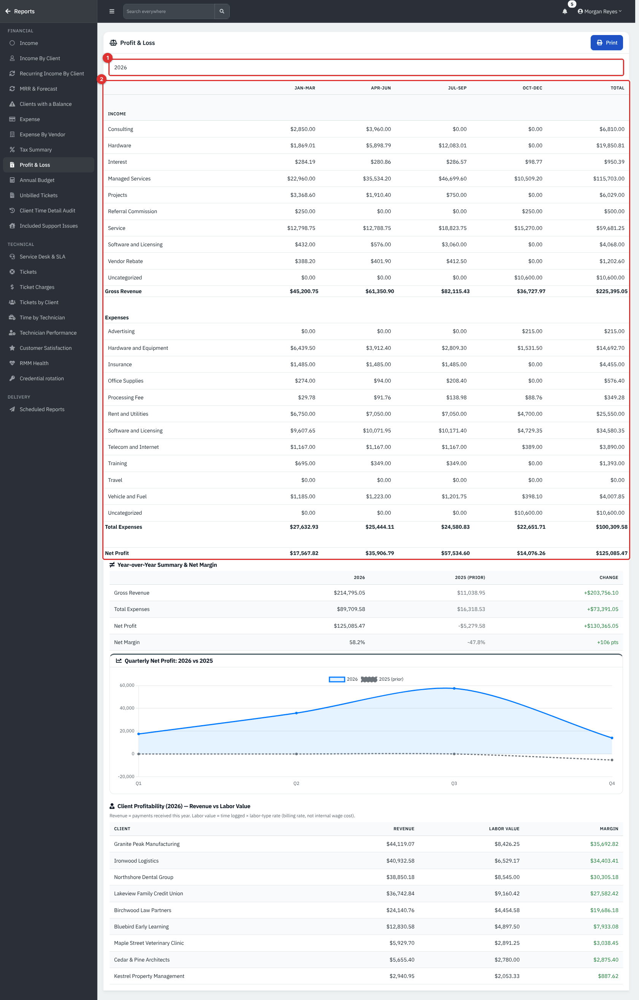

*Figure 11 — (1) Year. (2) Income, expenses and **Net Profit** by quarter.*

Below the table: **Year-over-Year Summary & Net Margin**, **Quarterly Net Profit** against the prior year, and **Client Profitability** (revenue is payments received; labor value is time logged multiplied by the labor-type billing rate, not wage cost).

> **Note.** Money with no category appears on an **Uncategorized** line in both income and expenses (in the demo, transfers between accounts). The quarterly table includes it, the year-over-year summary does not, so the two gross revenue figures can differ by that amount.

### Annual Budget

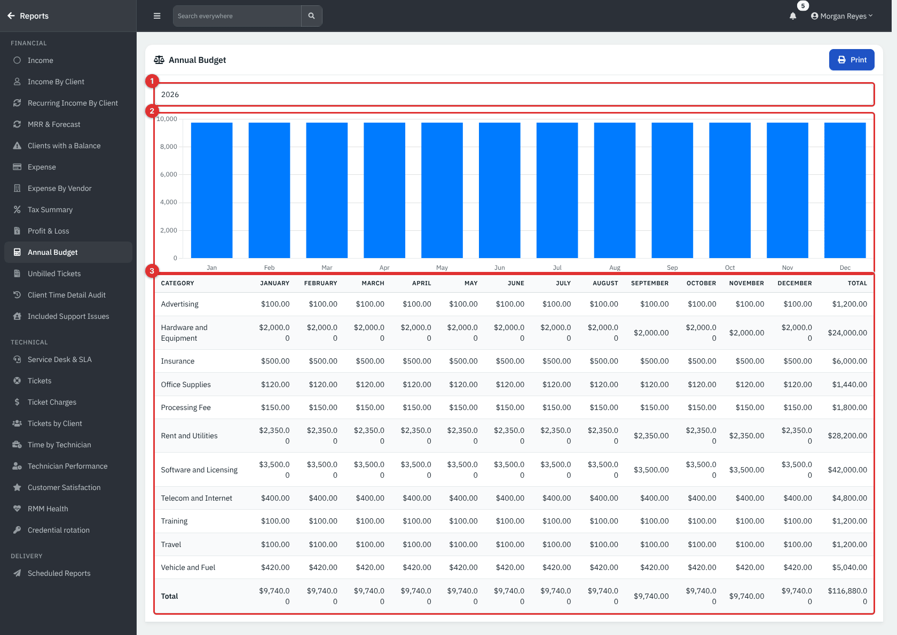

*Figure 12 — (1) Year. (2) Budget per month. (3) Budget by expense category with totals.*

Shows planned amounts per expense category and month.

> **Note.** In this release the report only displays figures already stored in the `budget` table. No screen in RivetMSP enters them. The demo's budget was loaded by the demo setup.

### Unbilled Tickets

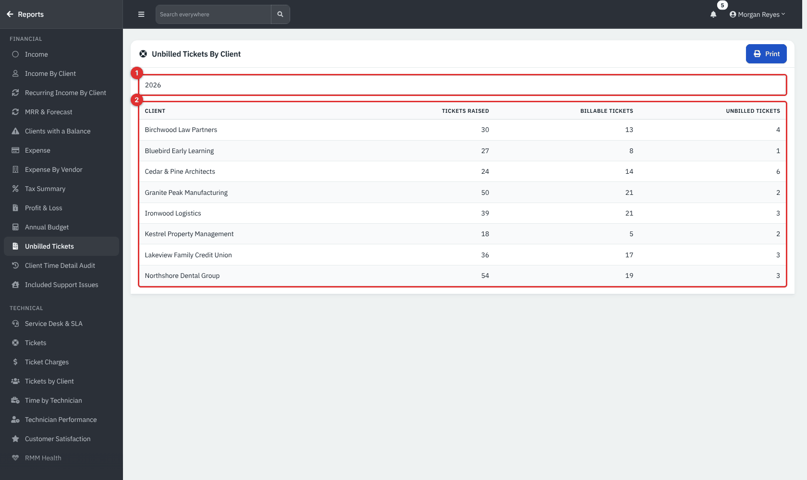

*Figure 13 — (1) Year the tickets were created. (2) Per client: **Tickets Raised**, **Billable Tickets** (closed and billable) and **Unbilled Tickets** (closed, billable, on no invoice). Click a client for the filtered ticket list.*

This is the list behind **Ready to bill** on the [dashboard](02-dashboard.md#the-waiting-on-you-band). It shows counts, not money.

### Client Time Detail Audit

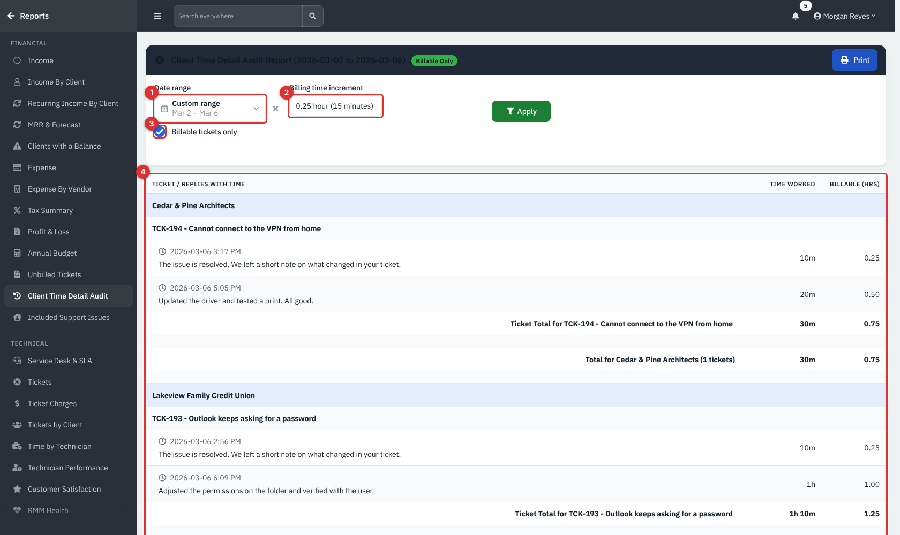

*Figure 14 — (1) Date range (default **This month**). (2) **Billing time increment**: 0.1, 0.25 or 0.5 hour. (3) **Billable tickets only**. (4) Each reply with time, ticket subtotals, client totals and a grand total.*

Use it to check an invoice. Time worked is the real time; **Billable (hrs)** rounds each reply up to the chosen increment and adds the rounded values. Clients that are archived are left out. There is no export.

> **Note.** The title bar of this report is dark with dark text in the light theme, so the title is hard to read. The page works normally.

### Included Support Hours

*Figure 15 — (1) Month. (2) Year. (3) For each client with an included-hours plan: allowance, used, remaining and a percentage, for remote and for on-site.*

The menu calls it **Included Support Issues**; the page is titled **Included Support Hours**. Allowances come from the client's active contract. Usage is counted in tickets, not minutes: every ticket created in the month and linked to the contract counts as half an hour (remote) or one hour (on-site). The percentage badge is green below 80, amber from 80 and red from 100. An overrun shows as "(x over)".

## Technical reports

### Service Desk & SLA

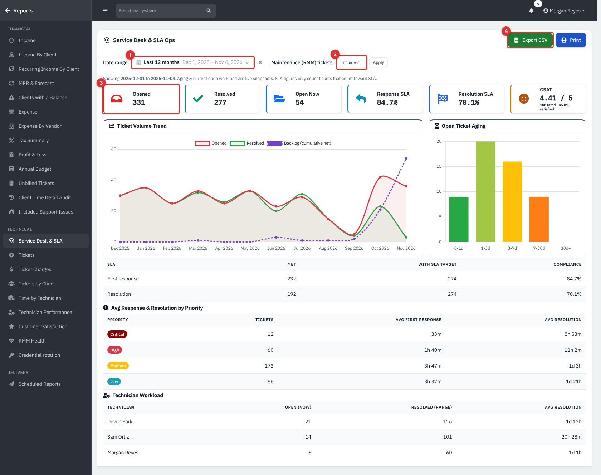

*Figure 16 — (1) Date range. (2) **Maintenance (RMM) tickets**: **Include**, **Exclude** or **Only these**. (3) Headline tiles: **Opened**, **Resolved**, **Open Now**, **Response SLA**, **Resolution SLA**, **CSAT**. (4) **Export CSV** (monthly opened, resolved and backlog).*

- **Ticket Volume Trend** shows opened, resolved and the running backlog by month.
- **Open Ticket Aging** is a live snapshot of open tickets by age.
- **SLA** compares each ticket's first response and resolution with the due times set by its SLA policy. Tickets that do not count toward SLA (maintenance tickets) never enter the percentages.
- **Avg Response & Resolution by Priority** and **Technician Workload** (open now, resolved in the range, average resolution).

### Tickets

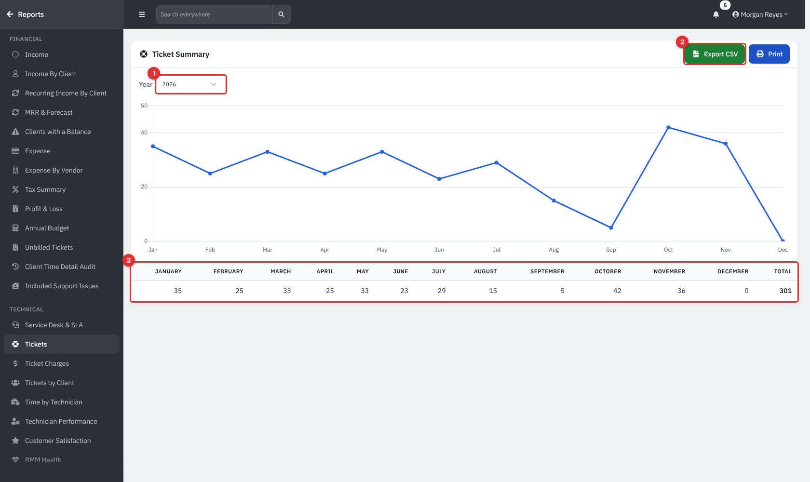

*Figure 17 — (1) Year. (2) **Export CSV**. (3) Tickets raised per month, with a year total.*

### Ticket Charges

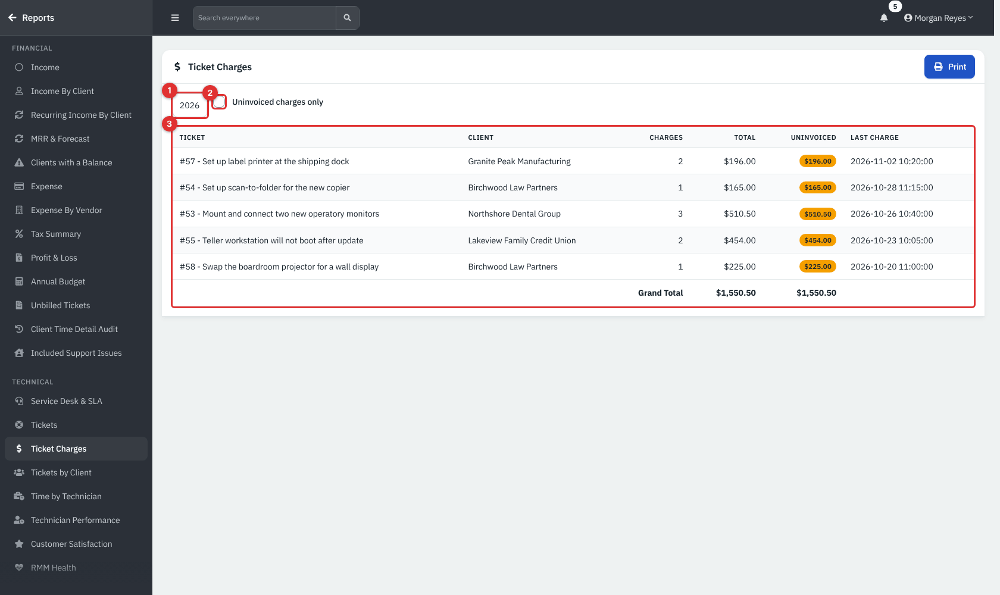

*Figure 18 — (1) Year. (2) **Uninvoiced charges only**. (3) Tickets with charges, the total and the amount not yet invoiced.*

Appears only when **Ticket Charges** is turned on in the modules settings.

### Tickets by Client

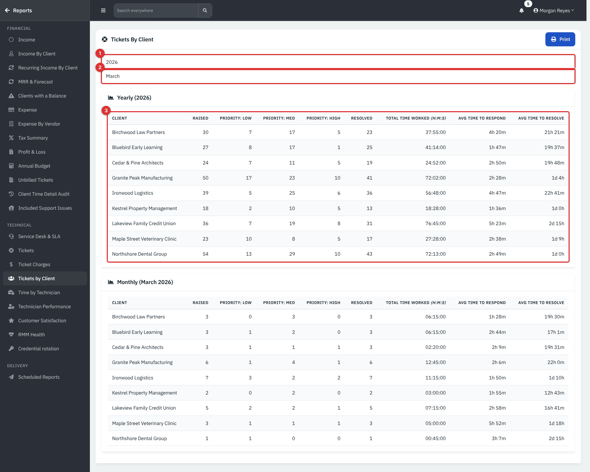

*Figure 19 — (1) Year. (2) Month. (3) Per client: raised, by priority, resolved, total time worked, average time to respond and to resolve.*

The page has a **Yearly** table and a **Monthly** table for the month you pick. The priority columns show Low, Medium and High only; Critical tickets count in **Raised** but have no column.

### Time by Technician

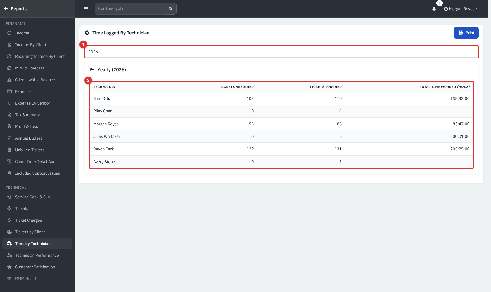

*Figure 20 — (1) Year. (2) Per technician: **Tickets assigned**, **Tickets touched** (replied to, opened or closed) and **Total time worked**.*

A yearly table only. Tickets assigned counts tickets created in the year that are still assigned to that person.

### Technician Performance

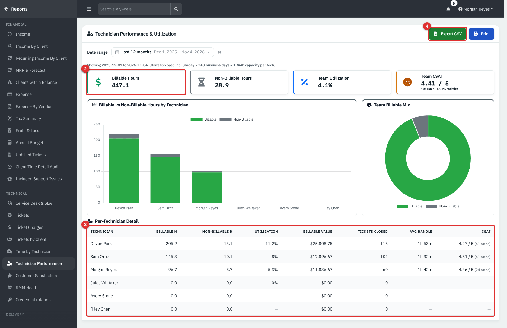

*Figure 21 — (1) **Export CSV**. (2) Headline tiles: **Billable Hours**, **Non-Billable Hours**, **Team Utilization**, **Team CSAT**. (3) **Per-Technician Detail**.*

A reply is billable when the labor type it was logged under has a rate above zero. **Utilization** is time logged divided by a capacity of 8 hours a day on business days (Monday to Friday) in the range; the capacity is fixed in this release. **Billable Value** is hours multiplied by the labor-type rate. **Avg Handle** is total time divided by tickets closed.

> **Note.** The demo's utilization looks low (single digits to low teens) because the demo logs far less time than a full-time team would. Use the report for comparing people and periods, not as an absolute measure.

### Customer Satisfaction

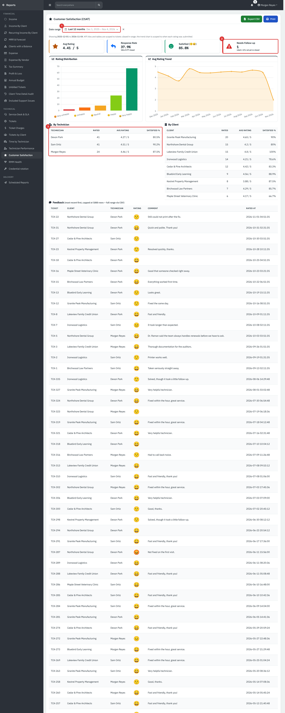

*Figure 22 — (1) Date range. (2) **Needs Follow-up**: tickets rated at or below the low-rating threshold that are not yet closed again. (3) **By Technician** (**By Client** is next to it).*

Tiles, tables and the response rate count tickets closed in the range; the trend counts when each rating was given. Ratings are 1 to 5; 4 and 5 count as satisfied. The low-rating threshold is set in the ticket settings. The **Feedback** list is capped at 1,000 rows; **Export CSV** carries all of them.

### RMM Health

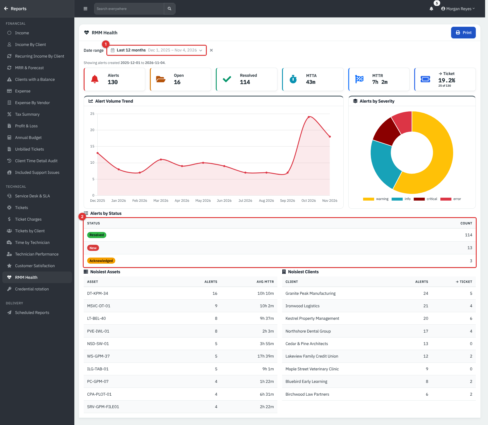

*Figure 23 — (1) Date range. (2) **Alerts by Status**.*

Alerts from your remote monitoring tools: total, open, resolved, **MTTA** (mean time to acknowledge), **MTTR** (mean time to resolve) and how many became a ticket (**→ Ticket**). **Noisiest Assets** and **Noisiest Clients** show where alerts concentrate. With no alerts yet the page says so. Example data, not a live connection to a monitoring service. There is no export.

### Credential rotation

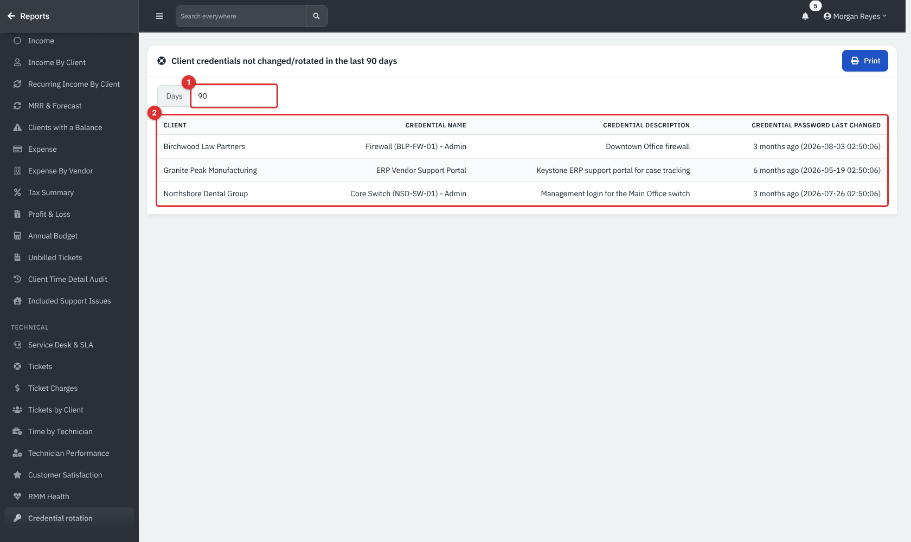

*Figure 24 — (1) **Days**, default 90. (2) Credentials whose password was last changed before that.*

Needs the **Credentials** permission rather than **Support**. It lists credentials, grouped by client, with their last-changed date.

## Exports and printing

| Report | **Export CSV** contains | File name |
|---|---|---|
| Income | Category by month, with Total | `income_summary_YEAR.csv` |
| Expense | Category by month, with Total | `expense_summary_YEAR.csv` |
| MRR & Forecast | Top clients: Client, MRR, ARR | `mrr_DATE.csv` |
| Clients with a Balance | Client by age bucket, with Total | `ar_aging_DATE.csv` |
| Service Desk & SLA | Month, Opened, Resolved, Cumulative backlog | `service_desk_FROM_to_TO.csv` |
| Tickets | Month, tickets raised | `ticket_summary_YEAR.csv` |
| Technician Performance | One row per technician | `technician_performance_FROM_to_TO.csv` |
| Customer Satisfaction | One row per rating, with comment | `csat_FROM_to_TO.csv` |

The export follows the year or date range you have chosen. Files are UTF-8 with a byte-order mark so a spreadsheet shows accents correctly. A text cell that starts with `=`, `+`, `-` or `@` gets an apostrophe in front, so it cannot run as a spreadsheet formula. Every other report has only **Print**, which uses the browser's print dialog and leaves out the menus.

## Scheduled reports

A scheduled report emails a short headline summary of a report to staff, again and again, without anyone opening RivetMSP.

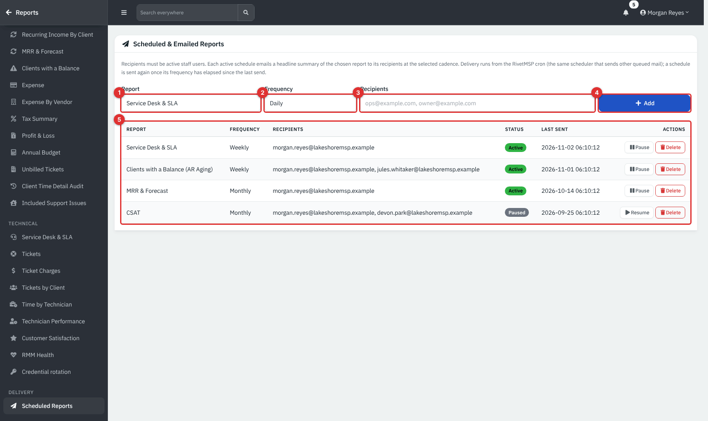

*Figure 25 — Scheduled reports (example data). (1) **Report**. (2) **Frequency**. (3) **Recipients**. (4) **Add**. (5) The schedules with their status, last sent time, **Pause** or **Resume**, and **Delete**.*

### Add a schedule

1. Open **Reports** → **Scheduled Reports** (under **Delivery**).
2. Choose the **Report**: **Service Desk & SLA**, **Technician Performance**, **MRR & Forecast**, **Income Summary**, **Expense Summary**, **Ticket Summary**, **Clients with a Balance (AR Aging)** or **CSAT**.
3. Choose the **Frequency**: **Daily**, **Weekly** or **Monthly**.
4. Type the **Recipients**, separated by commas.
5. Choose **Add**. The message **Report schedule added.** appears.

Recipients must be email addresses of active staff users. Anything else is rejected with the list of addresses that were not accepted, because company figures are never sent outside the team. You only see, and can only schedule, reports you could open yourself.

### Pause, resume or delete

**Pause** stops sending and turns the status badge to **Paused**; **Resume** restarts it. **Delete** asks you to confirm. A person with read-only reporting access sees the list but not the form or the buttons.

### What is sent and when

- The email subject reads "<company name> report: <report name> (<date>)". The body is a small table of headline figures, not the whole report. Service desk, technician and satisfaction summaries cover the month so far; income, expense and ticket summaries cover the year so far; MRR and AR aging are as of today.
- A schedule is sent the first time the scheduler runs, then again once its frequency has passed since **Last sent**. The scheduler is part of the daily cron job (`cron/report_scheduler.php`), which only runs when **Enable Cron** is on in the notification settings. Mail then goes out through the normal mail queue.
- Figures match the on-screen report because both use the same calculations.

> **Not verified on a live service.** The demo server has no mail server and the scheduler was not run, so no email was sent. The schedules and their **Last sent** times in Figure 25 are example rows. The email wording above comes from the application code.

## Reference

### Who can see which report

| Reports | Permission needed (all also need Reporting, Read) |
|---|---|
| Income, Income By Client, Recurring Income By Client, MRR & Forecast, Clients with a Balance, Expense, Expense By Vendor, Tax Summary, Profit & Loss, Annual Budget | Financial, Read, and invoicing/accounting turned on |
| Unbilled Tickets, Client Time Detail Audit, Included Support Hours | **Sales**, Read (they sit under **Financial** in the menu) |
| Service Desk & SLA, Tickets, Tickets by Client, Time by Technician, Technician Performance, Customer Satisfaction, RMM Health | Support, Read, and ticketing turned on |
| Ticket Charges | Support, Read, and **Ticket Charges** turned on |
| Credential rotation | Credentials, Read |
| Scheduled Reports: view | Reporting, Read, and the permission of each report listed |
| Scheduled Reports: add, pause, delete | Reporting, Modify, and the permission of that report |

> **Note.** A person with Financial but not Sales permission sees the three **Sales** reports in the menu and gets an access message when they open one.

### Where each hub tile comes from

| Tile | Definition |
|---|---|
| Income This Month | Payments dated this month plus revenue entries with a category |
| Outstanding AR | Unpaid balance of every invoice that is not Draft, Cancelled or Non-Billable |
| Seriously Overdue (90+ Days) | The part of that balance more than 90 days past due |
| Open Tickets | Not closed and not resolved |
| Unassigned Tickets | Not closed, with nobody assigned |
| Opened Today | Created today |
| CSAT (30 days) | Average rating given in the last 30 days |

## Tips and good practice

- Start the month with **Clients with a Balance**, **Unbilled Tickets** and **MRR & Forecast**: money owed, money not yet billed and the recurring base.
- Before sending an invoice for time, open the **Client Time Detail Audit** for the same dates and increment.
- Watch **Resolution SLA** and **Needs Follow-up** for service quality, and **Technician Performance** for workload balance.
- Export to a spreadsheet when you need a chart the report does not draw.
- Schedule the AR aging weekly to the person who collects, and the MRR report monthly to the owner.
- If two reports seem to disagree, check their periods first. Some use the ticket's creation date, some its closing date, some the payment date.

## Related guides

- [Dashboard](02-dashboard.md) for the widgets that use the same figures.
- [Service desk tickets](05-service-desk-tickets.md) and [Ticket billing and worksheets](06-ticket-billing-and-worksheets.md) for the data behind the technical reports.
- [Recurring tickets, catalog, CSAT and requests](07-recurring-tickets-catalog-csat-requests.md) for satisfaction surveys.
- [Assets](11-assets.md) for the devices behind RMM Health.
