# Endpoints and RMM: overview, fleet and adding devices

The **Endpoints** group of the sidebar is where RivetMSP watches and manages the computers and network gear you support. It can do this in two ways, side by side. You can connect a **vendor RMM** you already run (Tactical RMM, Level.io, Action1, and Sophos Central for firewalls), or you can enroll computers in RivetMSP's own **endpoint agent**, a small program that reports health, inventory and checks, and runs maintenance jobs you queue from the browser. This page explains how to choose, how to switch each one on, and how to read the dashboard and the fleet list. It also covers adding a device. Later pages cover [what you can do to a device](26-rmm-devices-jobs-policies.md), [patching, software and remote access](27-rmm-patching-software-remote.md), and [alerts, backups, network and RivetPanel](28-alerts-backups-network-panel.md).

| | |
|---|---|
| **Where to find it** | Sidebar → **Endpoints** → **RMM Dashboard**, **Agent Fleet** and **Add device**. The two switches live on their own settings pages: **Administration** → **Settings** → **Endpoint agent** (built-in agent) and **Administration** → **Settings** → **Integrations** → **RMM** (vendor RMM). |
| **Who can use it** | Looking: the role permission **RMM** (module `module_rmm`) at **Read**. Alerts also need **RMM alerts** (the **Alerts** item and the **RMM Alerts** page). Running scripts and rebooting need **RMM scripts**, and remote sessions need **RMM remote connect** (see page 26 and page 27). Turning the module on, minting enrollment tokens, **Add device**, approving unknown devices and every setting on the **Endpoint agent** page are for **administrators** only. A technician limited to some clients sees only those clients' devices. |
| **Turn it on** | Both layers are **off by default**. Built-in agent: **Administration** → **Settings** → **Endpoint agent** → **Overview** tab → **Switch the RMM module on**. Vendor RMM: **Administration** → **Settings** → **Integrations** → **RMM** → **Enable RMM module**, then **Add Integration**. |

All screens in this guide show example data for a fictional company, Lakeshore Managed IT. Nothing on them is a live connection to a real agent or service: the devices, alerts and backup jobs were created for this guide. In particular, the install, patching and remote-access paths have not been verified on a live service.

**Note — permission modules.** A fresh RivetMSP install does not create the permission modules **RMM**, **RMM scripts**, **RMM remote connect** and **RMM alerts**. Until an administrator adds them (they are in the demo), only administrators can use the Endpoints menu. See [Users, roles and security](34-users-roles-security.md).

## What it's for

- See at a glance which computers are online, offline or silent, which are short of disk or memory, and which are waiting for a restart.
- Enroll a Windows PC, a Windows or Linux server, or a Linux machine in a few clicks, with the installer already carrying the client name and a one-use token.
- Keep a single list of every managed device, joined to its **Asset** record so documentation, tickets and health live on one page.
- Keep using a vendor RMM you already pay for, and still get its alerts, devices and backups in one place.

### Which layer should I use?

| | Built-in endpoint agent | Vendor RMM (Tactical RMM, Level.io, Action1) |
|---|---|---|
| What reports | RivetMSP's agent, enrolled per device | The vendor's own agent; RivetMSP syncs through the vendor's API |
| Switch | **Endpoint agent** → **RMM module** card | **Integrations** → **RMM** → **Enable RMM module** |
| Where devices appear | **Agent Fleet**, plus the **RMM** panel on each asset page | **Assets** (the **RMM Assets** page) and the same asset page |
| Alerts | **Agent alerts** and the central **Alerts** page | **RMM Alerts** and the central **Alerts** page |
| Actions | Jobs, scripts, policies, patches, software, remote (pages 26 and 27) | Whatever the vendor offers through RivetMSP: **Connect**, scripts synced from the vendor, check policies |

You can run both at once. A device that both RMMs track can be given a preference for the **Connect** button (**Prefer Tactical RMM for Connect/Remote**).

## A quick tour

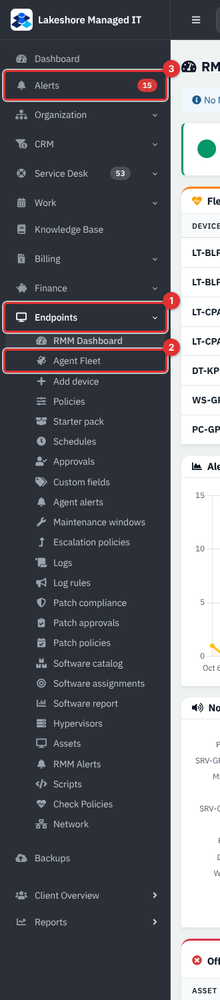

*Figure 1 — The Endpoints group of the sidebar. Example data, not a live connection.*

1. **Endpoints** holds every RMM page. Many entries appear only after the matching feature is switched on in the **Endpoint agent** settings (for example the patch, software and **Hypervisors** pages).
2. **Agent Fleet** lists devices that run the built-in agent.
3. **Alerts** (outside the group, red badge) merges new RMM and backup alerts in one list. See [page 28](28-alerts-backups-network-panel.md).

The **Backups** and **Client Overview** items below the group belong to other tools.

### Switching the built-in agent on

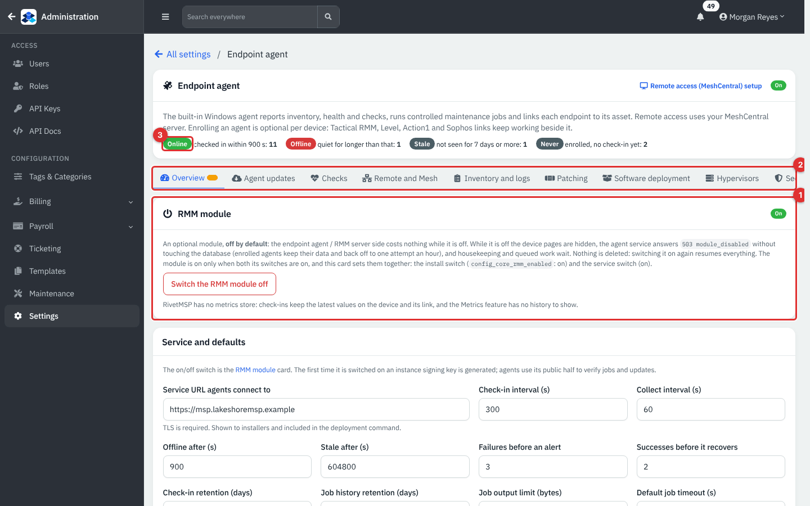

*Figure 2 — Administration → Settings → Endpoint agent, Overview tab. Example data, not a live connection.*

1. The **RMM module** card. Its **On** badge and the **Switch the RMM module off** button are one switch for two settings (the install setting and the service setting), so you never set them separately. While the module is off, device pages are hidden and the agent service answers "module disabled". Nothing is deleted, and switching it on again resumes everything. The first time it is switched on, RivetMSP generates a signing key (see **Security and policy**) that agents use to verify jobs and updates.
2. The tab bar: **Overview**, **Agent updates**, **Checks**, **Remote and Mesh**, **Inventory and logs**, **Patching**, **Software deployment**, **Hypervisors** and **Security and policy**. A dot on a tab means something needs attention (here, a device is waiting for approval).
3. Live counts in the header: **Online** (checked in within the offline limit), **Offline**, **Stale** (not seen for 7 days or more) and **Never** (enrolled, no check-in yet).

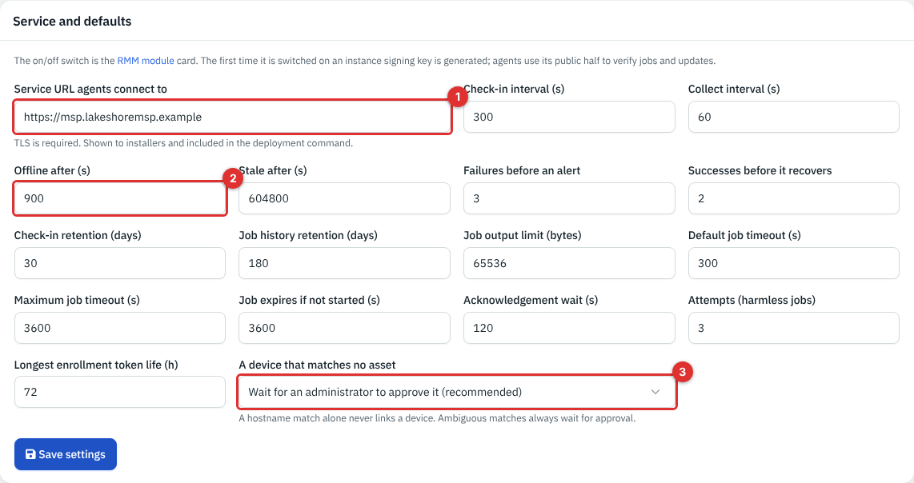

*Figure 3 — Service and defaults. Example data, not a live connection.*

1. **Service URL agents connect to**: the https address installers carry and agents call. TLS is required.
2. **Offline after (s)** (60 to 86,400 seconds): how long a device may be silent before it shows as **Offline**. **Stale after (s)** is the longer limit, and **Failures before an alert** and **Successes before it recovers** stop one bad reading from raising or clearing an alert.
3. **A device that matches no asset**: **Wait for an administrator to approve it (recommended)** is the safe choice. A hostname match alone never links a device to an asset, and ambiguous matches always wait for approval.

The same card has the check-in and collect intervals, retention periods, job time limits and **Longest enrollment token life (h)** (1 to 720). Change a value and press **Save settings**. **Allow Linux devices to enroll** is a separate switch: when off, Linux machines are refused, while devices already enrolled are not affected.

### Switching a vendor RMM on

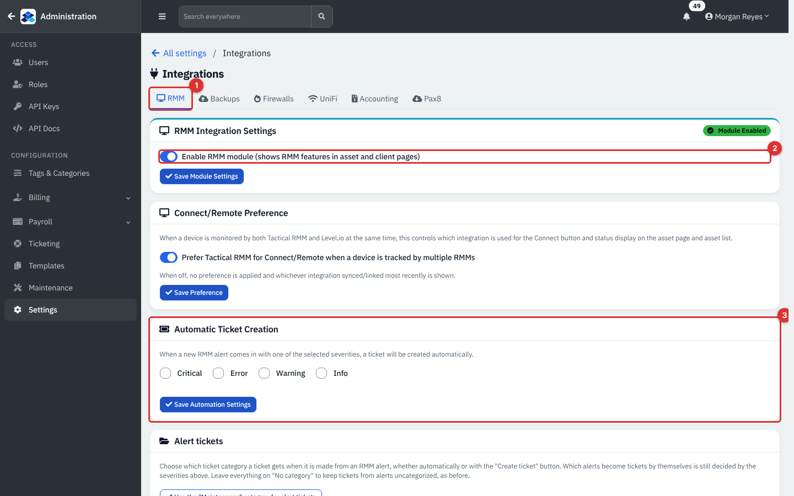

*Figure 4 — Administration → Settings → Integrations → RMM. Example data, not a live connection.*

1. The **RMM** tab of **Integrations** (the others are **Backups**, **Firewalls**, **UniFi**, **Accounting** and **Pax8**).
2. **Enable RMM module** shows RMM features on asset and client pages. Press **Save Module Settings**.
3. **Automatic Ticket Creation**: tick the alert severities (**Critical**, **Error**, **Warning**, **Info**) that should open a ticket on their own.

Further down the same page you choose a ticket category for tickets made from alerts, can add "special cases" (a check family, a source or a severity mapped to a category and priority), and can decide whether such tickets count toward SLA or send email. By default, tickets made from RMM alerts are maintenance work: they do not count toward SLA and send no email. The **RMM Integrations** table lists each connection with **Test** and **Sync Now**. Adding one is covered in [page 28](28-alerts-backups-network-panel.md#connect-a-vendor-rmm).

### The RMM Dashboard

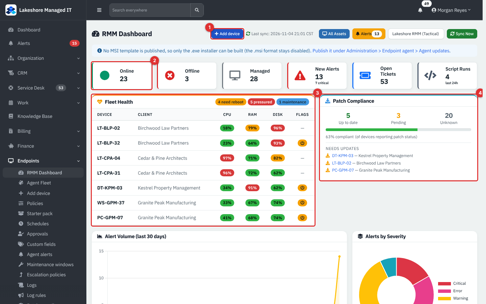

*Figure 5 — Endpoints → RMM Dashboard. Example data, not a live connection.*

1. **Add device** starts an enrollment (see below). **All Assets** opens the vendor RMM list, **Alerts** the RMM alert list, and **Sync Now** pulls from the default vendor RMM.
2. The tiles: **Online**, **Offline**, **Managed** (every device both layers know about), **New Alerts** (with how many are critical), **Open Tickets** and **Script Runs** in the last 24 hours.
3. **Fleet Health** lists the worst devices with colored **CPU**, **RAM** and **DISK** figures. The pills at the top count devices needing a reboot, under pressure, or in maintenance.
4. **Patch Compliance** shows devices up to date, pending and unknown, and links to the devices needing updates.

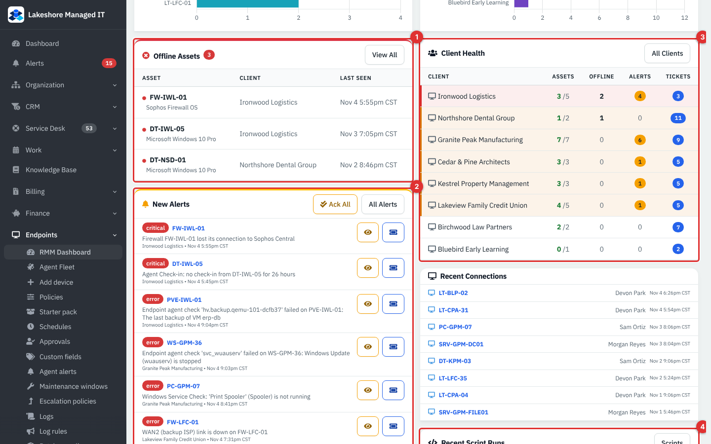

*Figure 6 — The lower half of the dashboard. Example data, not a live connection.*

1. **Offline Assets** with their last-seen time.
2. **New Alerts**, newest first, with **Ack All** and the per-alert eye and ticket buttons.
3. **Client Health**: assets, offline devices, alerts and tickets per client, worst first.
4. **Recent Script Runs** from the vendor RMM and the library, with who ran them.

Charts above these cards show **Alert Volume (last 30 days)**, **Alerts by Severity** and the noisiest assets and clients.

### Agent Fleet

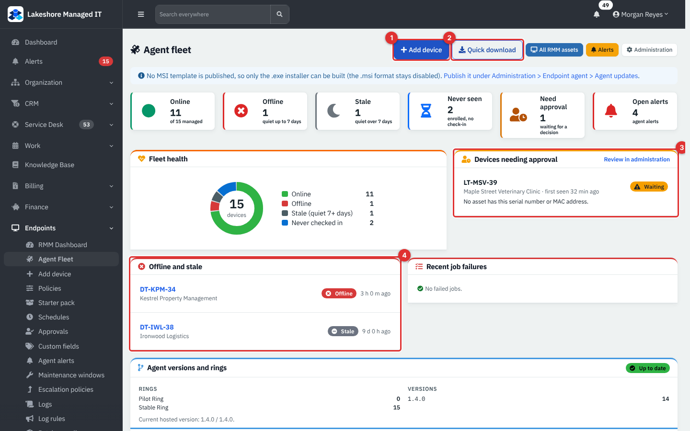

*Figure 7 — Endpoints → Agent Fleet. Example data, not a live connection.*

1. **Add device** opens the full installer page.
2. **Quick download** is the short way for one Windows PC: choose a client and get an installer.
3. **Devices needing approval** lists unknown computers waiting for a decision, with **Review in administration**.
4. **Offline and stale** lists the devices that need a look, with how long each has been quiet.

Tiles at the top count **Online**, **Offline**, **Stale**, **Never seen**, **Need approval** and **Open alerts**. Below them are **Fleet health**, **Recent job failures**, **Agent versions and rings** (with whether every device is on the hosted version), **Outdated software** and a **Performance and capacity** card for administrators.

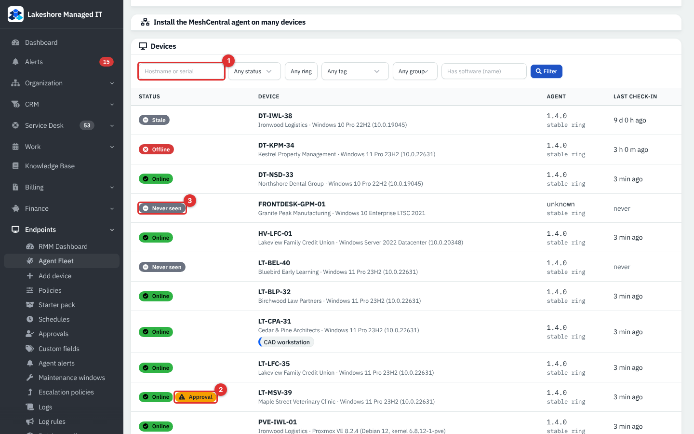

*Figure 8 — The device list at the bottom of Agent Fleet. Example data, not a live connection.*

1. Filters: **Hostname or serial**, status, update ring, tag, group, and **Has software (name)**.
2. **Approval** marks a device that checked in but is not linked to an asset yet.
3. **Never seen** means the device enrolled but has not yet reported.

Click a device name to open its asset page ([page 26](26-rmm-devices-jobs-policies.md)).

## Common tasks

### Enroll a Windows PC

1. Go to **Endpoints** → **Add device** (or **Agent Fleet** → **Add device**).
2. Choose the **Client**, and optionally a **Location**. Pick the **Update ring**: **Stable (recommended)** or **Pilot (early builds)**. Pick the **Windows architecture** (x64 or ARM64) and the **Token lifetime, hours**.
3. Optionally give a **Label**. Tick **I will install this on multiple machines** if one installer should work for up to 25 machines before it expires. Tick **Also install the MeshCentral agent** if remote desktop should be set up after approval.
4. Under **2. Windows**, press **Download .exe**. The installer already holds the server address, the token, the client and your certificate authority. Run it on the PC and accept the administrator prompt. For deployment tools run it with `setup --silent`.

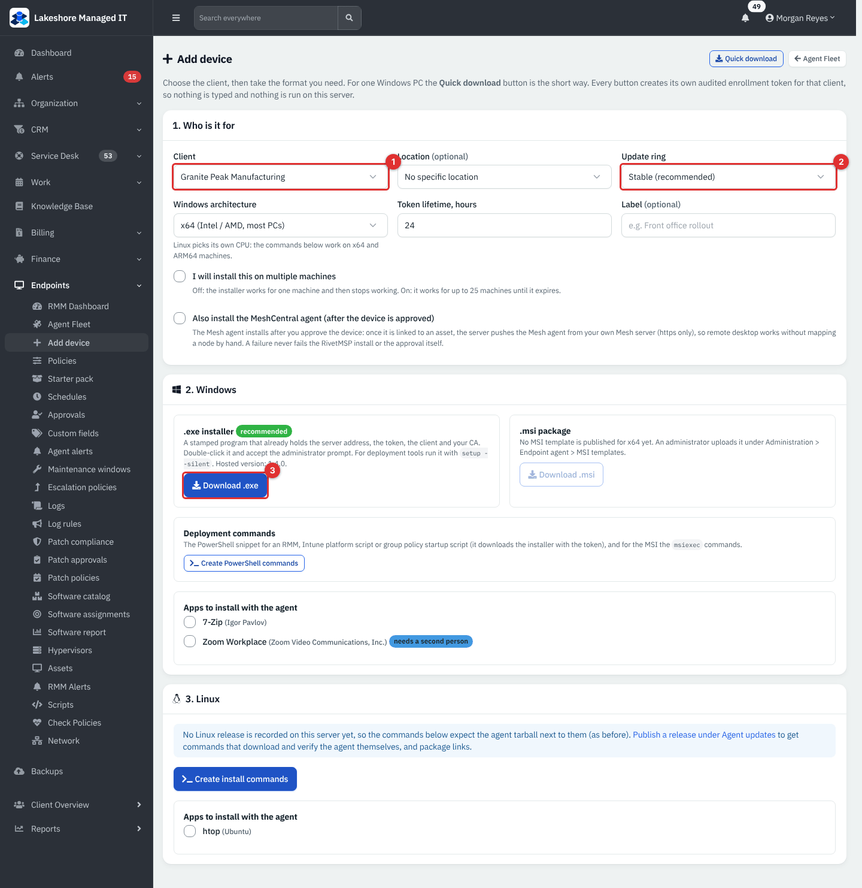

*Figure 9 — Add device. 1 is the client, 2 the update ring and 3 the .exe download. Example data, not a live connection.*

The page also offers an **.msi package** (disabled until an administrator uploads an MSI template under **Administration** → **Settings** → **Endpoint agent** → **Agent updates**) and **Create PowerShell commands** for an RMM, Intune platform script or group policy startup script. **Apps to install with the agent** lists catalog packages (see [page 27](27-rmm-patching-software-remote.md)). Every button creates its own audited enrollment token, so nothing is typed or run on the server.

### Enroll a Linux machine

1. On **Add device**, choose the client.
2. Under **3. Linux**, press **Create install commands**. Linux picks its own CPU, so the commands work on x64 and ARM64.
3. Run the commands on the server.

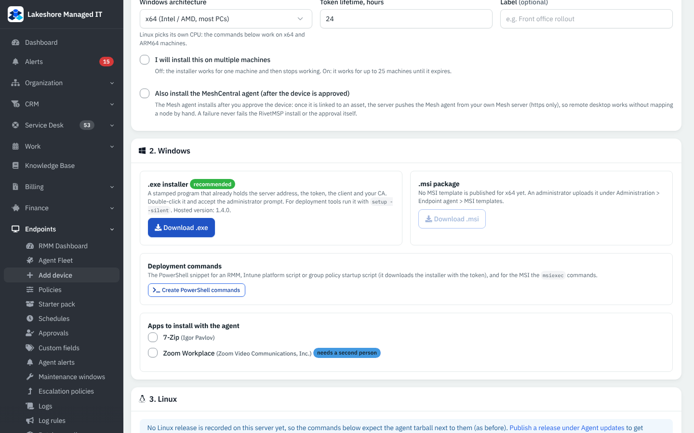

*Figure 10 — The Linux section. Example data, not a live connection.*

If no Linux release is published on the server, the page says so and the commands expect the agent file to sit next to them. Publish a release under **Agent updates** to get commands that download and verify the agent themselves.

### Approve a device that matched no asset

A device that checks in without a matching asset waits for a decision (with the recommended setting).

1. Open **Administration** → **Settings** → **Endpoint agent** and find **Waiting for approval** (also reachable from **Review in administration** on Agent Fleet).
2. Read the reason, such as "No asset has this serial number or MAC address".
3. Either choose an asset and press **Link to the chosen asset**, or press **Create a new asset** (it uses the device type shown), or press **Reject**.

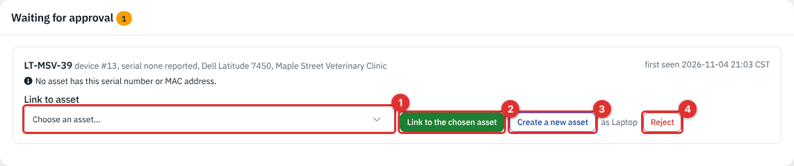

*Figure 11 — Waiting for approval. 1 is the asset list, 2 links, 3 creates a new asset and 4 rejects. Example data, not a live connection.*

### Rotate, revoke or retire a device

On the **Overview** tab, the **Devices** table at the bottom lists every enrolled device with its status, last check-in, agent version, linked asset and ring. **Rotate** invalidates the device's credential (the agent must re-enroll), **Revoke** makes it stop checking in and fetching jobs immediately, and **Retire** cancels queued jobs and stops monitoring while keeping the asset. Each asks you to confirm first.

### Review enrollment tokens

Open the **Security and policy** tab. **Enrollment tokens** shows each token's label, client, ring, uses (for example 4 / 10), expiry and state (**Active**, **Used up**, **Expired**, **Revoked**), with **Revoke** for active ones. A token's secret is shown once, when it is created, and only its hash is stored. Treat a token like a password.

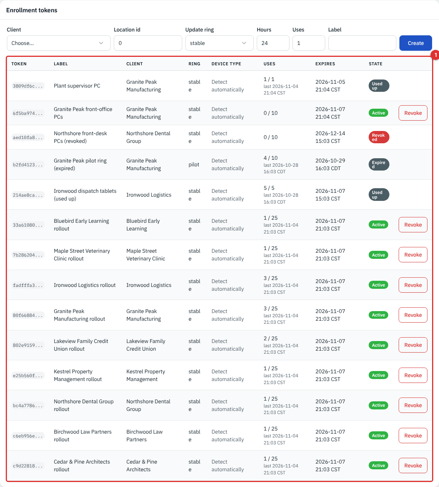

*Figure 12 — Enrollment tokens. The call-out marks the token list. Example data, not a live connection.*

### Publish agent versions

Agents update themselves from release **rings**. The **Agent updates** tab holds the agent binaries, the MSI templates, the hosted Linux files and a build installer option. In the demo no live agent is involved, so the updates tab shows stub files.

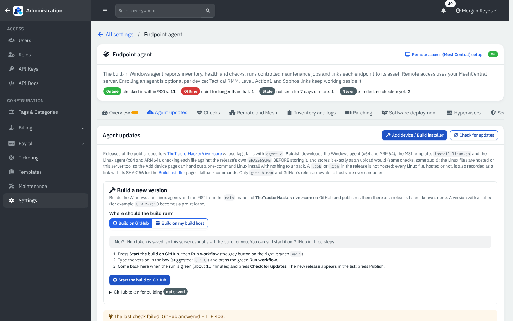

*Figure 13 — Agent updates. Example data, not a live connection.*

### Choose what the agent checks

The **Checks** tab sets the default check list in plain options: low disk space (a percentage of free space), a restart waiting, important services (for example **Windows Update**, **Windows time service** or **SSH server**) and your own scripts, plus **how often** they run. Policies (page 26) can refine this per client, group, tag or device.

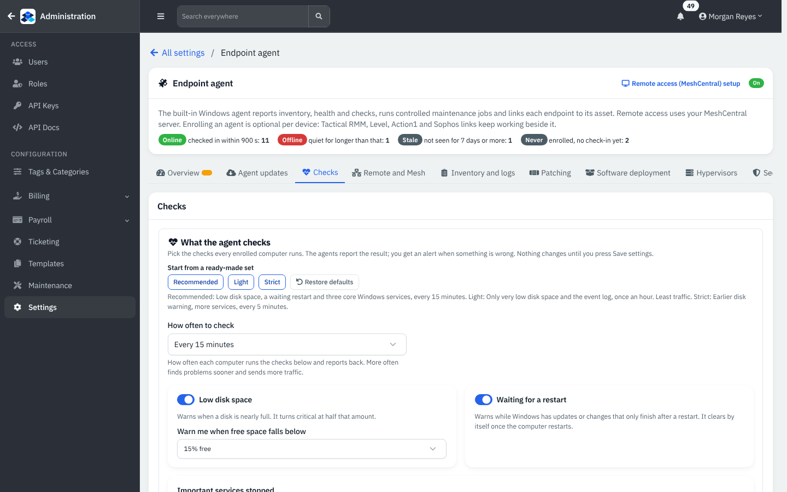

*Figure 14 — The Checks tab. Example data, not a live connection.*

## Reference

### Device status on the fleet

| Status | Meaning |
|---|---|
| **Online** | Checked in within the **Offline after** limit |
| **Offline** | Quiet for longer than that, but not yet stale |
| **Stale** | Not seen for the **Stale after** limit (7 days by default in the demo) |
| **Never seen** | Enrolled, but has not checked in |
| **Approval** | Waiting for you to link it to an asset |

### Switches that add menu entries

Several features are switched on separately on the **Endpoint agent** tabs, and each adds pages to the **Endpoints** menu: **Policies** and scripts (**Security and policy** / **Checks**), **Patching** (**Patch compliance**, **Patch approvals**, **Patch policies**), **Software deployment**, **Inventory and logs** (**Logs**, **Log rules**), **Hypervisors** and **Remote and Mesh**. Each switch shows a plain "Cost" line explaining what it adds to your server. Patch and software installs are further gated by a separate **live installs** switch (see page 27).

## Tips and good practice

- Start with one pilot PC per client in the **Pilot** ring, then move on.
- Keep **A device that matches no asset** on the approval setting. It stops a duplicate hostname from attaching a device to the wrong client.
- Use a **Label** on every token (for example "Front office rollout") so the token list is readable later.
- Short token lifetimes are safer. Revoke any token you no longer need.
- A device that is **Never seen** after a day usually means the installer never ran or could not reach the **Service URL**.

## Related guides

- [Devices, jobs, scripts, policies and alerting](26-rmm-devices-jobs-policies.md)
- [Patching, software, logs, hypervisors and remote access](27-rmm-patching-software-remote.md)
- [Alerts, backups, network and RivetPanel](28-alerts-backups-network-panel.md)
- [Assets](11-assets.md)
- [Users, roles and security](34-users-roles-security.md)
