# Devices, jobs, scripts, policies and alerting

Once computers are enrolled (see [Endpoints and RMM: overview](25-endpoints-rmm-overview.md)), most day-to-day work happens in three places: the **device page** (health, jobs and remote access for one computer), the **policies and scripts** that decide what every device does, and the **alerting** pages that decide who hears about problems and when. This page covers all three for the built-in endpoint agent.

| | |
|---|---|
| **Where to find it** | A device's page: sidebar → **Endpoints** → **Agent Fleet**, then click the device (or open the asset from **Assets** and look for the RMM panel). The rest: sidebar → **Endpoints** → **Policies**, **Starter pack**, **Schedules**, **Approvals**, **Custom fields**, **Agent alerts**, **Maintenance windows**, **Escalation policies**, and **Scripts**. The vendor RMM check list is **Check Policies**. |
| **Who can use it** | **RMM** (module `module_rmm`) at **Read** to see every page here. Changing policies, schedules and alert settings needs **Modify** (alert management) or an administrator. Running a saved library script and rebooting need **RMM scripts** at **Modify**; running a free-text script needs **RMM scripts** at **Full**. Approving needs an administrator (or **RMM scripts** at **Full** only if an administrator has allowed it on the **Endpoint agent** page). Remote sessions need **RMM remote connect**. |
| **Turn it on** | The built-in agent module (see page 25). **Policies** and **Scripts** each have their own switch on the **Endpoint agent** page (**Security and policy** tab), and a plain "Cost" note beside it. |

All screens in this guide show example data for a fictional company, Lakeshore Managed IT. Nothing on them is a live connection: no real agent reported these figures, and running a script, queueing a reboot or sending an escalation was not verified on a live device.

## What it's for

- Check one device's health, history and software, and act on it (run a script, reboot, open a remote session).
- Define **policies** once and have them reach everything, a client, a group, a tag or one device.
- Keep a **script library** with versions, parameters and a second-person approval for risky scripts, and run it now or on a **schedule**.
- Decide which alerts matter: thresholds, quiet **maintenance windows**, and **escalation** to the right person.

## A quick tour

### The device page

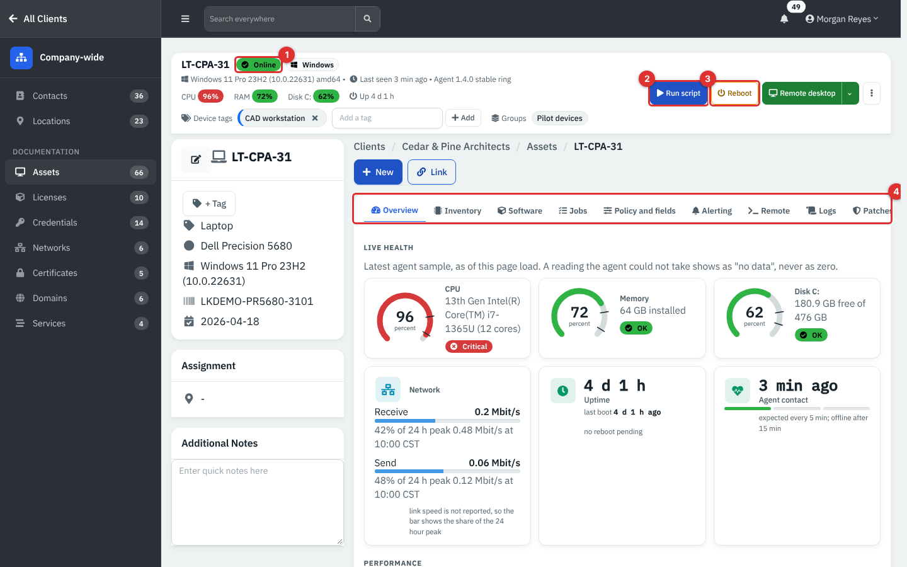

*Figure 1 — A device's asset page, RMM Overview tab. Example data, not a live connection.*

1. The status badge (**Online**, **Offline** and so on) beside the host name, with the operating system, last seen time, agent version, ring, and the **CPU**, **RAM** and **Disk C:** chips. **Device tags** and **Groups** sit below.
2. **Run script** opens the dialog for running a library script on this device.
3. **Reboot** queues a restart. It asks you to confirm first, because it interrupts the person using the device.
4. The tab bar: **Overview**, **Inventory**, **Software**, **Jobs**, **Policy and fields**, **Alerting**, **Remote**, **Logs**, **Patches**, **Deployment** and **Changes**. The last four appear when the matching feature is switched on.

Next to **Reboot**, the green **Remote desktop** button opens a MeshCentral session (see [page 27](27-rmm-patching-software-remote.md#a-quick-tour-remote-access-with-meshcentral)).

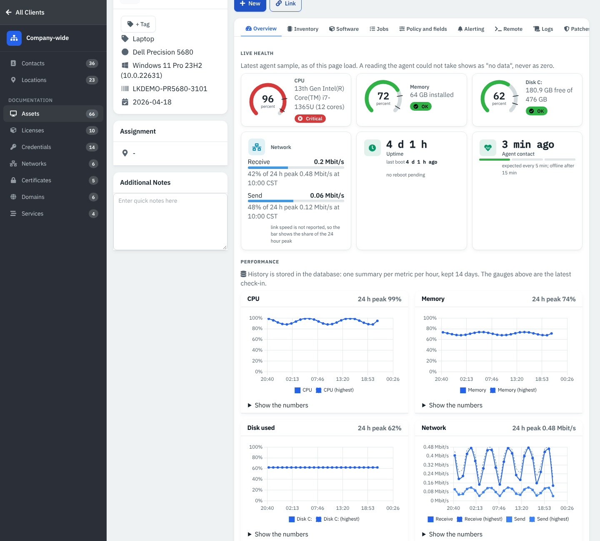

*Figure 2 — Live health and performance. Example data, not a live connection.*

The **Overview** tab shows gauges for **CPU**, **Memory** and **Disk C:**, plus **Network** receive and send, **Uptime** (and whether a restart is pending) and **Agent contact** (how long ago, and when it will be considered offline). Under **Performance**, 24-hour charts for CPU, memory, disk and network keep a one-point-per-hour summary for a limited time, and **Show the numbers** gives the figures behind each chart. A reading the agent could not take shows as "no data", never as zero.

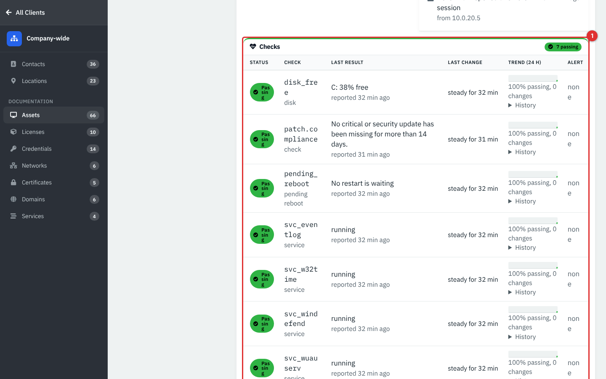

*Figure 3 — Checks on one device. Example data, not a live connection.*

1. Each row shows the check's **Status** (Passing, warning or failing), its name, the **Last result** with when it was reported, **Last change**, a **Trend (24 h)** and any **Alert**. **History** opens the earlier results.

### Jobs and running scripts

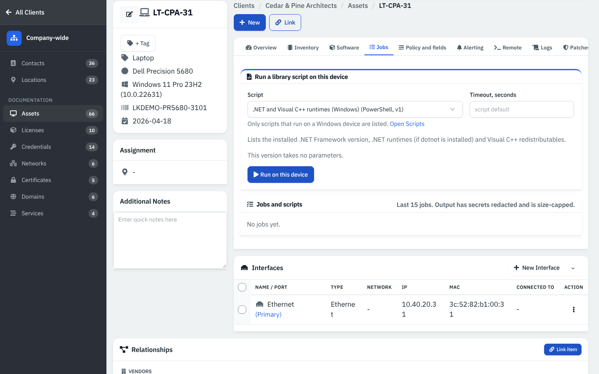

*Figure 4 — The Jobs tab. Example data, not a live connection.*

The **Jobs** tab has two parts. **Run a library script on this device** lets you pick a script, an optional timeout and fill in its parameters, then press **Run on this device**. **Jobs and scripts** lists the last 15 jobs for the device; their output has secrets redacted and is size-capped. A new device shows "No jobs yet".

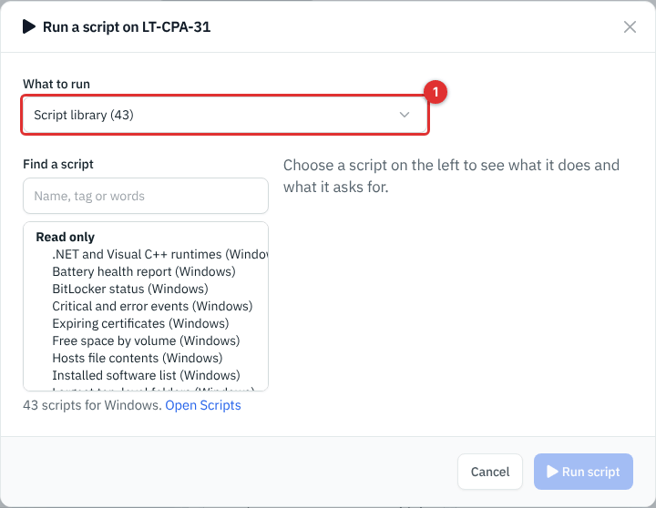

*Figure 5 — The Run script dialog from the device header. Example data, not a live connection.*

1. **What to run** offers the **Script library**, scripts you saved earlier, scripts synced from a vendor RMM, and free text. The library list is grouped by risk (**Read only** first) and filtered to scripts that run on this device's operating system.
2. **Run script** is greyed out until you choose a script. A destructive script asks you to tick **This script changes or removes things (destructive)**, and a free-text run asks you to confirm that it may run as SYSTEM (Windows) or root (Linux).

Every action is queued as a signed job that the agent verifies, and it is written to the audit log with your name. Job results are kept for the retention period set on the **Endpoint agent** page (180 days in the demo).

### Policy and fields, alerting

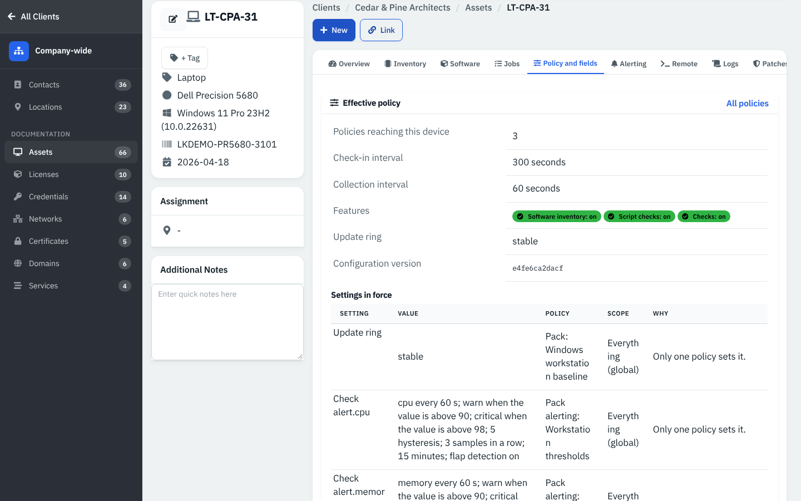

*Figure 6 — Policy and fields. Example data, not a live connection.*

**Policy and fields** shows the **Effective policy** for this device: how many policies reach it, its check-in and collection intervals, which features are on, its update ring and a configuration version. **Settings in force** explains each setting: its value, which policy set it, the scope it came from and why it won. Custom field values for this device are edited here too.

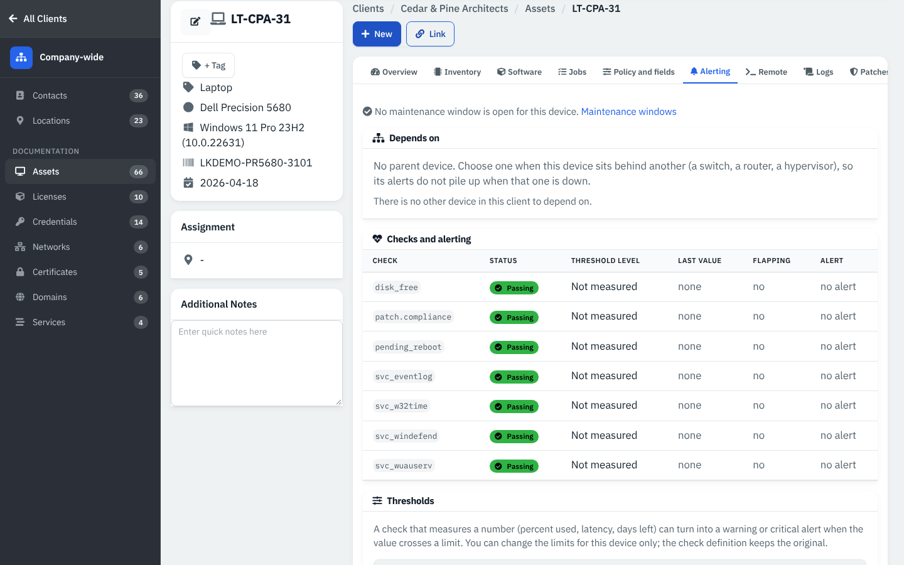

*Figure 7 — Alerting. Example data, not a live connection.*

The **Alerting** tab tells you whether a **maintenance window** is open for this device, lets you choose a **parent device** (**Depends on**) so alerts do not pile up when a switch or hypervisor above it is down, and lists the **Alerting state of each check** (status, threshold level, last value, flapping and alert). Under **Thresholds** you can set warning and critical limits for this device only, for checks that measure a number.

## Policies

A **policy** tells the devices it reaches how often to check in, which features to use, which update ring to follow and which checks to run. Open **Endpoints** → **Policies**.

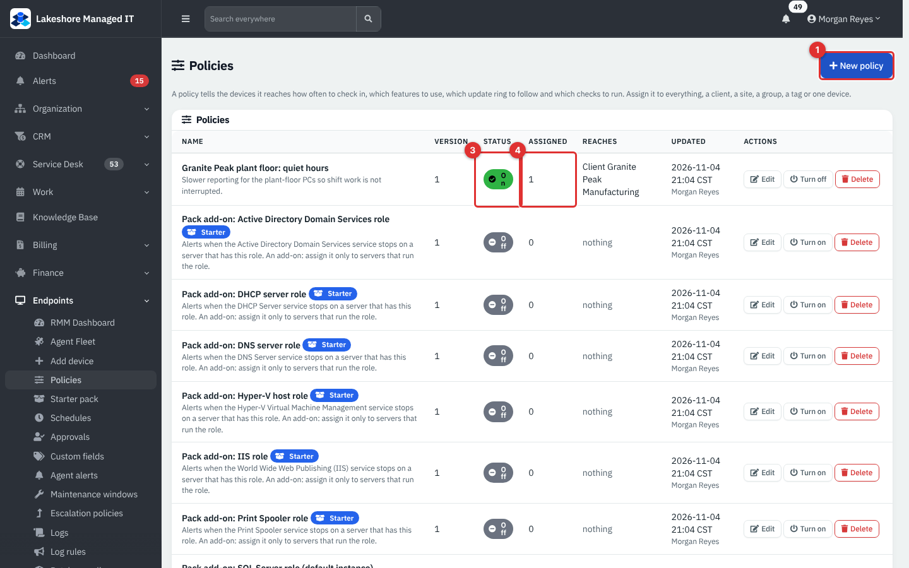

*Figure 8 — Policies. Example data, not a live connection.*

1. **New policy** creates one.
2. **Status**: **On** or **Off**. A policy that is off keeps its assignments but reaches no device. **Reaches** counts devices.
3. **Assigned**: which scope it applies to (everything, a client, a site, a group, a tag, or one device).

Each row can be edited, turned on or off, or deleted. Rows marked **Starter** come from the starter pack (see below).

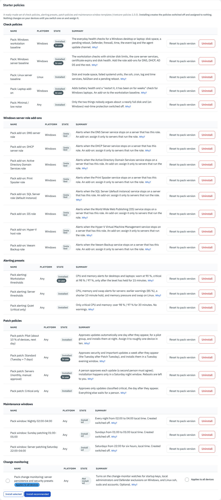

*Figure 9 — Starter policies. Example data, not a live connection.*

Starter policies ship switched off. Read each one, switch it on and assign it. Nothing reaches a device until you have done both.

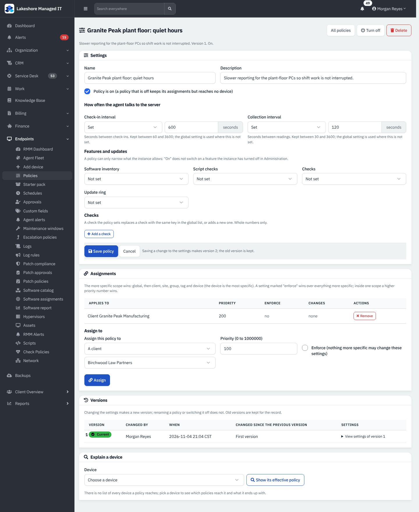

*Figure 10 — A policy's page. Example data, not a live connection.*

A policy page has **Settings** (name, description, **Policy is on**, check-in and collection intervals, **Software inventory**, **Script checks**, **Checks**, **Update ring**, and extra checks), **Assignments**, **Versions** and **Explain a device**. Each setting is either **Not set** (the policy has no opinion) or **Set** to a value. Saving a change to the settings makes a new version and keeps the old one.

How conflicts are settled: the more specific scope wins (global, then client, site, group, tag, device). A setting marked **Enforce** wins over everything more specific, and inside one scope a higher priority number wins. **Explain a device** lets you pick a device and see which policies reach it and what it ends up with.

## Scripts

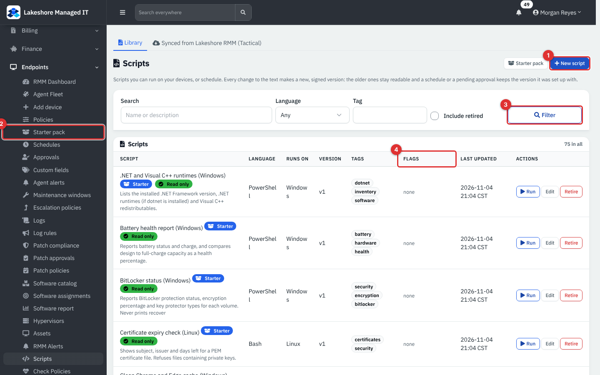

*Figure 11 — Endpoints → Scripts. Example data, not a live connection.*

1. **New script** creates a library script. Every change to the text makes a new, signed version. Older versions stay readable, and a schedule or a pending approval keeps the version it was set up with.
2. **Starter pack** opens the ready-made scripts.
3. **Filter** narrows by search text, language (**PowerShell**, **Bash**, **Python**) and tag. **Include retired** shows retired ones.
4. **Flags** show **Read only**, **Changes the system** or **Disruptive** (and whether approval is needed).

The vendor RMM's own scripts are on the separate **Synced from** tab (this guide's demo shows **Synced from Lakeshore RMM (Tactical)**).

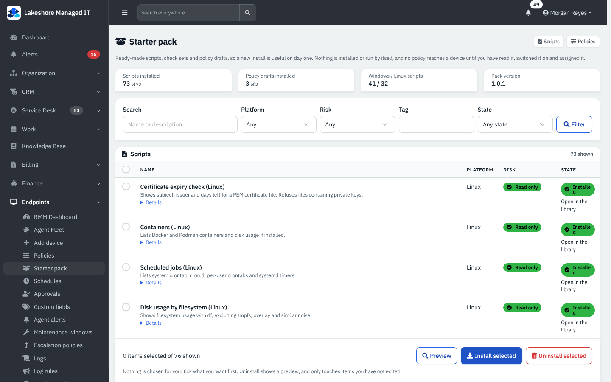

*Figure 12 — Starter pack. Example data, not a live connection.*

The **Starter pack** installs 73 scripts (41 for Windows, 32 for Linux), check sets and three policy drafts. Nothing runs by itself. You can install or uninstall a selection and see which have an update waiting for review or were edited by you.

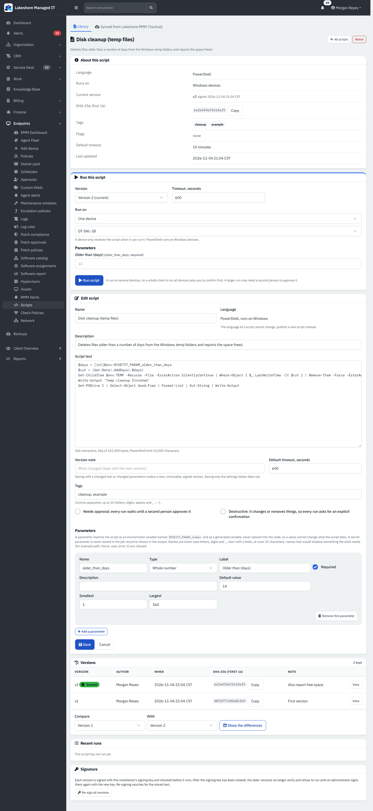

*Figure 13 — One script's page. Example data, not a live connection.*

The script page has **About this script** (language, runs on, version, SHA-256, tags and flags), **Run this script** (version, timeout, **Run on** one device, a tag, a group or a client, and the parameters), **Edit script** (text, version note, tags, **Needs approval**, **Destructive**, and parameters), **Versions** with **Show the differences**, **Recent runs** and **Signature**. A parameter reaches the script as an environment variable named `RIVETIT_PARAM_<name>`, never spliced into the code. A secret parameter is never stored in the job record or shown in output. A run on several devices, a whole client or all devices asks you to confirm first, and a larger run may need a second person.

## Schedules, approvals and fields

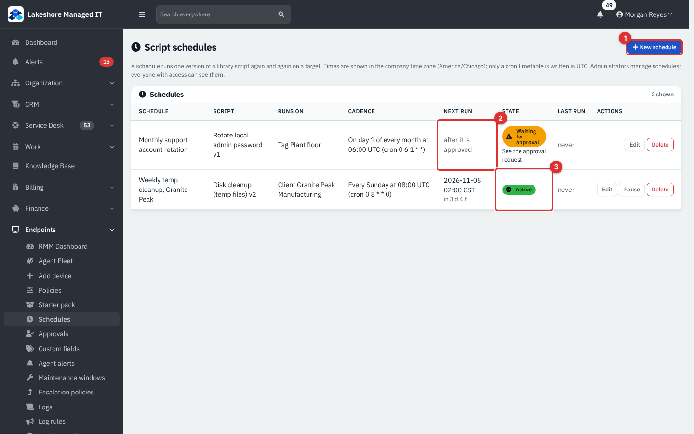

*Figure 14 — Script schedules. Example data, not a live connection.*

A **schedule** runs one version of a library script again and again on a target. Times show in the company time zone (the cron timetable itself is written in UTC, as the **Cadence** column shows). Administrators manage schedules; anyone with access can see them.

1. **New schedule** creates one.
2. A schedule for a script that needs approval is **Waiting for approval**, and links to its request. Its **Next run** reads "after it is approved".
3. An **Active** schedule shows its next run and last run, and can be edited, paused or deleted.

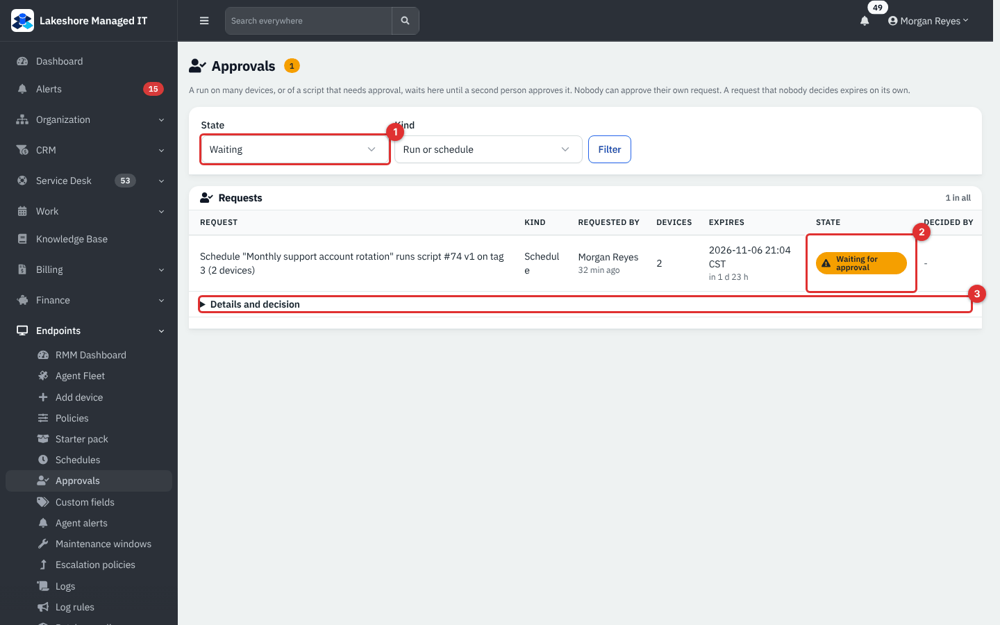

*Figure 15 — Approvals. Example data, not a live connection.*

A run on many devices, or of a script that needs approval, waits on **Approvals** until a second person approves it. Nobody can approve their own request, and a request nobody decides expires on its own.

1. Filter by **State** (**Waiting**, **Approved**, **Rejected**, **Cancelled**, **Expired**, **All**) and **Kind** (runs, schedules, patches, software).
2. The row shows who asked, how many devices and when it expires.
3. **Details and decision** opens the script version and targets, with the buttons to approve or reject.

**Custom fields** (**Endpoints** → **Custom fields**) hold facts you want scripts to use, per client, site or device (for example a cost center, or a support account password stored as a **Secret**, which is write-only). Put `{{field.name}}` in a script parameter and it is filled in with the value that applies to the device the script runs on.

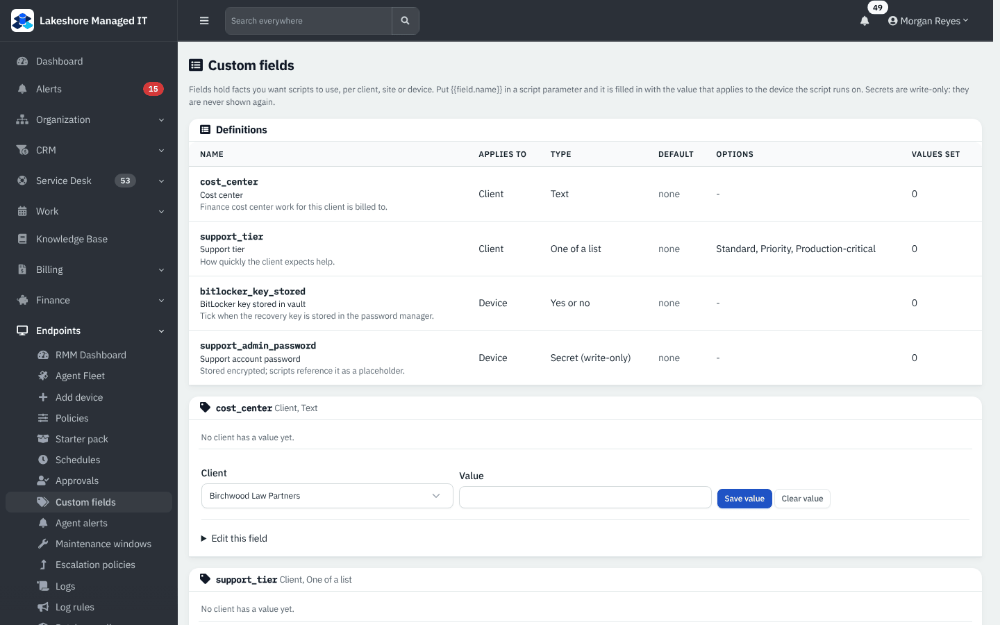

*Figure 16 — Custom fields. Example data, not a live connection.*

## Agent alerts, maintenance windows and escalation

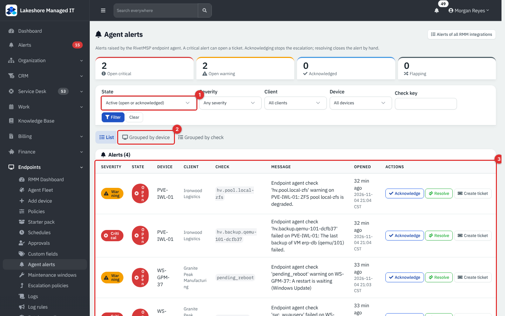

*Figure 17 — Endpoints → Agent alerts. Example data, not a live connection.*

**Agent alerts** are the alerts raised by the built-in agent. A critical alert can open a ticket. Acknowledging stops the escalation, and resolving closes the alert by hand.

1. Filter by **State** (the default is **Active (open or acknowledged)**), **Severity**, **Client**, **Device** and **Check key**.
2. **List**, **Grouped by device** and **Grouped by check** change the view, which helps when one device or one check is noisy.
3. Each row has **Acknowledge**, **Resolve** and **Create ticket**. The four tiles count open critical, open warning, **Acknowledged** and **Flapping** alerts. A check that keeps flipping between good and bad is marked **Flapping**.

Tickets made from alerts follow the settings on **Integrations** → **RMM** (see page 25).

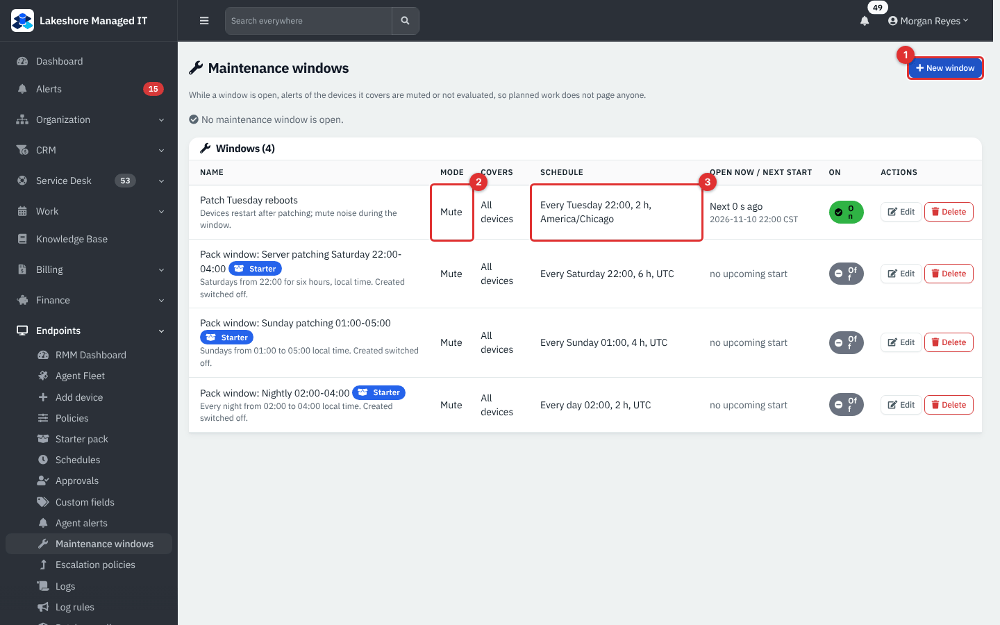

*Figure 18 — Maintenance windows. Example data, not a live connection.*

While a **maintenance window** is open, alerts of the devices it covers are muted or not evaluated, so planned work does not page anyone.

1. **New window** creates one.
2. **Mode**: **Mute** keeps the window from alerting.
3. **Schedule**: a recurring pattern with duration and time zone (for example "Every Tuesday 22:00, 2 h, America/Chicago"), or a single period. **Covers** is all devices, a client, a group or a tag.

Starter windows (for example server patching on Saturday night) are created switched off.

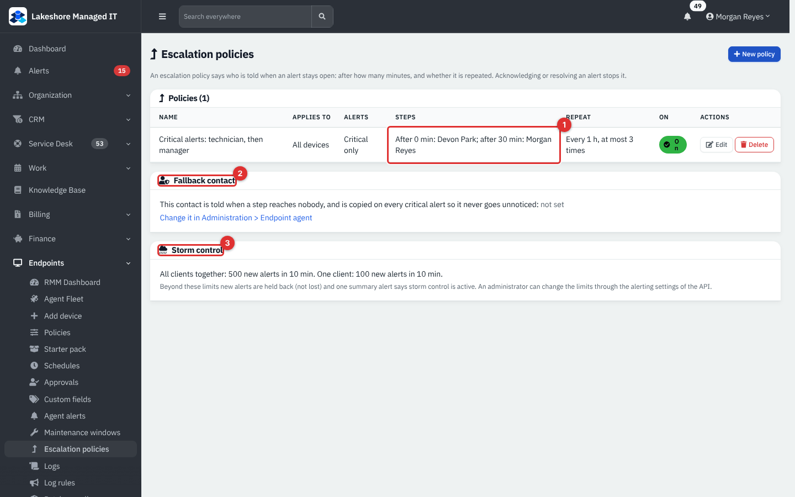

*Figure 19 — Escalation policies. Example data, not a live connection.*

An **escalation policy** says who is told when an alert stays open: after how many minutes, and whether it is repeated. Acknowledging or resolving stops it.

1. **Steps**: for example "After 0 min: Devon Park; after 30 min: Morgan Reyes", repeated every hour at most three times, for **Critical only** alerts.
2. **Fallback contact**: told when a step reaches nobody and copied on every critical alert. It is set on the **Endpoint agent** page.
3. **Storm control** holds back new alerts (they are not lost) once too many arrive in ten minutes, and raises one summary alert instead.

## The vendor RMM check list

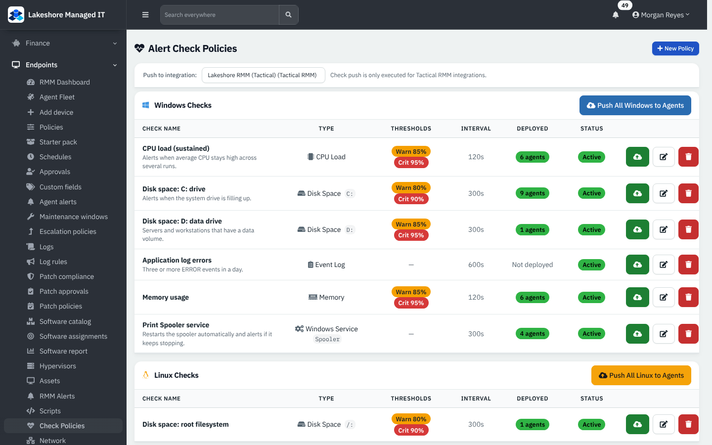

*Figure 20 — Endpoints → Check Policies. Example data, not a live connection.*

**Check Policies** is for the vendor RMM only (Tactical RMM). Each policy has a check type (**Disk Space**, **CPU Load**, **Memory**, **Windows Service**, **Event Log**, **Ping**), warning and critical thresholds, an interval, a count of agents it is **Deployed** to, and a status. **Push All Windows to Agents** (and the Linux and macOS equivalents) sends the checks to the vendor RMM, and only Tactical RMM integrations act on a push.

**Note.** The **Push to integration** list on this page also lists a Sophos Central connection and labels it "(Tactical RMM)", although the push is only carried out for Tactical RMM.

## Common tasks

### Run a library script on one device

1. Open the device and press **Run script** in the header (or use the **Jobs** tab).
2. Choose the script under **What to run** → **Script library**. Read its description and fill in any parameters.
3. Press **Run script** (**Queue job** in the dialog for other sources). The job appears under **Jobs and scripts**.

### Add a policy for one client

1. **Endpoints** → **Policies** → **New policy**. Give it a name and description.
2. Set only what you want to change, for example **Check-in interval**.
3. Save, then **Assign** it to the client, and turn it on.
4. Use **Explain a device** to confirm the result.

### Schedule a script

1. **Endpoints** → **Schedules** → **New schedule**.
2. Choose the script and version, the target, the cadence and what happens if a run overlaps.
3. If the script needs approval, a second person approves the request under **Approvals** before the first run.

### Quiet an alert during planned work

1. **Endpoints** → **Maintenance windows** → **New window**.
2. Choose the devices it covers, **Mute** and the time, then save.

## Reference

| Item | Values |
|---|---|
| Script flags | **Read only**, **Changes the system**, **Disruptive**; **Needs approval** and **Destructive** are set per script |
| Script languages | **PowerShell**, **Bash**, **Python** |
| Approval states | **Waiting**, **Approved**, **Rejected**, **Cancelled**, **Expired** |
| Alert severities (agent) | **Critical**, **Warning** (the vendor RMM list also has **Error** and **Info**) |
| Maintenance mode | **Mute** (alerts of covered devices are muted) |
| Custom field types | text, yes or no, one of a list, secret (write-only) |

## Tips and good practice

- Prefer **Read only** scripts to look first, then run one that changes things.
- Turn on **Needs approval** for any script that resets passwords or deletes data, so a second person sees the exact version.
- Use tags (for example **Domain controller**) and assign server policies to the tag, not to individual machines.
- Set **Depends on** for devices behind a switch or hypervisor so one outage does not raise dozens of alerts.
- Check **Flapping** alerts first: a check that flips constantly usually needs a better threshold.

## Related guides

- [Endpoints and RMM: overview](25-endpoints-rmm-overview.md)
- [Patching, software, logs, hypervisors and remote access](27-rmm-patching-software-remote.md)
- [Alerts, backups, network and RivetPanel](28-alerts-backups-network-panel.md)
- [Assets](11-assets.md)
- [Service desk tickets](05-service-desk-tickets.md)
