# Patching, software, logs, hypervisors and remote access

This page covers the features you switch on after the basics of the endpoint agent are running: finding and approving missing **patches**, keeping a **software catalog** and deploying from it, collecting **logs** and turning them into alerts, seeing the guests on **Proxmox VE** and **Hyper-V** hosts, and opening a **remote session** with MeshCentral. All of them belong to the built-in agent. Set up and enroll devices first ([overview](25-endpoints-rmm-overview.md)).

| | |
|---|---|
| **Where to find it** | Sidebar → **Endpoints** → **Patch compliance**, **Patch approvals**, **Patch policies**, **Software catalog**, **Software assignments**, **Software report**, **Logs**, **Log rules**, **Hypervisors**. Per device: the **Patches**, **Software**, **Deployment**, **Remote** and **Logs** tabs on the asset page. The switches: **Administration** → **Settings** → **Endpoint agent**, on the **Patching**, **Software deployment**, **Inventory and logs**, **Hypervisors** and **Remote and Mesh** tabs. |
| **Who can use it** | **RMM** (module `module_rmm`) at **Read** to see every page. Approving or declining updates, running **Install now** and managing packages need more than that (a technician with the install or deploy right, or an administrator); every switch and the MeshCentral setup are **administrator** only. Remote sessions need **RMM remote connect** at **Read**, and the terminal and file views need an administrator (or **RMM scripts** at **Full** if an administrator has allowed that). |
| **Turn it on** | Each feature has its own switch and adds its pages only while it is on. Every switch states its "Cost" in plain words. |

All screens in this guide show example data for a fictional company, Lakeshore Managed IT. Nothing on them is a live connection: the missing updates, packages, log lines, virtual machines and remote sessions were created for this guide. The Windows install paths for patches and software, the hypervisor reports and MeshCentral have **not been verified on a live service**, and the application itself says to start with a dry run on one pilot machine.

## What it's for

- Know which devices are missing critical or security updates, and for how long, per client.
- Approve updates once and let a patch policy install them in a safe window, instead of clicking through each machine.
- Keep a catalog of approved software, pinned by a hash, and see who has it.
- Collect event-log lines and raise an alert when a pattern appears (for example repeated disk errors).
- See guests, storage and backup status of virtualization hosts.
- Open a desktop, terminal or file view on a device without a VPN.

## A quick tour: patching

Detection comes first and installing is gated. A device reports which updates it is missing, a person (or a rule you wrote) approves them, and an installation happens only for approved updates, only where a **patch policy** allows it, only inside its install window. The agent never restarts a machine by itself.

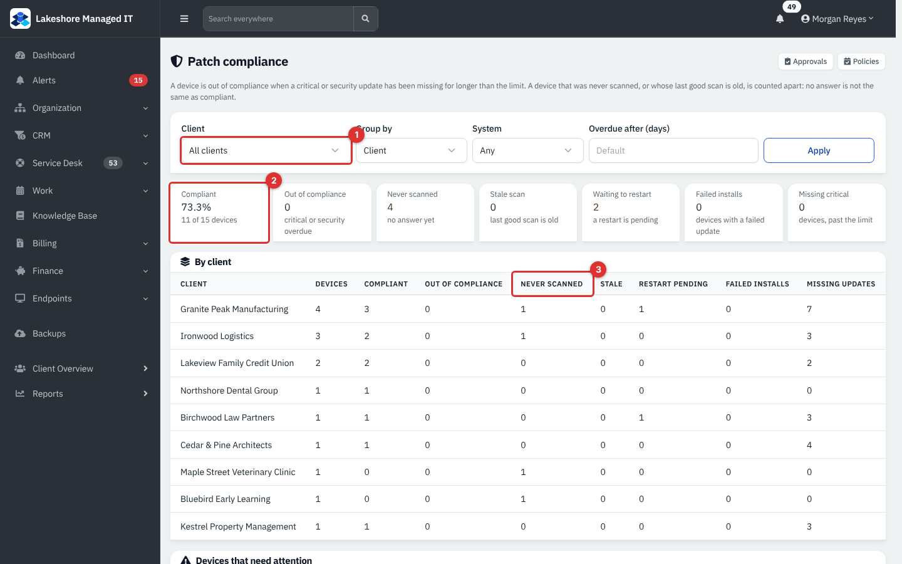

*Figure 1 — Endpoints → Patch compliance. Example data, not a live connection.*

1. Filters: **Client**, **Group by** (**Client**, **Site**, **Group**, **System**), operating system, and **Overdue after (days)**. Press **Apply**.
2. Tiles: **Compliant** (as a percentage and a count), **Out of compliance**, **Never scanned**, **Stale scan**, **Waiting to restart**, **Failed installs** and **Missing critical**. A device is out of compliance when a critical or security update has been missing longer than the limit. A device that was never scanned is counted apart: no answer is not the same as compliant.
3. **Never scanned** counts devices that have not answered a scan yet. The **By client** table below splits every figure per client.

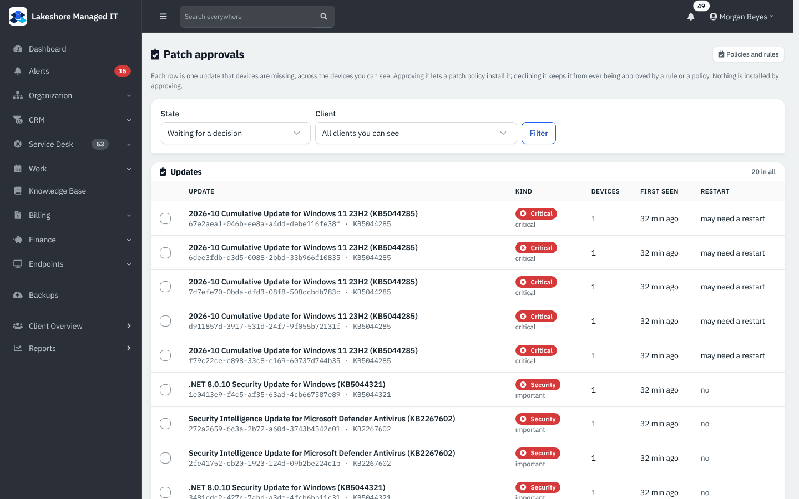

*Figure 2 — Patch approvals. Example data, not a live connection.*

Each row of **Patch approvals** is one update that devices are missing, with its kind (**Critical**, **Security**, **Important**, **Optional**, **Driver**), how many devices lack it, when it was first seen and whether it may need a restart. **State** filters **Waiting for a decision**, **Approved**, **Failed**, **Declined** and **Installed**. Approving lets a patch policy install the update, and nothing is installed by approving. Declining keeps it from ever being approved by a rule or a policy.

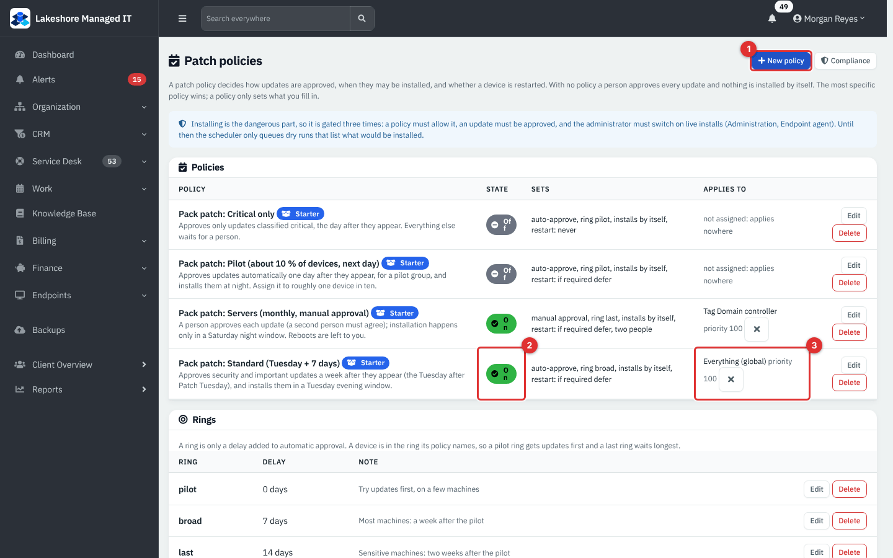

*Figure 3 — Patch policies. Example data, not a live connection.*

1. **New policy** creates one. With no policy, a person approves every update and nothing is installed by itself.
2. **State**: starter policies (**Pack patch: Standard (Tuesday + 7 days)**, **Pack patch: Critical only**, **Pack patch: Servers (monthly, manual approval)** and so on) arrive **Off**.
3. **Applies to** shows where a policy is assigned, or "not assigned: applies nowhere". The most specific policy wins, and a policy only sets what you fill in. Settings include auto-approve, the ring, whether it installs by itself, the install window and what happens about restarts.

Installing is gated three times: a policy must allow it, an update must be approved, and an administrator must switch on **Live installs**.

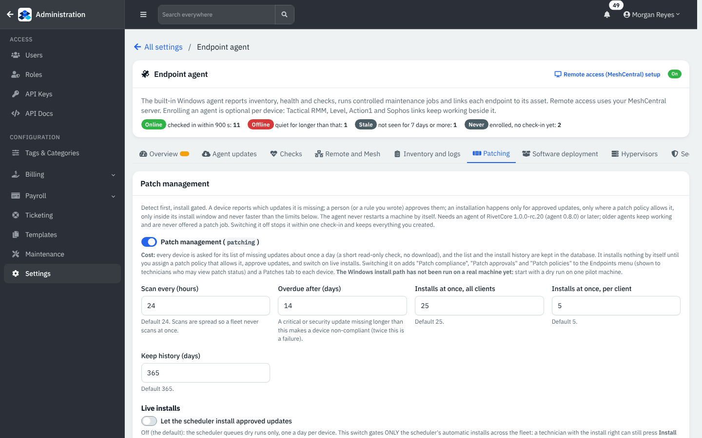

*Figure 4 — Administration → Settings → Endpoint agent → Patching. Example data, not a live connection.*

On this tab you set **Scan every (hours)** (every device is asked about once a day, spread so a fleet never scans at once), **Overdue after (days)**, **Installs at once** for all clients and per client, and **Keep history (days)**. **Let the scheduler install approved updates** is **off** by default: the scheduler then queues dry runs only. A technician with the install right can still press **Install now** on one device's **Patches** tab (with their own confirmation, written to the audit log). Turning the switch on asks you to tick that you understand updates will install without anyone clicking.

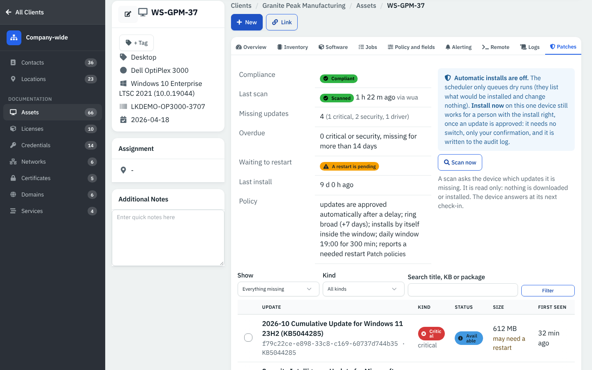

*Figure 5 — A device's Patches tab. Example data, not a live connection.*

The **Patches** tab shows **Compliance**, **Last scan**, **Missing updates** (here, 1 critical and 1 security), **Overdue**, whether the device is **Waiting to restart**, the **Last install** and the **Policy** that reaches it. **Scan now** asks the device which updates it is missing (read only: nothing is downloaded or installed, and the device answers at its next check-in). The list below filters by status, kind and a search for a title, KB or package.

## A quick tour: software

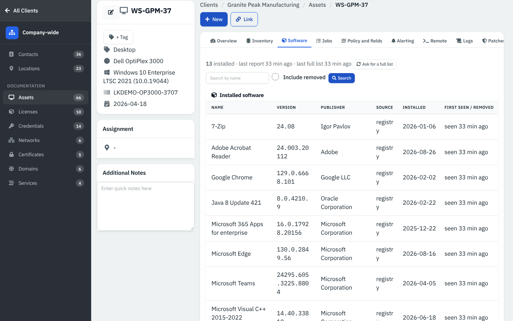

*Figure 6 — A device's Software tab. Example data, not a live connection.*

The **Software** tab lists what the agent reports: name, version, publisher, source (registry on Windows, dpkg and others on Linux), install date and when it was first seen or removed. **Ask for a full list** requests a fresh report and **Include removed** shows what has gone. This needs **Collect installed software** switched on under **Inventory and logs**; it is off by default.

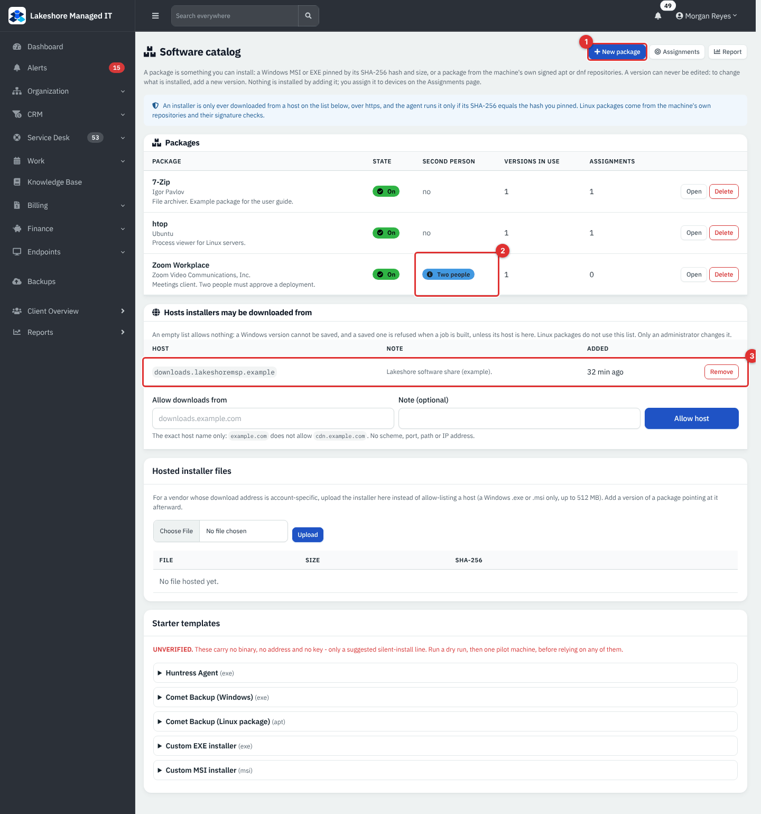

*Figure 7 — Endpoints → Software catalog. Example data, not a live connection.*

A **package** is something you can install: a Windows MSI or EXE pinned by its SHA-256 hash and size, or a package from the machine's own signed apt or dnf repositories. A version can never be edited; to change what is installed, add a new version.

1. **New package** adds one. Nothing is installed by adding it; you assign it on the **Assignments** page.
2. **Second person**: a package marked **Two people** always needs a second person for every assignment and every manual run.
3. **Hosts installers may be downloaded from**: an installer is only downloaded from a host on this list, over https, and the agent runs it only if its SHA-256 equals the hash you pinned. An empty list allows nothing. Only an administrator changes it.

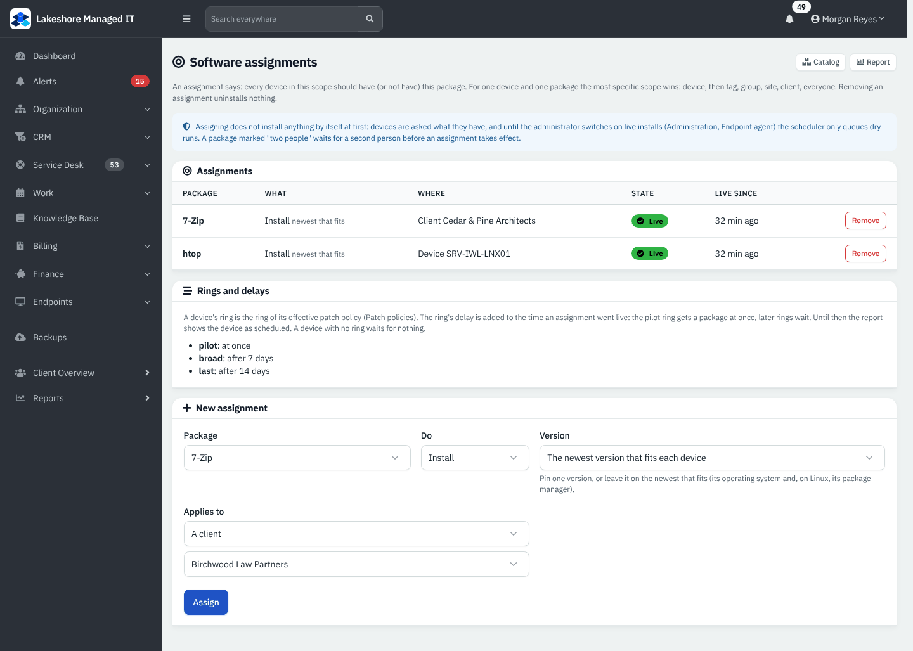

*Figure 8 — Software assignments. Example data, not a live connection.*

An **assignment** says that every device in a scope should have (or not have) a package. The most specific scope wins: device, then tag, group, site, client, everyone. Choose the package, **Do** (**Install** or **Remove**) and the version. Removing an assignment uninstalls nothing. **Rings and delays** add time after the assignment went live: **pilot** gets it at once, **broad** after 7 days and **last** after 14 days in the demo. A device's ring comes from its effective patch policy.

Until an administrator switches on **live installs** under **Software deployment**, the scheduler only queues dry runs. A person with the deploy right can still use **Install now** on one device's **Deployment** tab. The Windows install path (MSI, EXE, the pinned download) has not been run on a real machine yet.

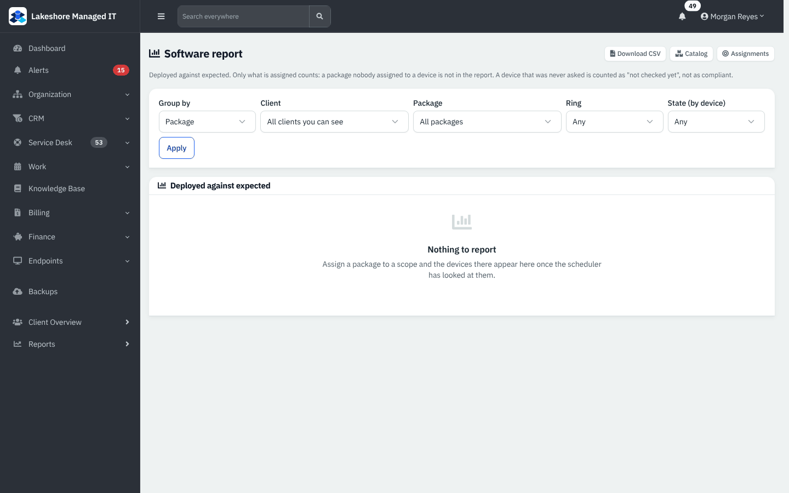

*Figure 9 — Software report. Example data, not a live connection.*

The **Software report** compares deployed against expected. Group it by package, client, ring or device and package, filter by state (**Failed**, **Pending**, **Missing**, **Present**, **Unknown**, **Scheduled**, **Compliant**), and press **Download CSV** to export. Only what is assigned counts, and a device never asked is shown as "not checked yet". In the demo no assignment has been evaluated yet, so it shows "Nothing to report".

## A quick tour: logs and log rules

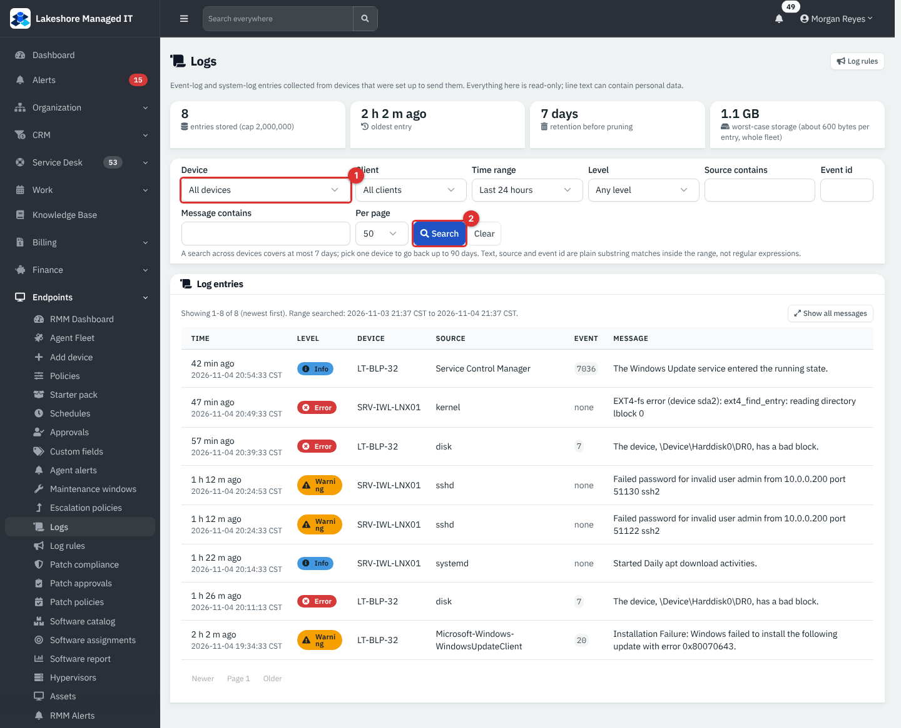

*Figure 10 — Endpoints → Logs. Example data, not a live connection.*

1. Filter by **Device**, **Client**, **Time range**, **Level** (from **Critical or worse** down to **Debug or worse**), **Source contains**, **Event id** and **Message contains**.
2. Press **Search**. A search across devices covers at most 7 days; pick one device to go back up to 90 days. Text, source and event id are plain substring matches, not regular expressions.

The summary tiles show entries stored (with the cap), the oldest entry, the retention before pruning (7 days) and a worst-case storage estimate. Line text can contain personal data, so the page is read-only.

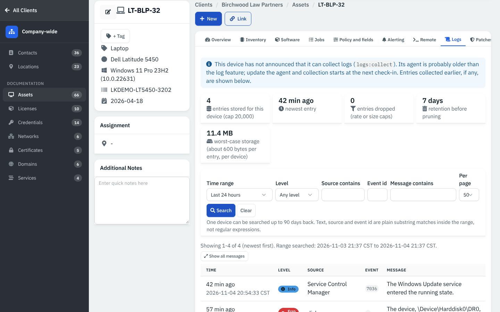

*Figure 11 — A device's Logs tab. Example data, not a live connection.*

On a device, the **Logs** tab shows the same filters for that device. In the demo it says "This device has not announced that it can collect logs", because no real agent is running; the sample entries were added directly.

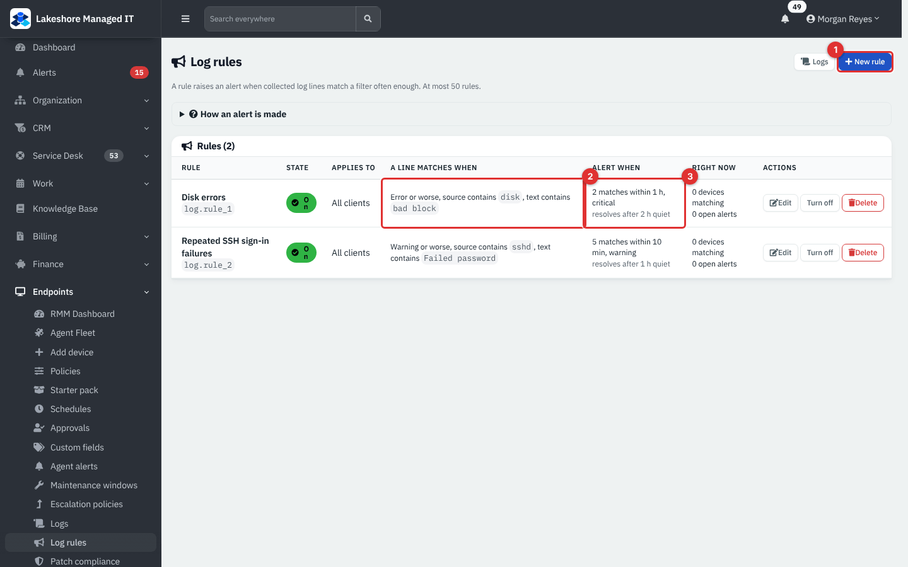

*Figure 12 — Log rules. Example data, not a live connection.*

A **log rule** raises an alert when collected lines match a filter often enough. At most 50 rules.

1. **New rule** creates one.
2. **A line matches when**: minimum level, text the source contains, and text the message contains (for example "Error or worse, source contains disk, text contains bad block").
3. **Alert when**: how many matches within how long, the severity and when it resolves ("2 matches within 1 h, critical; resolves after 2 h quiet"). **Right now** shows devices matching and open alerts.

Collection itself is switched on under **Inventory and logs** (and there is a preset for a Windows security-log baseline). Alerts from rules appear on **Agent alerts**.

## A quick tour: hypervisors

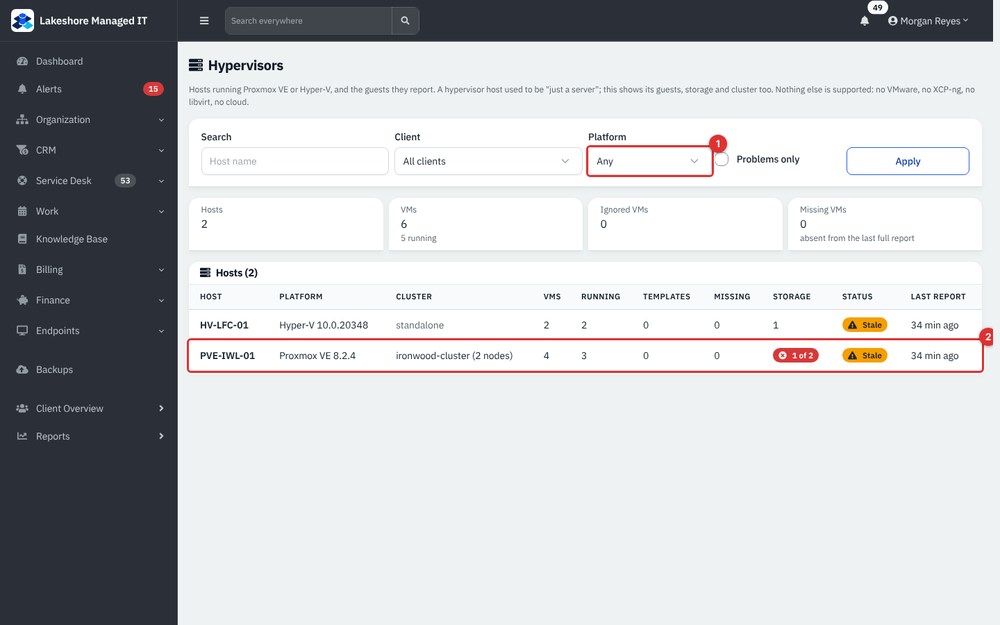

*Figure 13 — Endpoints → Hypervisors. Example data, not a live connection.*

1. Filter by **Client**, **Platform** (**Proxmox VE** or **Hyper-V**) or **Problems only**. Nothing else is supported: no VMware, no XCP-ng, no libvirt, no cloud.
2. The host row shows platform and version, **Cluster** (or standalone), **VMs**, **Running**, **Templates**, **Missing** and **Storage** (for example "1 of 2" healthy), the **Status** and the **Last report**.

Click a host to see its storage (with health), its virtual machines (state, CPU, memory, uptime, snapshots and last backup), and, where known, cluster nodes. The tiles count **Hosts**, **VMs**, **Ignored VMs** and **Missing VMs**. Thresholds for old snapshots, stale backups and full storage are on the **Hypervisors** tab of the **Endpoint agent** page.

**Note.** With the sample data in this guide, a host page prints "Nodes: Array, Array" for the cluster nodes and shows the **Last backup** cell as escaped markup. This is an oddity of the sample data on this build and is why this guide has no picture of a host page.

## A quick tour: remote access with MeshCentral

Remote access uses your own **MeshCentral** server. RivetMSP signs the technician in to MeshCentral with one click and opens the device in a new tab; it does not embed the session.

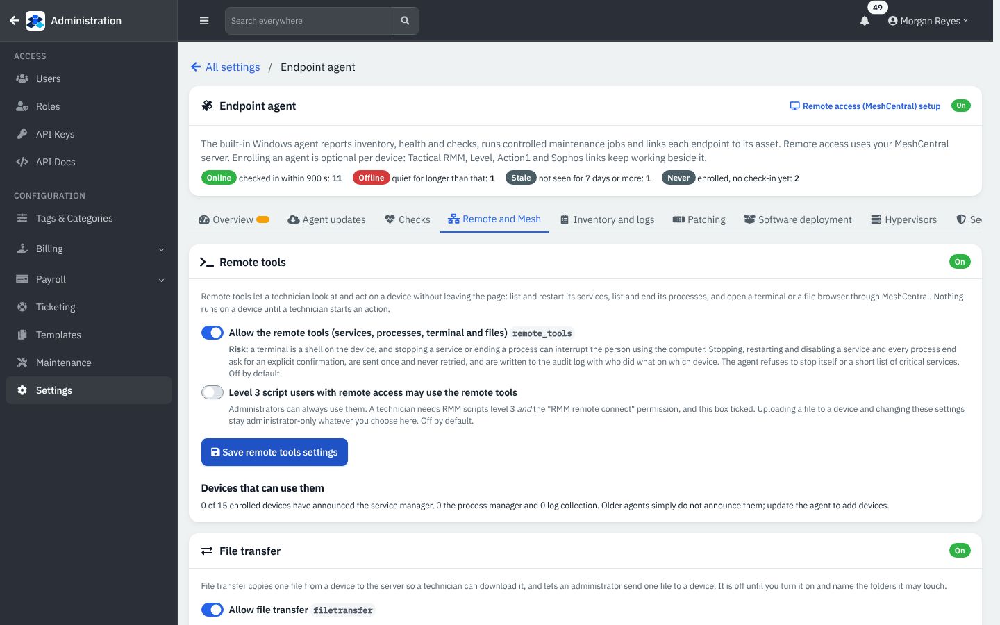

*Figure 14 — Administration → Settings → Endpoint agent → Remote and Mesh. Example data, not a live connection.*

**Remote tools** let a technician list and restart a device's services, list and end its processes, and open a terminal or file browser through MeshCentral. They are **off by default**, because a terminal is a shell on the device and stopping a service can interrupt the person using the computer. Stopping, restarting and disabling a service and every process end ask for explicit confirmation, are sent once and never retried, and are written to the audit log. **Level 3 script users with remote access may use the remote tools** is a second switch (off by default). **File transfer** copies one file from a device to the server (or sends one to a device) only from folders you list, with a size limit (default 50 MB) and a retention time (default 24 hours). Password databases, private keys and certificates are never transferable.

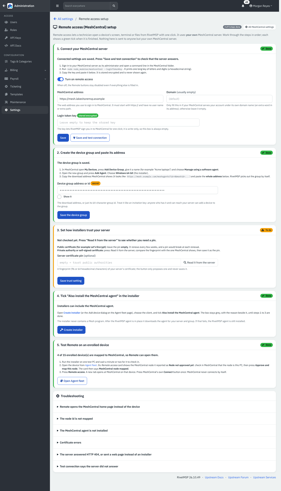

*Figure 15 — Remote access (MeshCentral) setup, opened from the link at the top of the Endpoint agent page. Example data, not a live connection.*

The wizard has five steps, each with a green tick when finished:

1. **Connect your MeshCentral server**: turn on remote access, enter the **MeshCentral address** (https, no extra path) and the **Login token key** (stored encrypted, write-only), then **Save and test connection**.
2. **Create the device group and paste its address**: in MeshCentral add a device group that is managed using a software agent, then paste the download address or the 64-character group id.
3. **Set how installers trust your server**: leave the pin empty for a public certificate, or use **Read it from the server** and compare the fingerprint for a private authority.
4. **Tick "Also install the MeshCentral agent"** in the installer.
5. **Test Remote on an enrolled device**: the device's **Remote access** card shows **MeshCentral node mapped** once approved and mapped.

The wizard also has a **Troubleshooting** list (the home page opens instead of the device, the node id is not mapped, and so on).

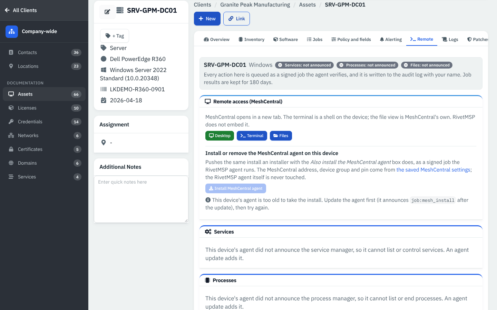

*Figure 16 — A device's Remote tab. Example data, not a live connection.*

The device's **Remote** tab offers **Desktop**, **Terminal** and **Files**, and an **Install or remove the MeshCentral agent on this device** button. Services and **Processes** sections appear when the agent announces them. Here the demo device is "too old to take the install", which the page says plainly. Every action here is queued as a signed job and written to the audit log with your name.

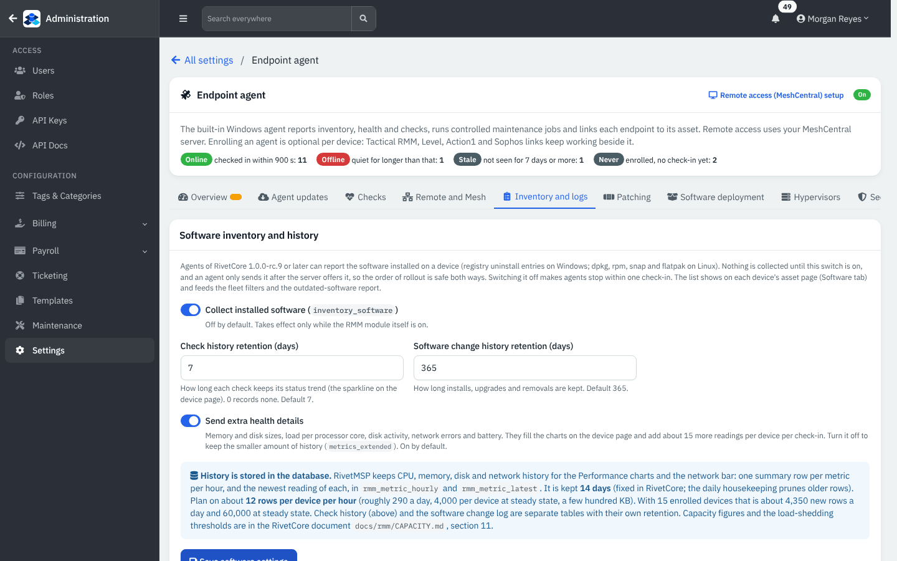

*Figure 17 — Inventory and logs settings. Example data, not a live connection.*

## Common tasks

### Approve an update and let it install

1. Switch on **Patching**, assign a patch policy (**Patch policies** → assign it to everything, a client, a tag or a device), and turn the policy on.
2. Open **Patch approvals**, filter **Waiting for a decision**, and approve the updates you trust (or **Decline** the ones you want blocked).
3. Wait for devices to report. Check **Patch compliance**.
4. To actually install, an administrator switches on **Let the scheduler install approved updates** (or a technician uses **Install now** on one device). Start with one pilot device.

### Deploy a package

1. **Software catalog** → **New package**, then add a version with its hash (Windows) or a package name (Linux). Add the installer host to the allow list first.
2. **Software assignments** → **New assignment**: choose the package, **Install**, the scope and the version.
3. Watch **Software report**. A package marked **Two people** waits for a second person.

### Raise an alert from logs

1. Switch on log collection under **Inventory and logs**.
2. **Log rules** → **New rule**: set the level, the source and the text, then how many matches in how many minutes.
3. Check **Right now** on the rules page, and the alert on **Agent alerts**.

### Open a remote session

1. Open the device, then press **Remote desktop** in the header (or **Desktop** on the **Remote** tab).
2. A new tab opens at MeshCentral. Press MeshCentral's own **Connect** button once: MeshCentral never connects by itself.

## Reference

| Item | Values |
|---|---|
| Patch kinds | **Critical**, **Security**, **Important**, **Optional**, **Driver**, **Other** |
| Patch approval states | **Waiting for a decision**, **Approved**, **Failed**, **Declined**, **Installed** |
| Software assignment actions | **Install**, **Remove** |
| Software report states | **Failed**, **Pending**, **Missing**, **Present**, **Unknown**, **Scheduled**, **Compliant** |
| Hypervisor platforms | **Proxmox VE**, **Hyper-V** |
| Log levels | **Critical or worse**, **Error or worse**, **Warning or worse**, **Information or worse**, **Debug or worse** |
| Defaults shown on the settings tabs | Patch scan every 24 hours; installs at once 25 (all clients) and 5 (per client); patch history 365 days; hypervisor full report every 600 seconds, summary every 120 seconds, history 30 days; file transfer 50 MB, kept 24 hours |

## Tips and good practice

- Roll out patching slowly: dry runs first, then one pilot machine, then a ring.
- Approve in **Patch approvals** by title and KB, and decline drivers that need a change window.
- Keep **Two people** on any package that is hard to undo.
- Pin the installer host and hash so a changed file cannot be installed.
- Leave the remote terminal off until you have a written policy for who may use it.

## Related guides

- [Endpoints and RMM: overview](25-endpoints-rmm-overview.md)
- [Devices, jobs, scripts, policies and alerting](26-rmm-devices-jobs-policies.md)
- [Alerts, backups, network and RivetPanel](28-alerts-backups-network-panel.md)
- [Assets](11-assets.md)
- [Users, roles and security](34-users-roles-security.md)
