# Alerts, backups, network devices and RivetPanel

This page covers the parts of the Endpoints area that look outward from single computers: the central **Alerts** list that merges every source, the **Backups** dashboard for Comet Backup, the **Network** page for firewalls, switches and access points (synced from UniFi and Sophos Central, or entered by hand), and **RivetPanel**, a small helper for the people at your clients' PCs. It also shows how to connect a vendor RMM, which feeds the **RMM Assets** and **RMM Alerts** pages. Everything here is optional, and each part has its own switch.

| | |
|---|---|
| **Where to find it** | Sidebar → **Alerts** (top level, red badge), **Endpoints** → **Assets**, **RMM Alerts**, **Network**, and **Backups** (top level). RivetPanel: open a client (**Organization** → **Clients**), then **SUPPORT** → **RivetPanel** in the client's sidebar. Settings: **Administration** → **Settings** → **Integrations** → **RMM**, **Backups**, **Firewalls**, **UniFi**. |
| **Who can use it** | **RMM alerts** (module `module_rmm_alerts`) for **Alerts**; **RMM** (module `module_rmm`) for the rest of Endpoints and **Backups**. Acknowledging and resolving alerts is shown to administrators only in this build, even for roles that have **RMM alerts** at **Modify** (see the Note below). **Create ticket** is shown to everyone who can see the alert list. RivetPanel needs **Support** (**Read** to look, **Modify** to mint tokens). Integration settings are **administrator** only. |
| **Turn it on** | Vendor RMM: **Integrations** → **RMM** → **Enable RMM module**. Comet Backup: **Integrations** → **Backups** → **Enable Comet Backup integration**. UniFi: **Integrations** → **UniFi** → **Enable UniFi module**. Sophos Central: add a connection on **Integrations** → **Firewalls**. RivetPanel: an install setting that is **off by default** and has no switch in the interface (see below). |

All screens in this guide show example data for a fictional company, Lakeshore Managed IT. Nothing on them is a live connection: there is no real Tactical RMM, Sophos, UniFi or Comet server behind them, and a small stand-in service supplied the backup figures when these pictures were taken. Syncing, test connections, webhooks and RivetPanel enrollment were **not verified on a live service**.

**Note — acknowledge permission.** The acknowledge and resolve buttons check a permission name (`module_rmm_alerts_ack`) that is not one of the permission modules in the Modules list. A technician with **RMM alerts** at any level can therefore see the alerts and **Create ticket**, but only an administrator sees **Acknowledge**, **Resolve** and the bulk buttons.

## What it's for

- Work every infrastructure alert from one list: RMM, built-in agent, backup and network alerts, newest first.
- Turn an alert into a ticket with one click, or let the settings do it automatically.
- Know at a glance whether last night's backups worked, per device and per client.
- Keep a list of firewalls, switches and access points per client, with firmware and last seen, filled in by sync where possible.
- Give staff at a client a desktop panel to raise tickets without a portal login.

## A quick tour: the central Alerts list

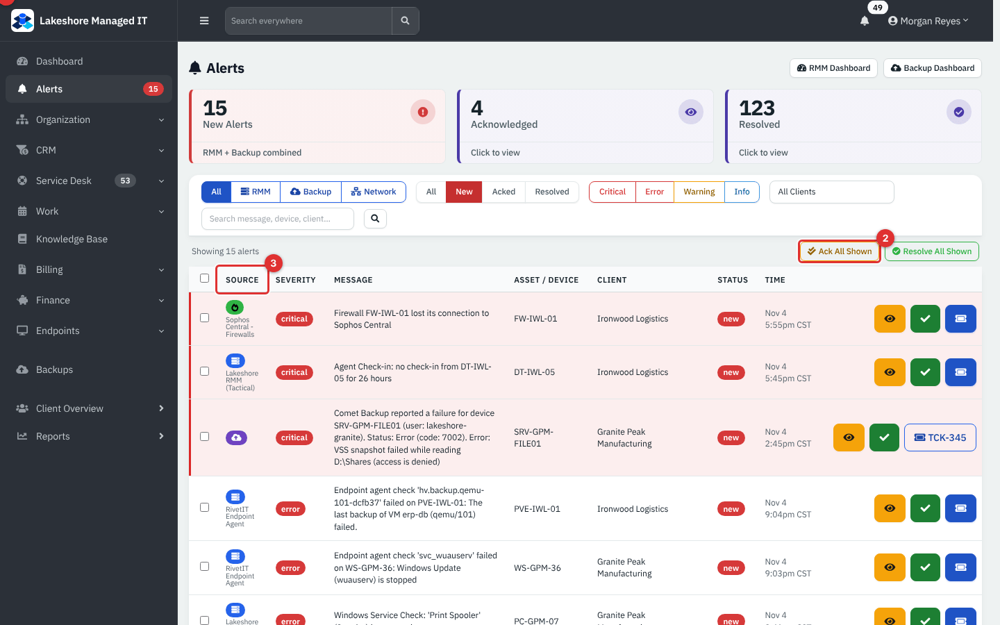

*Figure 1 — Alerts. Example data, not a live connection.*

1. The source switch: **All**, **RMM**, **Backup** and **Network**. Rows come from RMM integrations (Tactical RMM, Level.io, Action1), the built-in agent ("RivetIT Endpoint Agent"), Sophos Central and Comet Backup. Status buttons (**All**, **New**, **Acked**, **Resolved**), severity buttons (**Critical**, **Error**, **Warning**, **Info**) and a client filter narrow the list.
2. **Ack All Shown** and **Resolve All Shown** act on every row currently in the list (administrators).
3. The **Source** column says where each alert came from. The tiles at the top count **New Alerts**, **Acknowledged** and **Resolved**.

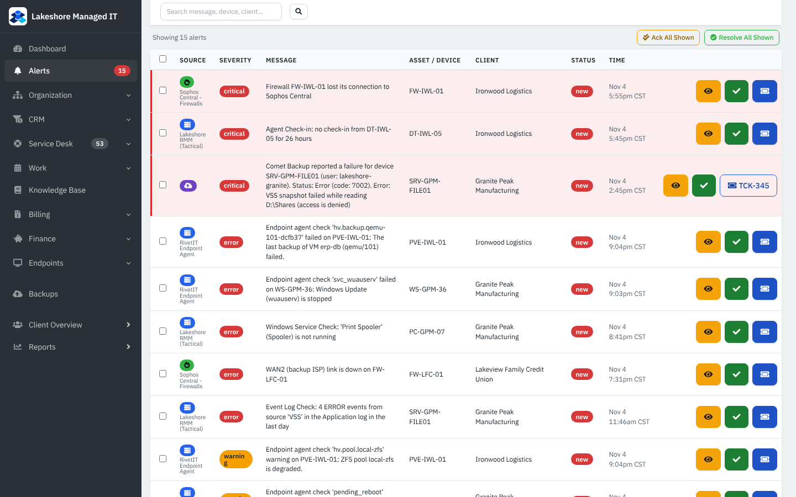

*Figure 2 — The alert table. Example data, not a live connection.*

Each row has its severity, message, **Asset / Device**, **Client**, **Status** and time. Acknowledged alerts are kept apart from new ones so the badge in the sidebar counts only what is still waiting.

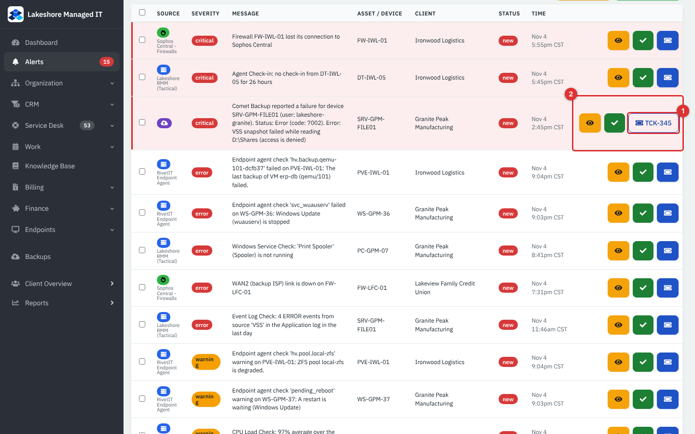

*Figure 3 — An alert that already has a ticket. Example data, not a live connection.*

1. A ticket number such as **TCK-345** means a ticket was created from this alert (automatically or with the button). Click it to open the ticket. Tickets from RMM alerts are maintenance work: by default they do not count toward SLA and send no email.
2. The action buttons: **Acknowledge**, **Create Ticket**, **Resolve**, and **View linked ticket** when a ticket exists.

Backup alerts that Comet raised can open a ticket for you too (one ticket per device, which resolves itself when the next backup works).

### RMM Alerts and RMM Assets (vendor RMM)

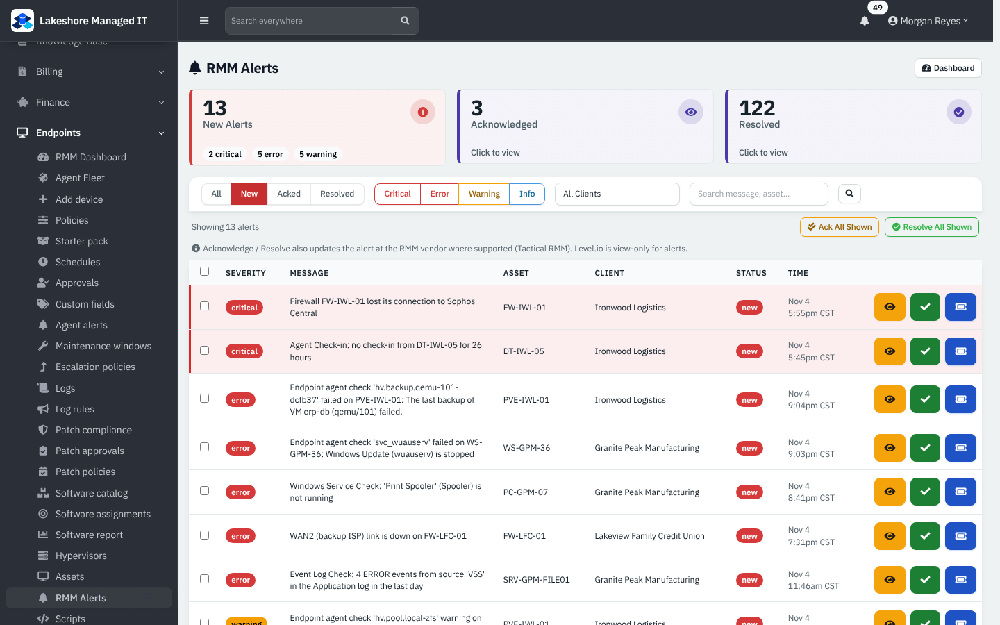

*Figure 4 — Endpoints → RMM Alerts. Example data, not a live connection.*

**RMM Alerts** is the same list restricted to RMM sources, with the counts of new (by severity), acknowledged and resolved alerts. Acknowledging or resolving here also updates the alert at the RMM vendor where supported (Tactical RMM). Level.io is view-only for alerts.

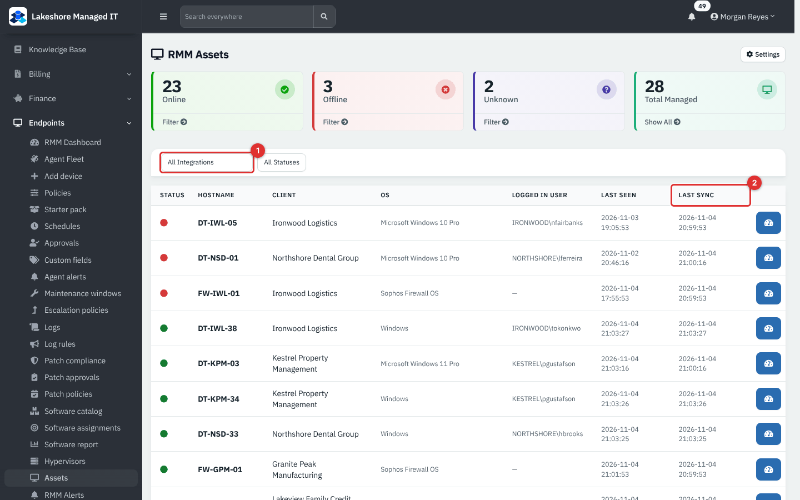

*Figure 5 — Endpoints → Assets (RMM Assets). Example data, not a live connection.*

1. Filter by **Integration** (for example Tactical RMM or Sophos Central), by status (**Online**, **Offline**, **Unknown**) or by client. The tiles count online, offline, unknown and total managed.
2. **Last seen** is when the device last reported to its RMM; **Last sync** is when RivetMSP last pulled it. A device with no client shows an **Assign client** menu.

### Connect a vendor RMM

1. **Administration** → **Settings** → **Integrations** → **RMM**, and tick **Enable RMM module**.
2. In **RMM Integrations**, press **Add Integration**. Choose the **Provider Type** (**Tactical RMM**, **Level.io** or **Action1**), give it a name, the **API URL**, an optional **Dashboard / Web URL** (used for the **Connect** button), and the **API Key** (and a **Client Secret** where the provider needs one). Keep **Enabled** ticked and save. Secrets are stored encrypted.
3. Press **Test** to check the connection and **Sync Now** to pull devices. A sync also runs on the schedule of the cron job.
4. If the RMM names a client or group that matches none of your clients, the name waits under **Client mapping** until you map or ignore it. A name that matches a client exactly is used as before.
5. Optionally set **Stale assets**: retire assets whose RMM agent has been silent for a number of days. This is off by default; a retired asset is archived, not deleted, and returns if the device reports again.

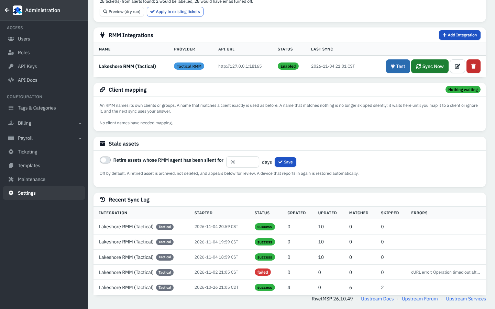

*Figure 6 — RMM Integrations. The connection shown is example data, not a live connection.*

In this guide the Tactical RMM address is a stand-in on the loopback address, and the key is a placeholder.

## A quick tour: Backups (Comet)

Comet Backup keeps device backups on its own server. RivetMSP reads the status through the Comet admin API and listens for webhook events.

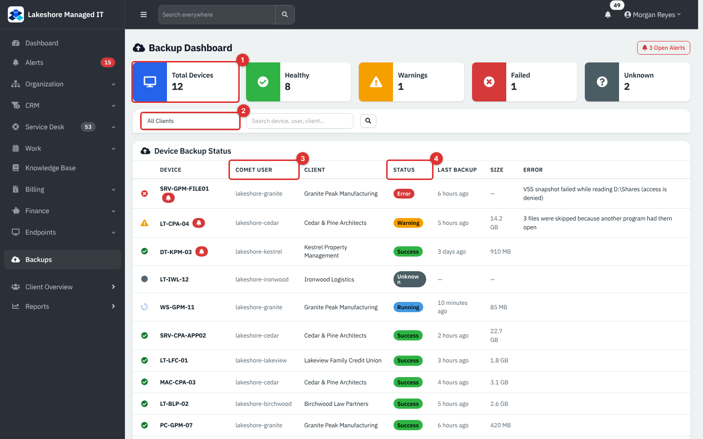

*Figure 7 — Backups. Example data, not a live connection.*

1. Tiles: **Total Devices**, **Healthy**, **Warnings**, **Failed** and **Unknown** (a device with no backup yet). The **Open Alerts** button at the top opens the alert list.
2. Filter by client, or search a device, Comet user or client.
3. **Comet User** is the Comet account the device belongs to. Each RivetMSP client is mapped to one Comet user in the settings.
4. **Status** is **Success**, **Warning**, **Error**, **Running** or **Unknown**.

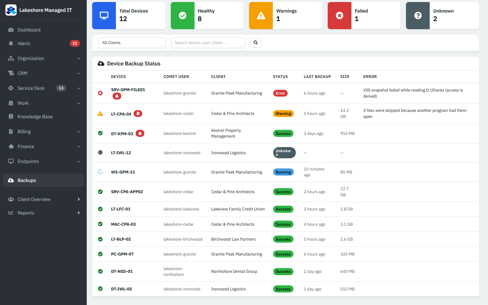

*Figure 8 — Device Backup Status. Example data, not a live connection.*

Each row shows the device, its client, the status, **Last backup**, **Size** and the **Error** text Comet reported. A small bell beside a device means it has an open alert. If a device is mapped to no client the **Client** cell is empty.

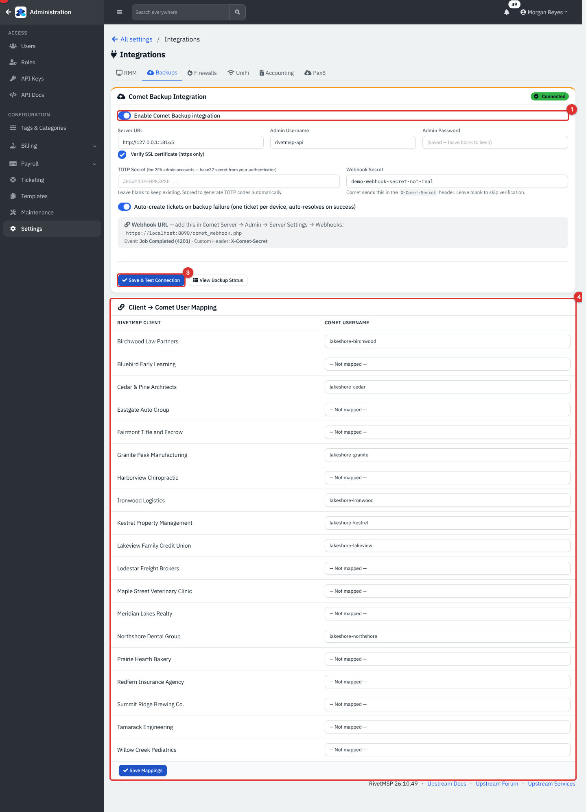

*Figure 9 — Administration → Settings → Integrations → Backups. Example data, not a live connection.*

1. **Enable Comet Backup integration**.
2. **Server URL**, **Admin Username**, **Admin Password** (stored; leave blank to keep), an optional **TOTP Secret** for two-factor admin accounts, and a **Webhook Secret**. **Verify SSL certificate (https only)** is on by default.
3. **Save & Test Connection** checks the server and shows **Connected** or the error. **View Backup Status** opens the dashboard.
4. **Client → Comet User Mapping**: pick a Comet username for each client, then **Save Mappings**.

Tick **Auto-create tickets on backup failure** if you want one ticket per failing device that resolves itself when a backup succeeds. For instant updates, add the webhook URL shown on the page in Comet under **Admin** → **Server Settings** → **Webhooks**, with the event **Job Completed (4201)** and the custom header **X-Comet-Secret**.

## A quick tour: Network

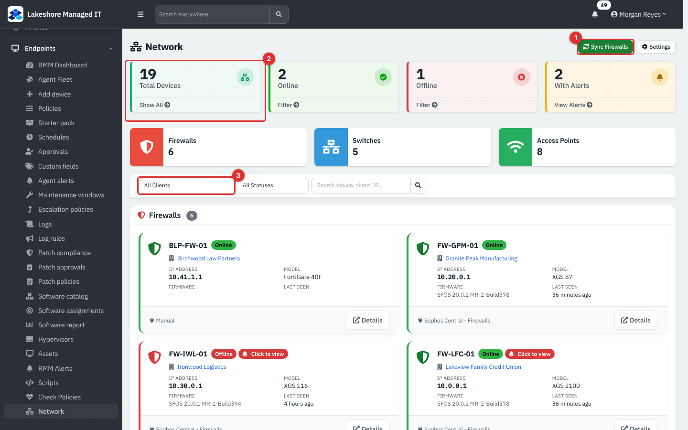

*Figure 10 — Endpoints → Network. Example data, not a live connection.*

1. **Sync Firewalls** pulls firewalls from Sophos Central (shown when a Sophos connection exists). **Settings** opens the integration settings.
2. Tiles: **Total Devices**, **Online**, **Offline** and **With Alerts**, plus counts of firewalls, switches and access points.
3. Filter by client and status.

Firewalls appear as cards (with IP address, model, firmware and last seen, and whether the source is **Manual** or Sophos Central). Switches and access points appear in tables.

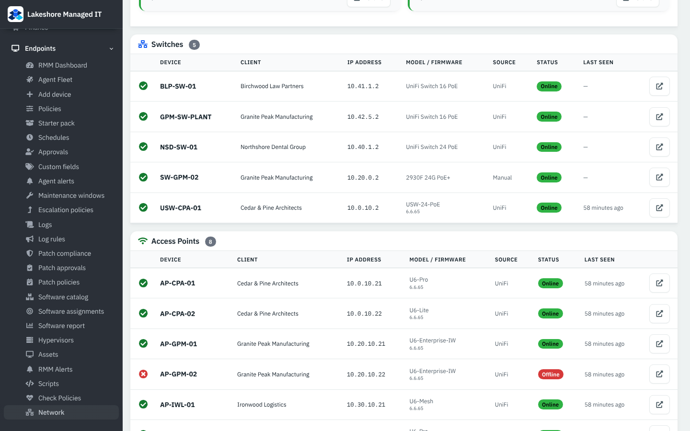

*Figure 11 — Switches and access points. Example data, not a live connection.*

The **Source** column says **UniFi** (synced from a controller) or **Manual** (added by hand as an asset). Press **Details** on a firewall to open its asset page.

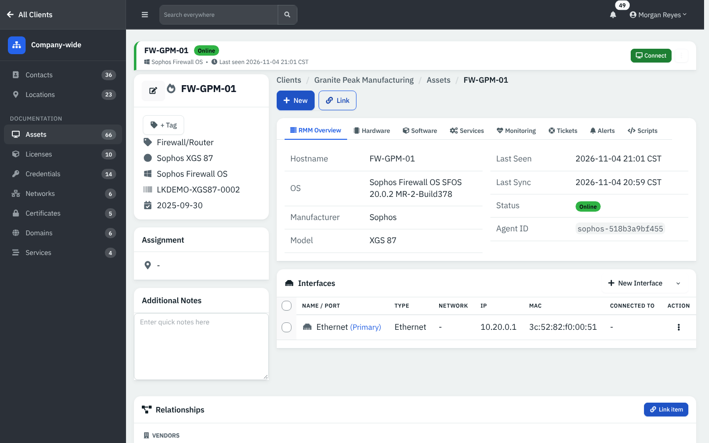

*Figure 12 — A firewall's asset page. Example data, not a live connection.*

### UniFi and Sophos Central settings

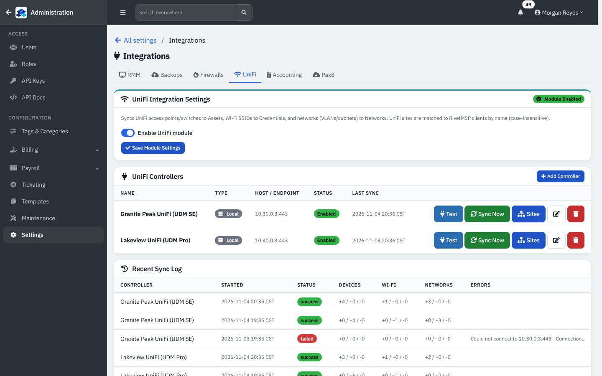

*Figure 13 — Administration → Settings → Integrations → UniFi. Example data, not a live connection.*

UniFi syncs access points and switches into Assets, Wi-Fi networks into Credentials and networks into **Networks**. A UniFi site is matched to a RivetMSP client by name (not case-sensitive). Add a controller (local or cloud) with **Add Controller**, then use **Test**, **Sync Now** and **Sites**. The **Recent Sync Log** shows, for each run, devices, Wi-Fi and network counts as created, updated and skipped, and any error such as "Could not connect to 10.30.0.3:443 - Connection timed out".

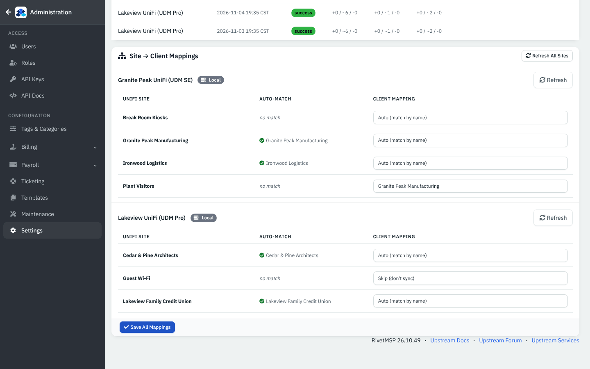

*Figure 14 — Site → Client Mappings. Example data, not a live connection.*

For each site you can leave **Auto (match by name)**, choose **Skip (don't sync)**, or pick a client by hand. A site that matches no client shows "no match" and waits for you.

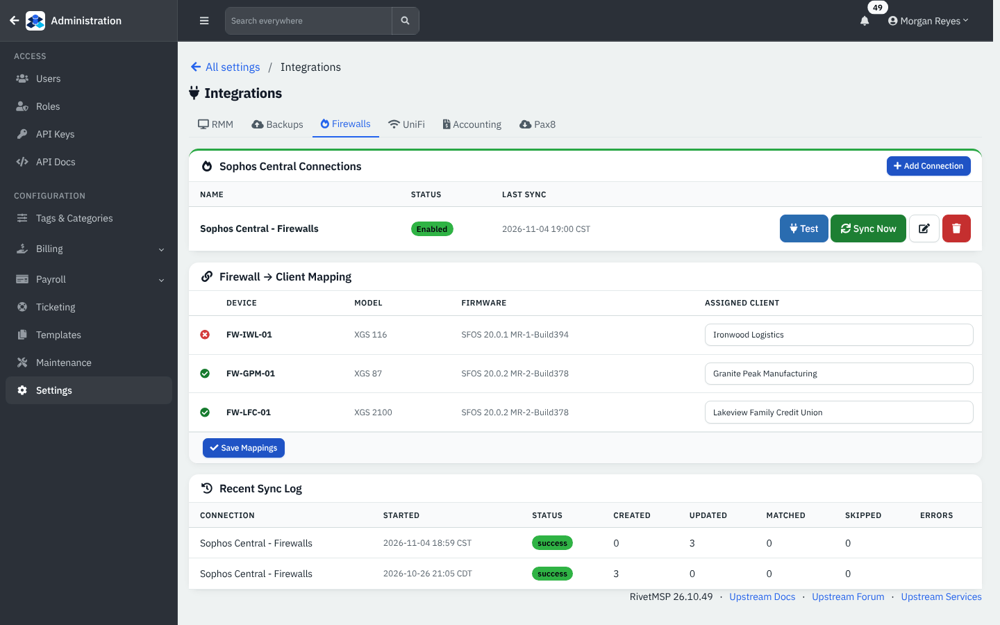

*Figure 15 — Administration → Settings → Integrations → Firewalls. Example data, not a live connection.*

**Sophos Central Connections** lists each connection with **Test** and **Sync Now**. **Firewall → Client Mapping** assigns each firewall to a client.

## A quick tour: RivetPanel

RivetPanel is a desktop helper that lets someone at a client's PCs open a ticket and chat with a technician without a client portal login. You mint an enrollment token per client, run the installer once per PC (or once for a whole fleet with a multi-use token), and the devices appear on the client's RivetPanel page.

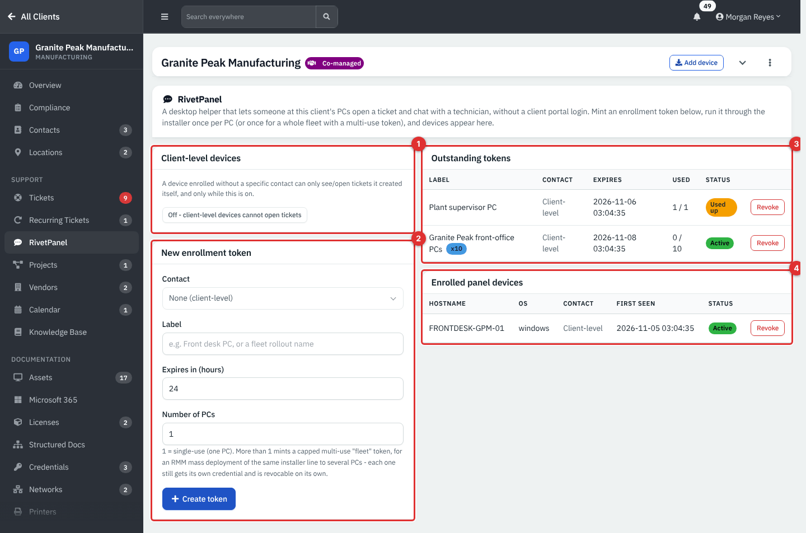

*Figure 16 — A client's RivetPanel page. Example data, not a live connection.*

1. **Client-level devices**: a device enrolled without a specific contact can see and open only tickets it created itself, and only while this switch is on. It is off here.
2. **New enrollment token**: choose the **Contact** (or **None (client-level)**), a **Label**, **Expires in (hours)** and **Number of PCs**. One PC makes a single-use token; a larger number makes a capped multi-use "fleet" token for an RMM mass deployment, where each PC still gets its own credential. Press **Create token**.
3. **Outstanding tokens**: label, contact, expiry, how many are used (for example 1 / 10), a status (**Active**, **Used up**) and **Revoke**.
4. **Enrolled panel devices**: hostname, operating system, contact, first seen and status, with **Revoke**.

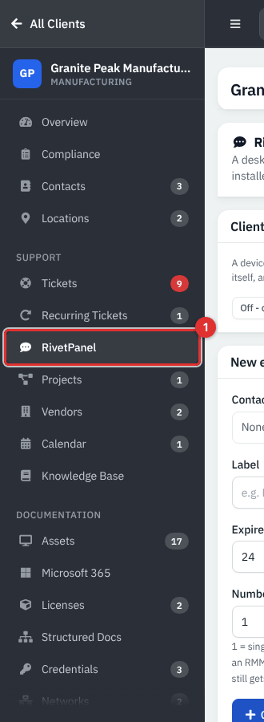

*Figure 17 — RivetPanel in the client sidebar. Example data, not a live connection.*

1. **RivetPanel** sits under **SUPPORT**, between **Recurring Tickets** and **Projects**.

**Note — RivetPanel has no switch in the interface.** It is controlled by an install setting (`config_core_panel_enabled`) that is off by default. While it is off, the page reads "RivetPanel is turned off" and the module answers "module disabled" to devices. In the demo the setting was switched on directly in the database. Ask your administrator or support contact to turn it on. The panel software itself was not verified on a live PC.

## Common tasks

### Turn an alert into a ticket

1. Open **Alerts**.
2. Press **Create Ticket** on the row. The ticket links back to the alert and is created in the category chosen under **Integrations** → **RMM** → **Alert tickets**.
3. Or tick severities under **Automatic Ticket Creation** so new alerts open tickets by themselves.

### Work a failed backup

1. Open **Backups** and filter the client, or press **Open Alerts**.
2. Read the **Error** text (for example a snapshot failure on a file server) and fix it at the device.
3. When the next backup works, the alert and its ticket resolve on their own if **Auto-create tickets on backup failure** is on.

### Map a UniFi site to a client

1. **Integrations** → **UniFi** → **Site → Client Mappings**.
2. For a site with "no match", choose the client (or **Skip (don't sync)**), then sync again.

### Enroll a PC with RivetPanel

1. Open the client → **RivetPanel**.
2. Choose a **Contact** (or none), a **Label**, how long the token is valid and for how many PCs, then **Create token**.
3. Copy the token (it is shown once), and use it with the RivetPanel installer on the PC. The device appears under **Enrolled panel devices**.

## Reference

| Item | Values |
|---|---|
| Alert source filters | **All**, **RMM**, **Backup**, **Network** |
| Alert statuses | **new**, **acknowledged**, **resolved** |
| Alert severities | **Critical**, **Error**, **Warning**, **Info** |
| Backup status | **Success**, **Warning**, **Error**, **Running**, **Unknown** |
| Network sources | **Manual**, **UniFi**, Sophos Central |
| RMM providers | **Tactical RMM**, **Level.io**, **Action1** (devices and alerts); **Sophos Central** (firewalls) |
| Panel token states | **Active**, **Used up**, expired, revoked |

## Tips and good practice

- Work the **New** alerts first and acknowledge what you have seen, so the sidebar badge stays meaningful.
- Map every client to a Comet user, or its devices show an empty **Client** cell and are hard to act on.
- Review UniFi sites with "no match" after the first sync, and map them rather than skipping.
- Mint short-lived RivetPanel tokens and use a **Label** that says where the PCs are.

## Related guides

- [Endpoints and RMM: overview](25-endpoints-rmm-overview.md)
- [Devices, jobs, scripts, policies and alerting](26-rmm-devices-jobs-policies.md)
- [Patching, software, logs, hypervisors and remote access](27-rmm-patching-software-remote.md)
- [Assets](11-assets.md)
- [Service desk tickets](05-service-desk-tickets.md)
- [Client portal](32-client-portal.md)
