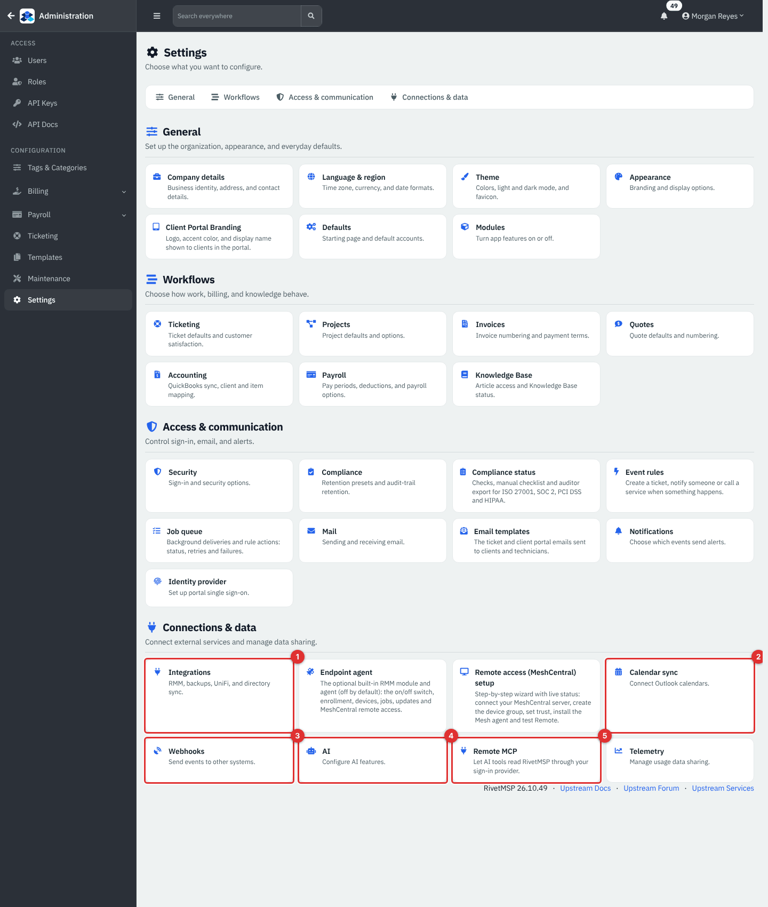
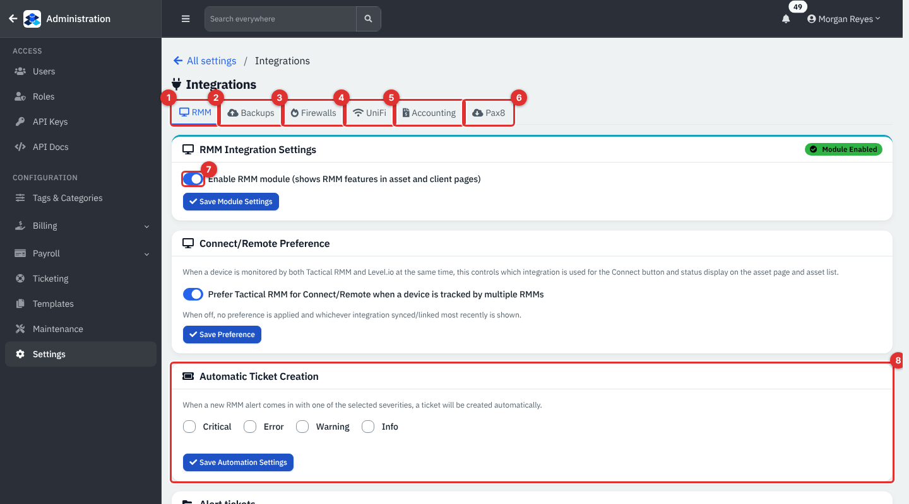
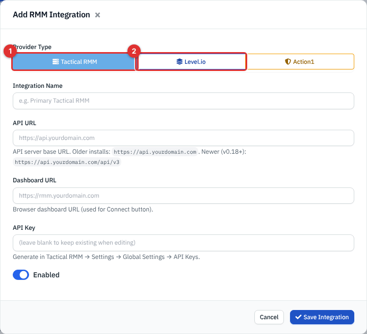
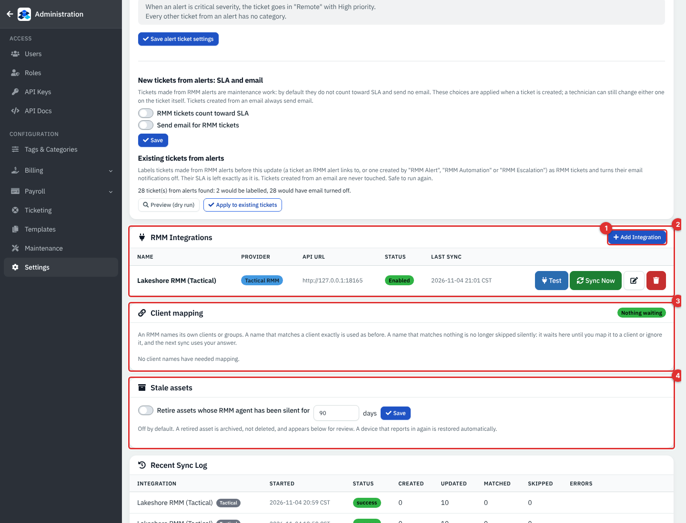
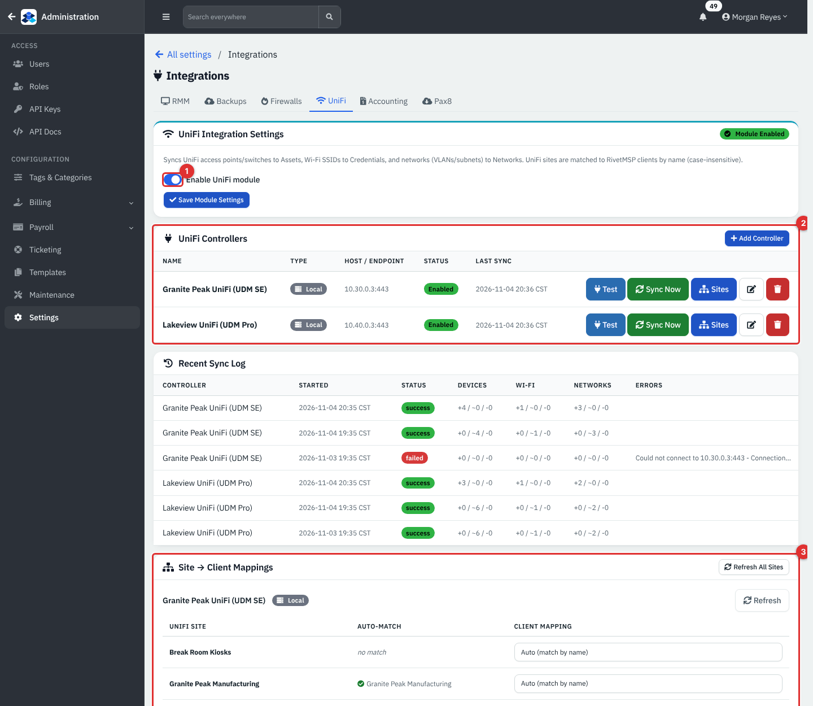
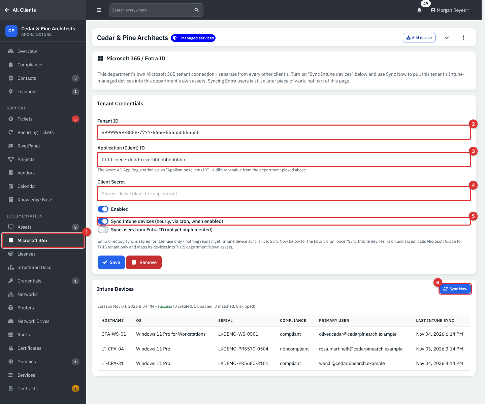
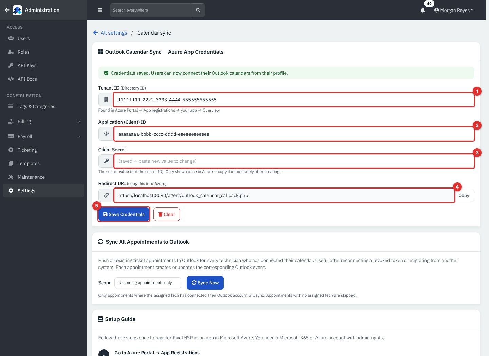
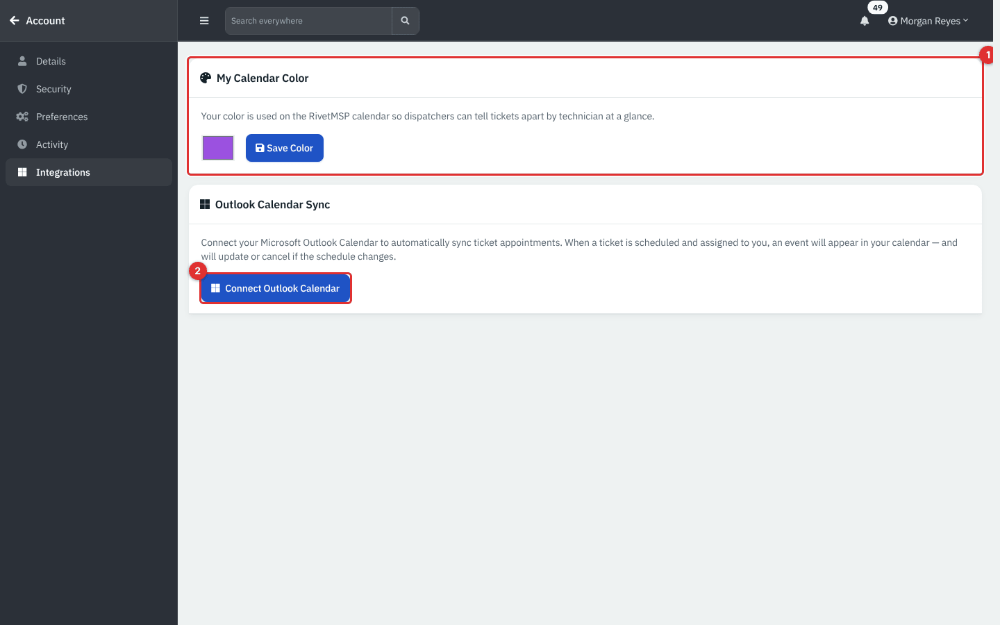

# Integrations: connecting RivetMSP to the tools you already use

RivetMSP can pull information from other products you run, so your technicians see one picture instead of five. This page is the map: where each connection lives, what you need before you start, and what it does once it is on. It covers the **Integrations** hub (remote monitoring tools, Comet backups, Sophos Central firewalls, UniFi), the per-client **Microsoft 365 / Entra ID** connection that brings in Intune devices, and **Outlook calendar sync**. Mail, webhooks, event rules, AI and the remote MCP server have their own pages (see [Related guides](#related-guides)).

All screens in this guide show example data for a fictional company, Lakeshore Managed IT. **Nothing on them is a live connection to Microsoft, Comet, UniFi, Sophos or any other service.** None of these services can be reached from the machine the guide was written on, so the pages below describe what each screen asks for and what the code does with it, and say so where something was **not verified on a live service**.

| | |
|---|---|
| **Where to find it** | Sidebar → **Administration** (top-left arrow) → **Settings** → **Connections & data**: **Integrations**, **Calendar sync**. The Microsoft 365 connection is per client: **Clients** → open a client → **Microsoft 365** in the client's sidebar. Each technician connects their own Outlook calendar under **Account** → **Integrations**. |
| **Who can use it** | The **Administration** pages (Integrations, Calendar sync) are for administrators only. The client's **Microsoft 365** page needs the role permission **Support** at **Read** to look and **Modify** to save, test or sync. |
| **Turn it on** | Each connection has its own switch. **RMM module**, **Comet Backup** and **UniFi** are switched on or off on the Integrations hub. Scheduled syncs also need the scheduled jobs to run: **Administration** → **Maintenance** → **Scheduled jobs** and **Enable Cron** under **Settings** → **Notifications** (the demo has both on; a new install has Enable Cron off). |

## What it's for

- See which devices a remote monitoring tool (RMM) manages, and turn its alerts into tickets automatically.
- Show backup results from Comet next to the client they belong to, and open a ticket when a backup fails.
- Keep firewall and network data from Sophos Central and UniFi in the client's documentation.
- Bring each client's Intune-managed devices into that client's **Assets**.
- Put scheduled ticket appointments into a technician's Outlook calendar.

## A quick tour

*Figure 1 — Administration → Settings, section **Connections & data**.*

1. **Integrations**: remote monitoring tools, backups, firewalls, UniFi, plus links to Accounting and Pax8.
2. **Calendar sync**: the Azure app credentials for Outlook calendar sync.
3. **Webhooks**: send events to other systems (see [Webhooks, event rules and the job queue](30b-webhooks-event-rules-and-jobs.md)).
4. **AI**: AI providers and limits (see [AI features and the remote MCP server](30c-ai-and-remote-mcp.md)).
5. **Remote MCP**: let AI tools read RivetMSP (same page).

The other tiles in this section, **Endpoint agent** and **Remote access (MeshCentral) setup**, belong to the built-in agent and are covered in [Endpoints and RMM overview](25-endpoints-rmm-overview.md).

*Figure 2 — Settings → Integrations. Example data, not a live connection.*

1. **RMM** tab: vendor remote monitoring tools (this tab).
2. **Backups** tab: Comet Backup.
3. **Firewalls** tab: Sophos Central.
4. **UniFi** tab: UniFi network controllers.
5. **Accounting** opens the QuickBooks and Xero page; see [Accounting and Pax8 sync](20-accounting-pax8-sync.md).
6. **Pax8** opens the Pax8 page; same guide.
7. **Enable RMM module**: shows RMM features on asset and client pages. Click **Save Module Settings** after changing it.
8. **Automatic Ticket Creation**: which alert severities become tickets.

The hub remembers the tab you were on (the address gains `?tab=rmm`, `backups`, `firewalls` or `unifi`), so you can bookmark a tab.

## Common tasks

### Connect a vendor RMM

RivetMSP has two ways to do remote monitoring. This tab is for **vendor** tools you already run: **Tactical RMM**, **Level.io** and **Action1**. The built-in RivetCore endpoint agent is a separate module with its own settings page; see [Endpoints and RMM overview](25-endpoints-rmm-overview.md) for how to choose.

1. Open **Settings** → **Integrations** → **RMM**. Turn on **Enable RMM module** and click **Save Module Settings**.
2. In the **RMM Integrations** card, click **Add Integration**.

   

   *Figure 3 — Add RMM Integration. Pick the provider first; the fields below change with it.*

   1. **Tactical RMM** (the default).
   2. **Level.io**. **Action1** is the third choice in the same row.
3. Enter an **Integration Name**, the **API URL** of the tool, optionally its **Dashboard URL** (the browser address, used for the Connect button) and its **API Key**. **Action1** also asks for a **Client Secret**. Tick **Enabled** and save. Keys are stored encrypted and are never shown again.
4. In the list, click **Test** to check the connection and **Sync Now** to run the first sync. The pencil edits, the red button deletes.

*Figure 4 — The RMM tab, lower half. Example data.*

1. **Add Integration**.
2. The integration list: **Name**, **Provider**, **API URL**, **Status** and **Last Sync**, with **Test**, **Sync Now**, edit and delete.
3. **Client mapping**: an RMM names its own clients or groups. A name that matches one of your clients exactly is used automatically. A name that matches nothing waits here until you map it to a client or ignore it; the next sync uses your answer. The badge says **Nothing waiting** when the queue is empty.
4. **Stale assets**: optionally retire assets whose RMM agent has been silent for a number of days (default 90, off by default). A retired asset is archived, not deleted, and comes back by itself when the device reports in again.

Below these cards, **Recent Sync Log** lists the latest runs with how many devices were created, updated, matched and skipped.

**What happens to alerts.** Under **Automatic Ticket Creation** tick the severities (**Critical**, **Error**, **Warning**, **Info**) that should open a ticket by themselves; none are ticked by default. The **Alert tickets** card above the integration list decides which ticket category and priority those tickets get, and **New tickets from alerts: SLA and email** keeps them out of SLA reporting and off e-mail unless you switch that on. Alerts that you do not turn into tickets stay on the central **Alerts** page, where **Create ticket** is one click.

If a device is watched by both Tactical RMM and Level.io, **Prefer Tactical RMM for Connect/Remote** decides which one the **Connect** button on the asset uses. With it off, the most recently synced one wins.

### Show Comet backup results

The **Backups** tab connects a Comet Backup server. It needs a Comet server you can reach from the RivetMSP server, an admin account on it, and (for the webhook) a public address for RivetMSP. **Not verified on a live service.**

1. Open the **Backups** tab and tick **Enable Comet Backup integration**.
2. Fill **Server URL**, **Admin Username** and **Admin Password**. **Verify SSL certificate (https only)** is ticked by default; leave it ticked for any server with a real certificate. If the admin account uses two-factor authentication, paste its base32 secret in **TOTP Secret** so RivetMSP can generate the codes itself.
3. To receive results as soon as a job finishes, copy the **Webhook URL** shown on the page into the Comet server (Admin → Server Settings → Webhooks) for the event **Job Completed (4201)**, add the custom header `X-Comet-Secret` and put the same value in **Webhook Secret** here. Leave **Webhook Secret** blank to skip the check (not recommended).
4. Tick **Auto-create tickets on backup failure** if you want one ticket per device that fails; it closes itself when the backup next succeeds.
5. Click **Save & Test Connection**. The badge at the top says whether the server answered. **View Backup Status** opens the Backups dashboard.
6. Under **Client → Comet User Mapping**, choose which Comet user belongs to which client so results land on the right client.

On the demo the badge reads "Cannot reach server" because there is no Comet server; that is what you see when the address is wrong or the server is down. The Backups dashboard and the alerts it produces are in [Alerts, backups, network and RivetPanel](28-alerts-backups-network-panel.md).

### Sophos Central firewalls and UniFi

- **Firewalls** tab: click **Add Connection** and enter a **Connection Name**, the **API Entry Point**, the **Client ID** and **Client Secret** from Sophos Central, and optionally a **Default Client**. Then use **Firewall → Client Mapping** to assign each firewall to a client. Firewalls become assets of type **Firewall/Router** with their status. **Not verified on a live service.**
- **UniFi** tab: turn on **Enable UniFi module** and click **Save Module Settings**, then **Add Controller** for a local UniFi OS controller or a cloud connection. Access points and switches become **Assets**, Wi-Fi networks become **Credentials**, and VLANs and subnets become **Networks**. Sites are matched to your clients by name (case-insensitive); change a mapping under **Site → Client Mappings**.

*Figure 5 — Settings → Integrations → UniFi. Example data, not a live connection.*

1. **Enable UniFi module**.
2. **UniFi Controllers**: **Test**, **Sync Now**, **Sites**, edit and delete for each controller.
3. **Site → Client Mappings**: **Auto (match by name)** or a client you pick.

The UniFi sync does not run from the main scheduler by itself: the install needs its own scheduled job entry for `scripts/unifi_sync_cli.php`. The hub shows the last run in **Recent Sync Log**, and a failed run shows its error text there.

### Connect a client's Microsoft 365 / Entra ID tenant (Intune devices)

Each client can have its own Microsoft 365 tenant. RivetMSP stores one connection per client, so one client's tenant problem never affects another's. You need an app registration in the client's Entra ID with permission to read Intune managed devices, and its tenant ID, application (client) ID and a client secret. **Not verified on a live service.**

1. Open **Clients**, click the client, then **Microsoft 365** in the client's sidebar (below **Assets**).
2. Enter the **Tenant ID**, **Application (Client) ID** and **Client Secret**. The secret is stored encrypted; once saved the box says "Stored - leave blank to keep current".
3. Tick **Enabled** and **Sync Intune devices (hourly, via cron, when enabled)**, then **Save**.
4. Click **Sync Now** (it stays greyed out until both switches are saved on). The scheduled job also syncs every hour, skipping a client that was synced within the last hour.

*Figure 6 — Clients → a client → Microsoft 365. Example data, not a live connection.*

1. **Microsoft 365** in the client's sidebar.
2. **Tenant ID**.
3. **Application (Client) ID**.
4. **Client Secret** (never shown again).
5. **Sync Intune devices** switch.
6. **Sync Now**. Under it, the last run and a table of the devices it brought in: **Hostname**, **OS**, **Serial**, **Compliance**, **Primary User** and **Last Intune Sync**.

A device is matched to an existing asset of the same client (by the Intune device it was linked to before, then by serial number, then by an unambiguous host name) or created as a new asset. An asset that belongs to a different client is never touched; it is counted as skipped. **Sync users from Entra ID** can be stored but is **not yet implemented**: nothing reads it. **Remove** deletes the client's connection.

**Note.** The explanatory text on this page still says "department" in two places. In RivetMSP it means the client.

### Sync appointments to Outlook

Scheduled ticket appointments can appear in each technician's own Outlook calendar and move or disappear when the ticket changes. This needs an app registration in your own Microsoft Entra ID. **Not verified on a live service.**

1. Open **Administration** → **Settings** → **Calendar sync**. The page includes a five-step **Setup Guide** for Azure: register an app (single tenant), copy the IDs, add the Microsoft Graph delegated permissions `Calendars.ReadWrite` and `offline_access`, grant admin consent, and create a client secret.
2. Paste **Tenant ID**, **Application (Client) ID** and **Client Secret**. Copy the **Redirect URI** shown on the page into the Azure app (type **Web**). Click **Save Credentials**. A green note says "Credentials saved. Users can now connect their Outlook calendars from their profile."

   

   *Figure 7 — Settings → Calendar sync. The IDs and secret are placeholders.*

   1. **Tenant ID**. 2. **Application (Client) ID**. 3. **Client Secret** (shown as "saved" once stored). 4. **Redirect URI** (read-only). 5. **Save Credentials**.
3. Each technician opens **Account** → **Integrations** and clicks **Connect Outlook Calendar** once, then signs in to Microsoft. RivetMSP keeps a refresh token per person.

   

   *Figure 8 — Account → Integrations.*

   1. **My Calendar Color**: the colour dispatchers see on the calendar. 2. **Connect Outlook Calendar**.
4. Back on **Calendar sync**, once credentials are saved a **Sync All Appointments to Outlook** card appears. Choose a **Scope** (**Upcoming appointments only** or **All appointments (past & future)**) and click **Sync Now** to push existing appointments, for example after a technician reconnects. Only appointments whose assigned technician has connected Outlook are synced; appointments with no technician are skipped.

**Clear** next to **Save Credentials** removes the stored tenant ID, application ID and secret (it asks you to confirm).

## Reference

### What each connection creates

| Connection | Needs | Creates or updates | Runs |
|---|---|---|---|
| Tactical RMM, Level.io, Action1 | API address and key of the tool | Asset links and status, RMM alerts, tickets (by severity) | **Sync Now**, and the scheduled sync |
| Comet Backup | Comet server, admin account, optional webhook | Backup alerts, optional tickets, Backups dashboard | Webhook on job completion; status poll |
| Sophos Central | Sophos API credentials | Firewall assets, status | **Sync Now**, scheduled sync |
| UniFi | Controller address and credentials | Assets, Credentials (Wi-Fi), Networks | **Sync Now**; own scheduled entry for `unifi_sync_cli.php` |
| Microsoft 365 / Entra (per client) | Tenant ID, app ID, secret | Assets from Intune devices | **Sync Now**; hourly via `intune_sync.php` |
| Outlook calendar | Azure app, each technician signs in once | Events in each technician's calendar | `outlook_schedule_sync` |

### Settings on the Integrations hub

| Setting | Where | Default |
|---|---|---|
| Enable RMM module | RMM tab | Off on a new install |
| Prefer Tactical RMM for Connect/Remote | RMM tab (only while the module is on) | Off |
| Automatic ticket severities | RMM tab | None ticked |
| RMM tickets count toward SLA / Send email for RMM tickets | RMM tab, alert tickets card | Off / Off |
| Retire assets whose agent has been silent for N days | RMM tab, **Stale assets** | Off, 90 days |
| Enable Comet Backup integration | Backups tab | Off |
| Verify SSL certificate | Backups tab | On |
| Enable UniFi module | UniFi tab | Off on a new install |

## Tips and good practice

- Create a dedicated, least-privilege account or API user for each tool, not a personal admin login.
- Run **Test** after every credential change, and read **Recent Sync Log** after the first **Sync Now**: it names the problem when a sync fails.
- Map RMM client names before the first big sync; otherwise devices wait in **Client mapping**.
- Client secrets in Azure expire (often after 6 to 24 months). Put the expiry date in your calendar; an expired secret shows up as a failed sync.
- Never paste secrets or tenant IDs into tickets or screenshots.

## Related guides

- [Endpoints and RMM overview](25-endpoints-rmm-overview.md) (the built-in agent and how to choose)
- [Alerts, backups, network and RivetPanel](28-alerts-backups-network-panel.md)
- [Accounting and Pax8 sync](20-accounting-pax8-sync.md)
- [Mail intake, sending and e-mail templates](30-mail-intake-and-sending.md)
- [Webhooks, event rules and the job queue](30b-webhooks-event-rules-and-jobs.md)
- [AI features and the remote MCP server](30c-ai-and-remote-mcp.md)
- [The API and the mobile app](31-api-and-mobile.md)
- [Dispatch, scheduling and the calendar](08-dispatch-scheduling-calendar.md)
