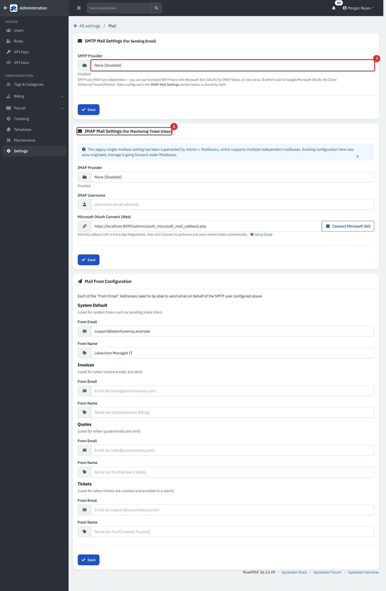
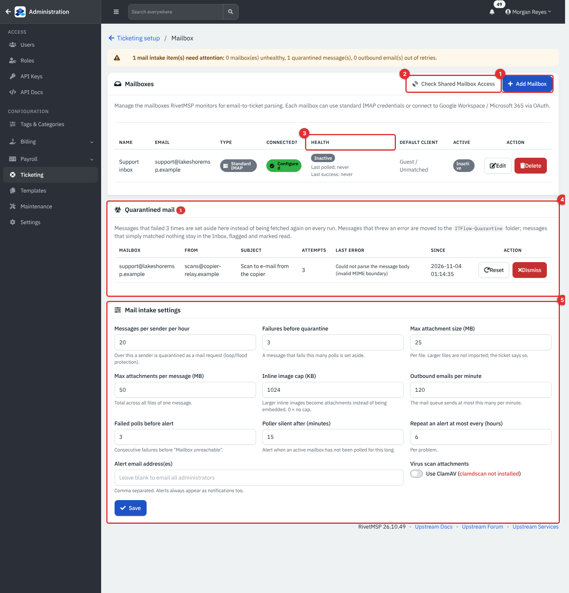
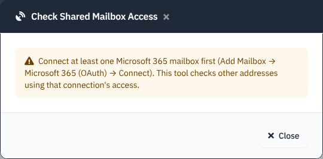
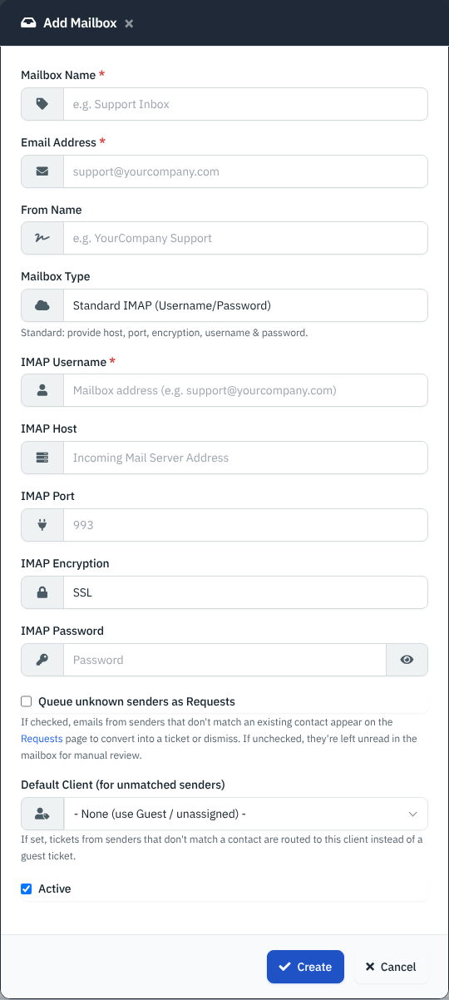
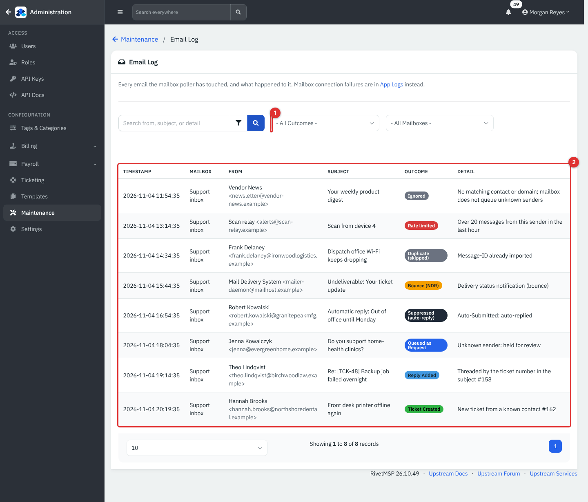
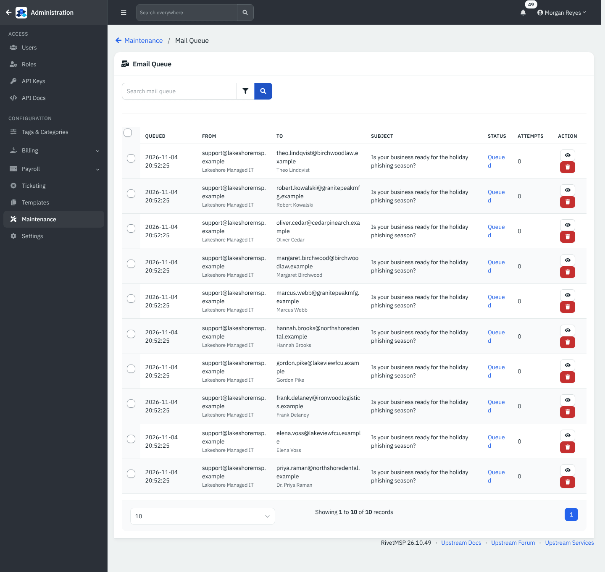
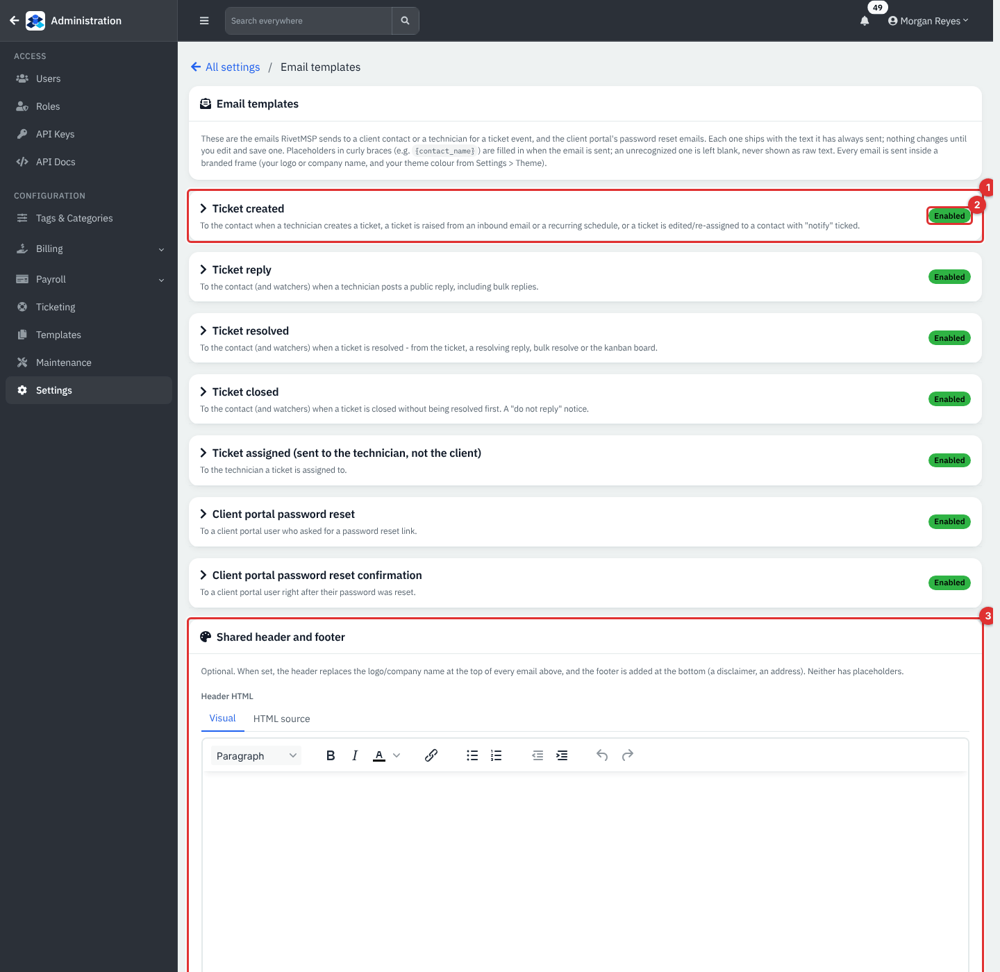
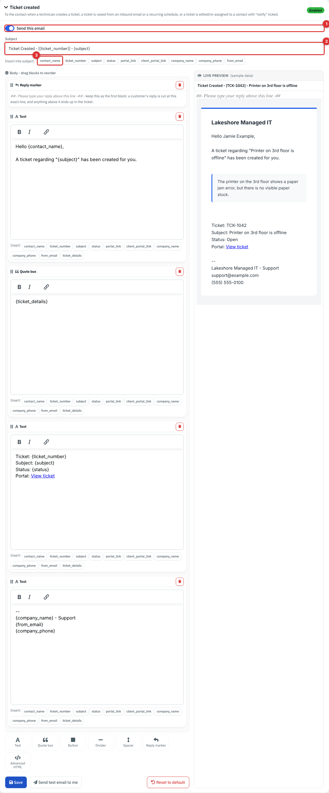

# Mail: turning e-mail into tickets, and sending it out

RivetMSP both reads and sends e-mail. **Inbound**, it watches one or more mailboxes and turns messages into tickets and ticket replies. **Outbound**, it sends ticket notices, invoices, quotes and campaigns through your mail server and keeps a queue so nothing is lost when a server is busy. This page covers the settings, the Mailboxes page, the Email Log, the Mail Queue and the e-mail templates, and explains what happens to a message from the moment it arrives.

Everything on the screens below is example data for a fictional company, Lakeshore Managed IT. No mailbox is polled and no e-mail is sent in the demo. Connecting a real mailbox or SMTP server was **not verified on a live service** for this guide; the steps come from the code and from the product's mail runbook (`docs/MAIL_INTAKE.md`).

| | |
|---|---|
| **Where to find it** | Administration (top-left arrow) → **Settings** → **Mail** (SMTP, IMAP, From addresses) and **Email templates**. **Ticketing** → **Mailboxes** (`admin/mailbox.php`) and **Mail requests**. **Maintenance** → **Email Log** and **Mail Queue**. |
| **Who can use it** | Administrators only. Technicians see the result: new tickets, and **Service Desk** → **Requests** for unmatched senders (see [Recurring tickets, request catalog, CSAT and requests](07-recurring-tickets-catalog-csat-requests.md)). |
| **Turn it on** | **Settings** → **Ticketing** → **Email-to-ticket parsing**, a mailbox that is **Active**, and scheduled jobs running (**Settings** → **Notifications** → **Enable Cron Job**; the mailbox poller `ticket_email_parser.php` and the sender `mail_queue.php` must be scheduled). Outbound mail needs an **SMTP Provider** other than **None (Disabled)**. |

## What it's for

- Let clients open tickets by e-mailing support, and reply to a ticket by replying to its notice.
- Keep mail loops, auto-replies, bounces and floods from creating junk tickets.
- Send ticket notices, invoices and quotes from the right address and show what was sent.
- Customize the wording of the ticket e-mails without editing code.

## A quick tour

*Figure 1 — Settings → Mail. Example data.*

1. **SMTP Provider** (outbound): **None (Disabled)**, **Standard SMTP (Username/Password)**, **Google Workspace (OAuth)** or **Microsoft 365 (OAuth)**.
2. **IMAP Mail Settings**: the older single-mailbox form. A blue note says it has been superseded by **Mailboxes**, which supports several mailboxes; existing settings were moved there automatically. Manage inbound mail on the Mailboxes page.

Below these is **Mail From Configuration**: a **From Email** and **From Name** for **System Default** (share links and system mail), **Invoices**, **Quotes** and **Tickets**. Each address must be one the SMTP account is allowed to send for; otherwise mail fails with an "invalid sender" error.

*Figure 2 — Ticketing → Mailboxes. Example data.*

1. **Add Mailbox**.
2. **Check Shared Mailbox Access** tests specific shared-mailbox addresses you believe you have Full Access to, using a connected Microsoft 365 mailbox (it is a check, not a directory: Microsoft cannot list them).
3. **Health**: a badge (**Healthy**, **Retrying**, **Failing**, **Not polled** or **Inactive**), plus **Last polled** and **Last success**. A yellow banner at the top counts everything that needs attention: unhealthy mailboxes, quarantined messages and outbound mail that ran out of retries.
4. **Quarantined mail**: messages the poller set aside.
5. **Mail intake settings**: limits and alert thresholds.

Without a connected Microsoft 365 mailbox, **Check Shared Mailbox Access** only shows how to connect one:

*Figure 3 — Check Shared Mailbox Access before any Microsoft 365 mailbox is connected.*

## Common tasks

### Send mail: set up SMTP

1. Open **Settings** → **Mail**. Choose the **SMTP Provider**. For **Standard SMTP** enter host, port, encryption, username and password. For **Microsoft 365 (OAuth)** or **Google Workspace (OAuth)** enter the app's client ID, secret and (Microsoft) tenant ID from your own Entra or Google Cloud app registration. The redirect address to register is shown on the page.
2. Click **Save**, then fill **Mail From Configuration** and **Save** again.
3. Watch **Maintenance** → **Mail Queue** after the first notice goes out: the **Status** should reach **Sent**.

### Receive mail: add a mailbox

1. Click **Ticketing** → **Mailboxes** → **Add Mailbox**.

   

   *Figure 4 — Add Mailbox. Fill in a real mailbox in your own system.*

2. Give it a **Mailbox Name**, the **Email Address** and optionally a **From Name**. Choose the **Mailbox Type**: **Standard IMAP (Username/Password)** (host, port 993, encryption **SSL** or **TLS**, username and password; use an app password where the provider needs one) or **Microsoft 365 (OAuth)**. A Microsoft mailbox is read through Microsoft Graph rather than IMAP, so tenants that block basic IMAP still work; after creating it click **Connect** and sign in as the mailbox.
3. **Queue unknown senders as Requests** (off by default): when on, mail from people who are not a known contact or domain goes to **Requests** for a technician to convert or dismiss. When off, it stays unread in the mailbox.
4. **Default Client (for unmatched senders)**: send tickets from unknown senders to one client instead of a "guest" ticket. **Active** controls whether the mailbox is polled.
5. Save. The poller runs about every five minutes per active mailbox.

**Note.** A Google Workspace mailbox type exists in the backend but is hidden from the **Mailbox Type** list, because there is no working sign-in step for it yet in this release. Use Standard IMAP with an app password or Microsoft 365 for now.

### Find out what happened to a message

Open **Maintenance** → **Email Log**. It lists every message the poller touched.

*Figure 5 — Maintenance → Email Log. Example data.*

1. Filters: a search box (from, subject or detail), **Outcome** and **Mailbox**.
2. The table: **Timestamp**, **Mailbox**, **From**, **Subject**, **Outcome** and **Detail**. The detail names the reason, and a ticket or request number where there is one.

| Outcome | What it means |
|---|---|
| **Ticket Created** | A new ticket from a known contact or domain. |
| **Reply Added** | Added to an existing ticket (matched by the e-mail's thread headers, then by the `[TCK-123]` number in the subject, then by a close subject match for the same client). |
| **Queued as Request** | Held for review: unknown sender, a sender who is not the ticket's contact, or over the hourly limit. |
| **Bounce (NDR)** | A delivery-failure notice. An administrator is told and the original ticket gets a system note. |
| **Ignored** | No contact or domain matched and the mailbox does not queue unknown senders. |
| **Suppressed (auto-reply)** | Machine-generated mail: out-of-office replies, `Auto-Submitted`, bulk or list mail, a null return path, or RivetMSP's own mail coming back. Never becomes a ticket. |
| **Duplicate (skipped)** | That message was already imported. |
| **Rate limited** | The sender went over the hourly cap and is held as a request. |
| **Quarantined** | Failed processing repeatedly and was set aside. |

If a customer says their mail never became a ticket, search the log for their address first. **Suppressed** means a rule matched (the detail says which); **Ignored** means the mailbox does not accept unknown senders, so add the contact or switch on **Queue unknown senders as Requests**.

### Handle quarantined mail and tune the limits

A message that makes processing fail is retried; after the **Failures before quarantine** limit (default 3) it is set aside. Messages that raised an error are moved to the `ITFlow-Quarantine` folder of the mailbox (the folder keeps its older product name); messages that matched nothing stay in the inbox flagged and marked read. Each appears under **Quarantined mail** with the last error. **Reset** gives it a fresh set of attempts (also move the message back into the inbox as unread), **Dismiss** removes the entry.

| Setting (Mail intake settings) | Default | Meaning |
|---|---|---|
| Messages per sender per hour | 20 | More than this and the sender is held as a request (loop and flood protection). |
| Failures before quarantine | 3 | Failed attempts before a message is set aside. |
| Max attachment size (MB) | 25 | Per file; larger files are not imported and the ticket says so. |
| Max attachments per message (MB) | 50 | Total per message. |
| Inline image cap (KB) | 1024 | Larger inline images become attachments; 0 means no cap. |
| Outbound emails per minute | 120 | The mail queue never sends more than this per minute. |
| Failed polls before alert | 3 | Consecutive failures before "Mailbox unreachable". |
| Poller silent after (minutes) | 15 | Alert when an active mailbox has not been polled for this long. |
| Repeat an alert at most every (hours) | 6 | Per problem. |
| Alert email address(es) | blank | Blank means every active administrator. Alerts also appear as notifications. |
| Virus scan attachments | Off | Uses ClamAV when `clamdscan` is installed; otherwise the box says "clamdscan not installed". |

Replies keep only the new text: the quoted history (`On … wrote:`, `-----Original Message-----`, quoted blocks) is removed. If that would leave nothing, the original is kept. New tickets are never trimmed.

### Watch the outbound queue

**Maintenance** → **Mail Queue** lists what RivetMSP has to send: **Queued**, **From**, **To**, **Subject**, **Status** and **Attempts**. Statuses are **Queued**, **Sending**, **Failed** and **Sent**. The eye icon shows the message; the red button cancels it. The ten messages in Figure 6 are a campaign from the CRM guide waiting for the scheduled sender.

*Figure 6 — Maintenance → Mail Queue. Example data; nothing is sent from the demo.*

A failed message is retried after 5, 15, 60 and 240 minutes. After the fifth failed attempt it is not retried again; a green paper-plane button appears on that row (it gives the message a fresh set of attempts) and an "Outbound email gave up" alert is raised. Permanent errors (a bad address, no mail server for the domain) fail at once. A message stuck in **Sending** for more than ten minutes goes back to **Queued** by itself. A ticket whose **Email notifications** switch is off gets no mail at all; see [Service desk and tickets](05-service-desk-tickets.md).

### Change what the ticket e-mails say

Open **Settings** → **Email templates**. Seven e-mails can be edited: **Ticket created**, **Ticket reply**, **Ticket resolved**, **Ticket closed**, **Ticket assigned** (sent to the technician, not the client), **Client portal password reset** and **Client portal password reset confirmation**. Each ships with its standard text and nothing changes until you save.

*Figure 7 — Settings → Email templates. Click a template to open it.*

1. A template card; click it to expand.
2. The **Enabled** or **Disabled** badge (and **Customized** once you have changed it).
3. **Shared header and footer**: optional HTML added above and below every template, for a disclaimer or address. No placeholders here.

*Figure 8 — An open template.*

1. **Send this email**: switch it off to stop that e-mail entirely.
2. **Subject**.
3. Placeholder buttons such as `contact_name`, `ticket_number`, `subject`, `status` and `portal_link`: click to insert. Placeholders are written in curly braces and an unrecognized one is left blank, never shown raw.

The body is built from blocks you can drag to reorder: **Text**, **Quote box**, **Button**, **Divider**, **Spacer**, **Reply marker** and **Advanced HTML**. A live preview shows sample data. Keep the **Reply marker** as the first block of any e-mail clients reply to: a reply is cut at that line, and anything above it ends up in the ticket. Templates that carry a portal link must keep it. **Send test email to me** sends a sample to you and **Reset to default** restores the standard text.

## Reference

### Outbound headers

Every message from the queue carries a unique `Message-ID` stored with the ticket (so a customer's reply threads back even if they edit the subject), `Auto-Submitted: auto-generated`, `X-Auto-Response-Suppress: All` and `X-RivetMSP-Auto: 1`. The poller recognizes the last one so RivetMSP never answers its own mail.

### Alerts raised by the mail system

| Alert | Fires when | What to do |
|---|---|---|
| Mailbox sign-in failed | An OAuth token refresh failed (revoked token, expired client secret) | Reconnect the mailbox; renew the secret in your Entra or Google console. |
| Mailbox unreachable | Three polls in a row failed | Read **Last error** on the Mailboxes page: password, IMAP disabled, firewall, DNS. |
| Mail poller silent | An active mailbox was not polled for over 15 minutes | The scheduled job `ticket_email_parser.php` is not running; check Cron and that **Email-to-ticket parsing** is on. |
| Outbound email gave up | Queued mail failed all five attempts | Open it in the Mail Queue, fix the cause, then click the green paper-plane button to send it again. |
| Sender rate limit reached | A sender exceeded the hourly cap | Usually a mail loop; review under **Requests**, fix the sender, dismiss. |
| Message set aside after repeated failures | A message was quarantined | See Quarantined mail above. |

### SPF, DKIM and DMARC

Notices go out from your own domain, so that domain must authorize the sending service or customers' servers will junk or reject them. Publish one SPF record that lists every sender, enable DKIM signing at your mail provider and start DMARC at `p=none`, then tighten it once SPF and DKIM line up. Test by mailing an outside address and checking the headers show `spf=pass`, `dkim=pass` and `dmarc=pass`.

## Tips and good practice

- Use a shared mailbox such as `support@` for intake and give it its own **Default Client** only if every unknown sender really belongs to one client.
- Leave **Queue unknown senders as Requests** on while you build up your contact list, then review **Requests** daily.
- Never type real mailbox passwords into screenshots or tickets; use an app password.
- Do not point two ticket systems at each other without `Auto-Submitted` handling; the hourly cap and the null-sender rule stop most loops, and the rate-limit alert names the sender.
- Client secrets for Microsoft expire. Put the date in your calendar; an expired secret shows as **Mailbox sign-in failed**.

## Related guides

- [Service desk and tickets](05-service-desk-tickets.md)
- [Recurring tickets, request catalog, CSAT and requests](07-recurring-tickets-catalog-csat-requests.md)
- [Ticketing setup and templates](37-ticketing-setup-and-templates.md)
- [System settings and maintenance](36-system-settings-maintenance.md) (cron, notifications)
- [Integrations](29-integrations.md)
- [Webhooks, event rules and the job queue](30b-webhooks-event-rules-and-jobs.md)
