# Webhooks, event rules and the job queue

Three tools work from the same stream of events ("a ticket was created", "a sign-in failed", "a credential was revealed"). A **webhook** posts the event to another system. An **event rule** reacts inside RivetMSP: it opens a ticket, notifies your technicians or calls a web address. The **job queue** is where the actual sending and acting happens in the background, so a slow or failing service never slows the screen someone is working on.

All screens show example data for a fictional company, Lakeshore Managed IT. The demo cannot reach outside services, so the three webhooks point at made-up `.example` addresses, and the delivery log and queued jobs are example rows. Delivery to a live service was **not verified** for this guide.

| | |
|---|---|
| **Where to find it** | Administration (top-left arrow) → **Settings** → **Connections & data** → **Webhooks**; **Settings** → **Access & communication** → **Event rules** and **Job queue**. |
| **Who can use it** | Administrators only. |
| **Turn it on** | Nothing to switch on. Webhooks and rules do nothing until you add one. Retries and rule actions also need the scheduled jobs running (**Maintenance** → **Scheduled jobs**; see [System settings and maintenance](36-system-settings-maintenance.md)). |

## What it's for

- Post new, resolved or reassigned tickets to a chat room, an automation platform or your own endpoint.
- Tell the whole team the moment a Critical ticket opens.
- Open a ticket automatically when onboarding starts or a sign-in is blocked.
- See why a delivery failed and send it again.

## A quick tour

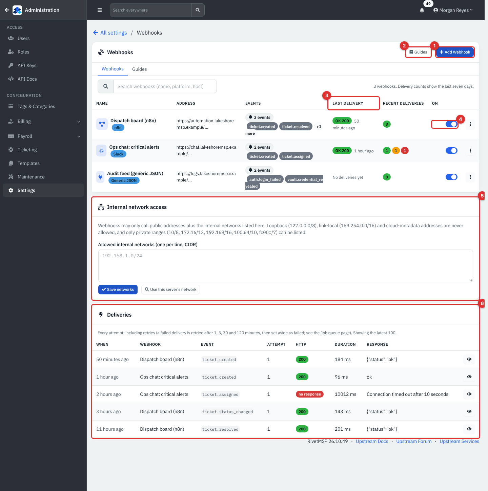

*Figure 1 — Settings → Webhooks. Example data, not a live connection.*

1. **Add Webhook** starts the four-step wizard.
2. **Guides**: one setup guide per platform, plus how signing works.
3. **Last delivery**: **OK 200** (green) or **Failed**/**No response** (red) with how long ago. The next column shows delivered, pending and failed counts for the last seven days.
4. The **On** switch turns a webhook off without deleting it. The three-dot menu has **Send test**, **Edit**, **Deliveries**, **Duplicate** and **Delete**.
5. **Internal network access**: webhooks may call public addresses only, plus any private ranges you list here.
6. **Deliveries**: every attempt, including retries, with the HTTP result, duration and the start of the response. The eye icon opens the exact payload that was sent.

A badge next to each name shows the platform; a webhook saved without a platform shows **Generic JSON (older)**.

## Common tasks

### Add a webhook

Webhooks are added in four steps. Nothing is saved until the last one.

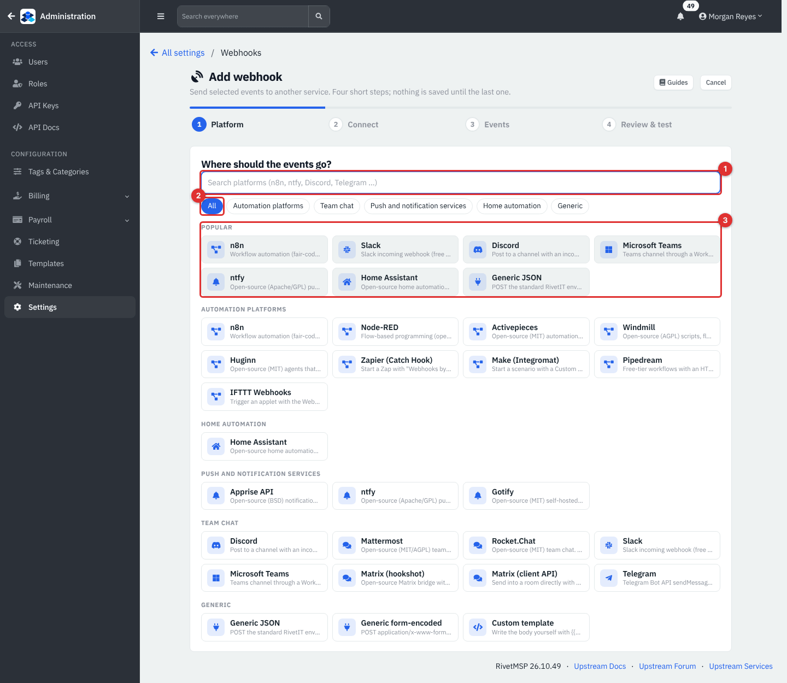

*Figure 2 — Add webhook, step 1: Platform.*

1. A search box; type `ntfy` or `Discord` to filter.
2. Category chips: **Automation platforms**, **Team chat**, **Push and notification services**, **Home automation** and **Generic**.
3. **Popular**: n8n, Slack, Discord, Microsoft Teams, ntfy, Home Assistant and Generic JSON. All 24 platforms are listed below, including Node-RED, Zapier, Make, Pipedream, IFTTT, Mattermost, Rocket.Chat, Telegram, Matrix, Gotify, Apprise and generic **Form** and **Custom template** formats for anything else.

Click a platform. Step 2 asks for the details that platform needs.

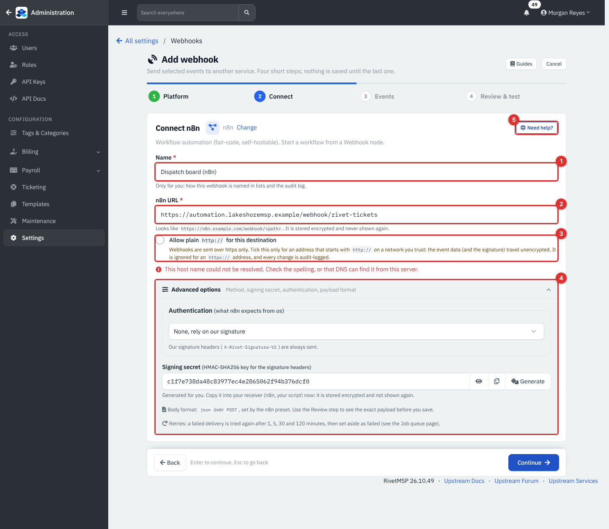

*Figure 3 — Add webhook, step 2: Connect.*

1. **Name**: only for you; it appears in lists and the audit log.
2. **n8n URL** (the label changes with the platform): the address that receives the events. It is stored encrypted and never shown again, only its scheme and host appear in the list. The wizard checks that the host name resolves from this server; a made-up name shows "This host name could not be resolved".
3. **Allow plain http:// for this destination**: webhooks are sent over https only. Tick this only for an address that starts with `http://` on a network you trust; the data and its signature then travel unencrypted. Every change is audit-logged, and the box is ignored for an `https://` address.
4. **Advanced options**: **Authentication** (what the receiver expects: for most platforms *None, rely on our signature*; some offer **Bearer token**, **Basic** or **Custom header**), a **Signing secret** that RivetMSP generates for you (copy it into the receiver now, it is stored encrypted and not shown again; **Generate** makes a new one), the body format and method set by the platform preset, and a note that failed deliveries are retried.
5. **Need help?** opens that platform's setup guide in a side panel.

Click **Continue**. Step 3 chooses the events.

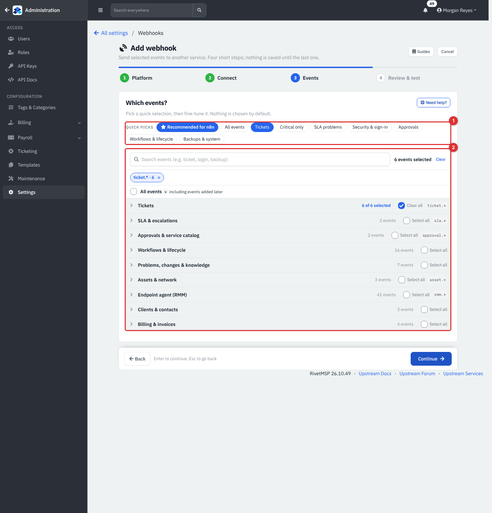

*Figure 4 — Add webhook, step 3: Events.*

1. **Quick picks**: **Recommended** for the platform, **All events**, **Tickets**, **Critical only**, **SLA problems**, **Security & sign-in**, **Approvals**, **Workflows & lifecycle**, **Backups & system**. Nothing is chosen by default.
2. The full list, grouped (Tickets, SLA & escalations, Approvals & service catalog, Workflows & lifecycle, Problems/changes & knowledge, Assets & network, Endpoint agent (RMM), Clients & contacts, Billing & invoices, and more). Tick a whole group (`ticket.*`) or single events, or **All events** to include events added later. A box searches event names.

Step 4, **Review and test**, summarizes what will be created, shows a **Payload preview** for a sample event, and has **Send test**. A test sends one clearly labelled test event through the real delivery path without saving anything. **Create webhook** saves it; **Create and send test** does both. Leave **Enabled** ticked to start sending right away.

### Check and repair deliveries

Click a webhook's name (or **Deliveries** in its menu). The page has four tabs: **Connection**, **Events**, **Payload & advanced** and **Deliveries**, and buttons for **Send test**, **Duplicate** and **Delete**.

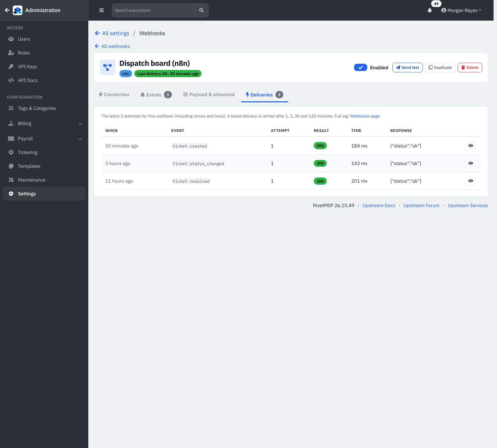

*Figure 5 — A webhook's Deliveries tab.*

Each row is one attempt: **When**, **Event**, **Attempt**, **Result** (HTTP code), **Time** and the **Response** snippet. The eye icon shows the payload exactly as sent (secrets are redacted).

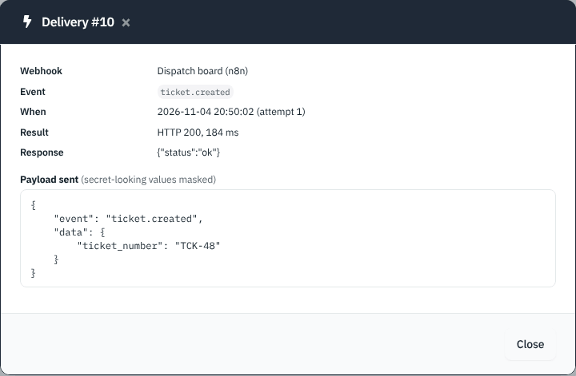

*Figure 6 — One delivery's payload.*

A delivery that gets no 2xx answer is tried again. It is attempted up to five times, after 1, 5, 30 and 120 minutes, and is then marked failed and set aside on the **Job queue** page where you can retry it by hand. RivetMSP never follows redirects and always verifies TLS certificates.

The **Guides** page (the second tab on the Webhooks page) has one setup guide per platform and the verification snippets.

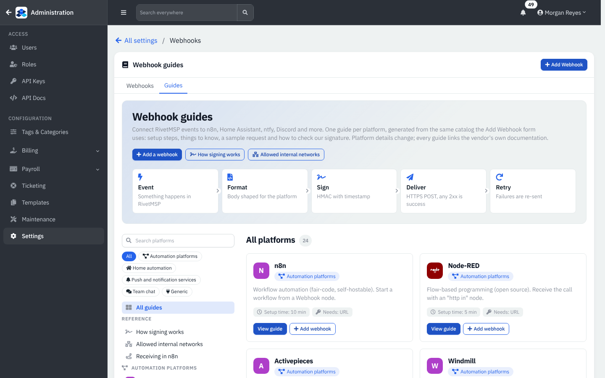

*Figure 7 — Settings → Webhooks → Guides.*

### Let a webhook reach an internal address

On the Webhooks page, **Internal network access** lists the private ranges webhooks may call, one per line in CIDR form (for example `192.168.1.0/24`). Only private ranges can be listed: 10.0.0.0/8, the 172.16 to 172.31 block, 192.168.0.0/16, the 100.64 block (shared address space) and the IPv6 range fc00::/7. Loopback (127.0.0.0/8), link-local (169.254.x.x) and cloud-metadata addresses are never allowed. **Use this server's network** fills in the range the server itself is on. Click **Save networks**.

### Verify a webhook on the receiving side

Every request is signed. Use these headers in your receiver:

| Header | Meaning |
|---|---|
| `X-Rivet-Timestamp` | Unix time (seconds) of this attempt. Reject requests that are too old. |
| `X-Rivet-Signature-V2` | `t=<timestamp>,v1=<hex>`, where the value is HMAC-SHA256 of `<timestamp>.<body>` with your signing secret. This is the one to verify. |
| `X-RivetMSP-Signature` | Older form: `sha256=<hex>`, HMAC-SHA256 of the body alone. `X-ITFlow-Signature` carries the same value for receivers built for the product's earlier name. Kept for compatibility. |
| `X-RivetMSP-Event` | The event name, for example `ticket.created`. |

The default JSON body is `{"event": "...", "timestamp": "...", "data": {...}}`. The **Guides** page has copy-and-paste verification snippets.

### Create an event rule

Open **Settings** → **Event rules**. The list shows each rule with its summary sentence and when it last fired.

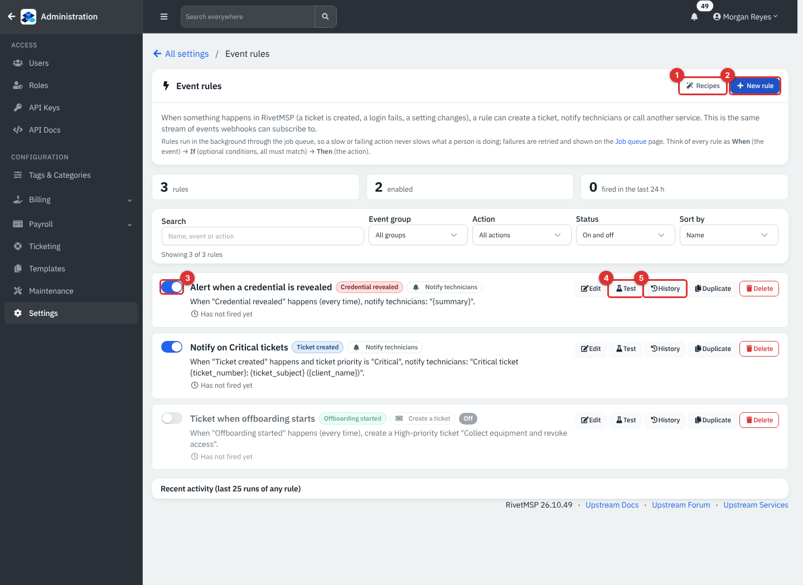

*Figure 8 — Settings → Event rules. Example data.*

1. **Recipes**: ready-made rules.
2. **New rule**: start from scratch.
3. The switch turns a rule on or off.
4. **Test**: a dry run (see below).
5. **History**: the recorded runs of that rule. **Edit**, **Duplicate** and **Delete** sit beside them. Three tiles above the list count **rules**, **enabled** and **fired in the last 24 h**, and you can search or filter by event group, action and status.

Choose a recipe, or **New rule**. Every rule reads **When** (the event), **If** (optional conditions) and **Then** (the action).

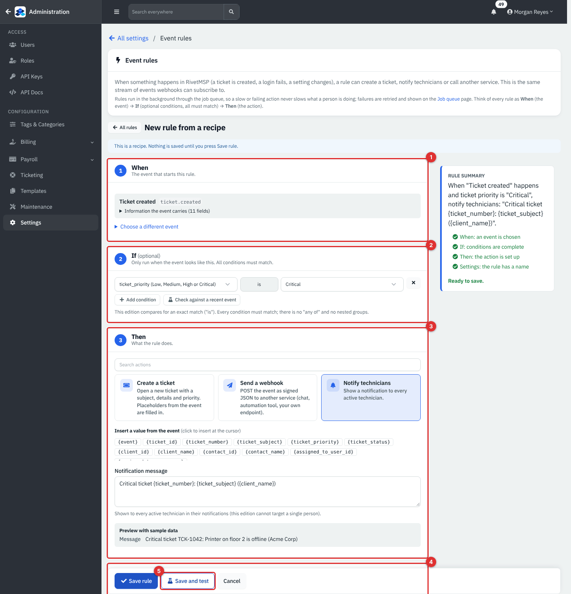

*Figure 9 — A rule opened from the recipe "Tell me about Critical tickets". Nothing is saved until you press Save rule.*

1. **When**: the event that starts the rule, with the fields it carries.
2. **If**: conditions such as `ticket_priority is Critical`. All conditions must match, and each is an exact "is" match: there is no "any of" and no nested groups. **Check against a recent event** tries them on a real one.
3. **Then**: choose **Create a ticket** (subject, details, priority, client), **Send a webhook** (an address and optional signing secret, sent as signed JSON) or **Notify technicians** (a message shown in every active technician's notifications; it cannot target one person). Click a value such as `{ticket_number}` to insert it into the text; unknown ones are left blank.
4. **Settings**: a name and **Rule is on**. A rule that is off keeps its settings but never runs.

The **Rule summary** beside the editor reads the rule back in plain words and shows a preview with sample data. **Save and test** saves, then runs a dry run.

A dry run (**Test**) evaluates the conditions against a sample or recent event and shows what the action would do. It never creates, sends or queues anything.

The ten recipes are: **Tell me about Critical tickets**, **Send new tickets to another tool**, **Report resolved tickets**, **Watch credential reveals**, **Alert on blocked sign-ins**, **Ticket for failed sign-ins**, **Ticket when onboarding starts**, **Ticket when offboarding starts**, **Know when a workflow action fails** and **Announce new change requests**.

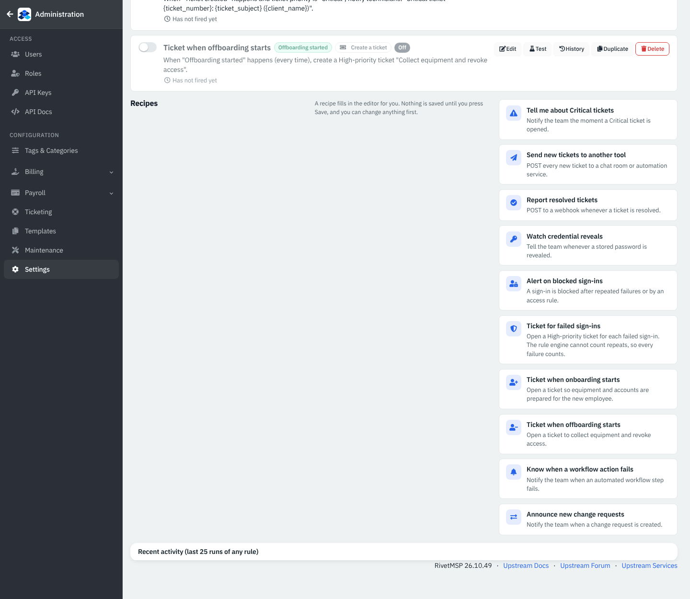

*Figure 10 — The recipes.*

**Ticket for failed sign-ins** opens one ticket for every failure, because the rule engine cannot count repeats. Use it with care.

### Watch the job queue

Webhook deliveries and rule actions are queued as jobs. A page that queues work sends it right after the page responds, and the scheduled job worker and the main cron pick up the rest.

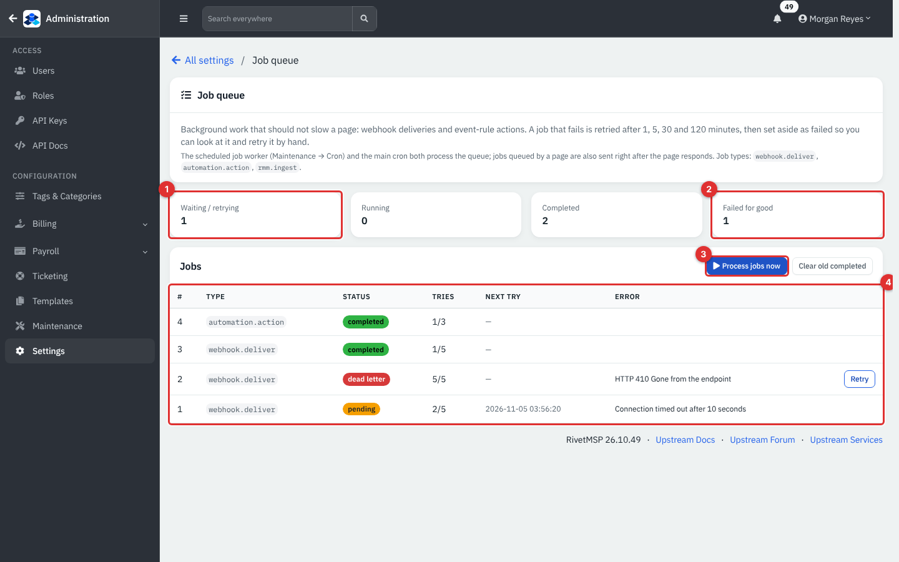

*Figure 11 — Settings → Job queue. Example data.*

1. **Waiting / retrying**: jobs that will run (or run again) at the **Next try** time.
2. **Failed for good**: the status **dead letter**. Click **Retry** on the row after you fix the cause.
3. **Process jobs now** runs what is due immediately. **Clear old completed** tidies the list.
4. The table: **#**, **Type**, **Status**, **Tries** (for example 2/5), **Next try** and **Error**.

Job types are `webhook.deliver`, `automation.action` and `rmm.ingest` (check-ins from the built-in endpoint agent). A failed job is retried after 1, 5, 30 and 120 minutes. Clicking a counter filters the list.

## Reference

### Ticket event data available to rules and templates

The ticket events carry: `{event}`, `{ticket_id}`, `{ticket_number}`, `{ticket_subject}`, `{ticket_priority}`, `{ticket_status}`, `{client_id}`, `{client_name}`, `{contact_id}`, `{contact_name}` and `{assigned_to_user_id}`. Other events carry their own fields, and `{summary}` is a one-line description for most.

### Common events

| Group | Examples |
|---|---|
| Tickets | `ticket.created`, `ticket.replied`, `ticket.assigned`, `ticket.status_changed`, `ticket.resolved` |
| Security | `auth.login_failed`, `auth.login_blocked`, `vault.credential_revealed` |
| Workflows | `workflow.onboarding_started`, `workflow.offboarding_started`, `workflow.completed`, `workflow.action_failed` |
| Problems and changes | `problem.created`, `change.created` |

Every audit event type the server has recorded can also be chosen, so the list grows as you use more features.

### Limits and timings

| Item | Value |
|---|---|
| Delivery attempts per webhook event | 5 (1, 5, 30, 120 minutes apart) |
| Attempts for a rule action | 3 |
| Request timeout | 10 seconds |
| Webhook address | https only, public addresses plus your listed internal networks |

## Tips and good practice

- Give each destination its own signing secret and verify `X-Rivet-Signature-V2` plus the timestamp in your receiver.
- Start a new webhook with **Recommended** events, then add more once it works.
- Use **Send test** before you rely on a webhook, and read the response snippet on the **Deliveries** tab.
- Test a rule with **Test** before turning it on. A rule that creates a ticket for every failed sign-in can create a lot of tickets.
- Watch **Failed for good** on the Job queue after a service outage; those deliveries are not retried automatically again.

## Related guides

- [Integrations](29-integrations.md)
- [Mail intake, sending and e-mail templates](30-mail-intake-and-sending.md)
- [AI features and the remote MCP server](30c-ai-and-remote-mcp.md)
- [Service desk and tickets](05-service-desk-tickets.md)
- [The API and the mobile app](31-api-and-mobile.md)
- [System settings and maintenance](36-system-settings-maintenance.md)
