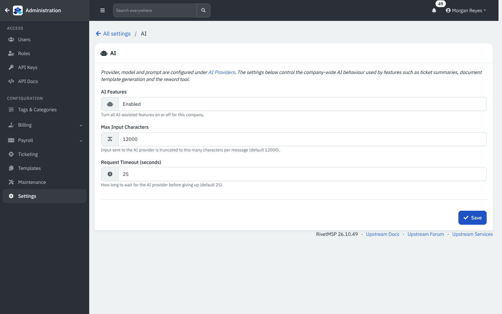
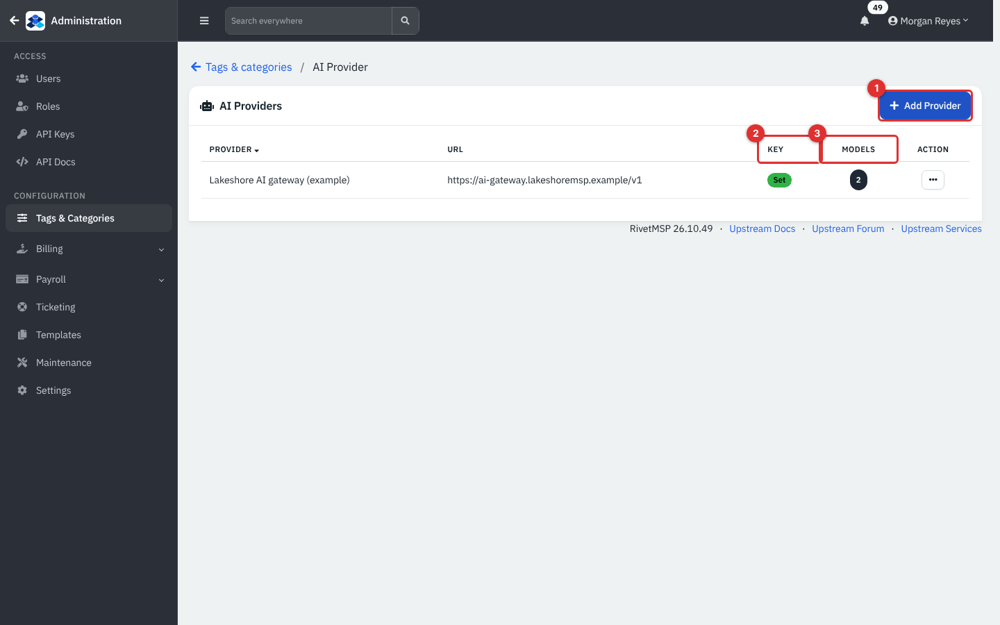
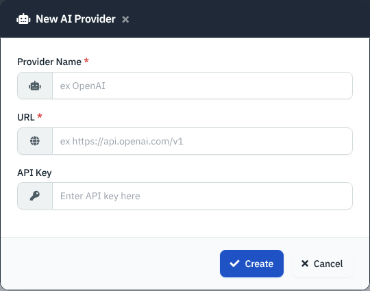
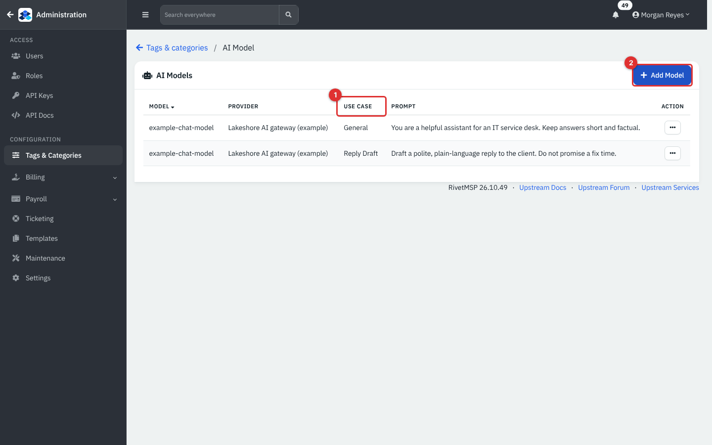
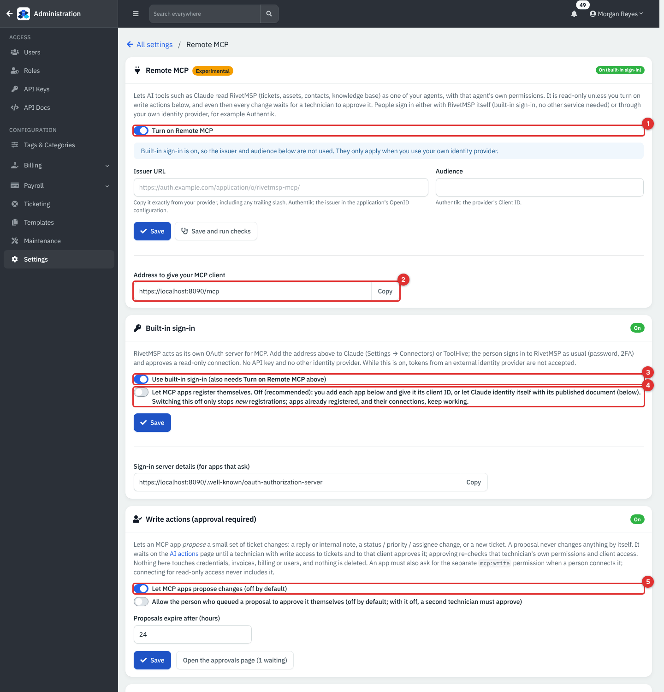
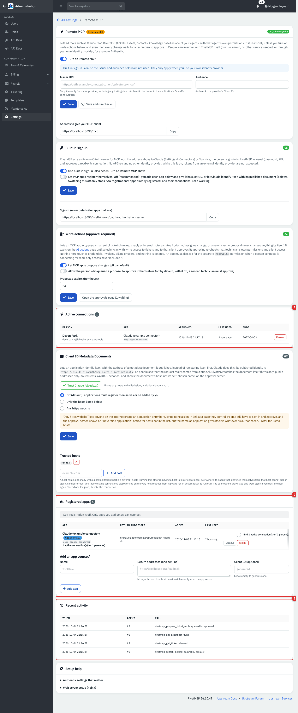
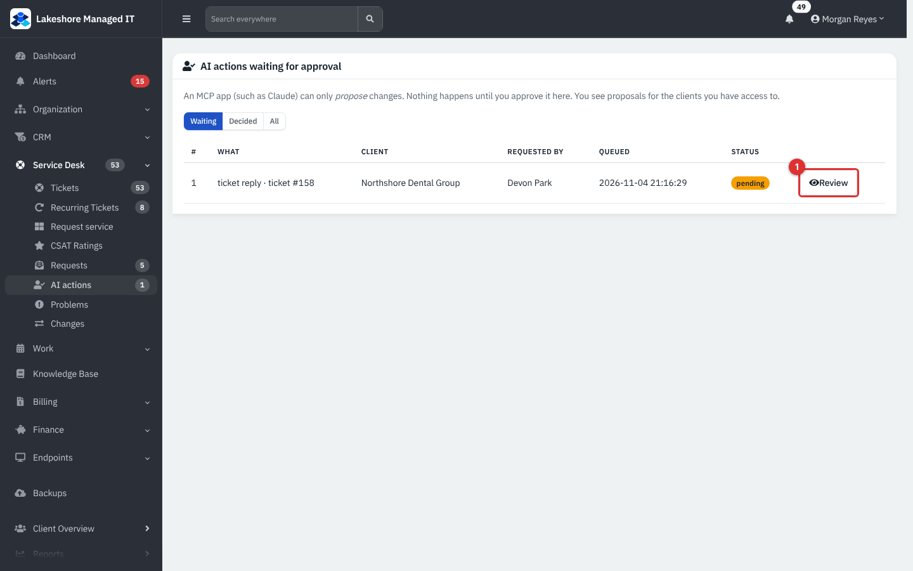
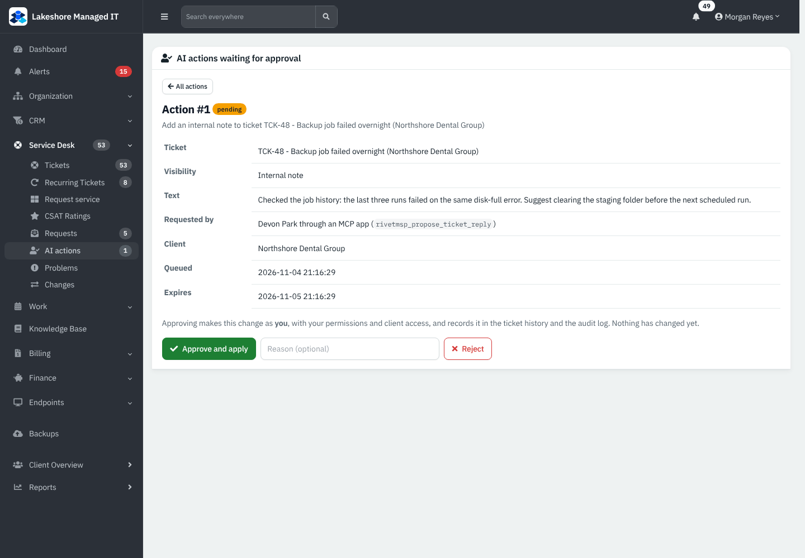

# AI features and the remote MCP server

RivetMSP can use an AI service in two directions. **Inbound to RivetMSP**: you connect an AI provider so technicians get a ticket summary, a drafted reply and a reword button. **Outbound from RivetMSP**: the experimental **Remote MCP** server lets an AI tool such as Claude read your tickets, assets, contacts and knowledge base as one of your technicians, and propose changes that a technician then approves.

All screens show example data for a fictional company, Lakeshore Managed IT. There is no AI service and no MCP client in the demo: the provider points at a made-up address with a placeholder key, and the MCP connection, its activity and the waiting proposal are example rows. Neither direction was **verified on a live service** for this guide.

| | |
|---|---|
| **Where to find it** | Administration (top-left arrow) → **Settings** → **Connections & data** → **AI** and **Remote MCP**. Providers and models: **Tags & Categories** → **AI providers** (the **AI Model** list opens from there). Proposals: sidebar **Service Desk** → **AI actions**. |
| **Who can use it** | AI and Remote MCP settings: administrators only. The AI buttons on a ticket appear for anyone who can work on it. **AI actions**: a technician with **Support** at **Modify** and access to that client. |
| **Turn it on** | **AI Features** is a company-wide switch on the **AI** page (Enabled or Disabled). Remote MCP needs **Turn on Remote MCP** and a sign-in method (see below). Both are optional and off until you set them up. |

## What it's for

- Summarize a long ticket, draft a plain-language reply and reword text, using a provider and model you choose.
- Let your own AI assistant answer "what's open for Birchwood?" from live data, read-only, with each person's own permissions.
- Let that assistant *suggest* a note or status change that a technician must approve before anything changes.

## A quick tour

### AI settings

*Figure 1 — Settings → AI.*

- **AI Features**: **Disabled** or **Enabled** for the whole company. When disabled, the AI buttons disappear from tickets.
- **Max Input Characters** (default 12000): text sent to the provider is cut to this length per message.
- **Request Timeout (seconds)** (default 25): how long to wait before giving up.

The provider, model and prompt are on the **AI providers** screens, not here.

### Providers and models

*Figure 2 — Tags & Categories → AI providers. Example data.*

1. **Add Provider**.
2. **Key**: whether an API key is stored. Keys are stored encrypted and never shown again.
3. **Models**: how many models the provider has. Click the number to open the model list.

*Figure 3 — Add Provider: a name, the base URL of an OpenAI-compatible service and an API key.*

The URL is the base address (for example the service's `/v1` address); RivetMSP adds `/chat/completions` itself and sends the key as a bearer token. Any service that speaks that interface works, including a self-hosted one.

*Figure 4 — AI Models.*

1. **Use Case**: **General**, **Tickets**, **Documentation** or **Reply Draft**.
2. **Add Model**: choose the provider, type the model name your service expects, pick the use case and optionally write a prompt.

RivetMSP picks the model by use case and falls back to **General**, so one General model is enough. Today the features ask for **Reply Draft** (drafted replies) or **General** (everything else); **Tickets** and **Documentation** can be added but no feature asks for them yet. The form allows one model per use case.

### Where technicians see it

- **Summarize**: on a ticket, the three-dot menu has **Summarize**.
- **Draft with AI**: above the reply box.
- **Reword Text**: in the text editor toolbar.
- **Document templates**: an AI helper that drafts a document template.
- **Ticket automation**: two optional automation actions, AI triage and AI sentiment, post an internal note with a suggestion. They never change the ticket themselves and fail silently if AI is off or unreachable.

AI features send ticket or document text to the provider you configure. Choose a provider you are allowed to send that data to, or keep **AI Features** disabled. The database has a per-client AI opt-out flag that the AI functions and the MCP tools honour, but **I found no screen in this release that sets it**; ask your administrator or support before relying on it.

## Remote MCP (experimental)

MCP (Model Context Protocol) is a standard way for AI tools to call tools on another system. RivetMSP's server lives at `/mcp` on your install.

*Figure 5 — Settings → Remote MCP. Example data. The address shown is the demo's.*

1. **Turn on Remote MCP**. A badge at the top says **Off**, **Needs setup** or **On (built-in sign-in)**.
2. **Address to give your MCP client**: copy it into the AI tool (Claude: Settings → Connectors).
3. **Built-in sign-in**: RivetMSP acts as its own OAuth server. The person signs in as usual (password, two-factor) and approves a connection. No API key and no other identity provider.
4. **Let MCP apps register themselves**: off is recommended. With it off you add each app yourself (below) or trust the published identity of a known host.
5. **Write actions (approval required)**: off by default (see below).

External identity providers (the **Issuer URL** and **Audience** fields, for example Authentik) are accepted by the settings page, but the MCP server in this release only accepts its own built-in sign-in: with an external provider alone, nothing answers at `/mcp`. While built-in sign-in is on, tokens from an external provider are not accepted.

### Who is connected

*Figure 6 — The lower half of the Remote MCP page. Example data.*

1. **Active connections**: person, app, scopes (`mcp:read`, and `mcp:write` for apps that may propose changes), when approved, last used and when the consent ends. **Revoke** ends one.
2. **Registered apps**: apps you added, with their return addresses and how many connections they have. Use **Add app** to register one by hand (a name and the exact return addresses the app uses, one per line, https or localhost; the client ID is generated if you leave it empty). **Disable** or **Delete** an app, optionally ending its connections.
3. **Recent activity**: the last MCP calls, who made them and whether they were allowed. Every call (allowed, denied, not found or failed) is also written to the audit log.

A consent lasts at most 180 days, and a person's access token lives 15 minutes (renewed by a 30-day refresh token). Above these cards, **Client ID Metadata Documents** lets an app identify itself by a web address. It is **Off** by default; **Trust Claude (claude.ai)** adds that one host. Choosing **Any https website** lets anyone on the internet create an app entry here, so prefer the listed hosts.

### What an AI tool can do

Every tool reads with the connected person's own client access and permissions, and clients marked for AI opt-out are excluded for everyone. Tools in this release:

| Tool | What it does |
|---|---|
| `rivetmsp_my_profile` | Who the connected person is |
| `rivetmsp_list_clients` | The clients that person can see |
| `rivetmsp_search_tickets`, `rivetmsp_recent_tickets`, `rivetmsp_get_ticket` | Find and read tickets |
| `rivetmsp_search_assets`, `rivetmsp_get_asset` | Find and read assets |
| `rivetmsp_search_contacts` | Find contacts |
| `rivetmsp_search_kb`, `rivetmsp_get_kb_article` | Find and read knowledge base articles |
| `rivetmsp_propose_ticket_reply`, `rivetmsp_propose_ticket_update`, `rivetmsp_propose_create_ticket`, `rivetmsp_get_proposal_status` | Only with **Write actions** on and the `mcp:write` scope: propose a reply or internal note, a status, priority or assignee change, or a new ticket, and check on a proposal |

Nothing here touches credentials, invoices, billing or users, and nothing is deleted.

### Approve what an AI proposes

With **Let MCP apps propose changes** on, a proposal never changes anything by itself. It waits on **Service Desk** → **AI actions**.

*Figure 7 — Service Desk → AI actions. The Review button is marked; the filters are Waiting, Decided and All.*

1. Click **Review** on a row.

*Figure 8 — Reviewing a proposal: what it would do, who requested it and through which tool, when it expires, and **Approve and apply** or **Reject** with an optional reason.*

2. Read the **Ticket**, **Visibility** (internal note or a public reply), **Text** and **Client**. Approving makes the change as you, with your permissions and client access, and records it in the ticket history and the audit log.
3. Click **Approve and apply** or **Reject**.

By default the person who queued a proposal cannot approve it; a second technician must. **Allow the person who queued a proposal to approve it themselves** changes that. A proposal expires after **Proposals expire after (hours)** (default 24, up to 168), and a person can have at most 25 waiting.

## Common tasks

### Connect an AI provider

1. **Settings** → **AI**: set **AI Features** to **Enabled** and **Save**.
2. **Tags & Categories** → **AI providers** → **Add Provider**: name, base URL, API key.
3. Open the provider's models and **Add Model** with the use case **General** (add **Reply Draft** if you want a different prompt for drafted replies).
4. On any ticket, try **Draft with AI** or the three-dot menu → **Summarize**. If nothing happens, the technician sees an error such as "No AI model configured for use case".

### Let Claude read RivetMSP

1. **Settings** → **Remote MCP**: tick **Turn on Remote MCP** and **Save**.
2. In **Built-in sign-in** tick **Use built-in sign-in** and **Save**.
3. Either add the app under **Registered apps**, or use **Client ID Metadata Documents** → **Trust Claude (claude.ai)** so Claude identifies itself.
4. In Claude, add a connector with the address from the page; sign in to RivetMSP and approve.
5. Watch **Recent activity** for the first calls. **Not verified with a real MCP client.**

Your web server must send `/mcp`, `/.well-known/oauth-authorization-server` and the related paths to the MCP script; the **Setup help** card on the page has the nginx example.

## Tips and good practice

- Start read-only. Leave **Write actions** off until people are comfortable with what the assistant reads.
- Keep self-approval off so a second person sees every change.
- Keep **Let MCP apps register themselves** off.
- Revoke the connection of anyone who leaves; consents otherwise last up to 180 days.
- Treat the API key of your AI provider like a password, and tell clients when their ticket text is processed by an outside service.

## Related guides

- [Integrations](29-integrations.md)
- [Webhooks, event rules and the job queue](30b-webhooks-event-rules-and-jobs.md)
- [The API and the mobile app](31-api-and-mobile.md)
- [Service desk and tickets](05-service-desk-tickets.md)
- [Users, roles and security](34-users-roles-security.md)
- [Knowledge base](13-knowledge-base.md)
