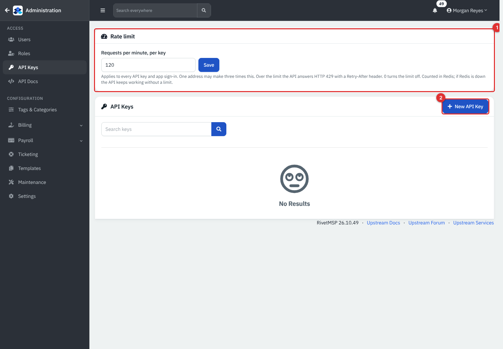
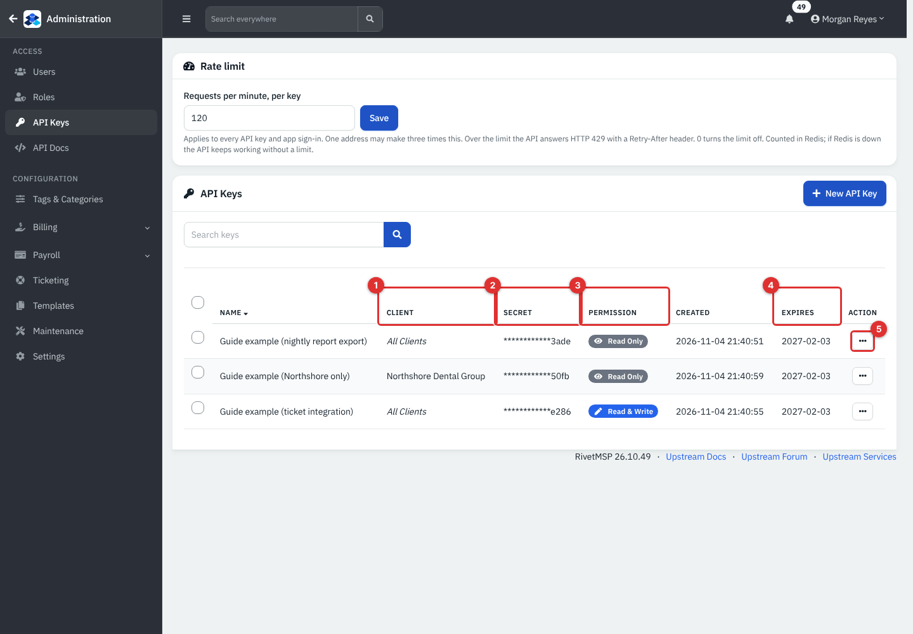
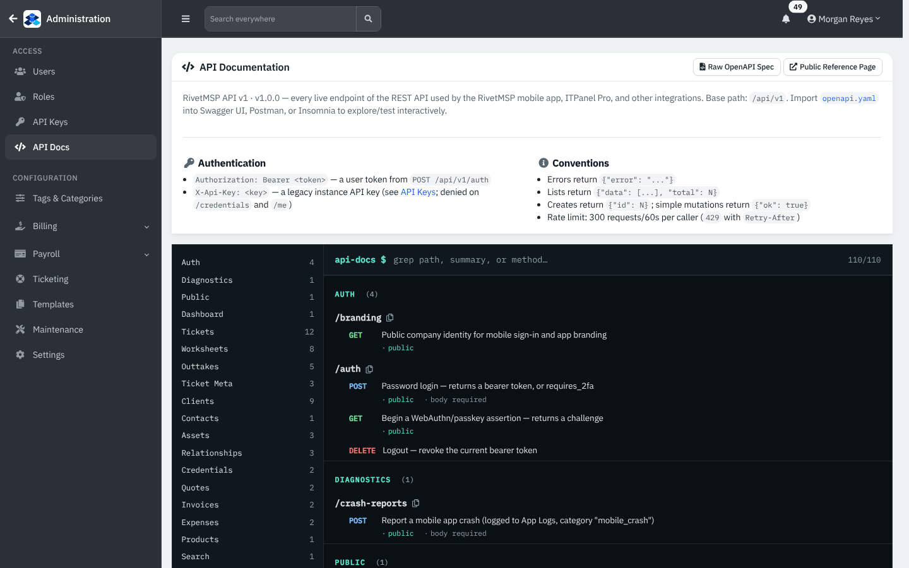
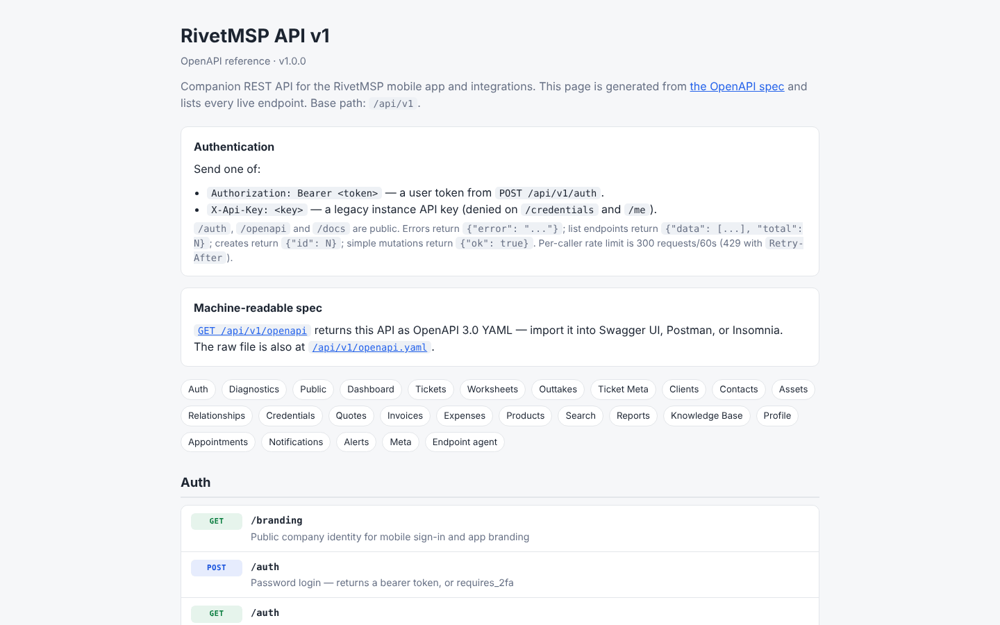
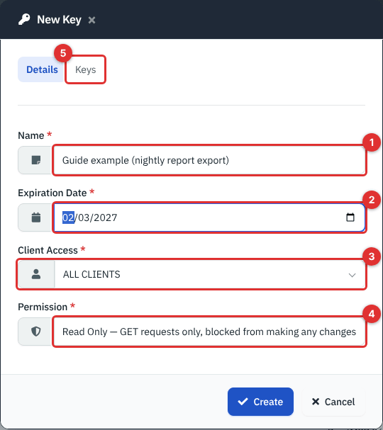
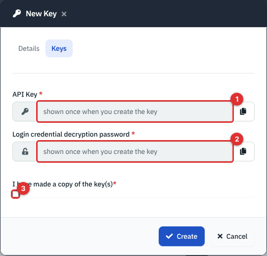
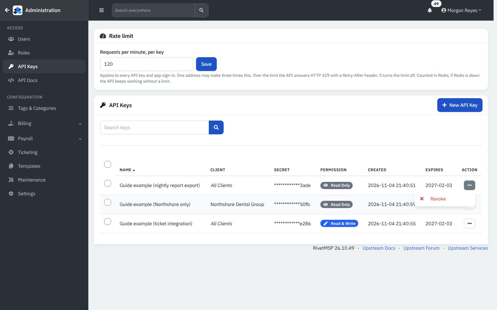
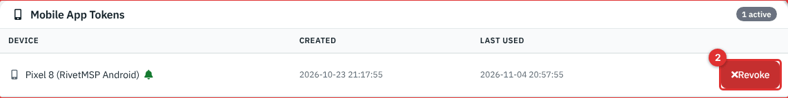

# The API, API keys and the mobile app

RivetMSP has a REST API that returns JSON. It is the same interface the RivetMSP Android app uses, and you can use it for your own scripts and reports: list tickets, read a client's assets, open a ticket from a monitoring tool, pull MRR into a spreadsheet. This page shows how to create an API key, how to call the API with `curl`, how the two kinds of sign-in differ, what the rate limit is and how to find every endpoint. It also describes the mobile app and the two device-only interfaces (the RMM agent and RivetPanel).

The calls on this page were **run for real** against a copy of the demo (see [How these examples were checked](#how-these-examples-were-checked)). The address `https://rivet.example.com` stands for your own installation and the keys are placeholders. The mobile app, the RMM agent and RivetPanel were **not verified** here: there is no phone or device in the sandbox, so those parts come from the code and the API reference.

| | |
|---|---|
| **Where to find it** | Administration (top-left arrow) → **API Keys** and **API Docs** in the **ACCESS** group of the sidebar. A technician's own mobile sign-ins: **Account** → **Security** → **Mobile App Tokens**. The public reference: `/api/v1/docs`. |
| **Who can use it** | Administrators create and revoke API keys and read **API Docs**. A **Bearer token** is for a technician's own login (it carries that person's permissions). The public reference page and the OpenAPI file need no sign-in. |
| **Turn it on** | Nothing to switch on. The API is part of every install. The rate limit needs Redis to be running (see [Rate limits](#rate-limits)). |

## What it's for

- Read tickets, clients, contacts, assets, invoices, reports and more from your own tools.
- Create tickets and replies from scripts, monitoring alerts or other systems.
- Run the Android app, with push notifications and biometric unlock for credentials.
- Let a device-side program (the RMM agent, RivetPanel) talk to the server.

## A quick tour



*Figure 1 — Administration → API Keys, before any key exists. Example data.*

1. **Rate limit**: requests per minute, per key (default 120; 0 turns the limit off). **Save** applies it at once.
2. **New API Key**.

After keys exist the list looks like this:



*Figure 2 — Three example keys (created and deleted again by the guide's screenshot script).*

1. **Client**: **All Clients**, or the single client the key is limited to.
2. **Secret**: only the last four characters of the stored value. The full key is shown once, when you create it.
3. **Permission**: **Read Only** or **Read & Write**.
4. **Expires**: every key has an expiry date; an expired key is marked **(Expired)** and stops working.
5. The row menu: **Revoke** (ends the key now) on a live key, **Delete** on an expired one.



*Figure 3 — Administration → API Docs: every endpoint, grouped, with a search box.*

**Raw OpenAPI Spec** and **Public Reference Page** are at the top right. The public page, `/api/v1/docs`, needs no sign-in, and the machine-readable file is at `/api/v1/openapi.yaml` (also `/api/v1/openapi`) for Swagger UI, Postman or Insomnia. At version 26.10.49 it describes 93 paths and 110 operations.

**Note.** Both reference pages, and the older `API.md` file in the product's `docs` folder, still say the limit is "300 requests/60s per caller". That text is out of date. The real limit is the setting on the API Keys page (default 120 per minute); see [Rate limits](#rate-limits).



*Figure 4 — The public reference page, `/api/v1/docs`. It shows the same outdated 300 requests/60s sentence.*

## Common tasks

### Create an API key

An API key is for a program, not a person: it is long-lived and carries one of two permission levels.

1. Open **API Keys** and click **New API Key**.

   

   *Figure 5 — New Key, Details tab.*

   1. **Name**: what the key is for, for example "Nightly report export".
   2. **Expiration Date**: required, and cannot be in the past.
   3. **Client Access**: **ALL CLIENTS**, or one client.
   4. **Permission**: **Read & Write** (can create, update and delete) or **Read Only** (GET requests only).
   5. The **Keys** tab.
2. Open the **Keys** tab.

   

   *Figure 6 — New Key, Keys tab. The two values are blanked in this picture; in the real dialog they are filled in.*

   1. **API Key**: the key itself. Copy it now with the copy button. It is not shown again.
   2. **Login credential decryption password**: a random value the dialog generates for you and shows next to the key. You do not type your own password here. Copy it too if your integration will need credential-related access.
   3. **I have made a copy of the key(s)**: tick it, then click **Create**.
3. Store the key in a password manager or your tool's secret store.

The key is saved as a hash, so RivetMSP itself can never show it again. If you lose it, create a new key and revoke the old one.

**What a key can do.** A key does not belong to a person. It acts as the first active administrator account, so changes it makes appear under that name. Because there is no person behind it, a key is refused on two endpoints: `/me` (a profile) and `/credentials` (stored passwords). Both answer HTTP 403 and ask for a user token instead.

### Make your first call

Send the key in the `X-Api-Key` header on every request. This call checks that the key works:

```
curl -s https://rivet.example.com/api/v1/validate_api_key \
  -H "X-Api-Key: $KEY"
```

```
{"success":"True","message":"API key is valid"}
```

List two clients:

```
curl -s "https://rivet.example.com/api/v1/clients?limit=2" -H "X-Api-Key: $KEY"
```

```
{"data":[{"id":2,"name":"Birchwood Law Partners","phone":"6085550122","city":"Madison","state":"WI","website":"https:\/\/birchwoodlaw.example"},{"id":8,"name":"Bluebird Early Learning","phone":"6085550131","city":"Verona","state":"WI","website":"https:\/\/bluebirdlearning.example"}],"total":19}
```

Your numbers and names will differ. Here `total` counts every active record in the clients table, so prospect records (leads) are included; there were ten leads in the demo.

A missing, wrong or expired key gets HTTP 401 with `{"error":"Unauthorized"}`. A key can also be sent as `?api_key=` in the address or in the JSON body of a POST, but the header is better because addresses end up in server logs.

### Filter and page through a list

Lists return `{"data":[...],"total":N}`. Use `page` and `limit`, and `search` for a text filter. The defaults and caps differ: clients default to 30 and allow 100; tickets default to 20 and allow 50. Tickets also take `status` (`open`, the default, `closed` or `all`), `client_id`, `contact_id`, `mine=1`, `overdue` and `due_today`.

```
curl -s "https://rivet.example.com/api/v1/tickets?status=open&client_id=1&search=backup&limit=1" \
  -H "X-Api-Key: $KEY"
```

```
{"data":[{"id":158,"number":48,"subject":"Backup job failed overnight","priority":"Critical","status":"Open","status_color":"#007bff","client":"Northshore Dental Group","assigned_to":"Morgan Reyes","created_at":"2026-11-03 20:51:35","due_at":null,"resolved_at":null,"updated_at":"2026-11-05 02:54:17"}],"total":1,"page":1,"limit":1}
```

One ticket with its replies: `GET /tickets/158`. All of one client's tickets: `GET /clients/1/tickets` (a plain array). A report: `GET /reports/overview`:

```
{"year":2026,"by_priority":[{"priority":"Critical","count":1},{"priority":"High","count":12}, ...],"by_status":[ ... ],"avg_resolution_hours":23.2}
```

Money and report endpoints follow the same rules; for example `GET /reports/mrr` returns monthly recurring revenue, `arr`, a 12-month trend and a forecast.

### Create a ticket and add a note

This needs a **Read & Write** key (or a user token).

```
curl -s -i -X POST https://rivet.example.com/api/v1/tickets \
  -H "X-Api-Key: $KEY" -H "Content-Type: application/json" \
  -d '{"client_id":1,"subject":"API example: test ticket","details":"Created from curl with an API key.","priority":"low"}'
```

```
HTTP/1.1 201 Created
{"id":461,"number":351}
```

`subject` is required (the API answers 400 `subject required` without it); `priority` is `low`, `medium`, `high` or `critical`; `contact_id`, `category_id`, `assigned_to`, `contract_id` and `hostname` are optional. With no `contact_id` the client's primary contact is used. Now add an internal note:

```
curl -s -X POST https://rivet.example.com/api/v1/tickets/461/reply \
  -H "X-Api-Key: $KEY" -H "Content-Type: application/json" \
  -d '{"reply":"Internal note from the API","type":"note"}'
```

```
{"id":1751,"type":"Internal"}
```

`type` can be `note` (internal, the default is a public reply), or `client` to record a reply from the contact. `time_worked` and `status_id` can ride along on the same call. The ticket then behaves like any other: notifications go out, and it shows in the service desk. The ticket created for this page was deleted again afterwards.

### Limit what a key can do

- **Read Only** keys answer every non-GET request with HTTP 403:

```
curl -s -i -X POST https://rivet.example.com/api/v1/tickets -H "X-Api-Key: $READ_KEY" \
  -H "Content-Type: application/json" -d '{}'
```

```
HTTP/1.1 403 Forbidden
{"error":"This API key is read-only"}
```

- A key tied to one client only sees that client. Listing clients with a key limited to Northshore Dental Group returns one row (`"total":1`); asking for another client's record answers `404 {"error":"Client not found"}`, and creating a ticket for another client answers `403 {"error":"Access denied"}`.
- Use one key per integration, with the smallest permission it needs and the shortest expiry you can live with.

To end a key, open its row menu and click **Revoke**; confirm with **Yes**. It is expired immediately and the row now offers **Delete**, which removes it. Both are written to the audit log.



*Figure 7 — The row menu of a live key.*

### Sign in as a person: Bearer tokens

A key has no person behind it. When the action must be attributed to a technician, or you need `/me`, use a token. `POST /auth` takes the technician's e-mail address and password and returns a token:

```
curl -s -X POST https://rivet.example.com/api/v1/auth \
  -H "Content-Type: application/json" \
  -d '{"username":"devon.park@lakeshoremsp.example","password":"…","device_name":"Nightly script"}'
```

```
{"token":"…64 characters…","user":{"id":2,"name":"Devon Park","email":"devon.park@lakeshoremsp.example","type":1}}
```

Send it as `Authorization: Bearer <token>`:

```
curl -s https://rivet.example.com/api/v1/me -H "Authorization: Bearer $TOKEN"
```

```
{"id":2,"name":"Devon Park","email":"devon.park@lakeshoremsp.example","type":1,"color":"#2f80ed","avatar":null}
```

End it with `DELETE /auth` (answer `{"ok":true}`); afterwards the token gets 401.

```
curl -s -X DELETE https://rivet.example.com/api/v1/auth -H "Authorization: Bearer $TOKEN"
```

What to know about tokens:

- Only technician accounts can sign in this way. A token carries that person's permissions and client access, so it can do less than an administrator's key.
- If the account uses two-factor authentication, the first call answers `{"requires_2fa":true}`; repeat it with `"totp_code":"123456"` (or a one-time recovery code). A passkey sign-in is also possible: `GET /auth` returns a challenge and a second `POST /auth` completes it.
- A wrong password answers 401 `Invalid credentials`. After five failures the account is locked for five minutes (429 `Too many failed attempts. Try again in 5 minutes.`).
- A token that has not been used for 90 days is deleted. Each person can see and **Revoke** their own tokens under **Account** → **Security** → **Mobile App Tokens**.



*Figure 8 — Account → Security → Mobile App Tokens. Example data.*

1. The list of sign-ins with the device name, when each was created and last used, and a green bell when push notifications are registered.
2. **Revoke** ends that sign-in at once.

### Rate limits

The API counts requests per key (or per token) and per address, in Redis. Over the limit the answer is HTTP 429 with a `Retry-After` header (seconds) and `{"error":"Rate limit exceeded","retry_after":36}`. A rate-limit hit is also written to the audit log as `api.rate_limited`, once per key per minute.

| Caller | Limit |
|---|---|
| Each key or token | The **Rate limit** setting on the API Keys page: default **120 per minute**, 0 = no limit, maximum 100000 |
| Each IP address | Three times that setting |
| `POST /auth` (sign-in) | 30 per minute per IP address |
| `/docs`, `/openapi`, `/branding` | 60 per minute per IP address |
| `POST /crash-reports` | 20 per 5 minutes per IP address |
| `GET /csat` | 60 per 5 minutes per IP address |

The streaming endpoints (a ticket's live chat and the notification stream) are not counted.

**Important.** Redis is optional, and the limits fail open when it is not running: the API keeps working without a limit. The sign-in endpoint is the exception: it **fails closed**. With no Redis, `POST /auth` answers 429 `Rate limit exceeded` for everyone, so token sign-in and the mobile app cannot work. (This is exactly what the unmodified demo does, because it runs without Redis; the examples on this page were run with a throwaway Redis.) API keys are not affected.

## The mobile app

RivetMSP has an Android app, kept in its own repository, that talks to the same API: dashboard counts, tickets (list, detail, reply, status, assignment, time, charges, attachments, live chat), assets with barcode and QR scanning, clients, worksheets and outtake forms with signatures, search, notifications with push messages, RMM and backup alerts, appointments, reports, expenses with receipt photos, knowledge base articles and credentials. According to the app's own documentation it needs a RivetMSP server of version 2.4.12 or newer. **Not verified here: there is no phone in the sandbox.**

How it connects: the person enters the server address and signs in with `POST /auth` (so the server needs Redis, and the person needs a technician account). The app registers its push token with `PUT /me` (`fcm_token`) and a biometric public key with `PUT /me` (`device_public_key_pem`). Reading a stored password's secret needs the bearer token plus a signed biometric challenge: `GET /auth` gives the challenge, the phone signs it, and the request carries `X-Biometric-Challenge-Token` and `X-Biometric-Signature`. API keys can never read credentials.

An administrator controls access with the usual tools: disable the user, or have the person revoke the phone under **Mobile App Tokens**.

## The device interfaces (not for scripts)

Two more families of endpoints exist for programs that run on devices, not for people:

- The **built-in RMM agent** uses `agent_enroll`, `agent_checkin`, `agent_jobs` and related endpoints with an enrolment token or a device credential. They answer `503 module_disabled` while the RMM module is off. See [Endpoints and RMM overview](25-endpoints-rmm-overview.md).
- **RivetPanel** uses `panel_enroll`, `panel_me`, `panel_categories`, `panel_tickets` and `panel_ticket_chat`, answering `503 module_disabled` while the panel is off. See [Alerts, backups, network and RivetPanel](28-alerts-backups-network-panel.md).

Both require HTTPS: over plain http they answer `426` with `{"error":"TLS is required.","code":"tls_required"}`. Do not build scripts against them; the agent protocol is fixed and owned by the product.

## Reference

### Authentication at a glance

| | API key | Bearer token |
|---|---|---|
| Header | `X-Api-Key: <key>` | `Authorization: Bearer <token>` |
| Made by | An administrator, under **API Keys** | `POST /auth` with a technician's login |
| Acts as | The first active administrator | The person who signed in |
| Limits | Client access, **Read Only** or **Read & Write**, expiry date | The person's own permissions and clients; revoked by `DELETE /auth` or in Mobile App Tokens; idle 90 days |
| Refused on | `/me`, `/credentials` | (nothing extra; credential secrets also need the biometric headers) |
| Best for | Scripts and server-to-server jobs | Anything that must be attributed to a technician; the mobile app |

### Endpoints that need no sign-in

`POST /auth` and `GET /auth`, `GET /branding` (company name and logo address), `GET /csat` (an aggregate star rating plus a few anonymous testimonial comments that you can show on your public website; no client or ticket details), `GET /docs`, `GET /openapi` and `GET /openapi.yaml`, and `POST /crash-reports` (the app's crash reports; a bearer token is used if present).

### Endpoint families

The reference page has every endpoint with its parameters. The main families:

| Family | What it covers |
|---|---|
| Auth and profile | `/auth`, `/me`, `/validate_api_key`, `/branding` |
| Dashboard and search | `/dashboard` (counters and your queue), `/search?q=` |
| Tickets | `/tickets` and `/tickets/{id}` with `/reply`, `/time`, `/status`, `/attachments`, `/chat`, `/charges`, `/worksheets`, `/outtakes`; `/statuses`, `/ticket-categories`, `/ticket-views`, `/appointments` |
| Clients and documentation | `/clients` (and `/{id}/tickets`, `/assets`, `/locations`, `/contracts`, `/files`, `/allowance`), `/contacts`, `/assets`, `/credentials` (names; secrets need the biometric step), `/relationships` |
| Billing | `/quotes`, `/invoices` (read), `/expenses`, `/products` |
| Knowledge base | `/kb/categories`, `/kb/articles` |
| Reports | `/reports/time`, `tickets`, `tickets-by-client`, `time-by-tech`, `service-desk`, `csat`, `mrr`, `rmm-health`, `unbilled-tickets`, `clients-with-balance`, `income-summary`, `expense-summary`, `profit-loss`, `expiring`, `overview` and more |
| Alerts and notifications | `/alerts` (RMM and backup; acknowledge and resolve), `/notifications`, `/notifications/stream` |
| Endpoints (RMM) for technicians | `/endpoint_devices` and related (needs a bearer token and the RMM permissions) |

### Conventions

- Lists: `{"data":[...],"total":N}` (some small lists are a plain array). Creates: `{"id":N}`. Other changes: `{"ok":true}`. Errors: `{"error":"..."}` with a matching HTTP code.
- Codes you will meet: 200, 201, 400 (missing or bad field), 401 (not signed in), 403 (not allowed, read-only key, wrong client), 404, 426 (TLS needed, device interfaces only), 429 (rate limit or lockout), 503 (module off).
- Dates are `YYYY-MM-DD HH:MM:SS` as stored. **Note:** rows created through the API are stamped with the database server's clock. In the demo that is UTC, so the ticket created for this page showed `2026-11-05 03:08:39` while tickets created in the web app are stamped in the company time zone (America/Chicago, six hours earlier). Allow for that when you compare times.
- Streaming endpoints (`/tickets/{id}/chat?stream=1`, `/notifications/stream`) keep the connection open and send server-sent events. A web server that runs requests one at a time can stall on them.
- File uploads (ticket attachments, expense receipts) use `multipart/form-data`.

### How these examples were checked

The demo server is the PHP built-in web server, which has no rewrite rules. For the clean addresses used here (`/api/v1/clients`) the web server must send unknown paths to `api/v1/index.php`: the product's nginx template does it with `try_files $uri /api/v1/index.php?$query_string` and the folder has an `.htaccess` for Apache. On the PHP built-in server, addresses whose first word matches a folder inside `api/v1` (clients, tickets, assets, contacts, invoices, quotes and others) answer 404, while names such as `/dashboard`, `/statuses` or `/auth` work. To run the examples anyway, a tiny router script (about five lines, kept outside the product) forwarded `/api/v1/*` to `index.php` the way nginx does, on a second private instance with its own Redis. The demo's rate limit was changed to 3 for one test and put back to 120. Throwaway keys and tokens were created through the real screens and calls and deleted or revoked again; the one ticket created for the examples, and the notifications it generated, were removed afterwards.

## Tips and good practice

- One key per integration, a clear name, the smallest permission that works and an expiry you will remember. Put the expiry in a calendar.
- Never put a key in a web page, a shared document or a screenshot. If one leaks, **Revoke** it at once.
- Prefer the `X-Api-Key` header over `?api_key=` so keys stay out of logs.
- Check `total`, `page` and `limit` when you read lists, so a script does not stop at the first page.
- Handle 429 by waiting for `Retry-After` seconds rather than retrying immediately.
- Use the **Read Only** permission for anything that only reports.

## Related guides

- [Integrations](29-integrations.md)
- [Webhooks, event rules and the job queue](30b-webhooks-event-rules-and-jobs.md) (push events out instead of polling)
- [AI features and the remote MCP server](30c-ai-and-remote-mcp.md)
- [Users, roles and security](34-users-roles-security.md) (two-factor, passkeys, sessions)
- [System settings and maintenance](36-system-settings-maintenance.md) (Redis, cron)
- [Alerts, backups, network and RivetPanel](28-alerts-backups-network-panel.md)
- [Reports](23-reports.md)
