# Client portal

The **client portal** is a separate website where the people at your clients sign in to see their own tickets, invoices, quotes, assets and documents, and to ask you for help. Clients never see the technician side of RivetMSP. They sign in with the same address as everyone else, at `/login.php`, and land on their own home page at `/client/`. What each person sees depends on three ticks you set on their contact record: **Primary**, **Billing** and **Technical**.

| | |
|---|---|
| **Where to find it** | Clients sign in at your RivetMSP address. You give a contact a login on the contact's **Access** tab (Sidebar → **Organization** → **Clients** → the client → **Contacts** → **Edit**). Branding is at Administration → **Settings** → **General** → **Client Portal Branding**; single sign-on is at Administration → **Settings** → **Access & communication** → **Identity provider**. |
| **Who can use it** | Clients: no permission module; each contact's own ticks decide what they see. Technicians: **Client** at **Modify** to give or change a contact's login. Administrators only for **Client Portal Branding**, **Identity provider** and **Modules**. |
| **Turn it on** | Administration → **Settings** → **General** → **Modules** → **Enable Client Portal**. While it is off, every portal sign-in is refused with "Incorrect username or password." |

## What it's for

- Letting a client open a ticket at any hour and follow it, reply, attach files and rate the result.
- Showing billing contacts their invoices, recurring invoices and quotes, and letting them pay online or save a card for automatic payment.
- Showing technical contacts the assets, contacts, contracts, documents, domains and certificates you keep for them, and what is about to expire.
- Publishing your knowledge-base articles and (when you choose) a security summary to clients.
- Giving a primary or technical contact a way to add, edit and remove their own colleagues.

> **Note:** The screens in this guide use example data. Online payment, e-mail delivery and single sign-on were not verified on a live service for this guide; they are described from the product's code and settings screens.

## A quick tour

### Signing in

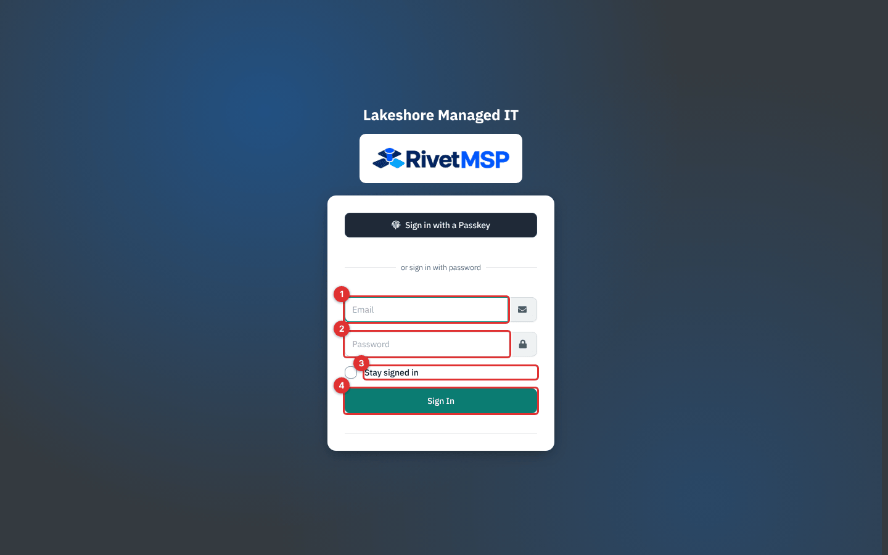

*Figure 1 — The sign-in page that clients and technicians share.*

1. **Email (1).** The contact's e-mail address (the one on the contact record).
2. **Password (2).** The password you set, or one the client chose with the reset page.
3. **Stay signed in (3)** keeps the session for later visits.
4. **Sign In (4).** Takes a contact to the portal, and a technician to the service desk.

A **Forgot password?** link appears under the form only when outgoing mail is set up (an SMTP host or a mail provider in Administration → **Settings** → **Mail**). The demo has no mail server, so it is not drawn in Figure 1. The link opens the page in Figure 2.

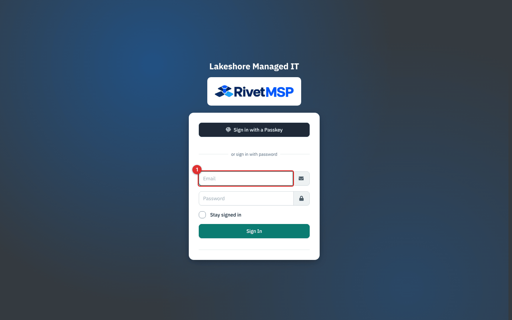

*Figure 2 — Password reset request. The page always answers "If your account exists, a reset link is on it's way" so it never reveals which addresses exist.*

1. **Registered Client Email (1).** Type the address of the login.
2. **Reset my password (2).** Queues an e-mail built from the **Client portal password reset** template (Administration → **Settings** → **Email templates**). The link in it asks for a new password of at least 8 characters, and works once.

If the same e-mail address belongs to both a technician and a contact, sign-in asks **Log in as Agent** or **Log in as Client**. In this guide, "agent" in that button means technician.

> **Note:** If **Login key required** is on in your security settings, the e-mail box reads "Client Email" instead of "Email" until the link carries the key.

### The home page

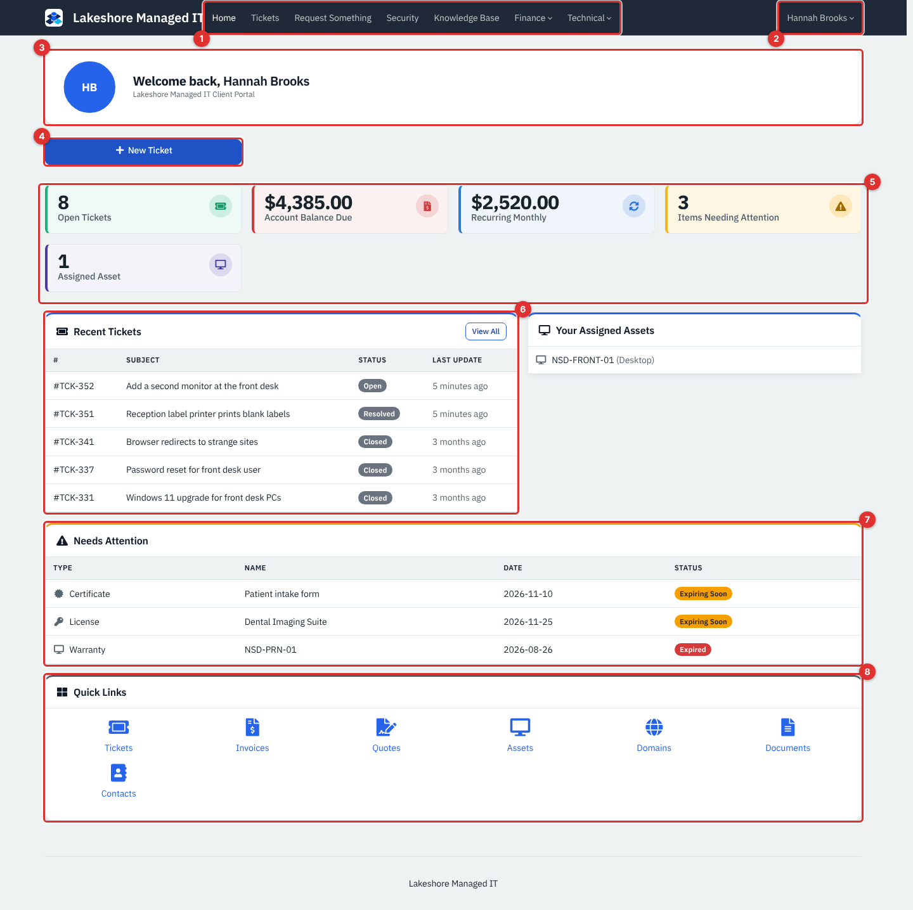

*Figure 3 — The home page for Hannah Brooks, who is a billing and technical contact at Northshore Dental Group. Example data.*

1. **Top menu (1).** **Home**, **Tickets**, **Request Something**, **Security** (only while something is published), **Knowledge Base** (only when the knowledge base is on), **Finance** and **Technical** (see [Who sees what](#who-sees-what)), then any custom links you add under Administration → **Tags & categories** → **Custom links** with the portal location.
2. **Account menu (2).** **Account** (the profile page) and **Sign out**.
3. **Welcome banner (3).** Shows the contact's photo or initials and the portal name.
4. **New Ticket (4).** Opens the new ticket form.
5. **Tiles (5).** **Open Tickets** (this contact's tickets that are not closed); **Account Balance Due** and **Recurring Monthly** (billing contacts); **Items Needing Attention** and **Assigned Assets** (technical contacts). The balance is all non-draft, non-cancelled invoices minus payments, and the tile turns green at zero.
6. **Recent Tickets (6).** The five latest tickets this contact opened.
7. **Needs Attention (7).** For technical contacts: domains, certificates, licences and asset warranties that expire within 45 days (**Expiring Soon**) or already have (**Expired**).
8. **Quick Links (8).** Shortcuts to the pages this contact may open.

## Common tasks

### Give a contact a portal login

1. Open the client and go to **Contacts**. Use the row's **Action** menu → **Edit**, or **New Contact**.
2. Open the **Access** tab.
3. Under **Client Portal**, choose **Using Set Password** (a password you type, or generate with the **?** button), **Using Azure Credentials** (Microsoft 365 sign-in), or **Using Single Sign-On** (shown only when single sign-on is switched on). **- No Access** removes the login.
4. Tick **Billing** and **Technical** as needed. The **Primary** contact is chosen on the **Details** tab.
5. Optionally tick **Send user e-mail with login details?** and **Save**. The e-mail is sent only when outgoing mail is set up. It tells the contact to use the reset page when you left the password empty, or gives the password you typed.

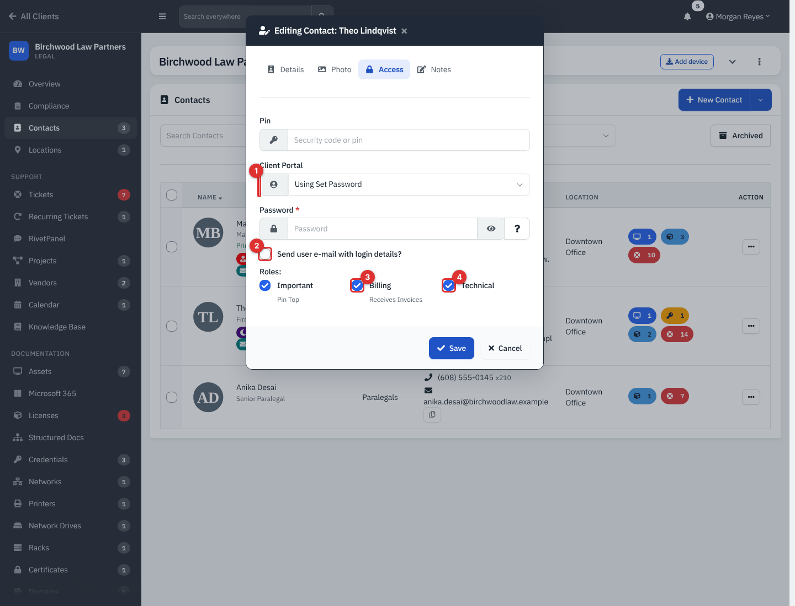

*Figure 4 — The **Access** tab of a contact. Example data.*

1. **Client Portal (1).** The kind of login.
2. **Send user e-mail with login details? (2).**
3. **Billing (3)** and **Technical (4)** decide which menus the contact gets.

If the password box is left empty for a new login, a random password is stored and the contact has to use the reset page. Archiving a contact switches the login off (see [Clients, contacts and locations](03-clients-contacts-locations.md)).

### Who sees what

| Contact | Top menu | Home tiles |
|---|---|---|
| **Primary** | Everything, including **Finance** and **Technical** | All |
| **Billing** | **Finance** (when invoicing is on) | **Account Balance Due**, **Recurring Monthly** |
| **Technical** | **Technical** (when documentation is on) | **Items Needing Attention**, **Assigned Assets** |
| None of these | **Home**, **Tickets**, **Request Something**, **Security**, **Knowledge Base** | **Open Tickets** only |

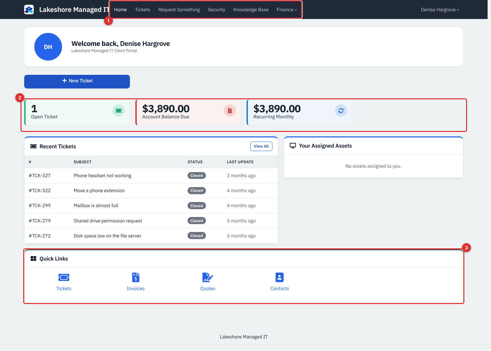

*Figure 5 — A billing-only contact (Granite Peak Manufacturing). Menu (1), tiles (2) and quick links (3) match the ticks.*

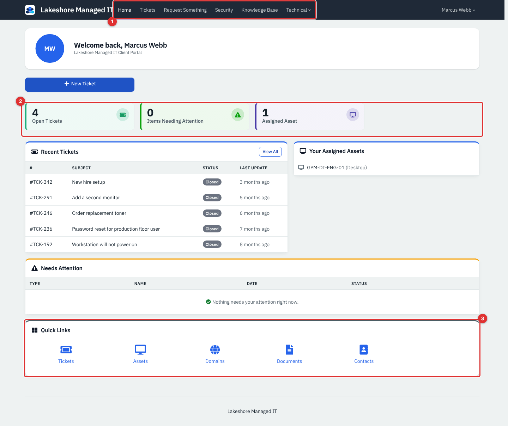

*Figure 6 — A technical-only contact.*

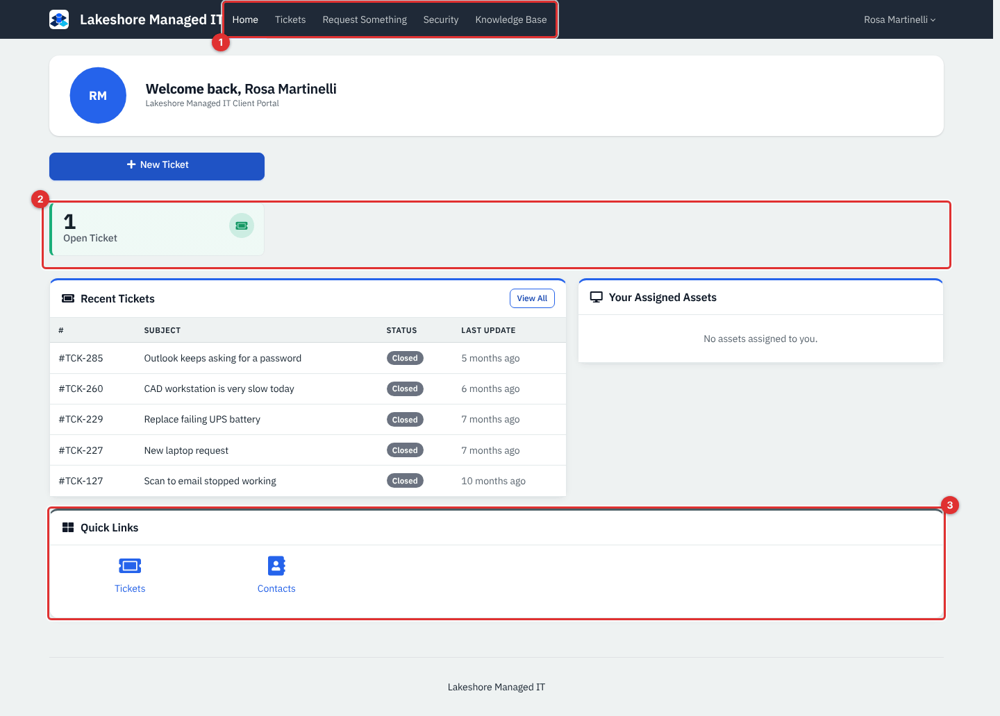

*Figure 7 — A contact with no ticks sees tickets, the request menu and the knowledge base only.*

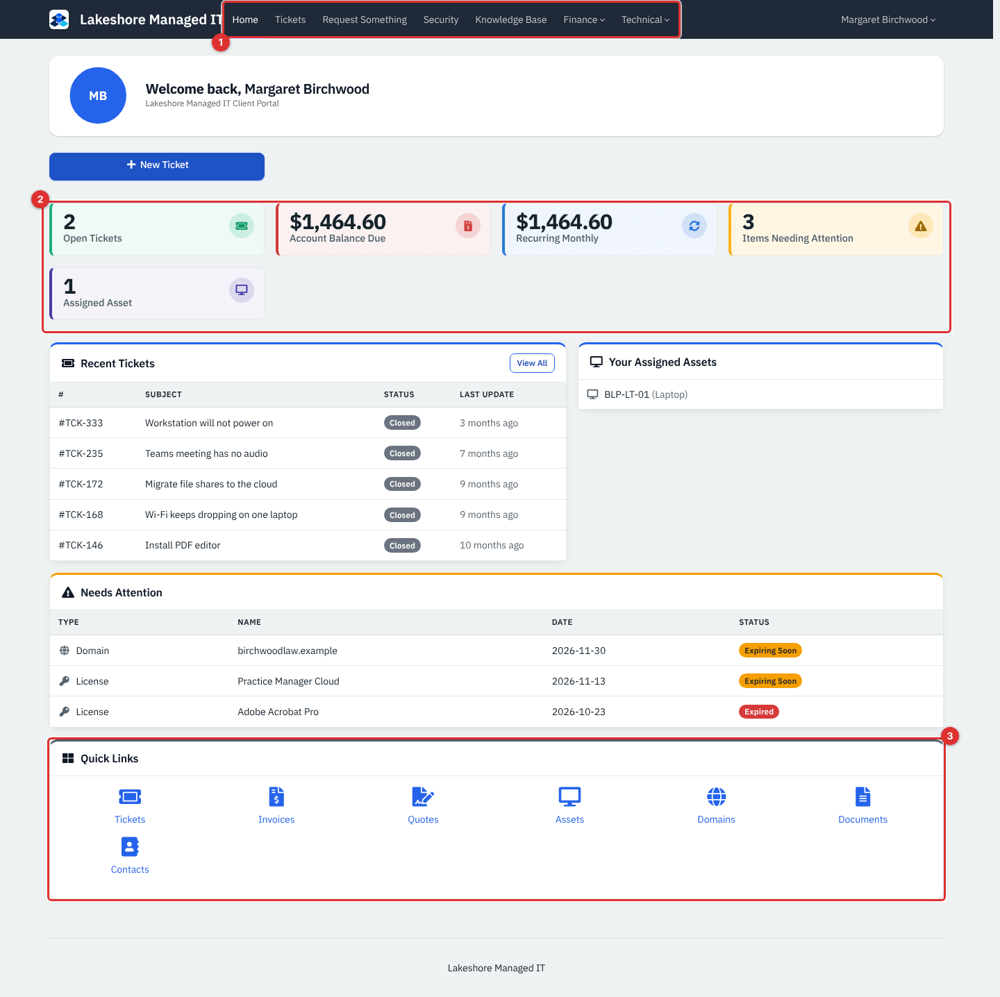

*Figure 8 — A primary contact sees everything the client has.*

> **Note:** A contact who opens a page their role does not allow (for example a billing-only contact typing the address of **Assets**) is signed out and sent to the sign-in page, not shown a "not allowed" message.

### Raise and follow a ticket

1. Choose **Tickets** → **New Ticket** (or **New Ticket** on **Home**).
2. Enter a **Subject**, a **Priority** (**Low**, **Medium** or **High**; **Medium** is the default), optionally a **Category**, and an **Asset** (shown only when assets are assigned to that contact). Describe the problem in **Details**. All three starred fields are required.
3. Click **Raise ticket**. It arrives in your queue with source **Portal**.

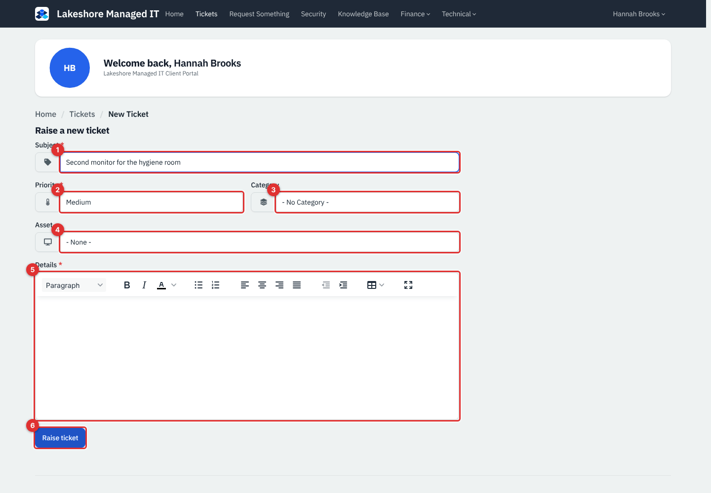

*Figure 9 — New ticket. Asset (4) appears only when the contact has assets assigned.*

If no **Category** is chosen the ticket gets the default client ticket category. If **New ticket notification e-mail** is set in Ticket Settings, that address is told.

**Tickets** shows the contact's own tickets: **Open**, **Closed** or **All**, with counts. Primary and technical contacts also get **All Company Tickets**, which lists every ticket of the client with a **Ticket Status** filter and a **Contact** column.

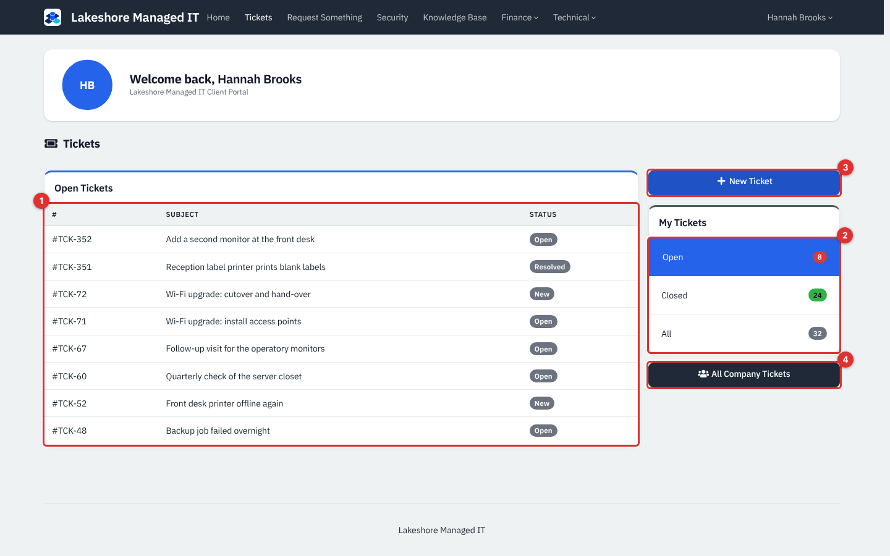

*Figure 10 — The Tickets page.*

1. **List (1)** of ticket number, subject and status.
2. **My Tickets (2).** Open, Closed and All counts.
3. **New Ticket (3).**
4. **All Company Tickets (4).** Primary and technical contacts only.

Open a ticket to see its state, priority, category, task progress (**Tasks: 0 / 2**), the technician and the **public** conversation. Internal notes never show. Reply with the editor and **Reply**; up to the app's allowed file types can be attached. A **Live Chat** box appears when **Show Live Chat on Tickets** is on in Administration → **Settings** → **Modules**.

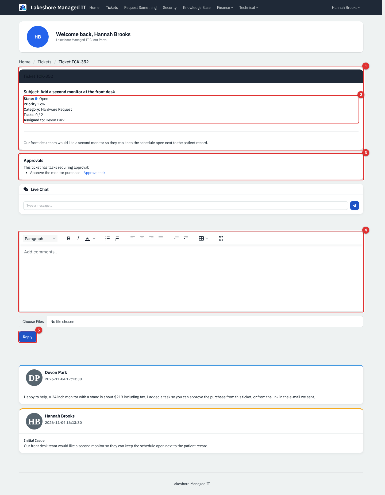

*Figure 11 — A ticket. Header (1), state and tasks (2), Approvals (3), reply editor (4) and Reply (5). Example data.*

> **Note:** In this release the ticket header bar shows the ticket number in dark text on a dark bar, so it is hard to read. The number is repeated in the breadcrumb above it.

**Approvals (3).** When a technician adds a task with a **client** approver, the ticket lists the task with **Approve task**. A primary contact can always approve; others can when the approver type is **any**, or matches their **technical** or **billing** tick. Otherwise the page says to ask your technical or billing contact. The same approval can be done without signing in from the e-mail link (see [Guest links](33-guest-links.md#approve-a-task)).

When a technician marks the ticket resolved, the reply form is replaced by **Your ticket has been resolved**:

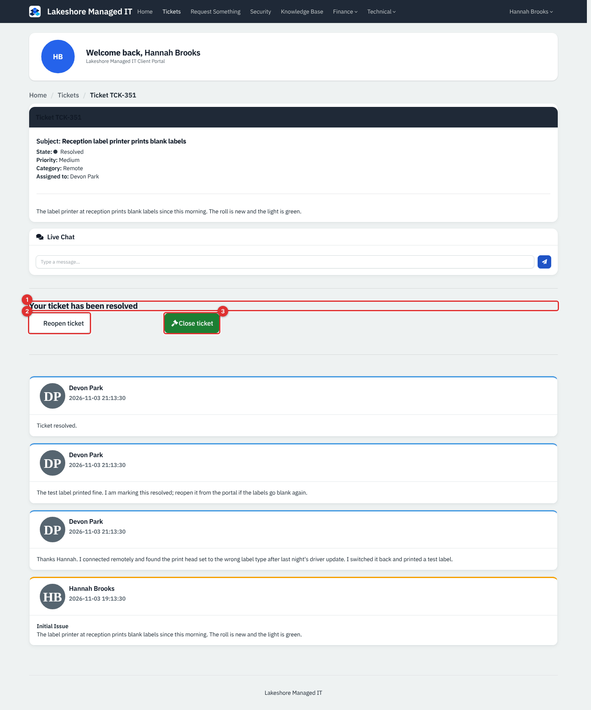

*Figure 12 — Resolved. **Reopen ticket** (2) puts it back in your queue; **Close ticket** (3) ends it.*

A contact can also click **Resolve ticket** on an open ticket when every task is done. After closing, a contact is asked **How did we do?** if **Ticket CSAT** is on:

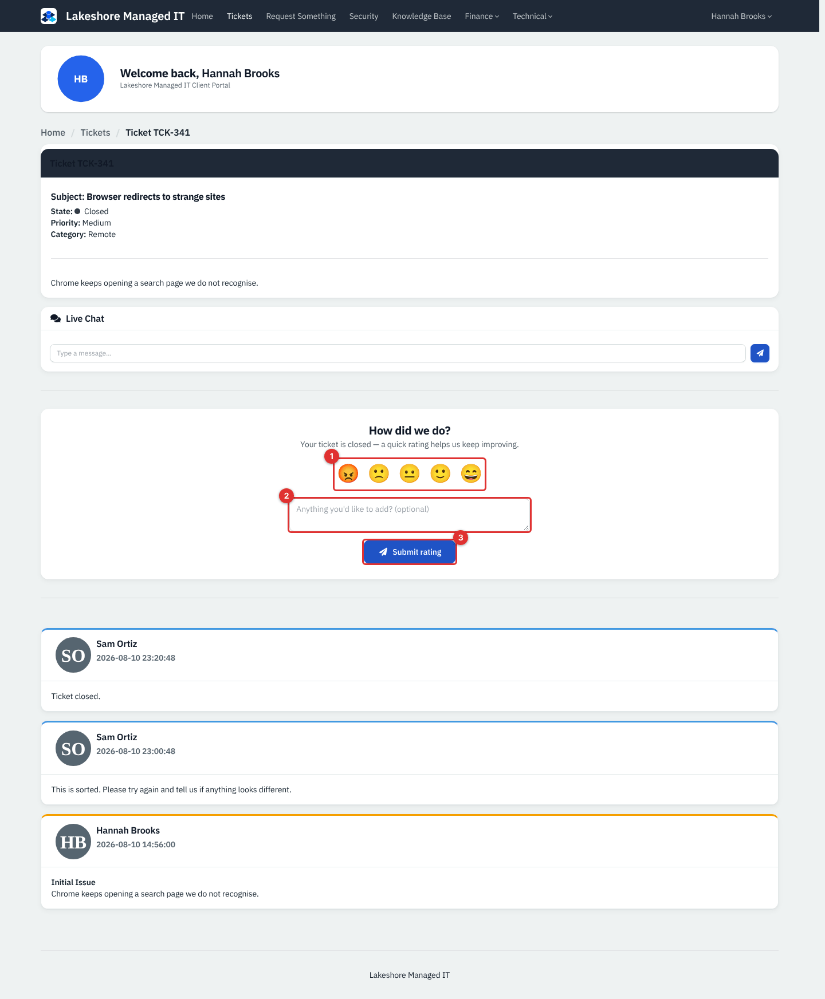

*Figure 13 — Rating a closed ticket: five faces (1), optional comment (2), **Submit rating** (3). A low rating reopens the ticket.*

A rating of 4 or 5 shows **Leave us a Google review** when a review link is set in Ticket Settings. Details are in [Recurring tickets, catalog, CSAT and requests](07-recurring-tickets-catalog-csat-requests.md).

### Request something from the menu

**Request Something** lists the items you publish under Administration → **Templates** → **Service catalog**. Picking one opens the ticket form with subject, category and priority already filled in. Items that **Needs approval** hold the ticket until a technician releases it. **Something else** opens a blank form. Shelves above the cards show what is **Popular this month** and **Recently used by you**.

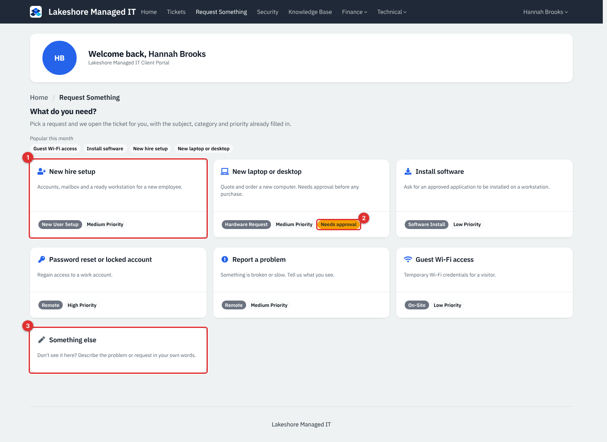

*Figure 14 — Request Something: a card (1), the **Needs approval** badge (2) and **Something else** (3).*

### Finance: invoices, quotes and saved cards

Primary and billing contacts get a **Finance** menu when invoicing is on.

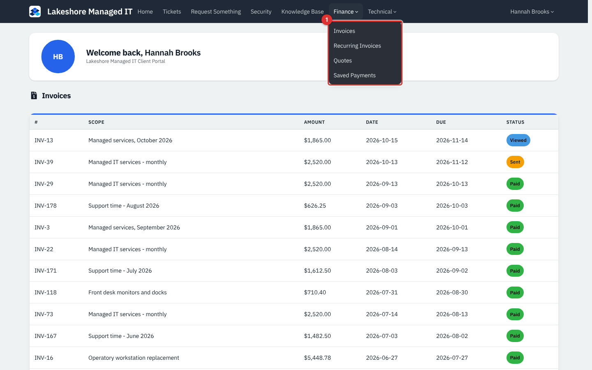

*Figure 15 — **Invoices**, **Recurring Invoices**, **Quotes** and **Saved Payments**.*

- **Invoices.** Every invoice except drafts, newest first, with **Scope**, **Amount**, **Date**, **Due** and a coloured **Status** (**Sent**, **Viewed**, **Partial**, **Paid**, **Cancelled**). A due date turns red and bold one day after it passes while the invoice is unpaid. The number opens the invoice's guest page in a new tab (see [Guest links](33-guest-links.md#invoices)).

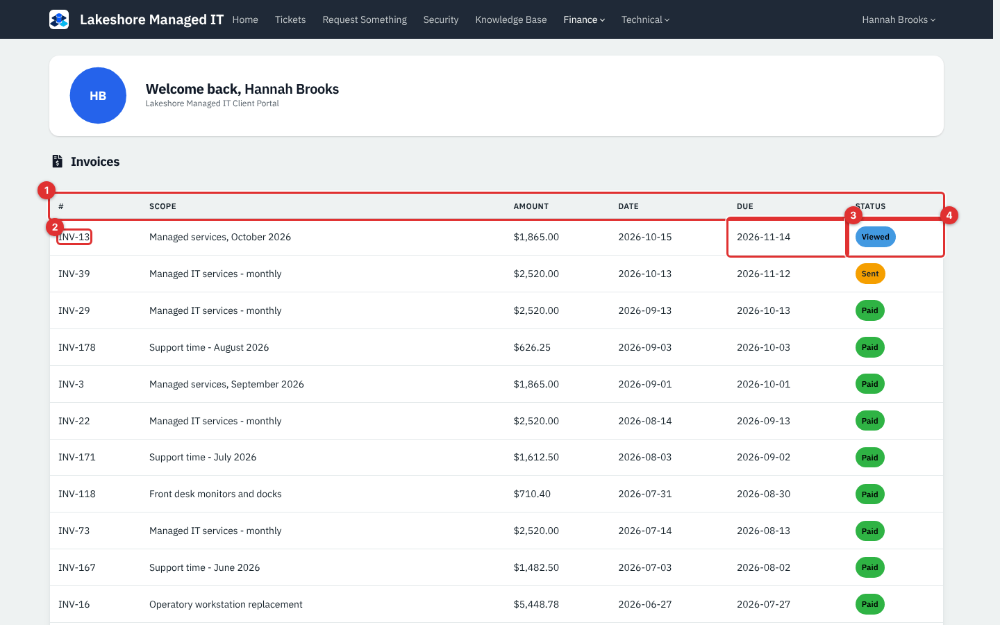

*Figure 16 — Invoices: columns (1), invoice number link (2), due date (3), status (4).*

- **Unpaid invoices.** The **Account Balance Due** tile opens this list when the balance is above zero. Each row has a **Pay** button when a payment provider is active and the invoice is under the provider's amount limit (0 means no limit). **Pay** offers **Enter Card Manually** and, if a card is saved, **Pay with a Saved Card**.

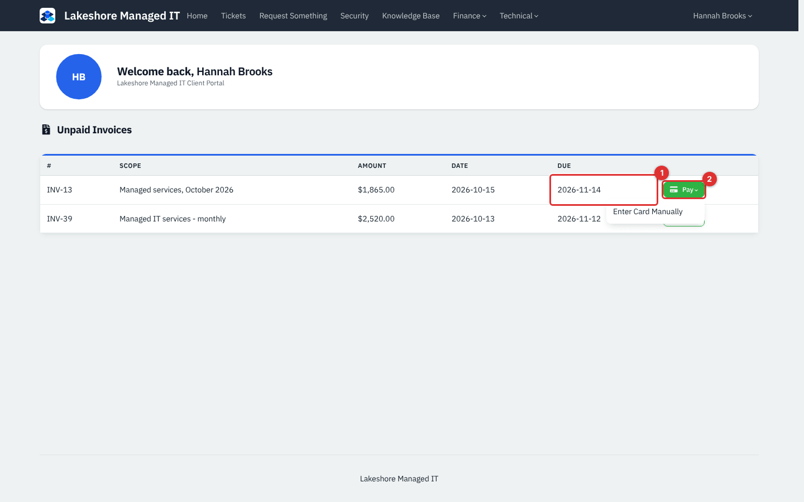

*Figure 17 — Unpaid invoices with **Pay** (2) open. Example data, not a live connection to Stripe.*

- **Recurring Invoices.** Active recurring invoices with **Scope**, **Amount**, **Next Bill Date** and **Frequency**. With a provider on, an **Auto Pay** column lets the contact pick a saved card or **Disabled**.

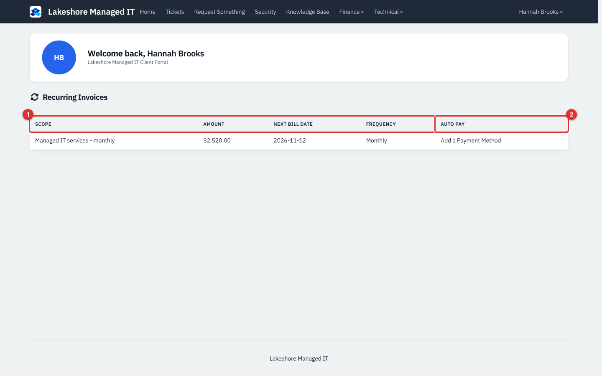

*Figure 18 — Recurring invoices. Auto Pay (2) offers **Add a Payment Method** until a card is saved.*

- **Quotes.** Quotes that are not drafts, with a status of **Sent**, **Viewed**, **Accepted**, **Declined** or **Invoiced**. The number opens the quote's guest page, where the client accepts or declines.

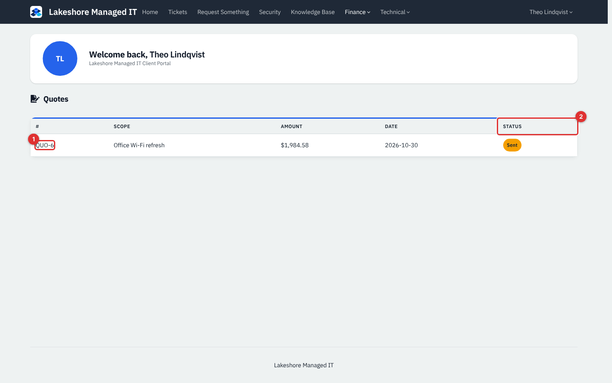

*Figure 19 — Quotes for Birchwood Law Partners, seen by their billing and technical contact.*

- **Saved Payments.** The first visit asks the contact to tick **I grant consent for automatic payments**, which creates a customer record at Stripe; after that cards can be added and removed.

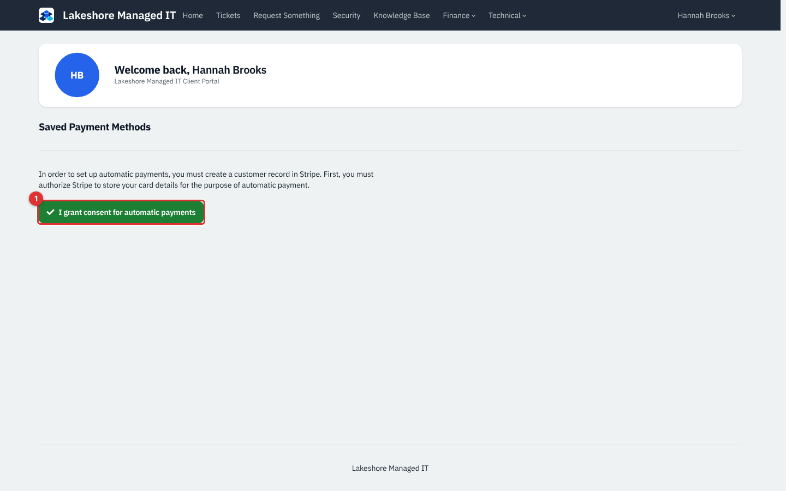

*Figure 20 — Saved payment methods, before consent (1). The page shows an error line instead if no Stripe provider with keys is set up. Not verified on a live service.*

### Technical: your assets and documents

Primary and technical contacts get a **Technical** menu when documentation is on.

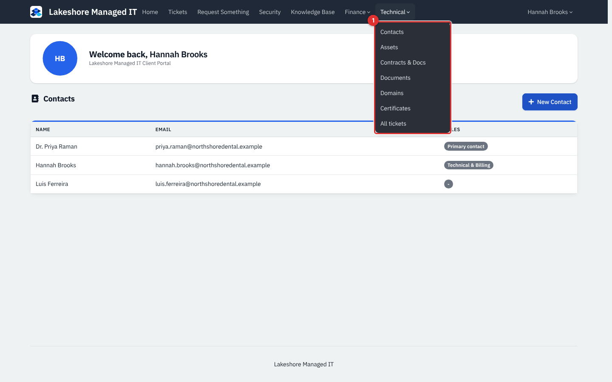

*Figure 21 — The **Technical** menu.*

- **Contacts.** Everyone at the client, with **Roles** (**Primary contact**, **Technical & Billing**, **Technical**, **Billing**). **New Contact** adds a colleague.

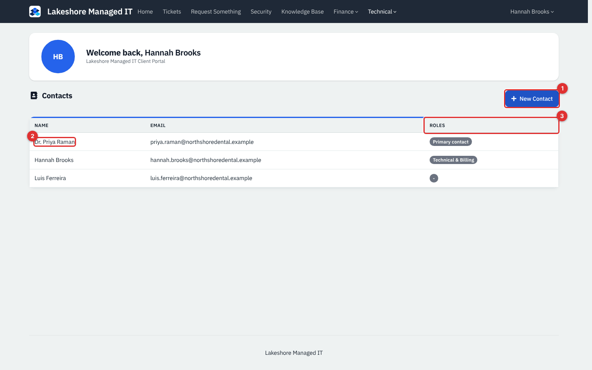

*Figure 22 — Contacts: New Contact (1), a name that opens the edit form (2), Roles (3).*

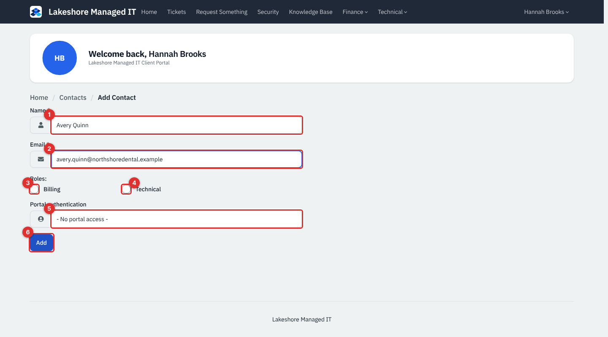

*Figure 23 — Add Contact: Name (1), Email (2), Billing (3), Technical (4), Portal authentication (5), **Add** (6).*

Only a **primary** contact can tick **Billing** or **Technical** for someone else; a technical contact's ticks are ignored. The primary contact and archived contacts cannot be edited here, and a technical contact cannot edit someone who holds billing or technical rights. The e-mail must not already belong to a login.

> **Note:** The **Portal authentication** list defaults to **- No portal access -**, but the portal needs a real choice (**Local (Email and password)**, or Azure when it is set up). Leaving the default shows "Invalid authentication method" and nothing is saved. A contact added here has a random password and uses the reset page to set one.

- **Assets** (name, type, model, serial, assigned contact, purchase date, warranty, status, link).

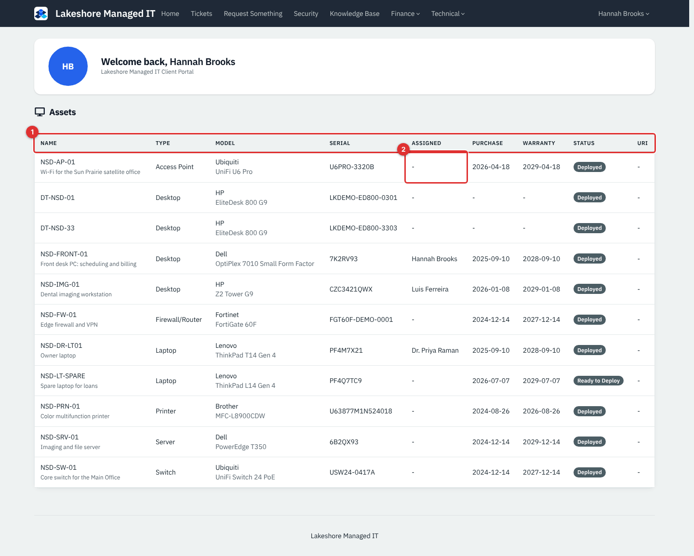

*Figure 24 — Assets: columns (1) and the warranty date (2).*

- **Documents.** Only documents marked client-visible. **New Document** writes a text document; **Upload File** accepts PDF, Word, text, Markdown, ODT and RTF.

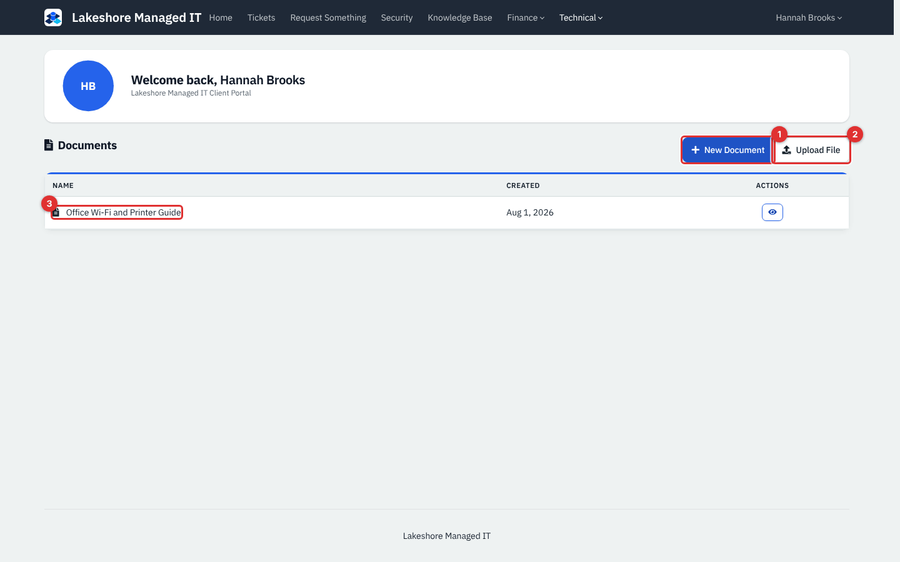

*Figure 25 — Documents: New Document (1), Upload File (2), a document (3).*

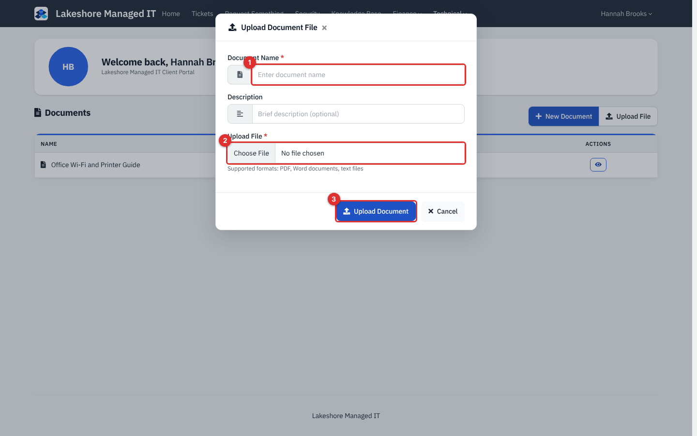

*Figure 26 — Upload Document File: name (1), file (2), **Upload Document** (3).*

- **Contracts & Docs.** Each active or past contract with its type, status, dates and attached files (**View / Download**).

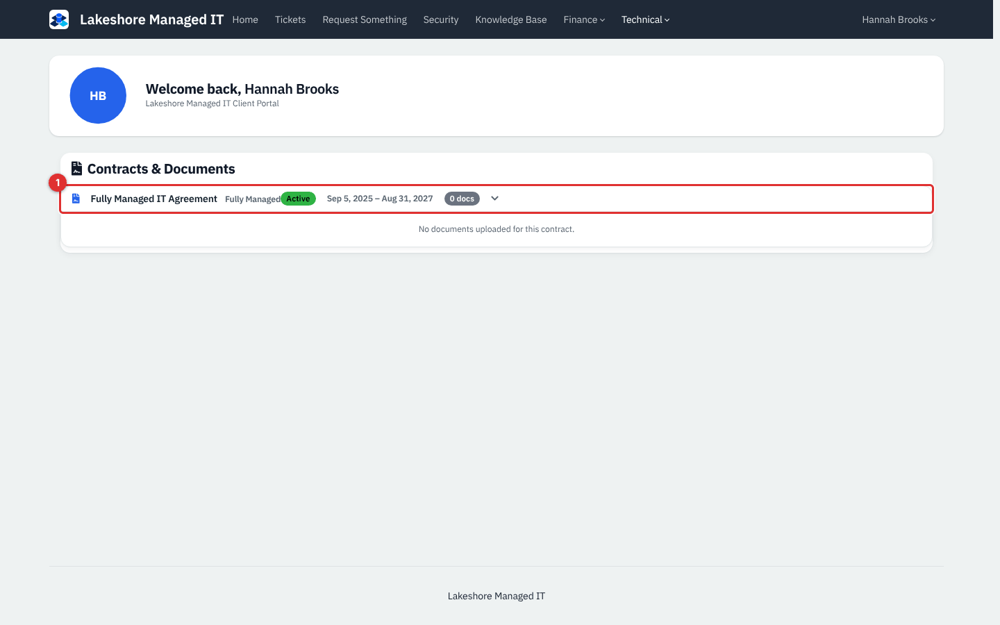

*Figure 27 — A contract (1). The demo contract has no uploaded files.*

- **Domains** and **Certificates** list names and expiry dates; anything within 30 days is highlighted.
- **All tickets**, described above.

### Security, Knowledge Base and the profile

**Security** appears only while a compliance snapshot is shared. It shows **Your compliance** (shared from [Client compliance](04-client-workflows-and-compliance-per-client.md)) and **Our security posture** (shared by an administrator), each with score tiles, **Technical controls** and **Policies and reviews**. It is a self-assessment, not a certification.

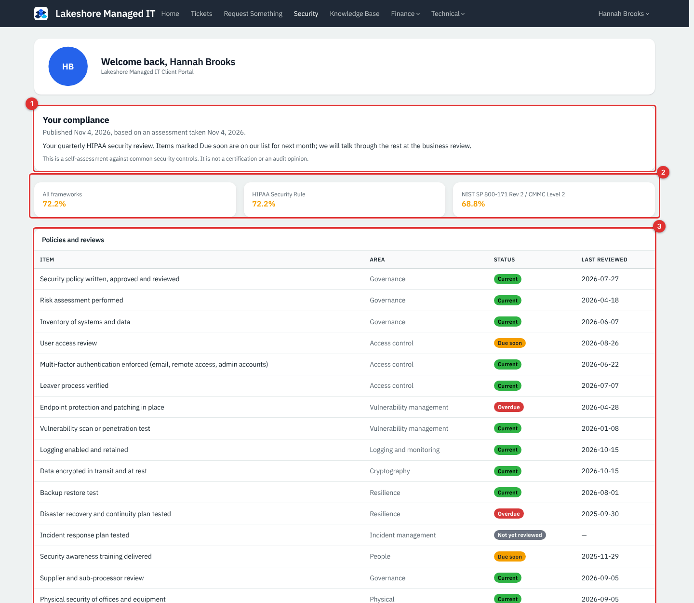

*Figure 28 — Security: summary (1), score tiles (2) and Policies and reviews (3).*

**Knowledge Base** shows articles marked visible to clients: company-wide ones (**Central** badge) and ones written for that client, grouped by category, with search.

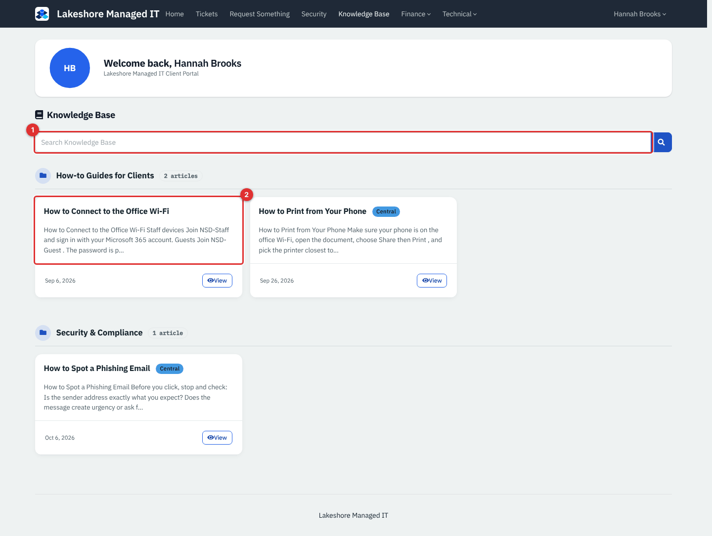

*Figure 29 — Knowledge Base: search (1) and an article (2).*

The **Account** page shows the contact's name, e-mail, PIN, client and roles, and how they signed in. Contacts who use a set password can change it here (at least 8 characters).

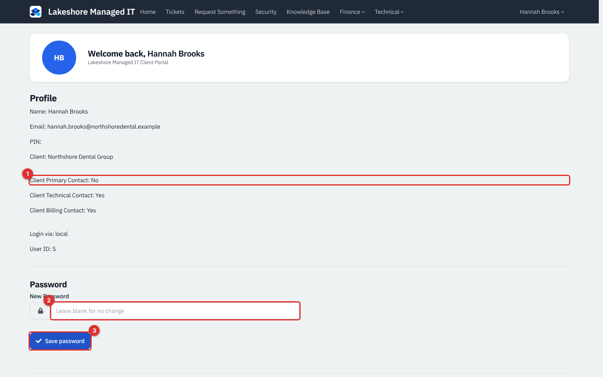

*Figure 30 — Account: roles (1), New Password (2), **Save password** (3).*

> **Note:** The **PIN** printed on this page is the contact's phone-verification PIN from the contact record; it is not a sign-in secret but is visible to the signed-in contact.

### Brand the portal

Administration → **Settings** → **General** → **Client Portal Branding** applies to every client: a **Portal logo** (JPG or PNG), a **Portal display name** (navbar, tab title, footer) and a **Portal accent color** (6-digit hex). Blank fields fall back to your company logo, name and the theme accent.

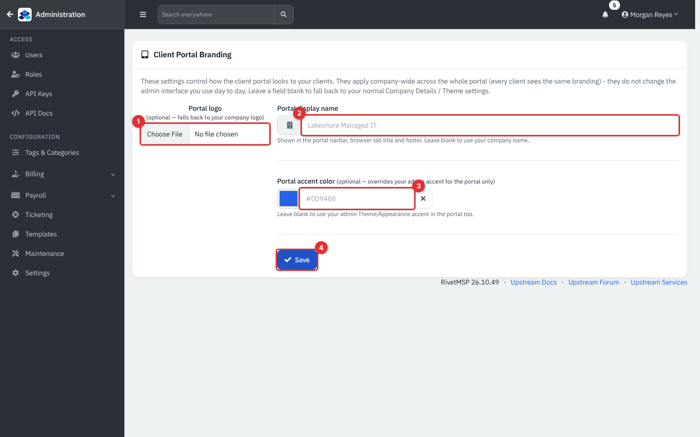

*Figure 31 — Branding: logo (1), display name (2), accent colour (3), **Save** (4).*

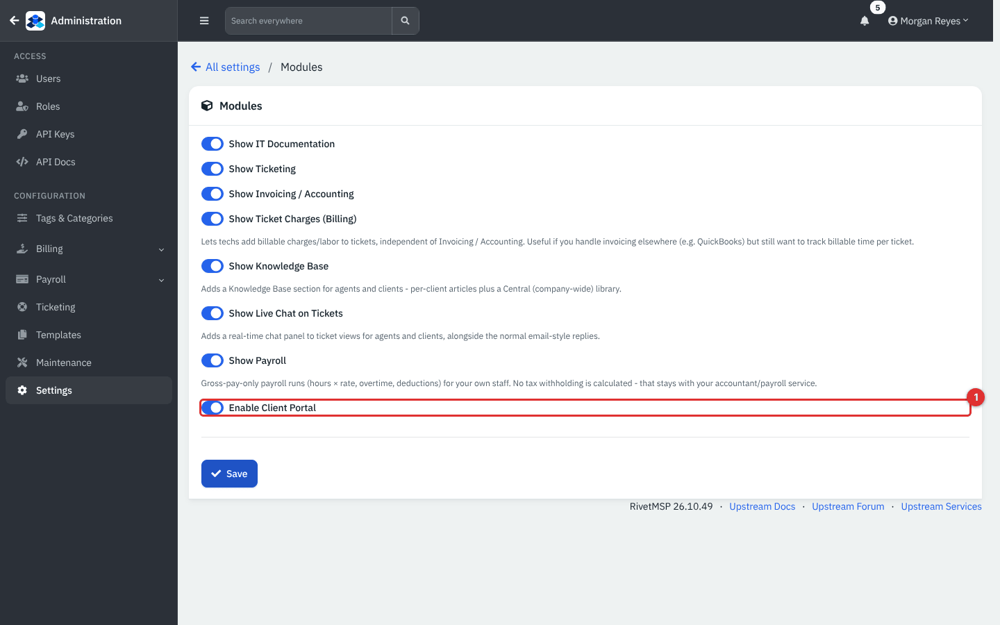

*Figure 32 — **Enable Client Portal** (1) on the Modules page.*

### Single sign-on

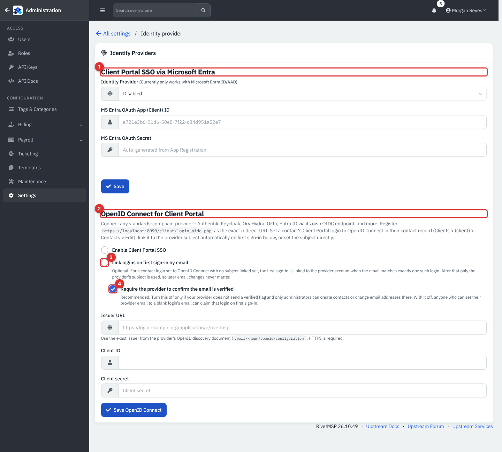

*Figure 33 — Identity providers: Microsoft Entra (1), OpenID Connect (2), **Link logins on first sign-in by email** (3), **Require the provider to confirm the email is verified** (4).*

- **Microsoft Entra.** Enter the **MS Entra OAuth App (Client) ID** and secret. The sign-in page then shows **Login with Microsoft Entra** for contacts set to **Using Azure Credentials**.
- **OpenID Connect.** Tick **Enable Client Portal SSO**, enter **Issuer URL**, **Client ID** and **Client secret**, and register `https://<your address>/client/login_oidc.php` as the redirect address. The sign-in page then shows **Single Sign-On**. Set the contact's login to **Using Single Sign-On**. **Link logins on first sign-in by email** ties the first sign-in to the contact with the same address; keep **Require the provider to confirm the email is verified** on unless your provider cannot send that flag.

Neither flow was tested against a live provider for this guide.

## Reference

### Portal pages and who may open them

| Page | Primary | Billing | Technical | Needs |
|---|---|---|---|---|
| Home, Tickets, New ticket, Request Something, Account, Knowledge Base | Yes | Yes | Yes | Knowledge base on for **Knowledge Base** |
| Invoices, Unpaid invoices, Recurring, Quotes, Saved payments | Yes | Yes | No | Invoicing on |
| Contacts, Assets, Contracts & Docs, Documents, Domains, Certificates, All Company Tickets | Yes | No | Yes | Documentation on for the menu |
| Security | Yes | Yes | Yes | A published snapshot |

### Settings that change the portal

| Setting | Where | Effect |
|---|---|---|
| **Enable Client Portal** | Settings → Modules | Off = no contact can sign in |
| **Show Live Chat on Tickets** | Settings → Modules | **Live Chat** box on tickets |
| **Ticket CSAT** | Ticket Settings | **How did we do?** after closing |
| Knowledge Base module | Settings → Modules | **Knowledge Base** menu |
| Client Portal Branding | Settings → General | Logo, name, accent |

## Tips and good practice

- Give every client one primary contact and at least one billing and one technical contact, so the right menus appear.
- Use **Items Needing Attention** in your own reviews: it is the same 45-day window the client sees.
- Prefer single sign-on for clients that use Microsoft 365; it removes password resets.
- Test a new client's login yourself with a throw-away contact, then archive it.
- Mark only documents you want the client to read as client-visible.

> **Note:** Reset e-mails and the welcome e-mail build their links with `https://`. A site served over plain http, as the demo is, needs HTTPS in front before those links work.

## Related guides

- [Clients, contacts and locations](03-clients-contacts-locations.md)
- [Client workflows and compliance](04-client-workflows-and-compliance-per-client.md)
- [Service desk tickets](05-service-desk-tickets.md)
- [Guest links](33-guest-links.md)
