# Users, roles and sign-in security

The Administration area is where administrators decide who can sign in to RivetMSP, what each person can do, which clients each technician can see, and how sign-in is protected. It also holds the two logs that answer "who did what": the **Audit log** and the **Audit trail**.

| | |
|---|---|
| **Where to find it** | Select your name at the top right, then **Administration**. In the Administration sidebar, **Users** and **Roles** are under **ACCESS**. **Settings** opens a directory with **Security** under **Access & communication**. **Maintenance** opens a directory with **Audit log** and **Audit trail**. Your own sign-in options are under your name → **Account** → **Security**. |
| **Who can use it** | Administrators only: people whose role has **Admin Access: Yes**. Other people do not see the **Administration** item. The permission levels described below are what the people you manage can do, not what you need to manage them. Your own **Account** pages are open to every technician. |
| **Turn it on** | Nothing to switch on. Some role rows only matter when their feature is on (for example Knowledge Base and the Endpoints rows). |

## What it's for

- **Users**: add technicians, give each one a role, limit them to some clients, reset passwords and two-factor sign-in, and disable or archive people who leave.
- **Roles**: what each kind of person can see and change, with one level per module.
- **Security**: the login message and key, session lengths, who must use two-factor sign-in, staff password rules, vault limits and the encryption key panel.
- **Audit log and Audit trail**: a searchable record of user actions, and a tamper-evident record of sign-ins, setting changes and similar events.

This page is about the people who work for your company (technicians, billing staff, administrators). Your clients' own people sign in to the client portal; see [Client portal](32-client-portal.md).

## A quick tour

Only administrators see **Administration** in the name menu.

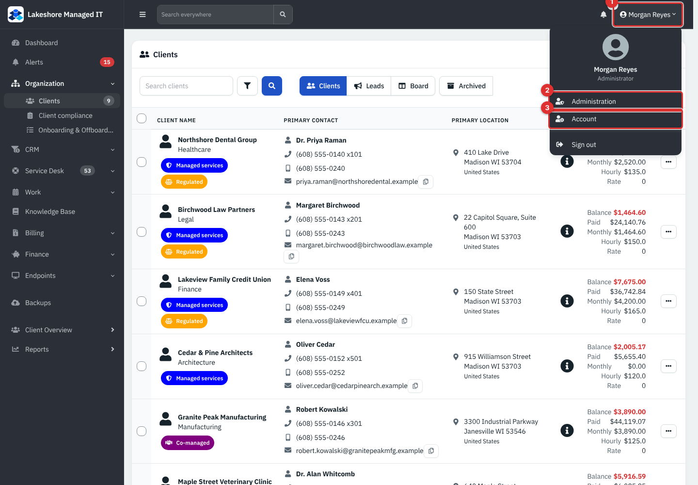

*Figure 1 — Select your name (1) to open the menu. **Administration** (2) opens the Administration area. **Account** (3) opens your own details and security pages.*

The Users page is the start of the Administration area (the area opens on it).

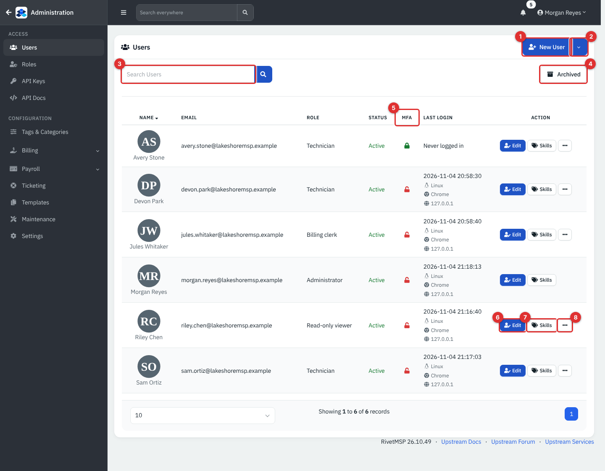

*Figure 2 — Administration → Users. (1) New User. (2) The arrow next to it opens Export and IR. (3) Search by name or email. (4) Archived switches between current and archived people. (5) The MFA column. (6) Edit. (7) Skills. (8) The row menu. Example data.*

The list shows **Name**, **Email**, **Role**, **Status**, **MFA**, **Last Login** and **Action**. You can sort by name, email, role and status.

- **Status** is **Active** (green) or **Disabled** (red). A blue **Invited** label exists in the code, but nothing in the current screens sets it.
- **MFA** shows a green closed padlock when the person has set up an authenticator app and a red open padlock when not. A passkey does not change the icon.
- **Last Login** shows the date, system, browser and address of the latest sign-in, or **Never logged in**. It is read from the activity log, so it follows the log retention setting.
- On your own row there is **Edit** and **Skills**, but no row menu: you cannot disable or archive yourself.

## Common tasks

### Add a user

1. Go to **Administration → Users** and select **New User**.
2. On the **Details** tab, fill in **Name**, **Email** (it is also the sign-in name) and **Role**. The role decides what the person can do; see [Roles and permissions](#roles-and-permissions).
3. Enter a **Password**. The minimum length comes from the sign-in policy (12 by default), and it cannot match the person's name or email address. The eye button shows the password and the dice button fills in a readable random one.
4. Tick **Force MFA on next login** if the person must set up an authenticator app straight away.
5. Optionally choose an **Avatar** (jpg, jpeg, gif, png or webp).
6. Open the **Access** tab to limit the person to some clients (next task). Leave every box empty for all clients.
7. Select **Create**. The person can sign in at once.

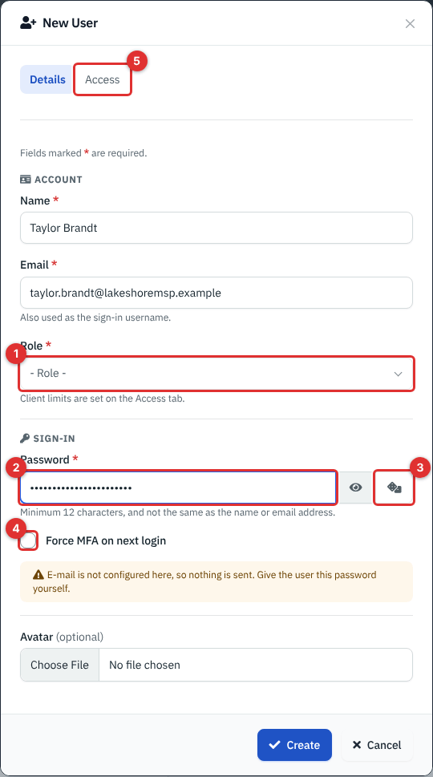

*Figure 3 — The New User pop-up. (1) Role. (2) Password. (3) The dice button makes a random password. (4) Force MFA on next login. (5) The Access tab.*

When outgoing mail is set up, a tick box offers to email the person a welcome message with the sign-in link. The password is never included, so hand it over separately. When mail is not set up, the pop-up says so and nothing is sent. A second user with the same email address is refused.

**Note.** Create users and set passwords while you are signed in with your password rather than a passkey. The new person's vault key is made from your unlocked session. See [Credentials and the vault](14-credentials-and-vault.md).

### Limit a person to some clients

By default every technician can open every client. To limit someone, open **Edit** on their row and choose the **Access** tab.

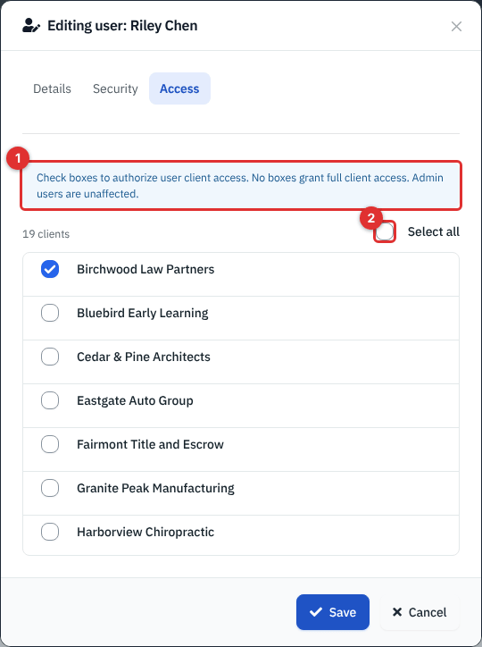

*Figure 4 — The Access tab. (1) The explanation: boxes grant access, no boxes means every client, administrators are not affected. (2) Select all. Below it, one tick box per active client. Example data.*

| Ticks | What the person sees |
|---|---|
| None | Every client. |
| One or more | Only the ticked clients, in lists, search, the client sidebar and reports built on the client list. Opening another client's page sends the person back to the Clients list with "Access Denied - You do not have permission to access that client!". |
| Administrator | Everything; ticks are ignored. |

The allow-list only applies once at least one box is ticked, so ticking every client is not the same as ticking none: a client you add later is not in the list. Archived clients are not shown on the tab. The change takes effect on the person's next click and is written to the Audit trail.

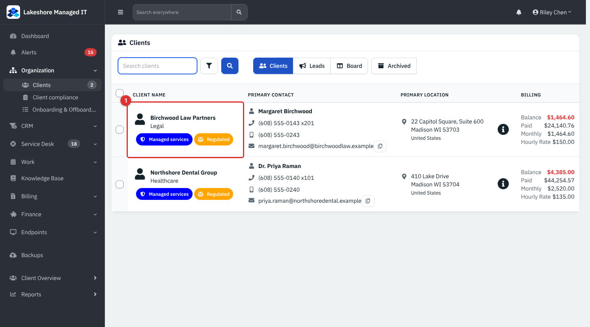

*Figure 5 — What a limited person sees: the Clients list shows only the two allowed clients (1), and the sidebar count says 2.*

### Change a role, password or name

1. Select **Edit** on the person's row.
2. Change **Name**, **Email**, **Role** or **New Password**. Leave **New Password** empty to keep the current one.
3. Select **Save**.

A new role applies on the person's next click; they do not need to sign in again. Changing a role or a password signs out the person's mobile and API tokens. A new password also ends their other sessions and remember-me cookies.

**Note.** Do not change your own role here. The form does not check that another administrator remains.

### Reset a password

- **You set it:** **Edit**, type a **New Password**, **Save**, then give it to the person by phone or in person and ask them to change it.
- **The person changes it:** your name → **Account** → **Security** → **Password**. This needs their current password.
- **Everyone at once:** use **IR**, described below.

There is no "forgot password" email for technicians. The **Forgot password** feature belongs to the client portal.

### Require two-factor sign-in and reset it

**Force MFA on next login** (on the **Details** tab) sends a person who has no authenticator app to a "MFA Enforcement" page straight after they sign in, and they cannot go further until they scan the QR code and enter a code. It has no grace period. For a company-wide rule with a grace period, see [Sign-in policy](#sign-in-policy).

To reset two-factor for someone who lost their phone, open **Edit** → **Security**.

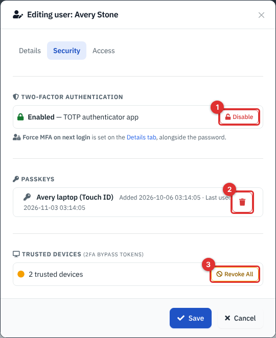

*Figure 6 — The Security tab. (1) Two-Factor Authentication: **Disable** turns it off and removes the person's recovery codes. (2) Passkeys: the trash button deletes one. (3) Trusted Devices: **Revoke All** removes the remember-me cookies so the person must enter a code again. Example data; the passkey is not a real device.*

The **Trusted Devices** block only appears when two-factor is on. The row menu on the Users page offers the same revoke action as **Revoke N Remember Tokens**, when the person has any. Resetting two-factor also signs out the person's mobile and API tokens.

### Skills

**Skills** opens a pop-up with the technician's skill tags. They are matched with a ticket category's required skill when tickets are dispatched automatically. Tags are created under **Administration → Tags & Categories** (type **Technician**). See [Dispatch and scheduling](08-dispatch-scheduling-calendar.md).

### Disable or archive a user

Open the row menu (the three dots) and choose **Disable** or **Archive**.

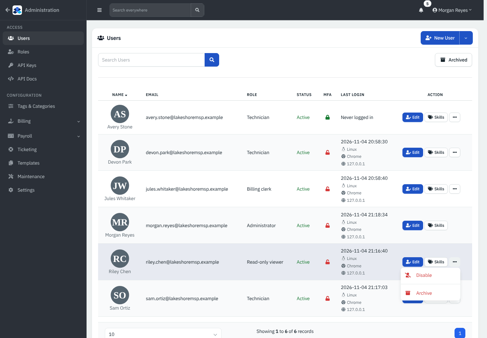

*Figure 7 — The row menu for an active person.*

| | Disable | Archive |
|---|---|---|
| Confirmation | None. It takes effect at once. | A pop-up asks who takes over open tickets and recurring tickets. |
| Can sign in | No. A person who is signed in is signed out on their next click. | No, likewise. |
| Their tickets | Open tickets and recurring tickets become unassigned. | Reassigned to the person you pick, or to **No one**. |
| Mobile and API tokens | Deleted. | Deleted. |
| Name and password | Unchanged. | The name gets " (archived)" added and the password is replaced by one nobody knows. |
| Where they appear | In the list, marked **Disabled**. | Only under **Archived**. |
| Undo | **Activate** in the row menu. | **Restore**. |

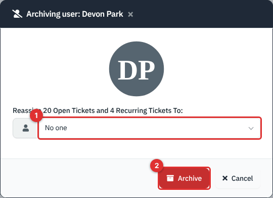

*Figure 8 — Archiving asks who takes over the person's open and recurring tickets (1). **Archive** (2) saves. Nothing is deleted. The ticket counts are from the demo data.*

Nothing deletes a user. Archive people who have left: their tickets, notes and history stay in place.

### Restore an archived user

1. Select **Archived** above the list.
2. Open the row menu and choose **Restore**.
3. Enter a new password, check the **Role** and select **Restore**.

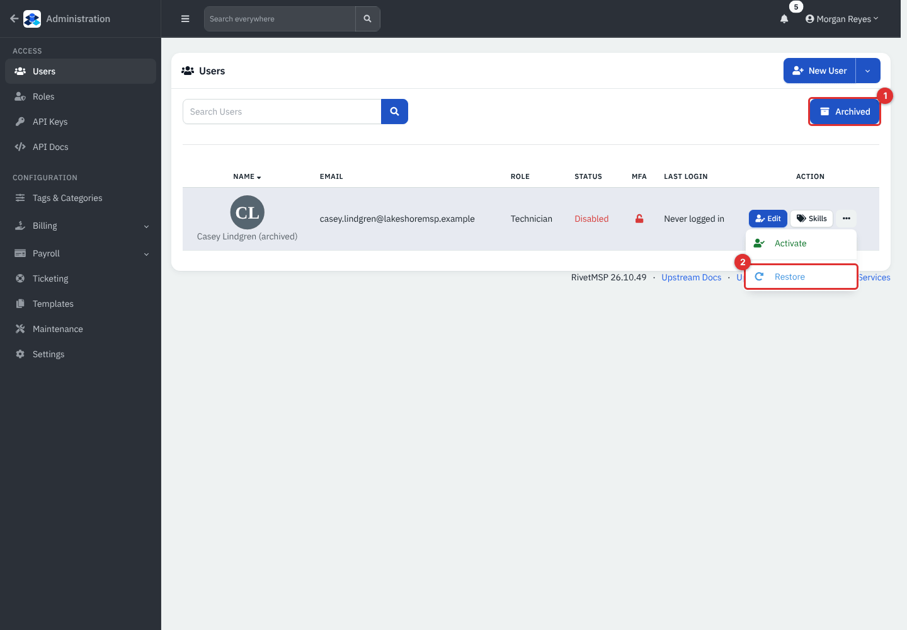

*Figure 9 — The archived view (1). **Restore** (2) brings the person back under their original name.*

**Note.** An archived person's row menu also offers **Activate**. Do not use it: it sets the status to Active but leaves the person archived and unable to sign in. Use **Restore**.

### Export users, and the IR reset

The arrow on **New User** opens two more actions. They appear only when there is more than one user.

- **Export** → **Download CSV** saves a file with **Name**, **Email**, **Role**, **Status** and **Creation Date**. It lists every account, including archived people and client portal logins.
- **IR** (incident response) resets passwords in one step. Enter your own password and select **Reset passwords**. Every account that is not archived, except yours, gets a new random password, and the list of email addresses and passwords appears once on a plain page. Copy it before you leave and pass the passwords on by phone, not email. The reset does not check the account type, so client portal logins are reset too. There is no undo.

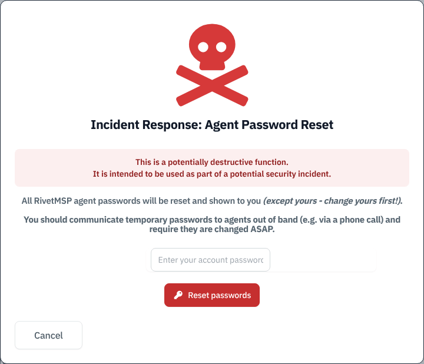

*Figure 10 — The IR pop-up. It asks for your own password and is meant for a security incident. It was not run for this guide.*

## Roles and permissions

A role is a named set of permissions. Every user has exactly one role. **Administration → Roles** lists them.

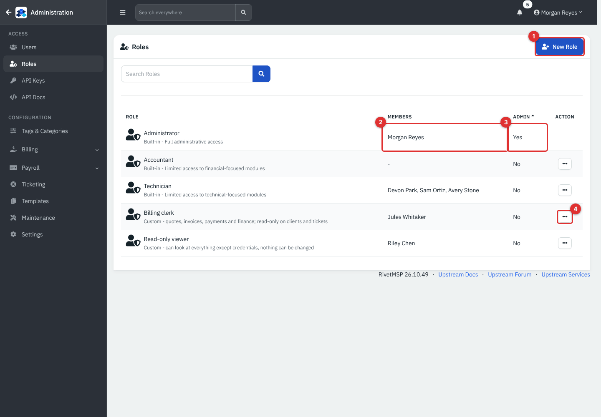

*Figure 11 — The Roles list. (1) New Role. (2) The people in the role. (3) Admin: **Yes** means full access. (4) The row menu has **Edit** and, only for a role with no members, **Archive**. Example data.*

Three roles exist from the start: **Administrator**, **Accountant** and **Technician**. "Built-in" is only a word in their description. You can edit Technician and Accountant like any role you create; only the **Administrator** role (the one with identifier 3) has no **Edit** and no menu. The demo adds two custom roles, **Billing clerk** and **Read-only viewer**.

### Create or edit a role

1. Select **New Role** (or **Edit** on an existing one).
2. On **Details**, enter a **Name** and **Description** and choose **Admin Access**. **No** uses the permissions tab. **Yes** gives full access, including the Administration area, and the permissions tab is hidden or disabled.
3. On **Permissions**, choose a level for each module: **None**, **Read**, **Modify** or **Full**. The line under each row describes the module.
4. Select **Create** (or **Save**). Nothing is saved until you do.

Then give the role to people with **Users → Edit → Role**.

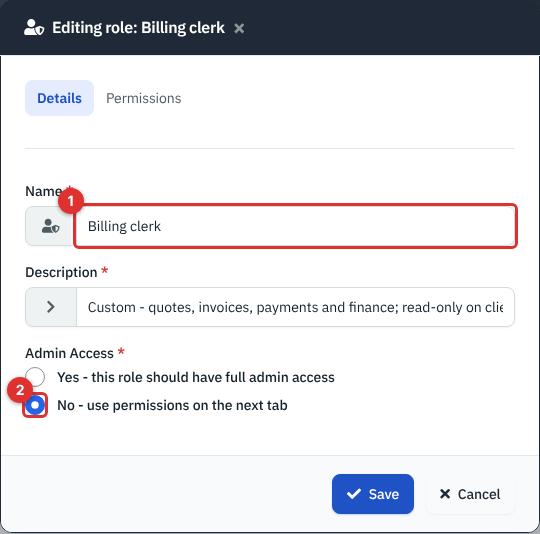

*Figure 12 — Details: the role name (1) and Admin Access (2).*

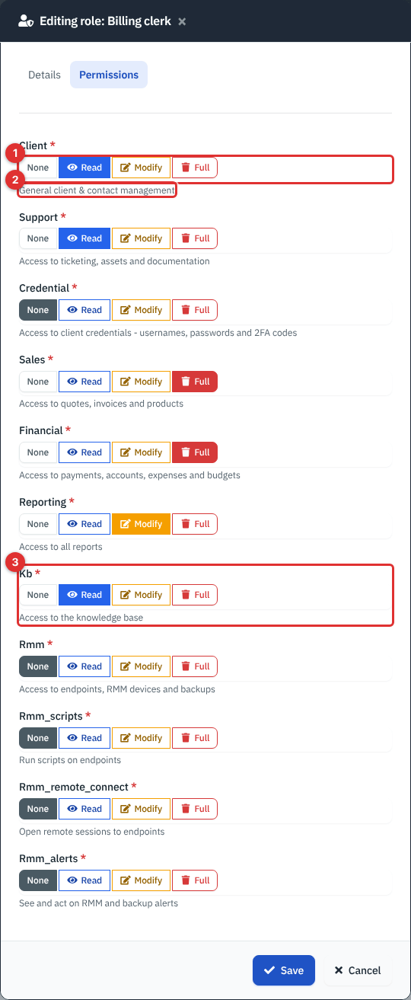

*Figure 13 — Permissions for the Billing clerk role. (1) One row of level buttons per module. (2) The description of the module. (3) Another module row. The rows are named after the module, for example **Kb** and **Rmm_scripts**.*

Notes on the editor:

- The levels mean **Read** (viewing only), **Modify** (read, edit, archive) and **Full** (read, edit, archive, delete). Each level includes the one before it. Administrators always have full access everywhere.
- Edit changes what everyone in the role can do from their next click. The audit trail records which levels changed.
- **Archive** only appears for roles with no active members. An archived role vanishes from the lists and role pickers, and the screens have no way to bring it back.
- Role names are shown for the module as stored, so the Knowledge Base row is **Kb** and the endpoint rows are **Rmm**, **Rmm_scripts**, **Rmm_remote_connect** and **Rmm_alerts**.

### What each module unlocks

| Module row | What it controls |
|---|---|
| **Client** | The Organization menu: clients, contacts, locations, Client compliance, Onboarding & Offboarding, and CRM leads (list and board). |
| **Support** | Service Desk and Work: tickets, recurring tickets, projects, calendar, problems, changes, assets and the documentation records (domains, certificates, networks, racks, printers, drives, services, vendors, structured documents). |
| **Credential** | The credential vault: seeing, copying and changing usernames, passwords and one-time codes. Read is enough to see and copy secrets. |
| **Sales** | Billing: products, quotes, invoices and recurring invoices, and the CRM opportunities, campaigns, segments and pipeline. |
| **Financial** | Finance: payments, accounts, expenses, recurring expenses, revenues, transfers and trips. |
| **Reporting** | The Reports menu and scheduled reports. Each report also needs the module it reports on. |
| **Kb** | The Knowledge Base, when the Knowledge Base feature is on. |
| **Rmm** | The Endpoints menu (dashboard, fleet, devices, checks, policies, patching, software, logs), Backups, and the Network page. |
| **Rmm_scripts** | Running scripts on devices. |
| **Rmm_remote_connect** | Opening remote sessions to devices. |
| **Rmm_alerts** | The central Alerts page and the alert badge. |

Payroll, the Administration area and all settings are open to administrators only, whatever the role. The Billing and Finance menus also need their features on; see [System settings](36-system-settings-maintenance.md). A person with **None** for a module does not see its menu, and a page opened by address shows "You are not permitted to do that!" with the module name.

### The roles in the demo

| Role | Client | Support | Credential | Sales | Financial | Reporting | Kb | Rmm | Scripts | Remote | Alerts |
|---|---|---|---|---|---|---|---|---|---|---|---|
| Administrator | all | all | all | all | all | all | all | all | all | all | all |
| Technician | Modify | Modify | Modify | Modify | None | Read | Modify | Modify | Modify | Modify | Modify |
| Accountant | Read | Read | None | Read | Modify | Read | None | None | None | None | None |
| Billing clerk | Read | Read | None | Full | Full | Modify | Read | None | None | None | None |
| Read-only viewer | Read | Read | None | Read | Read | Read | Read | Read | None | None | Read |

The Technician row also holds the Knowledge Base and endpoint levels that the demo set up; a fresh installation starts with fewer rows for the built-in roles, and an administrator adds the rest. The **Modules** page (`/admin/modules.php`) lists the module rows, but its sidebar link is switched off and adding a module there is not part of normal use.

## Sign-in security

### Your own sign-in options

Every technician has **Account → Security** (your name → **Account**, then **Security**). It is where people manage their own protection.

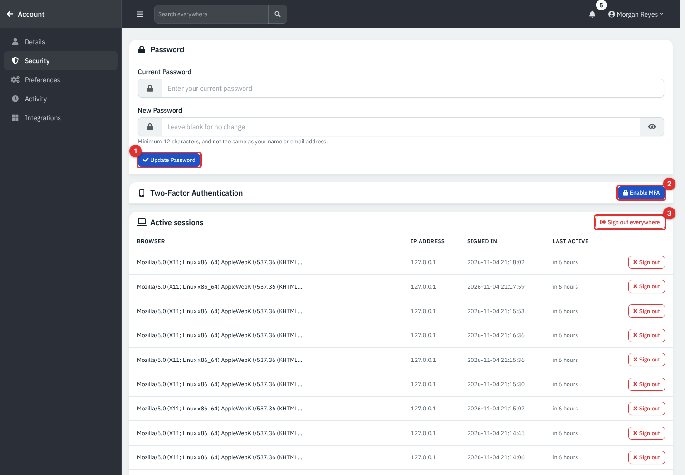

*Figure 14 — Account → Security. (1) Update Password (needs the current password). (2) Enable MFA scans a QR code with an authenticator app. (3) Sign out everywhere. The Passkeys card is further down. Each browser that signed in appears under Active sessions; this demo has many because every guide capture signs in.*

- **Password:** needs the current password; the minimum length comes from the sign-in policy.
- **Two-Factor Authentication:** **Enable MFA** starts the authenticator-app set-up. Once on, a **Recovery codes** area offers single-use codes (shown once; making new codes cancels the old ones and needs the password). **Disable** is hidden when two-factor is required for the person.
- **Remember-Me Tokens:** devices that skip the code; **Revoke All Tokens** removes them.
- **Active sessions:** each signed-in browser with address and times; **Sign out** ends one and **Sign out everywhere** ends all.
- **Passkeys:** **Add Passkey** registers Touch ID, Face ID or a security key (it needs a browser and device that support passkeys; not exercised in this guide). The trash button removes one. Passkeys can then be used from the sign-in page.

### Security settings

**Administration → Settings → Security** has four cards. Each has its own save button.

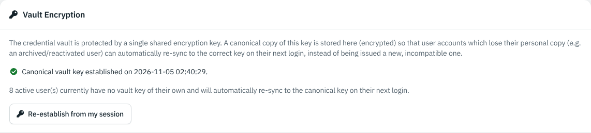

*Figure 15 — **Vault Encryption**. The credential vault is protected by one shared key. **Establish from my session** (or **Re-establish**) stores a canonical copy so a returning user's vault key can re-sync at their next sign-in. It needs you to be signed in with your password in this session.*

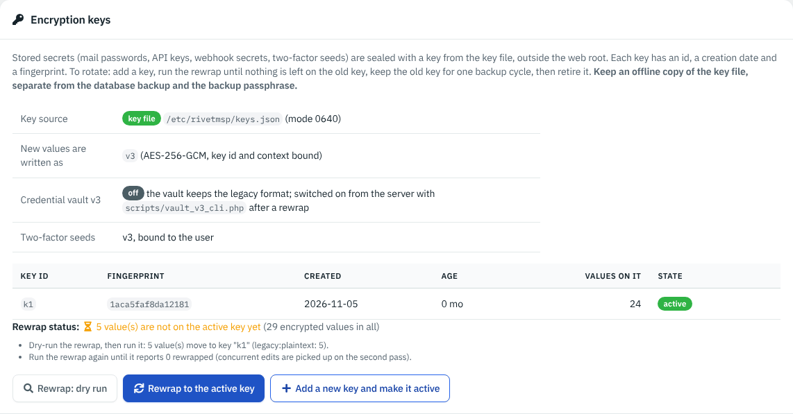

*Figure 16 — **Encryption keys**. It shows the key source (key file or the older key in `config.php`), how new values are written, each key's id, fingerprint, age, number of values on it and state, and the rewrap status. Key material is never shown. Demo data.*

**Encryption keys** protect stored secrets such as mail passwords, API keys and two-factor seeds. The usual rotation is: **Add a new key and make it active**, run **Rewrap to the active key** (the **dry run** first) until nothing is left on the old key, keep the old key for one backup cycle, then **Retire** it (offered only when no value uses it). Keep an offline copy of the key file, separate from the database backup and the backup passphrase. When the web server cannot write the key file, the panel says so and adding keys is done on the server with `scripts/keys_cli.php`; the rewrap works from the page. This guide did not rotate keys on a live system.

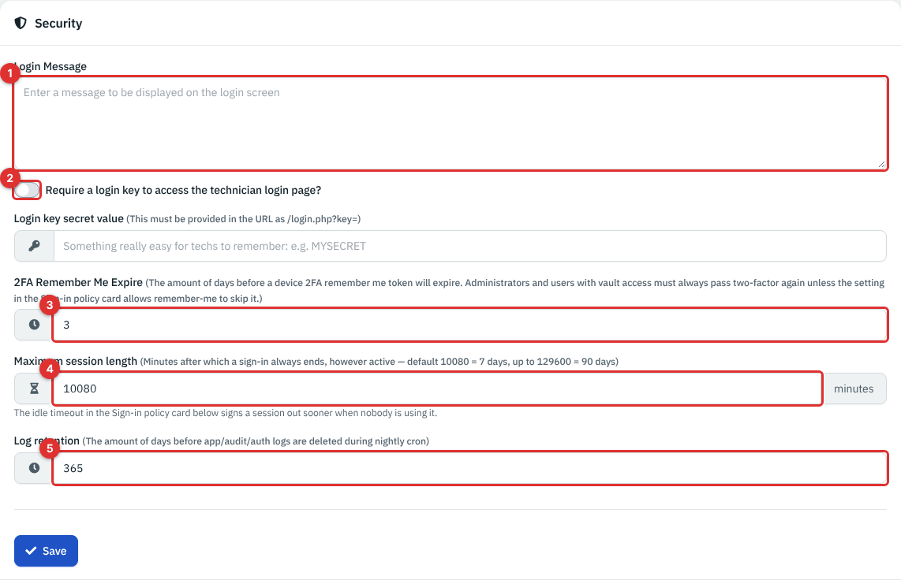

*Figure 17 — The **Security** card. (1) Login Message shown on the sign-in page. (2) Require a login key. (3) 2FA Remember Me Expire, in days. (4) Maximum session length, in minutes. (5) Log retention, in days.*

- **Login key:** when on, the technician sign-in page only works with `/login.php?key=<your secret>`. Without the key a technician's sign-in is sent back to the sign-in page and does not go through (the email box then reads "Client Email"). The switch is turned off when the secret is empty.
- **Maximum session length:** default 10080 minutes (7 days), from 60 to 129600 (90 days). A sign-in ends then however active it is.
- **Log retention:** days before the activity, app and sign-in logs are deleted by the nightly job. A retention preset under [Compliance](35-compliance-admin.md) is a minimum and raises a shorter value.

#### Sign-in policy

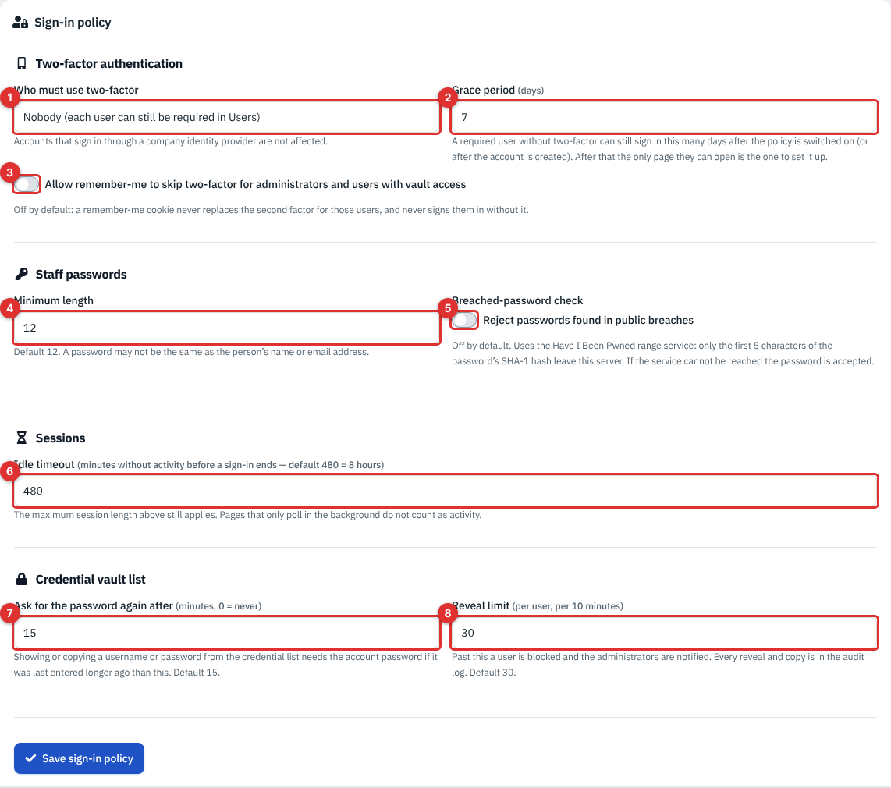

*Figure 18 — The **Sign-in policy** card, with its default values. (1) Who must use two-factor. (2) Grace period. (3) Remember-me and two-factor. (4) Minimum password length. (5) Breached-password check. (6) Idle timeout. (7) Password re-entry for the vault list. (8) Reveal limit.*

| Setting | What it does | Default |
|---|---|---|
| **Who must use two-factor** | **Nobody** (each user can still be required in Users), **Administrators**, or **All agents**. People who sign in through a company identity provider are not affected. | Nobody |
| **Grace period** (days) | How long a required person without two-factor can keep signing in after the policy is switched on or the account is created. After that, the only page they can open is the set-up page. 0 to 90. | 7 |
| **Allow remember-me to skip two-factor** | Off: a remember-me cookie never replaces the second factor for administrators and users with vault access. | Off |
| **Minimum length** | Shortest staff password, 8 to 128. A password cannot match the person's name or email. | 12 |
| **Breached-password check** | Rejects passwords found in public breach data, using only the first five characters of the password's SHA-1 hash. If the service cannot be reached the password is accepted. Not verified on a live service. | Off |
| **Idle timeout** (minutes) | Minutes without activity before a sign-in ends. 5 to 129600. Pages that only poll in the background do not count. | 480 |
| **Ask for the password again after** (minutes) | Showing or copying a username or password from the credential list needs the account password when it was last entered longer ago than this. 0 means never ask. | 15 |
| **Reveal limit** (per 10 minutes) | Past this a user is blocked and the administrators are notified. Every reveal and copy is in the audit log. | 30 |

A policy that switches two-factor on starts the grace period from that moment. Changes are recorded in the Audit trail ("changed the sign-in policy").

## Audit log and Audit trail

### Audit log

**Administration → Maintenance → Audit log** shows the plain activity log: sign-ins, user and role changes, exports, setting edits and more.

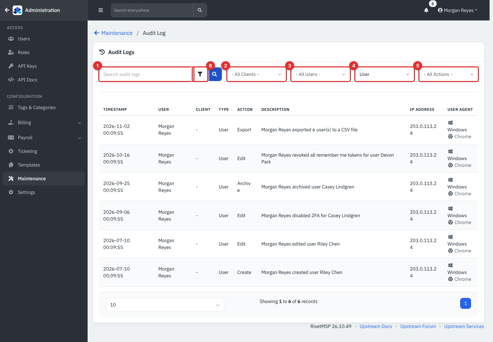

*Figure 19 — The Audit log, filtered to the **User** type. (1) Search the text, address, browser, user or client. (2) Client. (3) User. (4) Type. (5) Action. (6) The filter button opens the date range. Example data; the older rows were added by the demo.*

Columns: **Timestamp**, **User**, **Client**, **Type**, **Action**, **Description**, **IP Address** and **User Agent**. The newest row is first. The log is cleaned up by the retention period.

### Audit trail

**Administration → Maintenance → Audit trail** is the structured, tamper-evident record: sign-ins, setting and user changes, credential reveals, automation runs and compliance actions. Entries are only ever added; old ones are removed by the retention period under [Compliance](35-compliance-admin.md).

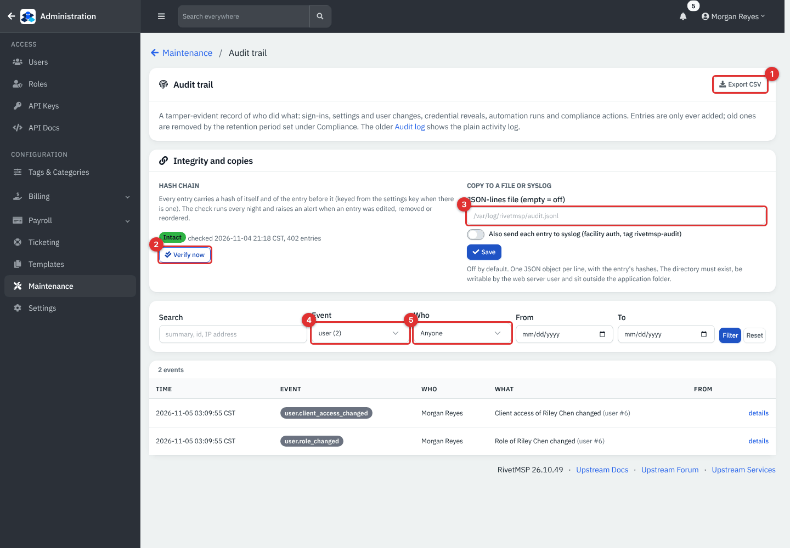

*Figure 20 — The Audit trail, filtered to the **user** group. (1) Export CSV. (2) Verify now runs the hash-chain check. (3) Copy each entry to a JSON-lines file. (4) Event group. (5) Who. Dates and a search box are beside them. **details** shows the stored facts of an entry.*

- **Hash chain:** every entry carries a hash of itself and of the entry before it. The check runs every night and raises an alert when an entry was edited, removed or reordered. The badge shows **Intact**, **BROKEN**, **Nothing sealed yet**, **Key changed** or **Key missing**.
- **Copy to a file or syslog:** off by default. One JSON object per line. The folder must exist, be writable by the web server and sit outside the application folder. **Also send each entry to syslog** uses the tag `rivetmsp-audit`. Not tested against a real syslog server.
- **Export CSV** downloads up to 50,000 rows (newest first) with the current filters, and the export is itself recorded. The filters are **Search**, **Event**, **Who**, **From** and **To**; 50 entries a page.
- The event colour hints at the kind: blue for sign-ins, orange for views and reveals, red for failures and blocks.

## Reference

### Limits to know

- A signed-in person who is disabled or archived is signed out at their next page load.
- There is no way to delete a user, and no way to bring back an archived role.
- A person with no tick on the Access tab sees every client, so adding the first tick changes "all" to "only these".

## Tips and good practice

- Keep the number of administrators small; the compliance page warns when more than half the team (with more than three agents) are administrators.
- Give technicians the built-in **Technician** role and use a custom role for exceptions such as a billing clerk or an outside reviewer.
- Require two-factor for administrators first (**Who must use two-factor → Administrators**), then widen to all agents when everyone has an authenticator app or passkey.
- Archive leavers on their last day and pick who takes over their tickets.
- Review the user list and role members every quarter and record it on the compliance checklist.
- Use **IR** only in a real incident, and keep the list of new passwords out of email and chat.
- Ask people to keep recovery codes somewhere other than their phone.

## Related guides

- [Getting started](01-getting-started.md): signing in, passkeys and the account menu.
- [Compliance administration](35-compliance-admin.md): retention presets, the compliance status page and the auditor export.
- [Credentials and the vault](14-credentials-and-vault.md): how the vault key and reveals work.
- [API and mobile](31-api-and-mobile.md): API keys.
- [System settings and maintenance](36-system-settings-maintenance.md): modules, cron, backups and updates.
- [Client portal](32-client-portal.md): the clients' own sign-in.
