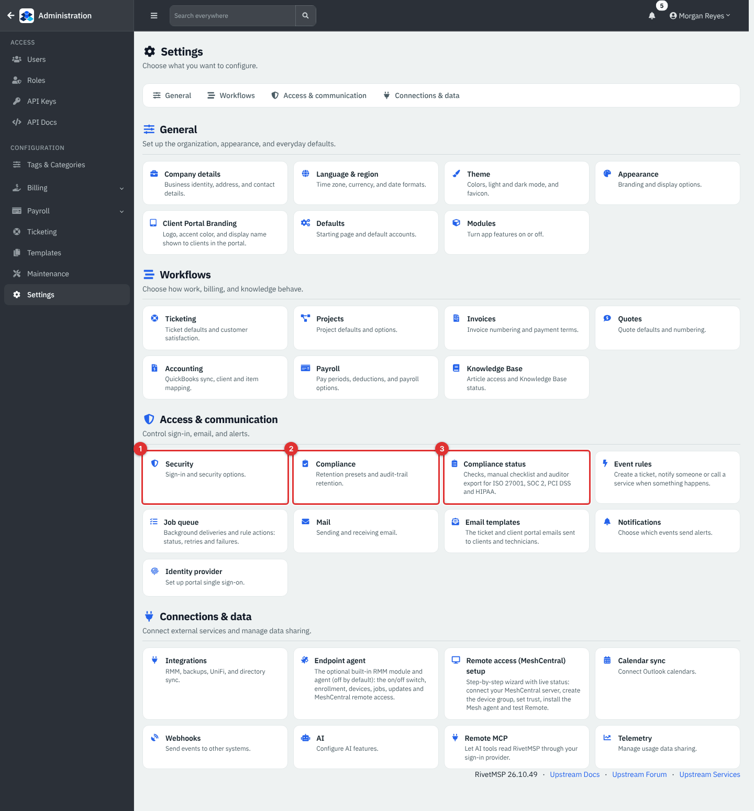
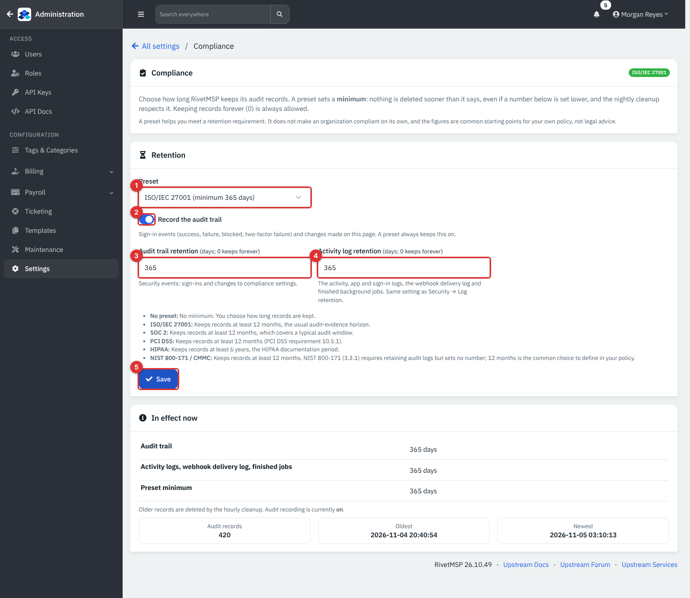
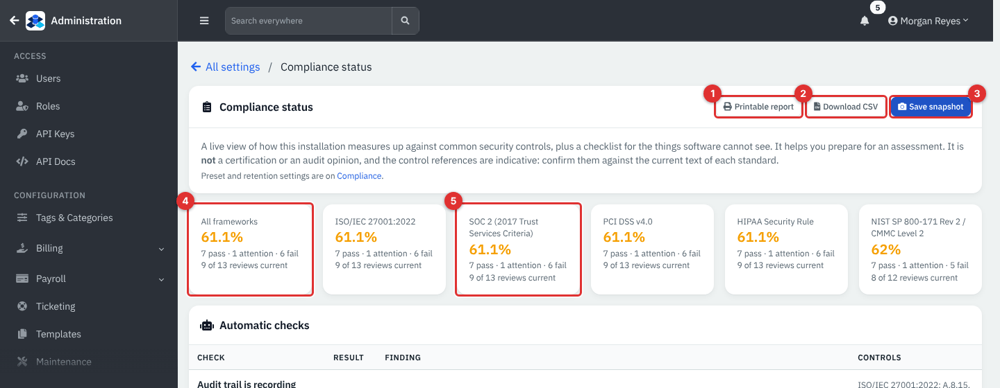
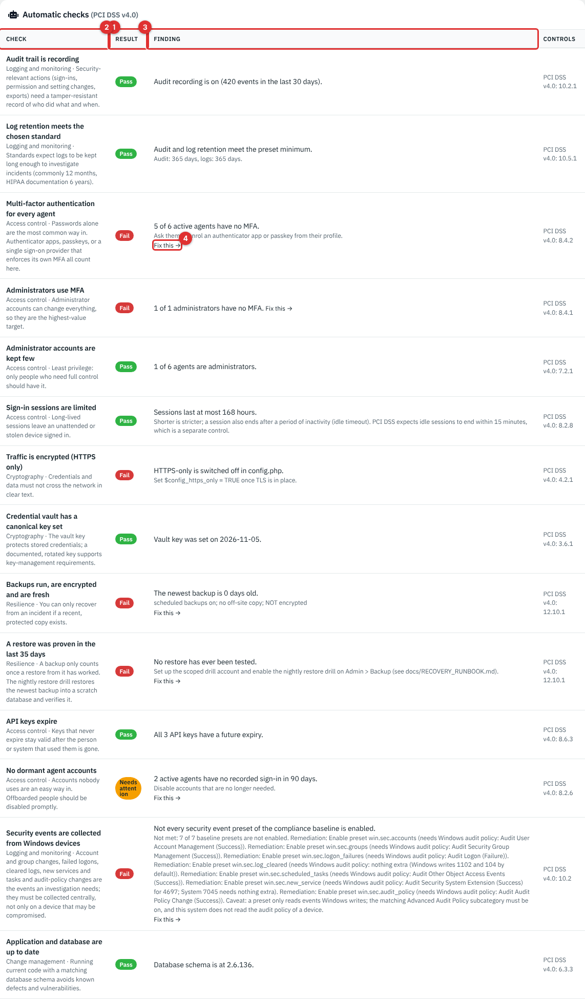
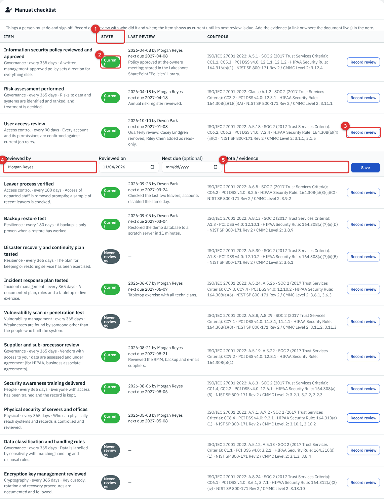
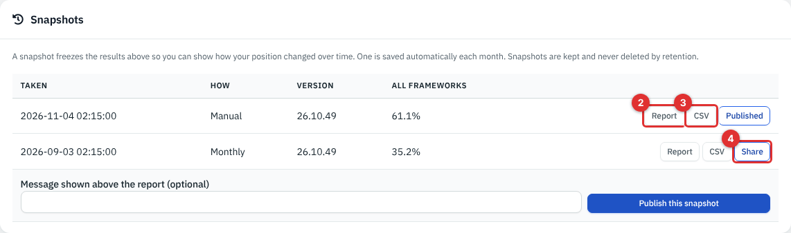
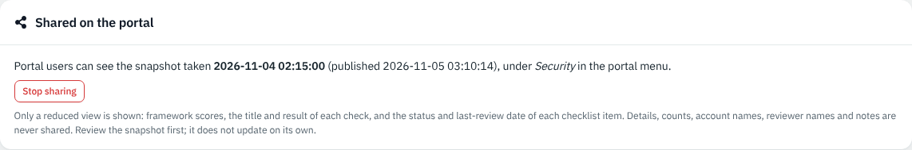
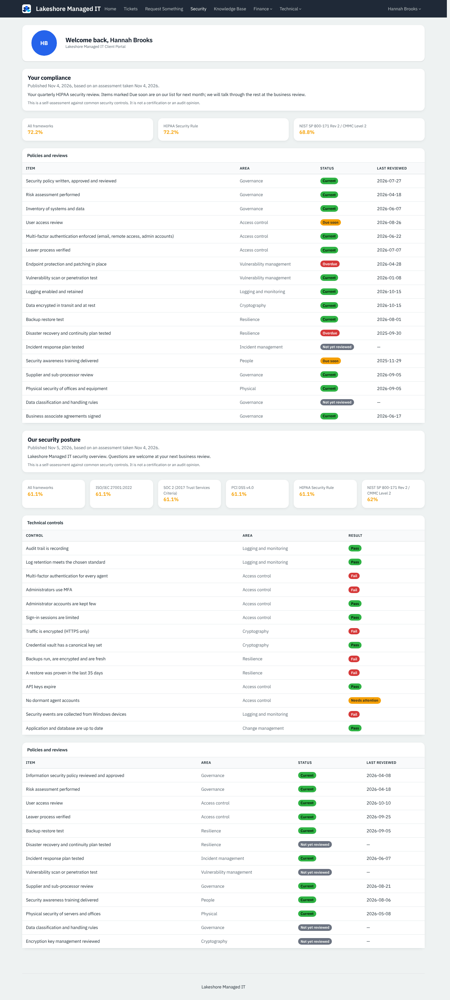
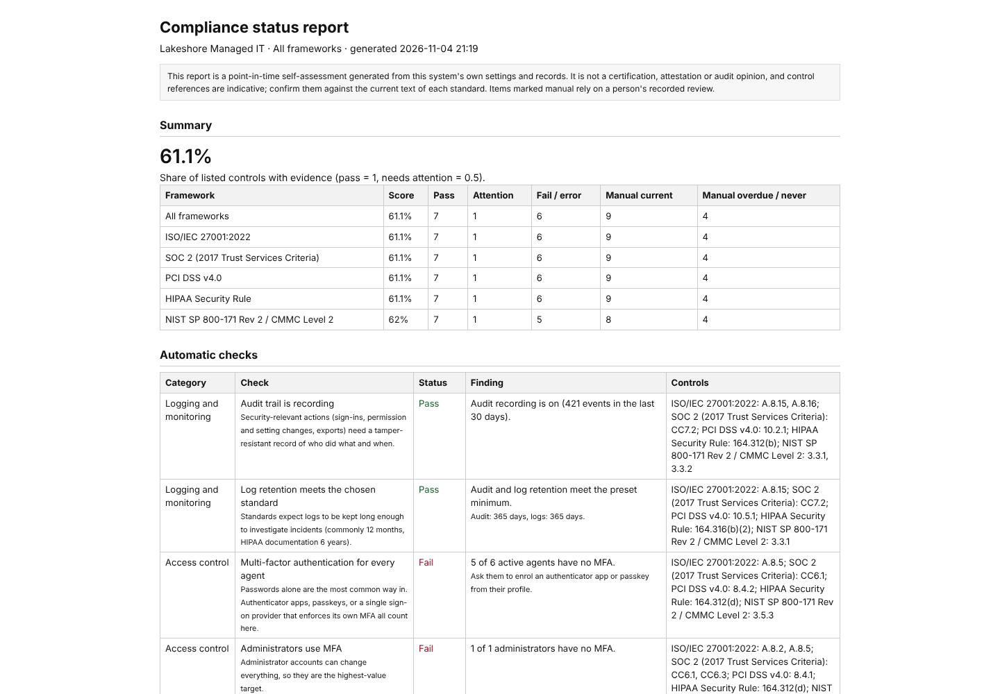

# Compliance administration

RivetMSP helps you prepare for a security assessment of your own company. **Administration → Settings → Compliance** sets how long audit records are kept. **Compliance status** measures this installation against common controls, keeps a checklist for things software cannot see, saves snapshots over time, exports a report for an auditor, and can share one snapshot with your clients in the client portal.

This page covers the provider's own compliance (your company). Compliance work for each client is a different tool; see [Client workflows and client compliance](04-client-workflows-and-compliance-per-client.md).

| | |
|---|---|
| **Where to find it** | Administration → **Settings** → **Access & communication** → **Compliance** and **Compliance status**. The auditor export is the **Printable report** and **Download CSV** buttons on Compliance status. |
| **Who can use it** | Administrators only. The portal view is read-only for client contacts. |
| **Turn it on** | The pages need the latest database update (Administration → **Update**); until then they say so. The monthly snapshot needs the background jobs switched on (**Enable Cron** under Settings → Notifications). |

## What it's for

- Keep audit records long enough for a standard you work to (a **retention preset**).
- See, in one place, which technical controls pass or fail today: two-factor sign-in, backups, HTTPS, vault key and more.
- Record the human controls (policy review, risk assessment, restore tests) with who did them, when, and where the evidence lives.
- Show how your position changed over time, hand an auditor a report, and optionally show clients a reduced version.

**What it is not.** It is a self-assessment. It is not a certification or an audit opinion, a preset does not make an organization compliant on its own, and the control references are indicative starting points: confirm them against the current text of each standard. Nothing here is legal advice.

## A quick tour

Both pages are tiles in the Settings directory.

*Figure 1 — Administration → Settings, group **Access & communication**. (1) Security (see [Users, roles and sign-in security](34-users-roles-security.md)). (2) Compliance: retention. (3) Compliance status.*

### Compliance (retention)

*Figure 2 — Settings → Compliance. (1) Preset. (2) Record the audit trail. (3) Audit trail retention. (4) Activity log retention. (5) Save. Below the form, **In effect now** shows what is enforced. Example data.*

The badge at the top right shows the chosen preset (**No preset** or its name).

| Field | Meaning |
|---|---|
| **Preset** | **No preset**, **ISO/IEC 27001**, **SOC 2**, **PCI DSS**, **HIPAA** or **NIST 800-171 / CMMC**. A preset sets a **minimum** retention. |
| **Record the audit trail** | Records sign-in events (success, failure, blocked, two-factor failure) and changes made on this page. Any preset keeps it on. |
| **Audit trail retention** | Days before audit trail records are deleted. 0 keeps them forever. 0 to 36500. |
| **Activity log retention** | Days before the activity, app and sign-in logs, the webhook delivery log and finished background jobs are deleted. 0 keeps everything. It is the same setting as **Security → Log retention**. |

The preset minimums come from the code:

| Preset | Minimum | Why |
|---|---|---|
| ISO/IEC 27001 | 365 days | The usual audit-evidence horizon; the standard itself sets no number. |
| SOC 2 | 365 days | Covers a typical audit window. |
| PCI DSS | 365 days | PCI DSS requirement 10.5.1. |
| HIPAA | 2190 days (6 years) | The HIPAA documentation period. |
| NIST 800-171 / CMMC | 365 days | A common choice; the standard requires retention but sets no number. |

A positive number below the minimum is raised to it when you save, and the page says so ("raised to 365 days"). Keeping records forever (0) is always allowed. Saving a change is recorded in the Audit trail. **In effect now** shows the effective audit and activity retention (with a **raised from** badge when a preset overrode your number), the preset minimum, and how many audit records exist with the oldest and newest times. Old records are deleted by the hourly cleanup.

### Compliance status

*Figure 3 — Settings → Compliance status. (1) Printable report. (2) Download CSV. (3) Save snapshot. (4) The **All frameworks** score. (5) A framework tile: select one to filter the whole page to that standard. Example data.*

The tiles show a score for **All frameworks** and for each framework: **ISO/IEC 27001:2022**, **SOC 2 (2017 Trust Services Criteria)**, **PCI DSS v4.0**, **HIPAA Security Rule** and **NIST SP 800-171 Rev 2 / CMMC Level 2**. Under each score: how many checks pass, need attention and fail, and how many checklist reviews are current. The score is the share of listed controls with evidence: pass counts 1 and needs attention counts 0.5. In the demo, 7 pass and 1 needs attention (7.5) plus 9 current reviews make 16.5 of 27 controls, which is 61.1%. The score colour is green from 80%, amber from 50%, red below.

#### Automatic checks

These read this installation's own settings and records.

*Figure 4 — Automatic checks (filtered to PCI DSS). (1) Check: the name, area and why it matters. (2) Result. (3) Finding, with detail. (4) **Fix this** opens the page that can change it. The last column lists the control references. This demo runs over plain HTTP with no backups yet, so several checks fail; that reflects the demo setup, not a fault.*

| Check | What it looks at |
|---|---|
| **Audit trail is recording** | Whether audit recording is on and how many events were recorded in the last 30 days. |
| **Log retention meets the chosen standard** | Whether your retention numbers meet the preset minimum. With **No preset** it asks you to choose a standard. |
| **Multi-factor authentication for every agent** | Active technicians with an authenticator app, a passkey or a single sign-on provider. |
| **Administrators use MFA** | The same, for administrator roles only. |
| **Administrator accounts are kept few** | Passes up to three agents; with more, warns when more than half are administrators. |
| **Sign-in sessions are limited** | Passes at 7 days (10080 minutes) or less, warns up to 30 days, fails above. |
| **Traffic is encrypted (HTTPS only)** | Whether HTTPS-only is on in `config.php`. |
| **Credential vault has a canonical key set** | Whether the canonical vault key date is recorded. |
| **Backups run, are encrypted and are fresh** | The newest successful backup: its age, whether scheduled backups and an off-site copy are on, and whether the file is encrypted. Fails with no backup or one older than 14 days. |
| **A restore was proven in the last 35 days** | The result of the nightly restore drill. |
| **API keys expire** | API keys with no expiry or already expired. |
| **No dormant agent accounts** | Active agents with no recorded sign-in in 90 days. |
| **Security events are collected from Windows devices** | Whether the endpoint log presets for security events are enabled (appears with the endpoint module). |
| **Application and database are up to date** | Whether the database version matches the code. |

Results are **Pass**, **Needs attention** (amber), **Fail** (red) or not applicable (grey). Several checks only fail until you act on them: for example, switching on scheduled encrypted backups (see [System settings and maintenance](36-system-settings-maintenance.md)) fixes the backup check.

#### Manual checklist

*Figure 5 — The Manual checklist. (1) State. (2) A state badge. (3) **Record review** opens a form under the row. (4) **Reviewed by**. (5) **Note / evidence**. The other fields are **Reviewed on** and **Next due (optional)**. Example data.*

The checklist holds 13 items software cannot see, each with a review interval: information security policy (365 days), risk assessment (365), user access review (90), leaver process (180), backup restore test (180), disaster recovery and continuity plan (365), incident response plan (365), vulnerability scan or penetration test (365), supplier and sub-processor review (365), security awareness training (365), physical security (365), data classification (365) and encryption key management (365).

To record a review:

1. Select **Record review** on the row.
2. Check **Reviewed by** (it starts as your name) and **Reviewed on** (today or earlier; the date box does not allow a later day).
3. Optionally set **Next due**, otherwise the next review date is worked out from the interval.
4. Add a **Note / evidence**: a link, or where the document lives.
5. Select **Save**.

The state is **Current**, **Due soon**, **Overdue** or **Never reviewed**. The **Last review** column shows the date, reviewer, next due date and note. Each new review is added to the history; earlier ones are kept.

#### Snapshots

A snapshot freezes the results so you can show how your position changed. **Save snapshot** takes one now (**Manual**). One is also saved automatically each calendar month (**Monthly**) by the background job. Snapshots are kept and never deleted by retention.

*Figure 6 — Snapshots. Columns: **Taken**, **How**, **Version**, **All frameworks** (the score). (1) The shared-snapshot box above. (2) **Report** opens the printable report of that snapshot. (3) **CSV**. (4) **Share** opens a form to publish it. The published one shows **Published**. Example data.*

### Share a snapshot with clients

1. In **Snapshots**, select **Share** on the snapshot you want to show.
2. Type an optional message ("shown above the report").
3. Select **Publish this snapshot**.

Only one snapshot is shared at a time; publishing another replaces it. **Stop sharing** (in **Shared on the portal**) withdraws it.

*Figure 7 — **Shared on the portal** names the snapshot and when it was published.*

Clients see a reduced view: framework scores, the title and result of each automatic check, and the status and last-review date of each checklist item. Details, counts, account names, reviewer names and notes are never shared. The snapshot does not update on its own, so review it first and publish a newer one when things change.

*Figure 8 — What a client contact sees under **Security** in the client portal. The top block, **Your compliance**, is the client's own shared report (see the per-client guide). **Our security posture** is the snapshot you published, with its message. This is a portal example with demo data.*

The **Security** link appears in the portal menu only when something is shared with that client: a snapshot published here, or a report published for that client. See [Client portal](32-client-portal.md).

### Auditor export

**Printable report** and **Download CSV** (and **Report** and **CSV** on each snapshot) export the live status or a saved snapshot. Both can be limited to one framework by choosing its tile first. Each export is recorded in the Audit trail.

*Figure 9 — The printable report opens in a new tab: a summary table by framework, the automatic checks with findings and control references, and the manual checklist. Print it to PDF from the browser if an auditor wants a file.*

The report says it is a point-in-time self-assessment and not a certification, attestation or audit opinion. The CSV holds the same rows for a spreadsheet.

## Common tasks

### Choose a retention preset

1. Go to **Administration → Settings → Compliance**.
2. Choose the **Preset** that matches the standard you work to.
3. Leave **Record the audit trail** on.
4. Check **Audit trail retention** and **Activity log retention**. Numbers below the minimum are raised when you save.
5. Select **Save** and read the message. **In effect now** shows the result.

### Work through a failing check

1. Open **Compliance status** and read the **Finding** and detail.
2. Select **Fix this** when it is offered (it opens Users, Roles, Security or Backup).
3. Make the change, then reload Compliance status to see the result.
4. When it passes, select **Save snapshot** to capture the new position.

### Prepare for an assessment

1. Record every checklist review with a note that says where the evidence is.
2. Fix the failing checks you can, and write down why the others are accepted.
3. Save a snapshot and open its **Report**.
4. Give the auditor the report and the CSV. Share the snapshot in the portal if clients ask how you protect their data.

## Reference

| Item | Value |
|---|---|
| Frameworks | ISO/IEC 27001:2022, SOC 2, PCI DSS v4.0, HIPAA Security Rule, NIST SP 800-171 Rev 2 / CMMC Level 2 |
| Automatic checks | 14 (13 when the endpoint module is not loaded) |
| Manual checklist items | 13, intervals 90, 180 or 365 days |
| Retention presets | None, ISO 27001, SOC 2, PCI DSS (365 days), HIPAA (2190 days), NIST 800-171 (365 days) |
| Retention range | 0 (forever) to 36500 days |
| Snapshots | Manual or one per calendar month; kept forever; one can be shared |
| Audit events written | `compliance.settings_changed`, `compliance.snapshot_taken`, `compliance.report_exported`, `compliance.report_published`, `compliance.report_unpublished` |

## Tips and good practice

- Start with the retention preset, then fix the cheap automatic checks (two-factor, API key expiry, dormant accounts).
- Write the evidence in the note ("policy v3 in the Policies library"), instead of a bare "done".
- Record the review on the day it happens. The date box does not accept a later day.
- Treat a score as a to-do list, not a grade. Two frameworks can show the same number when the same controls cover both.
- Review a snapshot before sharing it: clients see check titles and results, so fix or explain the red items first.
- The monthly snapshot only happens when the background jobs run.

## Related guides

- [Users, roles and sign-in security](34-users-roles-security.md): two-factor, sessions, vault key, audit log and audit trail.
- [Client workflows and client compliance](04-client-workflows-and-compliance-per-client.md): the same idea for each client.
- [Client portal](32-client-portal.md): the Security page clients see.
- [System settings and maintenance](36-system-settings-maintenance.md): backups, cron and updates, which several checks read.
