# System Settings and Maintenance

Administration is where an administrator decides which parts of RivetMSP are switched on, how the company appears, which alerts go out, and how the system is kept healthy, backed up and updated. This guide covers the system-wide settings and the **Maintenance** area. Mail and webhook setup is in [Mail intake and sending](30-mail-intake-and-sending.md), [Webhooks, event rules and jobs](30b-webhooks-event-rules-and-jobs.md) and [AI and the MCP server](30c-ai-and-remote-mcp.md), ticketing configuration is in [Ticketing setup and templates](37-ticketing-setup-and-templates.md), and users, roles and the audit trail are in [Users, roles and security](34-users-roles-security.md).

| | |
|---|---|
| **Where to find it** | Account menu (your name, top right) → **Administration**. The Administration sidebar replaces the normal one; the arrow at its top returns you to the app. |
| **Who can use it** | Administrators only. This is not a permission module with Read/Modify/Full levels: a role is either flagged as Administrator or it is not. |
| **Turn it on** | Nothing to enable. A few settings tiles appear only when a module is on (see [Turn modules on or off](#turn-modules-on-or-off)). |

## What it's for

- Switch modules on or off and set the company details, language, currency, time zone and look.
- Decide which notifications go out, and turn on the scheduler that sends them.
- See what the scheduler, the mail queue and the server are doing.
- Take, copy off-site, test and restore backups.
- Check for and install updates.

## A quick tour

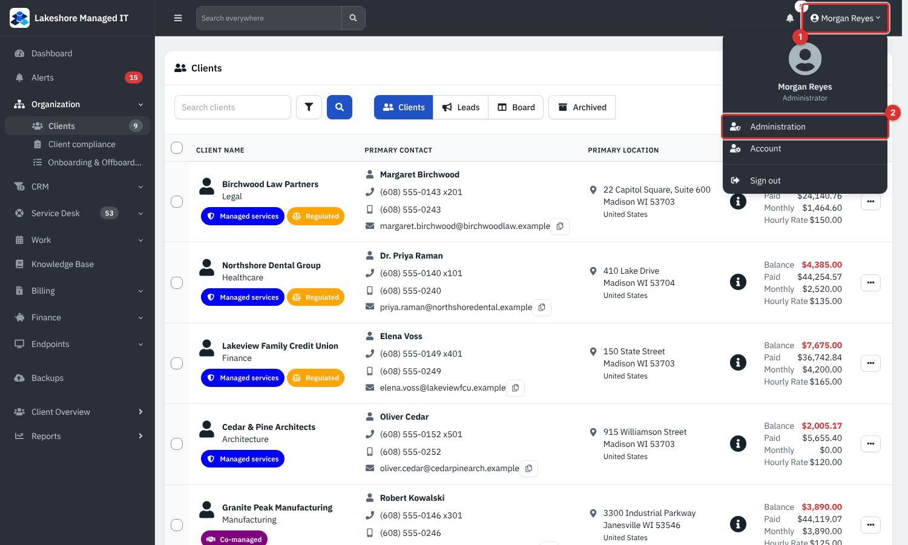

*Figure 1 — Open the account menu (1) and choose **Administration** (2). The entry is shown only to administrators.*

The Administration sidebar has two groups. **ACCESS** holds **Users**, **Roles**, **API Keys** and **API Docs**. **CONFIGURATION** holds **Tags & Categories**, **Billing** and **Payroll** (each only while its module is on), **Ticketing**, **Templates**, **Maintenance** and **Settings**. Settings, Ticketing, Templates and Maintenance open a directory of tiles. In this guide, **Settings → Modules** means the **Settings** entry in the sidebar, then the **Modules** tile.

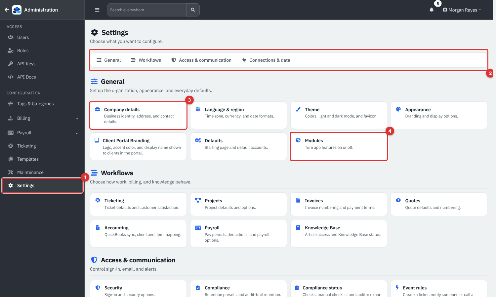

*Figure 2 — The Settings directory. (1) **Settings** in the sidebar. (2) Shortcuts to the four groups: **General**, **Workflows**, **Access & communication** and **Connections & data**. (3) **Company details**. (4) **Modules**.*

| Group | Tiles |
|---|---|
| **General** | Company details, Language & region, Theme, Appearance, Client Portal Branding (portal on), Defaults, Modules |
| **Workflows** | Ticketing, Projects (both need the ticketing module), Invoices, Quotes, Accounting (need invoicing), Payroll (payroll on), Knowledge Base |
| **Access & communication** | Security, Compliance, Compliance status, Event rules, Job queue, Mail, Email templates, Notifications, Identity provider (portal on) |
| **Connections & data** | Integrations, Endpoint agent, Remote access (MeshCentral) setup, Calendar sync, Webhooks, AI, Remote MCP, Telemetry |

A tile that does not apply is hidden. Invoice, quote, accounting and payroll settings are explained with those features, and integrations in [Integrations](29-integrations.md).

## Common tasks

### Turn modules on or off

1. Go to **Settings → Modules**.
2. Switch each module on or off.
3. Click **Save**. The change applies to everyone at once.

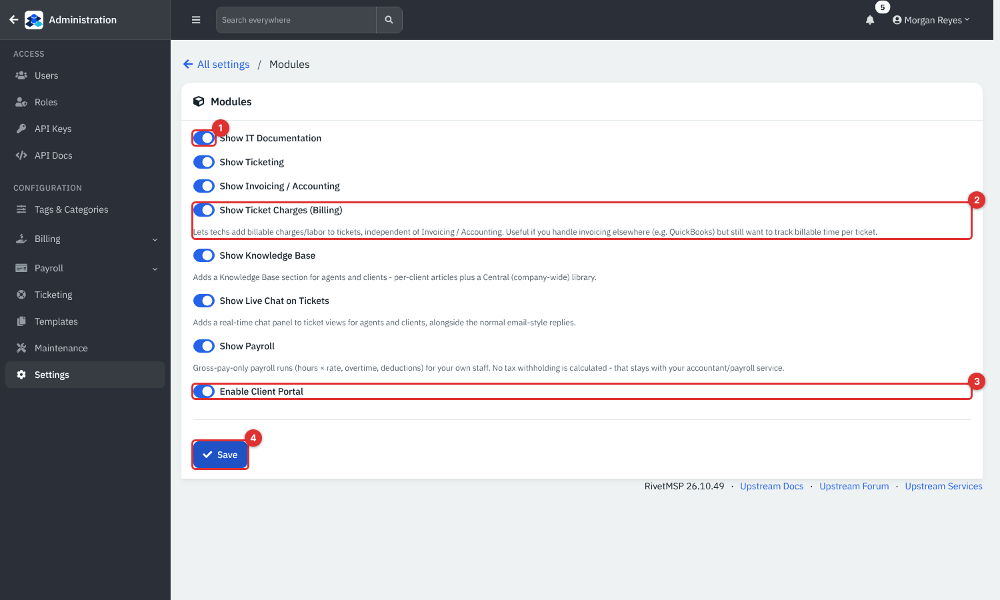

*Figure 3 — Modules. (1) A switch. (2) **Show Ticket Charges (Billing)** has its own switch and a note. (3) **Enable Client Portal**. (4) **Save**.*

| Switch | What it controls |
|---|---|
| **Show IT Documentation** | The documentation pages (assets, credentials, domains and so on) and the **Templates** entry. |
| **Show Ticketing** | The **Service Desk** group, projects, and the Ticketing settings. |
| **Show Invoicing / Accounting** | Billing and finance pages and settings. |
| **Show Ticket Charges (Billing)** | Lets technicians add billable charges and labor to tickets even if invoicing is handled elsewhere. |
| **Show Knowledge Base** | The Knowledge Base for technicians and clients: per-client articles plus a company-wide library. |
| **Show Live Chat on Tickets** | A real-time chat panel on tickets. |
| **Show Payroll** | Gross-pay-only payroll runs. No tax withholding is calculated. |
| **Enable Client Portal** | The client portal, its branding and identity-provider tiles. |

A switch hides pages; it does not delete data. Switching it back on restores everything. Even with a switch on, a person still needs the matching role permission to see an entry.

**Note.** Not every feature switch is here. The built-in endpoint agent, Comet backups, UniFi and Remote MCP have their own switch on their own settings pages (**Endpoint agent**, **Integrations**, **Remote MCP**).

### Update company details

1. Go to **Settings → Company details**.
2. Edit **Name** (required), **Address**, **City**, **State / Province**, **Postal Code**, **Country**, **Phone**, **Email**, **Website** and **Tax ID**. Upload a logo with **Choose File**; **Remove Logo** deletes it.
3. Click **Save**.

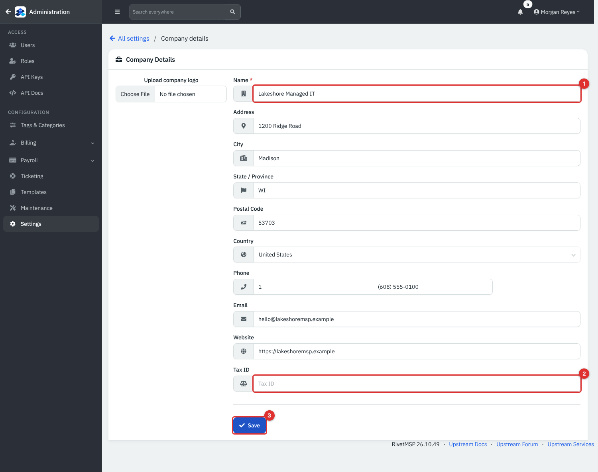

*Figure 4 — Company details. (1) **Name**. (2) **Tax ID**. (3) **Save**. The logo is shown on invoices, quotes and the client portal.*

The company **Country** also decides which holidays the **Holidays** page lists first (see [Ticketing setup and templates](37-ticketing-setup-and-templates.md#business-hours-and-holidays)).

### Set language, currency and time zone

Go to **Settings → Language & region**. **Language** is the locale used to format numbers and dates, **Currency** the currency code, and **Timezone** the time zone the app uses. All three are required. Click **Save**.

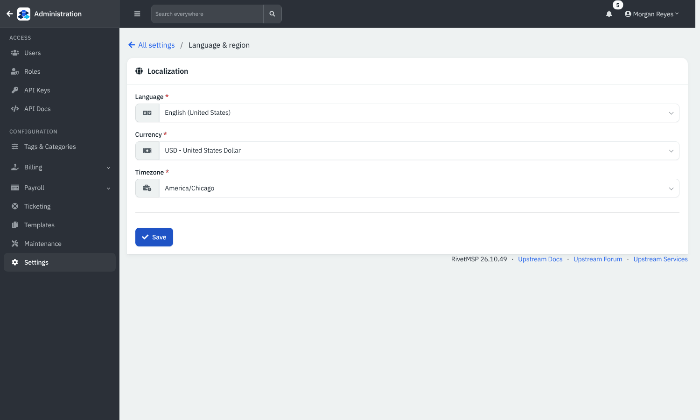

*Figure 5 — Language & region.*

### Change the look and the start page

- **Settings → Appearance** sets the **Accent Color** (15 presets, or a **Custom Accent Color** as a hex code that overrides the preset), the **Card Corner Radius** (blank keeps the 14 px default) and **Default to dark mode company-wide**. Individual users can still opt into dark mode in their own preferences. The company logo is managed on **Company details**.
- **Settings → Theme** is an older picker with a list of named colors and a favicon upload (**Upload Icon**, **Reset Favicon**). It writes the same accent setting, so use Appearance for everyday changes.
- **Settings → Defaults** holds **Start Page** (**Dashboard**, **Client Management**, **Support Tickets** or **Invoices**), the default **Calendar**, and the billing defaults: **Transfer From Account**, **Transfer To Account**, **Payment Account**, **Expense Account**, **Payment Method**, **Expense Payment Method**, **Net Terms** (On Receipt to 90 Days) and **Client Hourly Rate**.

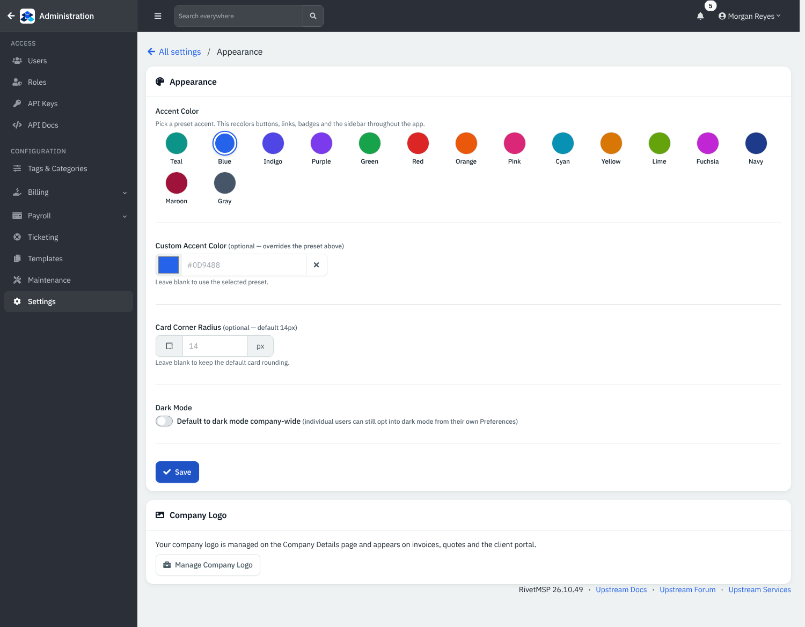

*Figure 6 — Appearance: accent presets, custom accent, corner radius and the dark mode default.*

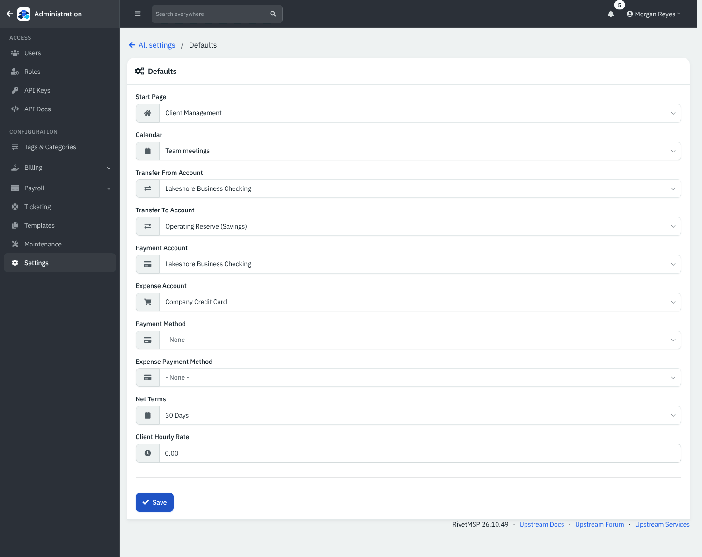

*Figure 7 — Defaults. The accounts and payment methods in the lists come from Finance and Billing.*

### Choose which notifications go out

1. Go to **Settings → Notifications**.
2. Set the options you need and click **Save Settings**.

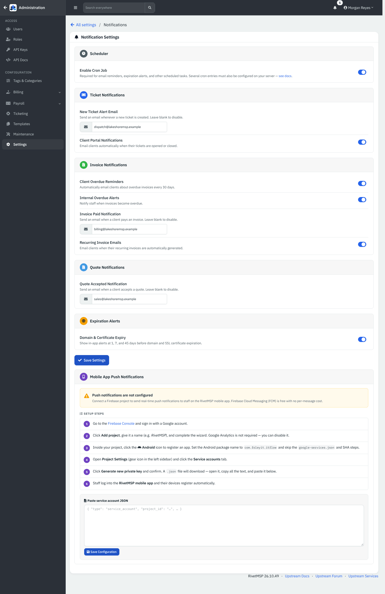

*Figure 8 — Notification Settings with example addresses. The **Mobile App Push Notifications** card at the bottom needs a Firebase project and the mobile app; it is not verified on a live service here.*

| Setting | What it does |
|---|---|
| **Enable Cron Job** | Master switch for scheduled work: reminders, expiry alerts, recurring tickets and invoices, ticket automation and automatic backups. Off on a new install. The server must also run the cron script (see [Keep scheduled jobs running](#keep-scheduled-jobs-running)). |
| **New Ticket Alert Email** | Emails this address whenever a ticket is created. Blank = none. |
| **Client Portal Notifications** | Emails clients when their tickets are opened or closed. |
| **Client Overdue Reminders** | Emails clients about overdue invoices (the page says every 30 days). |
| **Internal Overdue Alerts** | Notifies staff when invoices become overdue. |
| **Invoice Paid Notification** | Emails this address when a client pays an invoice. |
| **Recurring Invoice Emails** | Emails clients when a recurring invoice is generated. |
| **Quote Accepted Notification** | Emails this address when a client accepts a quote. |
| **Domain & Certificate Expiry** | In-app alerts at 1, 7 and 45 days before a domain or certificate expires. |

### Keep scheduled jobs running

Reminders, recurring tickets and invoices, ticket automation, mail sending and automatic backups depend on the scheduler:

1. Tick **Enable Cron Job** in **Settings → Notifications** and save.
2. Make sure the server runs `cron/cron.php` on a schedule. The installer (`deploy/install.sh`) and the Docker image add the entries for you.
3. Open **Maintenance → Scheduled jobs** (page title **Cron Manager**) to see what the server really runs.

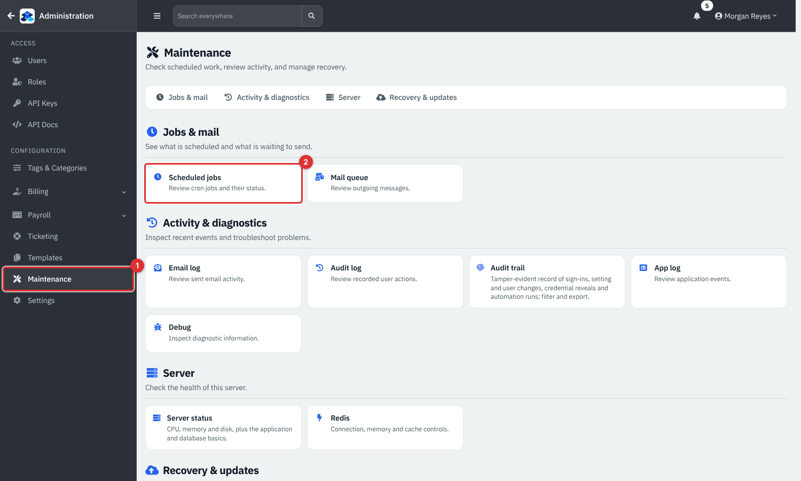

*Figure 9 — The Maintenance directory. (1) **Maintenance** in the sidebar. (2) **Scheduled jobs**. (3) **Backups**. (4) **Update**. The other tiles are **Mail queue**, **Email log**, **Audit log**, **Audit trail**, **App log**, **Debug**, **Server status**, **Redis** and **Credential restore**.*

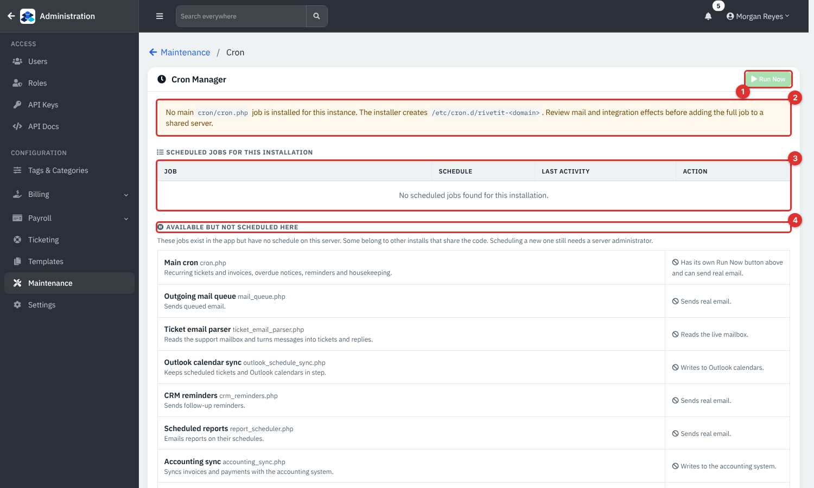

*Figure 10 — Scheduled jobs on the demo server, which has no installed cron entries. (1) **Run Now**, disabled until a main job exists and **Enable Cron Job** is on. (2) The notice shown when no main `cron/cron.php` job is installed. (3) The table of jobs installed for this instance. (4) Known jobs that have no schedule here.*

The page reads the cron files on the server. It shows the main job's schedule, the time of the **Last successful run** (from the App log), a warning if more than one main job targets this instance, and a reminder when **Enable Cron Job** is off. Each installed job has **Run now** (only for jobs that are safe to start by hand) and, when the server administrator has installed the Cron Manager helper, **Edit schedule**, a builder for hourly, daily, weekly, monthly or custom cron times. Jobs that send real email, read a live mailbox or write to outside systems show the reason instead of a button.

| Script | What it does |
|---|---|
| **Main cron** (`cron.php`) | Recurring tickets and invoices, overdue notices, reminders, housekeeping, ticket automation, automatic backups. |
| **Outgoing mail queue** (`mail_queue.php`) | Sends queued email. |
| **Ticket email parser** (`ticket_email_parser.php`) | Reads the support mailbox into tickets and replies. |
| **Outlook calendar sync**, **CRM reminders**, **Scheduled reports**, **Accounting sync** | Their own feature's recurring work. |
| **Domain refresh**, **Certificate refresh**, **Device metrics roll-up**, **MCP proposal expiry**, **Integration job worker**, **UniFi sync** | Safe to start with **Run now**. |
| **Restore drill** (`restore_drill.php`) | Nightly restore test (see [Test a restore](#test-a-restore)). |

**Note.** The schedule editing and the installed entries could not be exercised in the demo, which has no cron files. They are described from the code and are not verified on a live server.

### Review the mail queue

Outgoing email is queued first and sent by `cron/mail_queue.php`. **Maintenance → Mail queue** (page title **Email Queue**) lists each message with **Queued**, **From**, **To**, **Subject**, **Status** and **Attempts**.

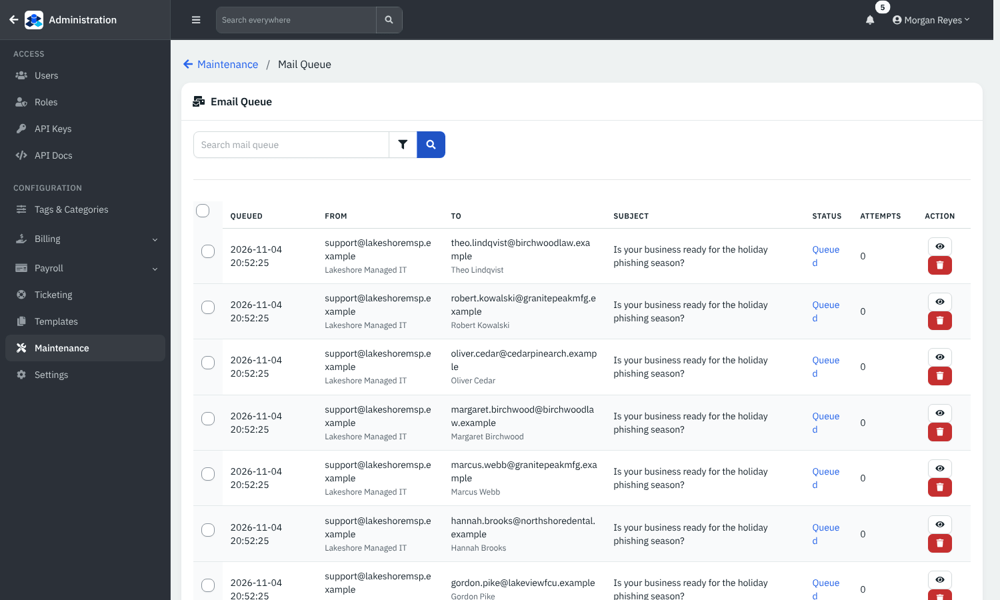

*Figure 11 — The Email Queue. The queued messages are example campaign mail that was never sent; the demo has no mail server.*

| Status | Meaning |
|---|---|
| **Queued** | Waiting for the next run of the mail script. |
| **Sending** | Being sent now. A row stuck here for 10 minutes goes back to Queued. |
| **Failed** | Could not be sent. The app retries after 5, 15, 60 and 240 minutes; after the fifth failed attempt it stops and a green send button appears to try again. |
| **Sent** | Accepted by the mail server. |

On a narrow window the **Queued** label wraps onto two lines ("Queue d"); this is a layout quirk of the page, not a different status. The eye button shows the message. The red bin cancels it: the message is marked **Failed** and never sent (the row stays). **Bulk Action** offers **Cancel** and **Delete**. The scheduler deletes queue rows older than 90 days. The **Email log** lists what the mailbox reader did with each incoming message (outcomes such as Ticket Created, Reply Added, Queued as Request, Bounce (NDR) or Ignored), and the **App log** records application events with **Type** and **Category** filters; both are described with mail intake in [Mail intake and sending](30-mail-intake-and-sending.md), [Webhooks, event rules and jobs](30b-webhooks-event-rules-and-jobs.md) and [AI and the MCP server](30c-ai-and-remote-mcp.md). The scheduler removes old audit, app and sign-in log rows after the log retention period; a compliance preset under **Settings → Compliance** sets a minimum that is never undercut.

### Check server status and Redis

**Maintenance → Server status** runs health checks each time you open it and shows an overall badge: **All healthy**, **Mostly healthy** or **Needs attention**. Checks are **OK**, **WARN** or **FAIL**.

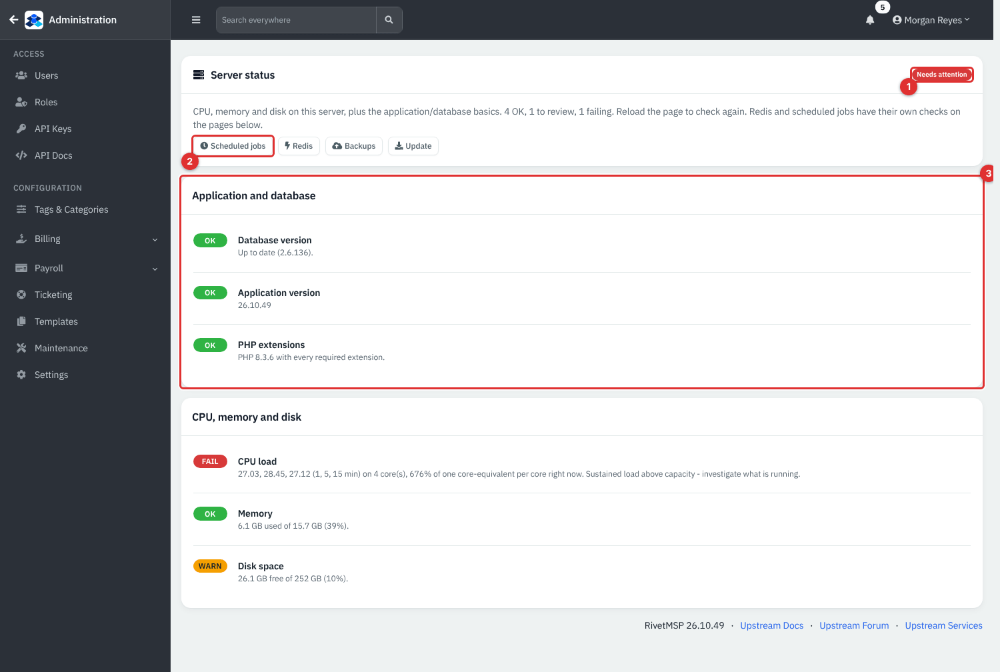

*Figure 12 — Server status. (1) The overall badge. (2) Shortcuts to Scheduled jobs, Redis, Backups and Update. (3) The **Application and database** group. The **CPU load** failure on this picture is real: the shared demo server was under heavy load while it was captured.*

| Check | Warns / fails when |
|---|---|
| **Database version** | The database is behind the code (press **Update Database** on the Update page). |
| **Application version** | Shown for information. |
| **PHP extensions** | A required extension is missing (fail). |
| **CPU load** | Load per core is 0.9 or more (warn) or 1.5 or more (fail). |
| **Memory** | 85% or more used (warn), 95% or more (fail). |
| **Disk space** | Under 15% or 5 GB free (warn), under 5% or 2 GB (fail). |

**Maintenance → Redis** shows the state of the optional Redis service. Redis speeds up live ticket and chat updates, rate limits and job locks. It never holds the only copy of anything: if it is down the app keeps working and only those extras pause.

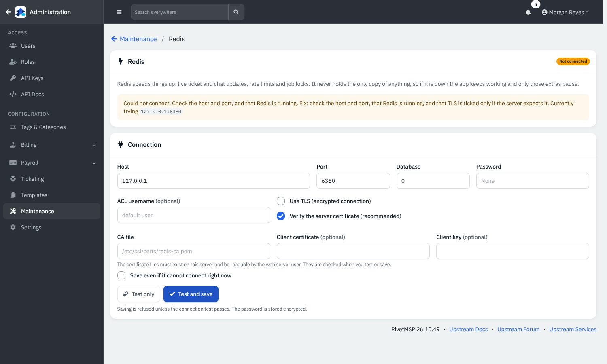

*Figure 13 — Redis on the demo, which has no Redis server: the badge reads **Not connected** and the page says which address it tried. When it is connected the page also shows version, memory and hit rate, a **Memory limit** card and **Clear cached data** buttons.*

Enter **Host**, **Port**, **Database**, an optional **Password** or **ACL username**, and **Use TLS** if needed, then **Test only** or **Test and save**. Saving is refused unless the test passes (tick **Save even if it cannot connect right now** to override). Settings that the server supplies through environment variables are shown as read-only.

### Back up RivetMSP

Go to **Maintenance → Backups** (the page is titled **System Backup**).

**Backups stay switched off until two things are set:** a **Backup encryption passphrase** of at least 16 characters, **and** a tick on **Allow unencrypted in-app backups**. The reason: the in-app zip holds the database dump and uploaded files as plain zip content; only the small manifest that carries the key for your stored secrets is encrypted with the passphrase. Until both are set, a red banner says so and **Download Backup** and **Save to Server** are greyed out. For a fully encrypted archive use `deploy/backup.sh` (see [Disaster recovery](#disaster-recovery-and-moving-to-a-new-server)).

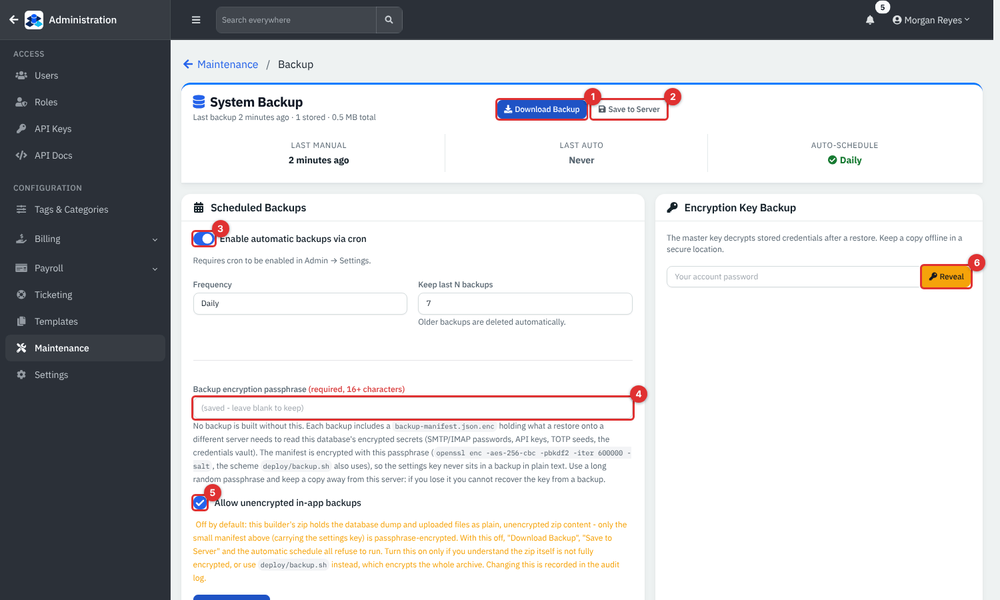

*Figure 14 — Backups. (1) **Download Backup** builds a fresh zip for your browser and keeps no copy. (2) **Save to Server** stores one in the server's `backups` folder. (3) **Enable automatic backups via cron**. (4) **Backup encryption passphrase**. (5) **Allow unencrypted in-app backups**. (6) **Reveal** shows the master key after you type your own password.*

1. Type a passphrase of 16 or more characters under **Backup encryption passphrase** and keep a copy somewhere other than this server. Without it a backup cannot be restored onto a new server. A blank box keeps the saved one.
2. Tick **Allow unencrypted in-app backups** if you accept the plain zip. The change is written to the audit log.
3. For automatic backups tick **Enable automatic backups via cron**, choose **Daily** or **Weekly (Sunday)**, set **Keep last N backups** (1 to 90; older ones are deleted) and click **Save Schedule**. This needs the scheduler. Automatic files are marked **Auto**.
4. Click **Save to Server**, or **Download Backup**. The tiles at the top show **Last Manual**, **Last Auto** and **Auto-Schedule**.
5. Under **Encryption Key Backup** type your account password and click **Reveal** to see the master key that decrypts stored credentials after a restore. Keep an offline copy.

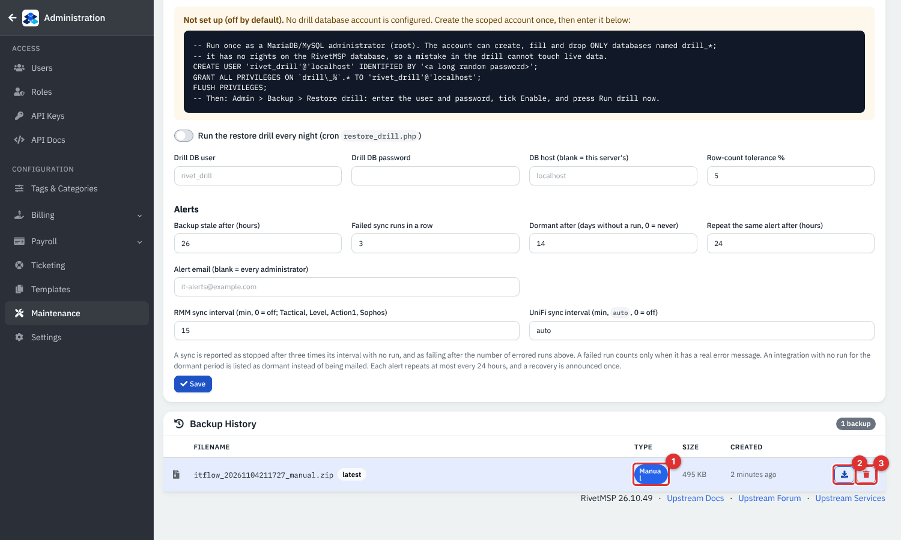

*Figure 15 — **Backup History**. (1) The type badge (**Manual** or **Auto**). (2) Download a stored file again. (3) Delete it.*

To send every backup to an S3-compatible bucket as well, use **Remote Storage (S3-compatible)**: fill in **Endpoint URL** (blank for AWS S3), **Region**, **Bucket**, **Access Key**, **Secret Key**, an optional **Key Prefix**, leave **Path-style addressing** on for self-hosted services, tick **Upload backups to S3-compatible storage**, then **Save Remote Storage** and **Test Connection**.

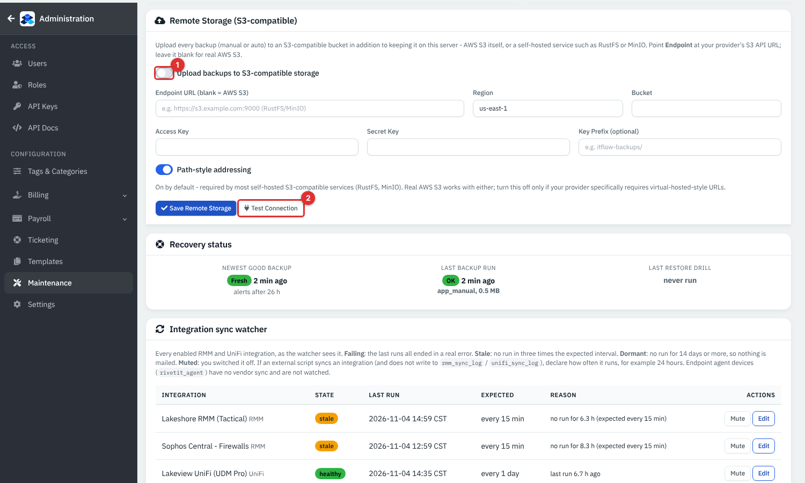

*Figure 16 — Remote storage. (1) The upload switch. (2) **Test Connection**. Not verified against a live bucket.*

### Watch backups and test a restore

Below the schedule, **Recovery status** shows the **Newest good backup** (**Fresh**, **Stale** or **None**; it goes stale after the number of hours set under Alerts, 26 by default), the **Last backup run** and the **Last restore drill**. A failed or stale backup raises an alert to the **Alert email** or, if blank, every administrator.

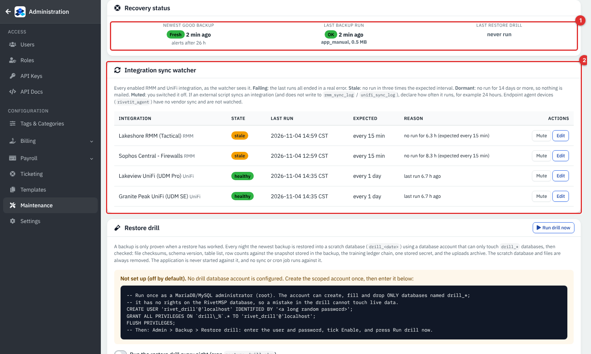

*Figure 17 — (1) Recovery status. (2) The **Integration sync watcher** lists each enabled vendor RMM and UniFi integration as **healthy**, **failing**, **stale**, **dormant** or **muted**, with **Mute**, **Edit** and **Forget history** actions. The four rows are example integrations with example run times, not live connections.*

#### Test a restore

A backup is only proven when a restore has worked. The **Restore drill** restores the newest backup into a scratch database named `drill_<date>`, checks file checksums, schema version, table list, row counts, one stored secret and the uploads archive, then always drops the scratch copy. It never touches live data or starts the application against the copy. It uses its own database account that can only touch `drill_*` databases.

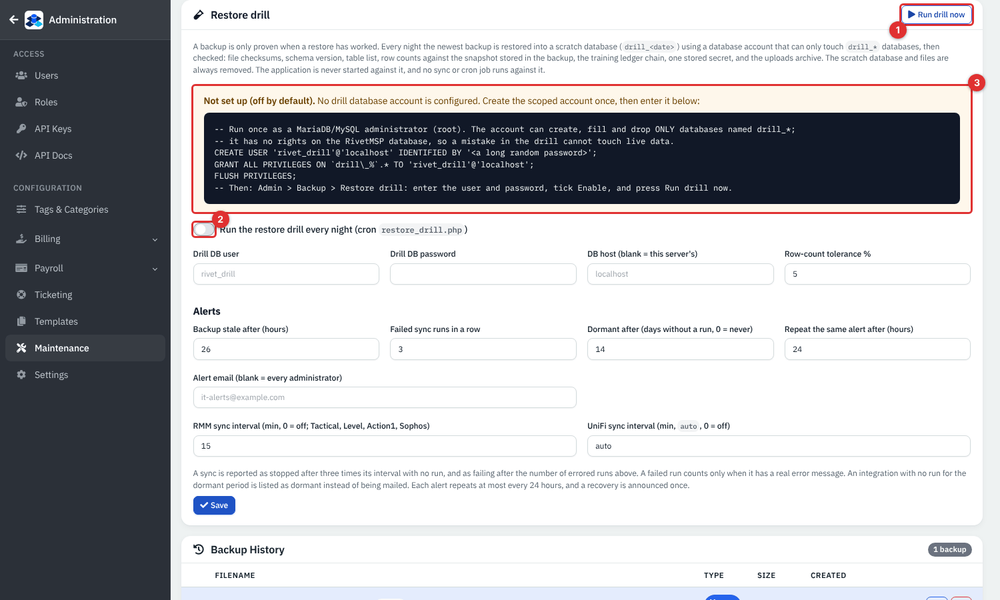

*Figure 18 — Restore drill. (1) **Run drill now**. (2) The nightly switch. (3) "Not set up" with the steps to create the scoped account. Not verified: the demo has no drill account.*

1. Ask your database administrator to create the scoped account shown in the yellow box (the page prints the exact commands).
2. Enter **Drill DB user** and **Drill DB password** (the password is stored encrypted), tick **Run the restore drill every night**, and click **Save**.
3. Click **Run drill now**. Results appear under **Recent drills** with the measured restore time, which is your evidence for how long a recovery takes.

The **Alerts** fields set **Backup stale after (hours)**, **Failed sync runs in a row**, **Dormant after (days without a run)**, **Repeat the same alert after (hours)** and the **Alert email**.

### Recover a single credential from an old backup

**Maintenance → Credential restore** is a one-off recovery tool. Upload a manual backup `.zip` with **Load Backup** (up to 500 MB); the app loads its credentials and clients tables into temporary staging tables, visible only to the administrator who uploaded them. Enter the old master key (the one **Reveal** showed on the backup that created the zip) and click **Decrypt**, then use **Restore** on a row to re-encrypt that username and password under your current vault.

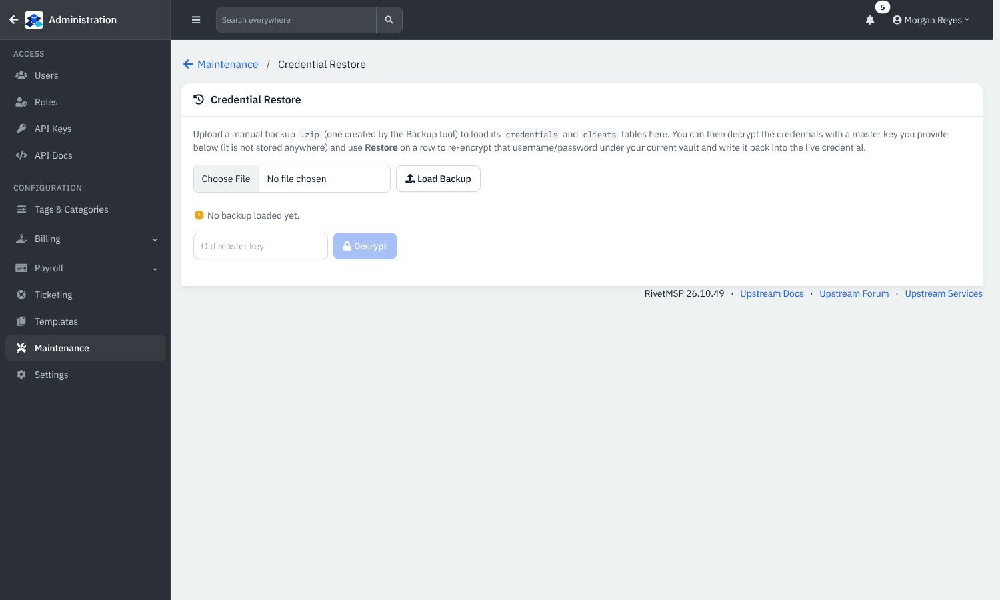

*Figure 19 — Credential restore with no backup loaded. The old master key is not stored anywhere.*

### Update RivetMSP

Go to **Maintenance → Update**.

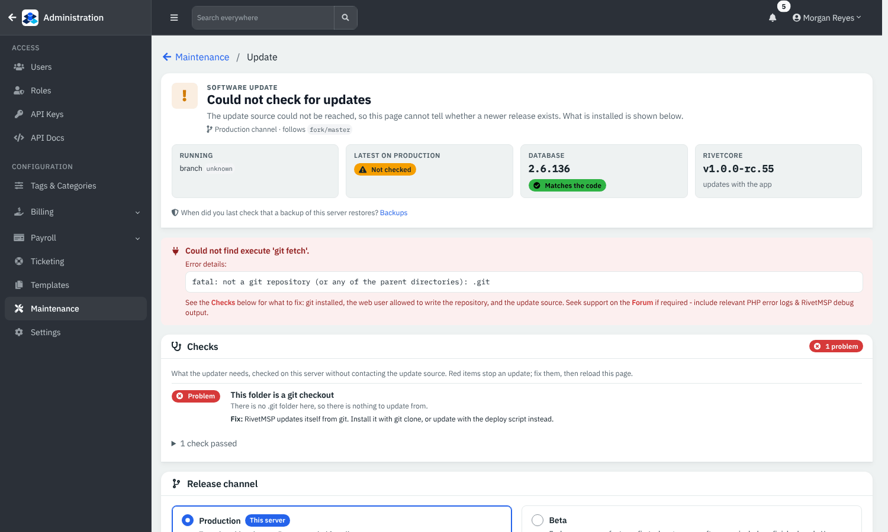

*Figure 20 — Update, on the demo, which is not a git checkout. The headline reads **Could not check for updates**; the tiles show **Running**, **Latest on Production**, **Database** and **RivetCore**; **Checks** lists what the updater needs.*

The headline is one of **Up to date**, **Update available**, **Database update needed**, **Could not check for updates** or a mismatch warning. Buttons appear only when needed:

- **Update App** runs `git pull` for the release channel's branch. **FORCE Update App** hard-resets to the channel and discards files changed by hand on the server.
- **Update Database** applies the database steps from the installed version to the latest, in order, once the new code is in place.

Take a backup first; the page warns that updates should not be run without one. The **Checks** panel tests, without contacting the update source, that git is installed, the folder is a git checkout, the web user can write to it, the update source is set, and the database matches the code. Each failed check shows a **Fix**.

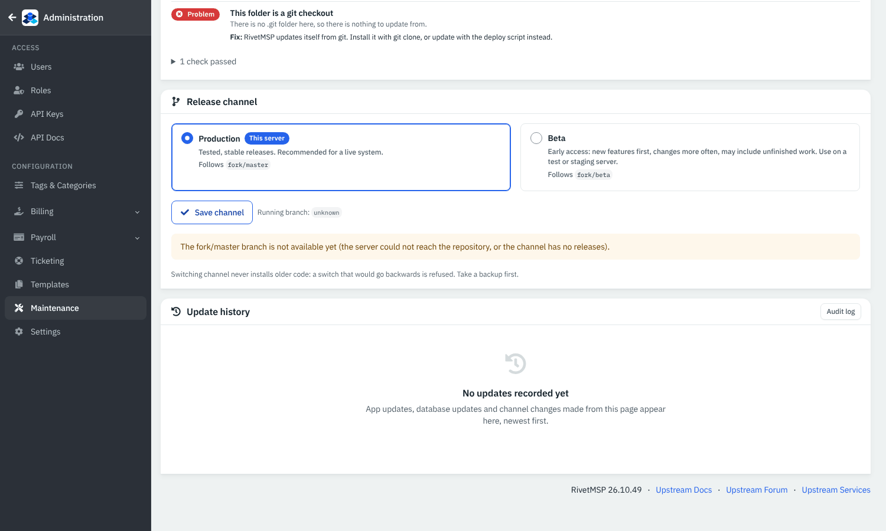

*Figure 21 — **Release channel**: **Production** (tested, stable releases, recommended for a live system) or **Beta** (early access, for a test server). Switching never installs older code. **Update history** lists app, database and channel changes recorded in the activity log.*

On the command line the same steps are `scripts/update_cli.php --update`, `--force_update`, `--update_db` and `--rewrap_secrets`, and `deploy/update.sh` wraps them with a mandatory backup. Updating by git could not be exercised in the demo and is not verified on a live server.

**Note.** When the update source cannot be reached, the red box reads "Could not find execute 'git fetch'." That wording is the application's own.

### Disaster recovery and moving to a new server

The Backups page restores nothing by itself. A restore replaces the whole database and uploads folder, so it is done on a clean host:

1. Get the newest archive, the backup passphrase, `config.php` and the settings key (`$config_settings_enc_key`) from your escrow. Without the settings key every stored secret (mail passwords, API keys, vault master key) is unreadable.
2. In-app zip: restore with the setup wizard's **Restore from Backup** step (see [First-time setup](00-first-time-setup.md#restore-a-backup-instead)) or `deploy/restore_admin_zip.sh`. Encrypted archive from `deploy/backup.sh`: `deploy/restore.sh`.
3. Bring the schema forward with `scripts/update_cli.php --update_db`.
4. Before the restored copy talks to anything, disable the cron switch, integrations, webhooks and queued mail, and re-enable them one at a time. The full order, the quarterly drill checklist and the key-escrow table are in the repository's `docs/RECOVERY_RUNBOOK.md`.

## Reference

### Maintenance tiles

| Tile | Purpose |
|---|---|
| **Scheduled jobs**, **Mail queue** | Jobs and outgoing mail. |
| **Email log**, **Audit log**, **Audit trail**, **App log**, **Debug** | Activity and diagnostics. **Debug** shows system information, PHP extensions, database structure comparison and table sizes. |
| **Server status**, **Redis** | Health of this server. |
| **Backups**, **Credential restore**, **Update** | Recovery and updates. |

### Backup settings

| Setting | Values |
|---|---|
| **Frequency** | **Daily**, **Weekly (Sunday)** |
| **Keep last N backups** | 1 to 90 (7 by default) |
| **Backup encryption passphrase** | 16 or more characters, required |
| **Allow unencrypted in-app backups** | Off by default; required for the in-app builder |

## Tips and good practice

- Turn on **Enable Cron Job** early. Missing reminders, recurring tickets and automatic backups usually mean the scheduler is off or not installed.
- Run **Save to Server** once, then **Download** it and check the passphrase works with your escrow before you rely on it.
- Keep the backup passphrase, the settings key and `config.php` somewhere other than the server, and test the restore drill every few months.
- Watch **Server status** after a busy period; a failing check is easier to fix before backups start failing.
- Tell your team before you switch a module off, because its pages vanish for everyone.

## Related guides

- [First-time setup](00-first-time-setup.md)
- [Ticketing setup and templates](37-ticketing-setup-and-templates.md)
- [Mail intake and sending](30-mail-intake-and-sending.md), [Webhooks, event rules and jobs](30b-webhooks-event-rules-and-jobs.md) and [AI and the MCP server](30c-ai-and-remote-mcp.md)
- [Users, roles and security](34-users-roles-security.md)
- [Compliance administration](35-compliance-admin.md)
