# Ticketing Setup and Templates

The service desk works the way you configure it. This guide covers the administrator pages behind it: ticket statuses, service-level (SLA) policies with business hours and holidays, automation rules, ticket categories and tags, ticket templates, canned responses, and the ticket defaults. Day-to-day ticket work is in [Service Desk: Tickets](05-service-desk-tickets.md).

| | |
|---|---|
| **Where to find it** | Account menu → **Administration**, then **Ticketing** (statuses, labor types, automation, SLA), **Templates**, **Tags & Categories**, and **Settings → Ticketing**. |
| **Who can use it** | Administrators only. |
| **Turn it on** | **Settings → Modules → Show Ticketing** (see [System settings and maintenance](36-system-settings-maintenance.md#turn-modules-on-or-off)). **Ticketing** and **Settings → Ticketing** disappear when it is off. |

## What it's for

- Add the statuses your team needs, and decide which ones pause the SLA clock.
- Set response and resolution targets by priority, counted in business hours with holidays left out.
- Let rules tag, assign, escalate or close tickets automatically.
- Organise tickets into boards (top-level categories) and tag them.
- Start tickets from templates with a ready checklist, and reply faster with canned responses.

## A quick tour

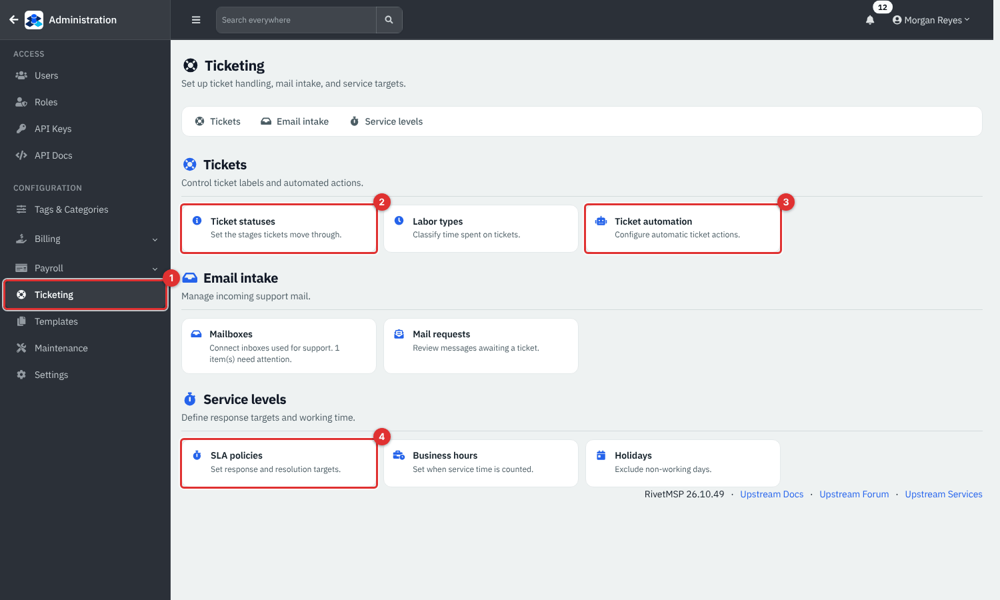

*Figure 1 — The **Ticketing** directory. (1) **Ticketing** in the Administration sidebar. (2) **Ticket statuses**. (3) **Ticket automation**. (4) **SLA policies**. The tiles are **Ticket statuses**, **Labor types**, **Ticket automation** (group **Tickets**), **Mailboxes** and **Mail requests** (**Email intake**), and **SLA policies**, **Business hours** and **Holidays** (**Service levels**).*

Mailboxes and mail requests are covered with mail intake in [Mail intake and sending](30-mail-intake-and-sending.md), [Webhooks, event rules and jobs](30b-webhooks-event-rules-and-jobs.md) and [AI and the MCP server](30c-ai-and-remote-mcp.md) and [Recurring tickets, catalog, CSAT and requests](07-recurring-tickets-catalog-csat-requests.md). Labor types (the named rates used when logging time) are in [Ticket billing and worksheets](06-ticket-billing-and-worksheets.md#set-up-labor-types).

## Common tasks

### Add or change a ticket status

Go to **Ticketing → Ticket statuses**. The list shows **Name**, **Color**, **SLA clock** (**Runs** or **Paused**), **Status** (**Active** or **Inactive**) and an action menu.

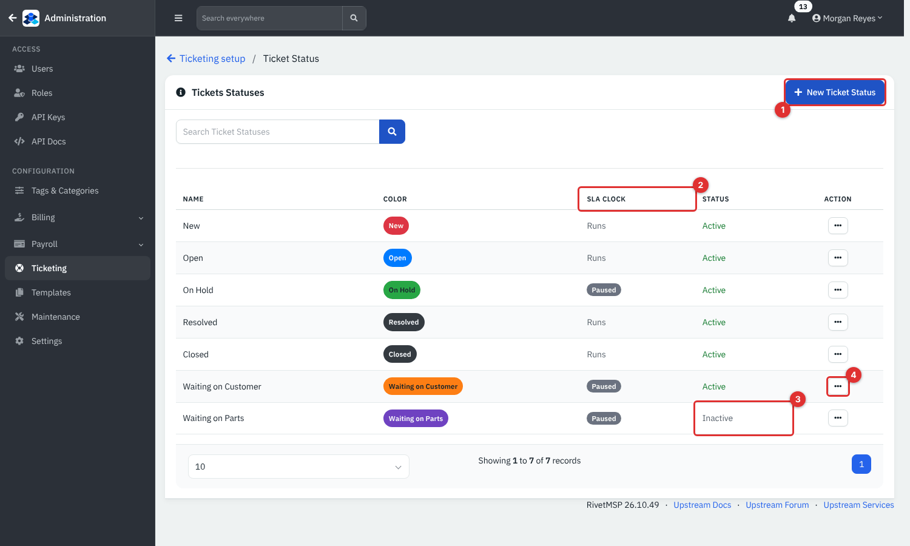

*Figure 2 — Ticket statuses. (1) **New Ticket Status**. (2) **SLA clock**. (3) An **Inactive** status. (4) The action menu with **Edit**. The demo adds **Waiting on Customer** (active, pauses the clock) and **Waiting on Parts** (inactive) to the five built-in statuses.*

1. Click **New Ticket Status**.
2. Type a **Name** and choose a **Color**. Tick **Pauses the SLA clock** for statuses where the ticket waits on someone else.
3. Click **Create**.

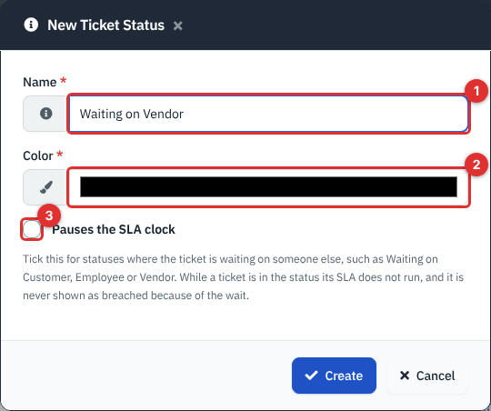

*Figure 3 — New Ticket Status. (1) **Name**. (2) **Color**. (3) **Pauses the SLA clock**.*

To change a status, open its **...** menu and choose **Edit**. Editing also offers **Order** and **Status** (**Active** or **Inactive**); saving updates the pause for open tickets already in that status. Only an **Inactive** status offers **Delete**, and the five built-in statuses (**New**, **Open**, **On Hold**, **Resolved**, **Closed**) cannot be deleted. The status names **Resolved** and **Closed** close the ticket; see [Service Desk: Tickets](05-service-desk-tickets.md#statuses).

### Set response and resolution targets (SLA policies)

Go to **Ticketing → SLA policies**.

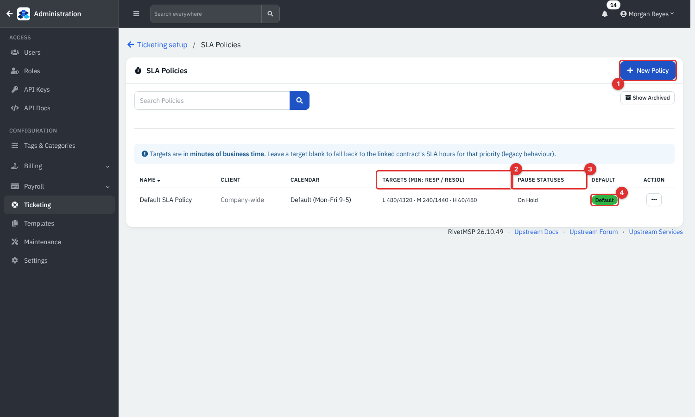

*Figure 4 — SLA policies. (1) **New Policy**. (2) **Targets (min: resp / resol)** for Low, Medium and High. (3) **Pause Statuses**. (4) The **Default** policy. The demo's policy targets 4 hours response and 3 days resolution for Low, 4 hours and 1 day for Medium, and 1 hour and 8 hours for High.*

Targets are minutes of business time. Read the **Targets** column as `L 480/4320 · M 240/1440 · H 60/480`: low response 480 minutes, low resolution 4320 minutes, and so on.

1. Click **New Policy**.
2. Enter a **Name**.
3. Pick a **Business Hours Calendar**, or **24/7 (no business-hours calendar)**.
4. Leave **Client** on **Company-wide** to apply the policy to every client without a policy of its own, or pick one client.
5. Pick **Pause Statuses**: the SLA clock stops while a ticket sits in them.
6. Fill the **Response (min)** and **Resolution (min)** targets for **Low**, **Medium** and **High**. A blank target falls back to the contract's SLA hours for that priority.
7. Tick **Set as default policy** if it should be the company default, then **Create**.

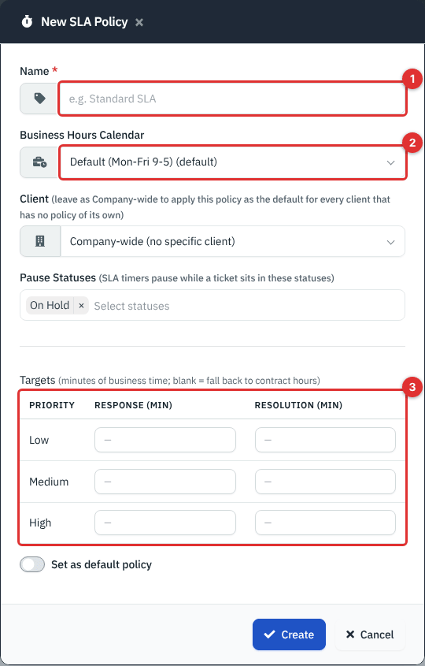

*Figure 5 — New SLA Policy. (1) **Name**. (2) **Pause Statuses**. (3) The targets table.*

How a ticket's policy is chosen: the policy pinned on the ticket, then a contract's policy if one is set, then an active policy for the ticket's client, then the company default. Priorities **High** and **Critical** both use the **High** targets. A status that is flagged **Pauses the SLA clock** pauses it on every policy, in addition to any statuses listed on the policy. Time spent paused is added back to the due date. Categories flagged **SLA exempt** get no SLA at all, and the ticket switch **Count toward SLA** is explained in [Service Desk: Tickets](05-service-desk-tickets.md#the-two-switches-count-toward-sla-and-email-notifications). The policy's **...** menu offers **Edit**, **Set as Default** and **Archive**; **Show Archived** lists archived policies.

### Business hours and holidays

Go to **Ticketing → Business hours** (**SLA Business Hours Calendars**). Each calendar has a **Name**, **Timezone**, open days, a **Default** flag and a holiday count.

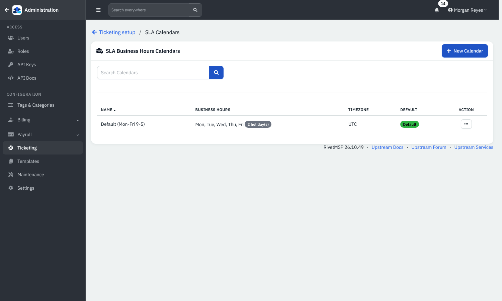

*Figure 6 — Business hours. The stock calendar is **Default (Mon-Fri 9-5)**, set to **UTC**.*

1. Click **New Calendar**, enter a **Name** and **Timezone**, optionally **Set as default calendar**, and **Create**. A new calendar starts as Monday to Friday, 09:00 to 17:00.
2. Open the calendar (click its name, or **...** then **Edit**). Tick the open days and set **Open** and **Close** for each. Unticked days count as closed.
3. In the **Holidays** section of the same pop-up, add dates from the holiday catalog. A calendar with no holidays is treated as open on all business days.

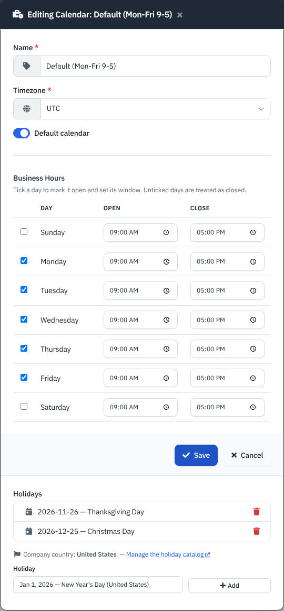

*Figure 7 — Editing a calendar: name, **Timezone**, **Default calendar**, the daily windows and, below them, the holidays added to this calendar.*

**Note.** The stock calendar's time zone is UTC even when your company is not. Set the calendar's **Timezone** to your own before relying on SLA due times.

**Ticketing → Holidays** is the catalog those pickers draw from.

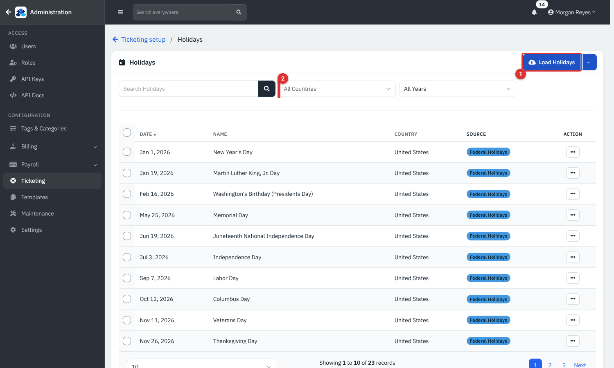

*Figure 8 — Holidays. (1) **Load Holidays** generates a country's public holidays for a range of years (up to 10 years; running it again never creates duplicates). (2) Country and year filters. The **Source** column marks built-in entries **Federal Holidays**; the drop-down next to **Load Holidays** adds a **Custom Holiday**.*

Only countries with a built-in rule set can be loaded; add anything else as a custom holiday. The company **Country** from [Company details](36-system-settings-maintenance.md#update-company-details) is used to list its holidays first.

### Automate ticket handling

Go to **Ticketing → Ticket automation**. A rule says: when this happens, if all of these conditions are true, do these actions.

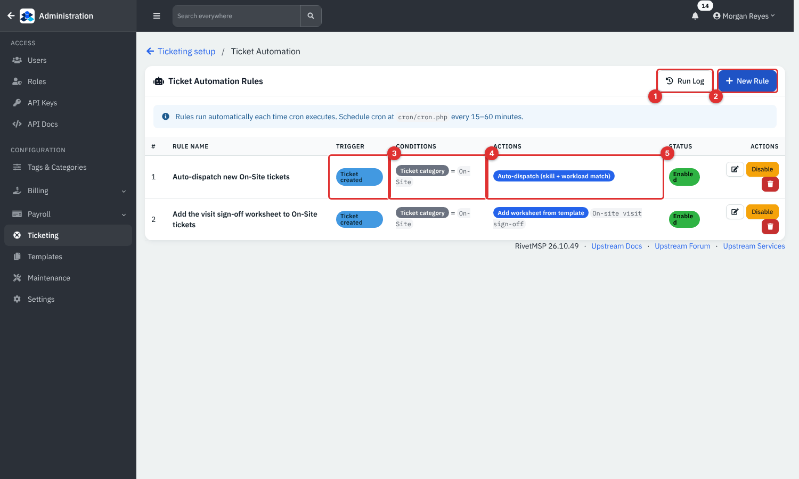

*Figure 9 — Rules. (1) **Run Log**. (2) **New Rule**. (3) The **Trigger**. (4) **Conditions**. (5) **Actions**. Each row also has an edit button, **Disable** or **Enable**, and a delete button. These are the two On-Site rules used in [Dispatch, scheduling and calendar](08-dispatch-scheduling-calendar.md).*

1. Click **New Rule** and enter a **Rule Name**.
2. Choose the **Trigger**.
3. Add **Conditions**. All must match. Leave them empty to match every event.
4. Add **Actions**; they run in order.
5. Set **Order** (lower runs first) and click **Save Rule**.

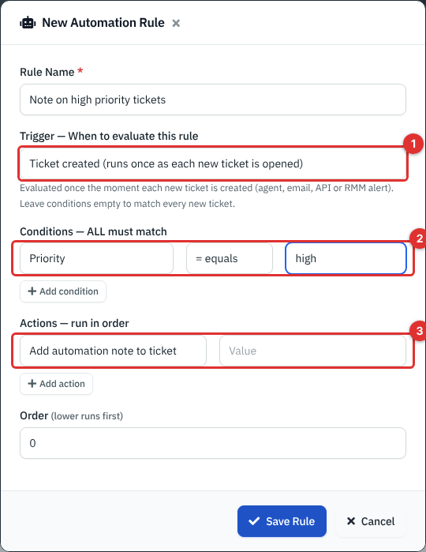

*Figure 10 — New Automation Rule, filled in as an example and not saved. (1) **Trigger**. (2) A condition. (3) An action.*

The **Run Log** (**Automation Run Log**) lists each time a rule ran, with **Time**, **Rule**, **Trigger**, **Client**, **Ticket / Asset** and **Result**. It is empty on the demo because no rule has fired.

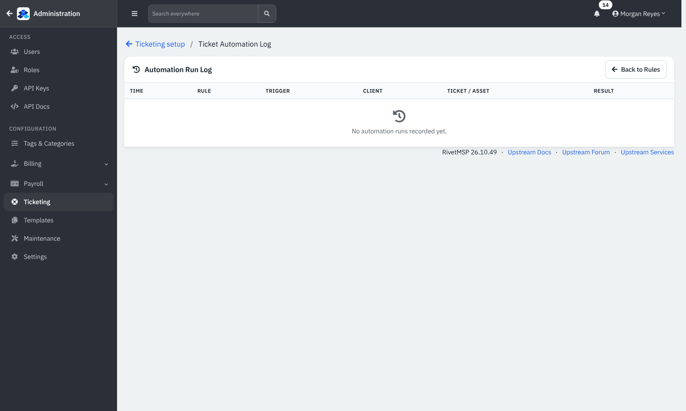

*Figure 11 — The run log before any rule has run.*

When rules run depends on the trigger. **Ticket created** and **Ticket updated** are evaluated when the ticket is created or saved from the agent form; **Scheduled check** is evaluated against every open ticket on each cron run, so it needs the scheduler (see [System settings and maintenance](36-system-settings-maintenance.md#keep-scheduled-jobs-running)). The page itself says to schedule cron every 15 to 60 minutes.

### Boards, categories and tags

Go to **Tags & Categories**. It has **Tags**, **Categories**, **Custom links** and **AI providers**.

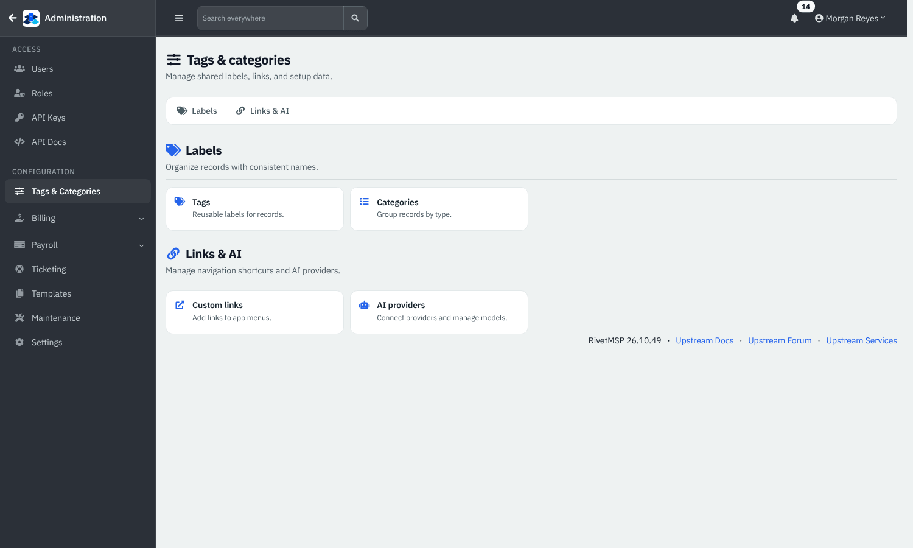

*Figure 12 — Tags & Categories.*

**Ticket categories.** Open **Categories** and choose the **Ticket** type. A category with no group is a **board**: the top row of the Tickets list. Give a category a **Group** to make it a sub-category of a board.

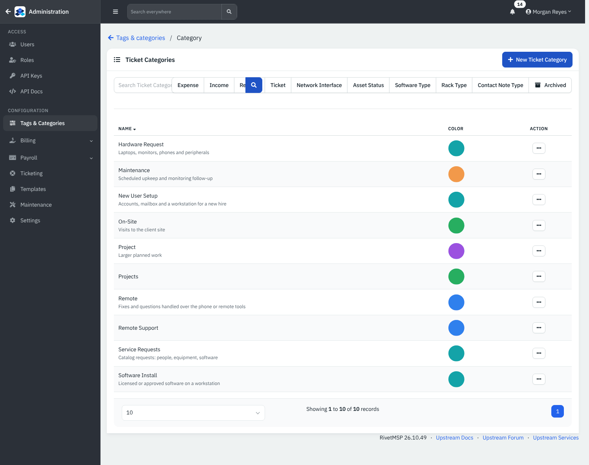

*Figure 13 — Ticket categories. The demo boards are Remote, On-Site, Project, Maintenance and Service Requests; New User Setup, Hardware Request and Software Install sit under Service Requests.*

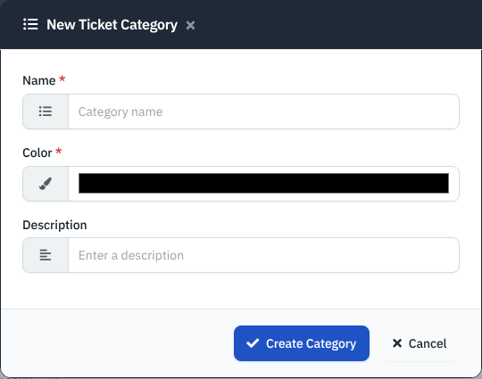

*Figure 14 — New Category. **Required Skill** is used by auto-dispatch to match a technician. **SLA exempt** gives tickets in the category no SLA policy, due dates or breaches. **Non-billable** makes them default to not billable.*

Fields: **Type**, **Group** (optional), **Required Skill** (optional), **SLA exempt**, **Non-billable**, **Name**, **Color** and **Description**.

**Ticket tags.** Open **Tags**, choose the **Ticket Tag** type and click **New Ticket Tag**: give it a **Name**, **Color** and **Icon**. Tags exist for clients, locations, contacts, credentials, assets and tickets.

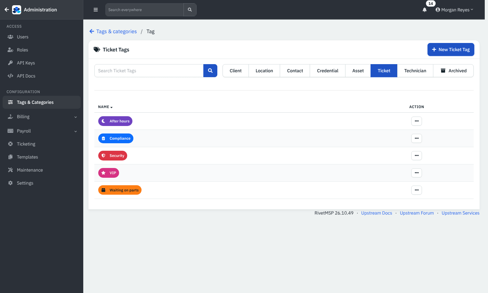

*Figure 15 — Ticket tags: VIP, After hours, Security, Waiting on parts and Compliance.*

### Ticket templates

Go to **Templates → Ticket templates**. A template pre-fills a new ticket and adds a checklist of tasks.

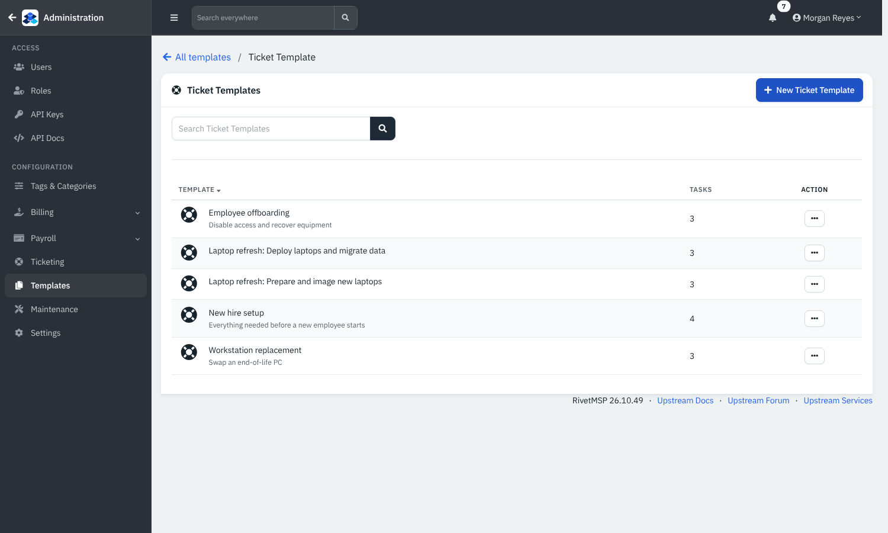

*Figure 16 — Ticket templates with their task counts.*

1. Click **New Ticket Template** and enter a **Template Name**, a **Subject** and a **Description**. Optionally add it to a project template (**Add it to a Project Template?**).
2. Click **Create Template**, then open the template.
3. On the **Tasks** card, type a task and press the tick button. Drag the handle to reorder tasks; each task's menu has **Edit** and **Delete**.

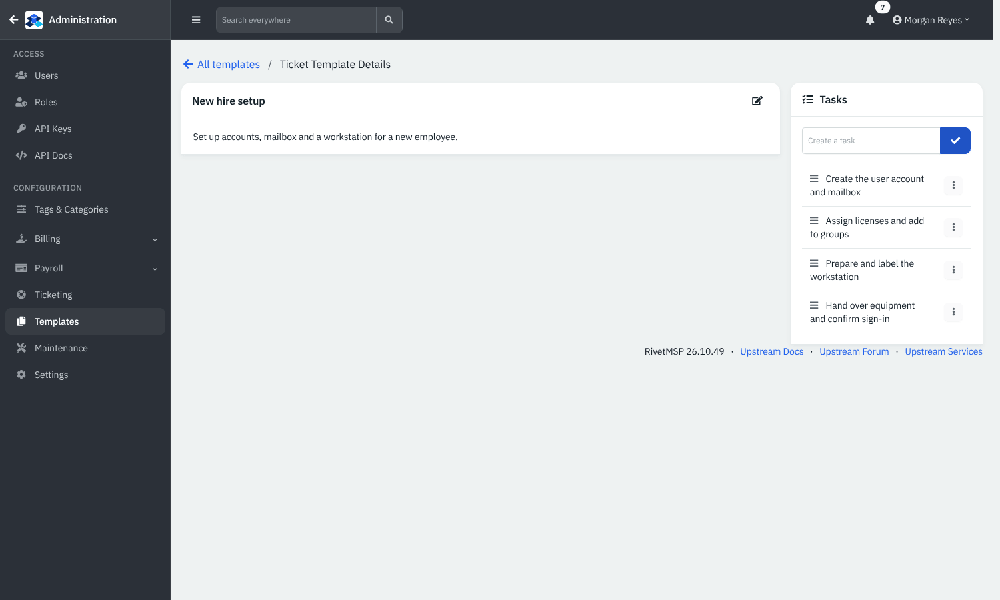

*Figure 17 — A template and its tasks. Choosing the template on **New Ticket** fills the subject and details and adds these tasks.*

### Canned responses

Go to **Templates → Canned responses** and click **New Canned Response**: a **Name** and a **Message**. Technicians insert them when replying. The list shows **Name** and **Message**, with **Edit** and **Delete**.

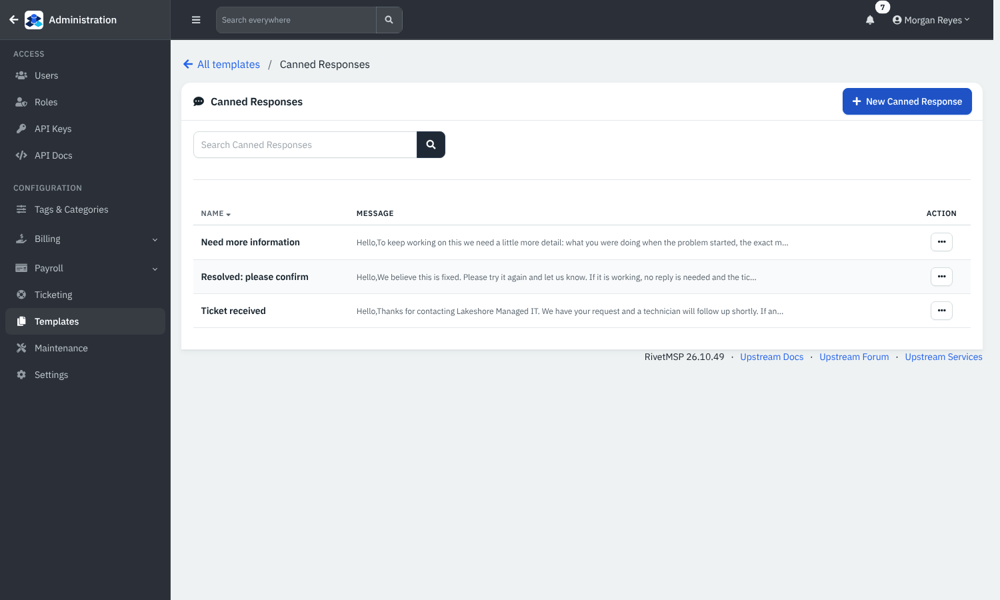

*Figure 18 — Canned responses.*

### Other templates

**Templates** is a directory with one more group of tiles; each tile has a **New** button.

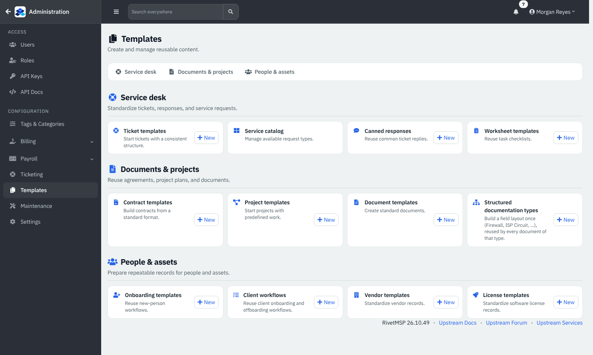

*Figure 19 — Templates. **Service desk**: Ticket templates, Service catalog, Canned responses, Worksheet templates. **Documents & projects**: Contract templates, Project templates, Document templates, Structured documentation types. **People & assets**: Onboarding templates, Client workflows, Vendor templates, License templates.*

The service catalog is explained in [Recurring tickets, catalog, CSAT and requests](07-recurring-tickets-catalog-csat-requests.md#manage-the-catalog), worksheet templates in [Ticket billing and worksheets](06-ticket-billing-and-worksheets.md#build-a-worksheet-template), and client workflows in [Client workflows and compliance](04-client-workflows-and-compliance-per-client.md). The **Templates** entry needs **Show IT Documentation** to be on.

### Ticket settings

**Settings → Ticketing** holds the defaults that apply to every ticket.

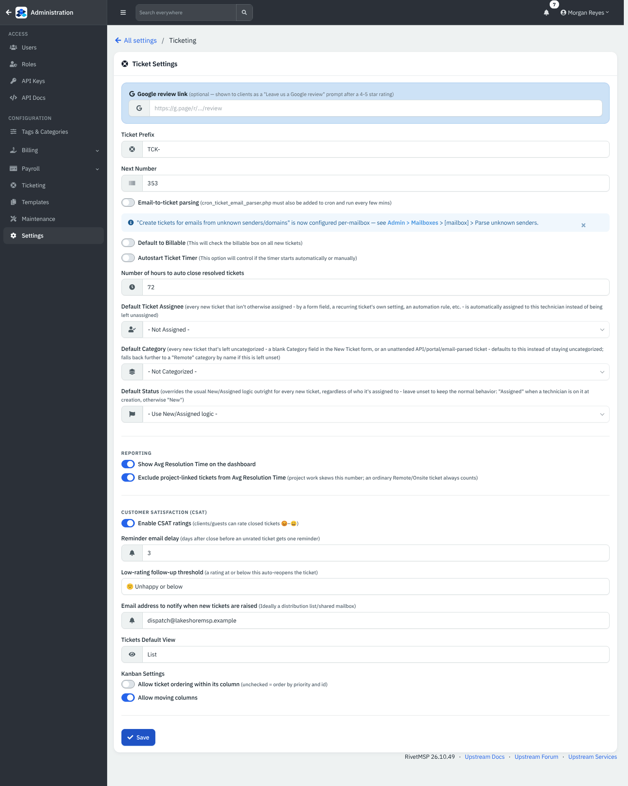

*Figure 20 — Ticket settings.*

| Setting | What it does |
|---|---|
| **Ticket Prefix**, **Next Number** | The label and counter of new ticket numbers (the demo uses `TCK-`). |
| **Email-to-ticket parsing** | Turns on mailbox reading. Unknown-sender handling is set per mailbox. |
| **Default to Billable** | Ticks the billable box on every new ticket. |
| **Autostart Ticket Timer** | Starts the timer automatically. |
| **Number of hours to auto close resolved tickets** | Closes resolved tickets after this many hours of no activity (72 in the demo). Needs cron. |
| **Default Ticket Assignee** | Assigns otherwise unassigned new tickets to this technician. |
| **Default Category** | Used when a new ticket has no category. |
| **Default Status** | Overrides the usual New/Assigned logic for every new ticket. |
| **Show Avg Resolution Time on the dashboard**, **Exclude project-linked tickets** | Reporting options. |
| **Enable CSAT ratings**, **Reminder email delay**, **Low-rating follow-up threshold**, **Google review link** | Customer satisfaction; see [Recurring tickets, catalog, CSAT and requests](07-recurring-tickets-catalog-csat-requests.md). |
| **Email address to notify when new tickets are raised** | The same field as **New Ticket Alert Email** under Notifications. |
| **Tickets Default View** | **List**, **Compact** or **Kanban**. |
| **Allow ticket ordering within its column**, **Allow moving columns** | Kanban options. |

## Reference

### Automation triggers and conditions

| Trigger | Runs | Condition fields |
|---|---|---|
| **Scheduled check** | Every cron pass, against open tickets | Ticket age (hours), Hours since last reply, Priority, Status ID, Assigned to (user ID), Ticket category, SLA response breached (1/0), SLA resolution breached (1/0), SLA response % consumed, SLA resolution % consumed |
| **Ticket created** | Once, as each ticket opens (agent, email, API or RMM alert) | Priority, Ticket category, Client ID, Ticket subject (contains), Ticket body (contains) |
| **Ticket updated** | Each time the agent edit form saves a ticket | Priority, Ticket category, Status ID, Assigned to, Client ID, subject, body |
| **New RMM alert received** | Once per new alert | Alert severity, Alert message (contains), Asset ID, Client ID, RMM integration ID, Asset hostname |
| **Asset goes offline** / **Asset comes back online** | When the RMM status changes | Asset ID, Client ID, RMM integration ID, Asset hostname |

Operators are **equals**, **not equals**, **greater than**, **less than** and **contains**. Status, user, client and asset conditions are entered as ID numbers.

### Automation actions

| Action | Value |
|---|---|
| **Set ticket priority** | low, medium, high or critical |
| **Assign ticket to user ID** | A user ID |
| **Auto-dispatch** | None; matches technician skill and workload |
| **Escalate ticket** | `userID:priority` |
| **Set ticket status ID** | A status ID |
| **Set ticket category** | A category |
| **Add tag to ticket** | A ticket tag |
| **Add automation note to ticket** | Note text |
| **AI triage**, **AI sentiment** | Post a suggestion note (needs an AI provider; not verified here) |
| **Notify assigned technician** | None |
| **Close ticket** | None |
| **Add worksheet from template** | A worksheet template |
| **Run RMM script on asset** | An enabled script |
| **Create ticket from RMM alert**, **Acknowledge RMM alert** | None |

### Ticket status columns

| Column | Meaning |
|---|---|
| **SLA clock** | **Runs**, or **Paused** while a ticket sits in the status. |
| **Status** | **Active** statuses can be chosen on tickets; **Inactive** ones cannot. |

## Tips and good practice

- Keep statuses few. Add one for each real "waiting on" state, flag it **Pauses the SLA clock**, and nothing else.
- Set the business-hours calendar's time zone first; every SLA due time depends on it.
- Test a new rule on **Ticket created** with a narrow condition before widening it, and watch the **Run Log**.
- Mark routine categories such as maintenance **SLA exempt** and **Non-billable** so they do not distort reports.
- Write ticket templates for repeat jobs (new hire, equipment swap); the task list is what saves time.

## Related guides

- [Service Desk: Tickets](05-service-desk-tickets.md)
- [Ticket billing and worksheets](06-ticket-billing-and-worksheets.md)
- [Recurring tickets, catalog, CSAT and requests](07-recurring-tickets-catalog-csat-requests.md)
- [Dispatch, scheduling and calendar](08-dispatch-scheduling-calendar.md)
- [System settings and maintenance](36-system-settings-maintenance.md)
