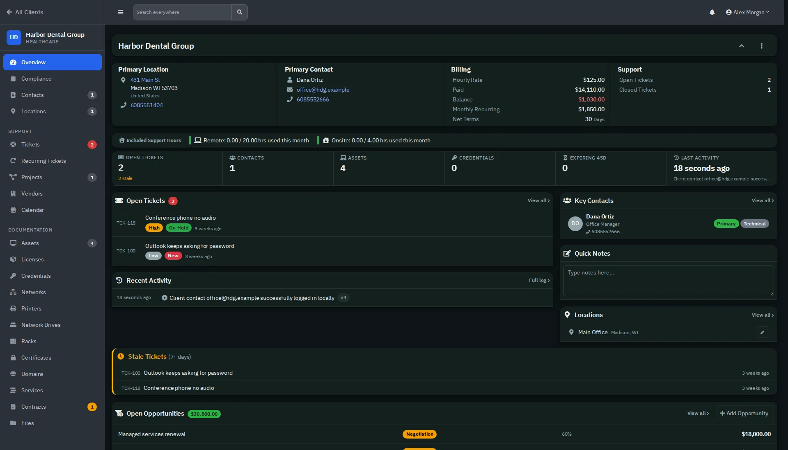
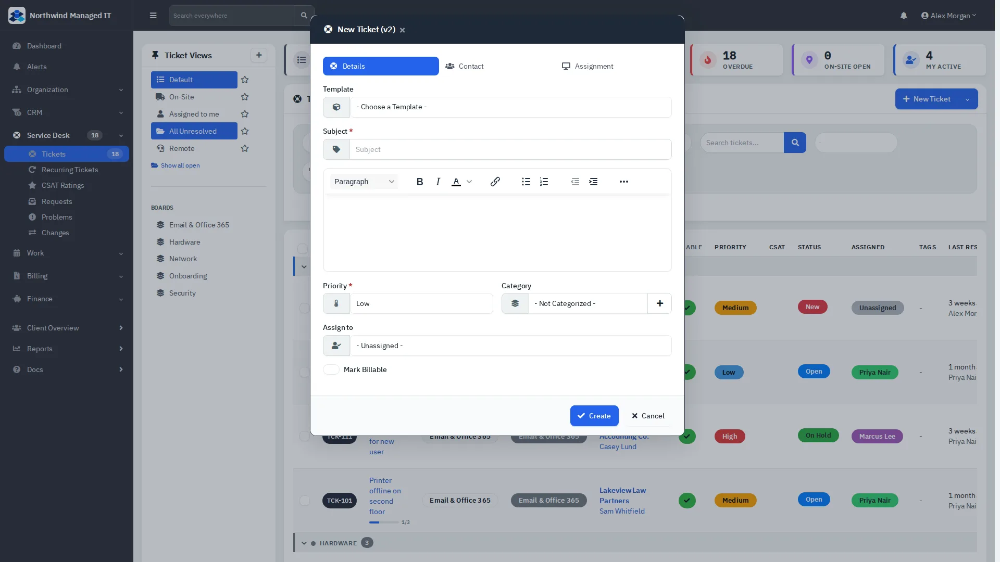
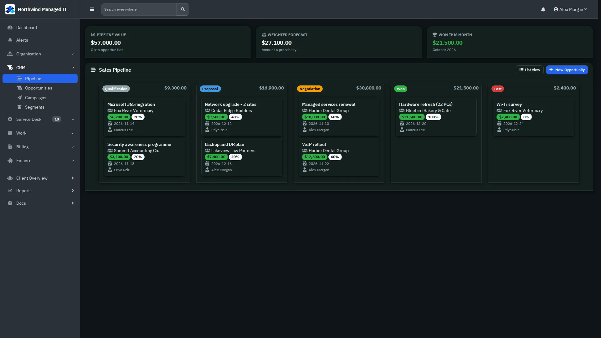
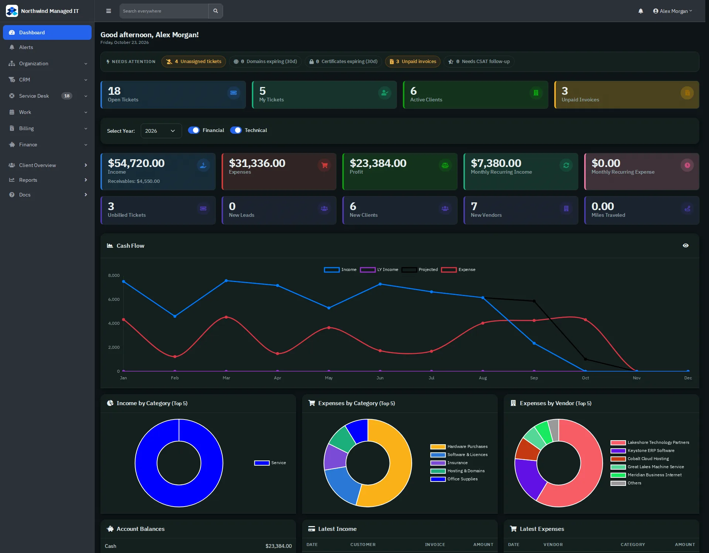
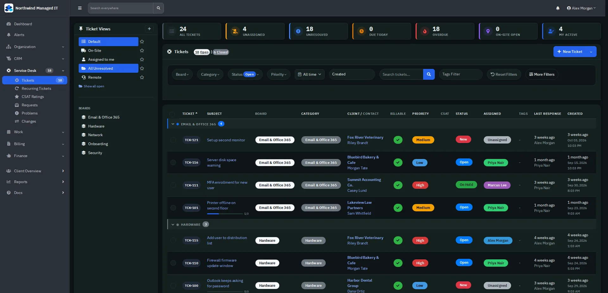

# RivetMSP web app screenshots

Fictional demo data (Northwind Managed IT). Light mode unless marked dark. Captions use the "Product: Description" style of the website gallery.

## Ar aging report

## Asset detail

## Client overview (dark mode)

## Client overview

## Client portal home

## Client portal new ticket

## Clients list

## Compliance status

## Income report

## Invoice list

## Invoice

## Mrr forecast

## New ticket

## Projects

## Quote

## Reports overview

## Sales pipeline (dark mode)

## Sales pipeline

## Service desk dashboard (dark mode)

## Service desk dashboard

## Settings

## Team calendar

## Ticket detail

## Ticket list and views (dark mode)

## Ticket list and views

## Users and roles

